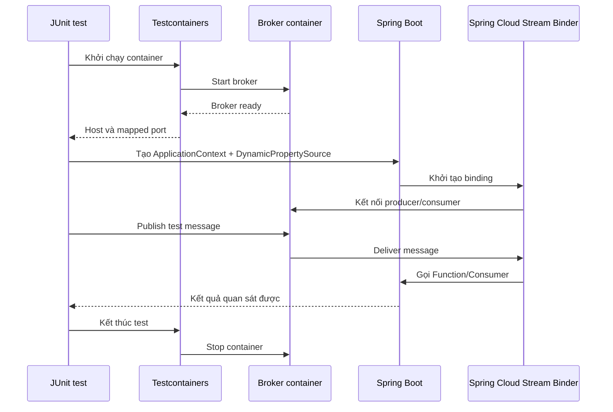

# Kiểm thử tích hợp Kafka, RabbitMQ hoặc Pulsar bằng Testcontainers

Spring Cloud Stream giúp ứng dụng giao tiếp với broker qua binder và binding. Khi kiểm thử function, mapping dữ liệu hoặc quy tắc nghiệp vụ, có thể dùng unit test và Spring Integration Test Binder mà không cần khởi chạy broker. Nhưng những kiểm tra liên quan đến giao thức, serializer, consumer group, partition, acknowledgement, retry, DLQ và provisioning phải chạy với broker thật.

Testcontainers khởi chạy Kafka, RabbitMQ hoặc Pulsar trong Docker ngay trước khi test cần dùng chúng, cung cấp địa chỉ kết nối động rồi dừng container sau khi hoàn tất. Nhờ vậy, integration test có thể xác minh toàn bộ đường đi của message qua Spring Cloud Stream Binder trong một môi trường cô lập, lặp lại được và gần với hành vi của hệ thống triển khai hơn.

## 1. Phân biệt các tầng kiểm thử

Không nên dùng một loại test để chứng minh mọi hành vi của hệ thống message. Mỗi tầng có mục tiêu và giới hạn riêng:

| Tầng | Thành phần | Kiểm tra tốt | Không chứng minh được |
|---|---|---|---|
| Unit test | Function, service, mapper | Validation, business rules, mapping, idempotency | Binding, serialization, broker |
| Spring Integration Test Binder | Binder chạy trong JVM | Function wiring, tên binding, message conversion cơ bản, header ở mức framework | Kafka offset, Rabbit exchange, Pulsar subscription, broker acknowledgement |
| Binder integration test | Binder thật + Testcontainers | Kết nối, provisioning, serialization, delivery, consumer group, retry và DLQ theo broker | Hành vi của cluster production nhiều node nếu chỉ chạy một broker |
| System/acceptance test | Nhiều service và broker | Luồng nghiệp vụ xuyên hệ thống, vận hành và cấu hình gần production | Mọi lỗi hạ tầng có thể xảy ra trong thực tế |

Ví dụ, một test dùng `InputDestination` và `OutputDestination` có thể chứng minh function chuyển `OrderCreated` thành `OrderAccepted`. Nó không chứng minh Kafka Binder đã tạo topic, Rabbit Binder đã bind queue vào exchange hoặc Pulsar đã tạo subscription. Muốn xác minh những hành vi đó, test phải kết nối tới broker tương ứng.

Một chiến lược hợp lý là kiểm tra business logic bằng unit test, wiring nhanh bằng Test Binder và một số luồng quan trọng bằng broker thật. Không cần chạy mọi test với Docker; chỉ những test cần chứng minh hành vi middleware mới cần Testcontainers.

## 2. Testcontainers hoạt động trong test như thế nào?

Một test tích hợp thường thực hiện các bước:

1. JUnit khởi chạy container broker.
2. Testcontainers chờ broker sẵn sàng theo wait strategy.
3. Spring tạo application context và binder.
4. Test cung cấp địa chỉ broker cùng các thuộc tính cần thiết.
5. Binder tạo producer/consumer và kết nối tới broker.
6. Test phát message hoặc chờ message được nhận.
7. Test xác minh payload, header, metadata và kết quả xử lý.
8. JUnit dừng container khi test kết thúc.

Testcontainers tự ánh xạ port của container sang port khả dụng trên máy chạy test. Không giả định broker luôn chạy ở `localhost:9092`, `localhost:5672` hoặc `localhost:6650`. Hãy lấy địa chỉ từ container đang chạy và đưa vào Spring bằng `@DynamicPropertySource` hoặc Spring Boot `@ServiceConnection`.

## 3. Chuẩn bị dependency cho test

Các dependency cơ bản thường gồm Spring Boot test, JUnit Jupiter integration và module Testcontainers tương ứng. Ví dụ Maven với dòng Testcontainers 2.x:

~~~xml
<dependencies>
    <dependency>
        <groupId>org.springframework.boot</groupId>
        <artifactId>spring-boot-starter-test</artifactId>
        <scope>test</scope>
    </dependency>

    <dependency>
        <groupId>org.testcontainers</groupId>
        <artifactId>testcontainers-junit-jupiter</artifactId>
        <scope>test</scope>
    </dependency>

    <dependency>
        <groupId>org.testcontainers</groupId>
        <artifactId>testcontainers-kafka</artifactId>
        <scope>test</scope>
    </dependency>

    <dependency>
        <groupId>org.testcontainers</groupId>
        <artifactId>testcontainers-rabbitmq</artifactId>
        <scope>test</scope>
    </dependency>

    <dependency>
        <groupId>org.testcontainers</groupId>
        <artifactId>testcontainers-pulsar</artifactId>
        <scope>test</scope>
    </dependency>
</dependencies>
~~~

Chỉ thêm module broker mà test thực sự sử dụng. Ví dụ test Kafka không cần kéo RabbitMQ và Pulsar container vào classpath nếu dự án tách test theo module hoặc source set. Nếu cần Spring Boot `@ServiceConnection`, thêm `spring-boot-testcontainers` ở test scope.

Các phiên bản Testcontainers cần được quản lý thống nhất bằng dependency management/BOM của dự án hoặc một phiên bản đã chọn rõ ràng. Không trộn module 1.x và 2.x trong cùng test runtime. Từ Testcontainers 2.x, tên artifact và package của một số module đã đổi:

| Broker | Module Testcontainers 2.x | Container class |
|---|---|---|
| Kafka | `testcontainers-kafka` | `org.testcontainers.kafka.KafkaContainer` |
| RabbitMQ | `testcontainers-rabbitmq` | `org.testcontainers.rabbitmq.RabbitMQContainer` |
| Pulsar | `testcontainers-pulsar` | `org.testcontainers.pulsar.PulsarContainer` |

Trong Testcontainers 1.x, nhiều project dùng artifact cũ như `kafka`, `rabbitmq`, `pulsar` và package `org.testcontainers.containers.*`. Hãy dùng package theo đúng major version trong dependency tree, không sao chép import của 1.x sang 2.x.

Binder của ứng dụng vẫn là dependency runtime tương ứng:

- Kafka: `spring-cloud-starter-stream-kafka`.
- RabbitMQ: `spring-cloud-starter-stream-rabbit`.
- Pulsar: `org.springframework.pulsar:spring-pulsar-spring-cloud-stream-binder`.

Các binder và Spring Boot phải thuộc các phiên bản tương thích theo Spring Cloud release train. Testcontainers không sửa được lỗi tương thích dependency giữa các binder.

## 4. Tạo một function dùng chung cho ví dụ

Giả sử ứng dụng nhận sự kiện đơn hàng từ một binding và chuyển payload tới service xử lý:

~~~java
public record OrderEvent(
    String eventId,
    String orderId,
    String customerId,
    long total
) {
}
~~~

Một bean `Consumer` nhận event:

~~~java
import java.util.function.Consumer;

import org.springframework.context.annotation.Bean;
import org.springframework.context.annotation.Configuration;

@Configuration
public class OrderFunctionConfiguration {

    @Bean
    Consumer<OrderEvent> collectOrders(OrderCapture capture) {
        return capture::accept;
    }
}
~~~

Trong test, dùng một hàng đợi để lưu message đã nhận. Cách này tránh phải kiểm tra log hoặc đợi một khoảng thời gian cố định:

~~~java
import java.time.Duration;
import java.util.concurrent.BlockingQueue;
import java.util.concurrent.LinkedBlockingQueue;
import java.util.concurrent.TimeUnit;

import org.springframework.stereotype.Component;

@Component
public class OrderCapture {

    private final BlockingQueue<OrderEvent> received =
        new LinkedBlockingQueue<>();

    public void accept(OrderEvent event) {
        received.add(event);
    }

    public OrderEvent awaitNext(Duration timeout)
            throws InterruptedException {
        return received.poll(timeout.toMillis(), TimeUnit.MILLISECONDS);
    }
}
~~~

Test dùng `awaitNext` với timeout hữu hạn. Nếu message không đến, test thất bại có giới hạn thời gian thay vì treo vô hạn. Trong test suite thực tế, có thể dùng Awaitility để đợi một điều kiện bất đồng bộ như consumer đã nhận đủ message hoặc DLQ đã có record.

Cấu hình chung cho input binding:

~~~yaml
spring:
  cloud:
    function:
      definition: collectOrders
    stream:
      bindings:
        collectOrders-in-0:
          destination: orders.created.it
          group: orders-integration
          content-type: application/json
~~~

Mỗi broker test sẽ chọn binder và cung cấp endpoint tương ứng. Nếu có nhiều binder implementation trên classpath, cần chọn binder cho binding bằng `binder` hoặc cấu hình `default-binder` phù hợp. Ví dụ dưới đây giả định test context đang chọn đúng binder được kiểm thử.

## 5. Kiểm thử Kafka Binder bằng KafkaContainer

Testcontainers có module Kafka để khởi chạy một Kafka broker trong Docker. Các image Kafka được hỗ trợ hiện nay gồm Apache Kafka và Confluent Kafka. Với Testcontainers 2.x, dùng `org.testcontainers.kafka.KafkaContainer`; class `org.testcontainers.containers.KafkaContainer` cũ đã deprecated.

Ví dụ khai báo container:

~~~java
import org.junit.jupiter.api.Test;
import org.springframework.beans.factory.annotation.Autowired;
import org.springframework.boot.test.context.SpringBootTest;
import org.springframework.test.context.DynamicPropertyRegistry;
import org.springframework.test.context.DynamicPropertySource;
import org.testcontainers.junit.jupiter.Container;
import org.testcontainers.junit.jupiter.Testcontainers;
import org.testcontainers.kafka.KafkaContainer;

@Testcontainers
@SpringBootTest(
    properties = {
        "spring.cloud.function.definition=collectOrders",
        "spring.cloud.stream.default-binder=kafka",
        "spring.cloud.stream.bindings.collectOrders-in-0.destination=orders.created.it",
        "spring.cloud.stream.bindings.collectOrders-in-0.group=orders-it",
        "spring.cloud.stream.bindings.collectOrders-in-0.content-type=application/json",
        "spring.cloud.stream.kafka.binder.auto-create-topics=true"
    }
)
class KafkaBinderIntegrationTest {

    @Container
    static final KafkaContainer kafka =
        new KafkaContainer("apache/kafka-native:3.8.0");

    @Autowired
    OrderCapture capture;

    @DynamicPropertySource
    static void kafkaProperties(DynamicPropertyRegistry registry) {
        registry.add(
            "spring.cloud.stream.kafka.binder.brokers",
            kafka::getBootstrapServers
        );
    }

    @Test
    void consumesMessageFromRealKafka() throws Exception {
        // Gửi message bằng Kafka client ở ví dụ bên dưới.
    }
}
~~~

`getBootstrapServers()` trả về địa chỉ broker và mapped port của container. Thuộc tính `spring.cloud.stream.kafka.binder.brokers` là cấu hình Kafka Binder. Nếu test đồng thời dùng Spring Boot `KafkaTemplate` hoặc Kafka auto-configuration, cần cung cấp `spring.kafka.bootstrap-servers` tương ứng; đừng giả định cấu hình binder luôn thay thế cấu hình client Spring Boot.

### Gửi record vào Kafka trong test

Có thể dùng Kafka Producer trực tiếp để phát JSON vào topic. Producer test dùng cùng bootstrap server của container:

~~~java
import java.util.Properties;
import java.util.concurrent.TimeUnit;

import com.fasterxml.jackson.databind.ObjectMapper;
import org.apache.kafka.clients.producer.KafkaProducer;
import org.apache.kafka.clients.producer.Producer;
import org.apache.kafka.clients.producer.ProducerConfig;
import org.apache.kafka.clients.producer.ProducerRecord;
import org.apache.kafka.common.serialization.StringSerializer;

@Test
void consumesMessageFromRealKafka() throws Exception {
    OrderEvent expected =
        new OrderEvent("evt-101", "order-101", "customer-7", 250000L);

    ObjectMapper objectMapper = new ObjectMapper();

    Properties properties = new Properties();
    properties.put(
        ProducerConfig.BOOTSTRAP_SERVERS_CONFIG,
        kafka.getBootstrapServers()
    );
    properties.put(
        ProducerConfig.KEY_SERIALIZER_CLASS_CONFIG,
        StringSerializer.class.getName()
    );
    properties.put(
        ProducerConfig.VALUE_SERIALIZER_CLASS_CONFIG,
        StringSerializer.class.getName()
    );

    try (Producer<String, String> producer =
            new KafkaProducer<>(properties)) {

        String json = objectMapper.writeValueAsString(expected);

        producer.send(
            new ProducerRecord<>(
                "orders.created.it",
                expected.eventId(),
                json
            )
        ).get(10, TimeUnit.SECONDS);
    }

    OrderEvent actual = capture.awaitNext(Duration.ofSeconds(10));

    assertThat(actual).isEqualTo(expected);
}
~~~

Ví dụ này kiểm tra một đường đi thật: producer ghi record vào Kafka, Kafka Binder đọc topic theo consumer group, Spring Cloud Stream chuyển JSON thành `OrderEvent`, rồi function nhận payload. Nếu test không nhận được message, hãy kiểm tra topic, group, content type, Serde/converter và binder connection.

Producer test dùng `StringSerializer` vì value là JSON string. Binder consumer dùng message conversion theo `application/json`; đây là đường chuyển đổi khác với Kafka native decoding bằng Serde tùy chỉnh. Nếu production bật native decoding hoặc Avro/Protobuf, integration test phải dùng đúng serializer, schema và cấu hình tương ứng.

## 6. Kiểm thử RabbitMQ Binder bằng RabbitMQContainer

RabbitMQ Binder ánh xạ destination tới exchange và consumer group tới queue được bind vào exchange. Testcontainers cung cấp `RabbitMQContainer` để khởi chạy broker thật.

Ví dụ:

~~~java
import org.junit.jupiter.api.Test;
import org.springframework.beans.factory.annotation.Autowired;
import org.springframework.boot.test.context.SpringBootTest;
import org.springframework.test.context.DynamicPropertyRegistry;
import org.springframework.test.context.DynamicPropertySource;
import org.testcontainers.junit.jupiter.Container;
import org.testcontainers.junit.jupiter.Testcontainers;
import org.testcontainers.rabbitmq.RabbitMQContainer;

@Testcontainers
@SpringBootTest(
    properties = {
        "spring.cloud.function.definition=collectOrders",
        "spring.cloud.stream.default-binder=rabbit",
        "spring.cloud.stream.bindings.collectOrders-in-0.destination=orders.created.it",
        "spring.cloud.stream.bindings.collectOrders-in-0.group=orders-it",
        "spring.cloud.stream.bindings.collectOrders-in-0.content-type=application/json"
    }
)
class RabbitBinderIntegrationTest {

    @Container
    static final RabbitMQContainer rabbit =
        new RabbitMQContainer("rabbitmq:4.0-management");

    @Autowired
    OrderCapture capture;

    @DynamicPropertySource
    static void rabbitProperties(DynamicPropertyRegistry registry) {
        registry.add("spring.rabbitmq.host", rabbit::getHost);
        registry.add("spring.rabbitmq.port", rabbit::getAmqpPort);
        registry.add("spring.rabbitmq.username", rabbit::getAdminUsername);
        registry.add("spring.rabbitmq.password", rabbit::getAdminPassword);
    }

    @Test
    void consumesMessageFromRealRabbitMq() throws Exception {
        // Gửi message qua exchange bằng RabbitMQ client.
    }
}
~~~

Rabbit Binder sử dụng Spring AMQP connection factory. Vì vậy, test cung cấp host, mapped AMQP port, username và password từ container. Không dùng port 5672 cố định trên máy host; Testcontainers có thể ánh xạ sang port khác.

### Publish message tới exchange

Ví dụ dùng RabbitMQ Java client để publish JSON message có content type rõ ràng:

~~~java
import com.fasterxml.jackson.databind.ObjectMapper;
import com.rabbitmq.client.AMQP;
import com.rabbitmq.client.Channel;
import com.rabbitmq.client.Connection;
import com.rabbitmq.client.ConnectionFactory;

@Test
void consumesMessageFromRealRabbitMq() throws Exception {
    OrderEvent expected =
        new OrderEvent("evt-201", "order-201", "customer-8", 410000L);

    ConnectionFactory factory = new ConnectionFactory();
    factory.setHost(rabbit.getHost());
    factory.setPort(rabbit.getAmqpPort());
    factory.setUsername(rabbit.getAdminUsername());
    factory.setPassword(rabbit.getAdminPassword());

    byte[] body = new ObjectMapper().writeValueAsBytes(expected);

    try (Connection connection = factory.newConnection();
         Channel channel = connection.createChannel()) {

        AMQP.BasicProperties properties =
            new AMQP.BasicProperties.Builder()
                .contentType("application/json")
                .deliveryMode(2)
                .build();

        channel.basicPublish(
            "orders.created.it",
            "orders.created.it",
            properties,
            body
        );
    }

    OrderEvent actual = capture.awaitNext(Duration.ofSeconds(10));

    assertThat(actual).isEqualTo(expected);
}
~~~

Trong ví dụ, `orders.created.it` là exchange destination do binder provision; routing key phải khớp binding của queue consumer. Rabbit binder mặc định dùng routing pattern cho consumer theo cấu hình binder. Nếu ứng dụng đã tùy chỉnh routing key, hãy publish bằng routing key tương ứng.

Message được gửi dưới dạng byte JSON và có content type `application/json`. Điều này cho phép Spring Cloud Stream message converter chuyển payload thành `OrderEvent`. Nếu production dùng native encoding, custom converter hoặc header mapper, test phải dùng cùng hợp đồng dữ liệu đó.

Có thể kiểm tra thêm topology bằng RabbitMQ Management API hoặc AMQP client: exchange đã tồn tại, queue của group đã được tạo, queue bind đúng routing key và message đi vào queue mong muốn. Việc function nhận được một message chỉ chứng minh một đường đi; nó chưa chứng minh mọi thuộc tính queue như durable, TTL, DLX hoặc quorum queue đều đúng.

## 7. Kiểm thử Pulsar Binder bằng PulsarContainer

Testcontainers có module dành cho Apache Pulsar. Container cung cấp broker URL và HTTP service URL để client và admin API kết nối.

Ví dụ:

~~~java
import org.junit.jupiter.api.Test;
import org.springframework.beans.factory.annotation.Autowired;
import org.springframework.boot.test.context.SpringBootTest;
import org.springframework.test.context.DynamicPropertyRegistry;
import org.springframework.test.context.DynamicPropertySource;
import org.testcontainers.junit.jupiter.Container;
import org.testcontainers.junit.jupiter.Testcontainers;
import org.testcontainers.pulsar.PulsarContainer;

@Testcontainers
@SpringBootTest(
    properties = {
        "spring.cloud.function.definition=collectOrders",
        "spring.cloud.stream.default-binder=pulsar",
        "spring.cloud.stream.bindings.collectOrders-in-0.destination=orders.created.it",
        "spring.cloud.stream.bindings.collectOrders-in-0.group=orders-it",
        "spring.cloud.stream.bindings.collectOrders-in-0.content-type=application/json"
    }
)
class PulsarBinderIntegrationTest {

    @Container
    static final PulsarContainer pulsar =
        new PulsarContainer("apachepulsar/pulsar:3.0.0");

    @Autowired
    OrderCapture capture;

    @DynamicPropertySource
    static void pulsarProperties(DynamicPropertyRegistry registry) {
        registry.add(
            "spring.pulsar.client.service-url",
            pulsar::getPulsarBrokerUrl
        );
        registry.add(
            "spring.pulsar.administration.service-url",
            pulsar::getHttpServiceUrl
        );
    }

    @Test
    void consumesMessageFromRealPulsar() throws Exception {
        // Gửi message qua Pulsar producer ở ví dụ bên dưới.
    }
}
~~~

`spring.pulsar.client.service-url` là địa chỉ broker cho client. `spring.pulsar.administration.service-url` là địa chỉ admin mà Pulsar topic provisioner có thể sử dụng khi tạo topic. Nếu chỉ kiểm tra một topic đã provision trước, nhu cầu admin có thể khác; với binder tự provision, cần cấu hình cả admin endpoint.

### Publish message tới Pulsar topic

Ví dụ dùng Pulsar client với `Schema.BYTES` để gửi JSON bytes:

~~~java
import com.fasterxml.jackson.databind.ObjectMapper;
import org.apache.pulsar.client.api.PulsarClient;
import org.apache.pulsar.client.api.Producer;
import org.apache.pulsar.client.api.Schema;

@Test
void consumesMessageFromRealPulsar() throws Exception {
    OrderEvent expected =
        new OrderEvent("evt-301", "order-301", "customer-9", 530000L);

    String topic =
        "persistent://public/default/orders.created.it";

    try (PulsarClient client = PulsarClient.builder()
            .serviceUrl(pulsar.getPulsarBrokerUrl())
            .build();
         Producer<byte[]> producer = client.newProducer(Schema.BYTES)
            .topic(topic)
            .create()) {

        byte[] json = new ObjectMapper().writeValueAsBytes(expected);
        producer.send(json);
    }

    OrderEvent actual = capture.awaitNext(Duration.ofSeconds(10));

    assertThat(actual).isEqualTo(expected);
}
~~~

Trong ví dụ, destination ngắn `orders.created.it` được ánh xạ vào namespace mặc định `public/default`. Nếu ứng dụng dùng tenant hoặc namespace riêng, hãy cấu hình destination đầy đủ và gửi tới đúng topic. Producer dùng `Schema.BYTES`; Pulsar Binder nhận byte payload rồi chuyển đổi theo content type JSON. Nếu production bật native decoding với schema JSON/Avro/Protobuf, test phải dùng đúng schema và message type thay vì mặc định `Schema.BYTES`.

Pulsar consumer group trong Spring Cloud Stream được ánh xạ thành subscription theo cơ chế binder. Kiểm thử cần xác minh subscription name và subscription type phù hợp với cấu hình, đặc biệt khi dùng Shared, Key_Shared hoặc Failover.

## 8. Dùng Spring Boot ServiceConnection khi phù hợp

Spring Boot hỗ trợ `@ServiceConnection` cho một số container có kiểu cụ thể. Với phiên bản Spring Boot có các connection factory tương ứng, Kafka, RabbitMQ và Pulsar container có thể tạo connection details tự động.

Ví dụ:

~~~java
import org.springframework.boot.testcontainers.service.connection.ServiceConnection;

@Container
@ServiceConnection
static final KafkaContainer kafka =
    new KafkaContainer("apache/kafka-native:3.8.0");
~~~

Để dùng service connection, thêm dependency `spring-boot-testcontainers` ở test scope. Cơ chế này giúp Spring Boot auto-configuration tạo connection details và các connection details có thể ưu tiên hơn các connection properties thông thường.

Tuy nhiên, Kafka Binder có nhóm cấu hình riêng như `spring.cloud.stream.kafka.binder.brokers`. Khi test binder, hãy xác minh property mà binder thực sự đọc. `@DynamicPropertySource` là lựa chọn tường minh khi cần ánh xạ endpoint container vào đúng prefix của binder. Với RabbitMQ và Pulsar, Spring Boot auto-configuration thường tiêu thụ connection details trực tiếp; vẫn cần kiểm tra phiên bản Spring Boot và binder của dự án.

Không dùng `@ServiceConnection` chỉ vì nó làm code ngắn hơn. Chọn một cách cấu hình endpoint nhất quán và dễ kiểm tra trong test.

## 9. Không trộn Test Binder với binder broker thật trong cùng test runtime

Spring Cloud Stream có Spring Integration Test Binder để kiểm tra function mà không cần broker. Dependency:

~~~xml
<dependency>
    <groupId>org.springframework.cloud</groupId>
    <artifactId>spring-cloud-stream-test-binder</artifactId>
    <scope>test</scope>
</dependency>
~~~

Test Binder cho phép gửi message qua `InputDestination` và nhận output qua `OutputDestination`:

~~~java
import java.nio.charset.StandardCharsets;
import java.util.function.Function;

import org.junit.jupiter.api.Test;
import org.springframework.beans.factory.annotation.Autowired;
import org.springframework.boot.autoconfigure.SpringBootApplication;
import org.springframework.boot.test.context.SpringBootTest;
import org.springframework.cloud.stream.binder.test.EnableTestBinder;
import org.springframework.cloud.stream.binder.test.InputDestination;
import org.springframework.cloud.stream.binder.test.OutputDestination;
import org.springframework.context.annotation.Bean;
import org.springframework.messaging.Message;
import org.springframework.messaging.support.GenericMessage;
import static org.assertj.core.api.Assertions.assertThat;

@SpringBootTest(classes = OrderFunctionTest.TestApplication.class)
class OrderFunctionTest {

    @Autowired
    InputDestination input;

    @Autowired
    OutputDestination output;

    @Test
    void transformsOrder() {
        input.send(
            new GenericMessage<>("hello".getBytes(StandardCharsets.UTF_8)),
            "uppercase-in-0"
        );

        Message<byte[]> message = output.receive(0, "uppercase-out-0");

        assertThat(new String(message.getPayload(), StandardCharsets.UTF_8))
            .isEqualTo("HELLO");
    }

    @SpringBootApplication
    @EnableTestBinder
    static class TestApplication {

        @Bean
        Function<String, String> uppercase() {
            return String::toUpperCase;
        }
    }
}
~~~

Test Binder chạy trong JVM và không kết nối Kafka, RabbitMQ hoặc Pulsar. Nó không xác minh broker protocol, offset, acknowledgement, partition assignment hoặc broker-specific retry/DLQ.

**Không đặt Test Binder và một binder middleware thật cùng test runtime rồi kỳ vọng chọn riêng từng binder cho từng test.** Khi Test Binder có trên test classpath, Spring Cloud Stream có thể chọn nó cho các binding. Tài liệu Spring Cloud Stream khuyến nghị tách các integration test dùng middleware thật sang module riêng để chúng kết nối đúng binder thực tế.

Có thể tổ chức:

- Module hoặc test source set nhanh: function unit test và Spring Integration Test Binder.
- Module integration test: Kafka/Rabbit/Pulsar binder thật cùng Testcontainers.
- Pipeline CI chạy cả hai nhóm với classpath và cấu hình tách biệt.

Nếu không tách dependency, một test có thể pass bằng Test Binder trong khi không hề khởi chạy broker. Đây là lý do cần kiểm tra test runtime và binder đang được chọn.

## 10. Kiểm thử message conversion và schema

Broker nhận bytes; function nhận kiểu Java. Integration test cần xác minh quá trình chuyển đổi ở cả hai chiều:

1. Producer dùng serializer hoặc schema đúng.
2. Record/message được ghi với content type hoặc schema metadata phù hợp.
3. Binder nhận bytes và chọn converter/Serde đúng.
4. Function nhận object có giá trị chính xác.
5. Output binding serialize đúng payload cho consumer downstream.

Các trường hợp cần kiểm thử:

- JSON hợp lệ với field đầy đủ.
- Field optional bị thiếu.
- Field mới được thêm trong schema.
- Enum hoặc kiểu dữ liệu thay đổi.
- Timestamp có timezone và định dạng chuẩn.
- Payload null hoặc tombstone nếu broker/topic có semantics đó.
- Byte payload sai định dạng.
- Schema version không tương thích.
- Header correlation ID, event ID và content type.
- Native encoding/decoding nếu ứng dụng bật.

Không chỉ so sánh chuỗi JSON nếu thứ tự field hoặc cách serialize có thể khác nhau. Nên deserialize payload và assert giá trị nghiệp vụ, hoặc kiểm tra schema contract rõ ràng.

Với Kafka, kiểm tra serializer/Serde và record headers. Với RabbitMQ, kiểm tra AMQP content type, delivery mode và headers. Với Pulsar, kiểm tra schema type, schema version và subscription. Một test dùng JSON converter mặc định không thay thế được test Avro, Protobuf hoặc custom schema registry.

## 11. Kiểm thử consumer group và phân phối partition

Một integration test có thể xác minh consumer group được tạo và nhiều instance cùng chia việc. Với Kafka:

- Tạo topic có nhiều partition.
- Khởi chạy hai application instance cùng group.
- Gửi record có key khác nhau.
- Xác minh record được xử lý bởi một instance trong group và partition được phân phối theo assignment.
- Khởi động/dừng một instance để quan sát rebalance.
- Kiểm tra offset commit và redelivery theo acknowledgement mode.

Không giả định mỗi instance nhận mọi record. Các instance cùng consumer group chia partition. Nếu cần mỗi service nhận toàn bộ sự kiện, service đó phải dùng group riêng.

Với RabbitMQ, nhiều consumer cùng group cạnh tranh nhận delivery từ queue chung. Với Pulsar, subscription type quyết định phân phối message. Kiểm thử cần xác minh subscription name, Shared/Exclusive/Failover/Key_Shared và thứ tự theo key nếu nghiệp vụ yêu cầu.

Testcontainers mặc định thường khởi chạy một broker đơn lẻ. Nó phù hợp với integration test của binder nhưng không chứng minh hành vi HA của Kafka multi-broker, RabbitMQ quorum queue nhiều node hoặc Pulsar cluster nhiều broker/bookie.

## 12. Kiểm thử acknowledgement, retry và redelivery

Một trong những lý do quan trọng để chạy broker thật là xác minh delivery semantics. Test cần tạo lỗi có kiểm soát và quan sát message có được giao lại hay không.

Ví dụ test service ném lỗi tạm thời ở lần đầu rồi thành công:

~~~java
@Component
public class FlakyOrderHandler {

    private final AtomicInteger attempts = new AtomicInteger();

    public void handle(OrderEvent event) {
        if (attempts.incrementAndGet() == 1) {
            throw new TransientOrderException("temporary failure");
        }

        // Xử lý thành công ở lần tiếp theo.
    }

    public int attempts() {
        return attempts.get();
    }
}
~~~

Cấu hình retry hữu hạn:

~~~yaml
spring:
  cloud:
    stream:
      bindings:
        processOrders-in-0:
          consumer:
            max-attempts: 3
            back-off-initial-interval: 200
            back-off-max-interval: 1000
            back-off-multiplier: 2.0
~~~

Test nên xác minh:

- Handler được gọi đúng số lần dự kiến.
- Message cuối cùng được xử lý thành công hoặc đi vào DLQ.
- Offset/acknowledgement không được xác nhận trước khi handler hoàn tất theo semantics đã chọn.
- Redelivery không tạo side effect trùng.
- Consumer restart trong lúc xử lý không làm mất message.
- Backoff và timeout nằm trong giới hạn của test.

Cần nhớ retry của Spring Cloud Stream và redelivery của broker là hai lớp khác nhau. Số lần gọi function có thể lớn hơn `max-attempts` nếu broker tiếp tục giao lại sau khi channel/connection hoặc consumer bị lỗi. Hãy phân biệt retry nội bộ với redelivery trong assertion.

## 13. Kiểm thử DLQ/DLT

DLQ là một phần của hợp đồng vận hành. Test nên xác minh cả nội dung record lỗi và metadata chẩn đoán:

- Payload gốc hoặc bytes gốc.
- Event ID, correlation ID.
- Topic/exchange/queue nguồn.
- Partition/offset hoặc routing metadata.
- Exception type và thông tin lỗi.
- Số lần retry nếu binder cung cấp.
- Consumer group/subscription.
- Thời điểm đưa vào DLQ.

Với Kafka, kiểm tra DLT đúng tên và partition strategy. Với RabbitMQ, kiểm tra DLX, DLQ và republish headers. Với Pulsar, kiểm tra dead-letter topic, retry letter topic và redelivery policy theo subscription.

Không chỉ assert rằng “DLQ có một message”. Hãy đọc record từ DLQ và xác minh payload, headers, source metadata và khả năng replay. Nếu dùng binder có hành vi gửi toàn batch vào DLT, test phải xác minh đúng semantics batch đó.

DLQ không tự sửa dữ liệu. Sau khi sửa schema hoặc code, replay phải có kiểm soát, giữ event ID ổn định và bảo đảm consumer idempotent.

## 14. Kiểm thử transaction và idempotency

Một consumer có thể xử lý thành công nghiệp vụ nhưng bị lỗi trước khi offset/acknowledgement được broker ghi nhận. Khi broker giao lại message, handler có thể chạy lần nữa.

Test cần mô phỏng cửa sổ lỗi:

1. Handler ghi thay đổi database.
2. Consumer bị dừng trước acknowledgement/offset commit.
3. Broker giao lại message.
4. Consumer xử lý lại.
5. Unique event ID hoặc idempotency key ngăn side effect trùng.

Nếu ứng dụng dùng transactional outbox, kiểm tra các tình huống:

- Database commit thành công nhưng process dừng trước khi publish.
- Publish thành công nhưng process dừng trước khi đánh dấu outbox sent.
- Outbox publisher restart và gửi lại.
- Consumer downstream nhận duplicate.
- Replay DLQ không tạo side effect lần hai.

Kafka transaction chỉ bao phủ các thao tác Kafka được tham gia transaction. Nó không tự tạo distributed transaction với RabbitMQ, Pulsar hoặc database ngoài Kafka. Integration test cần xác minh đúng ranh giới đảm bảo của ứng dụng.

## 15. Kiểm thử topology và provisioning

Testcontainers cho phép kiểm tra binder tạo destination theo cấu hình:

| Broker | Thành phần cần xác minh |
|---|---|
| Kafka | Topic, partition count, consumer group, offset, ACL nếu bật |
| RabbitMQ | Exchange, queue, binding, routing key, durability, DLX |
| Pulsar | Tenant, namespace, topic, partitioned topic, subscription, schema |

Nếu binder tự provision topic/queue, hãy xác minh tên và thuộc tính sau khi application context khởi động. Nếu production dùng hạ tầng provision bên ngoài, integration test nên tạo topology theo cùng hợp đồng hoặc tắt auto-provision để phát hiện cấu hình thiếu.

Không dựa vào trạng thái broker còn sót từ lần test trước. Mỗi test cần namespace, topic, queue hoặc group riêng, hoặc có bước cleanup rõ ràng. Với broker dùng chung trong một class test, cần xóa message và reset state giữa các test.

## 16. Kiểm thử bất đồng bộ ổn định

Message broker xử lý bất đồng bộ. Test dễ flake nếu gửi message rồi lập tức assert kết quả mà không đợi consumer hoàn thành.

Nên:

- Dùng `BlockingQueue.poll(timeout)`, Awaitility hoặc điều kiện chờ có timeout.
- Không dùng `Thread.sleep(5000)` như cách đồng bộ chính.
- Tạo topic/queue và consumer trước khi publish nếu test phụ thuộc thứ tự khởi tạo.
- Dùng event ID duy nhất để phân biệt message.
- Dùng group/subscription riêng cho mỗi test nếu cần isolation.
- Đặt timeout hợp lý cho producer send và consumer receive.
- Khi test thất bại, in log container và log binder có chọn lọc.
- Dọn consumer, producer, client và connection sau test.

Ví dụ Awaitility:

~~~java
await()
    .atMost(Duration.ofSeconds(10))
    .untilAsserted(() ->
        assertThat(capture.peek()).isEqualTo(expected)
    );
~~~

Timeout không nên quá ngắn đến mức phụ thuộc tốc độ máy CI, cũng không nên quá dài khiến test suite chậm khi có lỗi. Có thể đặt timeout riêng cho broker startup, publish và consumer delivery.

## 17. Quản lý vòng đời container và Spring ApplicationContext

JUnit Testcontainers hỗ trợ container field tĩnh và container theo từng test method:

- `@Container static`: một container được dùng cho các test method trong class.
- `@Container` không static: container được khởi động/dừng theo từng test method, giúp cô lập tốt hơn nhưng tốn thời gian.
- Container được khai báo thành Spring bean: Spring quản lý vòng đời cùng application context.
- `@ImportTestcontainers`: chia sẻ khai báo container giữa nhiều test class theo cơ chế được Spring hỗ trợ.

Nếu Spring TestContext cache application context sau khi class kết thúc, container do JUnit extension quản lý có thể bị dừng trong khi context còn được giữ lại. Khi nhiều test class dùng chung context, nên cân nhắc quản lý container như Spring bean hoặc dùng `@ImportTestcontainers` để vòng đời container phù hợp với context.

Không bật reusable containers mặc định chỉ để tăng tốc. Container dùng lại có thể giữ topic, queue, subscription, offset và dữ liệu cũ giữa các lần chạy. Nếu dùng reuse, phải có chiến lược namespace/cleanup và không coi dữ liệu của lần test trước là dữ liệu sạch.

## 18. Testcontainers cho từng broker: những điểm cần chú ý

### Kafka

- Dùng Kafka image và client version tương thích.
- Tạo topic với partition count phù hợp test.
- Dùng consumer group riêng.
- Kiểm tra offset reset policy nếu gửi dữ liệu trước khi consumer subscribe.
- Xác minh record key, partition và ordering.
- Kiểm tra retry/DLT, rebalance và commit.
- Không suy luận replication hoặc ISR từ một broker đơn lẻ.

### RabbitMQ

- Dùng image có management plugin nếu test cần quan sát topology.
- Xác minh exchange, queue, routing key và group.
- Kiểm tra acknowledgement, requeue, redelivery và DLX.
- Test prefetch/concurrency khi cần.
- Kiểm tra publisher confirms nếu ứng dụng phụ thuộc vào chúng.
- Không suy luận quorum queue HA từ một node đơn lẻ.

### Pulsar

- Cấu hình broker URL và admin service URL.
- Xác minh tenant/namespace/topic và partition.
- Kiểm tra subscription name/type và acknowledgement.
- Kiểm tra schema type và compatibility.
- Kiểm tra retry letter/dead-letter topic nếu dùng.
- Dùng container có bật transactions nếu test thật sự cần Pulsar transaction.
- Không suy luận HA của broker/bookkeeper cluster từ standalone container.

## 19. Kiểm thử tích hợp nhiều binder trong cùng ứng dụng

Nếu ứng dụng dùng Kafka cho input và RabbitMQ hoặc Pulsar cho output, test phải khởi chạy cả hai broker container và cấu hình từng binding trỏ tới đúng binder.

Ví dụ cấu hình:

~~~yaml
spring:
  cloud:
    function:
      definition: forwardOrder
    stream:
      bindings:
        forwardOrder-in-0:
          destination: orders.created
          group: bridge-it
          binder: kafka
          content-type: application/json
        forwardOrder-out-0:
          destination: orders.fulfillment
          binder: rabbit
          content-type: application/json
~~~

Test phải xác minh:

1. Input record được nhận từ đúng broker nguồn.
2. Function được gọi đúng một lần trong trường hợp bình thường.
3. Output được publish tới đúng broker đích.
4. Payload và event ID được giữ đúng.
5. Broker nguồn và đích đều có cấu hình endpoint đúng.
6. Lỗi publish đích không làm input bị xác nhận sai theo delivery contract.
7. Restart bridge có thể gây duplicate; consumer đích phải idempotent.

Không giả định Kafka transaction bao trùm RabbitMQ hoặc Pulsar. Nếu cần độ tin cậy cao giữa hai broker, test phải kiểm tra inbox/outbox hoặc workflow lưu trạng thái bền vững.

## 20. Chạy integration test trong CI

Testcontainers cần Docker-compatible container runtime. Trên máy developer, Docker Desktop hoặc Docker Engine phải hoạt động. Trên CI, runner cần quyền truy cập Docker daemon hoặc một runtime được Testcontainers hỗ trợ.

Các lưu ý:

- Pin image tag cụ thể, không dùng `latest` cho test cần tái lập.
- Kiểm tra Docker daemon trước khi chạy test suite.
- Cấu hình image registry mirror nếu CI bị giới hạn tốc độ pull.
- Không giả định port cố định; luôn dùng mapped port.
- Giới hạn số container chạy đồng thời nếu runner ít RAM/CPU.
- Lưu log container khi test thất bại.
- Tách unit test nhanh và broker integration test trong pipeline.
- Có thể dùng tag hoặc Maven/Gradle test task riêng để chọn nhóm integration test.
- Không để test tự động bỏ qua Docker trong CI quan trọng mà không có cảnh báo.

Một lệnh Maven minh họa chạy nhóm integration test có naming convention riêng:

~~~bash
./mvnw -Dtest='*BinderIntegrationTest' test
~~~

Nếu dùng Maven Failsafe, có thể đặt integration test theo pattern `*IT` và chạy `verify`. Cấu hình plugin phải được khai báo trong build của dự án; lệnh trên chỉ là ví dụ theo cách đặt tên test.

## 21. Lỗi thường gặp khi chạy Testcontainers

| Triệu chứng | Nguyên nhân có thể | Cách xử lý |
|---|---|---|
| Không tìm thấy Docker environment | Docker daemon chưa chạy hoặc Testcontainers không nhận diện runtime | Kiểm tra Docker Desktop/Engine và cấu hình runtime |
| Container khởi động lâu | Image lớn, CPU/IO chậm hoặc readiness strategy chưa phù hợp | Kiểm tra log container và startup timeout |
| Spring không kết nối broker | Dynamic property sai prefix hoặc mapped port chưa được dùng | Kiểm tra endpoint container và property binder đọc |
| Kafka test không nhận record | Topic/group sai, consumer chưa subscribe, serializer không tương thích | Kiểm tra binder logs, topic, group và content type |
| Rabbit test publish nhưng consumer không nhận | Sai exchange, routing key hoặc queue binding | Kiểm tra topology qua management API |
| Pulsar topic không được tạo | Thiếu admin service URL hoặc quyền provision | Kiểm tra client URL, admin URL và namespace |
| Test chạy độc lập pass nhưng suite fail | Container/context cache chia sẻ state hoặc group/topic trùng | Dùng tên duy nhất, cleanup và quản lý lifecycle |
| Test chờ vô hạn | Không có timeout khi đợi message | Dùng poll/Awaitility với timeout |
| Message xuất hiện hai lần | Redelivery hoặc retry sau khi side effect đã xảy ra | Kiểm tra acknowledgement và idempotency |
| Test Binder được dùng thay broker thật | Test Binder nằm trên test classpath và được ưu tiên | Tách module/classpath cho integration test |
| Test pass nhưng production fail | Single-node container không mô phỏng HA, ACL hoặc TLS production | Bổ sung test environment gần production cho các thuộc tính đó |

Khi test fail, đọc log broker và log Spring Cloud Stream Binder trước khi tăng timeout. Một timeout dài hơn không sửa được sai destination, sai serializer hoặc binder không khởi tạo.

## 22. Checklist cho một broker integration test

- [ ] Test dùng binder thật tương ứng với broker.
- [ ] Testcontainers module và image version tương thích.
- [ ] Container được khởi động trước khi Spring tạo binding.
- [ ] Endpoint được lấy từ container, không hard-code port.
- [ ] Binding destination và group/subscription được cấu hình rõ.
- [ ] Topic/queue/exchange được provision đúng.
- [ ] Message được gửi bằng serializer/schema đúng.
- [ ] Function nhận đúng payload và headers.
- [ ] Assertion có timeout và không dùng sleep cố định.
- [ ] Retry, acknowledgement và DLQ được kiểm tra nếu thuộc yêu cầu.
- [ ] Event ID và idempotency được kiểm tra với redelivery.
- [ ] Container và test state được dọn đúng vòng đời.
- [ ] CI có Docker runtime và lưu log khi test thất bại.

## 23. Checklist theo broker

| Nội dung | Kafka | RabbitMQ | Pulsar |
|---|---|---|---|
| Endpoint test | Bootstrap servers | Host + AMQP port | Broker service URL |
| Đích dữ liệu | Topic | Exchange + queue | Topic |
| Danh tính consumer | Consumer group | Queue/group | Subscription |
| Phân phối | Partition assignment | Competing consumers | Subscription type |
| Xác nhận | Offset commit | Ack/Nack | Ack/Nack |
| Lỗi | Retry + DLT | Retry + DLX/DLQ | Redelivery + retry/DLQ topic |
| Schema | Serializer/Serde | Converter/headers | Pulsar Schema hoặc bytes |
| Metadata cần kiểm tra | Key, partition, offset, timestamp | Routing key, headers, delivery tag | Message ID, schema, subscription |

## 24. Tài liệu tham khảo

- [Spring Cloud Stream — Testing](https://docs.spring.io/spring-cloud-stream/reference/spring-cloud-stream/spring_integration_test_binder.html), Spring Integration Test Binder, InputDestination và OutputDestination.
- [Spring Boot — Testcontainers](https://docs.spring.io/spring-boot/reference/testing/testcontainers.html), container lifecycle, `@ServiceConnection` và connection details.
- [Testcontainers — Kafka Module](https://java.testcontainers.org/modules/kafka/), KafkaContainer, bootstrap servers và image hỗ trợ.
- [Testcontainers — RabbitMQ Module](https://java.testcontainers.org/modules/rabbitmq/), RabbitMQ container dependency và cách sử dụng.
- [Testcontainers — Apache Pulsar Module](https://java.testcontainers.org/modules/pulsar/), PulsarContainer, broker URL và admin URL.
- [Spring Cloud Stream — Kafka Binder](https://docs.spring.io/spring-cloud-stream/reference/kafka/kafka-binder/index.html), Kafka binding, consumer và producer configuration.
- [Spring Cloud Stream — RabbitMQ Binder](https://docs.spring.io/spring-cloud-stream/reference/rabbit/rabbit_overview.html), exchange, queue, acknowledgement và DLQ.
- [Spring Cloud Stream — Pulsar Binder](https://docs.spring.io/spring-cloud-stream/reference/pulsar/pulsar_binder.html), Pulsar topic, schema, client properties và provisioner.

Kiểm thử tích hợp Kafka, RabbitMQ hoặc Pulsar bằng Testcontainers giúp xác minh ứng dụng Spring Cloud Stream thực sự giao tiếp với broker theo đúng cấu hình. Test Binder vẫn hữu ích cho function wiring và business logic, còn Testcontainers chứng minh các hành vi phụ thuộc broker như serialization, topic/queue provisioning, consumer group/subscription, acknowledgement, retry và DLQ. Khi test có endpoint động, dữ liệu cô lập, timeout rõ ràng, idempotency và lifecycle container phù hợp với Spring context, kết quả sẽ ổn định hơn trên máy developer và CI.

