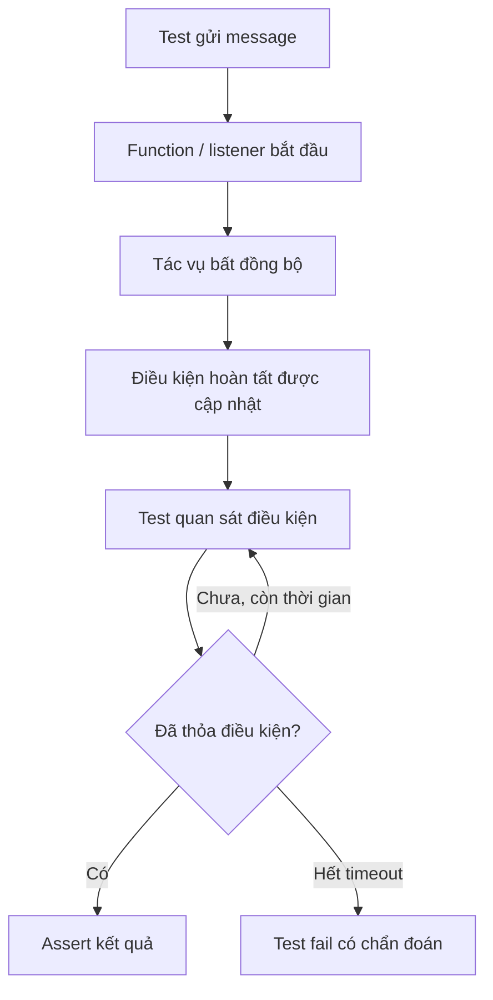

# Đồng bộ kiểm thử bất đồng bộ bằng điều kiện và timeout hữu hạn

## 1. Vì sao kiểm thử bất đồng bộ dễ chập chờn?

Trong Spring Cloud Stream, một message có thể đi qua nhiều bước trước khi tạo ra kết quả mà test cần kiểm tra: binder nhận message, function được gọi, executor hoặc scheduler xử lý tác vụ, service cập nhật dữ liệu, rồi output binding phát message. Các bước này có thể chạy trên những thread khác nhau và hoàn tất sau thời điểm test gửi input.

Nếu test giả định rằng xử lý đã hoàn tất ngay sau `send`, kết quả có thể phụ thuộc tốc độ máy, tải CI, lịch chạy thread hoặc thời gian khởi động application context. Test đôi khi pass trên máy cá nhân nhưng fail ngẫu nhiên trên CI.

Hai lỗi thường gặp:

- **Chờ quá ít:** test đọc kết quả trước khi tác vụ bất đồng bộ hoàn tất.
- **Chờ không giới hạn:** test treo khi message bị mất, function không được kích hoạt hoặc broker/binding gặp lỗi.

Giải pháp là đồng bộ theo một điều kiện có ý nghĩa và luôn đặt thời hạn chờ hữu hạn. Test chỉ tiếp tục khi điều kiện đã đúng hoặc dừng với lỗi rõ ràng khi hết thời gian.



Không cần đợi một khoảng thời gian cố định để hy vọng công việc hoàn tất. Hãy chờ chính tín hiệu thể hiện công việc đã hoàn tất.

## 2. Không dùng Thread.sleep để đồng bộ test

Ví dụ không nên dùng:

```java
input.send(message, "orders.raw");
Thread.sleep(1_000);
Message<byte[]> result = output.receive();
assertThat(result).isNotNull();
```

`Thread.sleep` chỉ làm thread test dừng trong một khoảng thời gian, không chứng minh function đã chạy xong. Nếu xử lý cần 1,2 giây, test vẫn fail; nếu chỉ cần 20 ms, test đã lãng phí gần một giây. Khi CI chậm, thời gian cố định thường không ổn định.

`Thread.sleep` còn che khuất nguyên nhân thật: input gửi sai destination, function không nằm trong `spring.cloud.function.definition`, message bị filter, output binding sai tên hoặc tác vụ bất đồng bộ bị lỗi. Test chờ lâu hơn vẫn không sửa được các lỗi này.

Hãy thay bằng một trong các cơ chế:

- `OutputDestination.receive(timeout, destination)` khi chờ output từ test binder.
- Awaitility khi chờ một trạng thái hoặc điều kiện cuối cùng.
- `CountDownLatch` khi cần tín hiệu hoàn tất một lần.
- `CompletableFuture.get(timeout, unit)` khi có future đại diện cho tác vụ.
- Reactor `StepVerifier` với thời hạn khi kiểm tra publisher.

## 3. Xác định điều kiện hoàn tất trước khi viết test

Điều kiện phải phản ánh kết quả nghiệp vụ mà test muốn kiểm tra, không chỉ là một dấu hiệu tình cờ của thread.

| Tác vụ | Điều kiện nên chờ |
|---|---|
| Function phát output | Output xuất hiện tại đúng destination |
| Listener cập nhật database | Bản ghi hoặc trạng thái mong đợi được lưu |
| Handler xử lý một event | Completion signal hoặc kết quả xử lý được công bố |
| Nhiều message được xử lý | Đã nhận đủ số event có ID mong đợi |
| Publisher reactive | Publisher phát đủ phần tử và hoàn tất |
| Tác vụ nền cập nhật cache | Giá trị cache đạt trạng thái mong đợi |
| Retry hoàn tất | Số lần thử hoặc trạng thái cuối cùng đạt điều kiện |

Không dùng log “đã bắt đầu xử lý” làm điều kiện cho một assertion yêu cầu xử lý đã hoàn tất. Cũng không chỉ chờ một counter tăng nếu counter được cập nhật trước side effect cần kiểm tra.

## 4. Dùng timeout hữu hạn với InputDestination và OutputDestination

Spring Cloud Stream test binder cung cấp `InputDestination` và `OutputDestination`. Khi test có một output cụ thể, overload `receive(timeout, destinationName)` vừa chọn đúng destination vừa chờ tối đa số mili giây đã chỉ định.

Ví dụ function:

```java
import java.util.function.Function;
import org.springframework.context.annotation.Bean;
import org.springframework.context.annotation.Configuration;

record OrderCreated(String orderId, long totalCents) {}
record OrderAccepted(String orderId, String status) {}

@Configuration
class OrderFunctions {

    @Bean
    Function<OrderCreated, OrderAccepted> acceptOrder() {
        return order -> new OrderAccepted(order.orderId(), "ACCEPTED");
    }
}
```

Cấu hình binding:

```yaml
spring:
  cloud:
    function:
      definition: acceptOrder
    stream:
      bindings:
        acceptOrder-in-0:
          destination: orders.raw
        acceptOrder-out-0:
          destination: orders.accepted
```

Test:

```java
import static org.assertj.core.api.Assertions.assertThat;

import org.junit.jupiter.api.Test;
import org.springframework.beans.factory.annotation.Autowired;
import org.springframework.boot.test.context.SpringBootTest;
import org.springframework.cloud.stream.binder.test.InputDestination;
import org.springframework.cloud.stream.binder.test.OutputDestination;
import org.springframework.cloud.stream.binder.test.TestChannelBinderConfiguration;
import org.springframework.context.annotation.Import;
import org.springframework.messaging.Message;
import org.springframework.messaging.support.GenericMessage;

@SpringBootTest(properties = {
    "spring.cloud.function.definition=acceptOrder",
    "spring.cloud.stream.bindings.acceptOrder-in-0.destination=orders.raw",
    "spring.cloud.stream.bindings.acceptOrder-out-0.destination=orders.accepted"
})
@Import(TestChannelBinderConfiguration.class)
class OrderFunctionTests {

    @Autowired
    InputDestination input;

    @Autowired
    OutputDestination output;

    @Test
    void emitsAcceptedOrderWithinBoundedTime() {
        input.send(new GenericMessage<>(new OrderCreated("ORD-7", 25_000)),
            "orders.raw");

        Message<byte[]> result = output.receive(3_000, "orders.accepted");

        assertThat(result).isNotNull();
        assertThat(result.getPayload()).isNotEmpty();
    }
}
```

Nếu không có output trong ba giây, `receive` trả về `null` và assertion thất bại thay vì treo vô hạn. Dùng đúng destination giúp tránh đọc nhầm output khi application có nhiều function hoặc binding.

Với test binder, tham số timeout của overload `receive(timeout, destinationName)` được tính bằng mili giây. Chọn timeout đủ cho môi trường test nhưng hữu hạn.

## 5. Chọn timeout cho từng giai đoạn

Một test bất đồng bộ có thể có nhiều mốc thời gian:

1. Application context khởi động.
2. Input được gửi.
3. Function nhận và xử lý message.
4. Tác vụ phụ thuộc như database hoặc HTTP hoàn tất.
5. Output được phát.

Không nên dùng một timeout khổng lồ cho mọi giai đoạn. Đặt timeout theo điều kiện cụ thể, đồng thời giữ tổng thời gian test hợp lý.

Ví dụ ngân sách cho một test integration chạy cục bộ:

| Giai đoạn | Thời hạn minh họa |
|---|---:|
| Chờ output từ test binder | 3 giây |
| Chờ trạng thái database | 5 giây |
| Chờ publisher reactive | 5 giây |
| Giới hạn toàn test | 10 giây |

Các con số chỉ là điểm khởi đầu. CI có thể cần timeout lớn hơn do tải và tài nguyên, nhưng timeout phải đủ ngắn để phát hiện lỗi thật. Hãy đo thời gian bình thường và p95/p99 của test suite để chọn giá trị phù hợp.

Các thời hạn trong bảng minh họa những loại chờ khác nhau, không nhất thiết cộng dồn trong cùng một test. Nếu một test thực hiện tuần tự nhiều lần chờ, timeout toàn test phải lớn hơn tổng thời gian chờ tối đa cộng thời gian setup/teardown.

## 6. Dùng Awaitility để chờ một điều kiện

Awaitility là thư viện giúp test chờ một điều kiện đạt trạng thái mong muốn. Thay vì tự viết vòng lặp hoặc sleep, test khai báo điều kiện, poll interval và giới hạn tổng thời gian.

Dependency Maven trong test scope:

```xml
<dependency>
    <groupId>org.awaitility</groupId>
    <artifactId>awaitility</artifactId>
    <scope>test</scope>
</dependency>
```

Nếu dự án không quản lý version của Awaitility qua BOM, khai báo version tương thích trong dependency management của dự án.

Ví dụ chờ database được cập nhật:

```java
import static org.awaitility.Awaitility.await;
import static org.assertj.core.api.Assertions.assertThat;

import java.time.Duration;

@Test
void eventuallyPersistsAcceptedOrder() {
    input.send(new GenericMessage<>(new OrderCreated("ORD-8", 31_000)),
        "orders.raw");

    await()
        .pollInterval(Duration.ofMillis(100))
        .atMost(Duration.ofSeconds(5))
        .untilAsserted(() ->
            assertThat(orderRepository.findStatus("ORD-8"))
                .contains("ACCEPTED")
        );
}
```

`untilAsserted` chạy assertion nhiều lần cho đến khi thành công hoặc hết timeout. Nếu điều kiện không đạt, test fail và Awaitility báo timeout. Assertion phải đọc trạng thái hiện có, không thực hiện side effect lặp lại ở mỗi lần poll.

## 7. Chọn poll interval phù hợp

Poll interval là khoảng cách giữa các lần kiểm tra điều kiện. Poll quá dày có thể tạo tải không cần thiết lên database hoặc service; poll quá thưa làm test chậm phát hiện kết quả đã sẵn sàng.

Ví dụ:

```java
await()
    .pollInterval(Duration.ofMillis(100))
    .atMost(Duration.ofSeconds(4))
    .until(() -> orderRepository.existsById("ORD-9"));
```

Với một điều kiện đọc nhẹ trong bộ nhớ, interval vài chục mili giây có thể phù hợp. Với truy vấn database hoặc API, interval 100–250 ms thường là điểm bắt đầu hợp lý. Điều chỉnh theo tải test và độ trễ hệ thống.

Không dùng poll interval để thay thế timeout. Điều kiện có thể không bao giờ đúng; `atMost` vẫn cần thiết để test dừng.

## 8. Chờ nhiều điều kiện bằng untilAsserted

Một tác vụ có thể cần cập nhật nhiều trường hoặc phát nhiều event. Dùng `untilAsserted` để kiểm tra tất cả trạng thái cần thiết trong cùng một lần thử:

```java
await()
    .atMost(Duration.ofSeconds(5))
    .untilAsserted(() -> {
        assertThat(orderRepository.findStatus("ORD-10"))
            .contains("ACCEPTED");
        assertThat(auditRepository.existsFor("ORD-10"))
            .isTrue();
    });
```

Không tách thành hai lần chờ dài nếu hai điều kiện là một kết quả nghiệp vụ duy nhất. Một assertion block giúp kiểm tra trạng thái cuối cùng tại cùng một lần poll. Tuy vậy, nếu hai kho dữ liệu không có transaction chung, việc cả hai cùng đúng tại một thời điểm vẫn không chứng minh chúng được cập nhật nguyên tử.

## 9. Dùng CountDownLatch khi cần tín hiệu hoàn tất một lần

`CountDownLatch` phù hợp khi một tác vụ bất đồng bộ cần báo cho test biết nó đã hoàn tất. Test tạo latch với số đếm, callback giảm số đếm khi kết thúc, và test gọi `await` với timeout hữu hạn.

Ví dụ kiểm thử một handler chạy trên executor:

```java
import static org.assertj.core.api.Assertions.assertThat;

import java.util.concurrent.CountDownLatch;
import java.util.concurrent.ExecutorService;
import java.util.concurrent.Executors;
import java.util.concurrent.TimeUnit;
import java.util.concurrent.atomic.AtomicReference;

@Test
void waitsForAsyncHandlerCompletion() throws Exception {
    ExecutorService executor = Executors.newSingleThreadExecutor();
    CountDownLatch completed = new CountDownLatch(1);
    AtomicReference<OrderAccepted> result = new AtomicReference<>();
    AtomicReference<Throwable> failure = new AtomicReference<>();

    try {
        executor.submit(() -> {
            try {
                result.set(orderService.accept(new OrderCreated("ORD-11", 42_000)));
            } catch (Exception error) {
                failure.set(error);
            } finally {
                completed.countDown();
            }
        });

        assertThat(completed.await(5, TimeUnit.SECONDS))
            .as("async handler should complete within five seconds")
            .isTrue();
        assertThat(failure.get()).isNull();
        assertThat(result.get()).isNotNull();
        assertThat(result.get().status()).isEqualTo("ACCEPTED");
    } finally {
        executor.shutdownNow();
    }
}
```

`await` trả về `false` khi hết thời hạn mà latch chưa về 0. Test cần assert giá trị này; không bỏ qua kết quả boolean. Dùng `finally` để giải phóng executor kể cả khi assertion thất bại.

Trong ví dụ, lỗi từ callback được chuyển về test qua `AtomicReference`. Nếu chỉ gọi `countDown` trong `finally` mà không lưu lỗi, test có thể pass dù tác vụ bất đồng bộ đã ném exception.

## 10. CountDownLatch cho nhiều message

Nếu test chờ một số message xác định, khởi tạo latch với số lượng mong đợi:

```java
CountDownLatch received = new CountDownLatch(3);
BlockingQueue<OrderAccepted> results = new LinkedBlockingQueue<>();

void onAccepted(OrderAccepted event) {
    results.add(event);
    received.countDown();
}
```

Test:

```java
assertThat(received.await(5, TimeUnit.SECONDS)).isTrue();
assertThat(results)
    .extracting(OrderAccepted::orderId)
    .containsExactlyInAnyOrder("ORD-21", "ORD-22", "ORD-23");
```

`BlockingQueue` và các lớp `java.util.concurrent` giúp chia sẻ dữ liệu giữa test thread và worker thread an toàn hơn một `ArrayList` thông thường. Nếu message có thể đến trùng hoặc nhiều hơn số mong đợi, assertion nên kiểm tra event ID và chính sách duplicate, không chỉ kiểm tra kích thước queue.

Không tái sử dụng một `CountDownLatch` đã về 0 cho nhiều test hoặc nhiều vòng thử. Latch chỉ đếm xuống, không reset; tạo latch mới cho mỗi test hoặc mỗi lần thực nghiệm.

## 11. Dùng CompletableFuture với get có timeout

Nếu API bất đồng bộ trả về `CompletableFuture`, test có thể chờ kết quả trực tiếp bằng `get(timeout, unit)`:

```java
import java.util.concurrent.CompletableFuture;
import java.util.concurrent.TimeUnit;

@Test
void waitsForAsyncPublication() throws Exception {
    CompletableFuture<PublishResult> future = publisher.publishAsync(
        new OrderCreated("ORD-31", 52_000)
    );

    PublishResult result = future.get(5, TimeUnit.SECONDS);

    assertThat(result.accepted()).isTrue();
    assertThat(result.messageId()).isNotBlank();
}
```

`get` ném `TimeoutException` nếu future chưa hoàn tất trong thời gian cho phép, `ExecutionException` nếu tác vụ hoàn tất bằng exception và `InterruptedException` nếu thread test bị interrupt. Những lỗi này nên làm test fail với nguyên nhân rõ ràng.

Nếu cần hủy tác vụ khi test timeout, có thể gọi `future.cancel(true)` trong `finally` hoặc khi bắt `TimeoutException`, nhưng chỉ khi API và tác vụ hỗ trợ cancellation. `cancel(true)` không bảo đảm mọi I/O hoặc side effect bên ngoài đã dừng ngay lập tức.

## 12. Phân biệt future hoàn tất với message được xử lý xong

Một `CompletableFuture` có thể biểu diễn việc producer gửi message được broker chấp nhận, nhưng không nhất thiết biểu diễn consumer đã xử lý message hoặc database đã commit.

Ví dụ:

- Producer future hoàn tất: broker xác nhận publish theo semantics của producer.
- Consumer completion signal: listener đã hoàn tất callback.
- Database condition: transaction nghiệp vụ đã được lưu.
- OutputDestination nhận message: function đã phát output vào test binder.

Chọn đúng tín hiệu theo mục tiêu test. Nếu muốn kiểm tra consumer xử lý xong, chờ trạng thái do consumer tạo ra hoặc output tương ứng; không chỉ chờ producer future.

## 13. Kiểm thử publisher reactive bằng StepVerifier

Với function trả về `Flux` hoặc `Mono`, Reactor Test cung cấp `StepVerifier`. Có thể kiểm tra phần tử, lỗi và completion trong một kịch bản có timeout:

```java
import java.time.Duration;
import reactor.core.publisher.Flux;
import reactor.test.StepVerifier;

@Test
void transformsReactiveOrderEvents() {
    Flux<OrderAccepted> result = acceptOrders.apply(
        Flux.just(new OrderCreated("ORD-41", 12_000))
    );

    StepVerifier.create(result)
        .assertNext(event -> {
            assertThat(event.orderId()).isEqualTo("ORD-41");
            assertThat(event.status()).isEqualTo("ACCEPTED");
        })
        .expectComplete()
        .verify(Duration.ofSeconds(5));
}
```

`verify(Duration)` giới hạn tổng thời gian xác minh. Nếu publisher không phát phần tử hoặc không kết thúc, test fail do timeout. Với publisher vô hạn, không gọi `expectComplete`; dùng `thenCancel` hoặc kiểm tra một số phần tử cụ thể rồi kết thúc verification theo kịch bản.

Nếu function dùng scheduler bất đồng bộ, StepVerifier vẫn chờ theo tín hiệu reactive. Tránh chuyển về `block()` không giới hạn trong test.

## 14. Dùng virtual time cho publisher có delay

Với publisher dùng toán tử thời gian như `delayElements`, có thể dùng virtual time để test nhanh mà không phải chờ thời gian thực:

```java
import java.time.Duration;
import reactor.core.publisher.Flux;
import reactor.test.StepVerifier;

@Test
void verifiesDelayedEventsWithVirtualTime() {
    StepVerifier.withVirtualTime(() ->
            Flux.just("A", "B")
                .delayElements(Duration.ofSeconds(10)))
        .thenAwait(Duration.ofSeconds(20))
        .expectNext("A", "B")
        .expectComplete()
        .verify(Duration.ofSeconds(2));
}
```

Virtual time chỉ điều khiển scheduler tương thích với Reactor virtual-time. Nếu code tự tạo thread, dùng scheduler không được thay thế hoặc gọi dịch vụ bên ngoài, virtual time không tự làm những thao tác đó chạy nhanh hơn.

## 15. Chờ trạng thái database sau khi nhận message

Trong một số kiến trúc, function gọi service bất đồng bộ và service cập nhật database. Test nên chờ trạng thái bền vững, không chờ thread đã bắt đầu:

```java
input.send(new GenericMessage<>(
    new OrderCreated("ORD-51", 75_000)
), "orders.raw");

await()
    .pollInterval(Duration.ofMillis(100))
    .atMost(Duration.ofSeconds(5))
    .untilAsserted(() -> {
        OrderEntity order = orderRepository.findByOrderId("ORD-51")
            .orElseThrow();
        assertThat(order.getStatus()).isEqualTo("ACCEPTED");
    });
```

Truy vấn trong điều kiện phải là thao tác đọc. Không gọi `save`, gửi message hoặc tăng counter bên trong lambda Awaitility vì lambda có thể chạy nhiều lần.

Nếu repository trả về cache hoặc persistence context đang giữ entity cũ, dùng truy vấn đọc mới phù hợp hoặc clear persistence context trước khi kiểm tra. Với transaction test, cần chú ý thread bất đồng bộ không tham gia transaction gắn với test thread.

## 16. Chờ nhiều message mà không phụ thuộc thứ tự

Nếu xử lý song song, output có thể đến theo thứ tự khác input. Khi thứ tự không phải yêu cầu nghiệp vụ, kiểm tra theo ID thay vì thứ tự nhận:

```java
Set<String> expected = Set.of("ORD-61", "ORD-62", "ORD-63");
Set<String> received = ConcurrentHashMap.newKeySet();

await()
    .atMost(Duration.ofSeconds(5))
    .untilAsserted(() -> assertThat(received).containsAll(expected));
```

Đảm bảo callback thêm ID vào collection thread-safe. Nếu cần phát hiện message thừa hoặc duplicate, lưu danh sách/count theo ID và assert riêng. `containsAll` chỉ chứng minh đủ phần tử mong đợi, không chứng minh không có phần tử trùng.

Nếu nghiệp vụ yêu cầu thứ tự, hãy assert thứ tự đó một cách tường minh và cấu hình partition/concurrency phù hợp. Không dùng `containsExactly` cho luồng xử lý song song nếu thứ tự hoàn tất không được bảo đảm.

## 17. Timeout của test và timeout của messaging khác nhau

Có nhiều loại timeout trong hệ thống:

| Timeout | Phạm vi | Mục đích |
|---|---|---|
| Test wait timeout | Một lần chờ trong test | Ngăn test treo khi điều kiện không xảy ra |
| JUnit test timeout | Toàn bộ test method | Giới hạn tổng thời gian test |
| `OutputDestination.receive` timeout | Chờ message ở test binder | Trả về khi có output hoặc hết thời gian |
| Producer send timeout | Gửi message tới broker | Giới hạn thời gian chờ xác nhận publish |
| Consumer acknowledgement timeout | Broker/binder chờ consumer xác nhận | Quyết định redelivery hoặc xử lý timeout theo broker |
| HTTP/database timeout | Lời gọi dịch vụ phụ thuộc | Giới hạn thời gian I/O |

Không dùng test wait timeout để thay thế producer hoặc consumer timeout. Một test có thể chờ 5 giây nhưng producer đã timeout sau 1 giây; hoặc producer gửi thành công nhưng consumer xử lý chưa xong.

## 18. Dùng JUnit @Timeout làm giới hạn toàn test

JUnit Jupiter có `@Timeout` để bảo vệ test method khỏi chạy quá lâu:

```java
import java.util.concurrent.TimeUnit;
import org.junit.jupiter.api.Test;
import org.junit.jupiter.api.Timeout;

class AsyncOrderTests {

    @Test
    @Timeout(value = 10, unit = TimeUnit.SECONDS)
    void processesOrderWithinTestBudget() {
        // bounded waits for each asynchronous condition
    }
}
```

`@Timeout` là giới hạn tổng thể, không thay thế timeout cho từng thao tác chờ. Nếu một lần chờ bị treo, timeout toàn test vẫn giúp JUnit dừng test theo chính sách của engine.

Với test có transaction, security context hoặc dữ liệu gắn với thread, cân nhắc cách JUnit thực thi timeout. `assertTimeoutPreemptively` chạy phần được kiểm tra trên thread khác và có thể làm thay đổi hành vi dựa trên ThreadLocal. Không dùng preemptive timeout một cách máy móc cho test phụ thuộc transaction hoặc context theo thread.

## 19. Không nuốt exception trong callback bất đồng bộ

Một lỗi phổ biến là callback bắt exception nhưng không chuyển về test:

```java
executor.submit(() -> {
    try {
        orderService.process(event);
    } catch (Exception ignored) {
        // test không biết tác vụ đã thất bại
    }
    completed.countDown();
});
```

Latch vẫn về 0, khiến test có thể hiểu nhầm rằng xử lý thành công. Hãy lưu exception, hoàn tất future exceptionally hoặc gửi lỗi qua một queue mà test kiểm tra.

Ví dụ với future:

```java
CompletableFuture<OrderAccepted> future = CompletableFuture.supplyAsync(
    () -> orderService.accept(event), executor
);

OrderAccepted accepted = future.get(5, TimeUnit.SECONDS);
assertThat(accepted.status()).isEqualTo("ACCEPTED");
```

Nếu service ném exception, `get` ném `ExecutionException`; test không thể âm thầm coi callback là thành công.

## 20. Đặt timeout cho Awaitility và xử lý lỗi có chủ đích

Awaitility nên được cấu hình timeout tại từng điều kiện:

```java
await()
    .pollInterval(Duration.ofMillis(100))
    .atMost(Duration.ofSeconds(4))
    .until(() -> orderRepository.existsById("ORD-71"));
```

Nếu điều kiện có thể ném exception tạm thời trong lúc ứng dụng khởi động, cân nhắc cách Awaitility xử lý exception hoặc dùng `untilAsserted` khi phù hợp. Không cấu hình bỏ qua mọi exception vì điều đó có thể che lỗi thật như database connection failure hoặc query sai.

Thông báo lỗi nên chứa event ID, destination, điều kiện đang chờ và timeout đã dùng. Có thể bổ sung `as(...)` của AssertJ để assertion cuối cùng dễ đọc hơn.

## 21. Đồng bộ với nhiều consumer và concurrency

Khi một binding có nhiều consumer hoặc function xử lý trên executor, không giả định message thứ nhất hoàn tất trước message thứ hai. Test nên dùng event ID và điều kiện số lượng/trạng thái.

Ví dụ chờ cả ba đơn hàng hoàn tất:

```java
Set<String> completedIds = ConcurrentHashMap.newKeySet();

await()
    .atMost(Duration.ofSeconds(8))
    .untilAsserted(() ->
        assertThat(completedIds)
            .contains("ORD-81", "ORD-82", "ORD-83")
    );
```

Nếu test cần chứng minh các event được xử lý song song, hãy ghi nhận thời điểm bắt đầu/kết thúc và dùng barrier hoặc latch để tạo điều kiện kiểm soát. Không dùng timeout ngắn để suy luận concurrency từ một lần chạy ngẫu nhiên.

## 22. Tránh race condition trong dữ liệu test

Test thread và worker thread có thể truy cập cùng một biến. Một `ArrayList` hoặc `HashMap` không được bảo vệ có thể gây race condition hoặc kết quả không nhìn thấy kịp thời.

Ưu tiên các cấu trúc thread-safe:

- `AtomicReference` cho một kết quả đơn.
- `AtomicInteger`/`LongAdder` cho bộ đếm phù hợp.
- `BlockingQueue` cho dữ liệu được producer thread đưa sang test thread.
- `ConcurrentHashMap` hoặc concurrent key set cho tập kết quả.
- `CountDownLatch`/`Semaphore` cho tín hiệu đồng bộ.
- `CompletableFuture` cho kết quả và exception của tác vụ.

Không dùng `volatile` như giải pháp cho mọi cấu trúc dữ liệu. `volatile` đảm bảo visibility của biến tham chiếu/giá trị được đánh dấu, nhưng không làm thao tác compound như `list.add` trở thành thread-safe.

## 23. Dọn dẹp executor và tài nguyên sau test

Test tạo executor, scheduler, listener hoặc subscription riêng cần giải phóng sau khi hoàn tất. Nếu worker thread còn chạy, test tiếp theo có thể bị ảnh hưởng hoặc JVM không thoát.

Ví dụ:

```java
ExecutorService executor = Executors.newFixedThreadPool(2);
try {
    // submit tasks and wait with finite timeouts
} finally {
    executor.shutdownNow();
    if (!executor.awaitTermination(2, TimeUnit.SECONDS)) {
        throw new IllegalStateException("Executor did not stop in time");
    }
}
```

Trong Spring test context, có thể dùng bean executor được quản lý bởi container và để context đóng bean theo lifecycle. Không tự đóng executor singleton dùng chung bởi các test khác. Tạo riêng hoặc dùng lifecycle rõ ràng để tránh test phụ thuộc nhau.

## 24. Kiểm thử retry bất đồng bộ

Retry làm thời gian hoàn tất không cố định. Nếu test cần kiểm tra retry, hãy chờ một trạng thái cuối cùng và quan sát số lần gọi bằng counter thread-safe:

```java
import static org.mockito.ArgumentMatchers.any;
import static org.mockito.Mockito.doAnswer;

import java.util.concurrent.atomic.AtomicInteger;

AtomicInteger attempts = new AtomicInteger();

doAnswer(invocation -> {
    int current = attempts.incrementAndGet();
    if (current < 3) {
        throw new TransientOrderException("temporary failure");
    }
    return null;
}).when(orderService).process(any(OrderCreated.class));

input.send(new GenericMessage<>(new OrderCreated("ORD-91", 19_000)),
    "orders.raw");

await()
    .atMost(Duration.ofSeconds(5))
    .untilAsserted(() -> assertThat(attempts.get()).isEqualTo(3));
```

Ví dụ này minh họa việc chờ retry counter. Trong test thực tế, cần cấu hình retry mechanism mà binder/function đang sử dụng và kiểm tra cả kết quả cuối hoặc DLQ. Không giả định mọi binder có cùng retry semantics.

Nếu retry có backoff, tổng timeout phải đủ lớn cho các lần thử và khoảng chờ. Tính thời gian tối đa theo cấu hình thực tế; đừng đặt timeout ngắn hơn tổng backoff rồi kết luận retry bị lỗi.

## 25. Test binder và broker thật có thời gian chờ khác nhau

Test binder hoạt động trong application context và thường phản hồi nhanh. Integration test với Kafka, RabbitMQ hoặc Pulsar còn có thời gian kết nối, provisioning, authentication, consumer assignment, broker acknowledgement và retry.

Do đó:

- Dùng timeout ngắn, ổn định cho test logic với test binder.
- Dùng timeout theo startup và delivery semantics của broker trong integration test.
- Chờ điều kiện readiness của broker trước khi gửi message.
- Chờ consumer group/subscription được tạo khi test phụ thuộc vào assignment.
- Không dùng `Thread.sleep` để chờ broker “chắc đã sẵn sàng”; dùng health/readiness condition hoặc kiểm tra resource cụ thể.
- Khi timeout, ghi lại destination, binder, event ID và trạng thái broker để chẩn đoán.

## 26. Ví dụ kiểm thử đầy đủ với test binder và Awaitility

Ví dụ sau kiểm tra function phát output và một tác vụ bất đồng bộ lưu trạng thái. Function xác nhận đã nhận đơn hàng để tiếp tục xử lý; một writer được quản lý bởi ứng dụng thực hiện việc lưu trạng thái trên executor. Phần `OrderStatusRepository` được giả định là repository test có thể đọc trạng thái đã lưu.

```java
import java.util.concurrent.CompletableFuture;
import java.util.function.Function;
import org.springframework.context.annotation.Bean;
import org.springframework.context.annotation.Configuration;

interface AsyncOrderWriter {
    CompletableFuture<Void> persistAcceptedAsync(OrderCreated order);
}

@Configuration
class AsyncOrderFunctions {

    @Bean
    Function<OrderCreated, OrderAccepted> acceptOrder(AsyncOrderWriter writer) {
        return order -> {
            writer.persistAcceptedAsync(order);
            return new OrderAccepted(order.orderId(), "ACCEPTED");
        };
    }
}
```

Trong ứng dụng production, `AsyncOrderWriter` phải quản lý lỗi của future, executor và transaction database. Đoạn function chỉ minh họa trường hợp output được phát trước khi side effect bất đồng bộ hoàn tất; vì vậy test cần chờ cả hai tín hiệu.

```java
import static org.assertj.core.api.Assertions.assertThat;
import static org.awaitility.Awaitility.await;

import java.time.Duration;
import org.junit.jupiter.api.Test;
import org.springframework.beans.factory.annotation.Autowired;
import org.springframework.boot.test.context.SpringBootTest;
import org.springframework.cloud.stream.binder.test.InputDestination;
import org.springframework.cloud.stream.binder.test.OutputDestination;
import org.springframework.cloud.stream.binder.test.TestChannelBinderConfiguration;
import org.springframework.context.annotation.Import;
import org.springframework.messaging.Message;
import org.springframework.messaging.support.GenericMessage;

@SpringBootTest(properties = {
    "spring.cloud.function.definition=acceptOrder",
    "spring.cloud.stream.bindings.acceptOrder-in-0.destination=orders.raw",
    "spring.cloud.stream.bindings.acceptOrder-out-0.destination=orders.accepted"
})
@Import(TestChannelBinderConfiguration.class)
class AsyncOrderFlowTests {

    @Autowired
    InputDestination input;

    @Autowired
    OutputDestination output;

    @Autowired
    OrderStatusRepository orderStatusRepository;

    @Test
    void waitsForOutputAndPersistedStatus() {
        String orderId = "ORD-101";
        input.send(new GenericMessage<>(new OrderCreated(orderId, 88_000)),
            "orders.raw");

        Message<byte[]> accepted = output.receive(3_000, "orders.accepted");
        assertThat(accepted).isNotNull();

        await()
            .pollInterval(Duration.ofMillis(100))
            .atMost(Duration.ofSeconds(5))
            .untilAsserted(() ->
                assertThat(orderStatusRepository.findStatus(orderId))
                    .contains("ACCEPTED")
            );
    }
}
```

Ở đây có hai điều kiện độc lập: output binding đã phát message và repository đã có trạng thái cuối. Nếu output được phát trước khi database commit, test vẫn tiếp tục chờ repository. Nếu output không xuất hiện, `receive` fail trong ba giây và không chờ phần database vô ích.

Trong ứng dụng thực tế, xác định thứ tự side effect và output theo semantics function. Không mặc định output publish đồng nghĩa transaction database đã commit.

## 27. Chẩn đoán test timeout

Khi một lần chờ hết hạn, kiểm tra theo trình tự:

1. Input đã được gửi vào đúng destination chưa?
2. Function có nằm trong `spring.cloud.function.definition` không?
3. Binding name và destination mapping có đúng không?
4. Function có lọc message hoặc trả publisher rỗng không?
5. Có exception ở listener/function/executor không?
6. Tác vụ có bị kẹt khi gọi database, HTTP hoặc lock không?
7. Điều kiện test đang chờ có được cập nhật sau side effect không?
8. Shared state giữa các thread có thread-safe và có visibility đúng không?
9. Timeout có ngắn hơn thời gian retry/backoff hoặc startup thực tế không?
10. Executor/scheduler có bị shutdown quá sớm không?

Thông báo timeout nên giúp xác định test đang chờ gì. Ví dụ: “Expected order ORD-101 to reach ACCEPTED within 5 seconds” hữu ích hơn một assertion chỉ báo `false`.

## 28. Quy trình viết test bất đồng bộ ổn định

1. Xác định điều kiện nghiệp vụ cuối cùng cần xác minh.
2. Chọn tín hiệu đồng bộ phù hợp: output receive, Awaitility, latch, future hoặc StepVerifier.
3. Đặt timeout hữu hạn cho từng lần chờ.
4. Chọn poll interval phù hợp với chi phí đọc điều kiện.
5. Dùng collection/atomic primitive thread-safe cho dữ liệu chia sẻ.
6. Truyền exception từ worker thread về test.
7. Dùng destination cụ thể khi ứng dụng có nhiều binding.
8. Tách timeout test khỏi timeout producer, consumer và service phụ thuộc.
9. Dọn executor, scheduler và subscription trong lifecycle của test.
10. Khi timeout, báo event ID, destination, điều kiện và trạng thái quan sát được.

Kiểm thử bất đồng bộ trong Spring Cloud Stream cần chờ tín hiệu hoàn tất thay vì đoán thời gian bằng `Thread.sleep`. Dùng `OutputDestination.receive` cho output, Awaitility cho điều kiện cuối cùng, `CountDownLatch` cho tín hiệu một lần, `CompletableFuture` cho kết quả tác vụ và `StepVerifier` cho publisher reactive. Mọi lần chờ phải có timeout hữu hạn, dữ liệu chia sẻ phải thread-safe và exception từ worker thread phải được chuyển về test. Cách làm này giúp test ổn định, phát hiện lỗi nhanh và phân biệt rõ function chưa chạy, tác vụ còn đang xử lý hay kết quả nghiệp vụ thực sự không đạt.

## Tài liệu tham khảo

- [Spring Cloud Stream — Testing](https://docs.spring.io/spring-cloud-stream/reference/spring-cloud-stream/spring_integration_test_binder.html)
- [Awaitility — Usage](https://github.com/awaitility/awaitility/wiki/Usage)
- [JUnit 5 User Guide — Timeouts](https://junit.org/junit5/docs/current/user-guide/#writing-tests-timeouts)
- [Project Reactor — Testing](https://projectreactor.io/docs/core/release/reference/testing.html)

