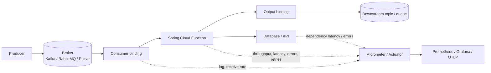

# Đo tốc độ, độ trễ xử lý, số lỗi và số lần thử lại

Một ứng dụng Spring Cloud Stream có thể vẫn báo trạng thái UP trong khi consumer xử lý chậm, backlog tăng, dependency liên tục lỗi hoặc message bị thử lại nhiều lần. Quan sát ứng dụng cần đo được tốc độ xử lý, thời gian xử lý, lỗi và retry, đồng thời đối chiếu với trạng thái của broker.

Bốn tín hiệu cốt lõi:

- **Throughput:** số message được nhận, xử lý thành công hoặc phát ra trong một đơn vị thời gian.
- **Processing latency:** thời gian function xử lý một message; cần phân biệt thời gian của một lần thử với tổng thời gian gồm cả backoff.
- **Error rate:** tỷ lệ message hoặc lần xử lý kết thúc thất bại.
- **Retry rate:** số lần function phải thử lại do lỗi tạm thời.

Ngoài bốn tín hiệu này, cần theo dõi **consumer lag/backlog**. Lag cho biết consumer đang tụt lại bao xa so với nguồn dữ liệu; nó không phải thời gian xử lý của một message. Kết hợp các tín hiệu sẽ giúp xác định hệ thống chậm do năng lực xử lý, do tải đầu vào, do dependency hay do broker.

## 1. Bức tranh quan sát của một pipeline sự kiện

Một pipeline Spring Cloud Stream thường gồm producer, broker, consumer function và hệ thống downstream. Mỗi thành phần có thể là điểm nghẽn riêng:



Không nên chỉ đo function. Nếu consumer không nhận được message vì broker hoặc binding bị lỗi, timer bên trong function không ghi nhận gì; dashboard có thể trông như không có lỗi dù pipeline đã ngừng tiến triển. Hãy kết hợp metric của ứng dụng, binder, broker và dependency.

## 2. Bốn tín hiệu cần đo

| Tín hiệu | Câu hỏi cần trả lời | Meter phù hợp |
|---|---|---|
| Throughput | Có bao nhiêu message thành công mỗi giây? | Counter |
| Processing latency | Một message mất bao lâu để xử lý? | Timer |
| Error rate | Bao nhiêu message kết thúc thất bại? | Counter |
| Retry rate | Có bao nhiêu lần xử lý lại sau lỗi? | Counter |

Có thể bổ sung:

- **In-flight:** số message đang được xử lý; dùng gauge hoặc LongTaskTimer tùy cách đo.
- **Payload size:** kích thước message; dùng DistributionSummary.
- **Lag/backlog:** số offset chưa tiêu thụ hoặc số message đang chờ trong queue; lấy từ binder/broker.
- **End-to-end age:** thời gian từ lúc event được tạo tới lúc consumer hoàn tất; tính từ event timestamp có quy tắc rõ ràng hoặc từ distributed trace.

Một metric chỉ có ý nghĩa khi xác định rõ đơn vị và thời điểm ghi nhận. Ví dụ, counter `messages.received` tăng khi function bắt đầu, còn `messages.succeeded` chỉ tăng khi xử lý hoàn tất thành công.

## 3. Throughput: đo số message qua hệ thống

Throughput thường được biểu diễn bằng message/second. Nên đo riêng message nhận vào function, message xử lý thành công, message kết thúc thất bại và message phát ra output binding.

Ví dụ một counter:

```java
Counter.builder("stream.messages.succeeded")
        .description("So message duoc xu ly thanh cong")
        .tag("function", "processPayment")
        .register(meterRegistry)
        .increment();
```

Counter chỉ tăng và không giảm. Để tính tốc độ trong một khoảng thời gian, monitoring backend lấy tốc độ tăng của counter, ví dụ Prometheus dùng `rate()` hoặc `increase()`.

Không dùng giá trị tổng tích lũy của counter để so sánh trực tiếp hai instance có thời gian chạy khác nhau. Hãy tính rate theo cửa sổ thời gian và tổng hợp theo function, binding hoặc instance phù hợp.

### Throughput đầu vào và đầu ra có thể khác nhau

Một function có thể lọc message, gộp nhiều message thành một kết quả hoặc phát nhiều output. Vì vậy:

- Input rate cao hơn output rate có thể là hành vi mong đợi nếu function lọc dữ liệu.
- Output rate thấp hơn input rate có thể là dấu hiệu xử lý chậm nếu logic yêu cầu một output cho mỗi input.
- Số lần function được gọi không nhất thiết bằng số record được publish nếu dùng batch, reactive stream hoặc Kafka Streams topology.

Hãy định nghĩa throughput theo hợp đồng nghiệp vụ của từng function.

## 4. Processing latency: đo thời gian xử lý

Latency của một message nên được đo bằng `Timer` của Micrometer. Timer ghi nhận thời lượng và số lần hoàn tất, có thể cung cấp tổng thời gian, thời gian lớn nhất và histogram/percentile nếu được cấu hình.

Cần phân biệt hai loại thời gian:

1. **Attempt latency:** thời gian một lần gọi logic xử lý.
2. **Message processing latency:** tổng thời gian từ lúc bắt đầu xử lý message đến khi thành công hoặc thất bại cuối cùng, gồm cả các khoảng backoff giữa những lần thử.

Ví dụ một lần gọi service mất 80 ms nhưng message phải retry hai lần, mỗi lần chờ backoff 500 ms. Attempt latency có thể quanh 80 ms, trong khi tổng processing latency vượt 1 giây.

Hai timer này trả lời hai câu hỏi khác nhau: service xử lý nhanh hay chậm, và message phải chờ bao lâu mới có kết quả cuối cùng.

### Vì sao nên theo dõi p50, p95 và p99?

Giá trị trung bình có thể che khuất một nhóm nhỏ message rất chậm. Hãy quan sát:

- **p50:** trải nghiệm của message điển hình.
- **p95:** 5% message chậm nhất bắt đầu vượt ngưỡng này.
- **p99:** phát hiện tail latency do lock, GC, downstream timeout, partition nóng hoặc retry.

Đối với pipeline có SLA, nên định nghĩa SLO rõ ràng, ví dụ 95% message hoàn tất trong 500 ms và 99% hoàn tất trong 2 giây. Các ngưỡng này phải dựa trên yêu cầu nghiệp vụ và dữ liệu thực tế.

## 5. Error rate: đếm lỗi đúng cách

Không phải mọi exception đều đồng nghĩa một message bị mất. Một lần thử có thể lỗi nhưng lần retry tiếp theo thành công. Vì vậy, cần tách:

- **Attempt failure:** một lần thử kết thúc bằng exception.
- **Retry:** một lần thử bổ sung sau lần đầu.
- **Terminal failure:** message vẫn thất bại sau khi hết retry hoặc bị từ chối theo policy.
- **DLQ count:** số message được chuyển sang dead-letter queue/topic.

Nếu chỉ đếm mọi exception là lỗi cuối cùng, dashboard sẽ phóng đại số message thất bại. Nếu chỉ đếm terminal failure, lại không nhìn thấy dependency đang chập chờn và khiến retry tăng cao.

Nên dùng các counter riêng như:

| Metric | Tăng khi |
|---|---|
| `stream.processing.attempts` | Mỗi lần gọi logic xử lý |
| `stream.processing.retries` | Mỗi lần thực sự chạy lại sau lần đầu |
| `stream.processing.attempt.errors` | Một lần thử ném lỗi |
| `stream.messages.succeeded` | Message hoàn tất thành công |
| `stream.messages.failed` | Message kết thúc thất bại |
| `stream.messages.deadlettered` | Message được xác nhận đã chuyển vào DLQ |

Tỷ lệ lỗi cuối cùng nên lấy terminal failures chia cho số message đã kết thúc xử lý trong cùng cửa sổ thời gian. Tỷ lệ lỗi theo attempt giúp phát hiện lỗi tạm thời dù message cuối cùng vẫn thành công.

## 6. Retry rate: phát hiện lỗi tạm thời và vòng lặp

Spring Cloud Stream dùng retry để thử lại message khi function ném exception. Các thuộc tính consumer phổ biến gồm:

| Thuộc tính | Ý nghĩa | Mặc định |
|---|---|---:|
| `max-attempts` | Tổng số lần thử, gồm lần đầu | 3 |
| `back-off-initial-interval` | Thời gian chờ ban đầu | 1000 ms |
| `back-off-max-interval` | Thời gian chờ tối đa | 10000 ms |
| `back-off-multiplier` | Hệ số tăng backoff | 2.0 |
| `default-retryable` | Mặc định có retry exception chưa khai báo hay không | true |

Ví dụ:

```yaml
spring:
  cloud:
    stream:
      bindings:
        processPayment-in-0:
          destination: payments
          group: payment-service
          consumer:
            max-attempts: 4
            back-off-initial-interval: 200
            back-off-max-interval: 2000
            back-off-multiplier: 2.0
            retryable-exceptions:
              com.acme.PaymentValidationException: false
              com.acme.TransientPaymentException: true
```

Trong ví dụ, tổng số lần xử lý tối đa là 4, không phải 4 lần retry cộng thêm lần đầu. Lỗi validation không được thử lại; lỗi dependency tạm thời có thể được thử lại theo backoff.

### Retry rate cao nói lên điều gì?

Retry tăng có thể là tín hiệu sớm của database hoặc API downstream chậm/chập chờn, timeout quá ngắn, rate limit từ dịch vụ bên ngoài, lỗi mạng hoặc message chứa dữ liệu gây lỗi lặp lại.

Retry không phải cách khắc phục cho mọi lỗi. Payload sai schema hoặc lỗi validation thường không tự hết khi thử lại. Hãy phân loại exception, giới hạn số lần thử và định tuyến lỗi không thể khôi phục sang DLQ/quarantine.

## 7. Đo retry bằng RetryTemplate khi ứng dụng sở hữu retry

Nếu cần đếm chính xác số lần thử bổ sung, có thể để một RetryTemplate do ứng dụng quản lý thực hiện retry và ghi metric ngay trong callback. Khi dùng cách này, đặt retry của binder thành một lần để tránh retry lồng nhau.

Ví dụ cấu hình:

```yaml
spring:
  cloud:
    stream:
      bindings:
        processPayment-in-0:
          destination: payments
          group: payment-service
          consumer:
            max-attempts: 1
```

RetryTemplate:

```java
@Bean
RetryTemplate paymentRetryTemplate() {
    RetryTemplate template = new RetryTemplate();

    Map<Class<? extends Throwable>, Boolean> retryable =
            Map.of(TransientPaymentException.class, true);

    template.setRetryPolicy(
            new SimpleRetryPolicy(3, retryable, true, false));

    ExponentialBackOffPolicy backOff = new ExponentialBackOffPolicy();
    backOff.setInitialInterval(200);
    backOff.setMultiplier(2.0);
    backOff.setMaxInterval(2000);
    template.setBackOffPolicy(backOff);

    return template;
}
```

Trong callback, `RetryContext.getRetryCount()` bằng 0 ở lần đầu và lớn hơn 0 ở các lần chạy lại. Có thể tăng retry counter khi giá trị này lớn hơn 0. Nếu dùng retry do binder quản lý, hãy instrument đúng RetryTemplate/error handler của binding hoặc dùng listener phù hợp với binder; đừng cộng thêm một RetryTemplate trong function mà không tắt retry bên ngoài.

## 8. Tạo metric tùy chỉnh bằng Micrometer

Spring Boot Actuator tự cấu hình `MeterRegistry` khi có Actuator và registry tương ứng trên classpath. Có thể dùng Counter và Timer để đo logic nghiệp vụ.

Ví dụ function imperative có retry do ứng dụng quản lý:

```java
@Bean
Function<PaymentEvent, PaymentResult> processPayment(
        PaymentService service,
        RetryTemplate paymentRetryTemplate,
        MeterRegistry registry) {

    Counter received = Counter.builder("stream.messages.received")
            .tag("function", "processPayment")
            .register(registry);

    Counter succeeded = Counter.builder("stream.messages.succeeded")
            .tag("function", "processPayment")
            .register(registry);

    Counter failed = Counter.builder("stream.messages.failed")
            .tag("function", "processPayment")
            .register(registry);

    Counter attempts = Counter.builder("stream.processing.attempts")
            .tag("function", "processPayment")
            .register(registry);

    Counter retries = Counter.builder("stream.processing.retries")
            .tag("function", "processPayment")
            .register(registry);

    Counter attemptErrors = Counter.builder("stream.processing.attempt.errors")
            .tag("function", "processPayment")
            .register(registry);

    Timer messageTimer = Timer.builder("stream.message.processing.duration")
            .tag("function", "processPayment")
            .register(registry);

    Timer attemptTimer = Timer.builder("stream.processing.attempt.duration")
            .tag("function", "processPayment")
            .register(registry);

    return event -> {
        received.increment();
        Timer.Sample messageSample = Timer.start(registry);

        try {
            PaymentResult result = paymentRetryTemplate.execute(context -> {
                attempts.increment();
                if (context.getRetryCount() > 0) {
                    retries.increment();
                }

                Timer.Sample attemptSample = Timer.start(registry);
                try {
                    return service.process(event);
                }
                catch (RuntimeException ex) {
                    attemptErrors.increment();
                    throw ex;
                }
                finally {
                    attemptSample.stop(attemptTimer);
                }
            });

            succeeded.increment();
            return result;
        }
        catch (RuntimeException ex) {
            failed.increment();
            throw ex;
        }
        finally {
            messageSample.stop(messageTimer);
        }
    };
}
```

Cách đọc:

- `received` tăng một lần khi function bắt đầu xử lý message.
- `attempts` tăng mỗi lần service thực sự được gọi.
- `retries` chỉ tăng ở lần gọi thứ hai trở đi.
- `attemptErrors` tăng mỗi lần gọi service ném exception, kể cả lần lỗi được retry thành công.
- `attemptTimer` đo riêng từng lần gọi service.
- `messageTimer` đo toàn bộ thời gian xử lý, gồm backoff.
- `succeeded` chỉ tăng khi RetryTemplate trả về kết quả.
- `failed` chỉ tăng khi retry kết thúc mà vẫn ném exception.

Nếu chuyển retry về binder, không dùng nguyên ví dụ này với `max-attempts` lớn hơn 1 vì mỗi lần binder gọi lại function sẽ tạo một invocation mới. Khi đó hãy định nghĩa rõ counter nào đếm delivery, counter nào đếm invocation và counter nào đếm retry.

## 9. Cấu hình Actuator và Prometheus

Thêm dependency Actuator và registry mà hệ thống monitoring sử dụng. Ví dụ với Maven:

```xml
<dependency>
    <groupId>org.springframework.boot</groupId>
    <artifactId>spring-boot-starter-actuator</artifactId>
</dependency>

<dependency>
    <groupId>io.micrometer</groupId>
    <artifactId>micrometer-registry-prometheus</artifactId>
    <scope>runtime</scope>
</dependency>
```

Cấu hình endpoint:

```yaml
management:
  endpoints:
    web:
      exposure:
        include: health,info,metrics,prometheus
  endpoint:
    health:
      show-details: when_authorized
  metrics:
    tags:
      application: payment-stream
```

Các endpoint thường dùng:

- `/actuator/health`: trạng thái ứng dụng và health indicator.
- `/actuator/metrics`: danh sách meter và chi tiết một meter.
- `/actuator/prometheus`: số liệu theo định dạng Prometheus khi registry đã được thêm.

Endpoint metrics là công cụ chẩn đoán. Hãy bảo vệ các endpoint quản trị bằng security/network policy và chỉ expose những endpoint cần thiết ra ngoài.

## 10. Xem metric qua Actuator

Có thể xem danh sách meter tại:

```http
GET /actuator/metrics
```

Xem một timer cụ thể:

```http
GET /actuator/metrics/stream.message.processing.duration
```

Lọc theo tag:

```http
GET /actuator/metrics/stream.message.processing.duration?tag=function:processPayment
```

Tên meter ở Actuator dùng tên Micrometer trong code. Khi xuất sang Prometheus, naming convention có thể đổi dấu chấm thành dấu gạch dưới và Counter được biểu diễn bằng hậu tố `_total`. Vì vậy, đừng lấy tên đã chuẩn hóa ở Prometheus rồi dùng trực tiếp làm selector cho Actuator.

## 11. Histogram, percentile và SLO

Để tính p95/p99 ở monitoring backend, cấu hình histogram cho timer. Ví dụ:

```yaml
management:
  metrics:
    distribution:
      percentiles-histogram:
        stream.message.processing.duration: true
      slo:
        stream.message.processing.duration: 100ms,500ms,1s,2s
```

Histogram xuất các bucket thời gian để backend tính percentile có thể tổng hợp qua nhiều instance. SLO bucket thể hiện các ngưỡng thời gian mà nghiệp vụ quan tâm.

Micrometer cũng hỗ trợ client-side percentiles. Tuy nhiên, percentile được tính riêng trên từng meter ID và không thể cộng gộp chính xác qua nhiều tag/instance như histogram. Với Prometheus, thường nên ưu tiên histogram và dùng `histogram_quantile()` để tính percentile từ bucket đã tổng hợp.

Không bật histogram cho mọi meter một cách tùy tiện. Mỗi tag combination và bucket làm tăng số time series và bộ nhớ. Chỉ bật cho timer quan trọng, đặt min/max expected value phù hợp và chọn SLO bucket theo yêu cầu thực tế.

## 12. Consumer lag khác processing latency

Consumer lag là khoảng cách giữa vị trí mới nhất của dữ liệu trong broker và offset mà consumer group đã commit. Lag tăng cho biết consumer đang tụt lại; nó không nói chính xác một message mất bao lâu trong function.

Ví dụ:

- Input topic nhận 1.000 message/giây.
- Consumer xử lý 800 message/giây.
- Backlog tăng khoảng 200 message/giây.

Ngay cả khi mỗi function invocation chỉ mất 10 ms, backlog vẫn tăng nếu tổng năng lực consumer thấp hơn tốc độ đầu vào.

Ngược lại, lag thấp không chứng minh processing latency tốt. Một message có thể nằm trong queue lâu rồi mới được xử lý nhanh. Muốn đo thời gian chờ từ lúc publish tới lúc xử lý, cần event timestamp hoặc trace context phù hợp.

## 13. Kafka binder: offset lag và metrics

Kafka binder cung cấp metric:

`spring.cloud.stream.binder.kafka.offset`

Metric này biểu diễn số message chưa được consumer group tiêu thụ từ topic, có thông tin consumer group, topic và lag theo committed offset. Nó hữu ích để phát hiện consumer tụt lại và làm tín hiệu cho autoscaling.

Có thể cấu hình cách thu thập lag:

```yaml
spring:
  cloud:
    stream:
      kafka:
        binder:
          metrics:
            default-offset-lag-metrics-enabled: true
            offset-lag-metrics-interval: 60
```

Giá trị mặc định của `defaultOffsetLagMetricsEnabled` là true; `offsetLagMetricsInterval` mặc định là 60 giây cho chế độ tính định kỳ khi được dùng. Metric lag có thể cần truy vấn metadata từ Kafka, vì vậy hãy cân nhắc chi phí khi có nhiều topic và consumer group.

Kafka binder cũng có metric từ Kafka client và Kafka Streams binder có thể xuất Kafka Streams metrics qua Micrometer `MeterRegistry`. Hãy kiểm tra metric thực tế theo phiên bản binder và client đang chạy; không giả định mọi metric Kafka đều có cùng tên giữa các phiên bản.

## 14. Kafka observation và tracing

Kafka binder có thuộc tính bật Micrometer Observation cho các binding:

```yaml
spring:
  cloud:
    stream:
      kafka:
        binder:
          enable-observation: true
```

Thuộc tính này mặc định là false trong Kafka binder. Khi bật, binder tích hợp Observation Registry trên các binding của binder. Observation có thể tạo metric và trace tùy registry/handler được cấu hình.

Với imperative function, Spring Cloud Stream tích hợp observation ở cấp Spring Cloud Function. Khi có các dependency quan sát cần thiết, function được bọc bằng observation wrapper và mỗi lần gọi function tạo một observation cho message.

Thông thường cần `spring-boot-starter-actuator` và một tracer bridge như `micrometer-tracing-bridge-brave` hoặc bridge tương ứng với tracing backend. Reactive function cần thêm `reactor-core-micrometer` để gắn observation vào từng đoạn xử lý.

Tracing giúp nối một message qua producer, broker, consumer và downstream dependency. Hãy truyền trace context theo cơ chế hỗ trợ của binder và kiểm tra trace thực tế qua toàn pipeline. Metrics cho biết xu hướng tổng thể; trace giúp tìm một message cụ thể đã chậm ở đâu.

## 15. RabbitMQ: quan sát listener và queue

RabbitMQ cần theo dõi cả ứng dụng và broker. Ở phía broker, các chỉ số quan trọng gồm:

- `messages_ready`: message đang chờ consumer.
- `messages_unacknowledged`: message đã giao nhưng chưa được xác nhận.
- Publish/deliver/ack rate.
- Consumer count và consumer utilization.
- Redelivery rate.
- DLQ depth và tuổi message cũ nhất.

Ở phía Spring AMQP, RabbitTemplate và listener containers hỗ trợ Micrometer Observation. Khi observation được bật, timer được quản lý qua observation; không nên đồng thời cộng thêm timer thủ công cho cùng một thao tác nếu sẽ đếm trùng. Tên meter và tag phụ thuộc phiên bản Spring AMQP, listener container và cấu hình binder.

Queue depth tăng trong khi `messages_unacknowledged` cao có thể chỉ ra consumer đang xử lý chậm hoặc prefetch/concurrency chưa phù hợp. Queue ready tăng nhưng consumer count bằng 0 thường là vấn đề binding, kết nối hoặc deployment.

## 16. Pulsar: quan sát listener và subscription

Pulsar có các tín hiệu cần quan sát:

- Backlog của subscription.
- Message publish/dispatch rate.
- Redelivery count.
- Consumer count và unacked messages.
- End-to-end latency và message age.
- Broker/storage health và throughput.

Spring for Apache Pulsar hỗ trợ Micrometer Observation cho `PulsarTemplate` và `PulsarListener` khi có `ObservationRegistry`. Các metric được tài liệu Spring Pulsar công bố gồm `spring.pulsar.listener` và `spring.pulsar.template` dạng timer, cùng các long-task timer tương ứng cho thao tác đang hoạt động.

Khi dùng Pulsar binder, các property của Spring for Apache Pulsar có thể được dùng qua binder do binder xây dựng producer/consumer từ các thành phần nền tảng đó. Tuy nhiên, hãy xác minh metric thực tế theo phiên bản Spring Cloud Stream Pulsar binder và Spring Pulsar đang dùng.

## 17. Reactive function cần observation thủ công

Spring Cloud Stream tự bọc imperative function theo từng invocation. Reactive function khác: function chỉ được gọi một lần khi khởi tạo pipeline, sau đó Reactor tự xử lý stream. Vì vậy framework không thể mặc định tạo một observation cho từng message.

Có thể gắn observation vào từng phần tử bằng `tap`:

```java
@Bean
Function<Flux<PaymentEvent>, Flux<PaymentResult>> processReactive(
        PaymentService service,
        ObservationRegistry observationRegistry) {

    return flux -> flux
            .flatMap(event ->
                    Mono.fromCallable(() -> service.process(event))
                            .tap(Micrometer.observation(observationRegistry)));
}
```

Trong ví dụ, `Mono.fromCallable` tạo một đoạn xử lý cho từng event và `tap` gắn Observation Registry vào đoạn đó. Có thể chọn một đơn vị quan sát khác, chẳng hạn một batch hoặc một đoạn stream, nhưng cần xác định rõ vì reactive pipeline không mặc định có một invocation cho mỗi message.

Nếu dùng Reactor metrics, thêm dependency `reactor-core-micrometer` theo hướng dẫn observability của Spring Cloud Stream.

## 18. Error channel và DLQ không thay thế error metric

Spring Cloud Stream có thể chuyển exception tới error channel; một số binder có khả năng requeue hoặc gửi message lỗi tới DLQ. Tuy nhiên, error channel và DLQ là cơ chế xử lý message lỗi, không tự động cung cấp đầy đủ metric nghiệp vụ về số lần retry hoặc tỷ lệ lỗi cuối cùng.

Với Kafka binder, lỗi gửi producer bất đồng bộ có thể được chuyển tới error channel dưới dạng `KafkaSendFailureException`; việc xử lý và định tuyến lỗi cần được ứng dụng cấu hình phù hợp. Không giả định producer send failure tự động được đưa vào DLQ.

Nên ghi nhận riêng số exception ở function, số lỗi gửi producer, số lần retry, số message cuối cùng bị từ chối và số message thực sự được publish tới DLQ.

Đối chiếu các counter này với broker metrics để tránh nhầm “đã phát sinh lỗi” với “message đã được lưu an toàn vào DLQ”.

## 19. Cardinality: tránh tạo quá nhiều time series

Mỗi tổ hợp tên metric và tag tạo ra một meter series. Nếu gắn tag có giá trị thay đổi theo từng message, số series có thể tăng rất nhanh.

Tag nên có tập giá trị hữu hạn:

- `function=processPayment`
- `binding=processPayment-in-0`
- `outcome=success|failure`
- `error.type=timeout|validation|dependency`
- `broker=kafka|rabbit|pulsar`

Tránh tag theo eventId, orderId, customerId, raw exception message hoặc stack trace, URL có path chứa ID, timestamp hay giá trị ngẫu nhiên. Tenant ID cũng có thể tạo cardinality lớn nếu số tenant không giới hạn.

Nếu cần tìm một message cụ thể, dùng trace ID trong log/trace, không biến trace ID thành metric tag. High-cardinality tag làm tăng chi phí lưu trữ, truy vấn và có thể khiến monitoring backend quá tải.

## 20. Dashboard: bố trí theo câu hỏi vận hành

Một dashboard cho consumer function có thể chia thành bốn nhóm:

| Nhóm | Biểu đồ | Mục đích |
|---|---|---|
| Throughput | Received/s, succeeded/s, failed/s | Xem năng lực xử lý và xu hướng tải |
| Latency | p50, p95, p99, SLO buckets | Phát hiện chậm và tail latency |
| Reliability | Error rate, retry rate, DLQ count | Phát hiện dependency lỗi hoặc message độc hại |
| Backlog | Kafka lag, Rabbit ready/unacked, Pulsar subscription backlog | Biết consumer có theo kịp nguồn hay không |

Đặt cùng time range cho các biểu đồ để đối chiếu. Ví dụ retry tăng trước, sau đó latency tăng, rồi lag tăng: khả năng cao dependency đang chập chờn và backoff giữ consumer lâu hơn.

Không nên dùng một biểu đồ tổng duy nhất cho mọi function. Có thể có một dashboard tổng quan, sau đó drill down theo function/binding và broker.

## 21. PromQL mẫu cho throughput, latency và lỗi

Tên metric Prometheus phụ thuộc naming convention của registry. Với các meter trong ví dụ, tên thường được chuẩn hóa thành dạng có dấu gạch dưới.

Throughput thành công:

```promql
sum by (function) (
  rate(stream_messages_succeeded_total[5m])
)
```

Tỷ lệ lỗi cuối cùng:

```promql
sum(rate(stream_messages_failed_total[5m]))
/
clamp_min(
  sum(rate(stream_messages_succeeded_total[5m])) +
  sum(rate(stream_messages_failed_total[5m])),
  1
)
```

Retry mỗi giây:

```promql
sum by (function) (
  rate(stream_processing_retries_total[5m])
)
```

p95 processing latency từ histogram:

```promql
histogram_quantile(
  0.95,
  sum by (le, function) (
    rate(stream_message_processing_duration_seconds_bucket[5m])
  )
)
```

Các query là ví dụ dựa trên tên meter trong bài. Hãy kiểm tra tên thực tế tại `/actuator/prometheus` và điều chỉnh tag/label theo registry đang dùng. Nếu histogram chưa bật, metric bucket sẽ không có và `histogram_quantile` không thể tính p95 theo cách này.

## 22. Alert theo xu hướng, không chỉ theo một ngưỡng

Một số cảnh báo hữu ích:

- **Consumer lag tăng liên tục:** lag tăng trong nhiều cửa sổ liên tiếp và không giảm sau khi tải đầu vào ổn định.
- **Processing p95 vượt SLO:** p95 cao hơn ngưỡng trong một khoảng thời gian đủ dài để tránh alert do spike ngắn.
- **Terminal error rate tăng:** tỷ lệ lỗi cuối cùng vượt ngưỡng đã thống nhất.
- **Retry rate tăng đột biến:** dependency có thể đang không ổn định dù message vẫn xử lý thành công sau retry.
- **DLQ có message mới:** cần phân loại lỗi và quyết định replay/quarantine.
- **Throughput thành công về 0:** trong khi input vẫn có dữ liệu hoặc broker backlog tiếp tục tăng.

Ví dụ ngưỡng ban đầu có thể là p95 trên 500 ms trong 10 phút, error rate trên 1% trong 5 phút hoặc lag tăng liên tục 10 phút. Đây chỉ là điểm bắt đầu; hãy điều chỉnh theo SLO, traffic và baseline của hệ thống.

Cảnh báo nên chỉ rõ hành động: kiểm tra dependency, consumer count, partition assignment, queue depth, retry và DLQ. Tránh alert cho từng exception đơn lẻ nếu hệ thống có retry và tự phục hồi bình thường.

## 23. Phân biệt metric, log và distributed trace

| Công cụ | Dùng để trả lời |
|---|---|
| Metric | Hệ thống có vấn đề không? Vấn đề tăng hay giảm? |
| Log | Một lần xử lý cụ thể đã gặp exception nào? |
| Trace | Message đi qua những thành phần nào và chậm ở span nào? |

Log nên có event ID, binding, outcome và error category nếu cần đối soát. Trace nên truyền context xuyên producer/consumer và dependency. Metric chỉ nên có các tag ít giá trị và ổn định.

Không ghi toàn bộ payload hoặc token vào log. Dùng correlation ID/trace ID để liên kết log và trace khi điều tra.

## 24. Kiểm thử metric và retry

Có thể kiểm thử metric tùy chỉnh bằng `SimpleMeterRegistry` mà không cần broker:

```java
@Test
void recordsSuccessAndLatency() {
    SimpleMeterRegistry registry = new SimpleMeterRegistry();

    Counter succeeded = Counter.builder("stream.messages.succeeded")
            .tag("function", "processPayment")
            .register(registry);

    Timer timer = Timer.builder("stream.message.processing.duration")
            .tag("function", "processPayment")
            .register(registry);

    succeeded.increment();
    timer.record(Duration.ofMillis(40));

    assertThat(registry.get("stream.messages.succeeded")
            .tag("function", "processPayment")
            .counter().count()).isEqualTo(1.0);

    assertThat(registry.get("stream.message.processing.duration")
            .tag("function", "processPayment")
            .timer().count()).isEqualTo(1);
}
```

Ngoài unit test, integration test nên xác minh:

1. Function thành công làm counter success tăng.
2. Function ném lỗi tạm thời làm retry counter tăng đúng số lần.
3. Retry thành công không làm terminal failure counter tăng.
4. Hết retry làm terminal failure counter tăng đúng một lần.
5. Timer message bao gồm backoff, timer attempt chỉ bao gồm thời gian gọi service.
6. Message vào DLQ làm DLQ metric hoặc broker count tăng.
7. Kafka lag, Rabbit queue depth hoặc Pulsar backlog phản ánh đúng trạng thái consumer.
8. Metric được export tại endpoint monitoring.
9. Reactive pipeline tạo observation cho từng message theo cách đã chọn.
10. Tags không chứa event ID hoặc giá trị cardinality cao.

Kiểm thử metric nên xác minh ý nghĩa đếm, không chỉ kiểm tra meter có tồn tại. Đặc biệt, hãy kiểm tra trường hợp retry thành công để phân biệt attempt failure với terminal failure.

## 25. Quy trình triển khai observability

1. Liệt kê function và input/output binding cần quan sát.
2. Xác định định nghĩa throughput, latency, error và retry cho từng function.
3. Thêm Actuator và registry phù hợp.
4. Bật observation/tracing theo binder và programming model.
5. Thêm Counter/Timer tùy chỉnh cho metric nghiệp vụ còn thiếu.
6. Chọn nơi quản lý retry: binder hay ứng dụng; tránh retry lồng nhau.
7. Bổ sung metric lag/backlog từ binder và broker.
8. Đặt histogram/SLO cho timer quan trọng.
9. Chọn tag có cardinality thấp.
10. Tạo dashboard tổng quan và drill-down.
11. Đặt alert theo SLO và xu hướng backlog/error/retry.
12. Kiểm thử metric, trace, error channel và DLQ trên môi trường tích hợp.
13. Theo dõi baseline sau triển khai và điều chỉnh ngưỡng.

## 26. Checklist trước khi đưa vào production

- Throughput đầu vào, thành công và thất bại được đo riêng.
- Timer đo được cả attempt latency và tổng message processing latency khi có retry.
- Error metric phân biệt attempt failure với terminal failure.
- Retry metric chỉ tăng khi có lần chạy lại thực sự.
- Consumer lag/backlog được quan sát từ broker/binder.
- Kafka offset lag được theo dõi theo topic và consumer group.
- Rabbit ready/unacked và DLQ depth được theo dõi.
- Pulsar subscription backlog và redelivery được theo dõi.
- Actuator metrics/prometheus được expose có kiểm soát.
- Histogram/SLO được bật cho timer quan trọng.
- Metric tags có cardinality thấp.
- Imperative và reactive function được instrument theo đúng mô hình.
- Retry policy có giới hạn, backoff và phân loại exception.
- DLQ/error channel có metric và quy trình vận hành.
- Dashboard hiển thị throughput, latency, errors, retries và lag cùng time range.
- Alert dựa trên SLO và xu hướng, không chỉ một spike ngắn.
- Integration test xác minh metric và trạng thái broker sau success, retry, failure.

Quan sát một pipeline Spring Cloud Stream cần kết hợp metric nghiệp vụ với metric của binder và broker. Counter cho biết tốc độ và số lỗi; Timer cho biết thời gian xử lý; retry counter cho thấy lỗi tạm thời; lag/backlog cho biết consumer có theo kịp nguồn hay không. Hãy đo riêng attempt và tổng thời gian message, phân biệt lỗi tạm thời với lỗi cuối cùng, rồi liên kết metric với log và trace để tìm nguyên nhân.

## Tài liệu tham khảo

- [Spring Cloud Stream 5.0.4 — Observability](https://docs.spring.io/spring-cloud-stream/reference/observability.html)
- [Spring Cloud Stream — Error Handling and Retry Template](https://docs.spring.io/spring-cloud-stream/reference/spring-cloud-stream/overview-error-handling.html)
- [Spring Cloud Stream 5.0 — Kafka Binder Metrics](https://docs.spring.io/spring-cloud-stream/reference/5.0/kafka/kafka-binder/metrics.html)
- [Spring Cloud Stream — Kafka Binder Configuration Options](https://docs.spring.io/spring-cloud-stream/reference/kafka/kafka-binder/config-options.html)
- [Spring Boot — Actuator Metrics](https://docs.spring.io/spring-boot/reference/actuator/metrics.html)
- [Micrometer — Histograms and Percentiles](https://docs.micrometer.io/micrometer/reference/concepts/histogram-quantiles.html)
- [Micrometer — Timers](https://docs.micrometer.io/micrometer/reference/concepts/timers.html)
- [Spring AMQP — Micrometer Observation](https://docs.spring.io/spring-amqp/reference/amqp/receiving-messages/micrometer-observation.html)
- [Spring for Apache Pulsar — Observability](https://docs.spring.io/spring-pulsar/reference/reference/observability.html)

