# Truyền trace context qua header và ranh giới luồng thực thi

Một trace chỉ hữu ích khi có thể nối các bước xử lý của cùng một yêu cầu hoặc sự kiện, kể cả khi chúng đi qua nhiều ứng dụng, broker và thread. Trong Spring Cloud Stream, trace context có thể đi cùng message qua header của Kafka, RabbitMQ hoặc Pulsar; bên trong một ứng dụng, context còn phải được giữ khi code chuyển sang executor khác hoặc đi qua pipeline reactive.

Micrometer Observation và Micrometer Tracing cung cấp lớp instrumentation cho Spring. Spring Cloud Stream có thể tạo observation quanh mỗi lần gọi hàm imperative, còn binder/transport chịu trách nhiệm ghi và đọc trace context ở ranh giới message. Khi chuyển thread hoặc dùng reactive function, ứng dụng cần cấu hình context propagation phù hợp. Ba việc này có liên quan nhưng không thay thế nhau: tạo span, truyền header qua broker và khôi phục context trên thread là các bước riêng.

## 1. Trace context gồm những gì?

Distributed tracing mô tả một công việc xuyên qua nhiều thành phần bằng một `traceId` chung và nhiều `spanId` đại diện cho từng thao tác. Ví dụ, một yêu cầu tạo đơn hàng có thể đi qua API Gateway, Order Service, Kafka, Inventory Service và Payment Service. Mỗi thành phần tạo span riêng nhưng các span được liên kết trong cùng một trace.

Các khái niệm chính:

| Thành phần | Ý nghĩa | Ví dụ |
| --- | --- | --- |
| `traceId` | Định danh toàn bộ trace | Một mã 128-bit dùng chung giữa các span trong cùng trace |
| `spanId` | Định danh một thao tác cụ thể | Span nhận HTTP request hoặc xử lý một message |
| Parent span | Span trực tiếp sinh ra thao tác hiện tại | Span publish message là parent của span consumer theo mô hình parent-child |
| `traceparent` | Header chuẩn W3C mang trace ID, parent ID và cờ trace | `00-<trace-id>-<parent-id>-01` |
| `tracestate` | Dữ liệu bổ sung đặc thù của tracing vendor | Metadata opaque do hệ thống tracing quản lý |
| `baggage` | Thuộc tính ứng dụng muốn truyền dọc theo trace | `tenant-id`, `region`, `workflow-type` |
| Correlation ID nghiệp vụ | Mã để liên kết bản ghi nghiệp vụ hoặc log | `orderId`, `eventId`, `correlationId` |

`traceId` không phải `orderId`, và `spanId` không phải message ID của broker. Một đơn hàng có thể phát sinh nhiều trace ở những thời điểm khác nhau; một trace cũng có thể xử lý nhiều message. Hãy giữ ID nghiệp vụ riêng, không dùng trace ID làm khóa dữ liệu hoặc idempotency key.

## 2. W3C Trace Context và các header thường gặp

W3C Trace Context định nghĩa hai header cốt lõi:

- `traceparent`: vị trí của thao tác hiện tại trong trace graph theo định dạng có thể hiểu bởi nhiều tracing vendor.
- `tracestate`: dữ liệu mở rộng đặc thù vendor, đi kèm `traceparent`.

Ví dụ một `traceparent` phiên bản `00`:

```text
traceparent: 00-0af7651916cd43dd8448eb211c80319c-b7ad6b7169203331-01
```

Các phần lần lượt là:

1. `00`: version của định dạng.
2. `0af7651916cd43dd8448eb211c80319c`: trace ID gồm 32 ký tự hexadecimal.
3. `b7ad6b7169203331`: parent/span ID gồm 16 ký tự hexadecimal.
4. `01`: trace flags; bit sampled được bật trong ví dụ.

`tracestate` có thể trông như sau:

```text
tracestate: acme=opaque-value,other-vendor=opaque-data
```

Ứng dụng nghiệp vụ không nên tự diễn giải hoặc sửa nội dung `tracestate`. Tracing propagator chịu trách nhiệm parse, xác thực và cập nhật giá trị này.

`baggage` mang các cặp key/value do ứng dụng định nghĩa, ví dụ:

```text
baggage: tenant-id=tenant-a,region=ap-southeast-1,workflow=order-create
```

Trace context trả lời câu hỏi “thao tác này thuộc trace nào?”. Baggage trả lời câu hỏi “có thuộc tính ngữ cảnh nào cần đi cùng luồng xử lý?”. Không đưa password, access token, thông tin thanh toán hoặc dữ liệu cá nhân không cần thiết vào baggage.

## 3. Header broker và HTTP header không phải cùng một carrier

Tên `traceparent`, `tracestate` và `baggage` được định nghĩa trong các chuẩn truyền context, nhưng khi dùng message broker, chúng thường được lưu trong metadata/header của message thay vì HTTP request header.

| Broker | Nơi mang header | Lưu ý |
| --- | --- | --- |
| Kafka | Native record headers (`org.apache.kafka.common.header.Headers`) | Giá trị header là byte array; producer/consumer phải thống nhất cách mã hóa chuỗi, thường là UTF-8 |
| RabbitMQ | AMQP message properties/headers | Header có kiểu AMQP; cần kiểm tra converter và header mapping của Spring AMQP/binder |
| Pulsar | Custom user properties và metadata của message | User properties là cặp key/value dạng chuỗi; metadata do Pulsar quản lý là trường riêng |

Spring Cloud Stream chuyển message qua Spring `Message<?>` và binder. Header mapper của binder chuyển đổi Spring `MessageHeaders` sang carrier mà broker hiểu, rồi chuyển ngược lại khi nhận. Nếu binder không chuyển một header hoặc consumer tắt việc đọc header, trace context có thể mất dù code nghiệp vụ vẫn xử lý message bình thường.

Với middleware hỗ trợ native headers như Kafka, RabbitMQ và Pulsar, hãy ưu tiên cơ chế header native của binder. `embeddedHeaders` là cách nhúng metadata vào payload dành cho middleware không hỗ trợ header native; không cần dùng nó thay thế native header nếu broker đã có cơ chế phù hợp.

## 4. Hai chiều inject và extract trace context

Khi gửi message, tracing instrumentation lấy context hiện tại, inject nó vào header carrier rồi producer gửi message. Khi nhận, consumer extract context từ header, tạo observation/span cho thao tác nhận hoặc xử lý và đặt context vào scope trong lúc chạy code.

```mermaid
flowchart LR
    A[HTTP request hoặc upstream event] --> B[Observation / span hiện tại]
    B --> C[Producer instrumentation]
    C --> D[Inject traceparent, tracestate, baggage]
    D --> E[Broker headers + payload]
    E --> F[Consumer instrumentation]
    F --> G[Extract remote trace context]
    G --> H[Consumer observation / child span]
    H --> I[Function / Consumer]
    I --> J[Downstream call hoặc message]
```



Producer và consumer phải dùng propagator tương thích. Nếu producer inject W3C nhưng consumer chỉ tìm định dạng B3, hai bên có thể tạo hai trace rời nhau. Trong hệ thống nhiều ngôn ngữ, hãy thống nhất W3C Trace Context hoặc một bộ định dạng chung, đồng thời kiểm tra baggage policy.

### Không sao chép traceparent cũ bằng tay

Khi một consumer xử lý message rồi phát message mới, thao tác publish cần mang context của span hiện tại. Tracing instrumentation sẽ tạo header outbound với parent ID phù hợp. Nếu ứng dụng sao chép nguyên `traceparent` inbound sang outbound, parent ID có thể vẫn trỏ tới span trước đó, bỏ qua span xử lý hiện tại và tạo cây trace sai.

Vì vậy:

- Để tracing propagator inject/extract `traceparent`, `tracestate` và `baggage`.
- Khi tạo message mới, chỉ copy các business header cần thiết như `eventId`, `correlationId`, `tenantId` hoặc `eventType`.
- Không tự đặt `traceparent` hoặc `tracestate` bằng một chuỗi đã đọc từ message cũ.
- Nếu tự tích hợp một broker client ngoài binder, dùng API `TextMapPropagator`/Micrometer Tracing để inject và extract trên carrier thay vì tự parse chuỗi.

## 5. Cấu hình nền tảng Micrometer Tracing

Spring Cloud Stream dùng Micrometer Observation để tạo observation cho các thao tác. Khi có tracing bridge, observation có thể tạo span và gửi tới backend như Zipkin hoặc OpenTelemetry Collector.

Một ứng dụng Spring Boot thường cần:

- `spring-boot-starter-actuator` để có ObservationRegistry và cơ sở observability.
- Một tracing bridge, ví dụ `micrometer-tracing-bridge-otel` hoặc `micrometer-tracing-bridge-brave`.
- Exporter tương ứng nếu cần gửi span tới backend, ví dụ OTLP exporter hoặc Zipkin reporter.
- `reactor-core-micrometer` khi ứng dụng dùng reactive observation theo hướng dẫn Spring Cloud Stream.
- `io.micrometer:context-propagation` khi cần truyền context qua một số ranh giới async, đặc biệt với `StreamBridge` async.

Chọn một tracing bridge phù hợp với Spring Boot BOM và backend của hệ thống. Không đưa đồng thời nhiều bridge chỉ để thử nghiệm; cấu hình propagator và exporter phải nhất quán với hạ tầng tracing.

Ví dụ cấu hình sampling và baggage trong `application.yml`:

```yaml
management:
  tracing:
    sampling:
      probability: 0.10
    baggage:
      remote-fields:
        - tenant-id
        - workflow-type
      correlation:
        fields:
          - tenant-id
```

`probability: 0.10` là ví dụ sampling 10%, không phải tỷ lệ bắt buộc. Chọn tỷ lệ theo lưu lượng, chi phí backend và nhu cầu điều tra. `remote-fields` khai báo baggage được phép truyền qua ranh giới transport có instrumentation hỗ trợ; `correlation.fields` đưa các giá trị được chọn vào logging context/MDC theo cấu hình của tracer.

Không giả định khai báo baggage là đủ để mọi binder tự truyền nó. Transport phải được instrument và propagator phải hỗ trợ carrier đó. Hãy kiểm tra header thực tế ở producer và consumer.

## 6. Spring Cloud Stream tự tạo observation cho imperative function

Spring Cloud Stream tích hợp Micrometer Observation ở tầng Spring Cloud Function. Với các hàm imperative như `Consumer<T>`, `Function<T, R>` hoặc dạng nhận `Message<T>`, framework dùng `ObservationFunctionAroundWrapper` để tạo observation quanh mỗi lần gọi hàm khi các dependency observability cần thiết có trên classpath.

Ví dụ:

```java
@Configuration(proxyBeanMethods = false)
public class OrderFunctions {

    @Bean
    public Consumer<OrderCreated> processOrder(OrderService service) {
        return event -> service.process(event);
    }
}
```

Với imperative function, mỗi lần nhận một message sẽ có một lần gọi hàm và một observation tương ứng. Đây là cách phù hợp cho handler xử lý từng event. Observation của hàm giúp ghi nhận thời gian xử lý và lỗi; để trace nối qua broker, producer/consumer transport cũng phải hỗ trợ inject/extract context.

Có thể tạo observation con cho một bước nghiệp vụ quan trọng:

```java
import io.micrometer.observation.Observation;
import io.micrometer.observation.ObservationRegistry;

@Service
public class OrderService {

    private final ObservationRegistry observationRegistry;
    private final InventoryClient inventoryClient;

    public OrderService(
            ObservationRegistry observationRegistry,
            InventoryClient inventoryClient) {
        this.observationRegistry = observationRegistry;
        this.inventoryClient = inventoryClient;
    }

    public void process(OrderCreated event) {
        Observation.createNotStarted("orders.reserve-inventory", observationRegistry)
                .lowCardinalityKeyValue("operation", "reserve-inventory")
                .observe(() -> inventoryClient.reserve(event));
    }
}
```

Khi có observation cha đang active, observation mới có thể trở thành span con. Dùng low-cardinality tag cho các giá trị có tập hữu hạn như operation hoặc outcome; không gắn `orderId`, `userId` hoặc message ID làm metric tag vì chúng tạo cardinality rất cao.

## 7. Binder transport instrumentation phải được bật và kiểm tra riêng

Observation quanh hàm không tự chứng minh header đã được ghi vào broker. Cần bật và kiểm tra instrumentation ở tầng binder/transport theo phiên bản đang dùng.

Với Kafka binder thông thường, tài liệu cung cấp thuộc tính:

```yaml
spring:
  cloud:
    stream:
      kafka:
        binder:
          enable-observation: true
```

Thuộc tính `spring.cloud.stream.kafka.binder.enableObservation` bật Micrometer Observation trên các binding của Kafka binder; mặc định được tài liệu binder công bố là `false`. Hãy kiểm tra đúng namespace cho binder đang dùng: Kafka Streams binder có namespace cấu hình riêng và không nên tự suy ra mọi thuộc tính của regular Kafka binder áp dụng cho nó.

Với RabbitMQ, cần kiểm tra observation support của Spring AMQP/Rabbit binder và cấu hình listener/template tương ứng trong release train. Với Pulsar, Spring for Apache Pulsar instrument `PulsarTemplate` và `PulsarListener` khi có `ObservationRegistry`; nếu dùng Spring Cloud Stream Pulsar binder, xác minh đường instrumentation thực tế của binder version thay vì giả định mọi cấu hình Spring Pulsar đều được áp dụng giống hệt.

Một số câu hỏi cần kiểm tra trong môi trường chạy:

- Producer observation có được tạo khi publish qua output binding hoặc `StreamBridge` không?
- Trace headers có xuất hiện trong broker record/message properties không?
- Consumer có extract remote context và tạo span xử lý không?
- Trace ID của span consumer có khớp trace ID upstream không?
- Parent span hoặc span link có phản ánh đúng semantics của message flow không?
- Sampling có làm mất span nhưng vẫn giữ propagation context hay không?

Không kết luận “tracing đã hoạt động” chỉ vì log trong cùng một thread có `traceId`. Hãy xác minh trace qua ít nhất hai process và một broker boundary.

## 8. Giữ business headers khi tạo message mới

Khi function nhận `Message<T>` và trả một message mới, các business header cần thiết có thể được copy có chọn lọc. Ví dụ:

```java
@Bean
public Function<Message<OrderCreated>, Message<OrderValidated>> validateOrder(
        OrderValidator validator) {

    return input -> {
        OrderValidated result = validator.validate(input.getPayload());

        return MessageBuilder.withPayload(result)
                .setHeader("eventId", input.getHeaders().get("eventId"))
                .setHeader("correlationId",
                        input.getHeaders().get("correlationId"))
                .setHeader("tenantId", input.getHeaders().get("tenantId"))
                .setHeader("eventType", "OrderValidated")
                .build();
    };
}
```

Ví dụ này chỉ copy business metadata. Không copy tất cả header một cách mù quáng, vì message inbound có thể chứa header nội bộ của binder, metadata broker, thông tin retry hoặc trace carrier đã được instrumentation quản lý. Khi output binding publish message, tracing instrumentation sẽ inject context hiện tại nếu được cấu hình.

Nếu cần giữ thêm business header, hãy định nghĩa allowlist. Đặc biệt, `correlationId` nghiệp vụ nên được giữ nguyên theo hợp đồng ứng dụng, trong khi `traceparent` cần được tạo từ span hiện tại.

## 9. StreamBridge và send bất đồng bộ

`StreamBridge` cho phép gửi message từ code không phải function bean. Mặc định, send dùng thread gọi và thường là blocking. Khi bật async send, công việc publish có thể chạy trên thread khác; nếu context propagation không được cấu hình, trace/log correlation có thể bị đứt ở ranh giới đó.

Ví dụ:

```java
@Service
public class OrderPublisher {

    private final StreamBridge streamBridge;

    public OrderPublisher(StreamBridge streamBridge) {
        this.streamBridge = streamBridge;
    }

    public boolean publish(OrderCreated event, String correlationId) {
        Message<OrderCreated> message = MessageBuilder
                .withPayload(event)
                .setHeader("correlationId", correlationId)
                .build();

        return streamBridge.send("orders-out-0", message);
    }
}
```

Khi không cần asynchronous send, giữ đường gửi blocking giúp context hiện tại tiếp tục trên cùng call stack. Nếu cần async:

```java
streamBridge.setAsync(true);
streamBridge.send("orders-out-0", message);
```

Spring Cloud Stream hướng dẫn thêm dependency `io.micrometer:context-propagation` khi dùng observability cùng async `StreamBridge`, để context có thể được capture và khôi phục qua thread boundary. Hãy kiểm tra việc context thực sự được truyền bằng integration test; không chỉ dựa vào việc async send trả về.

## 10. Truyền context qua Executor và @Async

Micrometer Tracing thường lưu scope hiện tại trong `ThreadLocal` để logging và instrumentation đọc được `traceId`/`spanId`. `ThreadLocal` không tự chuyển sang thread khác. Nếu gọi `executor.submit(...)` rồi xử lý ở worker thread, trace context có thể mất và log ở thread mới không còn correlation ID.

Với một executor do ứng dụng tự cấu hình, dùng `ContextPropagatingTaskDecorator`:

```java
import org.springframework.context.annotation.Bean;
import org.springframework.context.annotation.Configuration;
import org.springframework.core.task.TaskDecorator;
import org.springframework.core.task.support.ContextPropagatingTaskDecorator;
import org.springframework.scheduling.concurrent.ThreadPoolTaskExecutor;

@Configuration(proxyBeanMethods = false)
public class AsyncConfiguration {

    @Bean
    public TaskDecorator contextPropagatingTaskDecorator() {
        return new ContextPropagatingTaskDecorator();
    }

    @Bean
    public ThreadPoolTaskExecutor orderExecutor(TaskDecorator decorator) {
        ThreadPoolTaskExecutor executor = new ThreadPoolTaskExecutor();
        executor.setCorePoolSize(4);
        executor.setMaxPoolSize(8);
        executor.setQueueCapacity(200);
        executor.setThreadNamePrefix("order-worker-");
        executor.setTaskDecorator(decorator);
        executor.initialize();
        return executor;
    }
}
```

Decorator capture context khi task được submit và khôi phục các context accessor đã đăng ký khi task chạy. Nó cũng khôi phục trạng thái trước đó sau khi task hoàn tất, tránh để trace của message trước rò sang task kế tiếp trên cùng thread pool.

Nếu dùng executor auto-configured của Spring Boot cho `@Async`, một số phiên bản Boot có thuộc tính opt-in `spring.task.execution.propagate-context`. Với executor tự tạo, gắn decorator trực tiếp như ví dụ và xác minh behavior theo phiên bản Spring Framework/Boot.

Không tự truyền một `traceId` string vào `ThreadLocal` tùy ý rồi coi đó là distributed tracing. Việc khôi phục phải dùng context accessor của Micrometer Tracing/Observation để span scope, baggage và MDC được quản lý đúng.

## 11. Context propagation trong Reactor

Reactive pipeline có thể chạy trên nhiều thread. Reactor dùng `Context` gắn với subscription, trong khi nhiều logging/tracing integration cũng cần khôi phục `ThreadLocal` ở đoạn code imperative. Context Propagation của Micrometer giúp chuyển đổi giữa hai mô hình.

Trong Spring Boot, có thể bật automatic context propagation cho Reactor bằng property nếu phiên bản hỗ trợ:

```yaml
spring:
  reactor:
    context-propagation: auto
```

Hoặc dùng API Reactor tương ứng:

```java
Hooks.enableAutomaticContextPropagation();
```

Với reactive function trong Spring Cloud Stream, cần lưu ý một khác biệt quan trọng: reactive function được gọi một lần lúc khởi động để nối `Flux` do binder cung cấp với stream logic của ứng dụng. Nó không được framework wrap giống imperative function cho từng message. Do đó, application phải chọn rõ đơn vị observation và gắn observation vào đoạn pipeline cần theo dõi.

Ví dụ tạo observation cho từng phần tử:

```java
import java.util.function.Function;

import io.micrometer.observation.ObservationRegistry;
import io.micrometer.observation.reactor.Micrometer;
import reactor.core.publisher.Flux;
import reactor.core.publisher.Mono;

@Bean
public Function<Flux<OrderCreated>, Flux<OrderValidated>> validateReactive(
        ObservationRegistry registry,
        OrderValidator validator) {

    return orders -> orders.flatMap(order ->
            Mono.just(order)
                    .map(validator::validate)
                    .tap(Micrometer.observation(registry)));
}
```

`tap(Micrometer.observation(registry))` tạo observation cho đoạn chain được chọn. Đặt `tap` bên trong `flatMap` để mỗi message có observation riêng. Nếu đặt observation quanh toàn bộ `Flux`, đơn vị đo sẽ là subscription/stream thay vì một message; hãy chọn theo mục tiêu quan sát.

Đừng nhầm automatic context propagation giữa các operator với propagation qua broker. Reactor Context giữ ngữ cảnh trong pipeline; binder vẫn phải inject/extract trace headers khi message rời process hoặc đi vào từ broker.

## 12. Baggage: truyền metadata ứng dụng có kiểm soát

Baggage hữu ích khi một thuộc tính cần được dùng ở nhiều service nhưng không nên đưa vào payload nghiệp vụ, ví dụ `tenant-id`, `region` hoặc `workflow-type`. Micrometer Tracing cung cấp API tạo baggage trong scope:

```java
import io.micrometer.tracing.BaggageInScope;
import io.micrometer.tracing.Tracer;

@Service
public class TenantAwareOrderService {

    private final Tracer tracer;

    public TenantAwareOrderService(Tracer tracer) {
        this.tracer = tracer;
    }

    public void process(OrderCreated event) {
        try (BaggageInScope ignored =
                     tracer.createBaggageInScope("tenant-id", event.tenantId())) {
            handleOrder(event);
        }
    }
}
```

Khi scope đóng, baggage được khôi phục về trạng thái trước đó. Cách dùng try-with-resources giúp tránh baggage của một message rò sang message tiếp theo khi consumer dùng thread pool.

Nếu dùng Spring Boot, `management.tracing.baggage.remote-fields` khai báo các baggage field cần truyền qua transport được instrument; `management.tracing.baggage.correlation.fields` đưa field vào MDC; `management.tracing.baggage.tag-fields` có thể thêm field làm span tag. Tên và behavior cụ thể cần đối chiếu với phiên bản tracer bridge.

Không dùng baggage để truyền dữ liệu nghiệp vụ lớn hoặc bí mật. Baggage thường đi qua nhiều service và có thể xuất hiện trong trace backend, log hoặc telemetry. Chỉ cho phép field cần thiết, giới hạn kích thước và loại bỏ trước khi đi qua trust boundary.

## 13. Header propagation theo từng binder

Mỗi binder có cách lưu header riêng. Tracing instrumentation cần làm việc với header mapper/carrier tương ứng.

| Binder | Carrier | Điều cần kiểm tra |
| --- | --- | --- |
| Kafka | Record headers | Observation bật trên producer/consumer; header mapper không lọc `traceparent`, `tracestate`, `baggage`; byte values được đọc đúng |
| RabbitMQ | AMQP headers | Spring AMQP/Rabbit binder instrumentation tạo sender/receiver observation; properties converter giữ header và kiểu tương thích |
| Pulsar | User properties của message | Pulsar binder/Spring Pulsar instrumentation hỗ trợ inject/extract; user properties giữ các giá trị trace dưới dạng chuỗi |

Kafka binder thông thường có thuộc tính `spring.cloud.stream.kafka.binder.enable-observation`; tài liệu công bố default là `false`. Với RabbitMQ và Pulsar, hãy kiểm tra tài liệu của binder và phiên bản Spring AMQP/Spring Pulsar đang chạy. Không dùng property của Kafka cho Rabbit/Pulsar hoặc giả định một property chung sẽ bật mọi transport.

### Native headers và header mapping

Kafka, RabbitMQ và Pulsar đều có cơ chế native metadata/header. Nếu cấu hình header mapper có allowlist, phải cho phép các tracing header cần thiết. Nếu mapper có denylist, không vô tình loại `traceparent`, `tracestate` hoặc `baggage`.

Nếu producer là ứng dụng ngoài Spring Cloud Stream, cần thống nhất định dạng và kiểu header. Ví dụ Kafka headers là byte arrays, trong khi Pulsar user properties là strings. Producer/consumer phải encode/decode tương thích; chỉ đặt cùng tên header nhưng khác byte format vẫn có thể làm extraction thất bại.

## 14. Batch consumer là trường hợp đặc biệt

Với Kafka binder batch mode, tracing propagation không được hỗ trợ trực tiếp như record listener. Một batch có thể chứa record từ nhiều partition, topic hoặc producer; mỗi record có thể thuộc một trace khác nhau. Framework không thể gán một trace ID duy nhất cho toàn batch mà không làm sai ngữ nghĩa.

Nếu consumer dùng kiểu `Message<List<T>>`, Spring Kafka có thể cung cấp header `kafka_batchConvertedHeaders`, là danh sách metadata theo cùng thứ tự và số lượng phần tử với payload. Mỗi phần tử chứa map các header của record tương ứng. Ứng dụng cần duyệt từng phần tử, extract trace context và tạo observation riêng nếu cần trace theo record.

Không lấy `traceparent` của message đầu tiên làm context cho cả batch. Điều đó có thể gộp nhiều trace không liên quan vào một trace sai. Nếu batch được xử lý như một đơn vị nghiệp vụ, hãy tạo một observation batch riêng và dùng span links hoặc metadata per-record để giữ liên hệ tới từng trace gốc theo công cụ tracing đang dùng.

## 15. Correlation ID, event ID và trace ID

Các ID này phục vụ mục đích khác nhau:

| ID | Phạm vi | Dùng cho |
| --- | --- | --- |
| `traceId` | Một distributed trace | Tìm toàn bộ span trong một lần thực thi phân tán |
| `spanId` | Một thao tác | Định vị bước xử lý cụ thể trong trace |
| `correlationId` | Một luồng nghiệp vụ theo hợp đồng ứng dụng | Liên kết log, message hoặc request của cùng nghiệp vụ |
| `eventId` | Một event cụ thể | Deduplication, idempotency và audit |
| Broker message ID/offset | Một lần ghi message trên broker | Định vị message trong Kafka/RabbitMQ/Pulsar |

Ví dụ một order event có `eventId=evt-123` và `correlationId=order-456`. Khi retry, message vẫn giữ hai ID nghiệp vụ đó; mỗi lần xử lý có thể có span mới và span ID mới. Nếu hệ thống bắt đầu một trace mới do sampling, batch hoặc trust boundary, correlation ID vẫn giúp nối nghiệp vụ mà không giả vờ các span thuộc cùng trace.

## 16. Sampling và log correlation

Spring Boot dùng Micrometer Tracing để bổ sung `traceId` và `spanId` vào logging context/MDC khi tracing được cấu hình. Log có thể chứa correlation ID dựa trên hai giá trị này để người vận hành tìm log theo trace.

Sampling quyết định trace/span nào được ghi lại ở backend. Một request không được sample có thể không xuất hiện trong giao diện tracing, dù context vẫn được truyền xuống service khác tùy propagator và sampler. Vì vậy, “không thấy trace” không nhất thiết có nghĩa message không có trace context.

Trong môi trường production:

- Chọn sampling phù hợp với throughput và chi phí backend.
- Dùng sampling 100% trong test có kiểm soát để xác minh đường propagation.
- Log `traceId`, `spanId`, `eventId` và destination khi cần điều tra.
- Không dùng `traceId` hoặc `spanId` làm metric tag có cardinality cao.
- Kiểm tra MDC được khôi phục/clear đúng khi thread quay lại pool.

## 17. Bảo mật và ranh giới tin cậy

Trace headers và baggage là dữ liệu đến từ message carrier. Không coi chúng là nguồn xác thực danh tính hoặc quyền truy cập.

Các nguyên tắc cần tuân thủ:

- Không đưa token, password, session cookie hoặc dữ liệu thanh toán vào baggage.
- Không tin `tenant-id` trong baggage/header nếu chưa xác thực quyền của producer.
- Giới hạn độ dài `traceparent`, `tracestate`, `baggage` và các custom header.
- Chỉ cho phép baggage field có mục đích rõ ràng.
- Xem xét loại bỏ baggage nhạy cảm khi message đi qua trust boundary hoặc vendor bên ngoài.
- Không log toàn bộ header map nếu có thể chứa dữ liệu nhạy cảm.
- Không để người gửi bên ngoài tùy ý tạo span tag/metric tag từ giá trị có cardinality không giới hạn.
- Khi reset trace vì chính sách bảo mật, xử lý `tracestate` tương ứng và ghi nhận correlation ID nghiệp vụ riêng.

Trace context giúp liên kết telemetry; nó không thay thế authentication, authorization hoặc audit log.

## 18. Kiểm thử trace context qua broker

Unit test một hàm không đủ để chứng minh trace context đi qua broker. Nên kiểm tra theo từng ranh giới.

### Unit test cho function

Kiểm tra function giữ các business header cần thiết và không tự ghi đè trace header. Có thể dùng `MessageBuilder` để tạo message đầu vào và xác minh output payload/header.

### Kiểm tra async executor

Tạo observation/span cha, submit task qua executor có `ContextPropagatingTaskDecorator`, rồi xác minh trong task:

- Trace ID vẫn là trace cha.
- Span ID là span đang active phù hợp hoặc span con được tạo trong task.
- MDC được khôi phục và không rò sang task tiếp theo.

### Integration test với broker thật

Với Kafka, RabbitMQ hoặc Pulsar:

1. Tạo trace/observation ở producer.
2. Publish message qua binding hoặc `StreamBridge`.
3. Đọc raw broker message hoặc instrument consumer để xác nhận trace carrier được ghi.
4. Consume bằng ứng dụng có tracing.
5. Xác minh trace ID được giữ và consumer span được tạo theo parent/link semantics của instrumentation.
6. Publish message tiếp theo từ consumer và xác minh context được inject lại.
7. Lặp lại với header mapper allowlist, async send và retry.
8. Kiểm tra message từ producer ngoài Spring Cloud Stream có/không có trace headers.

### Test reactive và batch

- Reactive function: xác minh observation được tạo ở đúng segment và context qua scheduler switch được khôi phục.
- Kafka batch: xác minh `kafka_batchConvertedHeaders` được căn chỉnh với từng phần tử payload; không gộp trace của các record khác nhau.
- Async StreamBridge: xác minh context vẫn đúng sau khi send chuyển sang thread khác.

Để kiểm tra backend trace, có thể dùng in-memory exporter/test reporter hoặc test collector. Khi dùng `@SpringBootTest`, một số tracing exporter/reporter có thể không được tự cấu hình như lúc chạy ứng dụng; hãy cấu hình test bean hoặc test exporter rõ ràng.

## 19. Lỗi thường gặp và cách xử lý

| Hiện tượng | Nguyên nhân có thể | Cách xử lý |
| --- | --- | --- |
| Producer và consumer có hai trace ID khác nhau | Producer chưa inject header, consumer chưa extract hoặc propagator không tương thích | Kiểm tra binder observation, header thực tế và định dạng W3C/B3 ở hai phía |
| Log trong function có trace ID nhưng downstream không có | Function observation tồn tại nhưng transport instrumentation chưa bật | Bật/kiểm tra binder observation và header mapper |
| Trace mất sau `executor.submit` hoặc `@Async` | ThreadLocal không tự truyền sang thread mới | Dùng `ContextPropagatingTaskDecorator` hoặc executor có context propagation |
| Trace mất khi `StreamBridge.setAsync(true)` | Async send đổi thread nhưng context propagation chưa có | Thêm Micrometer `context-propagation` và kiểm thử async path |
| Trace mất trong reactive operator | ThreadLocal không được khôi phục từ Reactor Context | Bật context propagation phù hợp và đặt observation/tap trong chain |
| Reactive function chỉ có một span khi khởi động | Function reactive được gọi một lần để nối stream, không wrap từng message | Tạo observation rõ ràng cho mỗi message hoặc segment cần đo |
| Custom header mapper làm mất trace | Allowlist không có `traceparent`/`tracestate`/`baggage` | Bổ sung các header cần thiết và test round-trip |
| Span consumer không có parent mong đợi | Header cũ được copy thủ công hoặc producer/consumer dùng sampling/propagator khác nhau | Để propagator inject/extract context hiện tại; không copy raw traceparent |
| Baggage không xuất hiện ở downstream | Chưa khai báo remote fields hoặc transport không instrument baggage | Cấu hình baggage field và xác minh carrier/binder hỗ trợ |
| Trace backend không hiển thị trace | Sampling loại bỏ span, exporter chưa cấu hình hoặc endpoint lỗi | Kiểm tra sampler, exporter và backend; test sampling 100% trong môi trường kiểm soát |
| Batch có trace sai hoặc nhiều record chung một trace | Dùng header đầu batch cho toàn bộ payload | Dùng metadata per-record và tạo observation riêng |
| MDC chứa trace ID của message trước | Context scope không được đóng/khôi phục đúng | Dùng context propagation API, đóng scope bằng try-with-resources và test thread reuse |

## 20. Quy trình triển khai

Khi thiết lập tracing cho một luồng Spring Cloud Stream:

1. Chọn tracing bridge và backend phù hợp với Spring Boot BOM.
2. Thêm Actuator, tracing bridge và exporter cần thiết.
3. Xác định propagator chung, ưu tiên chuẩn W3C khi các thành phần hỗ trợ.
4. Bật instrumentation quanh imperative function và transport/binder.
5. Kiểm tra native header mapping không loại trace carrier.
6. Giữ business correlation ID/event ID tách biệt với trace ID/span ID.
7. Cấu hình context propagation cho executor, `@Async`, `StreamBridge` async và Reactor.
8. Chọn baggage allowlist và loại bỏ dữ liệu nhạy cảm.
9. Kiểm tra batch consumer và các producer ngoài Spring Cloud Stream.
10. Viết integration test đi qua broker thật và kiểm tra trace backend.
11. Chọn sampling, log correlation, metrics và alert phù hợp với production.

## Tài liệu tham khảo

- [Spring Cloud Stream 5.0.4 — Observability](https://docs.spring.io/spring-cloud-stream/reference/observability.html)
- [Spring Cloud Stream — Producing and Consuming Messages (StreamBridge async context propagation)](https://docs.spring.io/spring-cloud-stream/reference/spring-cloud-stream/producing-and-consuming-messages.html)
- [Spring Cloud Stream — Kafka Binder Configuration Options (`enableObservation`)](https://docs.spring.io/spring-cloud-stream/reference/kafka/kafka-binder/config-options.html)
- [Spring Cloud Stream — Kafka Batch Consumption and Observability](https://docs.spring.io/spring-cloud-stream/reference/kafka/kafka-binder/consume-batches.html)
- [Spring Boot — Tracing and Baggage](https://docs.spring.io/spring-boot/reference/actuator/tracing.html)
- [Spring Boot — Observability and Context Propagation](https://docs.spring.io/spring-boot/reference/actuator/observability.html)
- [Micrometer Context Propagation — Purpose and Usage](https://docs.micrometer.io/context-propagation/reference/purpose.html)
- [Spring for Apache Pulsar — Observability](https://docs.spring.io/spring-pulsar/reference/reference/observability.html)
- [W3C Trace Context — Header Format](https://www.w3.org/TR/trace-context/)
- [W3C Baggage — Propagation Format](https://www.w3.org/TR/baggage/)

Tên property, dependency và mức hỗ trợ có thể thay đổi theo Spring Boot, Spring Cloud Stream, binder và broker version. Đối chiếu tài liệu của đúng release train trước khi đưa cấu hình vào production.

## Kết luận

Trace context đi qua message broker nhờ tracing instrumentation inject context vào header lúc publish và extract nó khi consume. Spring Cloud Stream tạo observation quanh imperative function, nhưng transport instrumentation vẫn phải được bật và kiểm tra riêng. Khi code chuyển thread, dùng Micrometer Context Propagation; với reactive function, chọn đơn vị observation và gắn nó vào pipeline một cách tường minh. Giữ `traceparent`, `tracestate` và `baggage` do propagator quản lý, phân biệt chúng với ID nghiệp vụ, và kiểm thử end-to-end qua broker để xác nhận trace không bị đứt ở bất kỳ ranh giới nào.
