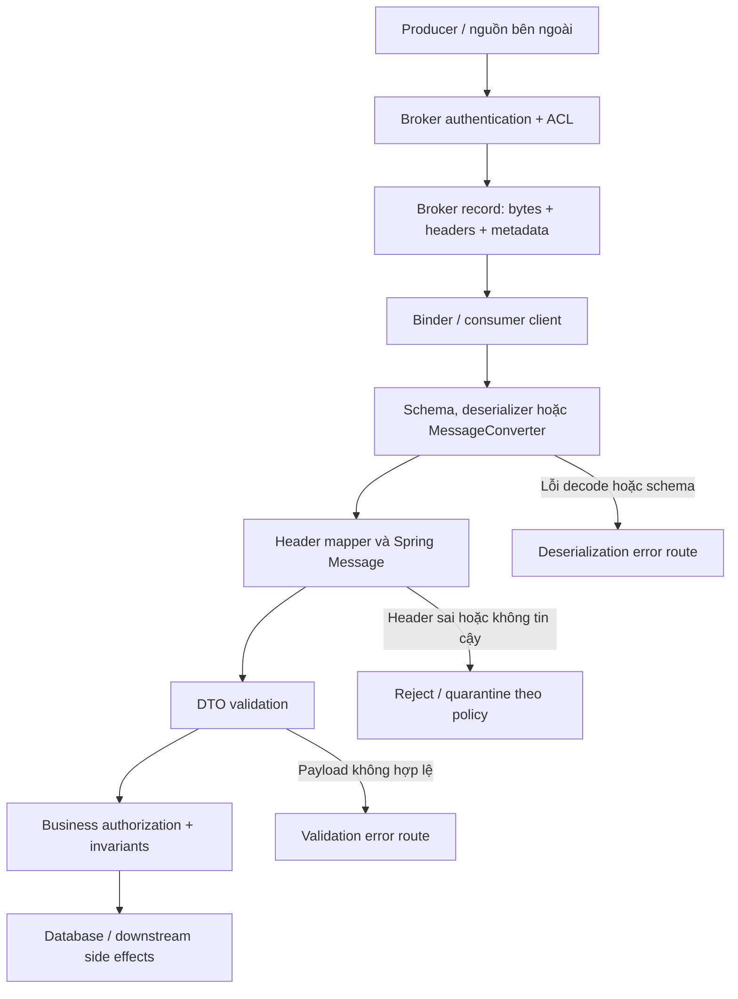

# Kiểm soát dữ liệu đầu vào, kiểu deserialization và header tin cậy

Một consumer Spring Cloud Stream nhận dữ liệu từ broker như nhận dữ liệu từ một ranh giới mạng: producer có thể là ứng dụng khác nhóm, một phiên bản cũ, một chương trình viết bằng ngôn ngữ khác hoặc một nguồn không đáng tin cậy. Payload có thể sai định dạng, thiếu trường, vượt kích thước cho phép hoặc cố điều khiển kiểu Java mà consumer sẽ khởi tạo. Header cũng có thể bị giả mạo, chứa giá trị quá lớn hoặc khai báo một class name không nằm trong hợp đồng message.

Muốn xử lý an toàn, cần kiểm soát riêng từng lớp: xác thực kết nối và quyền truy cập broker, kiểm tra schema/định dạng bytes, chọn kiểu deserialization có giới hạn, kiểm tra header, xác thực DTO sau khi chuyển đổi và kiểm tra quy tắc nghiệp vụ trước side effect. Không có một annotation hoặc một thuộc tính `trustedPackages` nào thay thế được toàn bộ các lớp đó.

## 1. Các ranh giới tin cậy của một message

Một message đi vào ứng dụng thường trải qua các bước:

1. Broker xác thực client và kiểm tra quyền đọc topic/queue/subscription.
2. Binder nhận record/message cùng payload bytes và metadata của broker.
3. Serializer/deserializer hoặc message converter chuyển bytes thành kiểu dữ liệu ứng dụng.
4. Header mapper chuyển metadata của broker thành Spring `MessageHeaders`.
5. Function/Consumer kiểm tra cấu trúc và dữ liệu của payload, header.
6. Service nghiệp vụ kiểm tra quyền và invariant trước khi ghi database hoặc gọi dịch vụ khác.



Các lớp bảo vệ giải quyết những vấn đề khác nhau:

| Lớp | Câu hỏi cần trả lời | Ví dụ kiểm soát |
| --- | --- | --- |
| Broker security | Ai được kết nối và đọc topic? | TLS, SASL, credentials, ACL, tenant/namespace policy |
| Schema/format | Bytes có đúng định dạng đã công bố không? | JSON parser, Avro/Protobuf/Pulsar schema, schema compatibility |
| Deserialization | Bytes được chuyển thành kiểu nào? | Target type cố định, type mapping allowlist, không tin class name tùy ý |
| Header mapping | Header nào được đưa vào Spring và kiểu nào được phục hồi? | Header allowlist, trusted packages, giới hạn kích thước |
| DTO validation | Các trường có đúng ràng buộc cấu trúc không? | Jakarta Bean Validation, required fields, range/length |
| Business validation | Người gửi có được phép thực hiện hành động này không? | Tenant authorization, ownership, state transition, idempotency |

Broker ACL không làm payload trở nên hợp lệ. Một producer có quyền ghi topic vẫn có thể gửi JSON sai hoặc header độc hại do lỗi ứng dụng hay bị chiếm quyền. Tương tự, `trustedPackages` không xác thực người gửi và không thay thế ACL.

## 2. Phân biệt payload, content type, schema và header

Spring Cloud Stream biểu diễn message bằng payload và `MessageHeaders`. Broker lại có mô hình wire riêng. Cần phân biệt bốn khái niệm:

| Khái niệm | Mô tả | Ví dụ |
| --- | --- | --- |
| Payload | Nội dung nghiệp vụ chính | `OrderCreated`, bytes JSON, Avro record |
| Content type | Gợi ý định dạng để Spring chọn `MessageConverter` | `application/json`, `application/avro` |
| Schema | Hợp đồng cấu trúc và kiểu dữ liệu của payload | JSON Schema, Avro schema, Protobuf descriptor, Pulsar schema |
| Header | Metadata đi cùng message | `eventId`, `correlationId`, `tenantId`, `traceparent` |

`contentType` không phải bằng chứng rằng payload thật sự là JSON. Producer có thể khai báo `application/json` nhưng gửi bytes không phải JSON. Consumer vẫn phải parse và xử lý lỗi.

Schema cũng không thay thế kiểm tra nghiệp vụ. Một record có thể đúng schema nhưng có `totalCents = -1`, `tenantId` không được phép hoặc trạng thái đơn hàng không hợp lệ.

Header không phải payload. Không nên đưa toàn bộ DTO, stack trace, access token hoặc object Java lớn vào header chỉ để tránh thay đổi schema payload.

## 3. Thứ tự chọn content type trong Spring Cloud Stream

Spring Cloud Stream chọn content type theo thứ tự ưu tiên:

1. Header `contentType` của message nếu có.
2. Cấu hình `spring.cloud.stream.bindings.<binding>.content-type`.
3. Mặc định `application/json` nếu không có hai thông tin trên.

Ví dụ cấu hình binding:

```yaml
spring:
  cloud:
    function:
      definition: processOrder
    stream:
      bindings:
        processOrder-in-0:
          destination: orders.created
          group: order-service
          content-type: application/json
```

Khai báo `content-type` giúp consumer chọn converter cho binding. Tuy nhiên, nếu message mang header `contentType` khác, header có độ ưu tiên cao hơn. Với nguồn bên ngoài, hãy xác định rõ ai được phép quyết định content type; không dùng một header tùy ý làm căn cứ để bật một converter không được dự kiến.

Nếu ứng dụng chỉ chấp nhận JSON cho binding, hãy kiểm thử các trường hợp header thiếu, header sai và payload không phải JSON. Khi cần wire format khác, dùng native encoding/decoding hoặc converter đã được cấu hình rõ ràng.

## 4. Deserialization là điểm rủi ro trước khi hàm nghiệp vụ chạy

Deserialization chuyển bytes thành object. Đây là bước cần thiết, nhưng nó có thể trở thành ranh giới nguy hiểm nếu ứng dụng để dữ liệu bên ngoài điều khiển class sẽ được khởi tạo.

Các tình huống thường gặp:

- JSON có trường sai kiểu hoặc cấu trúc lồng quá sâu.
- Message mang type header khai báo class Java ngoài hợp đồng.
- Jackson được bật polymorphic default typing quá rộng.
- Consumer dùng Java native serialization với dữ liệu đến từ broker bên ngoài.
- Schema hoặc class của producer và consumer không tương thích.
- Header mapper cố phục hồi object từ JSON type metadata không đáng tin.

Nguyên tắc an toàn:

- Ưu tiên DTO cụ thể hoặc `byte[]`/`String` rồi chuyển đổi bằng code có kiểm soát.
- Không dùng Java native serialization cho message giữa các service.
- Không bật Jackson default typing toàn cục cho dữ liệu không tin cậy.
- Không để tên class trong header quyết định tùy ý kiểu Java được nạp.
- Nếu cần nhiều kiểu payload, dùng token/schema ID allowlist ánh xạ tới một tập class đã biết.
- Giới hạn kích thước message, số trường, độ sâu lồng nhau và kích thước chuỗi theo hợp đồng.
- Xử lý lỗi parse/deserialization ở tầng binder/client vì hàm nghiệp vụ có thể chưa được gọi.

## 5. Không dùng Java native deserialization cho message không tin cậy

Java serialization có thể khôi phục object graph từ byte stream và gọi logic trong quá trình khởi tạo object. Một payload được tạo có chủ đích có thể kích hoạt chuỗi gadget nếu classpath có lớp phù hợp. Ngoài rủi ro bảo mật, Java serialization còn ghép chặt producer và consumer vào cùng hệ class, khó tương tác với Go, Python, Node.js hoặc các hệ thống không dùng Java.

RabbitMQ `SimpleMessageConverter` có thể xử lý content type `application/x-java-serialized-object`, nhưng tài liệu Spring AMQP không khuyến nghị dựa vào cơ chế này. Với Spring Cloud Stream, ưu tiên JSON, Avro hoặc Protobuf theo schema được quản lý.

Không nhận một message Java serialized chỉ vì producer là một service nội bộ. Nếu cần tương thích dữ liệu cũ, hãy cô lập migration consumer, xác thực nguồn, giới hạn class filter và chuyển dữ liệu sang format có schema rõ ràng.

## 6. Jackson polymorphic typing và type metadata

Một số serializer thêm type information vào header để consumer biết class cụ thể cần tạo. Với Kafka, Spring Kafka JSON serializer/deserializer có thể truyền type headers. Với RabbitMQ, Jackson message converter có thể dùng `__TypeId__` và các header liên quan. Với Pulsar, schema và message type mapping có vai trò riêng; custom user properties không nên trở thành cơ chế nạp class tùy ý.

Type header là dữ liệu do producer gửi. Không coi nó là nguồn sự thật đáng tin chỉ vì header có tên giống framework.

Ví dụ một type header có thể khai báo `com.acme.events.OrderCreated`. Nếu consumer tin mọi class name, một producer có thể yêu cầu consumer khởi tạo kiểu ngoài hợp đồng. Dùng một trong các cách sau:

- Target type cố định theo binding, ví dụ binding `orders.created` chỉ giải mã `OrderCreated`.
- Mapping token ngắn tới class đã biết, ví dụ `order-created -> OrderCreated`.
- Type resolver kiểm tra topic, schema version và discriminator đã allowlist.
- Bỏ qua type header từ producer và dùng kiểu consumer đã cấu hình.

Không bật Jackson default typing cho mọi object trong hệ thống chỉ để xử lý vài payload đa hình. Nếu polymorphism là yêu cầu nghiệp vụ, hãy khai báo discriminator như `eventType` với tập giá trị hữu hạn và kiểm tra nó trước khi chọn subtype.

## 7. Kiểm tra DTO sau khi deserialization

Deserialization chỉ chứng minh parser tạo được object. Jakarta Bean Validation giúp kiểm tra các ràng buộc trên object trước khi gọi service nghiệp vụ.

Ví dụ DTO:

```java
import jakarta.validation.constraints.NotBlank;
import jakarta.validation.constraints.Positive;
import jakarta.validation.constraints.Size;

public record OrderCreated(
        @NotBlank
        @Size(max = 80)
        String eventId,

        @NotBlank
        @Size(max = 80)
        String orderId,

        @NotBlank
        @Size(max = 80)
        String tenantId,

        @Positive
        long totalCents
) {}
```

Các annotation trên kiểm tra chuỗi bắt buộc, giới hạn độ dài và giá trị dương. Chúng không tự chạy chỉ vì record được deserialize; ứng dụng cần gọi validator hoặc dùng một cơ chế validation đã được cấu hình rõ.

Trong Spring Boot, thêm `spring-boot-starter-validation` để có provider Jakarta Bean Validation và cấu hình `Validator`. Khi một DTO không hợp lệ, thường nên phân loại `InvalidOrderMessageException` là non-retryable: việc thử lại cùng payload sai không làm dữ liệu tự hợp lệ. Hãy chuyển nó tới DLQ/quarantine theo chính sách của binder.

Ví dụ trong function imperative:

```java
import java.util.Set;
import java.util.function.Consumer;

import jakarta.validation.ConstraintViolation;
import jakarta.validation.Validator;
import org.springframework.context.annotation.Bean;
import org.springframework.context.annotation.Configuration;

@Configuration(proxyBeanMethods = false)
public class OrderFunctions {

    @Bean
    Consumer<OrderCreated> processOrder(
            Validator validator,
            OrderService orderService) {

        return event -> {
            Set<ConstraintViolation<OrderCreated>> violations =
                    validator.validate(event);

            if (!violations.isEmpty()) {
                throw new InvalidOrderMessageException(
                        "OrderCreated payload failed validation: "
                                + violations.size() + " violation(s)");
            }

            orderService.process(event);
        };
    }
}
```

`InvalidOrderMessageException` là exception nghiệp vụ của ứng dụng. Không đưa nguyên payload hoặc dữ liệu nhạy cảm vào exception message. Binder/error handler có thể dùng exception để định tuyến message lỗi tới DLQ theo cấu hình.

### Validate cả cấu trúc lồng nhau

Nếu DTO chứa object con hoặc danh sách, dùng `@Valid` ở trường lồng nhau:

```java
public record CustomerAddress(
        @NotBlank String city,
        @NotBlank String countryCode
) {}

public record CustomerProfile(
        @NotBlank String customerId,
        @jakarta.validation.Valid CustomerAddress address
) {}
```

Nếu thiếu `@Valid`, validator có thể kiểm tra trường ngoài nhưng không đi sâu vào object con. Với collection, kiểm tra số phần tử tối đa và validate từng phần tử; không để một message tạo danh sách không giới hạn làm cạn bộ nhớ.

## 8. Validation nghiệp vụ không chỉ là Bean Validation

Một payload có thể thỏa mọi annotation nhưng vẫn không hợp lệ trong ngữ cảnh nghiệp vụ. Ví dụ:

- `tenantId` tồn tại nhưng producer không có quyền thao tác tenant đó.
- `orderId` đã hoàn tất và không thể chuyển về trạng thái mới.
- `eventId` đã được xử lý trước đó.
- `totalCents` hợp lệ về kiểu và dấu nhưng vượt hạn mức của khách hàng.
- `customerId` thuộc một tài khoản khác.

Những kiểm tra này cần thực hiện ở service nghiệp vụ với dữ liệu và quyền hiện tại. Không dùng header `tenantId`, `userId`, `role` hoặc `isAdmin` làm bằng chứng phân quyền. Header là metadata do producer gửi; xác thực danh tính phải đến từ cơ chế bảo mật đáng tin cậy.

Trình tự khuyến nghị:

1. Parse/schema validation.
2. DTO structural validation.
3. Xác thực nguồn và tenant theo thông tin bảo mật đã xác minh.
4. Kiểm tra state transition và invariant nghiệp vụ.
5. Kiểm tra duplicate/idempotency.
6. Thực hiện side effect trong transaction hoặc cơ chế nhất quán phù hợp.

## 9. Header tin cậy: chỉ nhận metadata cần thiết

Header thường được dùng cho correlation, tracing, tenant routing, event type, schema version và retry metadata. Tuy nhiên, header do producer gửi vẫn là input. Một header có tên `x-tenant-id` không tự chứng minh message thuộc tenant đó; một header `__TypeId__` không tự chứng minh class được phép tạo; một `contentType` không chứng minh bytes đúng định dạng.

Hãy định nghĩa allowlist cho từng binding:

| Header | Mục đích | Chính sách |
| --- | --- | --- |
| `eventId` | Deduplication và audit | Bắt buộc, chuỗi có độ dài giới hạn, kiểm tra định dạng |
| `correlationId` | Liên kết luồng nghiệp vụ | Tùy chọn, giới hạn độ dài, không dùng làm quyền truy cập |
| `tenantId` | Phân vùng dữ liệu nghiệp vụ | Kiểm tra quyền từ identity đã xác thực, không tin header độc lập |
| `eventType` | Phân loại event | Allowlist token đã biết, không ánh xạ trực tiếp thành class name |
| `schemaVersion` | Chọn schema đã công bố | Kiểm tra tập version hỗ trợ |
| `traceparent`/`tracestate`/`baggage` | Distributed tracing | Để propagator xử lý, giới hạn kích thước, không dùng cho authorization |
| `__TypeId__` hoặc type header tương tự | Gợi ý kiểu Java | Bỏ qua hoặc ánh xạ qua allowlist; không tin class name tùy ý |
| `authorization`, `token`, `password` | Thông tin xác thực | Không chuyển tiếp trong message header; loại bỏ và không log |

Đừng copy toàn bộ header từ message inbound sang message outbound. Hãy tạo message mới với danh sách business header được phép. Framework có thể thêm header nội bộ phục vụ acknowledgment, retry, type mapping hoặc metadata broker; chuyển tiếp chúng tùy tiện có thể làm lộ dữ liệu hoặc thay đổi hành vi downstream.

## 10. Giới hạn header và payload

Giới hạn kích thước phải được áp dụng ở nhiều tầng:

- Broker/client frame hoặc maximum message size.
- Kích thước payload sau khi giải nén nếu có compression.
- Tổng kích thước header và từng giá trị header.
- Số lượng header trên mỗi message.
- Độ sâu JSON và kích thước collection/string.
- Thời gian parse và validate.

Đừng chỉ kiểm tra kích thước bytes trước khi giải nén. Một payload nén nhỏ có thể bung thành dữ liệu rất lớn. Với JSON, cấu hình giới hạn parser phù hợp với Jackson version; với Avro/Protobuf, giới hạn frame/message ở tầng broker và client; với Pulsar, kiểm tra giới hạn message và schema của broker/client.

Không dùng stack trace, payload lớn hoặc danh sách ID dài làm header. Các header được truyền cùng message và có thể xuất hiện trong log, tracing backend hoặc công cụ quản trị.

## 11. Kafka: payload deserialization và header mapping là hai cấu hình khác nhau

Kafka record có key, value và native record headers. Spring Cloud Stream Kafka binder có thể dùng message conversion của Spring Cloud Stream hoặc native deserialization của Kafka client. Hai đường này khác nhau:

| Chế độ | Ai chuyển bytes thành object? | Nơi cấu hình chính |
| --- | --- | --- |
| Message conversion mặc định | Spring Cloud Stream `MessageConverter` dựa trên target type và content type | `spring.cloud.stream.bindings.<binding>.content-type` |
| Native decoding | Kafka `Deserializer` được cấu hình cho consumer | `spring.cloud.stream.kafka.bindings.<binding>.consumer.configuration` và `use-native-decoding` |
| Header mapping | Kafka header mapper chuyển native headers sang Spring `MessageHeaders` | `spring.cloud.stream.kafka.binder.headerMapperBeanName` và bean `KafkaHeaderMapper` |

Không nhầm trusted packages của JSON payload deserializer với trusted packages của JSON header mapper. Một cấu hình không tự bảo vệ cấu hình còn lại.

### 11.1. Ưu tiên target type cố định khi binding có một event contract

Nếu topic `orders.created` chỉ chứa `OrderCreated`, cấu hình binding có content type JSON và function nhận DTO cụ thể:

```yaml
spring:
  cloud:
    function:
      definition: processOrder
    stream:
      bindings:
        processOrder-in-0:
          destination: orders.created
          group: order-service
          content-type: application/json
```

```java
@Bean
Consumer<OrderCreated> processOrder(OrderService service) {
    return event -> service.process(event);
}
```

Ở cách này, Spring Cloud Stream dùng content type và kiểu tham số để chọn converter. Không cần để một class name tùy ý trong header quyết định kiểu payload. Vẫn phải validate DTO và xử lý lỗi parse.

### 11.2. Khi dùng native Kafka JSON deserialization

Nếu binding bật native decoding và dùng Spring Kafka JSON deserializer, có thể cấu hình target type cố định, bỏ qua type header của producer và giới hạn trusted package. Ví dụ dưới đây minh họa cấu hình consumer-specific; tên class deserializer phải khớp Spring Kafka version trong BOM của ứng dụng:

```yaml
spring:
  cloud:
    stream:
      bindings:
        processOrder-in-0:
          destination: orders.created
          group: order-service
          consumer:
            use-native-decoding: true
      kafka:
        bindings:
          processOrder-in-0:
            consumer:
              configuration:
                value.deserializer: org.springframework.kafka.support.serializer.ErrorHandlingDeserializer
                spring.deserializer.value.delegate.class: org.springframework.kafka.support.serializer.JacksonJsonDeserializer
                spring.json.value.default.type: com.acme.events.OrderCreated
                spring.json.use.type.headers: false
                spring.json.trusted.packages: com.acme.events
```

Ý nghĩa:

- `use-native-decoding: true` yêu cầu binder dùng Kafka deserializer thay cho Spring Cloud Stream message conversion.
- `ErrorHandlingDeserializer` bọc delegate để lỗi deserialization có thể được chuyển tới error handling của Spring Kafka.
- `spring.json.value.default.type` chọn DTO mặc định khi không dùng type header.
- `spring.json.use.type.headers: false` bỏ qua type header do producer gửi.
- `spring.json.trusted.packages` giới hạn package được phép phục hồi khi deserializer cần dùng type metadata.

Ví dụ này chỉ phù hợp khi binder/version thực tế sử dụng Spring Kafka JSON deserializer tương ứng. Nếu dùng serializer khác, Avro/Protobuf hoặc Schema Registry, cấu hình theo serializer/deserializer đó. Không copy class name từ ví dụ vào một BOM khác mà chưa kiểm tra class tồn tại.

### 11.3. Khi thật sự cần nhiều payload type

Nếu một topic chứa nhiều event type, ưu tiên một hợp đồng rõ ràng:

- Dùng token như `order-created` hoặc `order-cancelled`.
- Map token tới một class đã biết ở consumer.
- Kiểm tra token nằm trong allowlist trước khi chọn kiểu.
- Giữ schema version và compatibility policy.
- Không cho producer gửi fully-qualified Java class name tùy ý.

Spring Kafka hỗ trợ type mappings dạng token/class pair. Producer và consumer có thể dùng token giống nhau nhưng class nằm ở package khác nhau, miễn hai class tương thích về dữ liệu. Đây là cách giảm coupling so với việc truyền class name trực tiếp.

### 11.4. Trusted header mapper của Kafka binder

Kafka header mapper xử lý native record headers, tách biệt với payload deserializer. Kafka binder hỗ trợ `headerMapperBeanName` để chỉ định bean `KafkaHeaderMapper` dùng cho mapping Spring headers và Kafka headers.

```yaml
spring:
  cloud:
    stream:
      kafka:
        binder:
          header-mapper-bean-name: safeKafkaHeaderMapper
```

Bean được chỉ định nên là `BinderHeaderMapper` hoặc `KafkaHeaderMapper` tùy mục tiêu. Nếu dùng JSON header mapping, cấu hình trusted packages chỉ cho các package header DTO thật sự cần thiết, ví dụ `com.acme.messaging.headers`. Không thêm toàn bộ package ứng dụng nếu không cần và không dùng `*` với header đến từ producer không tin cậy.

Nếu một header có kiểu không được tin cậy, mapper có thể đưa nó về dạng `NonTrustedHeaderType` thay vì khởi tạo class đó. Code nghiệp vụ phải kiểm tra kiểu nhận được; không cast mù quáng sang DTO.

## 12. RabbitMQ: content type, TypeId và trusted packages

RabbitMQ message có body bytes và AMQP properties/headers. Spring AMQP dùng `MessageConverter` để chuyển body thành object. `JacksonJsonMessageConverter` có thể đọc type information trong message properties như `__TypeId__` và các header liên quan.

Một số điểm cần chú ý:

- `contentType` phải là JSON-compatible để Jackson converter xử lý JSON.
- Nếu consumer biết target type, có thể cấu hình kiểu mặc định hoặc mapping token sang class.
- Type information do producer gửi có thể ảnh hưởng lựa chọn kiểu khi converter không có target type cố định.
- `trustedPackages` giới hạn package được phép khởi tạo từ type metadata; mặc định converter chỉ tin các package nền tảng `java.util` và `java.lang`.
- Dùng `*` nghĩa là tin tất cả package; tránh lựa chọn này cho queue nhận message từ bên ngoài trust boundary.

Ví dụ mapping token tới class:

```java
@Bean
JacksonJsonMessageConverter orderMessageConverter() {
    JacksonJsonMessageConverter converter = new JacksonJsonMessageConverter();
    DefaultClassMapper mapper = new DefaultClassMapper();

    Map<String, Class<?>> types = new HashMap<>();
    types.put("order-created", OrderCreated.class);
    types.put("order-cancelled", OrderCancelled.class);

    mapper.setIdClassMapping(types);
    mapper.setTrustedPackages("com.acme.events");
    converter.setClassMapper(mapper);
    return converter;
}
```

Đây là ví dụ theo API Spring AMQP hiện hành dùng Jackson 3; với release train cũ, tên converter/type mapper có thể là biến thể Jackson 2 và đã bị deprecate trong Spring AMQP 4.x. Kiểm tra package và API của BOM trước khi dùng. Mapping token rõ ràng giúp consumer chỉ khôi phục hai kiểu đã công bố.

Ví dụ `JacksonJsonMessageConverter`/`DefaultClassMapper` ở trên mô tả cơ chế Spring AMQP khi converter đó thực sự được gắn vào `RabbitTemplate` hoặc listener container. Với Spring Cloud Stream Rabbit binder, payload conversion mặc định thuộc lớp `MessageConverter` của Spring Cloud Stream. Không giả định chỉ cần khai báo bean `JacksonJsonMessageConverter` là binder tự dùng nó. Nếu cần converter tùy chỉnh trong Spring Cloud Stream, đăng ký `org.springframework.messaging.converter.MessageConverter` theo cơ chế user-defined converter của framework và kiểm thử qua đúng binding; nếu dùng trực tiếp Spring AMQP, cấu hình converter trên template/container tương ứng.

### 12.1. Tránh Java serialization trên RabbitMQ

`SimpleMessageConverter` có thể deserialize body mang content type `application/x-java-serialized-object`. Không bật hoặc chấp nhận định dạng này cho queue có producer không hoàn toàn tin cậy. Dùng JSON converter hoặc schema-based format và cấu hình target type/mapping rõ ràng.

### 12.2. Header AMQP vẫn cần allowlist

Header AMQP có thể chứa giá trị kiểu số, chuỗi, byte array hoặc kiểu AMQP khác. Hãy chỉ đọc các header nghiệp vụ đã định nghĩa, kiểm tra kiểu trước khi cast và giới hạn độ dài. Không dùng `tenantId`, `role` hoặc `userId` trong AMQP header làm cơ chế xác thực.

## 13. Pulsar: schema validation và message properties

Pulsar hỗ trợ schema như JSON, Avro, Protobuf và KeyValue. Spring for Apache Pulsar có thể suy luận schema cho primitive; với kiểu phức tạp, framework thường dùng JSON nếu không cấu hình khác. Khi dùng schema native, producer và consumer cần khai báo schema type phù hợp.

Spring Cloud Stream Pulsar binder có hai đường:

- Spring message conversion mặc định: payload được chuyển thành `byte[]` theo content type, binder gửi/nhận qua `Schema.BYTES`, sau đó Spring converter chuyển thành target type.
- Native encoding/decoding: Pulsar Schema chịu trách nhiệm encode/decode; binding bật `use-native-encoding` hoặc `use-native-decoding` và cấu hình `schema-type`, `message-type` tương ứng.

Ví dụ native JSON schema:

```yaml
spring:
  cloud:
    stream:
      bindings:
        orders-out-0:
          producer:
            use-native-encoding: true
        processOrder-in-0:
          consumer:
            use-native-decoding: true
      pulsar:
        bindings:
          orders-out-0:
            producer:
              schema-type: JSON
              message-type: com.acme.events.OrderCreated
          processOrder-in-0:
            consumer:
              schema-type: JSON
              message-type: com.acme.events.OrderCreated
```

Schema giúp xác định cấu trúc wire và compatibility giữa producer/consumer. Tuy vậy, schema hợp lệ không chứng minh giá trị đúng nghiệp vụ. Sau khi decode, vẫn validate DTO và authorization.

Pulsar message properties là cặp key/value dạng chuỗi. Hãy giữ chúng đơn giản: `eventId`, `correlationId`, `tenantId`, `eventType`, `schemaVersion`. Đừng truyền Java class name rồi tự nạp class từ property. Nếu dùng `PulsarHeaderMapper` với JSON typed headers, cấu hình trusted packages theo allowlist và kiểm tra giá trị header sau khi mapping.

Khi không biết trước schema của topic, Pulsar hỗ trợ `AUTO_CONSUME`/`GenericRecord` để đọc record theo schema gắn với topic. Dùng cách này khi cần công cụ kiểm tra hoặc consumer đa schema; không tự động chuyển mọi generic record thành class bất kỳ.

## 14. Header type không phải schema ID

Một số hệ thống dùng header để chứa schema ID hoặc type token. Những giá trị này chỉ là tham chiếu. Consumer phải tra cứu trong registry hoặc mapping allowlist, sau đó xác nhận schema nằm trong tập được phép cho topic/binding.

Không thực hiện các hành động sau:

- Dùng header `className` để gọi `Class.forName()` trực tiếp.
- Cho phép một schema ID bất kỳ trỏ tới schema ngoài namespace của ứng dụng.
- Chọn deserializer tùy ý chỉ dựa trên `contentType` do producer gửi.
- Tin `eventType` là một class name hoặc tên bean Spring.

Hãy dùng schema registry có xác thực và ACL, versioning rõ ràng, compatibility policy và mapping code/token có giới hạn. Consumer chỉ nên hiểu các event type mà nó đã đăng ký hỗ trợ.

## 15. Kiểm tra header trước khi dùng

Khi function nhận `Message<T>`, kiểm tra header bắt buộc, kiểu và độ dài trước khi sử dụng:

```java
import java.util.Set;
import java.util.function.Consumer;

import jakarta.validation.ConstraintViolation;
import jakarta.validation.Validator;
import org.springframework.context.annotation.Bean;
import org.springframework.context.annotation.Configuration;
import org.springframework.messaging.Message;

@Configuration(proxyBeanMethods = false)
public class OrderMessageFunctions {

    @Bean
    Consumer<Message<OrderCreated>> processOrderMessage(
            Validator validator,
            OrderService service) {

        return message -> {
            String eventId = requiredHeader(message, "eventId", 80);
            String tenantId = requiredHeader(message, "tenantId", 80);

            OrderCreated event = message.getPayload();
            if (!event.eventId().equals(eventId)) {
                throw new InvalidOrderMessageException(
                        "eventId header does not match payload");
            }

            Set<ConstraintViolation<OrderCreated>> violations =
                    validator.validate(event);
            if (!violations.isEmpty()) {
                throw new InvalidOrderMessageException(
                        "Order payload failed validation");
            }

            service.processForTenant(tenantId, event);
        };
    }

    private static String requiredHeader(
            Message<?> message, String name, int maxLength) {

        Object raw = message.getHeaders().get(name);
        if (!(raw instanceof String value)
                || value.isBlank()
                || value.length() > maxLength) {
            throw new InvalidOrderMessageException(
                    "Missing or invalid header: " + name);
        }
        return value;
    }
}
```

Đoạn code chỉ minh họa validation trong consumer. `service.processForTenant` vẫn phải xác minh tenant với identity/authorization đáng tin cậy. Việc so sánh `eventId` header với payload giúp phát hiện message mâu thuẫn, nhưng không thay thế idempotency store.

Không lấy header từ `MessageHeaders` rồi cast trực tiếp:

```java
// Không an toàn nếu header có thể đến từ producer ngoài ứng dụng.
String tenantId = (String) message.getHeaders().get("tenantId");
```

Hãy kiểm tra `instanceof`, null, độ dài, ký tự hợp lệ và allowlist trước khi dùng.

## 16. Giới hạn loại header được chuyển tiếp

Khi function tạo message mới, chỉ copy business headers cần thiết. Ví dụ:

```java
Message<OrderValidated> output = MessageBuilder
        .withPayload(validated)
        .setHeader("eventId", input.getHeaders().get("eventId"))
        .setHeader("correlationId", input.getHeaders().get("correlationId"))
        .setHeader("eventType", "order-validated")
        .build();
```

Không copy tất cả header inbound vì chúng có thể chứa:

- Metadata nội bộ của binder hoặc broker.
- Header type information từ producer.
- Header retry/exception.
- Header chứa raw data hoặc thông tin nhạy cảm.
- Header có giá trị không đúng kiểu mà downstream mong đợi.

Trace headers nên được tracing propagator quản lý. Header authorization/token nên được loại bỏ khỏi event. Với tenant header, chỉ chuyển tiếp sau khi ứng dụng đã xác minh tenant và chính sách downstream yêu cầu nó.

## 17. Xử lý lỗi deserialization trước khi function được gọi

Một lỗi parse có thể xảy ra trước khi Spring Cloud Function gọi `Consumer`/`Function`. Vì vậy, `Validator` trong code nghiệp vụ không thể bắt mọi message lỗi.

Các lỗi xảy ra trước function gồm:

- Kafka deserializer không đọc được key/value.
- Jackson không parse được JSON hoặc không tìm thấy class được khai báo trong type header.
- Rabbit converter không nhận được content type phù hợp hoặc không thể map type ID.
- Pulsar schema không tương thích hoặc native decoding thất bại.
- Header mapper không thể chuyển đổi giá trị header.

Với Kafka, Spring Kafka cung cấp `ErrorHandlingDeserializer` để bọc delegate deserializer. Nếu delegate thất bại, wrapper giữ raw bytes và exception metadata để error handler/recoverer xử lý thay vì để record biến mất trước khi listener nhận được.

Ví dụ cấu hình ở cấp Kafka consumer client:

```java
props.put(ConsumerConfig.VALUE_DESERIALIZER_CLASS_CONFIG,
        ErrorHandlingDeserializer.class);
props.put(ErrorHandlingDeserializer.VALUE_DESERIALIZER_CLASS,
        JacksonJsonDeserializer.class);
props.put(JacksonJsonDeserializer.VALUE_DEFAULT_TYPE,
        "com.acme.events.OrderCreated");
props.put(JacksonJsonDeserializer.TRUSTED_PACKAGES,
        "com.acme.events");
```

Khi dùng Spring Cloud Stream Kafka binder, đặt các consumer properties trong cấu hình của input binding hoặc tạo consumer/container customizer theo hướng dẫn binder. Không đặt các property Kafka consumer ở namespace binder dùng chung cho cả producer và consumer nếu chúng không phải property chung.

Nếu error handler publish record lỗi sang DLT, serializer của DLT producer phải hỗ trợ raw `byte[]` cho record không thể deserialize. Không cố serialize lại raw bytes như DTO đã parse thành công.

## 18. Schema compatibility và versioning

Thay đổi schema cần được đánh giá theo cả producer lẫn consumer đang chạy song song. Một thay đổi hợp lệ với code mới có thể làm consumer cũ không đọc được.

Một số hướng dẫn:

- Ưu tiên thêm field optional có default phù hợp khi mở rộng schema.
- Không đổi kiểu field hiện hữu nếu chưa có migration.
- Không đổi ý nghĩa của field mà giữ nguyên tên và kiểu.
- Giữ enum có phương án cho giá trị mới nếu consumer cần tương thích tiến.
- Kiểm tra compatibility policy của Schema Registry hoặc Pulsar schema registry trước khi publish schema mới.
- Test producer mới với consumer cũ và producer cũ với consumer mới.
- Ghi `schemaVersion`/event version theo hợp đồng; không dùng version để nạp class tùy ý.

Với JSON không có registry, hãy công bố JSON Schema/OpenAPI/event contract, kiểm tra trong CI và chạy contract test. JSON parser thành công không có nghĩa message tuân thủ schema đã thống nhất.

## 19. Lỗi thường gặp

| Hiện tượng | Nguyên nhân có thể | Cách xử lý |
| --- | --- | --- |
| JSON parse thành `Map` thay vì DTO | Không có target type hoặc generic type không được suy luận | Dùng function signature cụ thể, content type và converter phù hợp |
| Consumer tạo class ngoài dự kiến | Tin type header hoặc bật polymorphic typing quá rộng | Dùng target type cố định, token mapping allowlist và trusted packages nhỏ |
| Header object trở thành `NonTrustedHeaderType` | Package của header class chưa được tin cậy | Kiểm tra kiểu nhận được; chỉ thêm package cần thiết sau khi review |
| Header tenant bị giả mạo | Dùng header làm danh tính/authorization | Xác minh tenant từ identity đáng tin và kiểm tra quyền ở service |
| Function không nhận được message lỗi | Deserialization thất bại trước khi function chạy | Cấu hình error handling ở deserializer/container/binder và DLQ |
| Content type ghi JSON nhưng payload không phải JSON | Producer khai báo sai hoặc bị giả mạo | Kiểm tra bytes thực tế, xử lý conversion exception và đưa message lỗi vào error route |
| Payload đúng schema nhưng nghiệp vụ sai | Chỉ kiểm tra schema, không kiểm tra invariant | Dùng Bean Validation và business authorization |
| Message lỗi được retry mãi | Parse/schema error không thể tự hết nhưng bị coi là transient | Phân loại lỗi non-retryable và route sang DLQ/quarantine |
| DLT không giữ được record parse lỗi | DLT producer chỉ serialize DTO mà không hỗ trợ raw bytes | Dùng serializer hỗ trợ cả DTO và `byte[]` |
| Header quá lớn gây lỗi broker hoặc tăng chi phí | Không giới hạn số lượng/độ dài header | Allowlist, giới hạn kích thước và giữ payload lớn trong body |
| Producer/consumer lệch schema version | Không có compatibility check hoặc rollout không theo thứ tự | Contract test, schema registry và chiến lược rollout tương thích |

## 20. Kiểm thử bảo mật input và header

Một bộ test an toàn nên bao gồm cả payload hợp lệ, payload sai định dạng và metadata độc hại:

| Test case | Kỳ vọng |
| --- | --- |
| Payload JSON hợp lệ, đủ trường | Deserialize, validate và xử lý thành công |
| Thiếu trường bắt buộc | Validation thất bại trước side effect |
| Chuỗi vượt giới hạn | Bị từ chối theo DTO/header size policy |
| Số âm hoặc ngoài miền cho phép | Bean Validation/business validation thất bại |
| JSON sai cú pháp | Deserialization error route được gọi; function không chạy |
| `contentType` không hỗ trợ | Conversion bị từ chối hoặc raw bytes được xử lý theo policy đã định |
| Type header khai báo class ngoài allowlist | Không khởi tạo class; error handler hoặc mapper trả non-trusted marker |
| Type token không biết | Bị từ chối, không fallback sang class tùy ý |
| Header `tenantId` không khớp quyền | Authorization thất bại, không có side effect |
| Header nhạy cảm | Không được chuyển tiếp và không xuất hiện trong log |
| Payload/header vượt kích thước | Bị giới hạn trước khi tiêu thụ quá nhiều bộ nhớ |
| Schema version không hỗ trợ | Được định tuyến tới error handling/DLQ theo chính sách |
| Message duplicate | Idempotency ngăn side effect lặp |

Unit test kiểm tra DTO validator, allowlist và logic header. Integration test với broker thật xác minh deserializer, converter, header mapper, schema và dead-letter behavior. Test Binder không mô phỏng toàn bộ semantics của Kafka/RabbitMQ/Pulsar.

## 21. Không ghi dữ liệu đầu vào nhạy cảm vào log

Khi message lỗi, log nên ghi đủ thông tin để tìm sự cố mà không lộ payload hoặc secret:

- Destination/topic/queue và consumer group/subscription.
- Event ID hoặc correlation ID đã qua kiểm tra.
- Exception class và lý do validation tổng quát.
- Schema version và event type đã allowlist.
- Broker offset/message ID khi có.
- Trace ID nếu tracing được cấu hình.

Tránh log toàn bộ body, toàn bộ `MessageHeaders`, access token, cookie, địa chỉ hoặc thông tin thanh toán. Nếu cần lưu raw bytes để điều tra, đưa vào kho lưu trữ lỗi có ACL, encryption, retention và quy trình truy cập riêng; không nhét raw payload vào exception message.

## 22. Checklist triển khai production

Trước khi mở consumer cho producer hoặc topic mới:

- Xác định nguồn producer và ranh giới trust.
- Cấu hình TLS/SASL/ACL cho broker; chỉ cấp quyền tối thiểu.
- Công bố schema và content type; kiểm tra compatibility trước deploy.
- Dùng DTO/target type cụ thể; tránh Java native serialization.
- Không để type header điều khiển class tùy ý.
- Giới hạn trusted packages và header allowlist.
- Giữ payload schema tách biệt với header mapper.
- Kiểm tra header bắt buộc, kiểu, độ dài và giá trị.
- Chạy Jakarta Bean Validation trước side effect.
- Kiểm tra authorization và tenant từ nguồn identity đáng tin.
- Giới hạn kích thước message, header, nesting và collection.
- Cấu hình deserialization error handling và DLQ/quarantine.
- Bảo đảm DLT producer giữ được raw bytes khi decode thất bại.
- Dùng idempotency cho retry/redelivery.
- Viết unit, contract và broker integration tests.
- Không log raw payload hoặc secret.
- Theo dõi số validation failure, deserialize failure, unknown type/header và DLQ growth.

## Tài liệu tham khảo

- [Spring Cloud Stream — Content Type Negotiation and Message Conversion](https://docs.spring.io/spring-cloud-stream/reference/content-type.html)
- [Spring Cloud Stream Kafka Binder — Configuration Options and Header Mapper](https://docs.spring.io/spring-cloud-stream/reference/kafka/kafka-binder/config-options.html)
- [Spring Cloud Stream Kafka Binder — Consumer Configuration](https://docs.spring.io/spring-cloud-stream/reference/kafka/kafka-binder/config-options.html)
- [Spring for Apache Kafka — Serialization, Deserialization and Message Conversion](https://docs.spring.io/spring-kafka/reference/kafka/serdes.html)
- [Spring for Apache Kafka — ErrorHandlingDeserializer](https://docs.spring.io/spring-kafka/reference/kafka/serdes.html#serdes-error-handling-deserializer)
- [Spring AMQP — Message Converters and Trusted Packages](https://docs.spring.io/spring-amqp/reference/amqp/message-converters.html)
- [Spring Cloud Stream Pulsar Binder — Message Conversion and Native Schema](https://docs.spring.io/spring-cloud-stream/reference/pulsar/pulsar_binder.html)
- [Spring for Apache Pulsar — Message Consumption and Schema Information](https://docs.spring.io/spring-pulsar/reference/reference/pulsar/message-consumption.html)
- [Jakarta Bean Validation — Specification](https://jakarta.ee/specifications/bean-validation/)

Tên class, package Jackson và property có thể thay đổi theo Spring Boot, Spring Cloud Stream, Spring Kafka, Spring AMQP và Spring for Apache Pulsar release train. Hãy kiểm tra API tương ứng với BOM của ứng dụng trước khi áp dụng cấu hình.

## Kết luận

Kiểm soát input an toàn cần nhiều lớp. Schema và deserializer xác định bytes có thể chuyển thành payload nào; content type chỉ là gợi ý cho message converter; trusted packages và type mappings giới hạn kiểu Java có thể được phục hồi; header allowlist giới hạn metadata được tin; Bean Validation kiểm tra DTO; service nghiệp vụ xác minh quyền và invariant trước side effect. Kafka, RabbitMQ và Pulsar có cơ chế schema, header và deserialization khác nhau, vì vậy cần cấu hình riêng cho từng binder và kiểm thử với broker thực tế. Không tin class name, tenant ID hoặc content type chỉ vì chúng xuất hiện trong message header.
