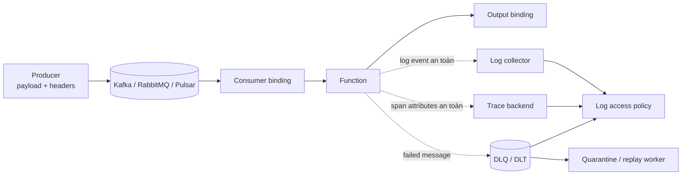

# Che dữ liệu nhạy cảm trong payload log, trace và DLQ

Một message của Spring Cloud Stream có thể đi qua producer, broker, consumer function, log collector, tracing backend và dead-letter destination. Payload và headers có thể được sao chép ở nhiều điểm. Nếu một nơi ghi toàn bộ message hoặc exception, dữ liệu nhạy cảm có thể tồn tại lâu hơn vòng đời nghiệp vụ và được nhiều hệ thống, nhóm vận hành hoặc công cụ phân tích nhìn thấy.

Bảo vệ dữ liệu cần được thiết kế cho ba bề mặt riêng:

- **Log:** ghi sự kiện vận hành đủ để điều tra, nhưng không ghi payload, token, mật khẩu hoặc dữ liệu cá nhân thô.
- **Trace:** chỉ đưa thuộc tính cần thiết vào span; không biến payload, HTTP headers hoặc baggage thành dữ liệu quan sát mặc định.
- **DLQ:** coi dead-letter topic/queue là một bản sao dữ liệu có độ nhạy tương đương message gốc. Kiểm soát payload, headers, exception metadata, quyền đọc, thời hạn lưu và quy trình replay.

Nguyên tắc xuyên suốt là **data minimization**: chỉ thu thập trường cần thiết cho mục đích đã xác định. Nếu cần liên kết nhiều lần xử lý, dùng event ID không chứa thông tin cá nhân hoặc mã giả danh có khóa; không dùng log/trace/DLQ như kho lưu payload để tiện debug.

## 1. Nhận diện dữ liệu cần bảo vệ

Trước khi viết code che dữ liệu, hãy phân loại dữ liệu trong event, header và exception. Những trường thường cần loại bỏ, che, giả danh hóa hoặc mã hóa gồm:

| Nhóm | Ví dụ | Rủi ro khi bị lộ |
|---|---|---|
| Thông tin xác thực | Password, API key, access token, refresh token, cookie, session ID | Chiếm quyền truy cập |
| Bí mật hệ thống | Private key, connection string, credential database, secret cấu hình | Truy cập trái phép vào hạ tầng |
| Thanh toán | PAN thẻ, CVV, số tài khoản, thông tin chủ thẻ | Gian lận và lạm dụng tài chính |
| Định danh cá nhân | Số giấy tờ, ngày sinh, địa chỉ, email, số điện thoại | Xác định hoặc giả mạo cá nhân |
| Dữ liệu nhạy cảm | Sức khỏe, sinh trắc học, vị trí chính xác, dữ liệu trẻ em | Xâm phạm quyền riêng tư |
| Nội dung nghiệp vụ | Nội dung đơn hàng, hợp đồng, giao dịch, thông tin khách hàng | Lộ bí mật kinh doanh |
| Metadata kỹ thuật | Header Authorization, cookie, routing nội bộ, tên queue/topic nhạy cảm | Lộ credential hoặc cấu trúc nội bộ |

Không phải mọi ID đều vô hại. Email dùng làm event key, số điện thoại trong routing key, hoặc customer ID có thể là dữ liệu cá nhân. Hãy phân loại theo khả năng nhận diện và liên kết, không chỉ theo tên field.

### Phân biệt các kỹ thuật

| Kỹ thuật | Kết quả | Khi dùng |
|---|---|---|
| Loại bỏ (redaction) | Không lưu giá trị gốc | Khi không cần giá trị để xử lý hoặc điều tra |
| Che một phần (masking) | Chỉ giữ một phần, ví dụ `****1234` | Khi cần nhận diện hạn chế như bốn số cuối |
| Giả danh hóa (pseudonymization) | Thay giá trị bằng mã ổn định có thể đối chiếu bằng khóa | Khi cần liên kết các lần xử lý mà không lộ ID gốc |
| Băm có khóa (HMAC) | Tạo mã xác định từ secret key và giá trị đầu vào | Khi cần mã giả danh khó suy ngược bằng cách thử từ điển |
| Mã hóa (encryption) | Có thể khôi phục dữ liệu bằng khóa | Khi cần giữ dữ liệu gốc để replay hoặc xử lý có kiểm soát |

Hash không khóa trên email hoặc số điện thoại thường có thể bị dò bằng từ điển. Nếu cần mã giả danh ổn định, ưu tiên HMAC với khóa quản lý qua secret manager/KMS. Xoay khóa cần có kế hoạch vì cùng một ID sẽ tạo mã khác sau khi đổi khóa.

## 2. Xác định ranh giới dữ liệu qua pipeline

Spring Cloud Stream dùng Spring Messaging `Message<?>` làm biểu diễn message trong ứng dụng. Message gồm payload và headers. Binder chuyển message qua Kafka, RabbitMQ hoặc Pulsar; framework và ứng dụng có thể tạo thêm log, span, error message hoặc dead-letter record.



Một message có thể xuất hiện trong payload gốc tại broker, Spring Message trong memory, log do ứng dụng ghi, span attributes/span events/baggage, error channel và exception metadata, DLQ/DLT cùng headers nguồn và headers lỗi, log của broker/proxy/collector, snapshot, backup và bản export phục vụ điều tra.

Che dữ liệu ở dashboard sau khi log đã được thu thập là quá muộn. Hãy loại bỏ hoặc biến đổi dữ liệu trước điểm ghi/export đầu tiên. Mỗi lớp vẫn cần kiểm soát riêng vì binder hoặc broker có thể tạo bản sao mà function không nhìn thấy.

## 3. Không log payload thô hoặc toàn bộ Message

Cách dễ gây rò rỉ nhất là ghi trực tiếp object hoặc message:

```java
// Không nên: toString() có thể chứa mọi field của payload.
log.info("Received payment: {}", paymentEvent);

// Không nên: Message.toString() có thể in payload và headers.
log.debug("Incoming message: {}", message);

// Không nên: exception message có thể chứa query, token hoặc dữ liệu đầu vào.
log.error("Processing failed: {}", ex.getMessage());
```

Không dựa vào việc record/POJO hiện tại có `toString()` ngắn. Một thay đổi model trong tương lai có thể thêm field nhạy cảm và tự động đưa field đó vào log.

Thay vào đó, tạo log event riêng với allowlist field:

```java
public record PaymentLogEvent(
        String eventRef,
        String accountRef,
        String operation,
        String outcome,
        String errorCode
) {
}

void logPaymentFailure(
        PaymentEvent event,
        String accountRef,
        PaymentProcessingException exception) {

    PaymentLogEvent safe = new PaymentLogEvent(
            event.eventId(),
            accountRef,
            "authorize",
            "failure",
            exception.getCode()
    );

    log.warn(
            "payment_processing_failed eventRef={} accountRef={} operation={} outcome={} errorCode={}",
            safe.eventRef(),
            safe.accountRef(),
            safe.operation(),
            safe.outcome(),
            safe.errorCode()
    );
}
```

Ví dụ chỉ ghi event reference, mã giả danh tài khoản, thao tác, kết quả và error code ổn định. Không ghi payload, PAN, email, access token hoặc nội dung exception.

### Allowlist an toàn hơn denylist

Denylist chỉ che các field đã biết là nhạy cảm. Khi schema thêm `bankAccount`, `identityNumber` hoặc `authorizationToken`, field mới có thể lọt qua nếu chưa được thêm vào danh sách cấm.

Allowlist chỉ ghi những trường đã được duyệt. Khi schema thay đổi, field mới không tự động xuất hiện trong log. Áp dụng cùng nguyên tắc cho trace attributes và metadata gửi sang DLQ.

## 4. Che dữ liệu trước khi ghi log

Một helper redaction nên có contract rõ ràng, test riêng và được dùng tại điểm tạo log. Ví dụ:

```java
public final class SafeLogValues {

    private SafeLogValues() {
    }

    public static String maskLastFour(String value) {
        if (value == null || value.isBlank()) {
            return null;
        }

        String normalized = value.replaceAll("\\s+", "");
        if (normalized.length() <= 4) {
            return "****";
        }

        return "****" + normalized.substring(normalized.length() - 4);
    }

    public static String safeErrorCode(String code) {
        if (code == null) {
            return "UNKNOWN";
        }

        String normalized = code.replaceAll("[^A-Z0-9_]", "_");
        return normalized.substring(0, Math.min(normalized.length(), 64));
    }

    public static String safeLogText(String value) {
        if (value == null) {
            return null;
        }

        String sanitized = value.replaceAll("[\\r\\n\\p{Cntrl}]", "_");
        return sanitized.substring(0, Math.min(sanitized.length(), 128));
    }
}
```

`maskLastFour` chỉ phù hợp khi chính sách cho phép giữ bốn ký tự cuối. Không áp dụng cách này cho CVV, password, token hoặc secret. `safeLogText` giới hạn ký tự điều khiển để giảm nguy cơ log injection và giới hạn độ dài field do người dùng kiểm soát.

Không dùng một hàm regex tổng quát để cố che mọi payload JSON ở cuối pipeline. JSON có thể lồng nhau, escape ký tự, chứa binary hoặc không parse được. Che theo schema/domain model tại ranh giới ứng dụng sẽ đáng tin cậy hơn.

## 5. Giả danh hóa định danh bằng HMAC

Khi cần biết nhiều lần xử lý có cùng tài khoản hay không mà không ghi account ID gốc, có thể dùng HMAC:

```java
public final class AccountPseudonymizer {

    private final SecretKeySpec key;

    public AccountPseudonymizer(byte[] keyMaterial) {
        this.key = new SecretKeySpec(keyMaterial, "HmacSHA256");
    }

    public String pseudonym(String accountId) {
        if (accountId == null || accountId.isBlank()) {
            return "missing";
        }

        try {
            Mac mac = Mac.getInstance("HmacSHA256");
            mac.init(key);

            byte[] digest = mac.doFinal(
                    accountId.getBytes(StandardCharsets.UTF_8));

            return HexFormat.of().formatHex(digest, 0, 8);
        }
        catch (GeneralSecurityException ex) {
            throw new IllegalStateException("Cannot pseudonymize account", ex);
        }
    }
}
```

Khóa HMAC phải được lấy từ secret manager/KMS hoặc cơ chế quản lý secret của nền tảng. Không hardcode khóa trong source, log hoặc config được commit vào repository.

HMAC tạo mã ổn định khi dùng cùng khóa, nhưng vẫn là dữ liệu có thể liên kết. Giới hạn quyền truy cập vào mã giả danh, tránh công bố cho bên không cần biết và có kế hoạch đổi khóa. Không dùng plain SHA-256 trên email, số điện thoại hoặc ID có không gian giá trị nhỏ.

## 6. Không để exception làm lộ dữ liệu

Exception message thường được tạo từ dữ liệu đầu vào, câu SQL, URL, HTTP response hoặc thông tin xác thực. Stack trace có thể chứa tên host nội bộ, đường dẫn, query và tên class. Vì vậy, không mặc định ghi toàn bộ exception vào log hoặc trace.

Ví dụ không an toàn:

```java
catch (Exception ex) {
    log.error("Cannot process payload {}", event, ex);
    throw ex;
}
```

Ví dụ dùng mã lỗi ổn định:

```java
catch (PaymentGatewayTimeoutException ex) {
    log.warn(
            "payment_gateway_timeout eventRef={} dependency={} errorCode={}",
            event.eventId(),
            "payment-gateway",
            "GATEWAY_TIMEOUT"
    );

    throw new PaymentDependencyException(
            "Payment dependency unavailable",
            ex
    );
}
```

Thông báo exception mới không chứa payload hoặc credential. Tuy nhiên, cause gốc vẫn còn trong exception chain; error handler hoặc framework logger có thể ghi stack trace của cause đó. Nếu cần giữ cause để chẩn đoán, hãy bảo đảm đường log/error/DLQ có redaction và quyền truy cập riêng. Không giả định chỉ vì log level là DEBUG hoặc ERROR thì dữ liệu trở nên an toàn.

Cũng cần kiểm tra HTTP client logging, SQL logging, framework debug log, broker client log và exception handler. Ứng dụng có thể không log payload trực tiếp nhưng thư viện hoặc interceptor vẫn ghi request/response body.

## 7. Structured logging và field allowlist

Structured logging giúp log được truy vấn theo field mà không cần ghi payload. Ví dụ JSON log event:

```json
{
  "event": "payment_processing_failed",
  "event_ref": "evt_01J9M8K7",
  "account_ref": "5f8d9a12c6b4e311",
  "messaging_system": "kafka",
  "destination": "payments.authorize",
  "operation": "authorize",
  "outcome": "failure",
  "error_code": "GATEWAY_TIMEOUT",
  "trace_id": "4bf92f3577b34da6a3ce929d0e0e4736"
}
```

Ví dụ này dùng event reference không chứa dữ liệu cá nhân, account reference đã giả danh hóa và error code ổn định. Không đưa payload, authorization, cookie, session, cardNumber hoặc raw exception message vào log schema.

Hãy xác định schema log được duyệt cho mỗi loại event. Code review và test nên phát hiện khi một field mới được thêm vào log event mà chưa có quyết định phân loại dữ liệu.

## 8. Bảo vệ trace attributes và span events

Spring Cloud Stream tích hợp Micrometer Observation ở cấp Spring Cloud Function. Observation có thể tạo metric và trace. Việc bật observation không có nghĩa payload sẽ tự động được che. Dữ liệu do ứng dụng đưa vào span attributes hoặc span events vẫn có thể được export tới tracing backend.

Chỉ đưa thuộc tính cần cho chẩn đoán:

```java
observation.highCardinalityKeyValue("app.event.type", "payment.authorized");
observation.lowCardinalityKeyValue("messaging.system", "kafka");
observation.lowCardinalityKeyValue("app.outcome", "failure");
observation.lowCardinalityKeyValue("app.error.code", "GATEWAY_TIMEOUT");
```

Không thêm toàn bộ payload, access token, cookie, password, email, số điện thoại, số giấy tờ, số tài khoản, raw exception message hoặc request/response body vào span.

High-cardinality attribute không đồng nghĩa với dữ liệu an toàn. Span có thể lưu nhiều thuộc tính chi tiết hơn metric, nhưng trace backend vẫn là kho dữ liệu cần kiểm soát. Dùng event reference không nhạy cảm hoặc trace ID để liên kết; không đưa customer ID thô vào span chỉ vì nó là high-cardinality.

## 9. Baggage và trace context

Trace context như `traceparent` giúp nối span giữa producer và consumer. Baggage là tập key/value được truyền dọc theo request và có thể được instrumentation tự động đưa vào HTTP headers khi gọi downstream service.

Không đưa PII, token hoặc secret vào baggage. Một giá trị được thêm ở đầu pipeline có thể được chuyển tiếp tới dịch vụ ngoài phạm vi dự kiến. Nếu cần truyền tenant hoặc account context, hãy dùng mã giả danh hoặc phân loại không nhạy cảm và chỉ propagate qua các ranh giới được cho phép.

Ví dụ metadata phù hợp hơn:

| Có thể cân nhắc | Không nên propagate |
|---|---|
| `tenant_tier=standard` | Email hoặc số điện thoại |
| `region=ap-southeast` | Access token |
| `event_type=payment.authorized` | Session cookie |
| `correlation_ref` không nhạy cảm | Số tài khoản hoặc số giấy tờ |
| `workflow=settlement` | Nội dung giao dịch |

Trace ID và span ID là định danh kỹ thuật; chúng không thay thế kiểm soát truy cập. Không chia sẻ trace URL hoặc trace export cho người không có quyền xem dữ liệu liên quan.

## 10. Kiểm tra auto instrumentation và header capture

Instrumentation của HTTP client, server, messaging và database có thể tự tạo span. Tùy thư viện và cấu hình, span có thể chứa URL, query string, exception event hoặc header được capture.

Trước khi bật instrumentation trên production:

1. Kiểm tra danh sách span attributes thực tế.
2. Kiểm tra có capture request/response headers hay không.
3. Nếu cần capture header, chỉ allowlist các header không nhạy cảm.
4. Không capture Authorization, Cookie, Set-Cookie, X-Api-Key hoặc header chứa token.
5. Loại bỏ query parameter có thể chứa email, token hoặc định danh.
6. Kiểm tra exception event và SQL statement có bind value hay không.
7. Kiểm tra dữ liệu tại collector và backend, không chỉ trong ứng dụng.

Sampling chỉ giảm số trace được giữ; nó không phải cơ chế redaction. Một trace được chọn vẫn có thể chứa toàn bộ thuộc tính nhạy cảm nếu ứng dụng hoặc instrumentation đã thêm chúng.

## 11. DLQ là một bản sao dữ liệu có độ nhạy cao

Dead-letter queue/topic thường lưu message không xử lý được sau khi retry hoặc khi lỗi không thể phục hồi. DLQ có thể chứa payload gốc chưa được parse hoặc validate, header nghiệp vụ và transport, routing key, topic, partition, offset, queue, subscription, exception class/message/stack trace, số lần delivery/retry và thời điểm lỗi.

Nếu payload gốc có thông tin thẻ, token, email hoặc dữ liệu cá nhân, DLQ cũng có những dữ liệu đó. Việc đổi tên topic thành `*.dlq` không làm nó ít nhạy cảm hơn.

### Hai cách lưu DLQ

**DLQ phục vụ replay:** cần giữ dữ liệu đủ để xử lý lại. Khi đó phải bảo vệ payload gốc bằng ACL, encryption, retention ngắn và quy trình replay có kiểm soát.

**Quarantine phục vụ điều tra:** chỉ cần metadata đã làm sạch, error code, event reference và con trỏ tới bản dữ liệu gốc được mã hóa ở kho riêng. Cách này giảm dữ liệu nhạy cảm trong broker DLQ nhưng cần một kho replay an toàn nếu nghiệp vụ yêu cầu khôi phục.

Không xóa payload tùy tiện nếu quy trình replay cần dữ liệu đó. Hãy chọn rõ mục đích của destination và thiết kế format tương ứng.

## 12. Dữ liệu lỗi trong Kafka DLQ

Spring Cloud Stream Kafka binder có thể thêm các header như `x-original-topic`, `x-exception-message` và `x-exception-stacktrace` khi publish record lỗi tới DLQ. Spring Kafka `DeadLetterPublishingRecoverer` còn có thể giữ tất cả header gốc và thêm exception class, cause, message, stack trace, topic, partition, offset, timestamp và consumer group.

Điều đó có hai hệ quả:

1. Header nhạy cảm từ record nguồn có thể tiếp tục xuất hiện trong DLT.
2. Stack trace hoặc exception message có thể chứa query, URL, dữ liệu đầu vào hoặc credential.

Không giả định binder tự lọc các header này. Nếu cần loại bỏ header, hãy tùy chỉnh recoverer/container error handler hoặc xây dựng error flow riêng. Với Spring Kafka, recoverer có API loại trừ header chuẩn và có thể override `createProducerRecord()` để xóa header gốc trước khi publish.

Ví dụ minh họa loại bỏ header gốc nhạy cảm và không thêm stack trace vào DLT:

```java
@Bean
DeadLetterPublishingRecoverer safeRecoverer(
        KafkaTemplate<Object, Object> template) {

    DeadLetterPublishingRecoverer recoverer =
            new DeadLetterPublishingRecoverer(template) {

        @Override
        protected ProducerRecord<Object, Object> createProducerRecord(
                ConsumerRecord<?, ?> record,
                TopicPartition topicPartition,
                Headers headers,
                byte[] key,
                byte[] value) {

            headers.remove("authorization");
            headers.remove("cookie");
            headers.remove("x-api-key");
            headers.remove("customer-email");
            headers.remove("session-token");

            return super.createProducerRecord(
                    record, topicPartition, headers, key, value);
        }
    };

    recoverer.excludeHeader(HeaderNames.HeadersToAdd.EX_STACKTRACE);
    return recoverer;
}
```

Đây là ví dụ Spring Kafka; chữ ký và API loại trừ header cần đối chiếu phiên bản Spring Kafka đang dùng. Danh sách header trong ví dụ chỉ là minh họa, phải thay bằng allowlist/denylist đã phân loại trong hệ thống. Xóa header không che payload gốc. Nếu payload có dữ liệu nhạy cảm, cần một chính sách riêng cho payload DLT: tokenization trước khi publish, mã hóa bản gốc, hoặc chuyển bản gốc vào kho replay hạn chế quyền.

Với Kafka binder DLQ do binder quản lý, cần xác định điểm tùy biến phù hợp với phiên bản binder. Có thể chuyển retry/DLQ sang listener container bằng customizer và dùng recoverer tùy chỉnh. Không cho rằng property `header-patterns` của producer thông thường sẽ lọc mọi header được tạo trong đường dead-letter.

## 13. Kafka Streams deserialization DLQ

Kafka Streams binder có cơ chế riêng cho lỗi deserialize. Có thể chọn handler `logAndFail`, `logAndContinue` hoặc `sendToDlq` cho record không deserialize được.

Lỗi deserialize đặc biệt nhạy cảm vì function chưa nhận được domain object để che field. Record lỗi có thể chỉ còn raw bytes cùng exception metadata. Nếu bật gửi poison pill sang DLQ:

- Hạn chế quyền đọc topic DLQ.
- Không log raw bytes hoặc exception header chứa nội dung lỗi.
- Dùng topic riêng cho từng nhóm dữ liệu nhạy cảm nếu cần.
- Đặt retention phù hợp và kiểm tra backup.
- Chỉ replay sau khi schema/deserializer đã được sửa và có kiểm tra dữ liệu.

Với raw bytes không parse được, không thể dựa vào một JSON redactor ở function để làm sạch. Hãy xử lý ở lớp recoverer/ingress hoặc lưu bản gốc trong vùng quarantine được mã hóa và giới hạn quyền.

## 14. RabbitMQ DLX/DLQ và metadata x-death

RabbitMQ có thể dead-letter message qua dead-letter exchange. Broker chuyển message cùng body và metadata sang DLQ theo policy/queue arguments. Header `x-death` chứa thông tin lịch sử dead-letter như queue, reason, exchange, routing key, thời gian và số lần.

Spring Cloud Stream Rabbit binder có thể dùng `auto-bind-dlq` và `republish-to-dlq`. Khi republish, binder có thể thêm header `x-exception-stacktrace`; stack trace có thể bị cắt theo giới hạn frame headroom. Cắt ngắn không đồng nghĩa đã redaction.

Ví dụ cấu hình:

```yaml
spring:
  cloud:
    stream:
      bindings:
        processPayment-in-0:
          destination: payments
          group: payment-service
      rabbit:
        bindings:
          processPayment-in-0:
            consumer:
              auto-bind-dlq: true
              republish-to-dlq: true
              dlq-ttl: 86400000
              dlq-max-length: 10000
```

TTL và giới hạn độ dài chỉ kiểm soát vòng đời/sức chứa, không che dữ liệu. Nếu dùng broker-native dead-lettering, body thường vẫn là message gốc. Nếu dùng republish, hãy xem xét header exception được thêm vào và loại bỏ dữ liệu nhạy cảm trước khi ghi.

Rabbit binder có `headerPatterns` cho header của outbound binding, nhưng không nên giả định property đó tự động áp dụng cho message được broker dead-letter qua DLX. Hãy kiểm tra đúng đường đi của message và kiểm thử header ở queue đích.

## 15. Pulsar Dead Letter Topic

Pulsar hỗ trợ dead-letter topic thông qua dead-letter policy của consumer. Khi message vượt quá số lần redelivery cho phép, consumer chuyển message sang DLT. Tên mặc định thường theo dạng `<topic>-<subscription>-DLQ`, có thể đặt tên riêng.

Theo tài liệu Pulsar hiện hành, dead-letter policy được hỗ trợ cho subscription kiểu Shared và Key_Shared. Hãy xác minh loại subscription của consumer và hành vi của phiên bản client/binder đang dùng trước khi dựa vào DLT trong production.

Vì DLT lưu message thất bại, hãy coi payload và properties của nó có cùng độ nhạy với message gốc. Không giả định Pulsar binder tự động redaction body hoặc properties.

Các kiểm soát cần có:

- Tạo namespace/topic DLQ trong vùng quyền truy cập giới hạn.
- Cấp quyền consume DLT chỉ cho worker xử lý lỗi và nhóm vận hành được phép.
- Bật authentication, authorization và TLS cho kết nối broker.
- Bảo vệ storage, backup và bản export của DLT theo chính sách dữ liệu.
- Giới hạn retention và số lần redelivery.
- Không đưa secret vào message properties hoặc log của consumer.
- Kiểm thử replay với consumer có idempotency.

Pulsar có các tính năng encryption, authentication và authorization; cấu hình mặc định của cluster cần được rà soát vì môi trường không bật các cơ chế bảo vệ sẽ cho phép client truy cập qua kết nối không mã hóa hoặc không xác thực nếu mạng không được giới hạn.

## 16. Giữ payload replay mà không mở rộng nơi lộ dữ liệu

Có những tình huống cần payload nguyên bản để replay, ví dụ message sai schema hoặc dependency tạm thời. Không nên làm mất dữ liệu cần khôi phục bằng cách che không thể đảo ngược ngay trong message duy nhất.

Có thể dùng mô hình hai phần:

1. Mã hóa payload gốc bằng data encryption key (DEK).
2. Lưu ciphertext trong kho replay riêng có ACL hẹp và retention rõ ràng.
3. Ghi vào DLQ một envelope đã làm sạch gồm event reference, error code, topic/partition/offset và pointer tới ciphertext.
4. Lưu DEK được bọc bởi key-encryption key (KEK) trong KMS.
5. Chỉ replay worker có quyền được cấp mới giải mã payload.
6. Ghi audit event cho thao tác đọc, giải mã và replay.

Ví dụ envelope DLQ:

```json
{
  "eventRef": "evt_01J9M8K7",
  "source": {
    "system": "kafka",
    "destination": "payments",
    "partition": 4,
    "offset": 91821
  },
  "failure": {
    "code": "SCHEMA_VERSION_UNSUPPORTED",
    "type": "DeserializationException"
  },
  "payloadRef": "vault://replay/payments/evt_01J9M8K7",
  "attempt": 3,
  "occurredAt": "2026-11-24T08:30:00Z"
}
```

Envelope không chứa token, body, raw exception message hoặc stack trace. `payloadRef` là pointer, không phải credential; kho replay vẫn phải kiểm tra quyền của caller trước khi trả ciphertext/plaintext.

Không dùng một pointer đoán được như email hoặc số tài khoản. Event reference nên ngẫu nhiên, không mang thông tin cá nhân và không cấp quyền truy cập chỉ vì biết ID.

## 17. Quyền truy cập và retention cho log, trace, DLQ

Mỗi nơi lưu dữ liệu cần một chính sách riêng:

| Kho | Ai cần truy cập? | Kiểm soát chính |
|---|---|---|
| Application logs | SRE/on-call theo nhiệm vụ | RBAC, field allowlist, retention, audit |
| Trace backend | Developer/SRE được phân quyền | Tenant isolation, sampling, redaction, hạn chế export |
| Kafka DLT | Consumer phục hồi và nhóm xử lý lỗi | Topic ACL, TLS, encryption storage, retention |
| Rabbit DLQ | Consumer phục hồi và nhóm xử lý lỗi | Vhost/user permissions, TLS, queue policy, TTL |
| Pulsar DLT | Subscription xử lý lỗi | Namespace/topic permissions, TLS, storage protection |
| Replay vault | Worker được cấp quyền theo tác vụ | KMS, audit, approval, short-lived access |

Retention phải phục vụ mục đích xử lý lỗi và yêu cầu lưu trữ đã được xác định. Không giữ DLQ vô thời hạn chỉ vì chưa có người dọn; cũng không xóa trước khi quy trình phục hồi hoàn tất.

Encryption không thay thế authorization. Một DLQ mã hóa vẫn có thể bị đọc nếu service account có quyền rộng hoặc key được chia sẻ không đúng. Dùng TLS khi truyền, encryption at rest cho storage/backup theo khả năng nền tảng, key rotation và tách quyền quản lý key khỏi quyền đọc message.

## 18. Replay DLQ an toàn

Replay có thể làm dữ liệu nhạy cảm xuất hiện lần nữa ở log, trace và hệ thống downstream. Trước khi replay:

1. Xác định nguyên nhân lỗi đã được sửa.
2. Xác định destination và consumer group đích.
3. Kiểm tra payload/schema và quyền truy cập.
4. Giữ event ID ổn định để idempotency hoạt động.
5. Không log payload khi replay.
6. Giới hạn số message, tốc độ và thời gian replay.
7. Ghi audit metadata: người/worker yêu cầu, thời điểm, số message, kết quả.
8. Đưa message không thể phục hồi sang quarantine riêng.
9. Sau replay, áp dụng retention và xóa bản sao tạm theo policy.

Không replay trực tiếp toàn bộ DLQ vào production topic khi chưa phân loại. Một message lỗi do schema không tương thích có thể lặp vô hạn; message có side effect thanh toán có thể gây thực hiện nghiệp vụ hai lần nếu consumer không idempotent.

## 19. Redaction ở ingress và egress

Một chiến lược tốt có nhiều lớp:

- **Ingress:** validate schema, phân loại field, loại bỏ credential không cần thiết và tạo canonical event.
- **Function:** chỉ truyền dữ liệu cần thiết cho logic nghiệp vụ.
- **Log:** tạo safe log DTO riêng.
- **Trace:** chỉ thêm attributes allowlist, không đưa body hoặc baggage nhạy cảm.
- **Egress:** serialize đúng contract và loại bỏ headers nội bộ/credential.
- **Error path:** sanitize exception metadata, header và payload theo chính sách DLQ.
- **Storage:** ACL, encryption, retention và audit.
- **Replay:** worker riêng có quyền giải mã khi cần.

Redaction sau cùng ở log collector có thể là lớp phòng vệ bổ sung, nhưng không thay thế redaction trong ứng dụng. Dữ liệu có thể đã đi qua stdout, sidecar, container runtime hoặc buffer trước khi collector xử lý.

## 20. Kiểm thử không rò rỉ dữ liệu

Test nên sử dụng giá trị giả nhưng có dạng giống dữ liệu nhạy cảm, ví dụ token `test-secret-abc`, email `alice@example.invalid` hoặc số tài khoản giả. Sau khi chạy function và error flow, kiểm tra chúng không xuất hiện trong log, trace export hoặc DLQ envelope.

Ví dụ test redactor:

```java
@Test
void masksAccountNumber() {
    assertThat(SafeLogValues.maskLastFour("1234567890123456"))
            .isEqualTo("****3456");
}

@Test
void removesControlCharactersFromUntrustedLogText() {
    assertThat(SafeLogValues.safeLogText("bad\r\nfield"))
            .isEqualTo("bad__field");
}
```

Các test tích hợp nên xác minh:

- Log chỉ có field trong allowlist.
- `Message.toString()` hoặc exception không được ghi trực tiếp.
- Token, cookie và payload nhạy cảm không xuất hiện trong structured log.
- Span không có body, token hoặc baggage nhạy cảm.
- HTTP instrumentation không capture header bí mật.
- Kafka DLT không chứa header nhạy cảm bị cấm.
- Exception stack trace/message được loại bỏ hoặc xử lý theo policy.
- Rabbit DLQ được kiểm tra cả broker-native DLX và republish flow.
- Pulsar DLT có ACL phù hợp và không bị consumer không được phép đọc.
- Replay vault chỉ trả plaintext cho identity được cấp quyền.
- Retention/TTL và audit hoạt động như thiết kế.

Không chỉ test helper redaction. Hãy tạo một message lỗi thật trong môi trường test broker và kiểm tra dữ liệu tại destination cuối cùng.

## 21. Checklist trước khi triển khai

- Đã phân loại field nhạy cảm trong payload và headers.
- Không ghi raw payload hoặc `Message<?>` vào log.
- Log event dùng allowlist field.
- Exception message/stack trace không tự động được ghi nếu có thể chứa dữ liệu đầu vào.
- Giá trị cần liên kết được pseudonymize bằng HMAC có khóa quản lý an toàn.
- Không đưa PII hoặc secret vào trace attributes, span events hoặc baggage.
- HTTP instrumentation chỉ capture header được phép.
- Sampling không bị xem là biện pháp redaction.
- Kafka DLT được kiểm tra payload, header gốc và exception metadata.
- Rabbit DLQ được kiểm tra body, `x-death` và exception headers.
- Pulsar DLT được bảo vệ bằng namespace/topic permissions.
- Stack trace và exception message trong DLQ được loại bỏ hoặc giới hạn.
- DLQ có ACL, TLS, encryption storage, retention và audit.
- Nếu cần replay payload gốc, bản gốc được mã hóa và lưu trong kho riêng.
- Replay worker có quyền tối thiểu, tốc độ giới hạn và idempotency.
- Log collector, trace backend, backup và export có quyền/retention tương ứng.
- Integration test xác minh không rò rỉ dữ liệu trên log, trace và DLQ.

Che dữ liệu nhạy cảm phải bắt đầu từ nơi dữ liệu được tạo ra. Log chỉ cần ghi sự kiện vận hành; trace chỉ cần context đủ để nối các bước; DLQ chỉ giữ dữ liệu cần cho phục hồi và phải được bảo vệ như bản sao của message gốc. Khi cần replay, hãy lưu payload gốc trong vùng mã hóa có quyền hẹp và đưa pointer cùng metadata đã làm sạch vào DLQ.

## Tài liệu tham khảo

- [OWASP Logging Cheat Sheet](https://cheatsheetseries.owasp.org/cheatsheets/Logging_Cheat_Sheet.html)
- [Spring Cloud Stream — Observability](https://docs.spring.io/spring-cloud-stream/reference/observability.html)
- [Spring Cloud Stream — Kafka Binder DLQ](https://docs.spring.io/spring-cloud-stream/reference/kafka/kafka-binder/dlq.html)
- [Spring Kafka — Handling Exceptions and Dead-letter Records](https://docs.spring.io/spring-kafka/reference/kafka/annotation-error-handling.html)
- [Spring Cloud Stream — RabbitMQ Binder](https://docs.spring.io/spring-cloud-stream/reference/rabbit/rabbit_overview.html)
- [Apache Pulsar — Messaging and Dead Letter Topics](https://pulsar.apache.org/docs/5.0.x/concepts-messaging/)
- [Apache Pulsar — Security Overview](https://pulsar.apache.org/docs/next/security-overview/)
- [OpenTelemetry — Baggage and Security Considerations](https://opentelemetry.io/docs/concepts/signals/baggage/)

