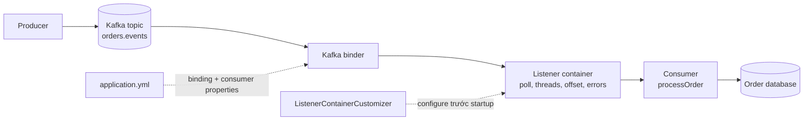
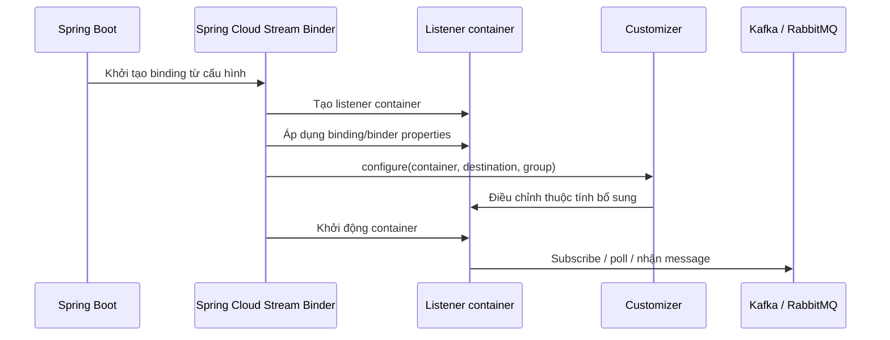
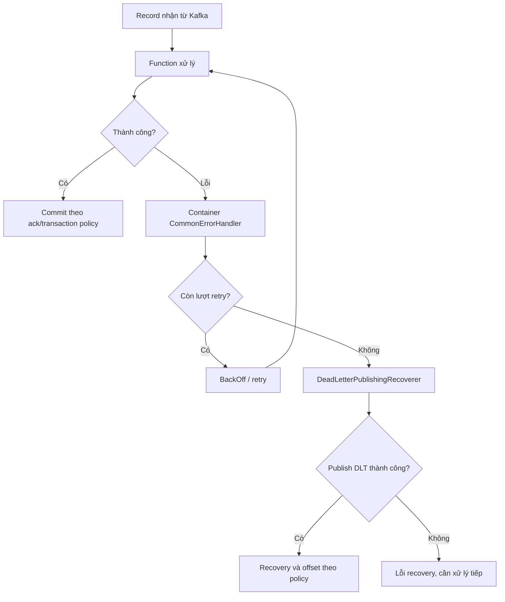

# Tùy biến listener container bằng ListenerContainerCustomizer

Trong Spring Cloud Stream, function `Supplier`, `Function` và `Consumer` mô tả xử lý nghiệp vụ, còn **binder** kết nối function với Kafka, RabbitMQ hoặc Pulsar. Với consumer dạng nhận message do broker đẩy tới (message-driven), binder thường tạo một **listener container** để quản lý việc nhận message, phân phối vào function, xác nhận tiến độ, xử lý lỗi và vòng đời consumer.

Khi các thuộc tính binding thông thường chưa đủ, `ListenerContainerCustomizer` cho phép can thiệp vào listener container **sau khi binder đã áp dụng cấu hình** và trước khi container bắt đầu nhận message. Đây là điểm mở rộng hữu ích để tinh chỉnh hành vi listener, nhất là trong hệ thống phải mở rộng theo số partition, queue, instance hoặc áp dụng error handling đặc biệt.

Bài học thuộc nhóm **Mở rộng**, tập trung vào API tùy biến container, cách dùng đúng với Spring Cloud Stream Kafka binder và RabbitMQ binder, ảnh hưởng lên concurrency, acknowledgment, retry/DLQ, quan sát, kiểm thử và giới hạn với Kafka Streams/Pulsar.

## 1. Listener container nằm ở đâu?

Ví dụ một service nhận order event từ Kafka:



Các lớp có trách nhiệm khác nhau:

| Thành phần | Vai trò |
|---|---|
| Spring Cloud Function bean | Xử lý một payload/message theo nghiệp vụ |
| Binding | Ánh xạ tên function input/output sang broker destination và group |
| Binder | Tạo adapter/container và chuyển đổi message phù hợp middleware |
| Listener container | Quản lý consumer thread, nhận message, acknowledgment, lỗi và lifecycle |
| `ListenerContainerCustomizer` | Điều chỉnh thêm các đặc tính container mà binding thông thường chưa bộc lộ |
| Broker | Quản lý partition/queue, lưu message, phân phối cho consumer |

`ListenerContainerCustomizer` không tạo topology Kafka Streams và không thay đổi format của message. Nó chỉnh hành vi **container nhận message** mà binder đã tạo.

## 2. Khi nào cần tùy biến?

Hãy ưu tiên các property chính thức trước vì chúng rõ ràng, dễ vận hành và thường đã được binder kiểm tra:

```yaml
spring:
  cloud:
    function:
      definition: processOrder
    stream:
      bindings:
        processOrder-in-0:
          binder: kafka
          destination: orders.events
          group: order-workers
          consumer:
            concurrency: 3
            max-attempts: 3
```

Cần customizer khi:

- Muốn gắn thuộc tính container nâng cao chưa có binding property tương ứng.
- Cần logic áp dụng riêng cho một cặp `destinationName` và `group`.
- Muốn cấu hình listener/idle behavior, logging cấu hình container hoặc error handler chuyên biệt.
- Cần tinh chỉnh các loại container khác nhau, ví dụ Kafka `ConcurrentMessageListenerContainer` và Rabbit `SimpleMessageListenerContainer`.
- Cần chuyển retry/DLQ sang tầng listener container trong trường hợp binder default không phù hợp.

Không dùng customizer chỉ để thay mọi property có sẵn. Ví dụ `concurrency`, Kafka `ackMode` hoặc Rabbit `prefetch` thường có cấu hình binding/binder phù hợp; nên dùng property trừ khi thực sự cần chính sách lập trình theo từng container.

## 3. Giao diện ListenerContainerCustomizer

Giao diện tổng quát của Spring Cloud Stream:

```java
@FunctionalInterface
public interface ListenerContainerCustomizer<C> {

    void configure(
            C container,
            String destinationName,
            String group);
}
```

Ba tham số:

1. `container`: instance listener container do binder tạo; kiểu cụ thể phụ thuộc binder.
2. `destinationName`: tên destination mà binder dùng, ví dụ Kafka topic hoặc tên queue của Rabbit binder.
3. `group`: consumer group logic của binding; có thể rỗng/`null` cho anonymous consumer tùy binder và cách cấu hình.

Bean customizer được gọi **sau khi** cấu hình từ `application.yml` đã áp dụng. Vì vậy, giá trị đặt trong customizer có thể thay thế giá trị binder đã đặt. Điều này hữu ích nhưng dễ làm configuration drift: dashboard và YAML ghi một giá trị, runtime lại chạy giá trị khác.

Nên có **một customizer phù hợp với binder**, chứa các nhánh điều kiện rõ ràng, thay vì khai báo nhiều bean cùng can thiệp vào một container mà không kiểm soát thứ tự.

## 4. Chu trình tạo container và thứ tự áp dụng



Thứ tự này giải thích ba nguyên tắc:

- Không cần tạo container mới bằng `new ConcurrentMessageListenerContainer(...)` trong customizer; binder đã sở hữu container.
- Không gọi `container.start()` hay `stop()` trong customizer vì binder quản lý vòng đời.
- Cần xét cấu hình cuối cùng sau customization, không chỉ đọc giá trị YAML.

Listener container thường được tạo một lần cho mỗi consumer binding trong một instance ứng dụng. Với Kafka, một `ConcurrentMessageListenerContainer` có thể quản lý nhiều child containers/consumer threads theo `concurrency`.

## 5. Ví dụ Kafka cơ bản: listener container customization

Cho function đơn giản:

```java
@Configuration
public class OrderConsumerConfiguration {

    @Bean
    public Consumer<OrderEvent> processOrder(OrderService service) {
        return service::process;
    }
}
```

Cấu hình binding:

```yaml
spring:
  cloud:
    function:
      definition: processOrder
    stream:
      bindings:
        processOrder-in-0:
          binder: kafka
          destination: orders.events
          group: order-workers
          consumer:
            concurrency: 3
```

Bean customizer:

```java
import org.springframework.cloud.stream.config.ListenerContainerCustomizer;
import org.springframework.context.annotation.Bean;
import org.springframework.context.annotation.Configuration;
import org.springframework.kafka.listener.AbstractMessageListenerContainer;

@Configuration
public class KafkaListenerTuning {

    @Bean
    ListenerContainerCustomizer<AbstractMessageListenerContainer<?, ?>>
            orderContainerCustomizer() {

        return (container, destinationName, group) -> {
            if (!"orders.events".equals(destinationName)
                    || !"order-workers".equals(group)) {
                return;
            }

            // Phát event khi listener không nhận record đủ lâu.
            container.getContainerProperties()
                    .setIdleEventInterval(60_000L);

            // Ghi tóm tắt cấu hình container lúc khởi động.
            container.getContainerProperties()
                    .setLogContainerConfig(true);
        };
    }
}
```

Ở đây customizer chỉ tác động tới consumer có đúng destination/group yêu cầu. Khi thêm consumer cho topic khác, nó không bị áp dụng nhầm timeout hoặc logging policy.

`setIdleEventInterval(60_000L)` yêu cầu Spring Kafka phát `ListenerContainerIdleEvent` nếu listener không nhận record trong khoảng thời gian tương ứng. Nó **không tự retry**, **không tự restart consumer** và **không đồng nghĩa consumer bị lỗi**: idle có thể đơn giản là topic chưa có event mới.

`setLogContainerConfig(true)` giúp quan sát cấu hình listener lúc khởi động. Đánh giá mức độ nhạy cảm của thông tin cấu hình trước khi bật mức log rộng; không log credentials hoặc raw payload.

## 6. Phản ứng với idle event

Có thể quan sát event do Kafka container phát:

```java
import org.springframework.context.event.EventListener;
import org.springframework.kafka.event.ListenerContainerIdleEvent;
import org.springframework.stereotype.Component;

@Component
public class KafkaIdleObserver {

    @EventListener
    public void onIdle(ListenerContainerIdleEvent event) {
        // Chỉ log metadata có kiểm soát, không log raw Consumer.
        String listenerId = event.getListenerId();
        System.out.println("Idle listener: " + listenerId);
    }
}
```

Trong sản phẩm thật, dùng structured logger và metric `idle event count` phù hợp. Idle event không cho biết consumer group lag bao nhiêu; hãy đối chiếu Kafka consumer lag, partition assignment và input throughput.

Nếu đã có property binder `idleEventInterval` cho Kafka input binding, ưu tiên đặt ở YAML. Dùng customizer khi cần áp dụng logic chọn lọc hoặc kết hợp một tùy biến chưa có property chính thức.

## 7. Tùy biến concurrency cho Kafka

Kafka binder có property `spring.cloud.stream.bindings.<binding>.consumer.concurrency`. Nếu thực sự cần điều chỉnh theo loại container, có thể kiểm tra type và gọi `setConcurrency`:

```java
@Bean
ListenerContainerCustomizer<AbstractMessageListenerContainer<?, ?>>
        concurrencyCustomizer() {

    return (container, destination, group) -> {
        if (!"orders.events".equals(destination)
                || !"order-workers".equals(group)) {
            return;
        }

        if (container instanceof ConcurrentMessageListenerContainer<?, ?> concurrent) {
            concurrent.setConcurrency(4);
        }
    };
}
```

Đoạn này là một **phương án thay thế** cho customizer ở phần 5, không nên khai báo đồng thời hai bean mà không hợp nhất logic.

### Concurrency không thể vượt quá giới hạn partition hữu ích

Với Kafka, mỗi partition trong một consumer group tại một thời điểm chỉ được một consumer instance phụ trách. Nếu topic có 12 partition và service chạy 3 pod, mỗi pod có concurrency=4, tổng 12 consumer threads có thể được phân công 12 partition.

| Pod | Concurrency | Consumer threads |
|---|---:|---:|
| order-worker-1 | 4 | 4 |
| order-worker-2 | 4 | 4 |
| order-worker-3 | 4 | 4 |
| **Tổng** | | **12** |

Nếu tăng lên 6 threads/pod, 18 threads cùng cạnh tranh 12 partitions; một số thread sẽ không được phân partition. Tăng concurrency khi đó có thể tăng chi phí mà không tăng throughput.

Công thức ước lượng ban đầu:

**Consumer threads của group = số instance × concurrency mỗi instance.**

**Số consumer hoạt động hữu ích tối đa thường bị giới hạn bởi số partition được phân công cho group.**

Khi subscribe nhiều topic, assignment strategy và số partition từng topic cũng ảnh hưởng phân bố; không giả định mọi thread luôn có khối lượng như nhau.

## 8. Thứ tự message và scaling

Kafka giữ thứ tự record **trong một partition**. Nếu cùng order ID luôn được dùng làm record key và partitioner cho chúng vào cùng partition, các record của order đó được đọc theo thứ tự partition.

Tăng concurrency không tạo ra thứ tự toàn cục. Một consumer group có thể xử lý nhiều partition song song; kết quả ghi database hoặc gọi API còn phụ thuộc thời gian hoàn thành của từng function.

Khi scale:

- Chọn Kafka key ổn định theo đơn vị cần giữ thứ tự, ví dụ `orderId`.
- Không xử lý bất đồng bộ rồi trả control quá sớm nếu offset được commit trước khi side effect hoàn tất.
- Dùng idempotency/version check nếu replay, rebalance hoặc retry có thể xảy ra.
- Theo dõi lag theo partition, không chỉ lag tổng.
- Nếu một partition nóng, kiểm tra key distribution; tăng thread không chia được một partition đang nóng thành nhiều consumer trong cùng group.

## 9. Kafka ack mode và tác động khi tùy biến

Kafka binder cho phép đặt ack mode bằng property:

```yaml
spring:
  cloud:
    stream:
      kafka:
        bindings:
          processOrder-in-0:
            consumer:
              ack-mode: MANUAL
```

Với `MANUAL` hoặc `MANUAL_IMMEDIATE`, message có thể mang `KafkaHeaders.ACKNOWLEDGMENT`. Function nhận `Message<T>` có thể xác nhận sau khi hoàn tất một bước xử lý.

```java
@Bean
Consumer<Message<OrderEvent>> processOrder(OrderService service) {
    return message -> {
        service.process(message.getPayload());

        Acknowledgment ack = message.getHeaders()
                .get(KafkaHeaders.ACKNOWLEDGMENT, Acknowledgment.class);

        if (ack == null) {
            throw new IllegalStateException("Expected Kafka acknowledgment");
        }

        ack.acknowledge();
    };
}
```

`MANUAL` và `MANUAL_IMMEDIATE` có thời điểm commit khác nhau theo Spring Kafka container. Cần hiểu ack semantics và consumer thread, nhất là khi xử lý async.

Có thể đặt ack mode trực tiếp qua `container.getContainerProperties().setAckMode(...)`, nhưng nên ưu tiên binding `ack-mode` để tránh xung đột với binder, batch mode và các cấu hình transaction/retry. Acknowledgment **không tự biến database/API bên ngoài thành exactly-once**; vẫn cần idempotency hoặc transactional outbox/inbox khi nghiệp vụ yêu cầu.

## 10. Kafka client configuration và container configuration khác nhau

Một lỗi phổ biến là đặt Kafka consumer client property vào listener container mà không kiểm tra lớp chịu trách nhiệm.

| Cấu hình | Nơi cấu hình phù hợp |
|---|---|
| `group.id` | Binding `group` hoặc binder quản lý |
| `bootstrap.servers` | Kafka binder/broker configuration |
| `max.poll.records` | Kafka consumer `configuration` map |
| `max.poll.interval.ms` | Kafka consumer `configuration` map |
| `concurrency` | Binding `consumer.concurrency` |
| `ackMode` | Kafka binding consumer `ack-mode` |
| `idleEventInterval` | Kafka binder consumer property hoặc container customization |
| `CommonErrorHandler` đặc thù | Kafka container customizer/bean theo binder API |
| Listener advice chain | Rabbit listener container customization |

Ví dụ Kafka client config:

```yaml
spring:
  cloud:
    stream:
      kafka:
        bindings:
          processOrder-in-0:
            consumer:
              configuration:
                max.poll.records: 250
                max.poll.interval.ms: 300000
```

`max.poll.records` không phải số thread và không giới hạn tổng backlog. Nó là giới hạn record trả về trong một lần `poll`. Tăng quá cao có thể làm một chu kỳ xử lý lâu, tăng nguy cơ vượt `max.poll.interval.ms` nếu function chặn lâu.

Đừng sửa Kafka consumer object từ thread tùy ý; KafkaConsumer không thread-safe. Dùng API container/binding lifecycle và các property được hỗ trợ.

## 11. Customizer không thay thế retry policy

Khi function ném exception, cần xác định lớp nào đang chịu trách nhiệm retry:

- Retry ở Spring Cloud Stream binder.
- Retry ở Spring Kafka listener container error handler.
- Retry do chính function/service thực hiện.
- Retry/republish ở broker hoặc một retry topic khác.

Không thiết kế nhiều tầng retry mà không đếm tổng số lần thử. Ví dụ binder thử 3 lần và custom error handler thử thêm 4 lần có thể khiến số lời gọi nghiệp vụ và độ trễ tăng ngoài dự kiến.

Bảng quyết định:

| Tình huống | Cách xử lý |
|---|---|
| Retry đơn giản và binder hỗ trợ đầy đủ | Dùng binding properties |
| Cần thay đổi common error handler của Kafka container | `ListenerContainerCustomizer` hoặc extension phù hợp |
| Có DLQ và muốn chuyển retry/DLQ khỏi binder | `ListenerContainerWithDlqAndRetryCustomizer` |
| Cần xử lý lỗi theo từng binding mà không tùy biến container rộng | Xem `commonErrorHandlerBeanName` của Kafka binding |
| Function có side effect ngoài Kafka | Kết hợp retry với idempotency/DLQ và quy tắc giao nhận |

## 12. Kafka: ví dụ tắt container retry khi không dùng DLQ

Theo tài liệu Kafka binder, khi DLQ **không** được bật, `max-attempts: 1` không nhất thiết vô hiệu hóa retry do listener container thực hiện. Spring Kafka có thể vẫn sử dụng default error handler.

Nếu yêu cầu một lần thử rồi dừng retry ở container, có thể dùng:

```java
@Bean
ListenerContainerCustomizer<AbstractMessageListenerContainer<?, ?>>
        noRetryCustomizer() {

    return (container, destination, group) -> {
        if (!"audit.events".equals(destination)
                || !"audit-workers".equals(group)) {
            return;
        }

        DefaultErrorHandler errorHandler =
                new DefaultErrorHandler(new FixedBackOff(0L, 0L));

        container.setCommonErrorHandler(errorHandler);
    };
}
```

`FixedBackOff(0L, 0L)` không thử lại sau lần lỗi đầu tiên trong Spring Kafka. **Lưu ý:** default recoverer của `DefaultErrorHandler` có thể ghi log và coi record đã được xử lý lỗi, cho phép tiến offset theo chính sách container. Nếu message không được phép mất, cần cấu hình recoverer ghi DLT an toàn hoặc chủ động dừng pipeline; không chỉ vô hiệu hóa retry rồi hy vọng record tự tồn tại ở nơi khác.

Ví dụ này chỉ phù hợp khi đã xác định rõ chính sách xử lý record thất bại. Đặt nó ở binding `audit.events` cụ thể, không áp dụng rộng cho mọi consumer.

## 13. DLQ có thể thay đổi thứ tự ưu tiên

Khi bật Kafka binder DLQ:

```yaml
spring:
  cloud:
    stream:
      bindings:
        processOrder-in-0:
          destination: orders.events
          group: order-workers
          consumer:
            max-attempts: 3
      kafka:
        bindings:
          processOrder-in-0:
            consumer:
              enable-dlq: true
```

Binder thường tự quản lý retry và publish DLT theo các property này. Một `CommonErrorHandler` đặt qua generic customizer không mặc nhiên thay toàn bộ logic binder; retry/DLQ do binder quản lý có thể được ưu tiên.

Nếu muốn chuyển trách nhiệm retry/DLQ xuống listener container, dùng extension `ListenerContainerWithDlqAndRetryCustomizer` và quyết định rõ `retryAndDlqInBinding(destination, group)` cho từng binding.

**Đừng khai báo đồng thời binder-managed DLQ và custom container DLQ như hai cơ chế độc lập**, vì có thể tạo hành vi lặp, không thống nhất recoverer, hoặc làm lệch số lần retry.

## 14. Ba giao diện Kafka customization cần phân biệt

Spring Cloud Stream Kafka binder có ba giao diện liên quan:

| Giao diện | Callback | Mục tiêu |
|---|---|---|
| `ListenerContainerCustomizer<C>` | `configure(container, destination, group)` | Tùy biến chung listener container |
| `KafkaListenerContainerCustomizer` | Có thêm `ExtendedConsumerProperties<KafkaConsumerProperties>` | Tùy biến Kafka với properties của binding |
| `ListenerContainerWithDlqAndRetryCustomizer` | Có DLQ resolver, backoff và tùy phiên bản có extended properties | Điều khiển chiến lược retry/DLQ ở listener container |

Ví dụ sử dụng Kafka-specific customizer khi cần biết extended consumer properties:

```java
@Bean
KafkaListenerContainerCustomizer kafkaSpecificCustomizer() {
    return (container, destination, group, extendedProperties) -> {
        if ("orders.events".equals(destination)
                && "order-workers".equals(group)) {
            // Có thể đọc extendedProperties để quyết định tùy biến.
            container.getContainerProperties()
                    .setIdleEventInterval(60_000L);
        }
    };
}
```

Đây là **phương án thay thế**, không nên tự động khai báo thêm nếu đã có generic customizer làm cùng việc. Các extension của Kafka có thay đổi chữ ký ở một số dòng Spring Cloud Stream; hãy đối chiếu interface đúng version được import thay vì sao chép lambda khác version.

## 15. Retry/DLQ customizer: trách nhiệm và quy trình

Một luồng xử lý Kafka retry/DLT do listener container quản lý điển hình:



Khi dùng `ListenerContainerWithDlqAndRetryCustomizer`:

1. Chọn đúng destination và group.
2. Trả `false` từ `retryAndDlqInBinding(...)` cho binding sẽ giao retry/DLQ cho container.
3. Trong `configure(...)`, nhận DLQ destination resolver và BackOff mà binder cung cấp, nếu có.
4. Tạo `DeadLetterPublishingRecoverer` với producer/KafkaTemplate tương thích DLT.
5. Tạo `DefaultErrorHandler(recoverer, backOff)` và đặt vào container.
6. Kiểm tra DLT topic/partition, serializer, ACL và khi nào offset được commit.
7. Test exception, retry, recovery, restart và transaction.

Docs của Spring Cloud Stream có ví dụ hoàn chỉnh cho extension này. **Lưu ý phiên bản:** tài liệu mục "Kafka Binder Listener Container Customizers" mô tả một biến thể callback có thêm extended properties; tài liệu "Retry and Dead Letter Processing" có ví dụ callback ít tham số hơn. Khi hiện thực, dùng chữ ký thực tế của dependency Spring Cloud Stream được pin trong ứng dụng và kiểm tra compile.

Một ví dụ minh họa theo dạng callback có `dlqDestinationResolver` và `backOff`:

```java
// Phác thảo logic trong configure(...) của
// ListenerContainerWithDlqAndRetryCustomizer
if ("orders.events".equals(destinationName)
        && "order-workers".equals(group)) {

    if (dlqDestinationResolver == null) {
        throw new IllegalStateException("DLQ resolver is required");
    }

    var recoverer = new DeadLetterPublishingRecoverer(
            kafkaTemplate,
            dlqDestinationResolver
    );

    var retryBackOff = backOff != null
            ? backOff
            : new FixedBackOff(1_000L, 2L);

    container.setCommonErrorHandler(
            new DefaultErrorHandler(recoverer, retryBackOff));
}
```

Đây là **đoạn logic dùng bên trong callback**, không phải bean đầy đủ để copy nguyên xi. Các tham số là tham số callback từ binder, không tự tạo resolver bằng tên topic đoán trước. Đặc biệt, nếu DLT nằm ở cluster khác, KafkaTemplate phải được tạo với bootstrap servers/security của cluster DLT và serializer phù hợp.

## 16. RabbitMQ: listener container cũng tùy biến được

RabbitMQ binder dùng listener container của Spring AMQP. Với consumer dùng `SimpleMessageListenerContainer` hoặc `DirectMessageListenerContainer`, các property khác nhau có thể áp dụng.

Spring Cloud Stream hướng dẫn dùng:

```java
@Bean
ListenerContainerCustomizer<
        org.springframework.amqp.rabbit.listener.AbstractMessageListenerContainer>
        rabbitCustomizer(Advice tracingAdvice) {

    return (container, destination, group) -> {
        if ("orders.exchange".equals(destination)
                && "order-workers".equals(group)) {
            container.setAdviceChain(tracingAdvice);
        }
    };
}
```

Trong ví dụ `tracingAdvice` là một bean Spring AOP `Advice` có sẵn do ứng dụng cung cấp. Advice được gắn vào listener container để áp dụng logic quan sát hoặc chính sách quanh invocation.

**Cẩn trọng:** `setAdviceChain(...)` có thể thay chuỗi advice đang được dùng. Nếu binder/container đã có advice cho retry, transaction hoặc instrumentation, cần kiểm tra trước khi thay; việc gắn advice mới phải giữ được hành vi cần thiết. Đừng dùng một advice chung để vô tình thay đổi semantics ack/retry.

### Tùy biến theo loại Rabbit container

```java
@Bean
ListenerContainerCustomizer<
        org.springframework.amqp.rabbit.listener.AbstractMessageListenerContainer>
        rabbitScalingCustomizer() {

    return (container, destination, group) -> {
        if (!"notifications".equals(destination)
                || !"email-workers".equals(group)) {
            return;
        }

        if (container instanceof SimpleMessageListenerContainer simple) {
            simple.setConcurrentConsumers(2);
            simple.setMaxConcurrentConsumers(5);
        }
    };
}
```

Ở đây phương thức `setConcurrentConsumers` / `setMaxConcurrentConsumers` thuộc Simple container, không áp dụng cho Direct container. Ví dụ này chỉ nên chọn khi ứng dụng cần điều khiển riêng một loại container; với scaling thông thường, hãy bắt đầu bằng Rabbit consumer binding properties như `concurrency` và `maxConcurrency`.

## 17. Rabbit prefetch, ack và giới hạn mở rộng

Rabbit không phân phối message theo Kafka partition. Một queue có thể có nhiều consumer, và cơ chế prefetch cùng ack mode ảnh hưởng số message đang xử lý nhưng chưa được xác nhận.

| Thuộc tính | Tác động |
|---|---|
| `concurrency` | Số consumer của listener container theo cấu hình binder |
| `maxConcurrency` | Ngưỡng mở rộng động với Simple container khi hỗ trợ |
| `prefetch` | Số message có thể giao trước cho mỗi consumer chưa ack |
| `acknowledgeMode` | Tự động/thủ công xác nhận message theo Spring AMQP |
| `requeueRejected` | Quyết định requeue khi reject theo điều kiện lỗi |
| `autoBindDlq` và `republishToDlq` | Cấu hình dead-letter handling của Rabbit binder |

Một queue nhiều consumer có thể tăng throughput nhưng làm thứ tự completion không còn giống thứ tự publish. Nếu nghiệp vụ yêu cầu thứ tự chặt theo một key, cân nhắc thiết kế queue, routing và cơ chế single-active-consumer hoặc idempotency/version check trước khi tăng concurrency.

Prefetch quá lớn có thể làm nhiều message nằm ở consumer chậm và tăng `messages_unacknowledged`. Đừng tăng prefetch/concurrency theo trực giác; đo throughput, queue ready/unacked, processing latency và memory trước/sau.

## 18. Phân biệt Simple, Direct và Stream Rabbit container

RabbitMQ binder có thể dùng nhiều loại consumer container:

| Loại | Mô hình xử lý | Lưu ý |
|---|---|---|
| `SimpleMessageListenerContainer` | Các consumer xử lý message qua Simple container | Hỗ trợ `concurrentConsumers` và `maxConcurrentConsumers` |
| `DirectMessageListenerContainer` | Các consumer trực tiếp theo queue | Dùng các property phù hợp Direct container; không gọi setter chỉ có ở Simple |
| `StreamListenerContainer` | RabbitMQ Stream Plugin | Cơ chế consumer và concurrency khác; một số property queue consumer không áp dụng |

Khi bật Rabbit Stream Plugin, Spring Cloud Stream có thể dùng `ListenerContainerCustomizer<MessageListenerContainer>` rồi cast sang `StreamListenerContainer` theo hướng dẫn của binder. Cần kiểm tra đúng type trước khi gọi method, vì áp dụng setter AMQP queue container cho Stream container có thể thất bại ngay lúc startup.

Không coi Rabbit Stream là Kafka Streams; đây là các API và mô hình xử lý khác nhau.

## 19. Pollable consumer dùng cơ chế khác

`ListenerContainerCustomizer` dành cho message-driven consumer mà binder tạo listener container.

Với `PollableMessageSource`, ứng dụng chủ động gọi `poll(...)` theo vòng lặp/lịch chạy. Spring Cloud Stream có `MessageSourceCustomizer` cho trường hợp này. Ví dụ Rabbit polled source có thể dùng `MessageSourceCustomizer<AmqpMessageSource>` để chỉnh converter hoặc thuộc tính nguồn message.

Sự khác biệt:

| Kiểu consumer | Ai chủ động lấy message? | Điểm tùy biến |
|---|---|---|
| Message-driven Kafka/Rabbit | Listener container | `ListenerContainerCustomizer` |
| Pollable consumer | Application poll loop | `MessageSourceCustomizer` |
| Kafka Streams DSL | Kafka Streams runtime/tasks | Kafka Streams binder configuration / StreamsConfig |
| Pulsar listener | Spring Pulsar container/binder | Pulsar-specific configuration và customizer được binder hỗ trợ |

Không mong `ListenerContainerCustomizer<AbstractMessageListenerContainer<?, ?>>` của Kafka tự tác động tới Kafka Streams topology. Kafka Streams có consumer/task runtime và transaction/processing guarantee riêng.

## 20. Tùy biến khi có nhiều binder

Trong ứng dụng có nhiều binder (ví dụ Kafka + Rabbit hoặc nhiều Kafka clusters), mỗi binder có thể nằm trong **application context riêng**. Một customizer bean ở context chính không nhất thiết được nhìn thấy trực tiếp bởi mọi named binder.

Spring Cloud Stream cung cấp `BinderCustomizer` để chỉnh binder trước khi binder bắt đầu hoạt động. Ví dụ:

```java
@Bean
BinderCustomizer kafkaBinderCustomizer(
        ListenerContainerCustomizer<AbstractMessageListenerContainer<?, ?>> customizer) {

    return (binder, binderName) -> {
        if (!"kafkaOrders".equals(binderName)) {
            return;
        }

        if (binder instanceof KafkaMessageChannelBinder kafkaBinder) {
            kafkaBinder.setContainerCustomizer(customizer);
        }
    };
}
```

Ý nghĩa:

- `binderName` cho phép giới hạn customization ở một binder instance đã đặt tên.
- `instanceof KafkaMessageChannelBinder` tránh cast nhầm Rabbit binder.
- `setContainerCustomizer(...)` chuyển customizer đến binder instance thích hợp.
- Các binding của binder đó vẫn có thể được lọc tiếp theo destination và group.

Nếu ứng dụng chỉ có một binder, thường không cần `BinderCustomizer`. Với nhiều binders/named binders, đọc kỹ tài liệu BinderCustomizer và kiểm tra bean đã được áp dụng thực sự; tránh giả định bean ở application context chính tự tới binder con.

## 21. Tính idempotent của callback và cấu hình startup

Một callback cấu hình tốt nên:

- Chỉ sửa container đúng scope theo destination/group.
- Chỉ đặt giá trị cấu hình, không tạo consumer mới hoặc subscribe thủ công.
- Không gọi network chậm hay blocking dài trong quá trình startup.
- Không tự `start()`, `stop()` hoặc `poll()` bên trong callback.
- Không lưu reference đến raw KafkaConsumer để gọi từ thread khác.
- Không thao tác business side effect.
- Có log cấu hình an toàn ở mức phù hợp, tránh ghi secret.
- Có thể gọi lại khi binding/container được tạo lại mà không sinh state thừa.

Ví dụ điều kiện chính xác:

```java
private static boolean isOrdersBinding(String destination, String group) {
    return "orders.events".equals(destination)
            && "order-workers".equals(group);
}
```

Tránh điều kiện `destination.contains("orders")` vì có thể khớp nhầm `orders.audit`, `orders.retry` và `orders.private`.

## 22. Kiểm thử customizer ở nhiều lớp

### Unit test callback

Có thể kiểm tra riêng logic cấu hình mà không cần broker. Ví dụ với Mockito và AssertJ:

```java
@Test
void customizesOnlyOrdersBinding() {
    var config = new KafkaListenerTuning();
    var customizer = config.orderContainerCustomizer();

    var ordersContainer =
            mock(AbstractMessageListenerContainer.class);
    var ordersProperties = new ContainerProperties("orders.events");
    when(ordersContainer.getContainerProperties())
            .thenReturn(ordersProperties);

    customizer.configure(
            ordersContainer, "orders.events", "order-workers");

    assertThat(ordersProperties.getIdleEventInterval())
            .isEqualTo(60_000L);
}
```

Với một binding khác, gọi callback với destination/group khác và xác nhận giá trị giữ nguyên. Test này xác minh điều kiện áp dụng và effect lên container properties; nó không chứng minh Kafka consumer đã vận hành thành công.

### Integration test với Kafka/Rabbit

Dùng Testcontainers hoặc broker tích hợp phù hợp để kiểm tra:

1. Binder khởi tạo container và callback được gọi.
2. Chỉ binding đúng được customize.
3. Container có effective concurrency/ack/error handler đúng.
4. Message được nhận và function xử lý như mong muốn.
5. Retry, DLT/DLQ và offset/ack hoạt động đúng khi function lỗi.
6. Restart consumer không bỏ qua message ngoài policy.
7. Concurrency vượt số partition không được coi là tăng throughput.
8. Rabbit Simple/Direct container không bị ClassCastException.
9. Với multi binder, customizer được truyền đúng vào named binder.
10. Log và metrics phản ánh cấu hình runtime chứ không chỉ YAML.

Không thử nghiệm crash/rebalance bằng cách sleep dài trong callback. Hãy tạo kịch bản retry, idle, partition rebalance và shutdown bằng test fixture hoặc broker giả lập có kiểm soát.

## 23. Monitoring sau khi thay đổi container

Sau rollout, theo dõi các tín hiệu:

- **Kafka:** consumer lag theo partition/group, poll rate, rebalance count, processing latency, error handler/recovery count và DLT rate.
- **RabbitMQ:** `messages_ready`, `messages_unacknowledged`, consumer count, ack/nack, redelivery, DLQ rate và connection/channel health.
- **Ứng dụng:** throughput thành công, số retry, terminal failures, CPU, heap và thread count.
- **Lifecycle:** container started/stopped/idle/non-responsive events, assignment change, startup errors.

Ví dụ: sau khi tăng Kafka concurrency từ 2 lên 4, throughput tăng nhưng lag vẫn tăng. Cần kiểm tra partition count, downstream latency và retry; có thể bottleneck nằm ở database chứ không phải số consumer threads.

Nếu Rabbit prefetch tăng cùng concurrency, unacked tăng vọt và heap pressure tăng, hãy giảm prefetch hoặc giới hạn in-flight processing thay vì tiếp tục thêm thread.

## 24. Các lỗi thường gặp

| Triệu chứng | Nguyên nhân có thể |
|---|---|
| Customizer không được gọi | Sai bean type, bean nằm khác binder context hoặc binding không dùng listener container |
| ClassCastException lúc startup | Cast Kafka container thành Rabbit container hoặc nhầm Rabbit Simple/Direct |
| YAML concurrency=3 nhưng chạy 4 | Customizer đã ghi đè cấu hình sau binder |
| Tăng Kafka concurrency nhưng throughput không đổi | Số active partitions không đủ hoặc bottleneck downstream |
| Ack thủ công nhưng offset hành xử bất thường | Xung đột ack mode, batch/retry/transaction hoặc gọi ack sai luồng |
| Đặt DefaultErrorHandler nhưng DLQ vẫn theo binder | Binder-managed retry/DLQ có precedence |
| Retry không tắt khi max-attempts=1 | Kafka container mặc định xử lý retry khi DLQ tắt |
| Named binder không thấy customizer | Cần BinderCustomizer gắn customizer vào binder instance |
| Idle event không đến | Chưa cấu hình interval, chưa đủ thời gian hoặc listener không thật sự idle |
| Rabbit custom advice làm thay đổi retry | setAdviceChain thay chuỗi advice cần thiết |
| Kafka Streams function không bị ảnh hưởng | Đây là Kafka Streams runtime, không phải Spring Kafka listener container |
| Pollable input không bị ảnh hưởng | Cần MessageSourceCustomizer |

### Quy trình chẩn đoán

1. Xác nhận binding name, destination, group và binder type.
2. Kiểm tra container class thực tế khi callback chạy.
3. Xác nhận customizer bean trong binder application context.
4. Đọc effective container properties sau customization.
5. Kiểm tra binder retry/DLQ policy có ghi đè không.
6. Kiểm tra số partitions/queues, consumer threads và assignment.
7. Tạo message thành công/lỗi để xác minh processing, ack và recovery.
8. Đối chiếu metric broker với metric ứng dụng.

## 25. Quy tắc thiết kế customizer cho production

Một customizer an toàn trong hệ thống event-driven nên thỏa:

- **Đúng scope:** destination và group được đối chiếu chính xác.
- **Đúng binder:** Kafka/Rabbit/Pulsar dùng đúng container type và API.
- **Không xung đột:** property YAML và customizer không bí mật ghi đè nhau.
- **Không mất dữ liệu:** ack/retry/DLQ được kiểm chứng ở kịch bản lỗi.
- **Không phá thứ tự:** concurrency/async processing phù hợp quy tắc ordering.
- **Dễ quan sát:** có metric và log effective configuration.
- **Có test:** unit cho callback, integration cho broker.
- **Tương thích phiên bản:** kiểm tra Spring Cloud Stream, Spring Kafka/Spring AMQP và chữ ký customizer được compile với dependency thực tế.

Nếu phải dùng nhiều customizer hoặc logic phân nhánh phức tạp, cân nhắc gom chính sách vào một configuration class, tách các hàm xác định binding và viết test riêng. Tránh đưa business logic hoặc truy cập database vào callback startup.

## 26. Checklist triển khai

- Đã xác nhận `menuLevel2` và consumer binder mà bài học áp dụng.
- Đã thử cấu hình qua binding properties trước khi dùng customizer.
- Đã biết listener container được tạo và cấu hình theo thứ tự nào.
- Đã chọn đúng `ListenerContainerCustomizer<C>` cho container thực tế.
- Đã lọc theo destination và group.
- Không gọi start/stop/poll thủ công trong callback.
- Không tạo consumer trùng với binder.
- Concurrency Kafka có xét số partition và số pod.
- Kafka key/partition ordering được bảo toàn theo yêu cầu.
- Ack mode không xung đột manual commit, batch và transaction.
- Retry/DLQ có một tầng sở hữu rõ ràng.
- Nếu cần container-managed DLQ, đã kiểm tra extension và version.
- Với Rabbit, đã phân biệt Simple/Direct/Stream container.
- Prefetch, concurrency và unacked được đo sau scaling.
- Với multi-binder, BinderCustomizer đã truyền đúng customizer.
- Pollable consumer dùng MessageSourceCustomizer, Kafka Streams dùng cấu hình riêng.
- Unit test xác nhận callback đúng binding.
- Integration test xác nhận effective behavior, retry, ack, DLT và restart.
- Có dashboard theo dõi lag/backlog, throughput, errors và threads.
- Có kế hoạch rollback nếu consumer bị rebalance, tăng retry hoặc mất throughput.

`ListenerContainerCustomizer` là điểm mở rộng mạnh của Spring Cloud Stream cho message-driven consumer, đặc biệt khi cần tinh chỉnh listener container vượt quá binding properties. Sức mạnh của nó đến từ việc chạy sau cấu hình binder, đồng thời cũng là rủi ro vì dễ vô tình ghi đè concurrency, ack hoặc error handling. Hãy áp dụng có điều kiện theo binding, phân biệt Kafka/Rabbit/Kafka Streams và kiểm thử trên broker thực tế trước khi triển khai rộng.

## Tài liệu tham khảo

- [Spring Cloud Stream — Kafka Binder Listener Container Customizers](https://docs.spring.io/spring-cloud-stream/reference/kafka/kafka-binder/container-cust-kafka-binder.html)
- [Spring Cloud Stream — Binding Properties và Advanced Consumer Configuration](https://docs.spring.io/spring-cloud-stream/reference/spring-cloud-stream/binding-properties.html)
- [Spring Cloud Stream — Kafka Retry and Dead Letter Processing](https://docs.spring.io/spring-cloud-stream/reference/kafka/kafka-binder/retry-dlq.html)
- [Spring Cloud Stream — Kafka Dead-Letter Topic Processing](https://docs.spring.io/spring-cloud-stream/reference/kafka/kafka-binder/dlq.html)
- [Spring Cloud Stream — Kafka Binder Configuration Options](https://docs.spring.io/spring-cloud-stream/reference/kafka/kafka-binder/config-options.html)
- [Spring Cloud Stream — Rabbit Advanced Listener Container Configuration](https://docs.spring.io/spring-cloud-stream/reference/rabbit/rabbit_overview/advanced-listener-container-configuration.html)
- [Spring Cloud Stream — Rabbit Consumer Properties](https://docs.spring.io/spring-cloud-stream/reference/rabbit/rabbit_overview/cons-props.html)
- [Spring Cloud Stream — Customizing Binders in Multi Binder Applications](https://docs.spring.io/spring-cloud-stream/reference/spring-cloud-stream/binder-customizer.html)
- [Spring Kafka — Message Listener Containers](https://docs.spring.io/spring-kafka/reference/kafka/receiving-messages/message-listener-container.html)
- [Spring Kafka — Application Events and Idle Containers](https://docs.spring.io/spring-kafka/reference/kafka/events.html)
- [Spring Cloud Stream — RabbitMQ Stream Consumer](https://docs.spring.io/spring-cloud-stream/reference/rabbit/rabbit_overview/rabbitmq-stream-consumer.html)

