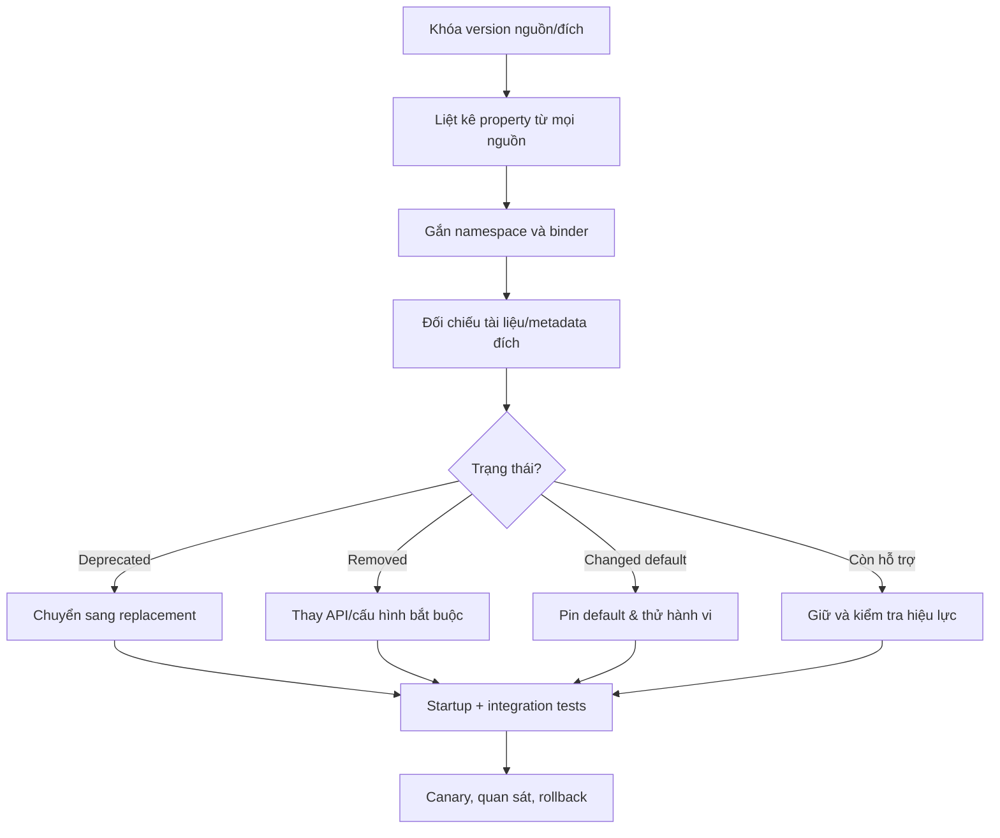

# Đối chiếu thuộc tính đổi tên, hết khuyến nghị hoặc đã bị loại bỏ

Nâng cấp Spring Cloud Stream không đơn thuần là thay version trong `pom.xml` hoặc `build.gradle`. Ứng dụng event-driven còn có một **hợp đồng cấu hình** gồm tên function/binding, destination, consumer group, thuộc tính binder Kafka/RabbitMQ/Pulsar, serialization, retry/DLQ, Kafka Streams state và các tùy chọn do Spring Boot hoặc Apache Kafka client cung cấp. Một property bị đổi tên, deprecated hoặc bị loại bỏ có thể khiến ứng dụng vẫn khởi động nhưng **đọc sai topic, tạo group mới, mất DLQ, đổi kiểu payload hoặc xử lý lại dữ liệu**.

Bài này trình bày cách **đối chiếu thuộc tính qua phiên bản** cho dự án `SPRING_CLOUD_STREAM`, phân biệt thay đổi có chứng cứ từ tài liệu chính thức với những thay đổi chỉ mang tính khuyến nghị. Phạm vi gồm functional model `Supplier/Function/Consumer`, Kafka message-channel binder, Kafka Streams binder, RabbitMQ/Pulsar, cấu hình native encoding, retry, schema, quan sát và kiểm thử trước khi triển khai.

> **Giới hạn phiên bản:** Những ví dụ bên dưới đối chiếu tài liệu Spring Cloud Stream 2.x/3.x/4.x với các nhánh 5.0/5.1 và Apache Kafka Streams hiện đại. Trạng thái cuối cùng phải xác nhận trên **đúng phiên bản dependency đã khóa trong dự án**; không áp dụng một bảng migration chung như chứng cứ rằng mọi thuộc tính đã bị xóa ở tất cả phiên bản.

## 1. Mục tiêu học tập

Sau bài học, bạn có thể:

1. Phân biệt property **đổi tên**, property **deprecated**, property **đã bị loại bỏ**, **thay đổi hành vi** và **đổi binding name do thay đổi programming model**.
2. Đối chiếu các property cụ thể của Kafka binder như `admin.configuration`, `admin.replicas-assignment` và `admin.replication-factor` với nhóm `topic.*`.
3. Chuyển cấu hình binding kiểu `input/output` từ mô hình annotation sang binding name mặc định của function như `normalize-in-0` và `normalize-out-0`.
4. Nhận diện khác biệt giữa property Spring Cloud Stream, Spring Boot, Kafka Streams client và Rabbit/Pulsar binder.
5. Lập bảng kiểm migration có phiên bản nguồn/đích, chứng cứ, hành động và kiểm thử.
6. Dùng startup diagnostics, integration test và canary rollout để phát hiện property không còn tác dụng trước khi nâng cấp production.

## 2. Thuật ngữ: không gộp mọi thay đổi thành “bị xóa”

| Trạng thái | Ý nghĩa | Hành động điển hình |
|---|---|---|
| **Đổi tên / thay thế** | Có tên mới hoặc một cách cấu hình khác cho cùng mục đích | Chuyển sang tên mới, kiểm tra nghĩa và default |
| **Deprecated** | Cách cũ không còn được khuyến nghị nhưng có thể vẫn hoạt động | Lên kế hoạch bỏ cách cũ; không tuyên bố đã bị remove |
| **Removed** | Phiên bản đích không còn hỗ trợ API/property hoặc hành vi đó | Sửa code/config và kiểm tra startup |
| **Changed default** | Vẫn cùng tên, nhưng giá trị mặc định hoặc hiệu lực khác đi | Pin giá trị có chủ đích, kiểm tra behavior |
| **Semantic migration** | Đổi programming model/binder khiến đường dẫn property khác dù tên thuộc tính không đổi | Cập nhật binding name/prefix và test dữ liệu |
| **Legacy compatibility** | Property còn tồn tại để tương thích producer/consumer cũ | Chỉ giữ nếu còn đối tác thực sự cần |
| **No-op / ignored** | Property vẫn nhận diện hoặc được đặt nhưng không có tác dụng trong ngữ cảnh đang dùng | Thay cơ chế đúng cho binder/mode |

Ví dụ, `admin.replication-factor` của Kafka binder được tài liệu ghi **deprecated từ 2.1.1**, thay bằng `topic.replication-factor`. Không gọi nó là “đã bị loại bỏ” chỉ vì muốn bỏ trong code mới.

Ngược lại, khi đổi từ `@StreamListener` sang `Function`, `spring.cloud.stream.bindings.input.destination` có thể **vẫn là một property hợp lệ**; điều thay đổi là binding đang chạy mặc định tên `normalize-in-0`, không phải framework xóa thuộc tính `destination`.

## 3. Định vị cấu hình trước khi đối chiếu

Một property đầy đủ có nhiều lớp:

```text
spring.cloud.stream.bindings.<bindingName>.<commonProperty>
spring.cloud.stream.bindings.<bindingName>.consumer.<consumerProperty>
spring.cloud.stream.bindings.<bindingName>.producer.<producerProperty>

spring.cloud.stream.kafka.binder.<kafkaBinderProperty>
spring.cloud.stream.kafka.bindings.<bindingName>.consumer.<kafkaConsumerProperty>
spring.cloud.stream.kafka.bindings.<bindingName>.producer.<kafkaProducerProperty>

spring.cloud.stream.rabbit.bindings.<bindingName>.consumer.<rabbitConsumerProperty>
spring.cloud.stream.rabbit.bindings.<bindingName>.producer.<rabbitProducerProperty>

spring.cloud.stream.kafka.streams.binder.<streamsBinderProperty>
spring.cloud.stream.kafka.streams.bindings.<bindingName>.consumer.<streamsConsumerProperty>
spring.cloud.stream.kafka.streams.binder.functions.<functionName>.configuration.<streamsConfigKey>
```

Trong đó:

- **Common binding**: destination, group, contentType, concurrency, maxAttempts...
- **Binder-wide**: brokers, replication defaults, broker connection/security...
- **Extended binding**: key expression, topic provisioning, retry/DLQ cụ thể...
- **Kafka Streams `StreamsConfig`**: `processing.guarantee`, `commit.interval.ms`, `default.value.serde`...
- **Spring Boot/Spring Kafka/Spring AMQP/Spring Pulsar**: những thuộc tính nằm ngoài namespace Spring Cloud Stream và có vòng đời riêng.

Không đổi một property chỉ vì tên trông giống nhau. `replicationFactor` ở cấp Kafka binder, `topic.replication-factor` ở mức binding và `replication.factor` của Kafka Streams internal topics không phải một lựa chọn đồng nghĩa.

## 4. Quy trình đối chiếu theo phiên bản

Một migration có kiểm soát đi qua các bước:



Trước khi sửa code, ghi rõ:

- Phiên bản nguồn/đích của Spring Boot, Spring Cloud release train, Spring Cloud Stream, Spring Kafka/AMQP/Pulsar và Kafka clients.
- Binder có mặt trên classpath; có dùng **named binders** hoặc nhiều Kafka clusters không.
- Function names, binding names, destinations, consumer groups, application IDs.
- Cấu hình hiệu lực từ `application.yml`, profile, environment variables, command-line arguments, Config Server, Helm/Secret và override lúc deploy.
- Các Kafka topic, Rabbit queue/exchange, Pulsar subscription và schema contract quan trọng.
- Các property có ảnh hưởng trực tiếp tới acknowledgement, offset, DLQ, transaction và state restoration.

**Trong bài học này** bảng ví dụ được tổng hợp từ tài liệu; không thay thế kiểm kê trên repository/runtime cụ thể của bạn.

## 5. Ma trận thay đổi có chứng cứ

| Vùng | Cũ | Cách hiện đại / mới | Phân loại |
|---|---|---|---|
| Kafka topic provisioning | `admin.configuration` | `topic.properties` | Deprecated → replacement từ 2.1.1 |
| Kafka topic provisioning | `admin.replicas-assignment` | `topic.replicas-assignment` | Deprecated → replacement từ 2.1.1 |
| Kafka topic provisioning | `admin.replication-factor` | `topic.replication-factor` | Deprecated → replacement từ 2.1.1 |
| Kafka Streams exception | `serdeError` (tài liệu thế hệ cũ) | `deserializationExceptionHandler` | Tên khác giữa các thế hệ API/binder; xác minh theo version |
| Kafka Streams processing guarantee | giá trị `exactly_once` | `exactly_once_v2` | Giá trị cũ deprecated; migration có điều kiện |
| Kafka Streams processing guarantee | giá trị `exactly_once_beta` | `exactly_once_v2` | Giá trị cũ deprecated; replacement |
| Programming model | `@EnableBinding`, `@StreamListener` | `Supplier/Function/Consumer` beans | Annotation model deprecated; thay model lập trình |
| Test hỗ trợ | `spring-cloud-stream-test-support` / `MessageCollector` | `spring-cloud-stream-test-binder` với `InputDestination` / `OutputDestination` | Module/API cũ ngừng khuyến nghị |
| Reactive module | `spring-cloud-stream-reactive` | Spring Cloud Function + Reactor | Module cũ ngừng phân phối |
| Kafka reactive binder riêng | `spring-cloud-stream-binder-kafka-reactive` | Kafka message-channel binder + xử lý reactive rõ ràng | Dedicated binder deprecated từ 4.3.0 |
| Binding theo annotation | `bindings.input` / `bindings.output` theo tên kênh | `bindings.<function>-in-0` / `bindings.<function>-out-0` | Đổi tên binding do model, **không** phải `destination` bị xóa |

Ba dòng đầu được tài liệu Kafka binder của Spring Cloud Stream 5.0 ghi **deprecation từ version 2.1.1**, có mapping trực tiếp cả consumer và producer. Nhóm annotation/test/reactive lấy từ mục “Notable Deprecations” của tài liệu Spring Cloud Stream 4.0. Nhóm `processing.guarantee` được Apache Kafka Streams công bố độc lập với Spring Cloud Stream.

Không dùng bảng này để đoán thời điểm removed. Để biết một key cũ còn được nhận ở bản đích không, phải xem artifact metadata hoặc chạy bản đích và xác minh hành vi thực tế.

## 6. Kafka binder: admin.configuration → topic.properties

Trước đây một số cấu hình topic provisioning dùng nhánh `admin.*` trong extended Kafka binding. Tài liệu hiện đại thay bằng nhánh `topic.*`.

**Cấu hình cũ (consumer):**

```yaml
spring:
  cloud:
    stream:
      kafka:
        bindings:
          processOrder-in-0:
            consumer:
              admin:
                configuration:
                  cleanup.policy: delete
```

**Cấu hình mới:**

```yaml
spring:
  cloud:
    stream:
      kafka:
        bindings:
          processOrder-in-0:
            consumer:
              topic:
                properties:
                  cleanup.policy: delete
```

Hai đường dẫn đầy đủ tương ứng:

```text
spring.cloud.stream.kafka.bindings.processOrder-in-0.consumer.admin.configuration
spring.cloud.stream.kafka.bindings.processOrder-in-0.consumer.topic.properties
```

`topic.properties` là map cấu hình **topic provisioning**, không phải map cấu hình KafkaConsumer. Ví dụ `cleanup.policy` là thuộc tính topic; còn `max.poll.records` phải đặt trong consumer `configuration` hoặc một client property scope thích hợp.

**Lưu ý:** thuộc tính provisioning thường chỉ tác động khi binder tạo topic mới hoặc quản lý topology topic theo khả năng binder. Đổi property trong YAML không nhất thiết cập nhật một topic đã tồn tại. Với topic production, đối chiếu trạng thái thực tế bằng công cụ quản trị Kafka/AdminClient, tránh mặc định broker tự sửa topic config.

## 7. Kafka binder: admin.replicas-assignment → topic.replicas-assignment

Ánh xạ được tài liệu công bố:

```text
...consumer.admin.replicas-assignment
  -> ...consumer.topic.replicas-assignment

...producer.admin.replicas-assignment
  -> ...producer.topic.replicas-assignment
```

`topic.replicas-assignment` đại diện map partition → danh sách broker replicas khi **provisioning topic**. Ví dụ cấu hình minh họa:

```yaml
spring:
  cloud:
    stream:
      kafka:
        bindings:
          produceOrder-out-0:
            producer:
              topic:
                replicas-assignment:
                  0: [1, 2, 3]
                  1: [2, 3, 1]
```

Đây là ví dụ khi cluster thực sự có broker IDs 1, 2, 3; thứ tự replica có ý nghĩa đối với leader/preferred replica. Không đưa nguyên cấu hình này sang cluster khác mà không đối chiếu IDs và partition count.

Nếu đã cung cấp replica assignment rõ ràng, một số setting replication factor riêng có thể bị bỏ qua. Kiểm tra quy tắc ưu tiên trong tài liệu Kafka binder version đích.

## 8. Kafka binder: admin.replication-factor → topic.replication-factor

Mapping trực tiếp:

```text
...consumer.admin.replication-factor
  -> ...consumer.topic.replication-factor

...producer.admin.replication-factor
  -> ...producer.topic.replication-factor
```

Ví dụ producer:

```yaml
spring:
  cloud:
    stream:
      kafka:
        bindings:
          produceOrder-out-0:
            producer:
              topic:
                replication-factor: 3
```

Điều cần kiểm tra khi nâng cấp:

- `topic.replication-factor` áp dụng cho **topic provisioning của binding**.
- `spring.cloud.stream.kafka.binder.replication-factor` là mặc định ở cấp binder, có thể bị override.
- Kafka Streams `replication.factor` áp dụng cho **changelog/repartition topics do Streams tạo**, không phải replacement của `admin.replication-factor`.
- Nếu topic đã tồn tại, đổi cấu hình application không tự bảo đảm topic được tăng replication; cần thao tác quản trị tương ứng.
- Từ Spring Cloud Stream Kafka binder 3.0.8, giá trị default `replicationFactor=-1` nghĩa là dùng default replication factor của broker; vì vậy không copy một default cũ mà chưa xét phiên bản.

## 9. Ví dụ migration đầy đủ: topic provisioning

Giả sử một `Function<String, String> normalize()` nhận topic `orders.raw` và ghi topic `orders.normalized`.

**Dạng cũ của provisioning config:**

```yaml
spring:
  cloud:
    stream:
      kafka:
        bindings:
          normalize-in-0:
            consumer:
              admin:
                replication-factor: 3
                configuration:
                  cleanup.policy: delete
          normalize-out-0:
            producer:
              admin:
                replication-factor: 3
```

**Dạng thay thế:**

```yaml
spring:
  cloud:
    stream:
      kafka:
        bindings:
          normalize-in-0:
            consumer:
              topic:
                replication-factor: 3
                properties:
                  cleanup.policy: delete
          normalize-out-0:
            producer:
              topic:
                replication-factor: 3
```

Trong migration, không đổi bừa destination hoặc group. Chỉ chuyển namespace property đã được xác nhận deprecated. Sau đó xác minh topic có tồn tại, partition count/replication factor, cleanup policy và quyền tạo topic của service account.

Nếu cluster không cho application tạo topic, hãy quản lý topic bằng infrastructure-as-code/AdminClient và để binder `autoCreateTopics=false`, đồng thời đảm bảo topic được chuẩn bị trước deployment.

## 10. Annotation model → functional model: đổi tên binding hiệu lực

Đây là dạng lỗi migration phổ biến nhất: property bản thân vẫn hợp lệ nhưng trỏ tới binding **không còn được tạo**.

Ứng dụng cũ có thể dùng:

```java
@EnableBinding(Processor.class)
public class LegacyProcessor {

    @StreamListener(Processor.INPUT)
    @SendTo(Processor.OUTPUT)
    public String normalize(String value) {
        return value.trim();
    }
}
```

Cấu hình legacy dùng kênh tên `input` và `output`:

```yaml
spring:
  cloud:
    stream:
      bindings:
        input:
          destination: orders.raw
          group: normalization-workers
        output:
          destination: orders.normalized
```

Sau khi chuyển sang function:

```java
@Configuration
public class OrderFunctions {

    @Bean
    public Function<String, String> normalize() {
        return String::trim;
    }
}
```

Binding names mặc định là `normalize-in-0` và `normalize-out-0`. Cấu hình cần trỏ đúng tên này:

```yaml
spring:
  cloud:
    function:
      definition: normalize
    stream:
      bindings:
        normalize-in-0:
          destination: orders.raw
          group: normalization-workers
        normalize-out-0:
          destination: orders.normalized
```

**Không có một “rename toàn cục” từ `input` sang `normalize-in-0` cho mọi project.** Tên phụ thuộc function bean thực tế, composition và index của input/output.

Quan trọng: `destination` và `group` vẫn là property hiện hành. Nếu bỏ quên cấu hình `group` khi đổi binding name, consumer mới có thể trở thành **anonymous consumer** hoặc dùng group khác và xử lý lại/đọc dữ liệu khác dự kiến.

## 11. Tùy chọn giữ tên binding cũ khi chuyển function

Spring Cloud Stream vẫn hỗ trợ mapping explicit binding name:

```yaml
spring:
  cloud:
    function:
      definition: normalize
    stream:
      function:
        bindings:
          normalize-in-0: input
          normalize-out-0: output
      bindings:
        input:
          destination: orders.raw
          group: normalization-workers
        output:
          destination: orders.normalized
```

Nhờ `spring.cloud.stream.function.bindings.<implicit-name>`, binding ngầm của function được ánh xạ về tên cấu hình cũ.

Giải pháp này hữu ích khi nhiều deployment config đang phụ thuộc `bindings.input` / `bindings.output`. Tuy nhiên, tài liệu Spring Cloud Stream khuyến nghị tránh ánh xạ nếu không cần thiết vì nó tạo thêm một lớp gián tiếp khó truy vết. Trong code mới, nên ưu tiên tên function mặc định khi có thể.

Phải quyết định **một** chiến lược: dùng default functional binding names hoặc mapping explicit. Không trộn hai kiểu trong những file cấu hình khác nhau mà không có test xác nhận binding được tạo đúng.

## 12. Kafka Streams: serdeError → deserializationExceptionHandler

Trong một số tài liệu Kafka Streams binder đời cũ, binder-level deserialization handler xuất hiện với tên `serdeError`. Các tài liệu Kafka Streams binder đời mới trình bày `deserializationExceptionHandler` ở cấp binder và consumer binding.

Ví dụ lịch sử (không áp dụng tự động vào bản mới):

```properties
spring.cloud.stream.kafka.streams.binder.serdeError=logAndFail
```

Dạng cấu hình theo tài liệu hiện đại:

```yaml
spring:
  cloud:
    stream:
      kafka:
        streams:
          binder:
            deserialization-exception-handler: logAndFail
          bindings:
            enrich-in-0:
              consumer:
                deserialization-exception-handler: sendToDlq
```

Các giá trị handler thường gặp gồm `logAndFail`, `logAndContinue` và `sendToDlq`; tài liệu một số version còn nêu `skipAndContinue`.

**Phân loại thận trọng:** đây là ví dụ **đường dẫn property khác giữa các thế hệ tài liệu**. Không khẳng định mọi version tự động map `serdeError` sang key mới. Kiểm tra schema/metadata của version đích và khởi động thực nghiệm. Nếu key cũ không còn được nhận, bỏ nó và dùng `deserializationExceptionHandler` đúng scope.

Cũng cần kiểm tra topic DLQ, serializer, ACL và khả năng replay record lỗi vì thay handler từ fail-fast sang continue/DLQ là thay đổi **semantics**, không chỉ rename.

## 13. Kafka Streams: giá trị processing.guarantee đã deprecated

`processing.guarantee` là config của **Apache Kafka Streams**, truyền qua Spring Cloud Stream Kafka Streams binder. Chính **giá trị** của thuộc tính này thay đổi qua thế hệ Kafka:

| Giá trị | Trạng thái trong tài liệu Kafka hiện đại | Hướng xử lý |
|---|---|---|
| `at_least_once` | Giá trị mặc định được hỗ trợ | Giữ nếu chấp nhận duplicate |
| `exactly_once` | Giá trị EOS v1 đã deprecated | Lập kế hoạch sang `exactly_once_v2` |
| `exactly_once_beta` | Giá trị EOS v2 cũ đã deprecated | Thay bằng `exactly_once_v2` |
| `exactly_once_v2` | Giá trị EOS v2 hiện hành | Kiểm tra broker 2.5+, transaction config và tests |

Ví dụ functional Kafka Streams processor tên `enrich`:

```yaml
spring:
  cloud:
    function:
      definition: enrich
    stream:
      kafka:
        streams:
          binder:
            functions:
              enrich:
                applicationId: orders-enrichment-v1
                configuration:
                  processing.guarantee: exactly_once_v2
```

Đây là `StreamsConfig` nằm dưới `binder.functions.<function>.configuration`; không nhầm với property của Kafka message-channel binder.

**Nâng cấp từ EOS v1 cần kế hoạch riêng.** Kafka Streams upgrade guide có chỉ dẫn rolling upgrade theo hai giai đoạn cho ứng dụng EOS cũ, bởi chuyển client version và chuyển processing guarantee cùng lúc có thể gây vấn đề tương thích. Với ứng dụng stateful/transactional production, đọc upgrade guide của Kafka Streams cho đúng phiên bản nguồn/đích trước khi đổi giá trị.

## 14. Kafka Streams: applicationId theo function không phải thuộc tính bị đổi tên

Tài liệu Kafka Streams binder hỗ trợ `applicationId` ở nhiều scope:

- `spring.cloud.stream.kafka.streams.binder.applicationId` cho trường hợp đơn giản.
- `spring.cloud.stream.kafka.streams.binder.functions.<function>.applicationId` cho function cụ thể.
- `spring.cloud.stream.kafka.streams.bindings.<binding>.consumer.applicationId` ở một số kiểu cấu hình, đặc biệt legacy `StreamListener`.

Với nhiều function độc lập, nên đặt `applicationId` theo function:

```yaml
spring:
  cloud:
    stream:
      kafka:
        streams:
          binder:
            functions:
              fraudScore:
                applicationId: fraud-score-v1
              inventoryProjection:
                applicationId: inventory-projection-v1
```

Đây là **thay đổi khuyến nghị về scope**, không có chứng cứ rằng toàn bộ tên cũ đã bị removed.

Không thay `applicationId` cho “sạch tên” khi nâng cấp. Kafka Streams dùng nó cho consumer group, internal topics và local state. Đổi application ID có thể tạo ứng dụng logic mới, làm phát lại input hoặc xây lại state. Nếu buộc phải đổi, cần kế hoạch offset/state migration độc lập.

## 15. Annotation/test/reactive module: thay đổi API khác với property

Một số thay đổi được tài liệu Spring Cloud Stream ghi nhận là **deprecation/discontinuation API hoặc module**, không phải rename config key:

| Thành phần cũ | Hướng mới | Ghi chú |
|---|---|---|
| `@EnableBinding`, `@StreamListener`, `@Input`, `@Output` | Function beans | Cần đổi code và binding name |
| `@StreamMessageConverter` | Custom converter trong functional architecture nếu cần | Annotation đã deprecated |
| `spring-cloud-stream-reactive` | Spring Cloud Function + Project Reactor | Module cũ không còn được phân phối |
| `spring-cloud-stream-test-support` và `MessageCollector` | `spring-cloud-stream-test-binder` + `InputDestination/OutputDestination` | Tạo test mới cho function |
| Reactive Kafka binder riêng | Kafka message-channel binder cùng Reactor code chủ động | Deprecated từ Spring Cloud Stream 4.3.0 |

Không tự suy rằng `spring.cloud.stream.bindings.*.consumer.max-attempts`, `group`, `destination` hay `content-type` cũng bị loại bỏ chỉ vì annotation API đã deprecated.

Với reactive code, việc chuyển binder có thể làm khác backpressure, error propagation và acknowledgment. Hãy coi đây là **functional/behavioral migration**, không phải chỉ đổi dependency.

## 16. Test binder: cập nhật cách kiểm thử

Với code Spring Cloud Stream hiện đại, test binder dùng `InputDestination` và `OutputDestination`. Tài liệu nhánh 5.1 hướng dẫn sử dụng `@EnableTestBinder`.

Dependency test:

```xml
<dependency>
    <groupId>org.springframework.cloud</groupId>
    <artifactId>spring-cloud-stream-test-binder</artifactId>
    <scope>test</scope>
</dependency>
```

Ví dụ kiểm thử function:

```java
@SpringBootTest
class NormalizeStreamTest {

    @Autowired
    InputDestination input;

    @Autowired
    OutputDestination output;

    @Test
    void normalizesOrder() {
        input.send(new GenericMessage<>(" order-42 ".getBytes(
                StandardCharsets.UTF_8)), "normalize-in-0");

        Message<byte[]> result = output.receive(5_000, "normalize-out-0");

        assertThat(result).isNotNull();
        assertThat(new String(result.getPayload(), StandardCharsets.UTF_8))
                .isEqualTo("order-42");
    }

    @SpringBootApplication
    @EnableTestBinder
    static class TestApplication {

        @Bean
        Function<String, String> normalize() {
            return String::trim;
        }
    }
}
```

Test binder kiểm tra function, conversion và tên binding trong JVM; nó **không chứng minh** cấu hình Kafka partition/ACL/DLQ, Rabbit queue/exchange hay Pulsar subscription hoạt động thật. Sau khi đổi property, cần integration tests với broker thật hoặc Testcontainers tương ứng.

Các nhánh Spring Cloud Stream trước dùng `@Import(TestChannelBinderConfiguration.class)` trong ví dụ test. Chọn đúng annotation/cấu hình của version đích thay vì trộn ví dụ giữa nhiều dòng phát hành.

## 17. Legacy Kafka binder headers: vẫn có nhưng không dành cho ứng dụng mới

Kafka binder có property `spring.cloud.stream.kafka.binder.headers` để chỉ định custom headers theo cách tương thích với ứng dụng rất cũ (≤1.3.x và Kafka client trước 0.11). Tài liệu hiện đại ghi rõ property này **chỉ cần cho tương thích legacy** vì Kafka clients mới hỗ trợ record headers gốc.

Đây là ví dụ tốt của **legacy compatibility**, không phải căn cứ kết luận property đã removed.

Khi nâng cấp:

- Nếu mọi producer/consumer đều dùng Kafka client hiện đại, đánh giá việc loại bỏ cấu hình legacy không cần thiết.
- Nếu có app legacy, kiểm tra wire format/header mapping trước khi xóa.
- Không dùng `headerMode=embeddedHeaders` như giải pháp mặc định cho Kafka hiện đại.
- Khi bật native encoding/decoding, lưu ý framework conversion theo `contentType` không chạy và embedded headers có thể bị bỏ qua.

Một lần đổi header encoding có thể khiến consumer bên kia không còn thấy `correlationId`, `schemaVersion` hoặc key. Hãy kiểm tra trực tiếp record headers trên broker.

## 18. Kafka Streams resetOffsets: có key nhưng không có tác dụng

Tài liệu Kafka Streams binder lưu ý consumer setting `resetOffsets` **không có hiệu lực** với Kafka Streams binder; khác với Kafka message-channel binder, Kafka Streams không seek-to-beginning/end on demand bằng setting đó.

Đây là nhóm **no-op theo ngữ cảnh**, không phải một rename.

Để điều khiển vị trí bắt đầu khi **chưa có committed offset**, Kafka Streams consumer binding có `startOffset` (ví dụ `earliest`/`latest`). Khi đã có offset commit cho application ID, thay `startOffset` không tự reset tiến độ cũ.

Không thay bằng thao tác xóa internal topics/đổi application ID một cách tùy tiện. Kafka Streams stateful topology cần quy trình reset tool, stop application, backup state và kế hoạch replay tương ứng.

## 19. RabbitMQ và Pulsar: phải đối chiếu property theo binder

Kafka `topic.replication-factor` không thể dùng để cấu hình RabbitMQ queue. Rabbit binder có extended consumer/producer properties dành cho exchange, queue, DLQ, prefetch, concurrency và acknowledgment. Pulsar binder có properties riêng cho topic, subscription, schema và client.

Quy tắc:

| Lĩnh vực | Cần kiểm tra ở đâu? | Rủi ro nếu dùng nhầm |
|---|---|---|
| Rabbit `prefetch`/`autoBindDlq`/`republishToDlq` | Rabbit binder consumer docs | Unacked, retry/DLQ khác dự kiến |
| Rabbit exchange/queue provisioning | Rabbit binder producer/consumer docs | Tạo nhầm queue hoặc route |
| Pulsar `schema-type`/`message-type` | Pulsar binder schema docs | Deserialize/serialize sai |
| Pulsar subscription type/name | Pulsar consumer docs | Chuyển subscription hoặc redelivery khác |
| Kafka `topic.*` | Kafka message-channel binder docs | Không áp dụng cho Rabbit/Pulsar |
| Kafka Streams `StreamsConfig` | Kafka Streams binder + Kafka client docs | Key bị ignore hoặc sai scope |

Không gán nhãn “renamed” hay “removed” cho một Rabbit/Pulsar property nếu chưa có changelog hoặc deprecated metadata đúng phiên bản. Nếu không có bằng chứng, đánh dấu **chưa xác minh** và không tự động rewrite.

### Ví dụ scope không hoán đổi được

```yaml
spring:
  cloud:
    stream:
      bindings:
        orders-in-0:
          binder: rabbit
          destination: orders
      rabbit:
        bindings:
          orders-in-0:
            consumer:
              prefetch: 20
```

Property `prefetch` ở đây không thay cho Kafka `max.poll.records`. Cả hai ảnh hưởng throughput nhưng semantics và API khác nhau.

## 20. Spring Boot relaxed binding không phải property rename

Spring Boot hỗ trợ relaxed binding cho nhiều property:

```text
spring.cloud.stream.kafka.binder.replicationFactor
spring.cloud.stream.kafka.binder.replication-factor
SPRING_CLOUD_STREAM_KAFKA_BINDER_REPLICATIONFACTOR
```

Dạng kebab-case trong YAML là cách ghi dễ đọc, còn metadata có thể hiển thị camelCase. Không nên ghi hai mục khác nhau trong migration matrix chỉ vì khác dấu gạch ngang và chữ hoa.

**Không áp dụng relaxed binding cho mọi map key của client.** Các map như `configuration.max.poll.records` hoặc `configuration.processing.guarantee` được chuyển nguyên sang Kafka client/StreamsConfig. Cần bảo toàn tên Kafka property chính xác, tránh đổi thành `max-poll-records` hoặc `processing-guarantee` mà không có chứng cứ serializer/binder sẽ map lại.

Tương tự, env vars có thể bị chuyển chữ hoa/gạch dưới khác kỳ vọng. Hãy kiểm tra effective configuration thực tế ở runtime, không chỉ dựa vào hình thức tên.

## 21. Spring Boot properties migrator: có ích nhưng có giới hạn

Spring Boot cung cấp `spring-boot-properties-migrator` để phát hiện và tạm chuyển một số Boot properties deprecated trong quá trình startup:

```xml
<dependency>
    <groupId>org.springframework.boot</groupId>
    <artifactId>spring-boot-properties-migrator</artifactId>
    <scope>runtime</scope>
</dependency>
```

Một lần chạy ứng dụng với dependency này có thể in diagnostics và tạm migrate các property trong phạm vi Spring Boot mà nó biết.

**Không xem nó là công cụ đầy đủ cho tất cả Kafka/Rabbit/Pulsar binder properties.** Thuộc tính nằm trong nested map của Kafka client hoặc binder-specific property metadata có thể không được nhận diện như Boot core property.

Sau khi xử lý cảnh báo, **bỏ dependency migrator**. Không giữ nó vĩnh viễn để dựa vào hành vi tự chuyển property cũ.

## 22. Tìm property cũ từ nhiều nguồn cấu hình

Một bài kiểm kê phải xét nhiều nguồn hơn file `application.yml`:

- `application.yml`, `application.properties` và các profile (`application-prod.yml`).
- Environment variables, Helm values, Kubernetes ConfigMap/Secret.
- Command-line args và Java system properties.
- Spring Cloud Config hoặc nguồn remote config.
- Properties gắn trong definition của từng named binder.
- CI/CD templates, Terraform, Ansible, Docker Compose.
- Test properties và code dùng `@Value`/`@ConfigurationProperties`.
- Dependency-specific configuration của Kafka client, Spring Kafka, AMQP/Pulsar.

Ví dụ bảng inventory:

| Thuộc tính hiện tại | Nguồn | Binder/binding | Phiên bản ghi nhận | Kết luận | Hành động |
|---|---|---|---|---|---|
| `...consumer.admin.replication-factor` | YAML prod | Kafka process-in-0 | legacy | Deprecated | Chuyển sang `topic.replication-factor` |
| `bindings.input.group` | Helm values | annotation input | legacy | Binding name mismatch | Trỏ `process-in-0` hoặc mapping explicit |
| `...configuration.processing.guarantee=exactly_once` | Config Server | Streams enrich | Kafka EOS v1 | Deprecated value | Lập kế hoạch EOS v2 |
| `...binder.headers` | YAML shared | Kafka binder | legacy compatibility | Cần xác minh đối tác | Giữ/bỏ theo wire contract |

Không xóa một key chỉ vì không thấy nó trong file local. Giá trị chạy trên production có thể được override từ một nguồn có độ ưu tiên cao hơn.

## 23. Xác minh property đã được bind đúng

Spring Boot có metadata và Actuator hỗ trợ chẩn đoán config:

- Target dependency `META-INF/spring-configuration-metadata.json`: xem tên/kiểu/deprecation/replacement khi được khai báo.
- `/actuator/configprops`: xem các `@ConfigurationProperties` đã bind, với cơ chế bảo vệ và sanitization phù hợp.
- `/actuator/env`: đối chiếu property sources và giá trị hiệu lực; không expose công khai vì có thể lộ secrets.
- Startup logs: tìm warning về property deprecated, binder/binding được tạo, broker connection và function selection.
- Dependency tree: kiểm tra Kafka clients/Streams/AMQP/Pulsar thực tế, không chỉ BOM version dự định.

Metadata không đầy đủ cho mọi arbitrary `Map<String, Object>`: một key Kafka đặt trong `configuration` có thể hợp lệ với Kafka client nhưng không nằm trong danh sách property Spring Boot. Ngược lại, property đánh máy sai vẫn có thể không khiến ứng dụng fail-fast.

Có thể thêm một kiểm thử bằng `ApplicationContextRunner` hoặc `@SpringBootTest` để assert bean binding properties có giá trị dự kiến. Nhưng không đủ nếu chỉ assert startup thành công; cần gửi/nhận message thật.

## 24. Kiểm tra chức năng sau migration

| Kiểm thử | Điều cần xác minh |
|---|---|
| Function discovery | `spring.cloud.function.definition` trỏ đúng function; không bind nhầm function khác |
| Binding resolution | Tên input/output runtime đúng với YAML/alias |
| Destination/group | Topic/queue/subscription và consumer group không đổi ngoài kế hoạch |
| Serialization | `contentType`, native Serde/schema, headers và key giữ contract |
| Partitioning | Key → partition, topic partition count, ordering |
| Retry/DLQ | Số attempt, backoff, tên DLQ/DLT, offset/ack sau recovery |
| Kafka topic provisioning | Replica/partition/topic configs theo infra thực tế |
| Kafka Streams | Application ID, state restoration, changelog/repartition, EOS |
| Observability | Lag, metrics, traces, error count sau startup |
| Security | SASL/SSL/TLS, ACL, schema registry connection, secrets không lộ |
| Replay/rollback | Không xử lý trùng/mất record ngoài thiết kế |

**Test binder** giúp xác minh logic function và tên binding, nhưng không kiểm tra hết Kafka transaction, Rabbit DLX hoặc Pulsar subscription. Dùng Testcontainers hoặc môi trường tích hợp với broker thật cho đường đi quan trọng.

## 25. Tình huống lỗi: property tồn tại nhưng không có hiệu lực

Một ví dụ điển hình:

```yaml
spring:
  cloud:
    function:
      definition: normalize
    stream:
      bindings:
        input:
          destination: orders.raw
          group: normalization-workers
```

Nếu không có `spring.cloud.stream.function.bindings.normalize-in-0=input`, binding của function thực tế vẫn có thể tên `normalize-in-0`. Framework không bắt buộc báo lỗi cho một entry `bindings.input` không được sử dụng.

Hậu quả có thể gồm:

- Consumer subscribe destination mặc định khác mong đợi.
- Consumer dùng anonymous group nếu không thấy group config.
- Một topic mới vô tình được auto-create.
- Concurrency, retry hoặc DLQ config gắn vào binding cũ không còn tác dụng.

Cách tìm lỗi: log danh sách bindings thực tế, kiểm tra broker subscription/group, xác minh destination và gửi một test event với key, headers và payload dự kiến.

## 26. Phát hiện thay đổi default

Không chỉ tìm property có chữ “deprecated”. Default mới có thể nguy hiểm hơn rename:

- Kafka binder `replicationFactor` từ 3.0.8 mặc định `-1` để dùng broker default thay vì mặc định cố định của bản cũ.
- Kafka Streams `processing.guarantee` mặc định `at_least_once`; khi bật `exactly_once_v2`, default commit interval có thể đổi sang 100 ms.
- Content type framework mặc định `application/json` có thể ảnh hưởng ứng dụng cũ dùng payload text/raw bytes.
- Test binder kích hoạt khác nhau giữa các nhánh; code test cũ có thể vẫn compile nhưng không gắn đúng binder.
- Reactive Kafka binder riêng deprecated, chuyển sang binder thường có thể thay flow/backpressure mà không đổi tên message.

Khi default mang ý nghĩa nghiệp vụ hoặc reliability, hãy **pin property chủ đích** và ghi rõ lý do. Nhưng cũng không pin mọi default một cách mù quáng; ưu tiên những default có tác động tới delivery, transaction, partitioning, schema hoặc bảo mật.

## 27. Canary và rollback an toàn

Rollout property migration theo từng bước:

1. **Baseline:** lưu metrics consumer lag, throughput, error rate, DLQ count và snapshot config hiệu lực.
2. **Shadow/test:** chạy phiên bản mới với test topic/group riêng, tránh tranh chấp offset production.
3. **Preflight:** xác nhận broker/client compatibility, topic provisioning, schemas, TLS/ACL.
4. **Canary:** triển khai instance hoặc tenant thử nghiệm phù hợp mô hình consumer group.
5. **Quan sát:** lag, rebalance, retry, DLT, processing latency và state restoration.
6. **Roll forward/back:** đánh giá có thể rollback binary và property theo ma trận tương thích.
7. **Cleanup:** bỏ property deprecated khỏi source và deployment manifests; không giữ hai tên cũ/mới mãi mãi.

**Kafka Streams stateful upgrade:** rollback có thể khó khi topology/state store/changelog hoặc processing guarantee thay đổi. Đừng tự tin rằng chỉ cần đổi image tag trở lại là an toàn. Cần kế hoạch tương thích state, consumer offsets và internal topics theo Kafka Streams upgrade guide.

**Không thay application ID hoặc group ID để “reset cho chạy được”** nếu chưa quyết định replay/deduplication. Đó là thay đổi trạng thái xử lý, không phải sửa property.

## 28. Bảng troubleshooting migration

| Triệu chứng | Giả thuyết đầu tiên | Hướng kiểm tra |
|---|---|---|
| Application UP nhưng không consume | Binding name cũ, group/destination sai | Liệt kê binding runtime và broker subscription |
| Tự tạo topic lạ | Destination mặc định do config không map | Đối chiếu `<function>-in-0` và aliases |
| Topic replication không đổi | `topic.replication-factor` chỉ dùng khi provisioning | Xem topic thực tế và quản trị Kafka |
| Cảnh báo `admin.*` | Property deprecated từ 2.1.1 | Chuyển sang `topic.*` |
| Kafka Streams không nhận `serdeError` | Binder version đích đổi namespace | Xem `deserializationExceptionHandler` |
| Exactly-once startup lỗi | EOS value/client hoặc broker transaction config không tương thích | So sánh Kafka upgrade guide và broker 2.5+ |
| State replay đột ngột | `applicationId` đổi | Kiểm tra group, internal topics, state dir |
| DLQ ngừng có message | Retry/DLQ property gắn binding cũ | Kiểm tra effective binder config, exception test |
| Test dùng `MessageCollector` không compile | Test-support API legacy | Chuyển test binder và `InputDestination` |
| Reactive pipeline không tiến triển | Binder/module/API chuyển model | Kiểm tra subscription và error propagation |
| Property lạ không báo lỗi | Property không bind hoặc nằm trong arbitrary config map | Kiểm tra metadata, actuator và behavior test |

## 29. Thực hành: tạo ma trận nâng cấp cho một service

Cho service giả định `order-normalizer`:

- Trước nâng cấp dùng annotation-based `input/output`, Kafka producer/consumer có `admin.replication-factor`.
- Một Kafka Streams processor `fraudScore` còn dùng `processing.guarantee=exactly_once_beta`.
- Test còn dùng `MessageCollector`.
- Pipeline production yêu cầu consumer group `normalization-workers` không đổi.

Lập bảng:

| Ưu tiên | Thay đổi | Kiểm thử bắt buộc |
|---|---|---|
| P0 | Binding input/output → functional names hoặc mapping explicit | Consumer vẫn dùng `normalization-workers` và topic cũ |
| P0 | `exactly_once_beta` → `exactly_once_v2` | Kafka Streams transaction commit/abort, state restore |
| P1 | `admin.replication-factor` → `topic.replication-factor` | Provisioning topic mới và retention/replication policy |
| P1 | `MessageCollector` → `InputDestination/OutputDestination` | Function test và binding resolution |
| P2 | Loại config compatibility `binder.headers` nếu không dùng | Kafka header interoperability |

Sản phẩm của bài thực hành nên là **migration manifest** gồm path đầy đủ, version, source chứng cứ, thay đổi, người sở hữu, test và trạng thái rollout. Không cần thay đổi đồng thời mọi tầng; chia thành các bước có thể quan sát và rollback.

## 30. Checklist trước khi hoàn tất nâng cấp

- Đã khóa version nguồn/đích của Spring Boot, Spring Cloud Stream, binder và Kafka clients.
- Đã rà soát mọi config source, kể cả Helm/env/Config Server/test.
- Đã phân loại đúng deprecated, removed, semantic migration, changed default và no-op.
- Các Kafka `admin.*` đã được xem xét chuyển sang `topic.*` theo version.
- Binding names sau chuyển functional model đã được xác minh.
- Consumer group, destination và application ID giữ nguyên hoặc có kế hoạch chuyển đổi.
- Kafka Streams EOS value phù hợp client/broker và rolling upgrade guide.
- `serdeError` legacy đã được kiểm tra với `deserializationExceptionHandler` theo version.
- Rabbit/Pulsar properties chỉ được thay khi có chứng cứ cùng binder/version.
- Không nhầm relaxed-binding spelling với rename API.
- Không nhầm property provisioning topic với KafkaConsumer/producer client config.
- Test-support API phù hợp version; unit và integration tests đã chạy.
- Có log/metric xác nhận binding, consumer group, topic, DLQ và lag thực tế.
- Spring Boot properties migrator nếu dùng đã được tháo khỏi dependency sau migration.
- Có canary và phương án rollback, kể cả stateful Kafka Streams.
- Không tuyên bố migration hoàn tất chỉ vì ứng dụng startup thành công.

**Kết luận:** Nâng cấp Spring Cloud Stream an toàn là bài toán **đối chiếu hợp đồng cấu hình theo phiên bản**. Các nhóm `admin.* → topic.*` là deprecation có replacement rõ ràng; `serdeError → deserializationExceptionHandler` là khác biệt qua các thế hệ binder; `exactly_once / exactly_once_beta → exactly_once_v2` là thay đổi giá trị Kafka Streams; còn `input/output → function-in-0/function-out-0` là migration binding name do chuyển programming model. Hãy kiểm chứng từng thay đổi trên dependency đích và hành vi broker thật trước khi triển khai production.

## Tài liệu tham khảo

1. [Spring Cloud Stream — Kafka Binder Configuration Options (5.0)](https://docs.spring.io/spring-cloud-stream/reference/5.0/kafka/kafka-binder/config-options.html) — deprecation `admin.*`, replacement `topic.*`, binder replication defaults.
2. [Spring Cloud Stream — Functional Binding Names](https://docs.spring.io/spring-cloud-stream/reference/spring-cloud-stream/functional-binding-names.html) — naming convention và mapping explicit.
3. [Spring Cloud Stream 4.0 — Notable Deprecations](https://docs.spring.io/spring-cloud-stream/docs/4.0.0-M5/reference/html/spring-cloud-stream.html) — annotation, reactive module, test support và converter.
4. [Spring Cloud Stream — Kafka Streams Binder Configuration Options](https://docs.spring.io/spring-cloud-stream/reference/kafka/kafka-streams-binder/configuration-options.html) — `deserializationExceptionHandler` và per-function `applicationId`.
5. [Spring Cloud Stream — Kafka Streams Binder Reference (historical)](https://docs.spring.io/spring-cloud-stream/docs/current-snapshot/reference/htmlsingle/index.html) — ví dụ lịch sử `serdeError` (xem context/version của tài liệu cũ).
6. [Apache Kafka 4.4 — Kafka Streams Configuration](https://kafka.apache.org/44/streams/developer-guide/config-streams/) — `processing.guarantee` và trạng thái giá trị EOS.
7. [Apache Kafka 4.4 — Streams Upgrade Guide](https://kafka.apache.org/44/streams/upgrade-guide/) — rolling upgrade, EOS và compatibility.
8. [Spring Cloud Stream — Reactive Kafka Binder Overview](https://docs.spring.io/spring-cloud-stream/reference/kafka/kafka-reactive-binder/overview.html) — deprecation từ 4.3.0.
9. [Spring Cloud Stream 5.1 — Spring Integration Test Binder](https://docs.spring.io/spring-cloud-stream/reference/5.1/spring-cloud-stream/spring_integration_test_binder.html) — `@EnableTestBinder`, `InputDestination`/`OutputDestination`.
10. [Spring Cloud Stream — Common Binding Properties](https://docs.spring.io/spring-cloud-stream/reference/spring-cloud-stream/binding-properties.html) — phân biệt common và extended properties.
11. [Spring Cloud Stream — Polling Configuration](https://docs.spring.io/spring-cloud-stream/reference/spring-cloud-stream/producing-and-consuming-messages.html) — property `spring.integration.poller.*` hiện hành.
12. [Spring Boot — Deprecated Application Properties](https://docs.spring.io/spring-boot/appendix/deprecated-application-properties/index.html) — `spring-boot-properties-migrator` và giới hạn phạm vi.

