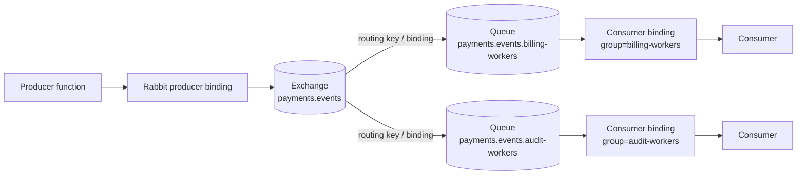
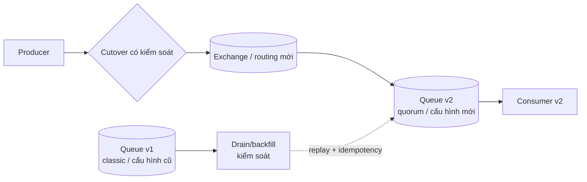

# Xung đột khai báo RabbitMQ queue, exchange hoặc thuộc tính tài nguyên

Spring Cloud Stream cho phép lập trình sự kiện bằng `Supplier`, `Function` và `Consumer`, rồi kết nối function với Kafka, RabbitMQ hoặc Pulsar qua binder. Trong **RabbitMQ binder**, quá trình khởi tạo binding thường bao gồm khai báo exchange, queue, binding và có thể cả dead-letter exchange/queue (DLX/DLQ). Nếu tài nguyên cùng tên đã tồn tại nhưng được khai báo với thuộc tính khác, RabbitMQ có thể từ chối và đóng AMQP channel.

Triệu chứng đặc trưng là **`406 PRECONDITION_FAILED - inequivalent arg`**: không phải broker “không kết nối được” mà là broker phát hiện cấu hình khai báo mới **không tương đương** với tài nguyên đang tồn tại. Một ứng dụng có thể chạy bình thường trong môi trường trống nhưng thất bại khi triển khai vào môi trường đã có queue/exchange do ứng dụng khác, hạ tầng hoặc phiên bản cũ tạo ra.

Mục tiêu của bài này là chẩn đoán đúng nguyên nhân, đối chiếu cấu hình effective giữa ứng dụng và broker, sửa mà **không làm mất message**, và thiết lập quyền sở hữu tài nguyên để tránh xung đột tái diễn.

## 1. Mục tiêu học tập

Sau bài học, bạn có thể:

1. Phân biệt exchange, queue và binding; biết thuộc tính nào được kiểm tra khi khai báo lại.
2. Đọc log `PRECONDITION_FAILED` để xác định **vhost, resource, argument, received và current**.
3. Nhận diện xung đột `durable`, `auto-delete`, `exclusive`, `x-queue-type`, `x-message-ttl`, `x-dead-letter-exchange` và exchange type.
4. Hiểu cách RabbitMQ binder đặt tên exchange/queue theo `destination`, `group`, `prefix` và `queueNameGroupOnly`.
5. Phân biệt broker policy với client-supplied `x-arguments` và thuộc tính cố định lúc khai báo.
6. Chọn biện pháp khôi phục an toàn: đồng bộ cấu hình, dùng hạ tầng pre-provisioned hoặc migration sang tài nguyên mới.
7. Kiểm thử xung đột trong môi trường tích hợp trước khi triển khai production.

## 2. Nhìn đúng mô hình RabbitMQ trong Spring Cloud Stream

Trong Kafka, `destination` thường là topic. Với **RabbitMQ binder**, `destination` thường ánh xạ tới **exchange**; queue của consumer được tạo và bind vào exchange đó.



Cấu hình ví dụ:

```yaml
spring:
  cloud:
    function:
      definition: processPayment
    stream:
      bindings:
        processPayment-in-0:
          binder: rabbit
          destination: payments.events
          group: billing-workers
```

Với mặc định phổ biến của Rabbit consumer binder, exchange là `payments.events` và queue bền tên `payments.events.billing-workers`. Consumer group khác dùng queue khác, nên có thể nhận bản sao message theo routing/binding phù hợp; nhiều instance cùng group cạnh tranh trên **cùng queue**.

Quan trọng: lỗi 406 đến từ **khai báo tài nguyên**, có thể xảy ra **trước khi function được gọi**. Sửa business code trong `processPayment` thường không giải quyết được lỗi này.

## 3. Quy tắc khai báo lại và property equivalence

AMQP `queue.declare` / `exchange.declare` có hai kiểu kết quả:

- Tài nguyên chưa tồn tại và ứng dụng có quyền: broker tạo tài nguyên.
- Tài nguyên đã tồn tại với thuộc tính tương đương: broker chấp nhận khai báo lại, về cơ bản là idempotent.
- Tài nguyên đã tồn tại nhưng thuộc tính không tương đương: broker trả lỗi **`406 PRECONDITION_FAILED`**, thường đóng **channel liên quan**.

Ví dụ hai ứng dụng khai báo cùng queue:

```text
Ứng dụng A:
queue = payments.events.billing-workers
durable = true
autoDelete = false
arguments = {"x-message-ttl": 60000}

Ứng dụng B:
queue = payments.events.billing-workers
durable = true
autoDelete = false
arguments = {"x-message-ttl": 120000}

Kết quả: xung đột trên x-message-ttl (giả sử không có quy tắc
đặc biệt làm cho hai khai báo tương đương).
```

Không phải cứ cùng **tên** là dùng chung được. Các ứng dụng cùng vhost và khai báo cùng exchange/queue phải thống nhất **hợp đồng tài nguyên**.

**Ngoại lệ cần biết:** RabbitMQ hiện đại có cơ chế default queue type (DQT) và tùy chọn nới lỏng một số phép so sánh `x-queue-type` trong trường hợp migration. Không xem đó là giải pháp tổng quát cho `durable`, `exclusive`, TTL, DLX hay các thuộc tính khác, và cũng không chuyển đổi queue hiện có sang loại mới.

## 4. Đọc đúng thông báo lỗi 406

Ví dụ message thường gặp (minh họa):

```text
ShutdownSignalException:
channel error;
reply-code=406,
reply-text=PRECONDITION_FAILED - inequivalent arg
'x-dead-letter-exchange' for queue 'payments.events.billing-workers'
in vhost '/':
received 'payments.retry' but current is 'payments.dlx'
```

Cần tách năm trường:

| Trường trong lỗi | Cách hiểu |
|---|---|
| `reply-code=406` | Lỗi điều kiện khai báo không thỏa; không mặc định là lỗi network |
| `inequivalent arg` | Có thuộc tính/argument khai báo không tương đương |
| `queue` hoặc `exchange` | Loại tài nguyên bị xung đột |
| Tên tài nguyên và `vhost` | Đúng đối tượng phải kiểm tra trên broker |
| `received` / `current` | Giá trị ứng dụng gửi khi khai báo và giá trị broker đang lưu |

**`received` là giá trị được gửi trong lần khai báo thất bại**, còn `current` là giá trị broker nhận định đang áp dụng. Đừng sửa ngược chiều. Khi broker báo nhận `120000` nhưng hiện hữu `60000`, cần quyết định bên nào là hợp đồng đúng trước khi thay đổi.

Log Java có thể bọc lỗi này qua `AmqpIOException`, `ShutdownSignalException`, `BeanCreationException`, hoặc lỗi của `RabbitAdmin` / listener container. Hãy tìm **lỗi gốc gần `channel.close`** thay vì chỉ dựa vào exception ngoài cùng.

## 5. Phân biệt lỗi 406 với những lỗi dễ nhầm

| Mã / hiện tượng | Điểm khác biệt | Bước kiểm tra |
|---|---|---|
| **406 PRECONDITION_FAILED** | Khai báo không tương đương hoặc vi phạm một precondition | Tên tài nguyên, field received/current, args |
| **404 NOT_FOUND** | Đang dùng/examine tài nguyên không có (ví dụ passive declare hoặc bind đến exchange thiếu) | Tài nguyên/vhost có tồn tại không? |
| **403 ACCESS_REFUSED** | Quyền, tên tài nguyên bị cấm hoặc thao tác không được phép | User/vhost/ACL, reserved names |
| **405 RESOURCE_LOCKED** | Queue độc quyền đang do connection khác sở hữu | Exclusive queue, connection owner |
| **530 NOT_ALLOWED** hoặc lỗi plugin | Thao tác/broker capability không hỗ trợ | Plugin, broker version, exchange type |
| Connection refused/TLS/SASL | Không thiết lập được connection | Host/port, credentials, TLS, network |

Các mã ngoài 406 có thể xuất hiện ở nhiều tình huống; luôn đọc `reply-text` chi tiết trước khi kết luận.

**Không chữa lỗi 406 bằng cách tăng `connection-timeout` hoặc retry vô hạn.** Mỗi lần reconnect, binder có thể tiếp tục khai báo cùng thuộc tính sai và thất bại lặp lại.

## 6. Ma trận thuộc tính thường gây xung đột

| Tài nguyên | Thuộc tính / argument | Ý nghĩa | Lưu ý khi sửa |
|---|---|---|---|
| Exchange | `type`: topic/direct/fanout/headers | Quy tắc định tuyến | Không đổi type của exchange đang tồn tại bằng redeclare |
| Exchange | `durable` | Exchange tồn tại sau broker restart | Đồng bộ với khai báo gốc |
| Exchange | `autoDelete` | Xóa khi điều kiện auto-delete thỏa | Default binder có thể khác hạ tầng |
| Exchange | `arguments`, ví dụ alternate exchange | Tùy chọn cấu hình exchange | Đối chiếu policy và x-args |
| Queue | `durable` | Độ bền metadata queue | Không đổi in-place qua redeclare |
| Queue | `exclusive` | Queue gắn với connection chủ sở hữu | Không nhầm với exclusive consumer |
| Queue | `autoDelete` | Xóa theo điều kiện auto-delete | Không dùng queue tạm làm shared durable group |
| Queue | `x-queue-type` | Classic/quorum/stream | Cố định khi tạo, không chuyển kiểu in-place |
| Queue | `x-message-ttl` | TTL mặc định của message | Ưu tiên policy khi có thể |
| Queue | `x-expires` | Thời gian sống của queue không sử dụng | Kiểm tra ảnh hưởng lên queue group |
| Queue | `x-dead-letter-exchange` | Exchange nhận message dead-letter | Tránh x-arg cứng nếu muốn cập nhật qua policy |
| Queue | `x-dead-letter-routing-key` | Routing key khi dead-letter | Phải khớp DLX topology |
| Queue | `x-max-length`, `x-max-length-bytes` | Giới hạn số message/bytes | Cần cân nhắc overflow policy |
| Queue | `x-max-priority` | Ưu tiên classic queue | Khó đổi do cố định tại declaration |
| Queue | `x-single-active-consumer` | Chỉ một consumer hoạt động | Không phải setting số thread của app |
| Binding | Routing/binding key, arguments | Kết nối exchange→queue | Sai key thường làm mất routing, không nhất thiết gây 406 |

Ví dụ cuối cùng rất quan trọng: **queue tồn tại, declaration thành công nhưng routing key sai** thường gây message không đến consumer; đây là **sai topology**, không phải bất tương đương khi khai báo queue.

## 7. Xung đột exchange type

Hai service cùng dùng destination `payments.events` nhưng cấu hình:

Ứng dụng A (type topic):

```yaml
spring:
  cloud:
    stream:
      rabbit:
        bindings:
          processPayment-in-0:
            consumer:
              exchange-type: topic
```

Ứng dụng B (type direct):

```yaml
spring:
  cloud:
    stream:
      rabbit:
        bindings:
          publishPayment-out-0:
            producer:
              exchange-type: direct
```

Nếu cả hai cùng khai báo exchange `payments.events` trong cùng vhost, ứng dụng chạy sau có thể nhận:

```text
406 PRECONDITION_FAILED - inequivalent arg 'type'
for exchange 'payments.events':
received 'direct' but current is 'topic'
```

Cách sửa an toàn: thống nhất **một loại exchange** và cập nhật routing/binding key tương ứng. Nếu nghiệp vụ thực sự cần thêm exchange `direct` độc lập, tạo **exchange tên mới**, không ép broker đổi type của exchange hiện hữu.

**Không thay `declare-exchange: false` chỉ để bỏ qua lỗi rồi tiếp tục publish khi exchange đang sai loại.** Ứng dụng có thể khởi động nhưng message bị định tuyến sai hoặc bị unroutable.

## 8. Xung đột exchange durable và auto-delete

Một trường hợp ít được chú ý: Rabbit binder mặc định có thể khai báo exchange với:

- `exchangeDurable=true`.
- `exchangeAutoDelete=true`.
- `exchangeType=topic`.

Đội hạ tầng có thể đã tạo exchange cùng tên với `durable=true` nhưng `auto_delete=false`. Ngay cả khi type cùng là `topic`, khai báo lại vẫn có thể gây 406.

Ví dụ consumer cần dùng exchange đã provision theo hợp đồng:

```yaml
spring:
  cloud:
    stream:
      rabbit:
        bindings:
          processPayment-in-0:
            consumer:
              exchange-type: topic
              exchange-durable: true
              exchange-auto-delete: false
```

Đọc `exchangeDurable` và `exchangeAutoDelete` ở **cả producer và consumer binding**. Nếu producer lẫn consumer cùng khai báo exchange, chỉ sửa một phía chưa đủ: service còn lại có thể tái tạo lỗi khi deploy/restart.

Auto-delete không có nghĩa “exchange biến mất ngay khi ứng dụng ngừng”. RabbitMQ chỉ tự xóa exchange khi điều kiện liên quan tới **binding cuối cùng** được thỏa; cần kiểm tra lifecycle thực tế.

## 9. Xung đột queue durable, exclusive và auto-delete

Queue có những thuộc tính bắt buộc độc lập với exchange. Ví dụ hai ứng dụng dùng cùng queue nhưng một bên muốn transient:

```text
Queue hiện hữu: orders.events.order-workers
durable=true, exclusive=false, auto_delete=false

Queue mới yêu cầu:
durable=false, exclusive=false, auto_delete=true
```

RabbitMQ không “chỉnh sửa” queue theo yêu cầu mới. Cần xác định vì sao hai app cùng sở hữu queue:

- Một app dùng `group` bền, app kia không có group và muốn temporary queue.
- Hai app có tên group/prefix trùng nhưng chủ đích khác nhau.
- Queue đã được tạo bằng `QueueBuilder` hoặc IaC với lifecycle khác.
- Profile `dev` và `prod` vô tình cùng kết nối một vhost và cùng dùng resource name.

**Exclusive queue** (thuộc tính queue) khác với **exclusive consumer** (cơ chế chỉ cho một consumer nhận từ queue trong một thời điểm). Không dựa vào property `exclusive` của Rabbit consumer binder để kết luận queue được tạo với `exclusive=true`.

Không đổi queue bền thành auto-delete chỉ để một lần khởi động thành công nếu queue còn backlog hoặc cần giữ message qua restart.

## 10. Xung đột classic, quorum và stream queue

RabbitMQ hỗ trợ các loại queue với semantics khác nhau:

- **Classic queue:** phù hợp một số workload truyền thống, không có cùng cơ chế replication như quorum.
- **Quorum queue:** dựa trên Raft, cần lưu ý topology cluster, resource và delivery limit.
- **Stream:** mô hình lưu trữ/consumer khác queue truyền thống.

Queue type được quyết định lúc tạo, thường qua `x-queue-type` hoặc default queue type của vhost/node. Vì vậy:

```text
Queue đã tồn tại: orders.events.order-workers
x-queue-type = classic

Ứng dụng mới yêu cầu:
x-queue-type = quorum
```

Sẽ xảy ra mismatch nếu property equivalence đang được thực thi chặt chẽ. Cấu hình Spring Cloud Stream Rabbit binder:

```yaml
spring:
  cloud:
    stream:
      rabbit:
        bindings:
          processOrder-in-0:
            consumer:
              quorum:
                enabled: true
```

**Không coi `quorum.enabled=true` là thao tác nâng cấp queue classic đã tồn tại.** Muốn chuyển sang quorum, cần tạo queue mới và kế hoạch chuyển/đọc hết backlog, điều chỉnh binding, deduplication, cutover producer/consumer.

RabbitMQ có tùy chọn nới lỏng một số phép kiểm `x-queue-type` phục vụ migration (`quorum_queue.property_equivalence.relaxed_checks_on_redeclaration`), nhưng **không chuyển loại queue** và không nên bật chỉ để che đi bất nhất tài nguyên. Hãy xác minh version và chính sách vận hành của cluster.

## 11. Default Queue Type (DQT) và điều kiện khó thấy

RabbitMQ có thể đặt **default queue type** ở cấp virtual host hoặc node. Khi client không gửi `x-queue-type`, queue có thể được tạo theo DQT thay vì giả định luôn là classic.

Các nguyên nhân phát sinh:

- Môi trường A dùng DQT classic, môi trường B dùng DQT quorum.
- Hạ tầng nâng DQT cho vhost nhưng ứng dụng vẫn cố khai báo type cũ.
- Một phần ứng dụng đặt `quorum.enabled`, phần còn lại để mặc định.
- Queue được tạo trước khi đổi DQT nên vẫn giữ type cũ.

Quy trình kiểm tra:

1. Đọc **type thực tế** của queue trong Management UI/CLI.
2. Kiểm tra `arguments` có `x-queue-type` hay không.
3. Kiểm tra DQT của đúng vhost/node.
4. Xem app/binder có gửi `x-queue-type` tường minh không.
5. Quyết định migration riêng; không sửa DQT rồi mặc định queue cũ đổi theo.

## 12. Optional arguments và kiểu dữ liệu

Các `x-arguments` của queue là map key/value được gửi khi khai báo:

```java
@Bean
Queue orderQueue() {
    return QueueBuilder.durable("orders.events.order-workers")
            .ttl(60_000)
            .deadLetterExchange("orders.dlx")
            .build();
}
```

Nếu queue cùng tên đã có `x-message-ttl` khác, Spring AMQP `RabbitAdmin` hoặc Rabbit binder có thể bị broker từ chối.

Cần xét cả kiểu biểu diễn của đối số, không chỉ nhìn chuỗi hiển thị:

- `60000` (integer) và một value có kiểu AMQP khác có thể không tương đương, tùy kiểm tra phía broker.
- `x-queue-type` là chuỗi enum có ý nghĩa nghiệp vụ; không thay bằng một boolean “quorum” tùy ý.
- `x-dead-letter-exchange` là **tên exchange**, không phải tên queue.
- `x-expires` là thời gian queue không được sử dụng; không đồng nghĩa với thời gian hết hạn của từng message (`x-message-ttl`).

Không sửa từng argument qua redeclare rồi chờ broker “đồng bộ” như một HTTP PUT. Declaration là lời yêu cầu tạo hoặc xác nhận tài nguyên có cùng hợp đồng, không phải thao tác patch arbitrary properties.

## 13. Policy và operator policy: điểm phân biệt sống còn

RabbitMQ có hai lớp chính sách:

- **User policy:** áp dụng runtime tới nhóm queue/exchange theo regex, hỗ trợ nhiều optional arguments như TTL, DLX, length limit.
- **Operator policy:** guardrail do đội vận hành đặt để giới hạn tài nguyên; có quy tắc ưu tiên riêng, với số liệu có thể lấy giá trị thấp hơn giữa các mức giới hạn.

Nếu cùng key xuất hiện ở client-supplied `x-arguments` và **user policy**, giá trị khai báo trực tiếp của client thông thường **ưu tiên hơn** policy. Vì vậy, việc thêm policy `message-ttl=60000` không chắc thay được `x-message-ttl=120000` đã hardcode trong app.

Ví dụ policy quản lý TTL (thao tác quản trị, chỉ chạy trong môi trường được phép):

```bash
rabbitmqctl -p / set_policy --apply-to queues --priority 5 \
  orders-ttl '^orders[.]events[.]order-workers$' \
  '{"message-ttl":60000}'
```

Lệnh minh họa cho vhost `/` và queue cụ thể. Trước khi áp dụng production, xác minh syntax `rabbitmqctl` của broker version, policy đang có, ưu tiên policy và ảnh hưởng tới message tồn đọng. **Không chạy lệnh này chỉ để chữa 406 khi chưa xác định x-arg hiện tại.**

Một số thuộc tính **không** thể thay bằng policy, ví dụ queue type và max priority của classic queue. Trường hợp đó cần migration tài nguyên, không dùng policy để né quy tắc bất biến.

## 14. Spring Cloud Stream Rabbit binder: hiểu tên tài nguyên

Các property quan trọng:

| Property của consumer binding | Mặc định / vai trò |
|---|---|
| `destination` | Tên exchange logic của binding |
| `group` | Consumer group, thường dùng để xác định queue bền |
| `prefix` | Tiền tố thêm vào tên exchange/queue |
| `queueNameGroupOnly` | false: queue thường `destination.group`; true: queue bằng `group` |
| `declareExchange` | true: binder khai báo destination exchange |
| `bindQueue` | true: binder khai báo queue và binding vào exchange |
| `exchangeType` | Mặc định `topic` |
| `exchangeDurable` | Mặc định true |
| `exchangeAutoDelete` | Mặc định true |
| `durableSubscription` | Mặc định true khi có group |
| `autoBindDlq` | Mặc định false |
| `quorum.enabled` | Mặc định false cho queue do binder tạo |

Namespace cấu hình của Rabbit consumer:

```text
spring.cloud.stream.rabbit.bindings.<bindingName>.consumer.<property>
```

Với function tên `processOrder`, binding name thông thường là `processOrder-in-0`, không phải `input` trừ khi có explicit binding mapping.

Nếu một deployment ghi property tại `spring.cloud.stream.rabbit.bindings.input.consumer` nhưng runtime chỉ có `processOrder-in-0`, cấu hình có thể không tác động vào đúng binding và binder sẽ dùng default khác dự kiến.

## 15. Một nguyên nhân lặp lại: producer và consumer cùng khai báo exchange

Producer và consumer có extended properties riêng:

```yaml
spring:
  cloud:
    stream:
      bindings:
        publishOrder-out-0:
          binder: rabbit
          destination: orders.events
        processOrder-in-0:
          binder: rabbit
          destination: orders.events
          group: order-workers
      rabbit:
        bindings:
          publishOrder-out-0:
            producer:
              exchange-type: topic
              exchange-durable: true
              exchange-auto-delete: false
          processOrder-in-0:
            consumer:
              exchange-type: topic
              exchange-durable: true
              exchange-auto-delete: false
```

Nếu chỉ producer đặt `exchange-auto-delete: false` còn consumer mặc định là true, cùng exchange có thể bị khai báo khác nhau, dẫn tới 406.

Giải pháp là **một hợp đồng exchange duy nhất** cho mọi app cùng vhost:

- Tên, type, durable, auto-delete, arguments.
- Ai là owner được phép declare/alter exchange.
- Các producer/consumer khác có khai báo lại không.
- Binding keys dự kiến và queue groups nào cần sử dụng.
- Quy tắc thay đổi và kiểm thử trước triển khai.

## 16. Producer requiredGroups cũng có thể tạo queue

Spring Cloud Stream Rabbit producer hỗ trợ `requiredGroups`. Khi cấu hình, producer không chỉ khai báo exchange mà còn có thể provision queue/binding cho các group được yêu cầu.

```yaml
spring:
  cloud:
    stream:
      bindings:
        publishOrder-out-0:
          binder: rabbit
          destination: orders.events
          producer:
            required-groups: order-workers
```

Khi cả producer và consumer cùng tạo queue `orders.events.order-workers`, các property queue/DLQ của hai phía phải thống nhất. Producer có extended properties áp dụng cho `requiredGroups` như `queueNameGroupOnly`, `autoBindDlq`, `quorum.enabled`, TTL/length, tùy version.

Tình huống:

- Producer tạo queue classic khi khởi động trước.
- Consumer deploy sau với `quorum.enabled=true`.
- Consumer khai báo lại queue cùng tên nhưng khác type → lỗi.

Không chỉ đọc YAML của consumer khi điều tra. Kiểm tra mọi producer hoặc provisioning job đang dùng `requiredGroups`; đó có thể là tác nhân đầu tiên tạo tài nguyên.

## 17. Ví dụ tái hiện 406 do exchange settings

Giả sử topology hiện tại đã có exchange `orders.events`:

```text
name=orders.events
type=topic
durable=true
auto_delete=false
```

Ứng dụng cũ khai báo:

```yaml
spring:
  cloud:
    stream:
      rabbit:
        bindings:
          consumeOrder-in-0:
            consumer:
              exchange-type: topic
              exchange-durable: true
              exchange-auto-delete: false
```

Một ứng dụng mới quên `exchange-auto-delete` nên dùng default true. Khi binding khởi tạo, broker báo:

```text
406 PRECONDITION_FAILED - inequivalent arg 'auto_delete'
for exchange 'orders.events' in vhost '/':
received 'true' but current is 'false'
```

**Sửa không phá dữ liệu:** bổ sung `exchange-auto-delete: false` vào consumer mới và các app cùng owner exchange. Không xóa exchange để broker “nhận lại config mới”: xóa exchange sẽ làm mất routes/bindings, và message được publish trong khoảng thời gian đó có thể không đến queue.

## 18. Ví dụ tái hiện 406 do TTL / DLX của queue

Queue hiện hữu:

```text
name=orders.events.order-workers
durable=true
arguments:
  x-message-ttl: 60000
  x-dead-letter-exchange: orders.dlx
```

Service mới cấu hình:

```yaml
spring:
  cloud:
    stream:
      rabbit:
        bindings:
          processOrder-in-0:
            consumer:
              ttl: 120000
              auto-bind-dlq: true
              dead-letter-exchange: orders.retry-dlx
```

Nếu binder khai báo queue với các argument khác queue hiện hữu, broker có thể báo xung đột `x-message-ttl` hoặc `x-dead-letter-exchange` trước tiên. Không có bảo đảm broker sẽ báo đầy đủ mọi field sai trong một lần.

Quy trình sửa:

1. Kiểm tra queue actual arguments và policy đang match.
2. Chốt TTL/DLX là **hợp đồng** chung giữa mọi producer/consumer.
3. Với giá trị có thể quản lý bằng policy, cân nhắc đưa vào RabbitMQ policy thay vì hardcode.
4. Nếu queue đã có hardcoded x-arg không thể đổi an toàn, lập kế hoạch queue migration.
5. Kiểm tra DLQ/DLX tồn tại và route đúng sau khi sửa.

Đổi `ttl` trong YAML không cập nhật in-place một queue đang tồn tại. Tương tự, bật `auto-bind-dlq` trên một queue đã có DLX khác không phải thao tác “patch DLX”.

## 19. DLQ/DLX cũng là tài nguyên có thể xung đột

Khi `autoBindDlq=true`, Rabbit binder có thể provision thêm:

- Dead-letter exchange (DLX).
- Dead-letter queue (DLQ).
- Binding từ DLX tới DLQ.
- Các `x-arguments` trên queue chính hoặc DLQ.

Những property cần đối chiếu gồm `deadLetterQueueName`, `deadLetterExchange`, `deadLetterExchangeType`, `deadLetterRoutingKey`, `declareDlx`, `dlqTtl`, `dlqMaxLength`, `dlqQuorum.enabled` và `dlqDeadLetterExchange`.

Một lỗi có thể xảy ra ở **DLQ** chứ không phải queue chính. Vì vậy, khi stack trace có `inequivalent arg`, đọc **tên queue/exchange trong log** trước; không mặc định đó là input queue.

**Cảnh báo:** thiết lập DLX hoặc TTL trên DLQ để đưa message quay lại queue chính có thể tạo vòng lặp. Kiểm tra dead-letter cycle, số lần redelivery, retry/backoff, poison message và dữ liệu tồn đọng trước khi thay đổi.

## 20. Kiểm kê tài nguyên từ RabbitMQ Management

Bước đầu tiên trong production là **thu thập bằng chứng chỉ-đọc**:

- Vhost đang được app kết nối.
- Exchange name, type, durable, auto_delete, arguments.
- Queue name, type, durable, auto_delete, arguments và messages.
- Queue bindings: source exchange, destination queue, routing key, arguments.
- Policies và operator policies đang match.
- Các service accounts có quyền declare và các service đang dùng cùng tên.

Trong RabbitMQ Management UI, tra cứu mục **Exchanges**, **Queues and Streams**, **Bindings** và **Policies** trong đúng vhost.

Một số lệnh CLI chỉ đọc (cú pháp tùy bản triển khai và quyền người dùng):

```bash
rabbitmqctl -p / list_exchanges name type durable auto_delete arguments
rabbitmqctl -p / list_queues name durable auto_delete arguments messages_ready messages_unacknowledged
rabbitmqctl -p / list_bindings source_name destination_name destination_kind routing_key
rabbitmqctl -p / list_policies
```

Thay `/` bằng đúng vhost của service. Không chạy `delete_queue`, `delete_exchange` hoặc `purge_queue` để “thử” trong production.

Chỉ truy cập thông tin được phép và tránh đưa mật khẩu/token hoặc full payload vào log/screenshot chẩn đoán.

## 21. Lập bảng actual-vs-declared

Với mỗi tài nguyên lỗi, ghi bảng:

| Thuộc tính | Actual trên broker | Declared từ app | Kết luận |
|---|---|---|---|
| Vhost | `/payments` | `/payments` | Khớp |
| Exchange | `orders.events` | `orders.events` | Khớp tên |
| Exchange type | `topic` | `topic` | Khớp |
| Exchange durable | true | true | Khớp |
| Exchange auto-delete | false | true | **Conflict** |
| Queue | `orders.events.order-workers` | Cùng tên | Khớp tên |
| Queue type | quorum | classic | **Conflict nếu redeclare chặt** |
| Queue TTL | 60000 | 120000 | **Conflict** |
| DLX | `orders.dlx` | `orders.retry-dlx` | **Conflict** |

Sau đó xác định **owner của hợp đồng tài nguyên**: broker IaC, Spring application A, Spring application B, hoặc một provisioning service. Không chọn `received` hay `current` chỉ vì một phía “mới hơn”; cần chốt yêu cầu vận hành (độ bền, retention, retry/DLQ, routing).

## 22. Cách sửa 1: đồng bộ khai báo theo tài nguyên hiện có

Đây thường là lựa chọn ít rủi ro nhất nếu tài nguyên hiện hữu đang phục vụ production đúng mục đích:

1. Giữ nguyên queue/exchange và messages.
2. So sánh broker actual với app YAML.
3. Đồng bộ exchange type, durable, auto-delete, queue type và hardcoded arguments.
4. Cập nhật **tất cả** app có thể redeclare cùng tài nguyên (producer, consumer, admin jobs).
5. Triển khai một app canary; kiểm tra binding, routing và consumer health.
6. Rollout phần còn lại; theo dõi retry/reconnect và backlog.

Không thay `durable=true` thành `false` chỉ để khớp một ứng dụng thử nghiệm nếu điều đó phá yêu cầu bảo đảm delivery. Hợp đồng đúng mới quyết định bên nào cần sửa.

## 23. Cách sửa 2: hạ tầng sở hữu topology, binder chỉ sử dụng

Khi exchange, queue và binding đã được quản trị bởi IaC/Platform team, ứng dụng nên tránh tái khai báo chúng.

Ví dụ **đã pre-provision**:

- Exchange `orders.events` loại `topic`.
- Queue `orders.billing-workers`.
- Binding queue vào exchange với routing key `orders.#`.
- Queue có TTL/DLX được hạ tầng cấu hình và kiểm soát.

Consumer:

```yaml
spring:
  cloud:
    function:
      definition: processOrder
    stream:
      bindings:
        processOrder-in-0:
          binder: rabbit
          destination: orders.events
          group: orders.billing-workers
      rabbit:
        bindings:
          processOrder-in-0:
            consumer:
              queue-name-group-only: true
              declare-exchange: false
              bind-queue: false
```

Producer (nếu cũng không được phép declare exchange):

```yaml
spring:
  cloud:
    stream:
      rabbit:
        bindings:
          publishOrder-out-0:
            producer:
              declare-exchange: false
```

Ở đây `queue-name-group-only: true` khiến queue name lấy từ `group`, thay vì tự ghép `destination.group`. `declare-exchange: false` và `bind-queue: false` **chỉ phù hợp nếu exchange, queue và binding đã được tạo đúng**. Nếu thiếu, ứng dụng có thể không nhận message hoặc publish thất bại.

**Không dùng cấu hình này như cách che 406 mà chưa kiểm tra topology**; cần test publish tới exchange và consume từ chính queue đã pre-provision.

## 24. Cách sửa 3: migration tài nguyên có thay đổi bất biến

Nếu cần chuyển classic→quorum, exchange direct→topic, durable→non-durable hoặc đổi queue arguments không thể điều chỉnh runtime, hãy xem đó là **migration topology**, không phải sửa một dòng YAML.



Quy trình khuyến nghị:

1. **Đóng băng cấu hình**: xác định toàn bộ apps sở hữu tên cũ, queue depth và SLA.
2. **Tạo tên mới** cho queue/exchange cần đổi type/lifecycle nếu broker không hỗ trợ đổi in-place.
3. **Chuẩn bị topology mới** qua IaC/management và xác minh ACL, DLX, arguments.
4. **Kiểm tra routing song song** bằng test event không nhạy cảm; đánh giá duplicate khi fanout đến cả queue cũ/mới.
5. **Chuyển producer/consumer có điều phối**, bảo đảm event không bị bỏ giữa chuyển đổi.
6. **Drain/backfill queue cũ** theo thiết kế có idempotency và khả năng resume.
7. **Giám sát** message ready/unacked, DLQ, throughput, số bản sao và consumer errors.
8. **Chỉ xóa tài nguyên cũ** khi đã xác nhận hết backlog và rollback window kết thúc.

Không hứa giữ thứ tự toàn cục hoặc exactly-once chỉ bằng dual routing. Khi re-publish/backfill, message có thể lặp hoặc đổi thứ tự; downstream phải có idempotency/version guard.

## 25. Những tình huống không phải xung đột khai báo

Một số lỗi được nhầm là queue/exchange conflict:

| Triệu chứng | Có nhất thiết là 406? | Giả thuyết khác |
|---|---|---|
| Queue có message nhưng consumer không nhận | Không | Consumer dừng, prefetch/unacked, ACL, group sai |
| Producer publish không lỗi nhưng queue trống | Không | Sai binding key, fanout/direct/topic semantics, unroutable |
| Binding name trong YAML sai | Không | Config không áp dụng; binder dùng default |
| Đọc nhầm vhost | Không | Topology cùng tên nằm ở vhost khác |
| `ACCESS_REFUSED` khi declare | Không | Thiếu configure/read/write permissions |
| Queue không tồn tại | Không | Đã tắt binder declare hoặc sai queue-name-group-only |
| Quorum queue không tạo được | Có thể không | Cluster capability, quorum size, disk/resource |
| Delayed exchange không tạo được | Không nhất thiết | Chưa bật plugin `x-delayed-message` |
| Auto-delete queue biến mất | Không | Lifecycle/connection/binding cuối cùng |

Đừng nhìn thấy `AmqpIOException` là tự động xóa queue. Cần trả lời “broker đã từ chối **lệnh nào**, trên **resource nào**, vì **nguyên nhân gì**?” trước khi hành động.

## 26. Phân biệt exclusive consumer và single active consumer

Rabbit consumer binder có thể cấu hình:

- `exclusive`: dùng exclusive consumer theo khả năng của Spring AMQP; khác queue `exclusive=true`.
- `singleActiveConsumer`: khai báo `x-single-active-consumer` trên queue, cho một consumer hoạt động và consumer khác chờ.

Nếu bật `single-active-consumer` trên queue đã tồn tại với argument khác, đây là **thay đổi queue argument** cần xét property equivalence. Tăng `concurrency` không tự sửa được.

Một hệ thống muốn bảo toàn thứ tự theo queue nên chọn rõ chiến lược single consumer/single active consumer và kiểm thử failover; không dùng `exclusive queue` tạm để thay queue bền cần lưu backlog qua restart.

## 27. Multi-binder và môi trường: cùng tên chưa chắc cùng tài nguyên

Với nhiều Rabbit binder hoặc nhiều môi trường, một tài nguyên được định danh bởi nhiều yếu tố:

**Rabbit cluster + virtual host + resource type + resource name**.

Hai exchange `orders.events` ở hai vhost khác nhau không phải cùng một exchange; cùng tên ở **một vhost** lại phải tuân thủ cùng hợp đồng.

Kiểm tra:

- `spring.rabbitmq.addresses` / host/port.
- `spring.rabbitmq.virtual-host`.
- Named binder và `environment.spring.rabbitmq.*` nếu cấu hình multi-binder.
- `prefix` của Rabbit binder và common binding `destination`.
- Profile Kubernetes/Helm/Config Server có override các property này không.
- User account, vhost permissions và broker policy áp dụng trong vhost đó.

Không giải quyết mismatch bằng cách vô tình trỏ sang vhost khác. Ứng dụng có thể “khởi động thành công” nhưng đã rời khỏi luồng dữ liệu production.

## 28. Retry khai báo và tác động vận hành

Sau lỗi 406, Spring AMQP/Rabbit binder có thể thử reconnect hoặc redeclare khi connection/channel được phục hồi. Trong khi topology không đổi, mỗi lần thử lại thường tiếp tục lỗi.

**Không nên:**

- Tăng vô hạn số lần retry startup.
- Bắt exception rồi bỏ qua mà không xác nhận queue/route.
- Tắt toàn bộ RabbitAdmin bằng cấu hình chung chỉ để app lên `UP`.
- Xóa queue đang có message để ép broker nhận định nghĩa mới.

**Nên:**

- Giải quyết đúng field mismatch.
- Giới hạn log spam nhưng vẫn giữ error code, vhost, queue/exchange và property.
- Phân biệt health check của ứng dụng với health của binding/consumer.
- Khi sự cố làm dừng flow, tạm ngừng rollout thay vì tự tạo topology khác.
- Sau khi sửa, xác nhận số consumer được gắn vào queue và message thực sự được xử lý.

## 29. Kiểm thử xung đột bằng broker thật

Test binder thuần trong JVM của Spring Cloud Stream **không tạo RabbitMQ queue/exchange thật**, nên không chứng minh property equivalence. Dùng RabbitMQ thật trong môi trường tích hợp hoặc Testcontainers.

### Kịch bản test

1. Khởi động RabbitMQ test container.
2. Dùng AMQP client hoặc Spring AMQP `RabbitAdmin` tạo exchange/queue có hợp đồng A.
3. Khởi động Spring Cloud Stream Rabbit app với hợp đồng B khác.
4. Assert startup/binding bị lỗi với root cause chứa `406 PRECONDITION_FAILED`.
5. Sửa B cho khớp A; khởi động lại và xác minh consumer nhận được message.
6. Thử `declare-exchange: false` / `bind-queue: false` với topology pre-provisioned.
7. Kiểm tra DLX/DLQ và policy; xác minh message không bị purge ngoài kịch bản test.

Ví dụ tái hiện tối giản bằng Java Rabbit client (chỉ chạy với **test broker**):

```java
try (Connection connection = factory.newConnection();
     Channel channel = connection.createChannel()) {

    Map<String, Object> args = Map.of(
            "x-message-ttl", 60_000
    );

    channel.queueDeclare(
            "demo.orders", true, false, false, args
    );
}

// Một connection/channel mới để tái khai báo khác TTL:
try (Connection connection = factory.newConnection();
     Channel channel = connection.createChannel()) {

    Map<String, Object> incompatible = Map.of(
            "x-message-ttl", 120_000
    );

    // Dự kiến server trả channel-level 406.
    channel.queueDeclare(
            "demo.orders", true, false, false, incompatible
    );
}
```

Đừng tái hiện bằng queue đang dùng trên production. Test có thể để lại tài nguyên test hoặc đóng channel lỗi; cần cô lập vhost/container và cleanup an toàn.

## 30. Đọc hiệu quả một log khai báo lỗi

Thứ tự tìm log:

1. `PRECONDITION_FAILED` và mã 406.
2. `queue` hay `exchange` bị báo lỗi.
3. Tên resource, vhost.
4. `inequivalent arg`, `received`, `current`.
5. Stack trace từ `RabbitAdmin` hoặc binder để biết binding nào đang declare.
6. Thời điểm deploy/app nào khai báo trước.
7. Queue/exchange actual và policies trong Management.
8. Config hiệu lực từ Helm/env/Config Server, không chỉ `application.yml`.

Một mẫu incident note:

```text
Incident: RabbitMQ 406 khi khởi động order-workers
Cluster/vhost: rabbit-prod /orders
Resource: exchange orders.events
Mismatch: auto_delete received=true, current=false
Owner of topology: messaging IaC
Affected bindings: publishOrder-out-0, processOrder-in-0
Safe action: pin exchange-auto-delete=false in both bindings
Validation: redeclare OK; queue depth stable; publish/consume pass
Rollback: revert app release only if routing/data compatibility preserved
```

Nội dung incident không cần chứa payload, user token hoặc password kết nối broker.

## 31. Runbook sự cố production

| Bước | Câu hỏi | Quyết định |
|---|---|---|
| 1. Khoanh vùng | Có đúng 406 và tài nguyên nào? | Tách declaration conflict khỏi network/ACL |
| 2. Bảo toàn dữ liệu | Queue depth, unacked, DLQ hiện tại? | Không purge/delete khi chưa đánh giá |
| 3. So sánh | Actual vs declared trên đúng vhost? | Xác định field mismatch |
| 4. Tìm owner | Ai provision, app nào cùng declare? | Thống nhất hợp đồng |
| 5. Chọn phương án | Align config, disable app declaration hay migrate? | Ưu tiên không phá dữ liệu |
| 6. Thử staging | Có reproducible test? | Kiểm tra behavior và rollback |
| 7. Triển khai | Canary có xử lý message không? | Theo dõi ready/unacked, retries |
| 8. Kết thúc | Đã có tài liệu/alert/preflight? | Ngăn tái diễn |

**Quy tắc quyết định:** khi mới nhìn thấy lỗi, lựa chọn an toàn nhất thường là **dừng rollout của phiên bản gây xung đột, giữ queue/exchange hiện hữu, lấy snapshot cấu hình và đối chiếu**. Không tự động xóa tài nguyên.

## 32. Checklist trước khi kết luận đã sửa

- Đã xác nhận đúng cluster, vhost, binding, destination và group.
- Đã có nguyên văn `reply-code`, `reply-text`, `received` và `current`.
- Đã phân biệt xung đột exchange, queue, DLQ và lỗi ACL/missing resource.
- Đã so sánh exchange type, durable, auto-delete và arguments.
- Đã so sánh queue durable, exclusive, auto-delete, type và x-arguments.
- Đã kiểm tra queue name thực tế từ `destination.group` hoặc `queueNameGroupOnly`.
- Đã kiểm tra producer `requiredGroups` và các provisioning jobs khác.
- Đã rà soát policy, operator policy và DQT của broker.
- Không kỳ vọng thay property YAML sẽ sửa queue có sẵn in-place.
- Nếu dùng topology do hạ tầng tạo, `declareExchange`/`bindQueue` được đặt có chủ đích.
- Nếu migration queue type/exchange type, có tên mới, cutover, drain và idempotency.
- Không xóa/purge production queue chỉ để app khởi động.
- Integration test với Rabbit broker thật đã xác nhận declaration và publish/consume.
- DLQ/DLX vẫn định tuyến chính xác sau thay đổi.
- Consumer count, messages ready/unacked, error/retry và throughput trở về bình thường.
- Đã ghi rõ owner và hợp đồng khai báo tài nguyên để tránh xung đột tái phát.

**Kết luận:** `406 PRECONDITION_FAILED` trong RabbitMQ là một tín hiệu quan trọng rằng **hợp đồng tài nguyên giữa client và broker đã khác nhau**. Với Spring Cloud Stream Rabbit binder, nguyên nhân thường đến từ default hoặc cấu hình của **nhiều app cùng khai báo**: exchange `type/durable/autoDelete`, queue `durable/type/TTL/DLX`, tên `destination.group`, producer `requiredGroups` hoặc hạ tầng tạo sẵn. Chẩn đoán theo `received/current`, đối chiếu actual-vs-declared trên đúng vhost, và ưu tiên sửa cấu hình không phá dữ liệu trước khi tính đến migration.

## Tài liệu tham khảo

1. [RabbitMQ — Queues: Declaration and Property Equivalence](https://www.rabbitmq.com/docs/queues) — queue redeclaration, lỗi 406, DQT, queue properties.
2. [RabbitMQ — Exchanges](https://www.rabbitmq.com/docs/exchanges) — exchange type, durable, auto-delete và arguments.
3. [RabbitMQ — Policies](https://www.rabbitmq.com/docs/policies) — client x-args, policy precedence, dynamic properties và bất biến.
4. [RabbitMQ — Dead Letter Exchanges](https://www.rabbitmq.com/docs/dlx) — `x-dead-letter-exchange`, policy vs hardcoded arguments, DLX permissions.
5. [RabbitMQ — Quorum Queues](https://www.rabbitmq.com/docs/quorum-queues) — queue type, Raft và property equivalence relaxation.
6. [RabbitMQ — Virtual Hosts](https://www.rabbitmq.com/docs/vhosts) — resource scope và default queue type.
7. [Spring Cloud Stream 5.0.4 — RabbitMQ Consumer Properties](https://docs.spring.io/spring-cloud-stream/reference/rabbit/rabbit_overview/rabbitmq-consumer-properties.html) — `bindQueue`, `queueNameGroupOnly`, `exchangeAutoDelete`, `quorum.enabled`, `autoBindDlq`.
8. [Spring Cloud Stream 5.0.4 — RabbitMQ Producer Properties](https://docs.spring.io/spring-cloud-stream/reference/rabbit/rabbit_overview/prod-props.html) — `requiredGroups`, exchange options, producer-side provisioning.
9. [Spring Cloud Stream — RabbitMQ Binder Reference](https://docs.spring.io/spring-cloud-stream/reference/rabbit/rabbit_overview.html) — cơ chế binding, queue và DLQ.
10. [RabbitMQ — Access Control](https://www.rabbitmq.com/docs/access-control) — configure/read/write permissions trên vhost.

