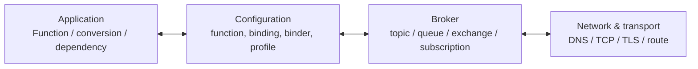
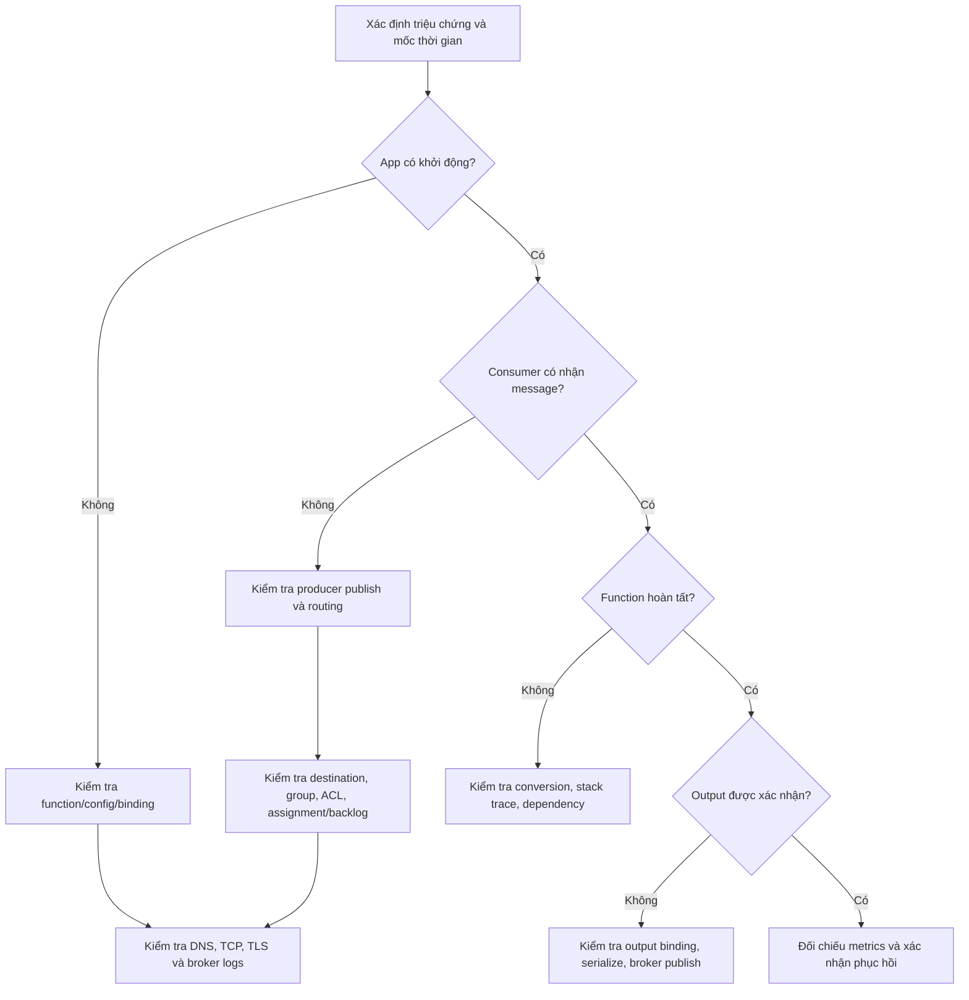
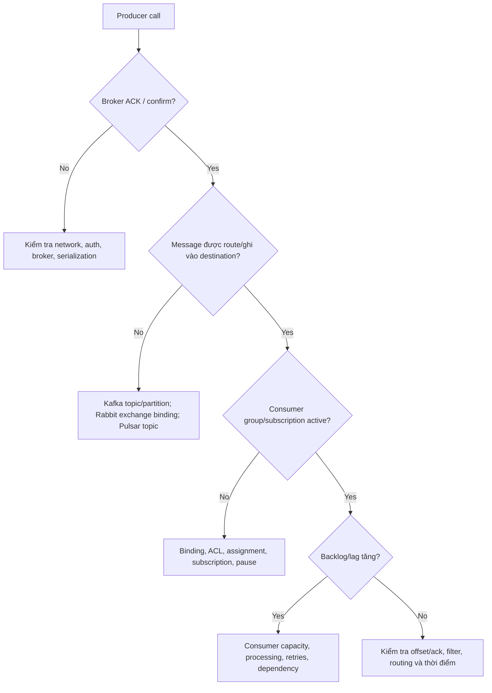

# Phân biệt lỗi ứng dụng, cấu hình, broker và mạng bằng bằng chứng

Khi một pipeline Spring Cloud Stream ngừng nhận message, tăng độ trễ hoặc liên tục retry, cùng một triệu chứng có thể xuất phát từ nhiều lớp: code xử lý nghiệp vụ, cấu hình binding/binder, broker hoặc đường mạng. Function không được gọi có thể do binding trỏ sai destination, topic chưa được tạo, queue không có binding key, consumer thiếu quyền, DNS phân giải sai hoặc broker quảng bá địa chỉ mà pod không thể truy cập.

Cách chẩn đoán đáng tin cậy là **thu thập bằng chứng theo cùng một mốc thời gian, định danh đúng binding/resource và kiểm tra từng lớp từ ứng dụng ra ngoài**. Một thông báo “connection failed” hoặc trạng thái Actuator UP riêng lẻ không đủ để kết luận nguyên nhân.

Bài học thuộc nhóm **Chẩn đoán sự cố**, tập trung phân biệt bốn nhóm:

- **Application:** exception trong function, lỗi chuyển đổi/serialize, dependency hoặc xử lý nghiệp vụ.
- **Configuration:** sai function definition, binding name, destination, group, binder, profile, credentials reference hoặc property override.
- **Broker:** resource, ACL, partition/leader, queue/exchange/binding, subscription, quota, broker health hoặc protocol-level rejection.
- **Network/transport:** DNS, route, firewall, TCP, TLS, proxy, NAT, idle timeout hoặc packet loss.

Các nhóm có thể cùng xuất hiện. Ví dụ cấu hình sai hostname gây lỗi mạng; chứng thư TLS sai gây handshake failure; broker quá tải có thể tạo timeout trông giống network. Mục tiêu là tìm **lớp đầu tiên có bằng chứng sai**, sau đó xác nhận bằng một phép thử có kiểm soát.

## 1. Mô hình bốn lớp cần phân biệt

Một ứng dụng Spring Cloud Stream có function, binding, binder và broker:



Các bước chính:

1. Spring Boot nạp cấu hình và tạo function bean.
2. Spring Cloud Stream phát hiện function, tạo binding và chọn binder.
3. Binder kết nối broker, khai báo hoặc truy cập resource.
4. Broker xác thực/ủy quyền, nhận producer hoặc gán consumer.
5. Message được chuyển tới function.
6. Function chuyển đổi payload, gọi nghiệp vụ và dependency.
7. Kết quả được ack/commit hoặc publish sang output binding.

Lỗi ở bước 1–2 thường thuộc application/configuration; bước 3–4 thường liên quan broker/network/security; bước 5–7 có thể liên quan broker delivery, conversion, application hoặc dependency.

Không gán nguyên nhân chỉ dựa trên vị trí exception được ném. Hãy xác định **lệnh cuối cùng thành công** và **ranh giới đầu tiên thất bại**.

## 2. Bốn nhóm lỗi và bằng chứng đặc trưng

| Nhóm | Bằng chứng thường gặp | Phép kiểm tra xác nhận |
|---|---|---|
| Application | Stack trace đi vào function/service; payload cụ thể tái hiện lỗi; dependency trả lỗi | Unit test function, replay payload đã làm sạch, mock/health dependency |
| Configuration | Function/binding không tồn tại, destination/group khác dự kiến, property không bind hoặc bị profile override | Effective config, binding inventory, startup logs, test context |
| Broker | ACL denial, topic/queue thiếu, 406/404, leader/partition, subscription backlog | Broker logs, admin/management API, ACL/resource inspection |
| Network | DNS failure, TCP timeout/refused/reset, TLS handshake, route/firewall | Probe từ cùng runtime, DNS/TCP/TLS test, network telemetry |

Các bằng chứng chỉ mang tính gợi ý cho đến khi được đối chiếu. Ví dụ TimeoutException có thể do broker quá tải, DNS/route, firewall drop, max.poll.interval.ms, hoặc downstream làm consumer không poll kịp.

## 3. Thu thập evidence pack trước khi thay đổi

Trước khi restart, tăng timeout, đổi group hoặc xóa resource, ghi lại một gói bằng chứng thống nhất:

| Dữ liệu | Ví dụ | Vì sao cần |
|---|---|---|
| Thời gian | UTC timestamp có timezone, khoảng ±2 phút | Ghép log app, broker và network |
| Deployment | image/tag, commit, pod/host, namespace | So sánh instance tốt và lỗi |
| Binding | function, binding name, binder, destination, group | Xác định đúng đường message |
| Broker | cluster, vhost/namespace, topic/queue, partition | Tránh kiểm tra nhầm resource |
| Client | client ID, consumer group, connection name | Tìm đúng session phía broker |
| Message | event ID/correlation ID đã được phép ghi | Nối producer, consumer và trace |
| Lỗi | exception chain, root cause, error code | Phân biệt app, config, broker và transport |
| Metrics | throughput, latency, retry, lag/backlog, connections | Biết lỗi ảnh hưởng trước hay sau thời điểm nào |
| Config | profile, property source, version, giá trị đã sanitize | Phát hiện override và cấu hình sai |
| Thay đổi gần nhất | release, config rollout, broker maintenance, network policy | Thu hẹp nguyên nhân theo thời điểm |

Không ghi payload, password, token, private key, connection string hoặc dữ liệu cá nhân vào evidence pack. Dùng ID giả danh hoặc correlation ID không nhạy cảm.

**Giữ nguyên bằng chứng trước khi thay đổi**: chụp trạng thái broker, queue depth/lag, consumer membership, cấu hình hiệu lực và log liên quan. Restart có thể làm mất dấu connection, rebalance hoặc exception gốc.

## 4. Dùng một timeline chung

Đồng bộ đồng hồ ứng dụng, node, broker và hệ thống log bằng NTP hoặc cơ chế time sync của nền tảng. Ghi timestamp ISO-8601 UTC, ví dụ:

```text
2026-11-24T09:14:22.381Z
```

Xây timeline:

```text
09:14:20.100Z  Producer bắt đầu publish eventRef=evt-7f...
09:14:20.145Z  Broker xác nhận publish / send result
09:14:22.381Z  Consumer ghi nhận receive
09:14:22.390Z  Function bắt đầu
09:14:22.510Z  Downstream HTTP timeout
09:14:22.515Z  Function ném exception
09:14:23.520Z  Retry lần 2
```

Nếu broker và app lệch đồng hồ, thứ tự sự kiện có thể bị hiểu sai. Ghi cả timezone/clock source và sai lệch ước tính nếu có. Trace ID giúp nối span; event ID giúp đối chiếu message; timestamp giúp ghép log của các thành phần không chia sẻ trace context.

## 5. Bắt đầu từ triệu chứng, không bắt đầu bằng giả thuyết

Phân loại câu hỏi đầu tiên:

- **Ứng dụng không khởi động:** function discovery, binding creation, config binding, dependency injection, DNS/TCP/TLS, broker declaration/auth.
- **Ứng dụng UP nhưng không có message:** function có được bind không, producer có publish không, broker có route không, consumer có assignment/subscription không?
- **Có nhận message nhưng function lỗi:** conversion, validation, code nghiệp vụ, dependency, timeout.
- **Function xử lý thành công nhưng output mất:** output binding, serialization, producer send, routing/ack/transaction.
- **Lỗi chỉ xảy ra ở một pod:** DNS cache, network policy/node, secret/config drift, image/version khác, resource limit.
- **Lỗi theo tải hoặc theo thời gian:** broker quota/overload, partition nóng, connection churn, idle timeout, GC, backpressure hoặc downstream saturation.



Sơ đồ là thứ tự điều tra, không phải quy tắc rằng mọi lỗi đều phải đi tuần tự. Nếu broker logs đã cho thấy ACL denial, hãy dùng bằng chứng đó để xử lý đúng lớp.

## 6. Phân biệt application error

Lỗi thuộc application khi message đã được giao đến tiến trình, binding đã hoạt động và stack trace cho thấy lỗi trong code xử lý hoặc dependency do code gọi.

Ví dụ:

```java
@Bean
Consumer<PaymentEvent> processPayment(PaymentService service) {
    return event -> service.authorize(event);
}
```

Nếu log cho thấy:

```text
function=processPayment
eventRef=evt-7f...
exception=PaymentValidationException
code=INVALID_CURRENCY
```

và test cùng payload tái hiện được exception mà không cần broker, đó là bằng chứng mạnh cho application/domain validation.

Các dấu hiệu khác:

- Stack trace đi qua class nghiệp vụ hoặc mapper của ứng dụng.
- Input đã tới function; có event ID hoặc trace span tương ứng.
- Broker consumer lag không tăng bất thường hoặc offset được xử lý theo error policy.
- Dependency trả HTTP 4xx/5xx hoặc database constraint violation có request/transaction ID đối chiếu.
- Cùng payload luôn tái hiện lỗi trên nhiều pod/version giống nhau.

Không vội kết luận app chỉ vì exception cuối cùng là RuntimeException. Xem Caused by, lỗi gốc, thread và span trước đó. SerializationException có thể xảy ra trước function; TimeoutException có thể phát sinh ở Kafka client hoặc HTTP client.

## 7. Phân biệt conversion/serialization với logic nghiệp vụ

Spring Cloud Stream có thể chuyển payload dựa trên content type, message converter, target type hoặc native encoding/decoding của binder.

| Điểm thất bại | Dấu hiệu | Cách xác minh |
|---|---|---|
| Deserialize ở binder/client | Không tạo được object; lỗi parse/Serde | Kiểm tra raw bytes, schema, serializer/deserializer |
| Message conversion | MessageConversionException, ConversionFailedException | Kiểm tra contentType, header, target type |
| Validation | Object tạo được nhưng vi phạm domain rule | Unit test validator/function |
| Business logic | Function chạy và ném exception nghiệp vụ | Stack trace và test function |
| Output serialization | Function hoàn tất nhưng producer không encode được | Producer error, converter/Serde, output schema |

Ví dụ cùng JSON bytes nhưng producer gửi text/plain trong khi consumer mong application/json có thể gây conversion failure. Điều này thuộc contract/configuration/conversion, không phải lỗi mạng.

Ghi lại content type và schema version đã được phép log; không dump raw payload nếu chứa dữ liệu nhạy cảm.

## 8. Phân biệt lỗi configuration

Cấu hình sai thường tạo ra hệ thống **kết nối thành công nhưng làm việc sai**. Những điểm cần đối chiếu:

- spring.cloud.function.definition: đúng function bean và composition chưa?
- Binding name: functional binding mặc định như processPayment-in-0, processPayment-out-0 hay tên alias explicit?
- binder: đúng named binder/cluster chưa?
- destination: đúng topic/exchange/queue logic chưa?
- group: consumer group có giữ đúng tên và semantics không?
- contentType: có khớp payload contract không?
- Consumer properties: concurrency, partitioning, max attempts, ack mode, DLQ?
- Producer properties: partition key, routing key, required groups, native encoding?
- Broker endpoint, vhost/namespace, security protocol và credential reference?

Ví dụ cấu hình:

```yaml
spring:
  cloud:
    function:
      definition: processPayment
    stream:
      bindings:
        processPayment-in-0:
          binder: kafkaOrders
          destination: payments.authorized
          group: payment-service
          content-type: application/json
```

Nếu deployment chỉ cấu hình bindings.input nhưng runtime function tạo processPayment-in-0, property cũ có thể không tác động. Ứng dụng vẫn có thể UP nhưng consumer subscribe destination mặc định hoặc group không mong đợi.

## 9. Xác minh cấu hình hiệu lực và precedence

Đọc file YAML không đủ. Spring Boot có nhiều property source và giá trị ưu tiên cao hơn có thể override file:

- Command-line arguments và system properties.
- Environment variables.
- Profile-specific config.
- External config/Config Server.
- Kubernetes ConfigMap/Secret, Helm values.
- Deployment templates hoặc runtime arguments.

Đối chiếu **giá trị đã bind**, property source và binding thực tế. Có thể dùng Actuator env/configprops nếu endpoint được bật, phân quyền và sanitization đúng; không expose endpoint nhạy cảm công khai.

Ví dụ các giá trị cần xác minh (đã sanitize):

```text
spring.cloud.function.definition = processPayment
spring.cloud.stream.bindings.processPayment-in-0.destination = payments.authorized
spring.cloud.stream.bindings.processPayment-in-0.group = payment-service
spring.cloud.stream.bindings.processPayment-in-0.binder = kafkaOrders
spring.cloud.stream.kafka.binder.brokers = broker-a.internal:9092
```

Đừng đưa secret value vào báo cáo. Chỉ ghi tên secret reference, trạng thái mount/rotation hoặc fingerprint không nhạy cảm khi cần.

## 10. Kiểm tra binder và binding lifecycle

Spring Cloud Stream binding là cầu nối giữa function và binder. Kiểm tra:

1. Function bean có được phát hiện?
2. Function definition có chọn đúng bean?
3. Binding name runtime có khớp property prefix?
4. Binder implementation có trên classpath?
5. Named binder có đúng cluster/environment?
6. Binding có được tạo, start và kết nối thành công?
7. Binding có bị pause/stop bởi actuator hoặc code vận hành?
8. Consumer group/destination có đúng trên broker?

Actuator health cho biết một số thành phần có health indicator; nó không chứng minh mọi binding đang nhận message. Binding lifecycle endpoint (nếu version và cấu hình expose hỗ trợ) có thể giúp xem trạng thái hoặc điều khiển binding; chỉ sử dụng endpoint quản trị khi được bảo vệ và đã hiểu tác động pause/resume.

## 11. Bằng chứng từ application logs, metrics và traces

Ba nguồn quan sát bổ sung cho nhau:

| Nguồn | Cung cấp bằng chứng | Không tự chứng minh |
|---|---|---|
| Logs | Exception, error code, binding/client ID, thứ tự sự kiện | Broker đã lưu/publish message thành công |
| Metrics | Throughput, latency, retries, lag, connections, CPU/heap | Một message cụ thể đã đi qua đâu |
| Traces | Span producer/consumer/dependency và thời lượng | Toàn bộ message đã được xử lý đúng business |

Tạo log có cấu trúc và trường allowlist:

```java
log.warn(
    "stream_processing_failed binding={} destination={} group={} eventRef={} errorCode={}",
    "processPayment-in-0",
    "payments.authorized",
    "payment-service",
    safeEventRef,
    "DEPENDENCY_TIMEOUT"
);
```

Không log raw payload, access token, password, cookie hoặc toàn bộ exception message nếu nó có thể chứa dữ liệu đầu vào. Đặt timestamp UTC, trace ID/correlation ID và pod identity để ghép nguồn.

Các metric hữu ích:

- messages.received, messages.succeeded, messages.failed.
- Attempt failures, retries, DLQ count.
- Processing timer p50/p95/p99.
- Consumer lag/backlog theo partition, queue hoặc subscription.
- Broker connection count, channel count, consumer count.
- CPU, heap, GC pause, thread pool saturation.

## 12. Kiểm tra DNS từ đúng runtime

DNS trên laptop có thể khác DNS trong container/pod, VPN hoặc subnet production. Thực hiện probe từ **cùng namespace/network path** với ứng dụng nếu được phép.

Linux/container:

```bash
getent hosts broker-a.internal
nslookup broker-a.internal
```

Windows PowerShell:

```powershell
Resolve-DnsName broker-a.internal
```

Đối chiếu:

- Hostname đúng với broker endpoint trong effective config?
- Có nhiều A/AAAA records và một số IP không reachable?
- DNS search suffix hoặc split-horizon DNS có thay đổi theo namespace?
- Pod dùng DNS cache cũ sau khi broker failover?
- Broker trả advertised hostname khác mà client không resolve được?

Nếu hostname không phân giải, đây là bằng chứng ở lớp DNS/config endpoint. Nhưng nếu hostname phân giải đúng mà TCP không kết nối, tiếp tục kiểm tra route/firewall/port.

## 13. Kiểm tra TCP reachability

Probe TCP chỉ xác nhận có thể thiết lập kết nối tới host:port tại thời điểm kiểm tra. Nó **không** xác nhận protocol, TLS, authentication, authorization hoặc publish/consume thành công.

Linux:

```bash
nc -vz -w 3 broker-a.internal 9092
nc -vz -w 3 rabbit.internal 5672
nc -vz -w 3 pulsar.internal 6650
```

PowerShell:

```powershell
Test-NetConnection broker-a.internal -Port 9092
Test-NetConnection rabbit.internal -Port 5672
Test-NetConnection pulsar.internal -Port 6650
```

Cách diễn giải:

- succeeded/TcpTestSucceeded=True: TCP handshake đã thành công.
- Connection refused: host/route có thể tới được nhưng không có listener phù hợp hoặc firewall/broker chủ động reject; kiểm tra endpoint/port/service.
- Timed out: SYN hoặc response có thể bị drop, route không hoàn chỉnh, firewall/security group hoặc broker không phản hồi; không đủ để quy lỗi network ngay.
- No route to host: kiểm tra routing, subnet, network policy hoặc host reachability.

Chạy từ cùng pod/host, ghi thời gian và IP đã resolve. Không mở port hoặc thay firewall rule khi chưa có owner mạng phê duyệt.

## 14. Kiểm tra TLS và certificate

TCP thành công nhưng TLS thất bại là lỗi **transport security/trust configuration**. Kiểm tra:

- Client có dùng đúng security.protocol/TLS mode?
- Certificate còn hạn, SAN có hostname mà client kết nối?
- Truststore chứa đúng CA/intermediate?
- Mutual TLS có yêu cầu client certificate/key?
- Certificate rotation có cập nhật secret/mount và process reload?
- Proxy/inspection device có thay certificate chain?
- Broker endpoint và SNI có khớp?

OpenSSL probe (nếu được cài và được phép):

```bash
openssl s_client -connect broker-a.internal:9093 -servername broker-a.internal -showcerts
```

Đối chiếu chain, subject/SAN, expiry và handshake alert. Không in private key, password keystore hoặc secret ra terminal.

SSLHandshakeException có thể do trust/certificate/protocol/cipher/client-auth; không gọi chung là lỗi mạng. TLS handshake hoàn tất cũng chưa xác nhận SASL/application authentication thành công.

## 15. Kiểm tra broker bằng nguồn dữ liệu phía broker

Nếu app có thể kết nối TCP/TLS nhưng bị broker từ chối hoặc không nhận message, cần đối chiếu phía broker:

- Broker logs cùng timestamp, source IP, client ID/connection name.
- Authentication/authorization logs và ACL.
- Topic/queue/exchange/subscription có tồn tại?
- Partition/leader/replica/consumer assignment có khỏe?
- Queue depth, unacked, redelivery, DLQ?
- Broker memory/disk alarms, connection/channel limits, quota.
- Publish/consume rates và throttling.
- Maintenance/failover/rolling restart cùng thời điểm.

**Broker không có log kết nối** trong khi client timeout có thể gợi ý request chưa tới broker, nhưng log sampling/level hoặc proxy trung gian cũng có thể giải thích. Xác minh bằng network flow/firewall telemetry và probe từ đúng nguồn.

## 16. Kafka: tách bootstrap, metadata và broker endpoints

Kafka client kết nối tới bootstrap server, sau đó nhận metadata chứa địa chỉ broker từ advertised.listeners. Vì vậy:

- TCP tới bootstrap port thành công **không đảm bảo** client tới được các broker leader.
- Một số pod có thể resolve/reach một broker nhưng không reach broker khác.
- advertised.listeners có thể trả hostname/IP chỉ dùng được trong mạng khác.

Bằng chứng cần thu thập:

1. Effective bootstrap.servers.
2. DNS/IP và TCP probe tới **từng advertised broker endpoint**.
3. security.protocol, SASL mechanism, truststore/client cert state (không lộ secret).
4. Topic, partition, leader và ISR.
5. Consumer group, member assignment, committed offsets và lag.
6. Broker log cùng client ID và error code.

Một số lỗi thường gặp:

| Exception/error | Hướng điều tra |
|---|---|
| UnknownTopicOrPartitionException | Topic/partition, auto-create, metadata và quyền |
| TopicAuthorizationException | ACL trên topic/group/cluster |
| SaslAuthenticationException | SASL mechanism, credential, broker auth |
| SSLHandshakeException | TLS trust, SAN, client certificate |
| NotLeaderOrFollowerException | Metadata, leader movement, broker health |
| DisconnectException | Kết nối bị đóng; đối chiếu broker/network logs |
| TimeoutException | Có thể metadata, network, overload, poll/processing; cần thêm evidence |
| Rebalance liên tục | Poll interval, processing time, membership, heartbeat, deployment churn |

Dùng công cụ quản trị Kafka được cấp quyền để describe topic/group và ACL. Ví dụ chỉ đọc:

```bash
kafka-topics.sh --bootstrap-server broker-a:9092 --describe --topic payments.authorized
kafka-consumer-groups.sh --bootstrap-server broker-a:9092 --describe --group payment-service
```

Nếu cluster bật SASL/TLS, truyền file cấu hình client đã bảo vệ qua quy trình nội bộ; không đưa password inline vào command history hoặc báo cáo.

## 17. RabbitMQ: tách connection, channel, resource và routing

RabbitMQ có các lớp kiểm tra khác nhau:

1. **Connection:** TCP/TLS, authentication, vhost.
2. **Channel:** protocol operations, precondition và channel-level exception.
3. **Exchange/queue:** resource declaration và properties.
4. **Binding:** routing key/arguments kết nối exchange tới queue.
5. **Consumer:** consumer count, prefetch, ack/nack và delivery.
6. **Policy:** TTL, DLX, length limit, queue type constraints.

Một số mã lỗi:

| Reply code | Ý nghĩa thường gặp | Hướng kiểm tra |
|---|---|---|
| 403 ACCESS_REFUSED | Thiếu quyền hoặc thao tác bị từ chối | User, vhost, configure/read/write permissions |
| 404 NOT_FOUND | Resource không tồn tại trong thao tác | Exchange/queue/vhost/name |
| 405 RESOURCE_LOCKED | Resource exclusive đang bị connection khác sở hữu | Exclusive queue/connection owner |
| 406 PRECONDITION_FAILED | Declaration không tương đương hoặc điều kiện không thỏa | received/current, queue/exchange arguments |

Management metrics cần xem:

- messages_ready: message chờ consumer.
- messages_unacknowledged: message đã giao nhưng chưa ack.
- Publish/deliver/ack rate.
- Consumer count, connection/channel count.
- Redelivery và DLQ depth.
- Node memory/disk alarms và file descriptor/socket usage.

Nếu producer publish confirm thành công nhưng queue trống, kiểm tra binding key, exchange type, alternate exchange và unroutable return. Publisher confirm chỉ xác nhận broker đã xử lý publish theo semantics của confirm; nó không mặc định chứng minh message đã được route vào queue mong muốn.

## 18. Pulsar: tách service URL, lookup và broker URL

Pulsar client thường truy cập service URL để lookup topic/partition, sau đó có thể kết nối tới broker endpoint được metadata trả về. Vì vậy cần kiểm tra:

- serviceUrl và TLS/service port.
- Lookup response và advertised broker address.
- DNS/TCP reachability tới từng broker endpoint.
- Authentication plugin/credentials và namespace/topic authorization.
- Tenant, namespace, topic, partitioned topic.
- Subscription name/type, cursor/ack position, backlog và redelivery.
- BookKeeper/storage health nếu publish/consume bị ảnh hưởng bởi persistence.

Các dấu hiệu:

| Triệu chứng | Hướng kiểm tra |
|---|---|
| Lookup timeout | Service URL, proxy, DNS, TCP/TLS |
| Authentication failure | Auth plugin, token/certificate, expiry |
| Authorization failure | Tenant/namespace/topic permissions |
| Topic not found | Tên đầy đủ tenant/namespace/topic, auto-create policy |
| Consumer không nhận | Subscription, backlog, redelivery, consumer count |
| Redelivery tăng | Ack timeout, negative ack, processing failures |
| Publish latency tăng | Broker load, BookKeeper/storage, batching/backpressure |

Dùng CLI Pulsar được cấu hình an toàn để xem topic stats, subscriptions và backlog. Không đưa token hoặc file credential vào output.

## 19. Producer đã publish nhưng consumer không nhận: kiểm tra đường đi

Không dùng một log “send succeeded” để kết luận toàn pipeline hoạt động.



Các khác biệt quan trọng:

- **Kafka:** producer ack thành công nghĩa record được broker xác nhận theo acks; consumer group có thể chưa commit offset hoặc đang đọc partition khác.
- **RabbitMQ:** publisher confirm không chứng minh route vào queue. Dùng mandatory/returned message hoặc alternate exchange và kiểm tra binding.
- **Pulsar:** send acknowledgment chứng minh broker đã nhận theo producer semantics; consumer subscription/cursor/authorization vẫn phải kiểm tra.

## 20. Phân biệt broker chậm với network chậm

Dấu hiệu có ích nhưng không đủ khi đứng riêng:

| Quan sát | Có thể chỉ ra | Bằng chứng bổ sung |
|---|---|---|
| RTT tăng giữa pod và broker | Network congestion hoặc broker response chậm | Network flow/RTT + broker CPU/disk/request latency |
| TCP retransmits tăng | Packet loss/congestion/path issue | Node NIC, firewall, route, packet capture |
| Broker request queue/latency tăng | Broker overload hoặc storage bottleneck | Broker metrics/logs, disk, GC, throttling |
| Chỉ một AZ/node bị lỗi | Network path, DNS, node resource hoặc broker placement | So sánh pod cùng image ở AZ khác |
| Tất cả app cùng cluster lỗi | Broker/cluster/network shared dependency | Broker health và network telemetry |
| Một function duy nhất lỗi | App/config/dependency riêng | So sánh binding và downstream trace |

Timeout là kết quả quan sát ở client, không phải kết luận nguyên nhân. Broker có thể nhận request nhưng xử lý chậm; response có thể bị drop; client có thể không resolve advertised host; hoặc thread ứng dụng bị block khiến heartbeat/poll trễ.

## 21. So sánh pod lỗi và pod khỏe

Nếu lỗi chỉ xuất hiện ở một instance, thu thập từ hai pod trong cùng khoảng thời gian:

- Image digest, application version, JVM options.
- ConfigMap/Secret version hoặc mounted file metadata (không đọc/ghi secret vào report).
- Environment/profile và binding properties đã sanitize.
- Node, AZ, subnet, network policy, DNS result.
- Resolved IP của broker và TCP/TLS probe.
- Client ID, consumer group member ID, partition assignment.
- CPU throttling, heap, GC pause, thread count.
- Restart count, readiness/liveness history.

Một pod lỗi và pod khỏe cùng image/config nhưng DNS resolve khác nhau là bằng chứng mạnh cho khác biệt DNS/path. Nếu DNS và network giống nhau nhưng chỉ pod lỗi có group/ACL error, tập trung vào identity/secret/config. Nếu cả hai nhận cùng event nhưng một pod ném validation exception, tập trung vào app state/input/side effects.

## 22. Health, readiness và liveness không đồng nghĩa

- **Liveness:** tiến trình có cần restart để tự phục hồi không?
- **Readiness:** instance có sẵn sàng nhận traffic/message theo policy không?
- **Health component:** dependency/binder có trả trạng thái health mà indicator kiểm tra không?
- **Functional verification:** một message mẫu có thực sự đi qua function và hoàn tất không?

Ứng dụng có thể UP vì JVM hoạt động trong khi binding bị dừng hoặc broker chưa có route. Ngược lại, một broker health check lỗi tạm thời không nhất thiết có nghĩa process cần restart.

Không gắn liveness trực tiếp vào một dependency chập chờn nếu việc restart tất cả pod làm tăng reconnect storm. Chọn readiness/liveness theo mục tiêu vận hành và hiểu tác động của health group.

## 23. Dùng test tách application khỏi broker

Để biết lỗi có nằm trong code function hay không, tạo các lớp test:

| Loại test | Cô lập được | Không chứng minh |
|---|---|---|
| Unit test function/service | Logic, validation, mapping | Binding, network, broker |
| Spring Cloud Stream test binder | Function wiring, message conversion/binding trong JVM | Kafka/Rabbit/Pulsar protocol và ACL thật |
| Integration test với Testcontainers | Broker declaration, protocol, auth/config test environment | Network production/AZ/firewall thật |
| Staging canary | Config/runtime/broker path gần production | Mọi tình huống production load/failover |
| Production telemetry | Hành vi thực tế | Root cause nếu không có correlation evidence |

Ví dụ function test:

```java
@Test
void rejectsUnsupportedCurrency() {
    PaymentService service = new PaymentService();

    assertThatThrownBy(() -> service.authorize(
            new PaymentEvent("evt-test", "USD", 1200)))
        .isInstanceOf(UnsupportedCurrencyException.class);
}
```

Nếu test function tái hiện lỗi, đó là bằng chứng application/domain. Nếu test pass nhưng broker integration fail khi bind, xem configuration/broker/network. Không kết luận chỉ từ một test đơn lẻ.

## 24. Kiểm tra dependency downstream

Function có thể nhận message nhanh nhưng bị chặn ở database, REST API, schema registry hoặc object store.

Dùng trace để xác định span chậm nhất và đối chiếu:

- DNS/TCP/TLS tới dependency.
- HTTP status hoặc database SQLState/error code.
- Connection pool active/idle/pending.
- Timeout, retry, circuit breaker state.
- Thread pool/connection pool saturation.
- Dependency server logs cùng trace/request ID.

Ví dụ trace:

```text
messaging.receive                         12 ms
  processPayment                          940 ms
    database.getAccount                    15 ms
    paymentGateway.authorize              900 ms
    database.savePayment                   20 ms
```

Nếu span paymentGateway.authorize chiếm 900 ms và kết thúc timeout, tăng Kafka consumer concurrency có thể làm tăng số request đồng thời tới gateway, không chữa được nguyên nhân.

## 25. Bằng chứng về resource pressure

Broker hoặc app có thể chậm do tài nguyên:

**Application**
- CPU throttling, heap pressure, GC pauses.
- Thread pool, connection pool, file descriptor.
- Disk/ephemeral storage và container restart.
- Backpressure, blocking call trên reactive event loop.

**Kafka**
- Broker CPU/disk/network, request handler idle, under-replicated partitions, ISR shrink, throttling, controller/leader churn.
- Consumer lag theo partition, rebalance, fetch latency.

**RabbitMQ**
- Memory/disk alarms, flow control, connection/channel count, queue depth, unacked, quorum replication.
- File descriptors, socket count, consumer utilization.

**Pulsar**
- Broker load, BookKeeper ledger/write latency, storage disk, backlog, namespace quota, bundle/partition distribution.
- Authentication/authorization provider latency.

So sánh metric trước và sau sự cố; một chỉ số cao không đủ kết luận nếu không có baseline và tương quan với lỗi.

## 26. Thực hành: phân loại một lỗi timeout

Giả sử consumer Kafka log:

```text
org.apache.kafka.common.errors.TimeoutException:
Topic payments.authorized not present in metadata after 60000 ms
```

Không kết luận ngay là broker down. Thu thập:

1. Effective bootstrap.servers, DNS và TCP từ pod.
2. Metadata request logs và advertised broker endpoints.
3. Topic tồn tại trong đúng cluster không?
4. ACL cho topic và cluster metadata có đúng?
5. Broker logs có nhận request từ client ID không?
6. Có DNS/TLS/SASL exception trước timeout không?
7. Các app khác có describe topic thành công từ cùng network không?

Nếu DNS/TCP pass, broker reachable, nhưng topic không tồn tại trong đúng cluster, đây là broker resource/configuration. Nếu topic tồn tại nhưng user không có ACL, tìm authorization logs. Nếu bootstrap pass nhưng advertised broker không reachable, đây là network/advertised listener configuration. Nếu metadata pass nhưng function sau đó timeout ở HTTP span, đây là application dependency.

## 27. Thực hành: Rabbit connection thành công nhưng queue không có message

Giả sử app log connection open và producer publish confirm, nhưng messages_ready=0:

1. Xác minh đúng cluster và vhost.
2. Kiểm tra destination exchange và exchange type.
3. Kiểm tra queue có tồn tại và đúng group name không.
4. Kiểm tra binding key/arguments và alternate exchange.
5. Kiểm tra message returned/unroutable.
6. Kiểm tra consumer count, queue ready/unacked và DLQ.
7. Kiểm tra ACL write exchange/read queue/configure.
8. Đối chiếu timestamp publish với queue metrics.

Nếu exchange tồn tại nhưng không có binding phù hợp, producer confirm vẫn có thể thành công trong khi message không đến queue. Đây là topology/routing evidence, không phải TCP network error.

## 28. Thực hành: Pulsar consumer không tiến cursor

Giả sử producer send ack, topic có backlog nhưng consumer không tiến:

1. Kiểm tra serviceUrl và lookup broker endpoint từ đúng pod.
2. Xác minh topic đầy đủ tenant/namespace/topic.
3. Kiểm tra subscription name/type và consumer count.
4. Kiểm tra namespace/topic authorization.
5. Xem backlog, unacked, redelivery và ack timeout.
6. Đối chiếu function errors và processing latency.
7. Kiểm tra broker/BookKeeper storage health.
8. Kiểm tra partitioned topic và bundle ownership.

Nếu backlog tăng trong khi consumer active và function lỗi validation, ưu tiên application evidence. Nếu consumer không được phép subscribe, ưu tiên authorization. Nếu lookup broker trả endpoint không thể resolve từ pod, ưu tiên advertised address/network.

## 29. Không thực hiện hành động phá hủy để thử

Trong lúc chưa rõ nguyên nhân, tránh:

- Xóa topic, queue, exchange hoặc subscription.
- Purge queue hoặc reset consumer offset.
- Đổi group/application ID để ép đọc lại.
- Tắt TLS/SASL/authorization để thử nhanh trên production.
- Tăng retry vô hạn hoặc timeout quá lớn.
- Restart đồng loạt tất cả app/broker nodes.
- Thay DNS/firewall/network policy không có change record.
- Log toàn bộ payload hoặc secret để xem message.

Các hành động này có thể xóa bằng chứng, làm mất message, tạo duplicate hoặc mở rộng phạm vi sự cố. Ưu tiên read-only diagnostics, test trên môi trường cô lập và thay đổi nhỏ có rollback.

## 30. Quy trình điều tra theo thứ tự

1. Ghi symptom, timestamp UTC, deployment và binding.
2. Thu thập exception chain, trace ID, event reference và metrics.
3. Xác định function đã được gọi chưa.
4. Xác minh effective config và binding/destination/group.
5. Kiểm tra DNS/TCP/TLS từ đúng runtime.
6. Kiểm tra broker logs, resource, ACL và health.
7. Đối chiếu message path: publish → route/store → consumer assignment → function → ack/output.
8. Dùng unit/test binder để cô lập logic; broker integration để xác minh protocol.
9. So sánh pod tốt/lỗi và baseline.
10. Nêu giả thuyết, evidence ủng hộ, evidence bác bỏ và phép thử tiếp theo.
11. Chỉ thay đổi một yếu tố có kiểm soát.
12. Xác nhận recovery bằng throughput, lag/backlog, error/retry và business outcome.

## 31. Mẫu incident report dựa trên bằng chứng

```text
Incident:
First observed (UTC):
Last known good:
Application/version/pod:
Spring Cloud Stream version:
Function/binding:
Binder/destination/group:
Broker cluster/vhost/namespace:
Symptom:
Root exception / protocol error:
Application evidence:
Configuration evidence:
Broker evidence:
Network/TLS evidence:
Metrics/traces:
Hypotheses supported:
Hypotheses ruled out:
Change applied:
Validation after change:
Remaining uncertainty:
Rollback plan:
```

Không điền “network issue” hoặc “broker issue” nếu chưa có bằng chứng ở lớp đó. Nếu chỉ biết TCP timeout từ một pod, hãy ghi chính xác điều đó và nêu phép thử tiếp theo.

## 32. Checklist kết luận nguyên nhân

- Có timestamp UTC và timeline liên kết app/broker/network.
- Đã xác định function có được gọi hay chưa.
- Đã đọc root cause và exception chain, không chỉ exception ngoài cùng.
- Đã xác minh function definition, binding name, binder, destination và group.
- Đã kiểm tra profile/env/Config Server/Helm override.
- Đã kiểm tra DNS và TCP từ đúng pod/network namespace.
- Đã kiểm tra TLS chain/SAN/client auth khi dùng TLS.
- Đã đối chiếu broker logs, ACL, resource và protocol error code.
- Kafka đã kiểm tra bootstrap và advertised broker endpoints, topic/partition/group/lag.
- RabbitMQ đã kiểm tra vhost, exchange/queue/binding, ready/unacked, confirms và DLQ.
- Pulsar đã kiểm tra service URL, lookup broker, namespace/topic/subscription/backlog.
- Đã đối chiếu dependency spans, connection pools và resource pressure.
- Đã dùng test phù hợp để cô lập application, binder và broker.
- Không xóa/purge/reset offset hoặc tắt bảo mật để thử.
- Báo cáo phân biệt fact, hypothesis và remaining uncertainty.
- Xác nhận recovery bằng metric và message/business outcome sau thay đổi.

**Kết luận:** phân biệt lỗi application, configuration, broker và network bằng cách xác định ranh giới đầu tiên thất bại, rồi kiểm tra bằng chứng từ cả hai phía của ranh giới đó. Log cho biết exception và thứ tự sự kiện; effective config cho biết ứng dụng thực sự đang dùng gì; broker metrics/logs cho biết resource và protocol; DNS/TCP/TLS probe từ đúng runtime cho biết đường vận chuyển. Không một tín hiệu đơn lẻ nào thay thế được chuỗi bằng chứng này.

## Tài liệu tham khảo

1. [Spring Cloud Stream — Observability](https://docs.spring.io/spring-cloud-stream/reference/observability.html) — metrics, tracing và observation.
2. [Spring Cloud Stream — Binding Properties](https://docs.spring.io/spring-cloud-stream/reference/spring-cloud-stream/binding-properties.html) — function bindings, destination, group và consumer properties.
3. [Spring Cloud Stream — Kafka Binder Configuration](https://docs.spring.io/spring-cloud-stream/reference/kafka/kafka-binder/config-options.html) — Kafka bootstrap, client và binder settings.
4. [Spring Boot — Actuator Health](https://docs.spring.io/spring-boot/reference/actuator/health.html) — health indicators, liveness và readiness.
5. [Spring Boot — Actuator Endpoints](https://docs.spring.io/spring-boot/reference/actuator/endpoints.html) — exposure và bảo vệ endpoint.
6. [Apache Kafka — Security](https://kafka.apache.org/documentation/#security) — SSL/SASL và authorization.
7. [Apache Kafka — Operations](https://kafka.apache.org/documentation/#operations) — topic, consumer groups và broker operations.
8. [RabbitMQ — Troubleshooting](https://www.rabbitmq.com/docs/troubleshooting) — connection, channel và protocol diagnostics.
9. [RabbitMQ — Monitoring](https://www.rabbitmq.com/docs/monitoring) — queue, connection, node và broker metrics.
10. [RabbitMQ — Access Control](https://www.rabbitmq.com/docs/access-control) — vhost và resource permissions.
11. [Apache Pulsar — Admin CLI](https://pulsar.apache.org/docs/4.0.x/admin-api-cli/) — topic/subscription administration and inspection.
12. [Apache Pulsar — Authorization](https://pulsar.apache.org/docs/4.0.x/security-authorization/) — tenant, namespace and topic permissions.

