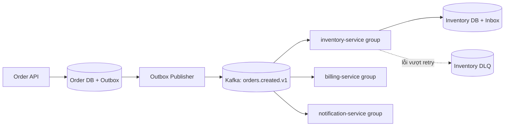

# Đánh giá lựa chọn binder và bảo đảm giao nhận cho một bài toán thực tế

## Mục tiêu

Trong bài thực hành này, bạn sẽ chọn một binder cho hệ thống xử lý đơn hàng, giải thích lựa chọn bằng yêu cầu nghiệp vụ và thiết kế cách xử lý message khi ứng dụng lỗi. Kết quả cần thể hiện được mối liên hệ giữa broker, binding, consumer group, partition, retry, dead-letter queue (DLQ) và tính idempotent của nghiệp vụ.

Sau khi hoàn thành, bạn có thể:

- Phân biệt nhu cầu event streaming, routing và work queue khi chọn Kafka, RabbitMQ hoặc Pulsar.
- Chọn destination, consumer group và khóa phân vùng phù hợp với thứ tự xử lý.
- Thiết kế xử lý ít nhất một lần (at-least-once) an toàn bằng idempotency.
- Phân loại lỗi tạm thời và lỗi dữ liệu, cấu hình retry và DLQ có giới hạn.
- Kiểm thử đường đi thành công, message trùng, lỗi kéo dài và khôi phục từ DLQ.

## Bối cảnh bài toán

Một cửa hàng trực tuyến phát sinh sự kiện `OrderCreated` sau khi khách hàng đặt hàng. Sự kiện này được dùng bởi ba nhóm nghiệp vụ độc lập:

1. `inventory-service` giữ hàng trong kho.
2. `billing-service` khởi tạo yêu cầu thanh toán.
3. `notification-service` gửi email hoặc thông báo cho khách hàng.

Giả định hệ thống có lưu lượng thông thường vài chục sự kiện mỗi giây và đạt khoảng 300 sự kiện mỗi giây vào giờ cao điểm. Một đơn hàng có thể phát sinh nhiều sự kiện tiếp theo như `OrderPaid`, `OrderCancelled` hoặc `ShipmentCreated`. Các yêu cầu quan trọng gồm:

- Mỗi dịch vụ nhận bản sao sự kiện độc lập; sự cố của dịch vụ thông báo không được làm dừng giữ hàng.
- Cần lưu sự kiện ít nhất bảy ngày để có thể đọc lại khi triển khai consumer mới hoặc sửa lỗi xử lý.
- Các sự kiện thuộc cùng một `orderId` phải được xử lý theo thứ tự trong phạm vi một consumer group.
- Một message có thể được giao lại khi consumer mất kết nối hoặc không hoàn tất xử lý. Việc giao lại không được giữ hàng hoặc ghi nhận thanh toán hai lần.
- Lỗi tạm thời như database timeout cần được thử lại có backoff. Lỗi dữ liệu không hợp lệ cần được đưa vào vùng cách ly để điều tra.
- Vận hành viên cần quan sát được consumer lag, số lần retry, số message vào DLQ và tuổi của message cũ nhất.

Đây là các giả định đầu vào của bài tập. Trong dự án thật, hãy thay chúng bằng số liệu đo được về lưu lượng, kích thước message, thời gian lưu, thời gian phục hồi và mức mất dữ liệu chấp nhận được.

## Chọn binder theo đặc tính của bài toán

Spring Cloud Stream cung cấp mô hình lập trình dựa trên `Supplier`, `Function` và `Consumer`. Binding nối đầu vào hoặc đầu ra của hàm với một destination; binder đảm nhiệm tích hợp destination đó với nền tảng messaging. Lớp trừu tượng này giúp ứng dụng giữ cách khai báo luồng xử lý tương đối ổn định, nhưng không làm cho các broker có cùng ngữ nghĩa về lưu trữ, định tuyến, xác nhận message hay phát lại dữ liệu.

| Tiêu chí | Kafka binder | RabbitMQ binder | Pulsar binder |
|---|---|---|---|
| Mô hình nổi bật | Log sự kiện phân vùng, consumer đọc theo offset | Exchange, queue và routing key | Topic, subscription và lưu trữ phân tầng |
| Đọc lại dữ liệu | Phù hợp với retention và việc đặt lại offset | Không phải thế mạnh của queue thông thường; message đã ack thường được loại khỏi queue | Hỗ trợ lưu giữ và đọc lại theo chính sách topic/subscription |
| Phân phối cho nhiều dịch vụ | Mỗi consumer group có tiến độ đọc riêng | Có thể định tuyến hoặc fanout đến nhiều queue | Nhiều subscription độc lập |
| Thứ tự | Có thứ tự trong một partition; không có thứ tự tổng thể giữa các partition | Phụ thuộc queue, consumer và cấu hình; không nên giả định thứ tự tuyệt đối khi có nhiều consumer hoặc redelivery | Có thứ tự theo cơ chế subscription và cấu hình topic; cần kiểm tra loại subscription được chọn |
| Routing và hàng đợi công việc | Có thể thực hiện bằng topic, key và consumer group | Mạnh về exchange, routing key, queue, ack và mô hình work queue | Hỗ trợ nhiều kiểu subscription và phân phối topic |
| Phù hợp khi | Cần event log bền vững, phát lại và nhiều consumer độc lập | Cần định tuyến linh hoạt, phân phối tác vụ và xử lý từng message | Cần messaging đa tenant, phân phối địa lý hoặc kiến trúc lưu trữ phân tầng |
| Điểm cần chuẩn bị | Quản lý partition, offset, retention, rebalance và lag | Thiết kế exchange/queue, TTL, dead-letter exchange và năng lực queue | Nắm mô hình tenant/namespace/topic/subscription và năng lực vận hành cụm |

Với yêu cầu của cửa hàng, Kafka là lựa chọn hợp lý vì sự kiện đơn hàng là dữ liệu nghiệp vụ cần lưu giữ và phát lại; ba dịch vụ cần đọc độc lập; và khóa `orderId` có thể đưa các sự kiện của cùng đơn hàng vào cùng partition. RabbitMQ sẽ là lựa chọn đáng cân nhắc hơn nếu trọng tâm là phân phối tác vụ theo routing key, xác nhận từng message và đưa tác vụ vào queue để worker xử lý. Pulsar phù hợp khi hệ thống có yêu cầu rõ ràng về đa tenant, nhiều vùng địa lý hoặc lưu trữ phân tầng mà tổ chức sẵn sàng vận hành nền tảng đó.

Không chọn binder chỉ dựa trên thông lượng quảng cáo. Hãy đánh giá cả retention, khả năng replay, thứ tự, mô hình lỗi, công cụ giám sát, kỹ năng vận hành và chi phí hạ tầng. Nếu hệ thống đã có một nền tảng messaging được vận hành tốt, chi phí đưa thêm một broker vào thường lớn hơn lợi ích của một khác biệt nhỏ trong benchmark.

## Thiết kế luồng sự kiện

Sự kiện nên chứa định danh ổn định và thông tin đủ để consumer xác định nghiệp vụ cần thực hiện. Ví dụ:

```json
{
  "eventId": "evt-01J8M4X2Q7",
  "eventType": "OrderCreated",
  "schemaVersion": 1,
  "orderId": "ORD-2026-1042",
  "occurredAt": "2026-11-24T09:15:30Z",
  "items": [
    { "sku": "BOOK-001", "quantity": 2 },
    { "sku": "PEN-004", "quantity": 1 }
  ]
}
```

`eventId` nhận diện một lần phát sinh sự kiện và được giữ nguyên khi retry hoặc phát lại. `orderId` là khóa nghiệp vụ để phân vùng. `schemaVersion` giúp consumer biết cấu trúc message thuộc phiên bản nào. Không dùng thời điểm nhận message làm định danh vì cùng một sự kiện có thể được nhận nhiều lần ở những thời điểm khác nhau.

Luồng tổng thể có thể mô tả như sau:



Order API ghi đơn hàng và một bản ghi outbox trong cùng transaction database. Một publisher riêng đọc outbox và gửi sự kiện lên Kafka. Cách làm này tránh tình huống database đã lưu đơn hàng nhưng ứng dụng dừng trước khi gửi message, hoặc message đã gửi nhưng transaction lưu đơn hàng bị rollback. Publisher có thể gửi lại nếu không chắc broker đã nhận; vì vậy consumer vẫn cần idempotency.

Mỗi dịch vụ dùng một consumer group riêng. Ví dụ `inventory-service` và `billing-service` đều đọc topic `orders.created.v1`, nhưng offset của hai group độc lập. Trong group `inventory-service`, các instance chia nhau partition. Nếu cần giữ thứ tự theo đơn hàng, producer phải dùng `orderId` làm message key và topic phải có số partition phù hợp với năng lực dự kiến. Mọi sự kiện cần được sắp thứ tự cho một đơn hàng phải dùng cùng quy tắc key.

Thứ tự chỉ được bảo đảm trong phạm vi một partition. Tăng số partition có thể thay đổi cách ánh xạ key sang partition nếu thuật toán phân vùng hoặc số partition thay đổi; cần có kế hoạch khi mở rộng topic. Không dựa vào thứ tự thời gian toàn cục giữa các đơn hàng.

## Bảo đảm giao nhận và idempotency

Trong thực tế, consumer có thể hoàn tất ghi database nhưng mất kết nối trước khi offset được xác nhận. Broker sẽ giao lại message và consumer có thể gặp cùng `eventId` lần thứ hai. Đây là tình huống bình thường của cơ chế at-least-once.

Với nghiệp vụ giữ hàng, cách xử lý an toàn là lưu dấu sự kiện đã xử lý và thay đổi tồn kho trong cùng một transaction database. Bảng inbox có khóa duy nhất kết hợp `consumer_name` và `event_id`, ví dụ:

```sql
CREATE TABLE processed_event (
    consumer_name VARCHAR(100) NOT NULL,
    event_id      VARCHAR(100) NOT NULL,
    processed_at  TIMESTAMP NOT NULL,
    PRIMARY KEY (consumer_name, event_id)
);
```

Repository cung cấp thao tác `insertIfAbsent` có tính nguyên tử dựa trên unique constraint. Không triển khai theo kiểu đọc `exists` rồi mới insert ở hai câu lệnh độc lập, vì hai instance có thể cùng thấy sự kiện chưa tồn tại và cùng thực hiện nghiệp vụ.

Ví dụ consumer:

```java
@Bean
Consumer<Message<OrderCreated>> reserveInventory(
        InventoryReservationService service) {
    return message -> service.reserveOnce(message.getPayload());
}
```

Phần nghiệp vụ chạy trong một Spring transaction:

```java
@Transactional
public void reserveOnce(OrderCreated event) {
    boolean firstDelivery = processedEventRepository.insertIfAbsent(
        "inventory-service", event.eventId());

    if (!firstDelivery) {
        return; // Sự kiện đã được xử lý; không giữ hàng lần nữa.
    }

    inventoryRepository.reserve(event.orderId(), event.items());
}
```

Đoạn mã minh họa hợp đồng của `insertIfAbsent`; phần SQL cụ thể tùy hệ quản trị cơ sở dữ liệu. Lệnh ghi dấu và cập nhật tồn kho phải thuộc cùng transaction. Nếu cập nhật tồn kho thất bại, transaction rollback cả hai thao tác để lần giao tiếp theo có thể thử lại. Nếu transaction đã commit nhưng message được giao lại, unique constraint khiến consumer bỏ qua lần xử lý trùng.

Đây là cách xây dựng hiệu ứng nghiệp vụ idempotent trên nền giao nhận at-least-once. Không nên tuyên bố hệ thống đạt exactly-once end-to-end chỉ vì broker có transaction hoặc producer bật idempotence. Khi một luồng đi qua broker, database và dịch vụ HTTP bên ngoài, các hệ thống đó không tự động cùng tham gia một transaction nguyên tử. Với thao tác gọi cổng thanh toán, hãy truyền idempotency key ổn định nếu nhà cung cấp hỗ trợ. Nếu cần phát sinh sự kiện tiếp theo từ một transaction database, ghi sự kiện vào outbox trong cùng transaction rồi để publisher gửi đi.

## Retry, backoff và DLQ

Phân loại lỗi trước khi chọn chính sách:

| Loại lỗi | Ví dụ | Hành động phù hợp |
|---|---|---|
| Tạm thời | Database timeout, broker hoặc dịch vụ phụ thuộc tạm mất kết nối | Retry có backoff và giới hạn số lần |
| Quá tải | Database đang chịu tải cao, API trả lỗi giới hạn tốc độ | Backoff tăng dần; giới hạn concurrency để tránh làm tải nặng hơn |
| Dữ liệu không hợp lệ | Thiếu `orderId`, sai schema, số lượng âm | Đưa vào DLQ hoặc vùng cách ly để điều tra; không retry vô hạn |
| Lỗi nghiệp vụ cần can thiệp | SKU không tồn tại hoặc đơn hàng đã ở trạng thái không cho phép | Áp dụng quy tắc nghiệp vụ rõ ràng; ghi nhận lý do và chuyển xử lý thủ công nếu cần |

Retry phải có giới hạn. Một cấu hình minh họa cho consumer Kafka binder:

```yaml
spring:
  cloud:
    function:
      definition: reserveInventory
    stream:
      bindings:
        reserveInventory-in-0:
          destination: orders.created.v1
          group: inventory-service
          consumer:
            max-attempts: 3
            back-off-initial-interval: 1000
            back-off-max-interval: 10000
            back-off-multiplier: 2
      kafka:
        binder:
          brokers: ${KAFKA_BROKERS:localhost:9092}
        bindings:
          reserveInventory-in-0:
            consumer:
              enable-dlq: true
              dlq-name: orders.created.v1.inventory.dlq
```

Tên binding `reserveInventory-in-0` được tạo từ tên hàm và hướng input. `group` xác định tiến độ đọc dùng chung của các instance inventory. `max-attempts` giới hạn tổng số lần thử theo chính sách retry của binding; các khoảng backoff tăng dần giúp tránh dồn request vào dependency đang lỗi. Kafka binder hỗ trợ bật DLQ cho consumer có group. Hãy xác minh tên property và hành vi cụ thể theo phiên bản Spring Cloud Stream/Kafka binder mà dự án đang dùng.

Với producer, cấu hình phân vùng theo khóa nghiệp vụ trên binding output tương ứng. Ví dụ sau minh họa ý tưởng cấu hình; tên binding phải khớp với hàm hoặc producer thực tế:

```yaml
spring:
  cloud:
    stream:
      bindings:
        orderEvents-out-0:
          destination: orders.created.v1
          producer:
            partition-key-expression: payload.orderId
            partition-count: 12
```

Số partition `12` chỉ là giả định cho bài tập. Hãy chọn bằng cách đo throughput mỗi partition, số consumer instance có thể chạy song song, kích thước message và mức tăng trưởng. Topic ở môi trường production nên được tạo và quản lý có chủ đích; bảo đảm cấu hình producer, topic thực tế và giới hạn hạ tầng thống nhất.

DLQ là nơi lưu message không thể xử lý sau chính sách retry, không phải thùng rác. Mỗi message trong DLQ cần giữ payload gốc, key, headers quan trọng, `eventId`, thời điểm lỗi và thông tin nguyên nhân. Giới hạn quyền truy cập vì payload có thể chứa dữ liệu khách hàng. Đặt cảnh báo theo số lượng và tuổi message trong DLQ.

Khi sửa được nguyên nhân, quy trình phát lại cần có người chịu trách nhiệm, ghi nhận message đã chọn, kiểm tra phiên bản schema, giữ nguyên `eventId` và theo dõi kết quả. Nếu lỗi là dữ liệu sai, phát lại nguyên trạng sẽ tiếp tục thất bại; phải sửa hoặc thay thế dữ liệu theo quy trình có kiểm soát. Khi chuyển message lỗi sang DLQ, các message tiếp theo trong partition có thể tiếp tục được xử lý tùy cấu hình. Nếu nghiệp vụ yêu cầu chặn tuyệt đối thứ tự của một đơn hàng, cần thiết kế cơ chế tạm dừng hoặc cách ly theo khóa và xử lý bù phù hợp; DLQ tự nó không bảo đảm thứ tự nghiệp vụ.

## Kiểm thử và vận hành

Một bài kiểm thử chỉ xác nhận hàm nhận được message là chưa đủ. Hãy kiểm tra cả ranh giới database, broker và chính sách lỗi.

| Kịch bản | Cách thực hiện | Kết quả cần xác nhận |
|---|---|---|
| Message hợp lệ | Gửi một `OrderCreated` mới | Tồn kho được giữ đúng; inbox có một `eventId` |
| Message trùng | Gửi lại cùng `eventId` nhiều lần | Chỉ có một lần thay đổi tồn kho |
| Lỗi tạm thời | Làm database timeout trong một số lần đầu rồi phục hồi | Consumer retry theo backoff; cuối cùng xử lý thành công |
| Lỗi kéo dài | Giữ dependency ở trạng thái lỗi quá số lần retry | Message đi vào DLQ; consumer tiếp tục xử lý theo chính sách đã chọn |
| Dữ liệu sai | Gửi payload thiếu trường bắt buộc hoặc sai schema | Lỗi được ghi nhận và cách ly; không tạo thay đổi nghiệp vụ một phần |
| Nhiều consumer | Chạy nhiều instance cùng group và gửi nhiều orderId | Partition được phân phối; sự kiện cùng key giữ thứ tự trong partition |
| Khởi động lại | Dừng consumer giữa quá trình xử lý rồi khởi động lại | Message chưa được xử lý an toàn được giao lại; không nhân đôi nghiệp vụ |

Có thể dùng Spring Cloud Stream test binder để kiểm tra nhanh logic hàm và binding trong unit/integration test. Test binder không mô phỏng đầy đủ hành vi partition, offset, rebalance hay DLQ của broker thật. Dùng Kafka Testcontainers hoặc môi trường Kafka kiểm thử để xác minh những hành vi phụ thuộc broker.

Trong production, theo dõi tối thiểu:

- Consumer lag theo group và partition; cảnh báo khi lag tăng liên tục hoặc vượt ngưỡng thời gian nghiệp vụ.
- Tốc độ nhận, xử lý thành công, retry và lỗi theo binding.
- Số message mới vào DLQ, tổng số message tồn đọng và tuổi của message cũ nhất.
- Thời gian xử lý mỗi message, tỷ lệ lỗi database và các dependency bên ngoài.
- Rebalance, số consumer đang hoạt động và tình trạng mất cân bằng giữa các partition.

Runbook cần chỉ rõ ai được phép phát lại DLQ, cách xác định nguyên nhân, cách chọn message, cách tránh phát lại trùng và cách xác minh sau phục hồi. Không đặt lại offset của cả group chỉ để xử lý một message lỗi nếu chưa đánh giá tác động lên toàn bộ partition.

## Thực hành tổng hợp

Hãy hoàn thành thiết kế cho `inventory-service` dựa trên kịch bản ở đầu bài. Nộp một bản quyết định kỹ thuật ngắn kèm cấu hình và bằng chứng kiểm thử. Nội dung cần có:

1. Bảng yêu cầu định lượng: lưu lượng trung bình/cao điểm, retention, thời gian phục hồi mục tiêu, số consumer và yêu cầu thứ tự.
2. Lý do chọn Kafka binder; nêu ít nhất hai tình huống mà RabbitMQ hoặc Pulsar sẽ phù hợp hơn.
3. Sơ đồ topic, key, partition, consumer group và DLQ. Giải thích vì sao `orderId` là khóa phân vùng.
4. Mẫu event có `eventId` và `schemaVersion`; quy tắc tương thích schema khi thêm hoặc đổi field.
5. Mã consumer có xử lý idempotent và transaction database; mô tả cách publisher dùng outbox.
6. Cấu hình retry, backoff và DLQ; nêu rõ loại lỗi nào được retry và loại nào được cách ly.
7. Kết quả kiểm thử message trùng, lỗi tạm thời, lỗi kéo dài, restart consumer và phát lại DLQ.
8. Chỉ số giám sát, ngưỡng cảnh báo ban đầu và các bước trong runbook phục hồi.

### Tiêu chí tự đánh giá

| Tiêu chí | Trọng tâm đánh giá |
|---|---|
| Chọn binder | Quyết định dựa trên retention, replay, routing, thứ tự và năng lực vận hành |
| Thiết kế binding | Destination, group, key và partition được giải thích rõ |
| Bảo đảm giao nhận | Nêu đúng giới hạn at-least-once; có idempotency và transaction ở ranh giới database |
| Quản lý lỗi | Retry có giới hạn, backoff hợp lý, DLQ có quy trình xử lý |
| Kiểm chứng | Có kiểm thử với broker thật cho các hành vi phụ thuộc broker |
| Vận hành | Có metric, cảnh báo và runbook phát lại an toàn |

Bạn hoàn thành bài khi có thể giải thích một message đi từ lúc tạo đơn hàng đến lúc giữ hàng, điều gì xảy ra khi consumer chết ở từng thời điểm, và bằng chứng nào cho thấy việc giao lại không làm nghiệp vụ chạy hai lần. Hãy ghi rõ các giả định còn cần đo trong môi trường thật trước khi chốt cấu hình production.
