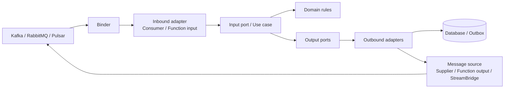

# Tách nghiệp vụ xử lý khỏi mã kết nối hệ thống truyền tin

## Mục tiêu

Một ứng dụng xử lý sự kiện thường bắt đầu bằng một hàm nhận message rồi thực hiện nghiệp vụ ngay bên trong hàm đó. Cách làm này nhanh khi thử nghiệm, nhưng theo thời gian mã nghiệp vụ dễ phụ thuộc vào Kafka, RabbitMQ, Pulsar, Spring Messaging, tên topic, header và cách xác nhận message. Khi cần đổi broker, thay schema hoặc kiểm thử một quy tắc nghiệp vụ, nhóm phát triển phải chạm vào nhiều phần không liên quan.

Bài học này trình bày cách tách **nghiệp vụ ứng dụng** khỏi **mã tích hợp hệ thống truyền tin** bằng kiến trúc ports-and-adapters (còn gọi là hexagonal architecture). Spring Cloud Stream đảm nhiệm vai trò adapter ở biên: nhận message từ binding, chuyển dữ liệu ngoài thành lệnh ứng dụng, gọi use case và chuyển kết quả hoặc sự kiện thành message đầu ra. Domain và use case không cần biết message đến từ broker nào.

Sau bài học, bạn có thể:

- Xác định trách nhiệm của domain, application service và messaging adapter.
- Tổ chức các cổng đầu vào/đầu ra để nghiệp vụ không phụ thuộc binder.
- Ánh xạ message schema và header sang mô hình ứng dụng.
- Dùng Supplier, Function và Consumer ở lớp tích hợp phù hợp.
- Kiểm thử nghiệp vụ độc lập với broker và kiểm thử riêng hành vi tích hợp.

## 1. Vấn đề khi đặt nghiệp vụ trong message handler

Giả sử một dịch vụ tồn kho nhận sự kiện `OrderCreated`. Handler phải đọc payload, kiểm tra dữ liệu, trừ tồn kho, ghi database, phát sự kiện `StockReserved`, xử lý retry và xác nhận message.

Nếu tất cả nằm trong một method, nó có thể đồng thời phụ thuộc vào:

- Kiểu message của Spring như `Message<T>` và các header.
- Tên destination, consumer group, partition hoặc routing key.
- API riêng của Kafka, RabbitMQ hoặc Pulsar.
- Cơ chế ack, offset commit, retry, DLQ và transaction.
- Quy tắc nghiệp vụ như kiểm tra tồn kho, giữ hàng và xử lý đơn trùng.

Những trách nhiệm này thay đổi vì các lý do khác nhau. Quy tắc giữ hàng có thể thay đổi do yêu cầu kinh doanh; destination có thể đổi do tổ chức lại hạ tầng; schema có thể được nâng phiên bản; binder có thể thay đổi khi chuyển broker. Nếu chúng nằm chung trong một lớp, một thay đổi ở biên truyền tin có thể gây ảnh hưởng đến logic nghiệp vụ và làm kiểm thử trở nên nặng nề.

Nguyên tắc kiến trúc là **phụ thuộc hướng vào lõi nghiệp vụ**. Adapter biết use case và mô hình ứng dụng; use case không biết adapter, broker hay thư viện truyền tin.

## 2. Phân chia các lớp và trách nhiệm

Một cách tổ chức phổ biến gồm bốn phần:

| Thành phần | Trách nhiệm | Ví dụ |
|---|---|---|
| Domain | Quy tắc và khái niệm nghiệp vụ cốt lõi | Tồn kho khả dụng, quy tắc giữ hàng |
| Application | Điều phối một ca sử dụng, định nghĩa cổng cần thiết | Use case `ReserveInventory`, command và kết quả |
| Inbound adapter | Nhận dữ liệu từ bên ngoài, kiểm tra cấu trúc, ánh xạ và gọi use case | Spring Cloud Stream `Consumer` hoặc `Function` |
| Outbound adapter | Thực hiện các cổng do application/domain định nghĩa | Repository database, outbox relay, API client |

Sơ đồ luồng phụ thuộc và dữ liệu:



Mũi tên thể hiện luồng gọi và dữ liệu. Adapter có thể phụ thuộc vào application port, nhưng application không import lớp adapter. Các interface ở cổng là hợp đồng do lõi ứng dụng định nghĩa; adapter cung cấp cách thực hiện hợp đồng đó.

Ví dụ cấu trúc package:

```text
com.example.inventory
├── domain
│   ├── Inventory.java
│   └── StockReservation.java
├── application
│   ├── port
│   │   ├── in
│   │   │   └── ReserveInventoryUseCase.java
│   │   └── out
│   │       ├── InventoryRepository.java
│   │       ├── ProcessedEventRepository.java
│   │       └── OutboxRepository.java
│   ├── model
│   │   ├── ReserveInventoryCommand.java
│   │   └── StockReserved.java
│   └── service
│       └── ReserveInventoryService.java
└── adapter
    ├── in
    │   └── messaging
    │       ├── OrderCreatedV1.java
    │       ├── OrderCreatedMapper.java
    │       └── OrderCreatedStreamAdapter.java
    └── out
        ├── persistence
        └── messaging
            └── OutboxStreamPublisher.java
```

Đây là gợi ý tổ chức, không phải cấu trúc package bắt buộc. Dự án nhỏ có thể dùng ít package hơn; điều quan trọng là ranh giới phụ thuộc được giữ rõ ràng.

## 3. Định nghĩa cổng đầu vào và use case

Cổng đầu vào mô tả điều ứng dụng cho phép bên ngoài yêu cầu. Nó dùng ngôn ngữ nghiệp vụ, không dùng thuật ngữ của broker.

Ví dụ command nội bộ:

```java
public record ReserveInventoryCommand(
        String eventId,
        String orderId,
        List<ReserveLine> lines
) {}

public record ReserveLine(String sku, int quantity) {}
```

Cổng đầu vào:

```java
public interface ReserveInventoryUseCase {
    void handle(ReserveInventoryCommand command);
}
```

Cổng đầu ra do application cần để truy cập dữ liệu:

```java
public interface InventoryRepository {
    void reserve(String orderId, List<ReserveLine> lines);
}

public interface ProcessedEventRepository {
    // Ghi nhận eventId bằng ràng buộc UNIQUE; trả false nếu đã tồn tại.
    boolean registerIfAbsent(String eventId);
}

public interface OutboxRepository {
    void append(StockReserved event);
}
```

Application service điều phối các cổng:

```java
public final class ReserveInventoryService
        implements ReserveInventoryUseCase {

    private final ProcessedEventRepository processedEvents;
    private final InventoryRepository inventory;
    private final OutboxRepository outbox;

    public ReserveInventoryService(
            ProcessedEventRepository processedEvents,
            InventoryRepository inventory,
            OutboxRepository outbox) {
        this.processedEvents = processedEvents;
        this.inventory = inventory;
        this.outbox = outbox;
    }

    @Override
    public void handle(ReserveInventoryCommand command) {
        if (!processedEvents.registerIfAbsent(command.eventId())) {
            return;
        }

        inventory.reserve(command.orderId(), command.lines());

        outbox.append(new StockReserved(
                command.eventId(),
                command.orderId()
        ));
    }
}
```

`StockReserved` là sự kiện trong mô hình ứng dụng, không phải DTO của Kafka hay RabbitMQ:

```java
public record StockReserved(String eventId, String orderId) {}
```

Trong triển khai thật, thao tác ghi nhận `eventId`, cập nhật tồn kho và thêm bản ghi outbox phải nằm trong **cùng transaction database**. Cột `event_id` cần có unique constraint để hai delivery đồng thời không cùng được coi là mới. Nếu bất kỳ thao tác nào thất bại, transaction rollback để lần giao lại có thể thử lại. Ranh giới transaction có thể được quản lý bằng Spring ở lớp service hoặc cấu hình hạ tầng; domain model và interface use case vẫn không cần import API của broker.

Application service không nhận `ConsumerRecord`, `MessageHeaders`, `Acknowledgment`, `Channel` hay tên topic. Nó chỉ nhận command và gọi các cổng nghiệp vụ.

## 4. Spring Cloud Stream là inbound adapter

Spring Cloud Stream cung cấp mô hình hàm để kết nối binding với code ứng dụng:

- **Consumer** nhận dữ liệu đầu vào và không phát kết quả trực tiếp.
- **Function** nhận dữ liệu đầu vào, xử lý và tạo dữ liệu đầu ra.
- **Supplier** cung cấp dữ liệu đầu ra khi framework lấy dữ liệu từ nguồn của ứng dụng.

Các hàm này nên nằm ở biên tích hợp. Chúng chuyển đổi định dạng và gọi use case; quy tắc giữ hàng, tính phí hoặc xác định trạng thái đơn hàng thuộc application/domain.

### Ánh xạ message thành command

Schema nhận từ broker là hợp đồng bên ngoài. Ví dụ phiên bản 1 của sự kiện đơn hàng:

```java
public record OrderCreatedV1(
        String eventId,
        String orderId,
        List<OrderLineV1> lines
) {}

public record OrderLineV1(String sku, int quantity) {}
```

Mapper chuyển DTO ngoài thành command nội bộ:

```java
@Component
public class OrderCreatedMapper {

    public ReserveInventoryCommand toCommand(OrderCreatedV1 message) {
        var lines = message.lines().stream()
                .map(line -> new ReserveLine(line.sku(), line.quantity()))
                .toList();

        return new ReserveInventoryCommand(
                message.eventId(),
                message.orderId(),
                lines
        );
    }
}
```

Adapter dùng `Consumer` khi chỉ cần gọi use case:

```java
@Configuration
public class OrderCreatedStreamAdapter {

    @Bean
    Consumer<OrderCreatedV1> orderCreated(
            ReserveInventoryUseCase useCase,
            OrderCreatedMapper mapper) {
        return message -> useCase.handle(mapper.toCommand(message));
    }
}
```

Lớp adapter biết kiểu DTO và Spring Cloud Stream. Use case chỉ biết `ReserveInventoryCommand`. Nếu sau này payload đổi tên trường hoặc thêm một phiên bản schema, có thể sửa DTO và mapper mà không phải sửa quy tắc giữ hàng.

Ví dụ `Consumer` ở trên và ví dụ `Function` bên dưới là hai lựa chọn endpoint cho các luồng khác nhau. Chọn hàm phù hợp với hợp đồng vào/ra của từng luồng và khai báo hàm cần chạy trong `spring.cloud.function.definition`.

Nếu cần metadata như `correlationId`, `tenantId` hoặc trace context, adapter có thể nhận `Message<OrderCreatedV1>` thay cho payload trực tiếp và đọc header tại biên. Chỉ đưa giá trị đã xác thực vào command dưới dạng field rõ ràng khi use case thực sự cần nó. Không truyền toàn bộ `MessageHeaders` vào domain/application; header là metadata của giao thức và có thể khác nhau giữa các binder.

### Dùng Function khi có đầu ra đồng bộ với lần xử lý

Nếu một lần gọi use case trực tiếp tạo ra kết quả cần phát tiếp, adapter có thể dùng `Function`. Ví dụ, cổng use case trả về mô hình kết quả ứng dụng:

```java
public interface ReserveInventoryResultUseCase {
    StockReserved handle(ReserveInventoryCommand command);
}

public record StockReservedV1(String eventId, String orderId) {}
```

Adapter ánh xạ cả hai chiều:

```java
@Bean
Function<OrderCreatedV1, StockReservedV1> reserveInventory(
        ReserveInventoryResultUseCase useCase,
        OrderCreatedMapper inputMapper,
        StockReservedMapper outputMapper) {
    return message -> outputMapper.toV1(
            useCase.handle(inputMapper.toCommand(message))
    );
}
```

Với tên hàm `reserveInventory`, Spring Cloud Stream mặc định tạo binding đầu vào `reserveInventory-in-0` và đầu ra `reserveInventory-out-0`. Application vẫn không biết các binding này tồn tại. Với luồng cần xử lý bất đồng bộ hoặc phát sự kiện sau transaction, nên cân nhắc outbox ở phần tiếp theo thay vì gửi message trực tiếp trước khi transaction nghiệp vụ hoàn tất.

### Vai trò của Supplier

`Supplier` phù hợp khi ứng dụng là nguồn phát dữ liệu, ví dụ đọc một nguồn sự kiện nội bộ hoặc tạo bản tin theo lịch. Supplier cũng là adapter. Nếu cần lấy dữ liệu nghiệp vụ, nó nên gọi một cổng đầu vào như `LoadPendingEventsUseCase`; không nên đặt truy vấn phức tạp hoặc quy tắc nghiệp vụ trực tiếp trong lambda Supplier.

Điểm chung của cả ba mô hình là: hàm Spring Cloud Stream chuyển đổi và điều phối ở biên, còn use case thực hiện nghiệp vụ.

## 5. Tách phát sự kiện khỏi transaction nghiệp vụ bằng outbox

Một vấn đề thường gặp là application cập nhật database rồi gọi broker để phát sự kiện. Nếu database commit nhưng gửi message thất bại, hệ thống có trạng thái nghiệp vụ mới nhưng không có sự kiện tương ứng. Nếu gửi message thành công rồi database rollback, consumer có thể nhận sự kiện cho một thay đổi chưa tồn tại.

Transaction thông thường không tự bao phủ cả database và broker. Mẫu **transactional outbox** giải quyết khoảng trống này:

1. Trong một transaction database, application cập nhật nghiệp vụ và thêm sự kiện vào bảng outbox.
2. Một tiến trình relay đọc các bản ghi outbox chưa phát.
3. Relay chuyển sự kiện thành DTO và gửi qua Spring Cloud Stream.
4. Khi việc gửi được xác nhận theo chính sách của hệ thống, relay đánh dấu bản ghi đã phát.
5. Nếu relay dừng sau khi gửi nhưng trước khi đánh dấu, sự kiện có thể được gửi lại. Consumer nhận sự kiện cần idempotent bằng `eventId`.

Cổng outbox thuộc application:

```java
public interface OutboxRepository {
    void append(StockReserved event);
}
```

Adapter relay sử dụng Spring Cloud Stream:

```java
@Component
public class OutboxStreamPublisher {

    private final StreamBridge streamBridge;
    private final StockReservedMapper mapper;

    public OutboxStreamPublisher(
            StreamBridge streamBridge,
            StockReservedMapper mapper) {
        this.streamBridge = streamBridge;
        this.mapper = mapper;
    }

    public void publish(StockReserved event) {
        boolean accepted = streamBridge.send(
                "stockReserved-out-0",
                mapper.toV1(event)
        );

        if (!accepted) {
            throw new IllegalStateException("Message was not accepted by the output binding");
        }
    }
}
```

Khai báo output binding để gắn tên mà `StreamBridge` sử dụng với destination mong muốn:

```yaml
spring:
  cloud:
    stream:
      output-bindings: stockReserved-out-0
      bindings:
        stockReserved-out-0:
          destination: inventory.stock-reserved
          content-type: application/json
```

Đây là adapter gửi một bản ghi outbox. Phần điều phối việc đọc, retry và đánh dấu outbox đã phát cần được thiết kế theo cơ chế lưu trữ và xác nhận của broker đang dùng. Giá trị `true` từ `StreamBridge.send` không nên được hiểu như bằng chứng rằng consumer đích đã hoàn tất nghiệp vụ. Nếu cần bảo đảm bền vững, hãy dùng xác nhận gửi phù hợp, lưu trạng thái relay và chấp nhận khả năng gửi lặp; `eventId` giúp downstream loại bỏ tác động trùng.

Outbox giữ cho transaction nghiệp vụ độc lập với giao thức truyền tin. Adapter relay có thể thay đổi cách gửi hoặc binder mà không làm thay đổi quy tắc giữ hàng.

## 6. Binding và binder nằm ở cấu hình tích hợp

Binding ánh xạ hàm vào destination. Binder kết nối binding với broker cụ thể. Cấu hình phổ biến của Spring Cloud Stream có thể giữ ở file cấu hình triển khai:

```yaml
spring:
  cloud:
    function:
      definition: orderCreated
    stream:
      bindings:
        orderCreated-in-0:
          destination: orders.created
          group: inventory-service
          content-type: application/json
```

Nếu dùng Function có cả đầu vào và đầu ra, cấu hình thêm binding đầu ra:

```yaml
spring:
  cloud:
    function:
      definition: reserveInventory
    stream:
      bindings:
        reserveInventory-in-0:
          destination: orders.created
          group: inventory-service
          content-type: application/json
        reserveInventory-out-0:
          destination: inventory.stock-reserved
          content-type: application/json
```

Tên binding gắn với tên hàm và vị trí tham số vào/ra. `destination` chỉ nơi nhận hoặc phát message; `group` xác định nhóm consumer theo mô hình của binder. Với consumer nghiệp vụ cần subscription bền vững, hãy khai báo group rõ ràng. Cách group, subscription, partition và lưu trữ offset có khác biệt giữa Kafka, RabbitMQ và Pulsar.

Cấu hình chung nên chứa những thuộc tính có ý nghĩa ở mức Spring Cloud Stream. Thuộc tính riêng của broker nên nằm ở phần cấu hình binder tương ứng hoặc profile triển khai. Ví dụ, offset và partition của Kafka, queue/exchange và prefetch của RabbitMQ, subscription và acknowledgment của Pulsar có ngữ nghĩa riêng. Không nên giả định đổi tên binder là mọi hành vi vận hành tự động tương đương.

Một cách tổ chức cấu hình theo môi trường:

```text
application.yml                 # tên hàm, binding, destination theo môi trường
application-kafka.yml           # thuộc tính Kafka binder
application-rabbit.yml          # thuộc tính Rabbit binder
application-pulsar.yml          # thuộc tính Pulsar binder
```

Tên file profile chỉ là ví dụ. Cần thêm đúng dependency binder và kiểm tra thuộc tính theo phiên bản Spring Cloud Stream đang dùng. Tránh đưa tên topic, queue, broker URL hoặc credential vào domain/application code.

## 7. Giữ đúng ranh giới khi xử lý lỗi và bảo đảm giao nhận

Tách nghiệp vụ khỏi broker không có nghĩa là bỏ qua giao nhận. Mỗi loại lỗi cần được xử lý ở lớp phù hợp:

| Vấn đề | Nơi chịu trách nhiệm chính | Ví dụ |
|---|---|---|
| Payload thiếu trường hoặc sai schema | Inbound adapter / schema boundary | Từ chối message không hợp lệ, ghi log có event ID |
| Quy tắc nghiệp vụ không thỏa mãn | Domain / application | Đơn đã hủy, SKU không được phép giữ |
| Database tạm thời không truy cập được | Outbound persistence adapter và retry policy | Retry có giới hạn, timeout, circuit breaker khi phù hợp |
| Broker tạm thời không sẵn sàng | Messaging adapter / binder | Retry gửi, giữ outbox chưa phát |
| Message được giao lại | Application idempotency + cấu hình consumer | Unique event ID, inbox hoặc processed-event store |
| Lỗi không thể xử lý sau retry | Integration boundary | DLQ, cảnh báo và quy trình replay |

Các quy tắc quan trọng:

- **Idempotency thuộc ranh giới nghiệp vụ.** Dùng event ID ổn định và ghi nhận sự kiện đã xử lý cùng transaction với thay đổi nghiệp vụ. Đừng dựa vào giả định broker chỉ giao một lần.
- **Retry phải có chủ đích.** Lỗi tạm thời có thể retry; lỗi dữ liệu hoặc vi phạm quy tắc nghiệp vụ thường không thể khắc phục bằng retry vô hạn.
- **DLQ là cơ chế vận hành ở biên.** Adapter/binder đưa message lỗi vào nơi lưu giữ; nhóm vận hành cần theo dõi, điều tra và quyết định replay hoặc xử lý thủ công.
- **Không đưa API ack vào domain.** Việc xác nhận offset hoặc delivery thuộc framework/binder. Application báo thành công bằng cách hoàn tất use case; adapter và container phối hợp với binder để xác nhận theo cấu hình.
- **Không giả định exactly-once xuyên hệ thống.** Transaction Kafka có thể phối hợp thao tác Kafka trong phạm vi hỗ trợ; nó không tự bao phủ PostgreSQL hay REST API. Outbox và idempotency giúp kiểm soát hiệu ứng qua các ranh giới đó.

## 8. Kiểm thử theo từng ranh giới

Tách lớp giúp kiểm thử nhanh và chỉ dùng broker thật ở nơi cần thiết.

### Unit test cho use case

Khởi tạo service với fake hoặc mock của các cổng đầu ra. Không cần khởi động Spring context, Kafka hay RabbitMQ:

```java
@Test
void shouldReserveInventoryAndAppendOutboxEvent() {
    var processedEvents = new InMemoryProcessedEventRepository();
    var inventory = new InMemoryInventoryRepository();
    var outbox = new InMemoryOutboxRepository();

    var useCase = new ReserveInventoryService(
            processedEvents, inventory, outbox
    );

    useCase.handle(new ReserveInventoryCommand(
            "evt-100", "order-42",
            List.of(new ReserveLine("SKU-1", 2))
    ));

    assertTrue(inventory.wasReserved("order-42", "SKU-1", 2));
    assertTrue(outbox.containsEvent("evt-100"));
}
```

Test này tập trung vào kết quả nghiệp vụ và điều phối cổng. Các lớp InMemory là test double do dự án tự định nghĩa; chúng không thay thế kiểm thử transaction hoặc unique constraint của database thật.

### Test cho inbound adapter

Kiểm tra mapper chuyển DTO phiên bản ngoài thành command đúng, kể cả trường hợp thiếu hoặc có giá trị không hợp lệ. Có thể gọi trực tiếp bean Consumer/Function với test double của use case để xác minh adapter truyền đúng dữ liệu và không nhét quy tắc nghiệp vụ vào mapper.

### Integration test cho binder

Dùng Spring Cloud Stream Test Binder hoặc broker chạy bằng Testcontainers để kiểm tra các hành vi thực sự cần phụ thuộc hạ tầng:

- Binding được nối đúng destination và consumer group.
- Message JSON được chuyển đổi đúng schema.
- Consumer xử lý lỗi theo retry, ack/offset và DLQ dự kiến.
- Outbox relay có thể gửi lại sau sự cố mà không nhân đôi hiệu ứng ở consumer.
- Partition, subscription hoặc routing hoạt động đúng với broker triển khai.

Test Binder hữu ích cho kiểm thử tích hợp ở mức framework, nhưng không mô phỏng đầy đủ mọi hành vi của Kafka, RabbitMQ hoặc Pulsar. Các bảo đảm về transaction, partition, redelivery và DLQ cần được xác minh với binder/broker tương ứng.

### Contract test cho schema

Kiểm tra tương thích giữa producer và consumer khi thay đổi message schema. Thêm trường tùy chọn có mặc định thường dễ tương thích hơn đổi tên hoặc đổi kiểu trường đang dùng. Phiên bản DTO ngoài như `OrderCreatedV1` giúp adapter nhận biết hợp đồng; application command có thể giữ ổn định dù schema ngoài phát triển.

## 9. Quy trình áp dụng khi tách một handler hiện có

Khi refactor handler đang chứa cả nghiệp vụ lẫn mã truyền tin, có thể tiến hành theo trình tự:

1. Liệt kê mọi thao tác trong handler và đánh dấu thao tác nào là ánh xạ, thao tác nào là quy tắc nghiệp vụ, thao tác nào là I/O.
2. Tạo command và input port thể hiện ca sử dụng bằng ngôn ngữ nghiệp vụ.
3. Chuyển quy tắc nghiệp vụ vào application/domain service; định nghĩa output port cho database, outbox hoặc dịch vụ ngoài.
4. Giữ Spring Cloud Stream handler làm inbound adapter: nhận DTO, chuyển thành command và gọi input port.
5. Chuyển truy cập broker và database sang outbound adapter; dùng outbox nếu cần phối hợp thay đổi database với phát sự kiện.
6. Viết unit test cho use case, test mapping cho adapter và integration test cho binder.
7. Chạy thử với cùng schema và cấu hình giao nhận, sau đó mới thay đổi broker hoặc topology nếu có nhu cầu.

Trong quá trình refactor, không cần tạo interface cho mọi method. Chỉ tạo port tại ranh giới mà application cần một khả năng bên ngoài hoặc nơi cần thay thế implementation để kiểm thử. Interface không có ý nghĩa nếu nó chỉ lặp lại một lớp mà không tạo ra ranh giới phụ thuộc hữu ích.

## Kết luận

Tách nghiệp vụ khỏi mã kết nối hệ thống truyền tin giúp use case tập trung vào mục tiêu ứng dụng và cho phép Spring Cloud Stream đảm nhiệm việc tích hợp ở biên. Inbound adapter chuyển message schema thành command; application/domain thực hiện quy tắc; outbound adapter thực hiện lưu trữ hoặc phát sự kiện thông qua các cổng đã định nghĩa.

Cách tổ chức này giảm phụ thuộc trực tiếp vào Kafka, RabbitMQ và Pulsar, đồng thời giúp kiểm thử nghiệp vụ độc lập. Tuy nhiên, binder vẫn có ngữ nghĩa riêng về group, partition, acknowledgment, retry, transaction và DLQ. Hãy giữ các quyết định đó ở lớp tích hợp, còn tính đúng đắn nghiệp vụ như idempotency và trạng thái đơn hàng phải được bảo vệ trong lõi ứng dụng.

