# Đường đi của thông điệp qua hàm, kênh và binder

Spring Cloud Stream cung cấp mô hình lập trình hướng hàm để ứng dụng trao đổi dữ liệu với Kafka, RabbitMQ hoặc Pulsar. Trong mô hình này, **hàm** thể hiện xử lý nghiệp vụ, **binding** nối đầu vào/đầu ra của hàm với một đích logic, **kênh (channel)** là ranh giới trao đổi thông điệp trong ứng dụng, còn **binder** kết nối binding với cơ chế truyền tin của broker.

Hiểu rõ đường đi của thông điệp giúp xác định dữ liệu được tạo ở đâu, chuyển đổi tại bước nào, đi qua destination nào và được giao cho hàm nhận ra sao. Đây cũng là cơ sở để cấu hình consumer group, schema, partition, xử lý lỗi và quan sát độ trễ trong môi trường triển khai.

## 1. Các thành phần trong kiến trúc

### Hàm nghiệp vụ

Spring Cloud Stream sử dụng mô hình hàm của Spring Cloud Function. Ứng dụng khai báo các bean có kiểu `Supplier`, `Function` hoặc `Consumer`:

- `Supplier<T>` không nhận đầu vào và tạo dữ liệu đầu ra. Ví dụ: đọc các bản ghi cần phát từ một nguồn dữ liệu hoặc tạo sự kiện theo lịch.
- `Function<T, R>` nhận dữ liệu kiểu `T`, thực hiện biến đổi và trả về dữ liệu kiểu `R`. Ví dụ: kiểm tra lệnh tạo đơn rồi tạo sự kiện kết quả.
- `Consumer<T>` nhận dữ liệu và thực hiện tác dụng nghiệp vụ, không tạo đầu ra qua binding của hàm. Ví dụ: cập nhật read model từ sự kiện đơn hàng.

Hàm nên tập trung vào xử lý nghiệp vụ. Việc kết nối broker, chuyển đổi dữ liệu truyền tải và quản lý vòng đời binding do Spring Cloud Stream cùng binder đảm nhiệm.

### Binding

Binding là cấu hình kết nối một đầu vào hoặc đầu ra của hàm với một destination logic. Tên binding được suy ra từ tên bean và hướng dữ liệu:

| Loại hàm | Binding | Ý nghĩa |
|---|---|---|
| `Supplier<T>` tên `orderEvents` | `orderEvents-out-0` | Đầu ra do supplier tạo. |
| `Function<T, R>` tên `processOrder` | `processOrder-in-0`, `processOrder-out-0` | Đầu vào và đầu ra của function. |
| `Consumer<T>` tên `saveProjection` | `saveProjection-in-0` | Đầu vào của consumer. |

Hậu tố `-in-0` và `-out-0` xác định hướng và chỉ số cổng dữ liệu. Khi cấu hình, có thể ánh xạ binding tới destination, group, content type và các thuộc tính producer/consumer. Tên binding là định danh trong ứng dụng; tên destination là tên tài nguyên logic trên broker.

### Channel

Channel là ranh giới để các thành phần trong ứng dụng chuyển `Message<?>` cho nhau. Trong hệ sinh thái Spring, thông điệp có payload và headers; channel cho phép thành phần gửi và thành phần nhận trao đổi thông điệp mà không cần gọi trực tiếp lẫn nhau.

Trong mô hình hàm của Spring Cloud Stream, phần lớn ứng dụng chỉ cần khai báo hàm và binding. Framework thiết lập các adapter và channel cần thiết. Vì vậy, không nhất thiết phải tự khai báo một `MessageChannel` cho mỗi binding. Channel là một phần của đường đi nội bộ, trong khi binding là cấu hình kết nối đầu hàm với hạ tầng truyền tin.

### Binder và broker

Binder là lớp tích hợp giữa Spring Cloud Stream và một nền tảng truyền tin. Binder tạo và quản lý kết nối, producer/consumer adapter, ánh xạ binding tới destination và chuyển tiếp thông điệp theo API của broker.

| Thành phần | Vai trò trong đường truyền |
|---|---|
| Kafka binder | Ánh xạ binding tới topic, partition và cơ chế producer/consumer của Kafka. |
| RabbitMQ binder | Ánh xạ binding tới exchange, queue, routing và consumer của RabbitMQ. |
| Pulsar binder | Ánh xạ binding tới topic, producer, subscription và consumer của Pulsar. |

Binder thống nhất cách ứng dụng khai báo luồng dữ liệu, nhưng không làm cho mọi đặc tính broker trở nên giống nhau. Partition, routing, acknowledgement, transaction, retry và dead-letter vẫn có quy tắc riêng theo binder và broker.

## 2. Đường đi tổng quát của thông điệp

Một thông điệp đi từ ứng dụng phát tới ứng dụng nhận qua các chặng sau:

1. **Nguồn dữ liệu:** dữ liệu được tạo bởi `Supplier`, được gửi từ một thành phần ứng dụng qua `StreamBridge`, hoặc được nhận từ một destination.
2. **Hàm và binding:** dữ liệu được đưa vào đầu vào của hàm hoặc được hàm tạo ra ở đầu ra. Tên binding xác định cổng dữ liệu.
3. **Channel nội bộ:** Spring chuyển `Message` qua ranh giới channel tương ứng.
4. **Adapter của binder:** adapter đầu ra nhận message để publish, hoặc adapter đầu vào nhận message từ broker để chuyển vào ứng dụng.
5. **Chuyển đổi dữ liệu:** payload được serialize khi gửi và deserialize/convert khi nhận theo content type và cấu hình liên quan.
6. **Destination trên broker:** broker định tuyến và lưu trữ thông điệp theo cấu hình topic, queue, exchange, partition hoặc subscription.
7. **Binding phía nhận:** binder chuyển message tới binding đầu vào của consumer hoặc function.
8. **Xử lý nghiệp vụ:** hàm nhận payload và thực hiện công việc. Nếu là function có đầu ra, kết quả tiếp tục đi qua binding đầu ra.

```mermaid
flowchart LR
    A[Nguồn dữ liệu] --> B[Supplier hoặc StreamBridge]
    B --> C[Binding đầu ra]
    C --> D[Channel nội bộ]
    D --> E[Binder producer adapter]
    E --> F[Serializer và giao thức broker]
    F --> G[(Kafka / RabbitMQ / Pulsar)]
    G --> H[Binder consumer adapter]
    H --> I[Deserializer và converter]
    I --> J[Channel đầu vào]
    J --> K[Binding đầu vào]
    K --> L[Function hoặc Consumer]
    L --> M[Xử lý nghiệp vụ]
    M --> N[Binding đầu ra nếu có]
```



Sơ đồ mô tả các ranh giới logic. Một số bước được framework kết hợp hoặc thực hiện bằng adapter nội bộ; không phải mỗi ô đều tương ứng với một tiến trình hay một dịch vụ riêng.

## 3. Đường đi từ Supplier tới broker

`Supplier` là nguồn tạo dữ liệu đầu ra. Ví dụ, một supplier tạo sự kiện trạng thái tồn kho:

```java
import java.time.Instant;
import java.util.function.Supplier;

import org.springframework.context.annotation.Bean;
import org.springframework.context.annotation.Configuration;

@Configuration
class InventoryEventConfiguration {

    @Bean
    Supplier<InventorySnapshot> inventorySnapshot(
            InventoryService inventoryService) {
        return () -> new InventorySnapshot(
            inventoryService.currentQuantity(),
            Instant.now()
        );
    }
}

record InventorySnapshot(int quantity, Instant capturedAt) {}
```

Vì `inventorySnapshot` là supplier, Spring Cloud Stream tạo binding đầu ra `inventorySnapshot-out-0`. Theo cơ chế polling mặc định của supplier trong mô hình này, framework gọi supplier theo lịch poller đã cấu hình để lấy dữ liệu mới. Khoảng polling phải phù hợp với nguồn dữ liệu và tải hệ thống; không nên chọn chu kỳ quá ngắn nếu mỗi lần gọi đều truy vấn nguồn dữ liệu tốn kém.

Cấu hình khai báo hàm và ánh xạ binding tới destination được đặt dưới `spring.cloud` như sau:

```yaml
spring:
  cloud:
    function:
      definition: inventorySnapshot
    stream:
      bindings:
        inventorySnapshot-out-0:
          destination: inventory.snapshots
          content-type: application/json
```

Khi supplier tạo một đối tượng `InventorySnapshot`, framework đưa dữ liệu qua binding đầu ra. Binder serialize payload theo content type và publish tới destination `inventory.snapshots` trên broker đã cấu hình. Ứng dụng không cần gọi API producer trực tiếp của Kafka, RabbitMQ hoặc Pulsar trong hàm nghiệp vụ.

Nếu dữ liệu được tạo do một yêu cầu HTTP hoặc một sự kiện nội bộ thay vì polling, có thể dùng `StreamBridge` để gửi từ thành phần ứng dụng tới binding đầu ra:

```java
import org.springframework.cloud.stream.function.StreamBridge;
import org.springframework.stereotype.Service;

@Service
class OrderEventPublisher {

    private final StreamBridge streamBridge;

    OrderEventPublisher(StreamBridge streamBridge) {
        this.streamBridge = streamBridge;
    }

    boolean publish(OrderCreated event) {
        return streamBridge.send("orderEvents-out-0", event);
    }
}
```

Trong ví dụ này, có thể khai báo binding đầu ra tường minh để ánh xạ tên `orderEvents-out-0` tới destination:

```yaml
spring:
  cloud:
    stream:
      output-bindings: orderEvents-out-0
      bindings:
        orderEvents-out-0:
          destination: orders.events
          content-type: application/json
```

`StreamBridge` phù hợp khi nguồn phát không phải một `Supplier` được poll. Giá trị boolean cho biết thao tác gửi qua bridge được chấp nhận theo API gửi của framework; nó không nên được hiểu là consumer cuối cùng đã xử lý xong. Nếu gửi tới một tên chưa có binding, `StreamBridge` cũng có thể tạo binding động theo tên destination; khi đó cần cấu hình dynamic destination và binder tương ứng. Với dữ liệu quan trọng, cần xem xét kết quả gửi, cấu hình xác nhận của binder/broker và mẫu outbox nếu việc phát phải gắn với giao dịch database.

## 4. Đường đi qua Function

`Function<T, R>` có cả đầu vào và đầu ra. Binding đầu vào nhận dữ liệu từ broker, channel chuyển message tới function, function thực hiện nghiệp vụ rồi trả kết quả để framework gửi qua binding đầu ra.

Ví dụ, function chuẩn hóa lệnh tạo đơn trước khi công bố tới luồng xử lý tiếp theo:

```java
import java.util.function.Function;

import org.springframework.context.annotation.Bean;
import org.springframework.context.annotation.Configuration;

@Configuration
class OrderCommandConfiguration {

    @Bean
    Function<CreateOrder, CreateOrder> normalizeOrder() {
        return command -> new CreateOrder(
            command.orderId().trim(),
            command.customerId().trim()
        );
    }
}

record CreateOrder(String orderId, String customerId) {}
```

Tên bean `normalizeOrder` tạo hai binding:

- `normalizeOrder-in-0`: nhận lệnh từ destination đầu vào.
- `normalizeOrder-out-0`: gửi kết quả chuẩn hóa tới destination đầu ra.

Cấu hình có thể ánh xạ hai binding tới hai destination khác nhau:

```yaml
spring:
  cloud:
    function:
      definition: normalizeOrder
    stream:
      bindings:
        normalizeOrder-in-0:
          destination: orders.commands.raw
          group: order-normalizer
          content-type: application/json
        normalizeOrder-out-0:
          destination: orders.commands.validated
          content-type: application/json
```

Khi broker giao một thông điệp thuộc `orders.commands.raw`, binder đầu vào nhận dữ liệu, chuyển đổi payload thành kiểu mà function yêu cầu rồi chuyển message vào binding đầu vào. Function trả `CreateOrder`; framework chuyển kết quả ra binding đầu ra và binder publish tới `orders.commands.validated`.

Nếu cần giữ hoặc bổ sung metadata, hàm có thể nhận và trả về `Message<T>`:

```java
import java.util.function.Function;

import org.springframework.messaging.Message;
import org.springframework.messaging.support.MessageBuilder;

Function<Message<CreateOrder>, Message<CreateOrder>> addTraceHeader = input ->
    MessageBuilder.withPayload(input.getPayload())
        .copyHeaders(input.getHeaders())
        .setHeader("processingStage", "normalized")
        .build();
```

Payload biểu diễn dữ liệu nghiệp vụ; headers mang metadata như `correlationId`, thông tin truy vết hoặc thuộc tính vận chuyển. Khi chuyển qua broker, khả năng bảo toàn header phụ thuộc binder và broker. Các trường nghiệp vụ bắt buộc phải nằm trong payload có schema rõ ràng.

## 5. Đường đi vào Consumer

`Consumer<T>` chỉ có đầu vào. Binder nhận thông điệp từ destination và chuyển payload vào binding đầu vào; framework gọi consumer để thực hiện tác dụng nghiệp vụ.

```java
import java.util.function.Consumer;

import org.springframework.context.annotation.Bean;
import org.springframework.context.annotation.Configuration;

@Configuration
class OrderCreatedConsumerConfiguration {

    @Bean
    Consumer<OrderCreated> updateInventory(InventoryService inventoryService) {
        return event -> inventoryService.reserve(
            event.orderId(), event.items()
        );
    }
}

record OrderCreated(String orderId, java.util.List<String> items) {}
```

Binding đầu vào có tên `updateInventory-in-0`. Có thể cấu hình group để nhiều instance của cùng một ứng dụng chia sẻ công việc:

```yaml
spring:
  cloud:
    function:
      definition: updateInventory
    stream:
      bindings:
        updateInventory-in-0:
          destination: orders.events
          group: inventory-service
          content-type: application/json
```

Với Kafka, group được ánh xạ tới consumer group và các partition được phân công cho member. Với RabbitMQ và Pulsar, binder ánh xạ group/subscription theo mô hình tương ứng của broker. Ý nghĩa và hành vi cụ thể không hoàn toàn giống nhau giữa các nền tảng.

Khi consumer hoàn tất, binder phối hợp với broker về ACK, offset hoặc acknowledgement theo cấu hình. Nếu consumer ném exception, cơ chế retry, redelivery, DLQ và thời điểm xác nhận sẽ phụ thuộc binder cùng chính sách lỗi đang dùng. Vì vậy, consumer nên có khả năng xử lý idempotent khi message được giao lại.

## 6. Binding, destination và cấu hình binder

Ba tên gọi này thuộc ba lớp khác nhau:

| Khái niệm | Ví dụ | Phạm vi |
|---|---|---|
| Tên hàm | `normalizeOrder` | Bean xử lý trong ứng dụng. |
| Tên binding | `normalizeOrder-in-0` | Cổng đầu vào của hàm trong cấu hình Spring Cloud Stream. |
| Destination | `orders.commands.raw` | Tài nguyên logic mà binder ánh xạ trên broker. |

Một binding có thể được cấu hình với các thuộc tính phổ biến:

- `destination`: tên topic, queue hoặc đích logic tương ứng.
- `group`: nhóm consumer logic để chia sẻ công việc và định danh subscription.
- `content-type`: định dạng payload được trao đổi, ví dụ `application/json`.
- `consumer.concurrency`: số luồng consumer đồng thời, tùy binder hỗ trợ.
- `consumer.max-attempts`: số lần thử xử lý trong cơ chế retry của binding.
- Các thuộc tính partition, retry, DLQ và transaction: cần xem tài liệu binder cụ thể.

Binder có thể được chọn thông qua dependency và cấu hình ứng dụng. Ví dụ cấu hình kết nối Kafka thường nằm dưới namespace `spring.cloud.stream.kafka.binder`; RabbitMQ và Pulsar có namespace cấu hình riêng. Không nên sao chép một thuộc tính broker từ binder này sang binder khác và kỳ vọng cùng ý nghĩa.

Khi một ứng dụng dùng nhiều binder, cấu hình binder có thể đặt tên riêng và binding được gán tới binder tương ứng. Cách này hữu ích khi một phần luồng dùng Kafka còn phần khác dùng RabbitMQ, nhưng cần kiểm soát rõ destination, schema, lỗi và vận hành ở mỗi phía.

## 7. Chuyển đổi payload và message schema

Thông điệp trong ứng dụng thường là đối tượng Java; trên broker, dữ liệu được lưu dưới dạng byte hoặc bản ghi theo giao thức của broker. Serializer ở phía phát và converter/deserializer ở phía nhận phải thống nhất về định dạng và schema.

Luồng chuyển đổi thường có các bước:

1. Hàm tạo đối tượng Java hoặc `Message<T>`.
2. Framework xem xét kiểu payload, content type và converter phù hợp.
3. Binder chuyển đổi dữ liệu thành biểu diễn mà broker chấp nhận.
4. Ở phía nhận, binder/converter đọc dữ liệu và tạo payload theo kiểu mà hàm yêu cầu.

Với JSON, `content-type: application/json` giúp biểu thị định dạng dữ liệu. Với Avro hoặc Protobuf, cần cấu hình converter/serializer và cách quản lý schema tương ứng. Nếu producer và consumer dùng phiên bản schema khác nhau, cần quy tắc tương thích như thêm trường tùy chọn có giá trị mặc định, tránh đổi kiểu trường đang được sử dụng hoặc loại bỏ trường mà consumer cũ còn cần.

Không nên dựa vào việc một Java class được serialize tự động theo cùng một cách ở mọi binder. Hãy định nghĩa schema truyền tải rõ ràng, kiểm thử dữ liệu thực tế và giữ tương thích trong quá trình triển khai phiên bản mới.

## 8. Partition, khóa và thứ tự thông điệp

Partition giúp chia tải xử lý. Với Kafka, partition key có thể giúp các bản ghi cùng khóa đi vào cùng partition, nhờ đó duy trì thứ tự trong phạm vi partition. RabbitMQ thường sử dụng exchange và routing key để định tuyến tới queue; Pulsar có các chế độ subscription và cơ chế phân phối theo key.

Khi nghiệp vụ cần thứ tự theo `orderId`, cần chọn khóa định tuyến ổn định và cấu hình partition/routing phù hợp. Không nên giả định mọi message trên nhiều partition hoặc nhiều queue được xử lý theo một thứ tự toàn cục. Nếu consumer xử lý song song, thứ tự hoàn tất cũng có thể khác thứ tự nhận.

Hãy cân nhắc:

- Số lượng partition/queue và số consumer đồng thời.
- Cách tạo partition key hoặc routing key.
- Hành vi khi tăng partition, thay đổi số instance hoặc rebalance.
- Retry và redelivery có thể khiến một message cũ được xử lý sau message mới.
- Tính idempotent và quy tắc nghiệp vụ khi message đến trễ hoặc lặp.

## 9. Function composition và các ranh giới trong ứng dụng

Spring Cloud Function hỗ trợ ghép nhiều hàm theo thứ tự. Ví dụ, `validateOrder` có thể nối với `enrichOrder` rồi `publishOrder`. Khi cấu hình một chuỗi hàm, dữ liệu đầu ra của hàm trước trở thành đầu vào của hàm kế tiếp trong cùng pipeline ứng dụng.

```yaml
spring:
  cloud:
    function:
      definition: validateOrder|enrichOrder|publishOrder
```

Với function composition, binding đầu vào và đầu ra được tạo cho hàm tổng hợp. Các bước ở giữa không mặc nhiên publish ra broker riêng. Điều này giúp giảm số lần truyền tin khi các bước chỉ cần chạy trong cùng ứng dụng. Nếu cần tách dịch vụ, mở rộng độc lập hoặc lưu sự kiện trung gian, hãy công bố dữ liệu qua binding/destination riêng thay vì chỉ ghép hàm trong bộ nhớ.

Một ranh giới broker thường đem lại khả năng mở rộng và triển khai độc lập, nhưng đồng thời bổ sung độ trễ, serialization, khả năng giao lặp và các điểm lỗi mạng. Việc chọn ghép hàm hay tách thành nhiều destination nên dựa trên ranh giới nghiệp vụ và yêu cầu vận hành.

## 10. Các điểm cần quan sát trên đường đi

Khi một thông điệp không tới được hàm nhận, cần lần theo từng ranh giới thay vì chỉ xem log trong function. Các tín hiệu nên theo dõi gồm:

| Chặng | Dấu hiệu cần quan sát |
|---|---|
| Nguồn phát/Supplier | Số lần poll, thời gian tạo dữ liệu, lỗi đọc nguồn và số message được tạo. |
| Binding đầu ra | Tên binding, số message gửi, lỗi chuyển đổi và lỗi gửi. |
| Binder/producer | Kết nối broker, timeout, xác nhận publish, retry và lỗi xác thực. |
| Broker | Tốc độ publish/consume, queue depth, partition lag, retention và tình trạng cluster. |
| Binder/consumer | Số message nhận, lỗi deserialize, redelivery, ACK/offset và rebalance. |
| Hàm nghiệp vụ | Thời gian xử lý, lỗi nghiệp vụ, số lần xử lý trùng và kết quả cập nhật dữ liệu. |

Gắn `messageId` hoặc `eventId` và `correlationId` vào log/trace để liên kết producer với consumer. Không nên ghi toàn bộ payload nhạy cảm vào log. Khi kiểm tra sự cố, xác minh lần lượt: hàm có tạo dữ liệu không, binding có hoạt động không, broker có nhận không, consumer group có đọc không, converter có giải mã được không và hàm có hoàn tất không.

## 11. Kiểm thử đường đi qua hàm, channel và binder

Spring Cloud Stream Test Binder có thể kiểm thử hàm và binding trong phạm vi ứng dụng mà không cần broker thật. Đây là lựa chọn phù hợp để xác minh:

- Supplier tạo đúng dữ liệu và gửi ra binding đầu ra.
- Function nhận đúng payload, biến đổi đúng và trả dữ liệu mong đợi.
- Consumer nhận message và thực hiện tác dụng nghiệp vụ.
- Header và payload được giữ hoặc thay đổi đúng theo hợp đồng ứng dụng.

Test Binder không mô phỏng đầy đủ hành vi vận hành của Kafka, RabbitMQ hoặc Pulsar như replication, routing, publisher confirm, partition assignment, ACK, transaction và DLQ. Các thuộc tính phụ thuộc broker cần được kiểm thử tích hợp với binder và broker tương ứng.

Một bộ kiểm thử tích hợp nên bao gồm gửi/nhận payload theo schema thật, xác minh group/subscription, partition key, retry và DLQ; đồng thời thử ngắt broker hoặc dừng consumer ở những thời điểm quan trọng. Với các luồng có cập nhật database, cần xác minh tình huống consumer xử lý xong nhưng chưa ACK để bảo đảm xử lý lặp không tạo tác dụng phụ trùng.

## 12. Cách lần theo một thông điệp khi triển khai

Khi triển khai một luồng mới, có thể lần theo một `eventId` cụ thể qua các câu hỏi sau:

1. Thành phần nào tạo event và hàm nào chịu trách nhiệm phát?
2. Binding đầu ra tên gì và ánh xạ tới destination nào?
3. Binder nào đang được dùng, kết nối tới broker và cluster nào?
4. Payload được serialize theo content type/schema nào?
5. Broker định tuyến message tới topic, queue hay partition nào?
6. Consumer group/subscription nào nhận message và instance nào xử lý?
7. Binding đầu vào gọi hàm nào, converter tạo kiểu payload gì?
8. Consumer xác nhận sau khi tác dụng nghiệp vụ bền vững bằng cơ chế nào?
9. Nếu có lỗi, message được retry, redeliver hay chuyển DLQ ở đâu?

Khi trả lời được các câu hỏi này, nhóm phát triển có thể xác định rõ trách nhiệm của hàm, channel, binding và binder; cấu hình đúng đích truyền tin; đồng thời tìm được điểm lỗi khi dữ liệu bị chậm, giao lại hoặc không được xử lý.
