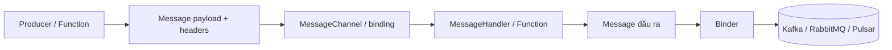

# Vai trò Spring Messaging và MessageChannel

Spring Cloud Stream xây dựng ứng dụng theo mô hình xử lý message. Để hiểu cách một hàm nhận sự kiện, đọc metadata, tạo message đầu ra và kết nối với broker, cần nắm các abstraction của Spring Messaging, đặc biệt là `Message`, `MessageHeaders`, `MessageChannel` và `MessageHandler`.

Spring Messaging định nghĩa hợp đồng trao đổi message bên trong ứng dụng Spring. MessageChannel biểu diễn điểm gửi message giữa các thành phần. Trong Spring Cloud Stream, binder kết nối các binding của ứng dụng với tài nguyên broker như Kafka topic, RabbitMQ exchange/queue hoặc Pulsar topic. Các abstraction này phối hợp với nhau nhưng có trách nhiệm khác nhau: channel không tự trở thành broker, còn binder không thay thế logic nghiệp vụ của message handler.

## 1. Spring Messaging nằm ở đâu trong kiến trúc

Spring Messaging là một phần của Spring Framework, cung cấp mô hình message dùng chung cho các thành phần Spring. Những kiểu dữ liệu quan trọng gồm:

- `Message<T>`: một message có payload kiểu `T` và tập header đi kèm.
- `MessageHeaders`: metadata của message như ID, timestamp, content type và các header nghiệp vụ.
- `MessageChannel`: hợp đồng gửi message.
- `SubscribableChannel`: loại channel cho phép đăng ký `MessageHandler`.
- `PollableChannel`: loại channel cho phép lấy message bằng thao tác nhận.
- `MessageHandler`: hợp đồng xử lý message nhận được.
- `MessageBuilder`: tiện ích tạo message và gắn header.

Các abstraction này tách mã xử lý khỏi cách message được chuyển tới thành phần tiếp theo. Một service có thể làm việc với `Message<OrderCreated>` mà không cần biết message đến từ một lời gọi trong ứng dụng, một binding Spring Cloud Stream hay một broker cụ thể.

Sơ đồ khái quát:



Sơ đồ thể hiện các vai trò logic. Ứng dụng Spring Cloud Stream hiện đại thường khai báo function bean và binding; framework quản lý endpoint và kết nối binder. Người viết ứng dụng không nhất thiết phải tự tạo một `MessageChannel` cho mỗi binding.

## 2. Message: payload và headers

Một `Message<T>` gồm hai phần:

- **Payload** chứa dữ liệu chính, ví dụ `OrderCreated`, `PaymentReceived` hoặc một chuỗi JSON.
- **Headers** chứa metadata mô tả message, ví dụ message ID, thời điểm tạo, content type, correlation ID, event type hoặc thông tin định tuyến.

Payload trả lời câu hỏi “message mang dữ liệu gì?”. Header trả lời câu hỏi “message cần được diễn giải hoặc theo dõi như thế nào?”. Không nên nhồi metadata vận hành vào payload nếu các thành phần trung gian cần đọc metadata mà không phải giải mã nội dung nghiệp vụ.

Ví dụ tạo message:

```java
OrderCreated event = new OrderCreated("order-42");

Message<OrderCreated> message = MessageBuilder
    .withPayload(event)
    .setHeader("eventId", "evt-10042")
    .setHeader("correlationId", "request-731")
    .setHeader("eventType", "OrderCreated")
    .build();
```

`MessageBuilder` giúp tạo message có kiểu rõ ràng và thêm header theo nhu cầu. `MessageHeaders` được cung cấp dưới dạng metadata chỉ đọc; khi cần tạo message mới, hãy dùng builder thay vì cố sửa map header của message đã nhận.

Một số header thường gặp:

| Header | Mục đích |
|---|---|
| `id` | Định danh message do framework tạo nếu không được cung cấp |
| `timestamp` | Thời điểm tạo message |
| `contentType` | Gợi ý định dạng payload để chuyển đổi, ví dụ JSON |
| `correlationId` | Liên kết các message thuộc cùng một luồng xử lý |
| `eventId` | Định danh sự kiện ở cấp nghiệp vụ, hữu ích cho deduplication |
| `eventType` | Tên loại sự kiện hoặc phiên bản hợp đồng theo quy ước ứng dụng |

Các header tùy chỉnh cần có quy ước tên và kiểu dữ liệu ổn định. Khi message đi qua broker, binder có thể ánh xạ, lọc hoặc chuyển đổi header theo khả năng của transport. Không giả định mọi header Java đều được truyền nguyên vẹn qua Kafka, RabbitMQ và Pulsar. Hãy xác minh header nào được hỗ trợ và cấu hình mapping khi header đó là một phần của hợp đồng tích hợp.

Message có envelope và header riêng, nhưng payload có thể là một object mutable. Tạo message mới không tự động sao chép sâu object payload. Nếu nhiều thành phần cùng giữ tham chiếu tới một payload có thể thay đổi, cần kiểm soát quyền sửa đổi hoặc dùng kiểu dữ liệu bất biến.

## 3. MessageChannel là hợp đồng gửi message

`MessageChannel` định nghĩa điểm gửi message. Hợp đồng cốt lõi cho phép gửi một `Message<?>` và có thể chỉ định thời gian chờ:

```java
public interface MessageChannel {
    boolean send(Message<?> message);
    boolean send(Message<?> message, long timeout);
}
```

Đây là cách mô tả rút gọn hai phương thức quan trọng của interface. Kết quả `true` cho biết channel đã chấp nhận việc gửi theo semantics của implementation; `false` có thể cho biết message không được gửi trong giới hạn timeout. Một số implementation cũng có thể ném exception khi việc gửi thất bại.

`MessageChannel` không định nghĩa thao tác nhận message. Cách nhận phụ thuộc interface mở rộng và implementation:

- `SubscribableChannel` cho phép đăng ký một hoặc nhiều `MessageHandler` để nhận message khi được gửi tới.
- `PollableChannel` cung cấp `receive()` và `receive(timeout)` để consumer chủ động lấy message.

Điều này quan trọng khi đọc code: biến có kiểu `MessageChannel` chỉ đảm bảo khả năng gửi. Muốn đăng ký handler, cần một `SubscribableChannel`; muốn đọc bằng polling, cần một `PollableChannel`.

### Gửi message qua một channel cục bộ

Các implementation như `DirectChannel` thuộc Spring Integration, triển khai các abstraction của Spring Messaging. Ví dụ đơn giản:

```java
DirectChannel orderChannel = new DirectChannel();

orderChannel.subscribe(message -> {
    OrderCreated event = (OrderCreated) message.getPayload();
    System.out.println("Received: " + event.orderId());
});

Message<OrderCreated> message = MessageBuilder
    .withPayload(new OrderCreated("order-42"))
    .setHeader("eventType", "OrderCreated")
    .build();

boolean accepted = orderChannel.send(message);
```

Trong ví dụ này, `DirectChannel` là channel cục bộ trong tiến trình. Handler được đăng ký sẽ xử lý message khi `send()` được gọi. Với cấu hình mặc định của DirectChannel, việc dispatch là đồng bộ trên luồng gửi; nếu handler xử lý lâu, lời gọi `send()` cũng có thể kéo dài tương ứng.

Ví dụ chỉ minh họa cách dùng channel và message. Để dùng `DirectChannel` trong một dự án độc lập, cần có Spring Integration Core trên classpath. Spring Messaging cung cấp interface và message contract; nó không chứa mọi implementation channel của Spring Integration.

## 4. Các kiểu channel và cách chọn

Spring Messaging định nghĩa các interface channel, còn Spring Integration cung cấp nhiều implementation với cách dispatch hoặc lưu message khác nhau. Những kiểu thường gặp:

| Implementation | Interface chính | Hành vi | Trường hợp sử dụng |
|---|---|---|---|
| `DirectChannel` | SubscribableChannel | Gọi handler đồng bộ trên luồng gửi; dispatcher chọn handler theo cấu hình | Luồng xử lý đơn giản, cần kết quả/lỗi đồng bộ |
| `ExecutorChannel` | SubscribableChannel | Chuyển việc dispatch sang Executor | Tách luồng gửi khỏi công việc xử lý |
| `PublishSubscribeChannel` | SubscribableChannel | Phát message tới các subscriber | Thông báo cho nhiều thành phần cùng quan tâm |
| `QueueChannel` | PollableChannel | Lưu message trong queue để consumer lấy ra | Tách thời điểm gửi và nhận trong cùng tiến trình |

Các khác biệt cần ghi nhớ:

**DirectChannel** thường dùng khi một message được chuyển tới một handler trong một luồng xử lý đồng bộ. Nếu có nhiều subscriber, dispatcher thực hiện lựa chọn handler theo chiến lược dispatch; không nên mặc định rằng mọi subscriber đều nhận một bản sao.

**ExecutorChannel** dùng executor để dispatch bất đồng bộ. Lời gọi gửi có thể kết thúc trước khi handler hoàn tất. Vì vậy, exception xảy ra trong handler không nhất thiết được ném về luồng gọi `send()`; cần có chiến lược quan sát và xử lý lỗi phù hợp.

**PublishSubscribeChannel** phát cùng một message tới các subscriber đã đăng ký. Kiểu này phù hợp cho các phản ứng độc lập như ghi audit, cập nhật chỉ số và phát thông báo trong một tiến trình. Nếu dùng executor, thời điểm hoàn tất của từng subscriber có thể khác nhau.

**QueueChannel** giữ message trong một queue cục bộ cho tới khi consumer gọi `receive()`. Nó giúp tách producer và consumer theo thời điểm xử lý, nhưng queue trong bộ nhớ không đồng nghĩa với lưu trữ bền vững. Khi tiến trình dừng, message chưa được xử lý có thể mất.

Không chọn channel chỉ theo tên. Hãy xác định có cần đồng bộ hay bất đồng bộ, một handler hay nhiều subscriber, gửi trực tiếp hay polling, và ai chịu trách nhiệm khi handler thất bại.

## 5. MessageHandler xử lý nội dung nhận được

`MessageHandler` là hợp đồng xử lý message. Một handler nhận toàn bộ message nên có thể đọc cả payload lẫn header:

```java
public interface MessageHandler {
    void handleMessage(Message<?> message);
}
```

Ví dụ handler kiểm tra correlation ID trước khi gọi service:

```java
MessageHandler orderHandler = message -> {
    OrderCreated event = (OrderCreated) message.getPayload();

    String correlationId = (String) message.getHeaders()
        .get("correlationId");

    orderService.record(event, correlationId);
};
```

Trong code thực tế, nên kiểm tra kiểu payload, header bắt buộc và quy tắc xử lý lỗi. Không nên ép kiểu tùy tiện nếu cùng một channel có thể nhận nhiều loại message. Có thể dùng một kiểu payload thống nhất, một channel riêng cho từng loại sự kiện hoặc một lớp định tuyến dựa trên header đã được chuẩn hóa.

Spring Cloud Stream cho phép viết function nhận payload trực tiếp hoặc nhận toàn bộ message:

```java
@Bean
Consumer<Message<OrderCreated>> recordOrder(OrderService service) {
    return message -> {
        OrderCreated event = message.getPayload();
        String eventId = (String) message.getHeaders().get("eventId");

        service.record(event, eventId);
    };
}
```

Dùng `Consumer<OrderCreated>` khi chỉ cần dữ liệu nghiệp vụ. Dùng `Consumer<Message<OrderCreated>>` khi logic cần header như event ID, correlation ID hoặc metadata khác. Với function tạo đầu ra, có thể trả về `Message<R>` để chủ động thiết lập header cho message tiếp theo.

## 6. MessageChannel trong Spring Cloud Stream

Spring Cloud Stream bổ sung lớp binding và binder trên nền tảng message của Spring. Một binding là kết nối logic giữa một đầu vào/đầu ra của ứng dụng với destination của broker. Binder triển khai kết nối đó cho broker cụ thể.

Trong mô hình hàm, tên binding được suy ra từ tên function và vị trí đầu vào/đầu ra:

- Function hoặc Consumer: `functionName-in-0`.
- Function có đầu ra: `functionName-out-0`.
- Supplier: `supplierName-out-0`.

Ví dụ một hàm chuyển đổi sự kiện đơn hàng:

```java
@Bean
Function<Message<OrderCreated>, Message<OrderAccepted>> acceptOrder() {
    return input -> {
        OrderCreated event = input.getPayload();

        OrderAccepted accepted =
            new OrderAccepted(event.orderId());

        return MessageBuilder
            .withPayload(accepted)
            .setHeader("eventId", "accepted-" + event.orderId())
            .setHeader("correlationId",
                input.getHeaders().get("correlationId"))
            .build();
    };
}
```

Cấu hình binding:

```yaml
spring:
  cloud:
    function:
      definition: acceptOrder
    stream:
      bindings:
        acceptOrder-in-0:
          destination: orders.created
          group: order-service
        acceptOrder-out-0:
          destination: orders.accepted
```

Trong cấu hình này, `acceptOrder-in-0` là binding đầu vào và `acceptOrder-out-0` là binding đầu ra. Binder được chọn cho ứng dụng sẽ kết nối chúng tới destination tương ứng. Với Kafka binder, destination thường là topic và group được ánh xạ sang consumer group. Với Rabbit binder, destination và group được ánh xạ vào mô hình exchange/queue của RabbitMQ theo quy tắc binder. Ngữ nghĩa cụ thể không giống nhau giữa các broker.

Ở mô hình channel-based đời trước, ứng dụng khai báo các channel bằng annotation như `@Input` và `@Output`, sau đó binder bind các channel đó. Mô hình functional hiện đại khai báo `Supplier`, `Function` hoặc `Consumer`; Spring Cloud Stream quản lý các binding theo tên function. Người phát triển thường không cần tự khai báo các bean `MessageChannel` cho từng binding.

## 7. Header, chuyển đổi payload và ranh giới broker

Spring Messaging cho phép message mang payload Java cùng metadata. Khi message đi qua binder, payload cần được serialize ở phía producer và deserialize ở phía consumer. Content type và converter hỗ trợ quá trình chuyển đổi, nhưng không thay thế thiết kế schema của sự kiện.

Ví dụ, một ứng dụng có thể khai báo `content-type: application/json` cho binding. Binder và message converter sẽ dùng thông tin này để chọn cách chuyển đổi thích hợp. Với Avro hoặc Protobuf, cần cấu hình serializer/deserializer và schema strategy tương ứng; chỉ thêm một header content type không tự cung cấp schema registry hay kiểm tra tương thích.

Cần phân biệt các loại metadata:

- Header phục vụ xử lý trong ứng dụng, chẳng hạn correlation ID hoặc thông tin tracing.
- Header do framework/binder sử dụng, chẳng hạn thông tin chuyển đổi, partition hoặc định tuyến.
- Metadata thuộc broker, chẳng hạn Kafka offset, partition, timestamp hoặc RabbitMQ delivery tag.

Không phải metadata broker nào cũng tồn tại như một header portable trong mọi binder. Offset Kafka không có ý nghĩa tương đương với delivery tag RabbitMQ. Khi cần dùng metadata đặc thù, hãy đọc tài liệu binder và chỉ để logic nghiệp vụ phụ thuộc vào metadata đó khi thực sự cần thiết.

## 8. Channel cục bộ không thay thế bảo đảm giao nhận của broker

Một `MessageChannel` trong tiến trình chủ yếu định nghĩa cách các thành phần gửi và nhận message trong ứng dụng. Nó không tự cung cấp các thuộc tính vận hành của một broker phân tán:

| Thuộc tính | Channel cục bộ | Broker qua binder |
|---|---|---|
| Phạm vi | Trong một tiến trình ứng dụng | Qua hạ tầng nhắn tin |
| Lưu trữ bền vững | Tùy implementation; QueueChannel mặc định là bộ nhớ | Tùy broker và cấu hình lưu trữ |
| Consumer group/partition | Không phải khái niệm chung của MessageChannel | Được binder ánh xạ theo broker |
| Acknowledgement/offset | Không có hợp đồng broker chung | Theo broker và binder |
| Retry/DLQ | Phải được xây dựng ở tầng ứng dụng/integration | Theo tính năng và cấu hình binder/broker |
| Mở rộng nhiều instance | Không tự chia tải giữa các tiến trình | Broker hỗ trợ theo mô hình consumer/subscription |

Vì vậy, `send()` trả về `true` không có nghĩa message đã được ghi bền vững vào Kafka, RabbitMQ hoặc Pulsar, cũng không có nghĩa consumer đã xử lý thành công. Bảo đảm giao nhận phụ thuộc producer confirmation, acknowledgement, offset commit, transaction, retry và cấu hình cụ thể của binder/broker.

Nếu một handler ghi cơ sở dữ liệu rồi thất bại trước khi message được xác nhận, broker có thể giao lại message. Consumer cần xử lý idempotent hoặc dùng cơ chế deduplication phù hợp. Nếu dùng channel bất đồng bộ trong ứng dụng, cũng cần quản lý exception và giám sát riêng vì lỗi có thể xảy ra sau khi luồng gửi đã kết thúc.

## 9. Khi nào nên dùng trực tiếp MessageChannel?

Trong ứng dụng Spring Cloud Stream theo mô hình function, nên ưu tiên khai báo function và binding vì framework quản lý kết nối broker. Dùng trực tiếp Spring Messaging hoặc Spring Integration channel khi có nhu cầu xử lý nội bộ rõ ràng, ví dụ:

- Ghép nhiều bước xử lý cục bộ trước khi gửi sự kiện ra broker.
- Phát một message tới nhiều handler nội bộ.
- Tách producer và consumer trong tiến trình bằng queue hoặc executor.
- Viết adapter kết nối API nội bộ với một message handler.
- Kiểm thử thành phần xử lý độc lập với broker.

Không cần tạo channel cục bộ chỉ để thay thế binding. Nếu mục tiêu là nhận message từ Kafka hoặc RabbitMQ, hãy cấu hình binding và binder. Nếu mục tiêu là điều phối các bước xử lý trong cùng tiến trình, một channel Spring Integration có thể phù hợp.

## 10. Checklist khi thiết kế luồng message

- Xác định payload có kiểu rõ ràng và schema ổn định.
- Chỉ đưa metadata cần thiết vào header; thống nhất tên và kiểu header tùy chỉnh.
- Quyết định handler cần payload hay toàn bộ `Message<T>`.
- Chọn channel theo semantics đồng bộ, bất đồng bộ, point-to-point, publish-subscribe hoặc polling.
- Xác định nơi xử lý exception, retry và message không hợp lệ.
- Kiểm tra header nào được binder truyền qua broker và header nào là đặc thù transport.
- Không coi kết quả `MessageChannel.send()` là bằng chứng broker đã lưu hoặc consumer đã xử lý.
- Kiểm thử logic handler độc lập, sau đó kiểm thử binding và broker thật cho các hành vi phụ thuộc broker.

Spring Messaging cung cấp hợp đồng message và channel để các thành phần Spring trao đổi dữ liệu theo cách nhất quán. Spring Cloud Stream sử dụng các abstraction này trong mô hình function và binding, còn binder kết nối ứng dụng với broker. Khi giữ rõ ranh giới giữa payload, header, channel, binding và broker, kiến trúc xử lý sự kiện sẽ dễ kiểm thử, mở rộng và vận hành hơn.

