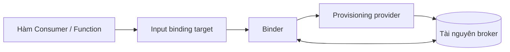
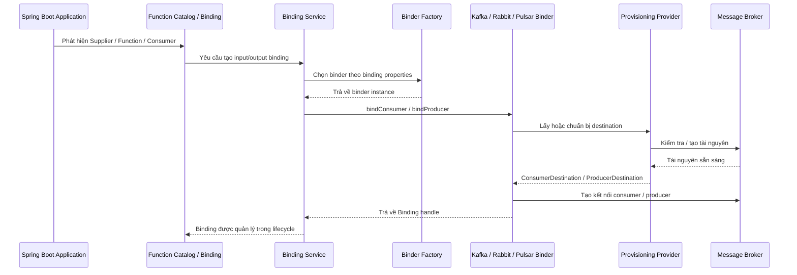

# Binder SPI, Binding và bộ phận cấp phát tài nguyên

Spring Cloud Stream tách phần xử lý nghiệp vụ khỏi cách ứng dụng kết nối với message broker. Hàm Java mô tả việc nhận, biến đổi hoặc phát sự kiện; **binding** nối đầu vào hoặc đầu ra của hàm với một destination; **binder** triển khai kết nối tới một loại broker; còn **provisioning provider** chuẩn bị destination và tài nguyên broker cần thiết. Các lớp này tạo thành ranh giới kiến trúc giúp một ứng dụng có thể dùng Kafka, RabbitMQ hoặc Pulsar mà phần lớn mã nghiệp vụ không phải phụ thuộc API riêng của từng broker.

Bài này giải thích vai trò của Binder SPI, vòng đời binding, cách Spring Cloud Stream chọn binder, cách provisioner cấp phát topic/queue/subscription, và những điểm cần quan tâm khi mở rộng hoặc tự xây dựng binder. Các ví dụ dùng mô hình hàm Supplier/Function/Consumer để làm rõ mối quan hệ giữa bean, binding name và destination.

## 1. Bốn khái niệm cần phân biệt

Trong một ứng dụng xử lý sự kiện, các thuật ngữ binder, binding, destination và provisioner thường xuất hiện cạnh nhau nhưng đại diện cho những trách nhiệm khác nhau.

| Thành phần | Trách nhiệm | Ví dụ |
|---|---|---|
| Binder | Adapter kết nối Spring Cloud Stream với một loại broker và ngữ nghĩa giao nhận của broker đó | Kafka binder, Rabbit binder, Pulsar binder |
| Binding | Kết nối đang chạy giữa một input/output target của ứng dụng với destination | `consumeOrder-in-0` nối hàm với topic `orders` |
| Destination | Tên tài nguyên logic nơi message được gửi hoặc nhận | Kafka topic, Rabbit exchange/queue, Pulsar topic |
| Provisioning provider | Tìm, tạo hoặc chuẩn bị tài nguyên broker theo cấu hình binding | Tạo topic với số partition yêu cầu hoặc khai báo queue và exchange |

Có thể hình dung một luồng consumer như sau:



Provisioner chuẩn bị tài nguyên; binder sử dụng tài nguyên đó để kết nối message channel hoặc target tương ứng. Hai thành phần có quan hệ chặt chẽ nhưng không đồng nghĩa. Provisioner không xử lý nghiệp vụ của message, còn binder không nên biến logic nghiệp vụ thành một phần của driver broker.

Một cách ghi nhớ hữu ích:

- **Binder là cách kết nối.**
- **Binding là một kết nối cụ thể.**
- **Destination là nơi kết nối tới.**
- **Provisioner chuẩn bị nơi đó để kết nối có thể hoạt động.**

## 2. Binding trong mô hình hàm

Spring Cloud Stream dựa trên Spring Cloud Function để phát hiện và liên kết các bean hàm. Với một bean hàm có tên `consumeOrder`, binding mặc định được tạo theo quy ước tên:

- Input: `consumeOrder-in-0`.
- Output của Function hoặc Supplier: `consumeOrder-out-0`.

Chỉ số `0` xác định vị trí tham số trong hàm. Với hàm có nhiều input hoặc output, chỉ số giúp phân biệt các binding tương ứng. `Consumer` có input mà không có output; `Supplier` có output mà không có input; `Function` có cả input và output.

Ví dụ ba hàm:

```java
@Configuration
public class OrderFunctions {

    @Bean
    Consumer<OrderCreated> consumeOrder(OrderHandler handler) {
        return handler::handle;
    }

    @Bean
    Function<OrderCreated, OrderEnriched> enrichOrder(OrderEnricher enricher) {
        return enricher::enrich;
    }

    @Bean
    Supplier<ServiceHeartbeat> heartbeat(HeartbeatFactory factory) {
        return factory::current;
    }
}
```

Cấu hình lựa chọn hàm và binding:

```yaml
spring:
  cloud:
    function:
      definition: consumeOrder;enrichOrder;heartbeat
    stream:
      bindings:
        consumeOrder-in-0:
          destination: orders
          group: order-handler
          content-type: application/json
        enrichOrder-in-0:
          destination: orders.raw
          group: order-enrichment
          content-type: application/json
        enrichOrder-out-0:
          destination: orders.enriched
          content-type: application/json
        heartbeat-out-0:
          destination: service.heartbeat
          content-type: application/json
```

Trong cấu hình này, `consumeOrder-in-0` và `enrichOrder-in-0` là input binding nên có thể khai báo `group`. Hai output binding chỉ phát message đến destination. `heartbeat-out-0` không có consumer group vì Supplier là nguồn phát dữ liệu.

`spring.cloud.function.definition` xác định bean hàm nào được đưa vào mô hình binding. Tên binding mặc định được tạo từ tên bean và vị trí input/output. Nếu muốn dùng tên dễ hiểu hơn hoặc muốn giữ tên cấu hình ổn định khi đổi tên bean, có thể ánh xạ tên binding bằng thuộc tính `spring.cloud.stream.function.bindings`.

Ví dụ:

```yaml
spring:
  cloud:
    function:
      definition: consumeOrder
    stream:
      function:
        bindings:
          consumeOrder-in-0: ordersInput
      bindings:
        ordersInput:
          destination: orders
          group: order-handler
```

Sau khi ánh xạ, `ordersInput` trở thành tên cấu hình binding được sử dụng cho destination, group và các consumer properties. Việc đổi alias không đổi tên bean hàm; nó chỉ tạo một tên binding cấu hình khác.

### Binding name, destination và group

Ba giá trị này có vai trò khác nhau:

| Thuộc tính | Trả lời câu hỏi | Ví dụ |
|---|---|---|
| Binding name | Ứng dụng đang cấu hình cổng vào/ra nào? | `consumeOrder-in-0` |
| Destination | Message đi qua tài nguyên broker nào? | `orders` |
| Group | Những consumer nào chia sẻ một tiến độ tiêu thụ? | `order-handler` |

Hai input binding có thể trỏ đến cùng destination nhưng có group khác nhau để nhận độc lập. Nhiều instance của cùng một consumer thường dùng chung group để chia tải. Binder dùng các giá trị này cùng thuộc tính broker-specific để xác định tài nguyên hoặc cách đăng ký consumer.

### Binding properties

Các thuộc tính cấu hình cốt lõi thường được đặt trong `spring.cloud.stream.bindings.<bindingName>`. Một binding có thể khai báo:

- `destination`: tên destination logic.
- `group`: consumer group hoặc subscription identity cho input binding.
- `content-type`: thông tin kiểu nội dung để chuyển đổi message.
- `binder`: tên binder cụ thể khi có nhiều binder.
- `consumer`: các thuộc tính tiêu thụ chung như concurrency, partitioning hoặc retry ở phạm vi core mà phiên bản hỗ trợ.
- `producer`: các thuộc tính phát message chung như partitioning hoặc required groups.

Ngoài các thuộc tính core, mỗi binder có nhóm cấu hình mở rộng riêng. Ví dụ Kafka có cấu hình broker, offset, transaction và topic; Rabbit có cấu hình exchange, queue, acknowledgement và dead-letter; Pulsar có cấu hình tenant, namespace, subscription và subscription type. Không nên lấy tên thuộc tính mở rộng của một binder rồi áp dụng nguyên trạng cho binder khác.

## 3. Binder và Binder SPI

Binder là lớp tích hợp broker với mô hình lập trình của Spring Cloud Stream. Nó nhận biết cách tạo consumer hoặc producer trên broker, chuyển đổi message giữa hạ tầng và binding target, áp dụng các thuộc tính giao nhận phù hợp, đồng thời cung cấp lifecycle handle cho kết nối đã tạo.

Binder SPI là hợp đồng mở rộng để các binder triển khai có thể được Spring Cloud Stream sử dụng theo một mô hình thống nhất. Ở mức khái niệm, interface `Binder` có hai thao tác quan trọng:

```java
public interface Binder<T,
        C extends ConsumerProperties,
        P extends ProducerProperties> {

    Binding<T> bindConsumer(
            String name,
            String group,
            T inboundBindTarget,
            C consumerProperties);

    Binding<T> bindProducer(
            String name,
            T outboundBindTarget,
            P producerProperties);
}
```

Đây là hình dạng SPI khái quát; binder cụ thể có thể kế thừa lớp nền, dùng kiểu target hoặc thuộc tính mở rộng riêng tùy phiên bản Spring Cloud Stream.

`bindConsumer` nhận tên destination, group, input target và consumer properties. Binder sử dụng chúng để đăng ký consumer với broker và trả về một `Binding` quản lý kết nối đó. `bindProducer` nhận destination, output target và producer properties để tạo đường phát message.

### Consumer properties và producer properties

Core cung cấp các lớp thuộc tính chung để binding có thể cấu hình theo cách nhất quán. `ConsumerProperties` biểu diễn các lựa chọn tiêu thụ chung; `ProducerProperties` biểu diễn các lựa chọn phát chung. Binder có thể mở rộng chúng bằng các lớp như extended consumer/producer properties để bổ sung khả năng riêng của broker.

Ví dụ, partitioning có thể được mô tả ở mức core bằng biểu thức chọn partition key hoặc selector; Kafka binder sau đó ánh xạ cấu hình đó vào partition của topic. Cấu hình concurrency là ý định về mức song song của consumer; binder cụ thể quyết định cách hiện thực bằng consumer thread, queue consumer hoặc subscription consumer.

Không phải thuộc tính core nào cũng có cùng tác dụng trên mọi broker. Một cấu hình chỉ có ý nghĩa nếu binder đang dùng hỗ trợ nó và có thể ánh xạ sang semantics tương ứng. Vì vậy, cần kiểm tra tài liệu binder và phiên bản cụ thể khi dùng các thuộc tính mở rộng.

### Binding là lifecycle handle

Kết quả từ thao tác bind là một đối tượng `Binding`. Nó đại diện cho kết nối đang hoạt động và cung cấp cách quản lý vòng đời như khởi động, dừng, kiểm tra trạng thái hoặc unbind. Spring Cloud Stream quản lý các binding trong vòng đời ứng dụng; khi context đóng, các kết nối tương ứng được giải phóng theo lifecycle của chúng.

Cần phân biệt thao tác unbind với xóa tài nguyên broker. Dừng hoặc unbind một binding thường ngắt kết nối consumer/producer khỏi ứng dụng. Nó không đồng nghĩa topic, exchange hoặc queue durable sẽ bị xóa. Việc xóa tài nguyên lâu dài phụ thuộc chính sách của binder, broker và cấu hình quản trị.

## 4. Spring Cloud Stream điều phối binding như thế nào?

Một ứng dụng thường không gọi trực tiếp `bindConsumer` hoặc `bindProducer`. Các thành phần điều phối trong Spring Cloud Stream thực hiện công việc này dựa trên bean hàm và cấu hình.

Luồng khởi tạo khái quát:



Các vai trò chính:

1. **Function discovery** tìm các bean hàm được chọn. Từ kiểu hàm và tên bean, framework xác định các input/output binding cần tạo.
2. **Binding configuration** đọc `destination`, `group`, `binder`, `content-type` và các thuộc tính consumer/producer.
3. **Binder factory** tìm và cung cấp binder phù hợp với tên hoặc loại binder đã cấu hình.
4. **Binding service** điều phối việc bind các input/output target bằng binder tương ứng và quản lý các binding được tạo.
5. **Provisioning provider** chuẩn bị destination và tài nguyên broker nếu binder cần cấp phát.
6. **Binder implementation** thiết lập kết nối thực tế, chuyển message và áp dụng semantics của broker.

Đây là mô hình kiến trúc để hiểu trách nhiệm. Chi tiết lớp nội bộ và thứ tự callback có thể thay đổi giữa các phiên bản, nhưng ranh giới chức năng trên vẫn là cách hữu ích để phân tích lỗi.

### Khi khởi tạo thất bại

Nếu binder không được tìm thấy, cấu hình không hợp lệ, credentials sai hoặc broker không cho phép tạo tài nguyên, binding có thể không khởi tạo được. Ứng dụng có thể thất bại lúc startup hoặc binding không đạt trạng thái mong muốn, tùy cơ chế lifecycle và cấu hình lỗi.

Khi chẩn đoán, hãy tách vấn đề theo từng lớp:

- Không tìm thấy binder: kiểm tra dependency, binder type và cấu hình lựa chọn.
- Không kết nối được broker: kiểm tra địa chỉ, DNS, TLS, credentials, network policy và quyền truy cập.
- Không tạo được destination: kiểm tra quyền provision, tên tài nguyên, số partition, queue/exchange hoặc namespace.
- Binding không nhận message: kiểm tra destination, group, subscription, routing, offset/cursor và trạng thái consumer.
- Message không giải mã được: kiểm tra content type, serializer/deserializer, schema và header.

Việc xác định lỗi ở đúng ranh giới giúp tránh sửa logic nghiệp vụ khi nguyên nhân thực tế nằm ở cấu hình broker.

## 5. Provisioning provider và cấp phát tài nguyên

Provisioning provider là phần trừu tượng hóa việc lấy hoặc tạo tài nguyên broker cho producer và consumer. Trong Binder SPI, hợp đồng provisioning thường được biểu diễn bằng `ProvisioningProvider` với hai thao tác chính:

```java
public interface ProvisioningProvider<
        C extends ConsumerProperties,
        P extends ProducerProperties> {

    ConsumerDestination getConsumerDestination(
            String name,
            String group,
            C consumerProperties);

    ProducerDestination getProducerDestination(
            String name,
            P producerProperties);
}
```

Tên và kiểu cụ thể có thể khác theo phiên bản hoặc lớp nền mà binder sử dụng; điều quan trọng là phân biệt hai đường cấp phát:

- Consumer destination thường cần biết cả tên destination và group vì cách tạo queue/subscription có thể phụ thuộc group.
- Producer destination thường cần tên destination và producer properties để xác định tài nguyên phát message, partition hoặc routing.

Provisioner có thể tìm tài nguyên đã tồn tại, tạo tài nguyên còn thiếu, bổ sung partition hoặc cấu hình binding theo khả năng broker và quyền hiện tại. Không phải binder nào cũng có cùng khả năng tự động tạo tài nguyên.

### Tài nguyên khác nhau theo broker

| Broker | Tài nguyên producer thường dùng | Tài nguyên consumer thường dùng | Đặc điểm |
|---|---|---|---|
| Kafka | Topic | Topic cùng consumer group và offset riêng | Group được quản lý bằng coordinator/offset; partition là đơn vị chia tải |
| RabbitMQ | Exchange và routing/binding phù hợp | Queue gắn với destination và group, cùng binding tới exchange | Queue lưu message; nhiều consumer trong cùng queue cạnh tranh nhận |
| Pulsar | Topic | Topic cùng subscription có cursor riêng | Subscription type quyết định cách các consumer phối hợp |

Đây là cách mô tả logic; tên vật lý, quy tắc đặt tên, loại exchange, subscription và tài nguyên phụ trợ do binder cùng cấu hình quyết định.

### Cấp phát tài nguyên cho Kafka

Với Kafka, destination thường ánh xạ tới topic. Provisioning có thể kiểm tra topic đã tồn tại, tạo topic với số partition và replication factor được cấu hình, hoặc bổ sung partition khi binder và cấu hình cho phép.

Các điểm cần lưu ý:

- Số partition ảnh hưởng mức song song tối đa của một consumer group.
- Replication factor ảnh hưởng khả năng chịu lỗi và yêu cầu số broker phù hợp.
- Tăng partition có thể thay đổi phân bố key của message mới; không thể tùy tiện giảm partition của topic đang sử dụng.
- Tạo topic cần quyền phù hợp nếu broker bật authorization.
- Cấu hình auto-create và auto-add partition phải phù hợp với chính sách vận hành; không giả định broker luôn tự tạo topic đúng thông số mong muốn.

Group của consumer Kafka không phải một queue riêng được tạo cho mỗi group. Các group đọc cùng topic nhưng giữ offset riêng theo từng topic-partition.

### Cấp phát tài nguyên cho RabbitMQ

Rabbit binder thường làm việc với exchange, queue và các binding giữa chúng. Destination thường xác định exchange logic; group giúp phân biệt queue của từng subscriber. Nhiều instance cùng group chia sẻ queue để cạnh tranh nhận message; group khác có queue riêng để nhận độc lập.

Provisioning cần quan tâm:

- Loại exchange và routing key.
- Tên queue và quy tắc đặt tên theo group.
- Durable queue và message persistence.
- Dead-letter exchange/queue nếu được cấu hình.
- Queue arguments, TTL, maximum length và các thuộc tính broker khác.
- Quyền configure, write và read của user kết nối.

Một exchange có thể route cùng message đến nhiều queue. Mỗi queue có backlog và acknowledgement riêng. Đây là cơ chế giúp nhiều subscriber group nhận độc lập.

### Cấp phát tài nguyên cho Pulsar

Pulsar tổ chức dữ liệu theo tenant, namespace và topic. Consumer đọc topic thông qua subscription. Subscription giữ cursor/tiến độ riêng; nhiều consumer dùng cùng subscription tham gia một luồng tiêu thụ. Subscription type như Exclusive, Failover, Shared hoặc Key_Shared quyết định cách phân phối message.

Provisioning và broker có thể liên quan đến:

- Tenant và namespace tồn tại, quyền truy cập namespace.
- Topic thường hoặc partitioned topic.
- Subscription identity và subscription type.
- Retention, backlog quota, message TTL và policy.
- Schema và compatibility policy nếu dùng schema registry tích hợp của Pulsar.

Việc topic hoặc subscription được tạo tự động phụ thuộc cấu hình broker, binder và chính sách namespace. Một ứng dụng không nên giả định có thể tạo tài nguyên ở mọi namespace chỉ vì credentials kết nối thành công.

## 6. Auto provisioning và quản trị hạ tầng

Tự động cấp phát tài nguyên giúp môi trường phát triển khởi động nhanh: ứng dụng có thể yêu cầu một destination và binder tạo topic hoặc queue nếu chưa có. Trong production, việc này cần được kiểm soát.

### Khi nào tự động tạo tài nguyên hữu ích?

- Local development hoặc môi trường integration test cần dựng broker và ứng dụng nhanh.
- Dịch vụ mới được triển khai cùng một hạ tầng có chính sách auto-provision rõ ràng.
- Tài nguyên có cấu hình đơn giản, quyền cấp phát được giới hạn theo namespace hoặc project.
- Môi trường ephemeral được tạo và hủy theo vòng đời test.

### Khi nào nên quản trị tài nguyên riêng?

- Topic cần replication factor, partition count, retention hoặc quota theo chuẩn vận hành.
- Queue cần TTL, dead-letter, priority hoặc policy bảo mật riêng.
- Namespace có quota, schema policy hoặc quyền truy cập được quản lý tập trung.
- Tài nguyên được chia sẻ giữa nhiều ứng dụng hoặc có vòng đời dài hơn một lần deploy.
- Tổ chức yêu cầu thay đổi hạ tầng phải qua review và audit.

Một cách triển khai phổ biến là dùng Infrastructure as Code hoặc pipeline hạ tầng để tạo tài nguyên production. Binder được cấu hình theo chế độ chỉ sử dụng tài nguyên đã có, hoặc không được cấp quyền tạo/xóa những tài nguyên ngoài phạm vi. Tên destination và group vẫn nằm trong cấu hình ứng dụng, còn thông số hạ tầng được quản trị ở nơi phù hợp.

### Quyền cấp phát tối thiểu

Provisioner thường cần quyền kiểm tra metadata và có thể cần quyền tạo hoặc thay đổi tài nguyên. Tài khoản runtime nên được cấp quyền tối thiểu theo nhu cầu:

- Producer chỉ cần quyền ghi vào destination cần thiết.
- Consumer chỉ cần quyền đọc và quyền group/subscription tương ứng.
- Tài khoản triển khai hạ tầng có thể có quyền tạo topic/queue hoặc cập nhật policy, nhưng không nhất thiết phải dùng cùng credentials runtime.
- Không lưu mật khẩu, token hoặc private key trực tiếp trong source code hay commit vào repository.

Tách quyền runtime và quyền provision giúp giảm tác động nếu ứng dụng bị xâm nhập hoặc cấu hình sai.

## 7. Nhiều binder trong cùng một ứng dụng

Một ứng dụng có thể cần đọc từ Kafka và phát sang RabbitMQ, hoặc kết nối hai cụm Kafka khác nhau. Spring Cloud Stream hỗ trợ cấu hình nhiều binder và chọn binder theo từng binding. Ví dụ này dùng một bean Function để có cả input lẫn output:

\`\`\`java
@Bean
Function<OrderCreated, OrderNotification> routeOrder(NotificationMapper mapper) {
    return mapper::toNotification;
}
\`\`\`

Ví dụ dưới đây minh họa một binder Kafka cho input và một binder Rabbit cho output:

```yaml
spring:
  cloud:
    function:
      definition: routeOrder
    stream:
      binders:
        kafkaOrders:
          type: kafka
          environment:
            spring:
              cloud:
                stream:
                  kafka:
                    binder:
                      brokers: kafka.internal:9092
        rabbitNotifications:
          type: rabbit
          environment:
            spring:
              rabbitmq:
                host: rabbit.internal
                port: 5672
      bindings:
        routeOrder-in-0:
          destination: orders
          group: order-handler
          binder: kafkaOrders
        routeOrder-out-0:
          destination: order-notifications
          binder: rabbitNotifications
```

Tên `kafkaOrders` và `rabbitNotifications` là alias binder do ứng dụng đặt. `type` chọn implementation binder có trên classpath; `environment` chứa cấu hình riêng cho binder instance đó. Thuộc tính `binder` trên mỗi binding xác định binding sử dụng alias nào. Input của Function đọc từ Kafka; output được gửi sang RabbitMQ.

Nếu ứng dụng có nhiều binder cùng loại, alias riêng giúp kết nối tới các cluster hoặc cấu hình khác nhau. Nếu có nhiều binder và không chỉ rõ binder cho binding, cần cấu hình default binder rõ ràng hoặc đánh dấu binder nào là ứng viên mặc định theo khả năng phiên bản đang dùng. Tránh để việc chọn binder phụ thuộc ngầm vào thứ tự dependency.

### Ranh giới giao dịch giữa hai broker

Một Function đọc từ Kafka rồi phát sang RabbitMQ tạo ra hai kết nối và hai hệ thống lưu trữ độc lập. Việc binder hỗ trợ transaction ở một broker không tự tạo transaction phân tán nguyên tử giữa cả hai broker.

Ví dụ, ứng dụng đọc event từ Kafka, cập nhật trạng thái, rồi gửi notification sang RabbitMQ. Nếu gửi Rabbit thành công nhưng commit offset Kafka thất bại, message có thể được đọc lại và notification có thể gửi lặp. Nếu commit offset trước khi gửi Rabbit thành công, notification có thể bị mất khi ứng dụng dừng.

Hãy thiết kế quy trình chịu lỗi bằng idempotency, outbox/inbox, retry và đối soát phù hợp. Không suy ra đảm bảo exactly-once xuyên broker chỉ từ việc hai binding cùng nằm trong một Spring Boot application.

## 8. Tạo binder riêng bằng Binder SPI

Chỉ nên xây dựng binder riêng khi có một broker hoặc giao thức cần tích hợp mà binder hiện có không đáp ứng, hoặc khi tổ chức cần adapter riêng cho nền tảng messaging nội bộ. Nếu broker đã có binder được hỗ trợ, sử dụng binder đó thường giảm chi phí bảo trì và rủi ro tương thích.

Một binder tùy chỉnh thường cần các phần sau:

1. **Module và dependency**: phụ thuộc vào đúng phiên bản Spring Cloud Stream/Binder SPI và client library của broker.
2. **Binder implementation**: triển khai `Binder` hoặc kế thừa lớp nền phù hợp để kết nối input/output target.
3. **Provisioning provider**: cung cấp cách tìm hoặc tạo producer/consumer destination.
4. **Properties**: khai báo consumer/producer properties mở rộng với prefix riêng.
5. **Auto-configuration**: tạo bean binder, provisioner, connection factory/client và các thành phần phụ trợ.
6. **Metadata đăng ký binder**: công bố binder theo cơ chế discovery/auto-configuration mà phiên bản Spring Cloud Stream yêu cầu.
7. **Lifecycle và health**: đóng connection, thread, client và tài nguyên khi context dừng; cung cấp trạng thái để quan sát.
8. **Tests**: kiểm thử contract, provisioning, message conversion, retry, partitioning và lỗi kết nối.

### Phác thảo cấu trúc module

```text
custom-stream-binder/
  src/main/java/
    com/example/binder/
      ExampleBinder.java
      ExampleProvisioningProvider.java
      ExampleBinderConfiguration.java
      ExampleConsumerProperties.java
      ExampleProducerProperties.java
      ExampleConsumerEndpoint.java
      ExampleProducerHandler.java
  src/main/resources/
    META-INF/
      spring.binders
  src/test/java/
    com/example/binder/
      ExampleBinderTests.java
      ExampleProvisioningTests.java
```

Đây là cấu trúc minh họa; cách đăng ký auto-configuration và metadata phụ thuộc dòng phiên bản Spring Boot/Spring Cloud đang dùng. Khi phát triển binder, hãy lấy mẫu từ binder cùng phiên bản thay vì sao chép cấu trúc của một major version cũ.

### Trách nhiệm của binder implementation

Một binder chất lượng cần xử lý đầy đủ các khía cạnh:

- Tạo producer hoặc consumer endpoint theo destination và properties.
- Chuyển message, payload và headers giữa Spring Message và client broker.
- Ánh xạ group, subscription, acknowledgement và offset/cursor theo broker.
- Xử lý partition, concurrency và ordering theo khả năng của broker.
- Phân loại lỗi tạm thời và lỗi vĩnh viễn; tích hợp retry hoặc error handling theo hợp đồng.
- Quản lý connection, channel, consumer thread, callback và shutdown.
- Trả về binding handle để framework có thể quản lý lifecycle.
- Cung cấp metrics, health và thông tin chẩn đoán phù hợp.

Không nên nhét toàn bộ mã tạo topic/queue vào lớp xử lý message. Tách provisioner giúp kiểm thử riêng logic hạ tầng và giữ binder tập trung vào việc kết nối.

### Extended properties

Consumer/producer properties của binder nên được bind từ cấu hình ngoài. Ví dụ:

```java
@ConfigurationProperties("spring.cloud.stream.example.binder")
public class ExampleBinderProperties {
    private String endpoint;
    private Duration requestTimeout = Duration.ofSeconds(5);

    // getters và setters
}
```

Các thuộc tính mở rộng theo từng binding nên dùng cấu trúc phù hợp với cơ chế extended binding properties của Spring Cloud Stream. Tránh đặt một thuộc tính toàn cục khi nó thực sự cần khác nhau giữa từng binding.

### Provisioning an toàn

Provisioner tùy chỉnh cần có hành vi xác định và có thể lặp lại:

- Nếu tài nguyên đã tồn tại và tương thích, tái sử dụng.
- Nếu tài nguyên tồn tại nhưng cấu hình không tương thích, báo lỗi rõ ràng thay vì âm thầm phá cấu hình.
- Nếu không có quyền tạo tài nguyên, đưa ra lỗi kèm tên destination và thao tác bị từ chối.
- Không xóa tài nguyên bền vững chỉ vì một binding unbind.
- Phân biệt lỗi cấu hình với lỗi broker tạm thời để retry đúng cách.
- Hỗ trợ timeout và giới hạn số lần thử khi broker chưa sẵn sàng.

Idempotency của thao tác provisioning rất quan trọng vì ứng dụng có thể khởi động lại nhiều lần hoặc nhiều instance cùng yêu cầu một destination. Việc tạo đồng thời cần xử lý trường hợp tài nguyên đã được instance khác tạo trong lúc yêu cầu hiện tại đang chạy.

## 9. Kiểm thử binding và provisioner

Kiểm thử nên đi từ hợp đồng đơn giản đến broker thật.

### Unit test cho properties và mapping

Kiểm tra việc bind cấu hình vào properties, giá trị mặc định, kiểm tra điều kiện không hợp lệ và mapping từ core properties sang broker client options. Ví dụ, một partition count âm hoặc destination rỗng phải được từ chối với thông báo dễ hiểu.

### Test provisioning provider

Dùng mock client hoặc fake admin API để kiểm tra:

- Destination chưa tồn tại được tạo theo đúng cấu hình.
- Destination đã tồn tại được tái sử dụng.
- Cấu hình hiện hữu xung đột được báo lỗi.
- Lỗi quyền truy cập được giữ nguyên nguyên nhân.
- Timeout và lỗi tạm thời có hành vi retry có giới hạn.
- Hai yêu cầu tạo đồng thời không dẫn tới trạng thái sai.

### Test binding lifecycle

Kiểm tra `bindConsumer` và `bindProducer` tạo endpoint đúng, trả về binding handle, có thể start/stop/unbind và giải phóng tài nguyên khi context đóng. Kiểm tra không còn thread hoặc connection bị rò rỉ sau khi shutdown.

### Integration test với broker

Test binder trong bộ kiểm thử Spring Cloud Stream hữu ích để kiểm tra logic hàm, tên binding và luồng message ở mức framework. Nó không chứng minh semantics thật của broker hoặc correctness của provisioner. Với binder tùy chỉnh, cần integration test trên broker thật hoặc môi trường tương thích để kiểm tra:

- Producer gửi được message đến đúng destination.
- Consumer nhận message theo group/subscription đã khai báo.
- Hai consumer cùng group chia tải theo semantics broker.
- Hai group khác nhau nhận độc lập.
- Partition/key và ordering hoạt động đúng.
- Acknowledgement, offset/cursor, retry và dead-letter xử lý đúng.
- Broker ngắt kết nối rồi phục hồi không làm rò rỉ tài nguyên hoặc mất trạng thái ngoài cam kết.

Nếu dùng Testcontainers, tạo tài nguyên có tên riêng cho mỗi lần test và đóng container sau test để tránh dữ liệu cũ làm sai kết quả.

## 10. Quan sát và vận hành

Binder là ranh giới giữa ứng dụng và broker nên cần quan sát cả trạng thái binding lẫn trạng thái tài nguyên.

Các thông tin cần theo dõi:

- Tên binding, binder alias, destination và group.
- Binding đang chạy, dừng hay gặp lỗi.
- Số consumer/producer đang hoạt động và thời điểm kết nối gần nhất.
- Consumer lag hoặc backlog theo group/subscription.
- Tốc độ message vào/ra, lỗi gửi/nhận và thời gian xử lý.
- Số lần retry, redelivery, message chuyển DLQ.
- Lỗi provisioning, số lần tạo tài nguyên, thời gian cấp phát.
- Rebalance, partition assignment hoặc consumer reconnect khi broker hỗ trợ.

Log nên chứa binding name, destination, group, event ID và correlation ID để truy vết xuyên các lớp. Tránh ghi credentials hoặc toàn bộ payload nhạy cảm.

Khi binding không hoạt động, hãy kiểm tra theo thứ tự: cấu hình binding, binder được chọn, kết nối broker, tài nguyên đã provision, quyền truy cập, consumer assignment/subscription và cuối cùng là message conversion. Trình tự này giúp khoanh vùng nhanh hơn việc chỉ xem log của hàm nghiệp vụ.

## 11. Các lỗi kiến trúc thường gặp

**Nhầm binding với destination.** Binding là kết nối logic của ứng dụng; destination là tài nguyên broker. Một destination có thể được nhiều binding dùng, với group hoặc binder khác nhau.

**Nhầm binder với một broker instance.** Binder là implementation adapter; một binder alias có thể được cấu hình để kết nối tới một cluster cụ thể. Cùng loại Kafka binder có thể có nhiều instance cấu hình cho các cluster khác nhau.

**Cho rằng provisioner luôn tạo tài nguyên.** Auto provisioning phụ thuộc binder, broker, cấu hình và quyền. Trong production, tài nguyên có thể được tạo trước bởi pipeline hạ tầng.

**Coi unbind là xóa queue hoặc topic.** Unbind giải phóng kết nối ứng dụng. Tài nguyên broker bền vững có vòng đời riêng và cần chính sách quản trị rõ ràng.

**Dùng cấu hình mở rộng của Kafka cho RabbitMQ hoặc Pulsar.** Các binder có semantics và properties khác nhau. Chỉ cấu hình core có thể dùng chung khi binder hỗ trợ cùng ngữ nghĩa.

**Dùng nhiều binder nhưng không chỉ rõ binder cho binding.** Ứng dụng có thể chọn nhầm default hoặc không khởi tạo được. Hãy gán binder alias rõ ràng khi cần kết nối nhiều broker.

**Tự xây dựng binder nhưng bỏ qua lifecycle.** Consumer thread, connection hoặc callback không được giải phóng có thể gây rò rỉ tài nguyên và làm test không kết thúc.

**Cho phép runtime tạo/xóa mọi tài nguyên.** Quyền quá rộng làm tăng phạm vi ảnh hưởng khi ứng dụng hoặc cấu hình bị lỗi. Hãy tách quyền cấp phát và quyền đọc/ghi runtime.

## 12. Quy trình thiết kế một binding mới

Khi bổ sung một luồng sự kiện, hãy đi theo các bước:

1. Xác định bean hàm là Supplier, Function hay Consumer và input/output nào cần binding.
2. Xác định binding name mặc định hoặc alias rõ ràng để cấu hình ổn định.
3. Chọn destination, group và binder theo yêu cầu giao nhận.
4. Xác định tài nguyên broker cần có: topic, partition, exchange, queue, namespace hoặc subscription.
5. Quyết định tài nguyên được auto-provision hay quản trị qua Infrastructure as Code.
6. Cấu hình content type, schema, partitioning, concurrency, retry và dead-letter theo binder.
7. Xác định quyền tối thiểu cho provisioner và credentials runtime.
8. Kiểm thử logic hàm, binding lifecycle và broker semantics.
9. Theo dõi binding state, backlog, lỗi và provisioning sau triển khai.

Khi cần tạo binder mới, bắt đầu bằng việc xác định chính xác phần nào của broker chưa được adapter hiện có hỗ trợ. Sau đó triển khai Binder SPI, provisioner, properties, auto-configuration, lifecycle và tests trên đúng phiên bản Spring Cloud. Một binder tốt giữ cho mã nghiệp vụ độc lập với broker, đồng thời thể hiện trung thực các khác biệt về group, partition, acknowledgement, subscription và tài nguyên của từng hệ thống.


