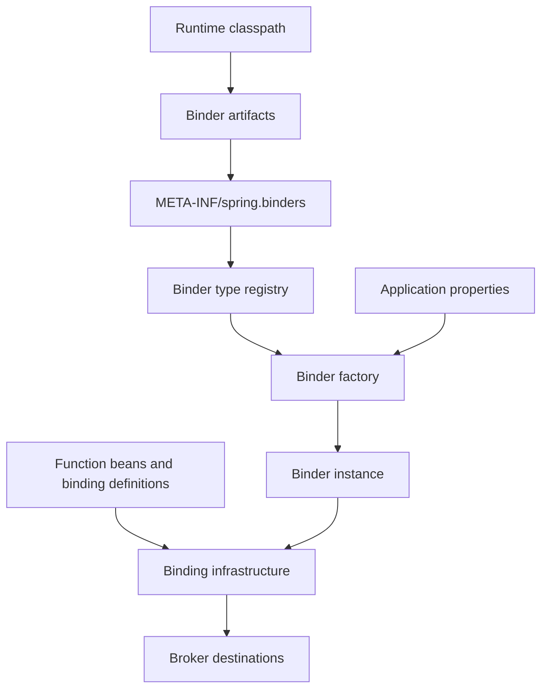

# Tự động cấu hình và phát hiện binder trên classpath

Spring Cloud Stream kết nối các hàm xử lý sự kiện với Kafka, RabbitMQ hoặc Pulsar thông qua binder. Trong một ứng dụng Spring Boot, phần lớn việc khởi tạo hạ tầng này được thực hiện tự động dựa trên thư viện có trong classpath, metadata do binder cung cấp và cấu hình của ứng dụng. Hiểu cơ chế đó giúp xác định vì sao một binder được chọn, vì sao một binding không được tạo và cách cấu hình khi ứng dụng có nhiều broker.

Tự động cấu hình và phát hiện binder là hai việc có liên quan nhưng khác nhau. Spring Boot quyết định cấu hình nào đủ điều kiện được kích hoạt. Spring Cloud Stream tìm các loại binder mà ứng dụng có thể sử dụng, tạo binder phù hợp và nối binding của hàm với destination. Dependency trên classpath cung cấp khả năng tích hợp; cấu hình binding và destination quyết định cách khả năng đó được sử dụng.

## 1. Các lớp tham gia vào quá trình khởi tạo

Một ứng dụng Spring Cloud Stream thường có những lớp sau:

| Thành phần | Trách nhiệm |
| --- | --- |
| Spring Boot auto-configuration | Phát hiện class và bean, kiểm tra điều kiện cấu hình, tạo các bean nền tảng khi ứng dụng khởi động. |
| Spring Cloud Function | Phát hiện và quản lý các bean `Supplier`, `Function` hoặc `Consumer` trong ứng dụng. |
| Spring Cloud Stream | Tạo binding, quản lý cấu hình luồng và kết nối hàm với binder. |
| Binder registry và binder factory | Đăng ký các loại binder có thể dùng, chọn loại phù hợp và tạo binder instance theo cấu hình. |
| Binder implementation | Thực hiện giao tiếp với broker cụ thể như Kafka, RabbitMQ hoặc Pulsar. |
| Destination | Tài nguyên trên broker mà binding đọc hoặc ghi, ví dụ topic hoặc exchange. |

Điểm khởi đầu thường là lớp ứng dụng có `@SpringBootApplication`. Annotation này bao gồm cơ chế bật auto-configuration của Spring Boot. Khi context được tạo, Spring Boot đánh giá các cấu hình tự động có trên classpath. Các cấu hình của Spring Cloud Stream và binder có thể tham gia quá trình đó nếu dependency và điều kiện cần thiết được đáp ứng.

Không cần khai báo `@EnableBinding` trong ứng dụng dùng mô hình hàm hiện đại. Ứng dụng khai báo bean hàm và để Spring Cloud Stream thiết lập binding theo cấu hình. `@EnableBinding` thuộc mô hình lập trình annotation-based trước đây và thường xuất hiện trong mã cũ.

## 2. Spring Boot quyết định auto-configuration như thế nào?

Auto-configuration là cơ chế Spring Boot cung cấp để tạo các bean phù hợp với môi trường ứng dụng. Một cấu hình tự động thường chỉ được áp dụng khi một số điều kiện được thỏa mãn. Các điều kiện phổ biến gồm:

- **Có class trên classpath:** thư viện cần thiết phải được thêm vào dependency. Ví dụ, cấu hình dành cho Kafka cần các class Kafka binder hoặc Kafka client tương ứng.
- **Có hoặc chưa có bean:** cấu hình có thể chỉ tạo bean mặc định khi ứng dụng chưa tự khai báo bean tương đương. Điều này cho phép ứng dụng tùy chỉnh một số thành phần.
- **Thuộc tính được bật hoặc có giá trị phù hợp:** một cấu hình có thể phụ thuộc vào property trong `application.yml`, biến môi trường hoặc tham số lúc chạy.
- **Điều kiện của ứng dụng:** cấu hình có thể phụ thuộc loại ứng dụng, class khác hoặc cấu hình tự động liên quan đã được nạp.

Các annotation như `@ConditionalOnClass`, `@ConditionalOnMissingBean` và `@ConditionalOnProperty` là những cơ chế Spring Boot thường dùng để biểu diễn điều kiện này. Đây là ví dụ về cách auto-configuration hoạt động; không nên suy ra rằng mọi cấu hình của Spring Cloud Stream đều dùng cùng một tập điều kiện.

Ví dụ, nếu ứng dụng không có dependency Kafka binder, phần tích hợp Kafka không thể hoạt động chỉ bằng cách khai báo `destination: orders.in`. Nếu Kafka binder có trên classpath nhưng địa chỉ broker sai, auto-configuration vẫn có thể tạo được các bean cần thiết, còn kết nối hoặc quá trình bind có thể thất bại khi ứng dụng khởi tạo luồng. Do đó, cần phân biệt lỗi thiếu thư viện với lỗi cấu hình kết nối.

## 3. Binder được phát hiện trên classpath

Mỗi binder implementation cung cấp metadata để Spring Cloud Stream biết loại binder nào có thể được tạo và cấu hình nào chịu trách nhiệm cho loại đó. Cơ chế đăng ký binder truyền thống của Spring Cloud Stream sử dụng tài nguyên `META-INF/spring.binders` bên trong artifact binder.

Tài nguyên này ánh xạ một tên loại binder với lớp cấu hình binder tương ứng. Ví dụ về mặt khái niệm:

```properties
kafka=...KafkaBinderConfiguration
rabbit=...RabbitBinderConfiguration
```

Các tên lớp cụ thể phụ thuộc artifact và phiên bản binder; ví dụ trên chỉ minh họa cấu trúc ánh xạ. Khi dependency Kafka binder hoặc Rabbit binder được đưa vào classpath, metadata tương ứng đi cùng artifact. Spring Cloud Stream đọc registry này để biết những loại binder có sẵn.

Quá trình phát hiện có thể hiểu theo các bước:

1. Build tool đưa starter hoặc binder dependency vào runtime classpath.
2. Artifact binder cung cấp implementation, thư viện client và metadata đăng ký loại binder.
3. Spring Cloud Stream đọc metadata và xây dựng registry các loại binder có thể dùng.
4. Binder factory sử dụng registry cùng cấu hình ứng dụng để tạo binder phù hợp.
5. Hạ tầng binding kết nối các binding đầu vào hoặc đầu ra với destination thông qua binder đó.



Metadata `META-INF/spring.binders` dùng cho registry loại binder của Spring Cloud Stream. Nó có vai trò khác với cơ chế đăng ký auto-configuration của Spring Boot, vốn thay đổi theo thế hệ Spring Boot và có thể sử dụng các metadata như `AutoConfiguration.imports`. Không nên nhầm hai cơ chế này: một cơ chế giúp Boot tìm cấu hình tự động, cơ chế còn lại giúp Spring Cloud Stream tìm loại binder.

## 4. Từ binder được phát hiện đến binding của hàm

Phát hiện được một binder chỉ có nghĩa ứng dụng có khả năng sử dụng binder đó. Spring Cloud Stream còn phải biết hàm nào cần kết nối và mỗi đầu vào hoặc đầu ra sẽ đi tới destination nào.

Ví dụ, ứng dụng khai báo một hàm:

```java
import java.util.function.Function;

import org.springframework.context.annotation.Bean;
import org.springframework.context.annotation.Configuration;

@Configuration
public class OrderFunctions {

    @Bean
    public Function<String, String> normalizeOrder() {
        return orderId -> orderId.trim().toUpperCase();
    }
}
```

Cấu hình có thể chọn hàm và destination như sau:

```yaml
spring:
  cloud:
    function:
      definition: normalizeOrder
    stream:
      bindings:
        normalizeOrder-in-0:
          destination: orders.raw
          group: order-normalizer
        normalizeOrder-out-0:
          destination: orders.normalized
```

Tên binding được suy ra từ tên bean hàm và quy ước đầu vào/đầu ra của Spring Cloud Stream. `normalizeOrder-in-0` là cổng đầu vào, còn `normalizeOrder-out-0` là cổng đầu ra. Destination xác định tài nguyên broker mà từng binding sử dụng. Nếu chỉ có một binder phù hợp trên classpath, Spring Cloud Stream thường có thể sử dụng binder đó theo cơ chế mặc định. Khi có nhiều binder, cần cấu hình lựa chọn rõ ràng.

Quá trình này cho thấy ba câu hỏi cần được kiểm tra riêng: hàm có được Spring nhận diện không, binder có được phát hiện và tạo thành công không, và binding có được nối tới destination mong muốn không. Một ứng dụng có thể vượt qua bước phát hiện binder nhưng vẫn thất bại ở bước bind vì destination, quyền truy cập hoặc cấu hình broker.

## 5. Chọn binder khi classpath chỉ có một binder

Nếu ứng dụng chỉ thêm một binder implementation, cấu hình thường đơn giản. Ví dụ, dependency Kafka binder có mặt trên classpath và ứng dụng chỉ kết nối Kafka:

```yaml
spring:
  cloud:
    function:
      definition: normalizeOrder
    stream:
      bindings:
        normalizeOrder-in-0:
          destination: orders.raw
          group: order-normalizer
        normalizeOrder-out-0:
          destination: orders.normalized
      kafka:
        binder:
          brokers: localhost:9092
```

Trong ví dụ này, dependency cung cấp Kafka binder; phần `spring.cloud.stream.kafka.binder.brokers` cung cấp địa chỉ kết nối. Không cần khai báo thêm một binder instance có tên riêng nếu ứng dụng chỉ cần một cấu hình binder mặc định.

Tuy nhiên, tên destination và địa chỉ broker là hai loại cấu hình khác nhau. `orders.raw` và `orders.normalized` xác định tài nguyên trao đổi message. `localhost:9092` xác định nơi Kafka binder kết nối. Nếu broker không thể truy cập, việc binder có mặt trên classpath không thể tự giải quyết vấn đề mạng hoặc xác thực.

## 6. Chọn binder khi classpath có nhiều binder

Khi ứng dụng có nhiều binder implementation, chẳng hạn vừa có Kafka binder vừa có Rabbit binder, cần tránh phụ thuộc vào lựa chọn ngầm. Có hai cách cấu hình thường dùng:

- Đặt binder mặc định bằng `spring.cloud.stream.default-binder` nếu hầu hết binding dùng cùng một binder.
- Chỉ định binder cho từng binding bằng thuộc tính `spring.cloud.stream.bindings.<bindingName>.binder` khi các luồng dùng broker khác nhau.

Ví dụ, ứng dụng có thể khai báo hai binder dependency và đặt binder mặc định:

```yaml
spring:
  cloud:
    stream:
      default-binder: kafka
      bindings:
        normalizeOrder-in-0:
          destination: orders.raw
          group: order-normalizer
        normalizeOrder-out-0:
          destination: orders.normalized
```

Ở đây, các binding không chỉ định binder riêng sẽ dùng binder mặc định `kafka`. Giá trị này cần khớp với tên binder mà ứng dụng có thể lựa chọn trong cấu hình thực tế.

Nếu một binding cần dùng Rabbit binder, có thể chỉ định riêng:

```yaml
spring:
  cloud:
    stream:
      bindings:
        normalizeOrder-in-0:
          destination: orders.raw
          group: order-normalizer
          binder: kafka-east
        notifyOrder-out-0:
          destination: order.notifications
          binder: rabbit-west
```

Trong cấu hình nhiều binder instance có tên `kafka-east` và `rabbit-west`, các tên đó phải được định nghĩa trong phần `spring.cloud.stream.binders`. Binder type là loại implementation, còn tên instance là cấu hình cụ thể được binding tham chiếu. Phân biệt hai khái niệm này đặc biệt hữu ích khi kết nối nhiều cluster cùng loại broker.

## 7. Định nghĩa nhiều binder instance

Một ứng dụng có thể cần hai cluster Kafka độc lập, hoặc cần kết nối Kafka và RabbitMQ trong cùng tiến trình. Spring Cloud Stream cho phép định nghĩa binder configuration theo tên, chỉ định `type` và môi trường cấu hình riêng.

Ví dụ cấu hình hai binder instance:

```yaml
spring:
  cloud:
    stream:
      binders:
        kafka-east:
          type: kafka
          environment:
            spring:
              cloud:
                stream:
                  kafka:
                    binder:
                      brokers: kafka-east.example:9092
        rabbit-west:
          type: rabbit
          environment:
            spring:
              rabbitmq:
                host: rabbit-west.example
                port: 5672
      bindings:
        ingestOrder-in-0:
          destination: orders.created
          group: order-ingestion
          binder: kafka-east
        publishNotification-out-0:
          destination: order.notifications
          binder: rabbit-west
```

`kafka-east` và `rabbit-west` là tên binder instance do ứng dụng đặt. `type` cho biết loại binder implementation cần dùng. `environment` chứa cấu hình được chuyển vào môi trường riêng của binder instance, chẳng hạn địa chỉ cluster Kafka hoặc máy chủ RabbitMQ. Các binding tham chiếu đúng tên instance trong thuộc tính `binder`.

Nếu có nhiều binder instance, thuộc tính `default-candidate` có thể kiểm soát instance nào được xem xét khi chọn binder mặc định. Đặt `default-candidate: false` cho instance chỉ dùng theo chỉ định rõ ràng giúp tránh nó trở thành ứng viên mặc định ngoài dự kiến. Cần kiểm tra cách đặt mặc định và lựa chọn binder của đúng phiên bản Spring Cloud Stream trong ứng dụng.

Không nên sao chép nguyên cấu hình broker vào nhiều vị trí mà không phân định rõ phạm vi. Cấu hình instance giúp tách thông tin kết nối theo cluster; cấu hình binding xác định luồng nào dùng instance nào. Với môi trường production, thông tin nhạy cảm như mật khẩu và token nên được đưa từ cơ chế quản lý secret hoặc biến môi trường phù hợp.

## 8. Thứ tự và phạm vi của cấu hình

Auto-configuration dựa trên classpath, còn giá trị cấu hình có thể đến từ nhiều nguồn: file cấu hình, profile, biến môi trường, tham số dòng lệnh hoặc hệ thống triển khai. Spring Boot áp dụng cơ chế property source và relaxed binding để hợp nhất các giá trị này.

Một số nguyên tắc giúp tránh nhầm lẫn:

- Cấu hình chung dưới `spring.cloud.stream` áp dụng cho hạ tầng stream theo phạm vi của thuộc tính.
- Cấu hình của từng binding nằm dưới `spring.cloud.stream.bindings.<bindingName>` và có thể ghi đè lựa chọn ở phạm vi chung nếu thuộc tính đó hỗ trợ.
- Cấu hình binder cụ thể nằm dưới namespace tương ứng, ví dụ `spring.cloud.stream.kafka.binder` hoặc trong môi trường của binder instance.
- Profile như `application-dev.yml` và `application-prod.yml` có thể cung cấp địa chỉ broker khác nhau cho từng môi trường.
- Tham số triển khai hoặc biến môi trường có thể ghi đè giá trị trong file cấu hình. Khi điều tra, cần xem cấu hình thực tế mà tiến trình nhận được, không chỉ đọc file trong repository.

Ví dụ, cấu hình cơ sở có thể đặt `default-binder: kafka`, trong khi profile kiểm thử khai báo binder khác hoặc dùng test binder. Nếu một biến môi trường của pipeline ghi đè `spring.cloud.stream.default-binder`, kết quả chạy có thể khác với cấu hình local. Cần ghi nhận cấu hình hiệu lực của từng môi trường khi xử lý sự cố.

## 9. Tùy chỉnh hoặc loại trừ auto-configuration

Spring Boot cho phép ứng dụng thay thế một số bean tự động bằng bean do ứng dụng tự khai báo. Nhiều auto-configuration sử dụng điều kiện chỉ tạo bean mặc định khi chưa có bean tương ứng. Đây là cách mở rộng thông thường khi cần tùy chỉnh hành vi.

Spring Boot cũng hỗ trợ loại trừ một auto-configuration cụ thể bằng thuộc tính `spring.autoconfigure.exclude` hoặc cơ chế loại trừ trên annotation. Tuy nhiên, không nên loại trừ cấu hình của Spring Cloud Stream hoặc binder chỉ để che một lỗi kết nối. Việc loại trừ có thể khiến binder factory, binding infrastructure hoặc các bean cần thiết không được tạo.

Trước khi tùy chỉnh, hãy xác định bean nào được tạo, cấu hình nào đã kích hoạt và điều kiện nào khiến một cấu hình khác bị bỏ qua. Chỉ loại trừ khi đã hiểu tác động và có một cấu hình thay thế đầy đủ.

## 10. Chẩn đoán lỗi phát hiện và lựa chọn binder

Khi ứng dụng không khởi động được hoặc binding không hoạt động, hãy kiểm tra theo lớp:

1. **Dependency:** starter hoặc binder artifact có nằm trong runtime classpath không? Dependency có bị đặt nhầm vào scope chỉ dành cho test không?
2. **Metadata:** artifact binder có chứa tài nguyên đăng ký binder cần thiết không? Phiên bản binder và Spring Cloud Stream có tương thích không?
3. **Auto-configuration:** cấu hình tự động có được đánh giá và áp dụng không? Có property nào vô hiệu hóa hoặc loại trừ cấu hình không?
4. **Binder selection:** nếu có nhiều binder, `default-binder` hoặc thuộc tính `binder` của binding có trỏ tới tên hợp lệ không?
5. **Binder environment:** địa chỉ broker, xác thực, TLS và các thuộc tính riêng có được nạp đúng vào instance không?
6. **Binding và destination:** tên binding có khớp với hàm đã chọn không? Destination, group, subscription hoặc routing có đúng không?
7. **Broker:** ứng dụng có thể kết nối tới broker và có quyền đọc/ghi hoặc tạo tài nguyên cần thiết không?

Spring Boot hỗ trợ tùy chọn `--debug` để in báo cáo điều kiện auto-configuration (Condition Evaluation Report). Báo cáo giúp xem cấu hình nào được áp dụng và cấu hình nào bị bỏ qua cùng lý do. Có thể bật log chi tiết hơn cho các package liên quan trong môi trường phát triển:

```yaml
logging:
  level:
    org.springframework.boot.autoconfigure: DEBUG
    org.springframework.cloud.stream: DEBUG
    org.springframework.cloud.function: DEBUG
```

Nếu ứng dụng dùng Spring Boot Actuator, endpoint `conditions` có thể cung cấp thông tin về các điều kiện cấu hình khi endpoint này được bật và expose phù hợp. Chỉ expose thông tin chẩn đoán theo chính sách truy cập của môi trường; không mở endpoint quản trị ra bên ngoài một cách tùy tiện.

Các lệnh kiểm tra dependency hữu ích:

```bash
# Maven: xem các binder và thư viện Spring Cloud được giải quyết
./mvnw dependency:tree -Dincludes=org.springframework.cloud

# Gradle: xem dependency liên quan đến Spring Cloud Stream
./gradlew dependencyInsight --dependency spring-cloud-stream --configuration runtimeClasspath
```

Trên Windows, dùng `mvnw.cmd` hoặc `gradlew.bat`. Khi xem cây dependency, kiểm tra cả binder artifact, `spring-cloud-stream` và client của broker. Việc class có mặt trên classpath không chứng minh broker có thể truy cập; nếu dependency và auto-configuration đều đúng, hãy tiếp tục kiểm tra log kết nối, quyền truy cập và trạng thái destination.

## 11. Kiểm thử tự động cấu hình và binder selection

Kiểm thử nên xác nhận ứng dụng chọn đúng hàm, binding và binder trong từng môi trường. Test binder của Spring Cloud Stream có thể mô phỏng luồng message trong kiểm thử mà không cần broker thật. Nó hữu ích để xác nhận logic hàm và việc nối binding ở cấp ứng dụng.

Tuy nhiên, test binder không chứng minh Kafka, RabbitMQ hoặc Pulsar đã được cấu hình đúng. Kiểm thử tích hợp vẫn cần xác nhận binder thật kết nối tới broker, truy cập destination, xử lý group hoặc subscription, và thực hiện retry hoặc DLQ theo yêu cầu.

Với ứng dụng có nhiều binder, nên có kiểm thử cấu hình cho từng binding quan trọng. Các kiểm thử cần xác nhận binding được gán đúng binder instance và không vô tình dùng binder mặc định. Cấu hình profile kiểm thử cũng cần được xem xét để test binder không bị đóng gói vào runtime production.

## Kết luận

Spring Boot auto-configuration tạo hạ tầng khi các điều kiện về classpath, bean và thuộc tính được đáp ứng. Spring Cloud Stream dùng metadata binder trên classpath để phát hiện các loại binder, sau đó binder factory tạo instance và binding infrastructure nối hàm với destination. Khi ứng dụng có một binder, lựa chọn thường đơn giản; khi có nhiều binder hoặc nhiều cluster, cần cấu hình rõ binder mặc định, binder cho từng binding và môi trường riêng của mỗi instance. Phân biệt auto-configuration, binder discovery, binder selection và binding giúp chẩn đoán chính xác lỗi khởi tạo và vận hành luồng sự kiện.
