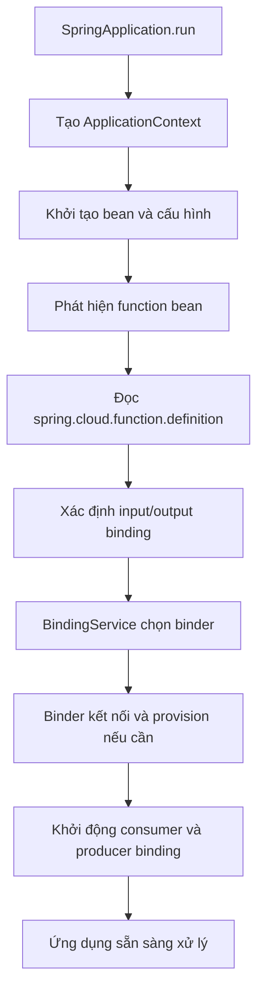
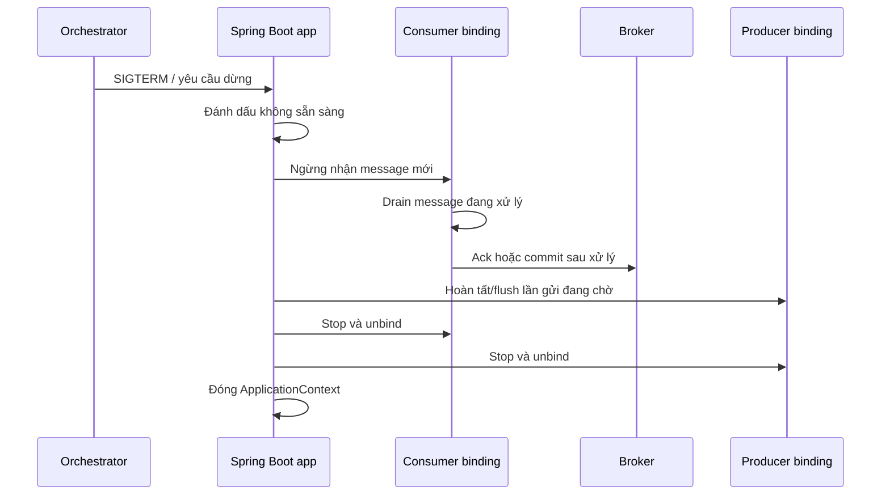

# Vòng đời khởi tạo, liên kết, hủy liên kết và dừng ứng dụng

## 1. Vì sao cần hiểu vòng đời của ứng dụng xử lý thông điệp

Một ứng dụng Spring Cloud Stream không chỉ chạy các hàm nghiệp vụ. Khi khởi động, ứng dụng còn phải tìm các hàm cần kích hoạt, tạo binding, chọn binder, kết nối broker và bắt đầu nhận hoặc gửi message. Khi dừng, ứng dụng cần ngừng nhận công việc mới, hoàn tất hoặc xử lý an toàn các message đang chạy, xác nhận tiến độ và giải phóng tài nguyên kết nối.

Nếu chỉ quan tâm đến lúc hàm `Function` hoặc `Consumer` được gọi, ta dễ bỏ sót những tình huống vận hành quan trọng: ứng dụng đã mở cổng HTTP nhưng consumer chưa sẵn sàng; binding bị dừng trong khi vẫn còn message đang xử lý; producer gửi message sau khi binding đã bị hủy; hoặc một instance bị kết thúc trước khi hoàn tất acknowledgement/offset commit.

Trong Spring Cloud Stream, cần phân biệt ba vòng đời có liên quan nhưng không đồng nhất:

- **Vòng đời ứng dụng Spring:** tạo ApplicationContext, khởi tạo bean, chạy các thành phần quản lý vòng đời và đóng context khi kết thúc.
- **Vòng đời binding:** tạo liên kết giữa hàm và destination, bắt đầu/dừng việc gửi hoặc nhận, rồi hủy liên kết để giải phóng tài nguyên.
- **Vòng đời tài nguyên broker:** topic, queue, exchange, subscription, consumer group và dữ liệu đã lưu trên Kafka, RabbitMQ hoặc Pulsar.

Dừng một binding thường chỉ giải phóng liên kết của ứng dụng. Việc đó không đồng nghĩa xóa topic, queue hoặc dữ liệu trên broker. Ngược lại, xóa destination khi ứng dụng vẫn đang sử dụng nó có thể gây lỗi cho nhiều producer và consumer.

## 2. Các thành phần tham gia vào quá trình khởi tạo

Một ứng dụng Spring Cloud Stream thường sử dụng các thành phần sau:

| Thành phần | Trách nhiệm trong vòng đời |
|---|---|
| Spring ApplicationContext | Tạo bean, quản lý dependency và điều phối quá trình khởi động/dừng ứng dụng |
| Spring Cloud Function `FunctionCatalog` | Phát hiện và cung cấp các bean `Supplier`, `Function`, `Consumer` |
| Function definition | Chỉ định hàm hoặc chuỗi hàm được kích hoạt trong ứng dụng |
| Binding | Nối cổng đầu vào/đầu ra của hàm với destination logic |
| `BindingService` | Phối hợp tạo và quản lý các binding theo cấu hình |
| Binder | Tích hợp với broker cụ thể, tạo consumer/producer và áp dụng cấu hình đặc thù |
| Broker | Lưu trữ, định tuyến và phân phối message theo semantics của hệ thống |

Spring Cloud Stream cung cấp lớp trừu tượng cho binding và binder. Việc tạo consumer, producer, channel, subscription hoặc cấu hình xác nhận được binder ánh xạ xuống API của broker tương ứng.

## 3. Vòng đời khởi động từ Spring Boot đến binding

Một luồng khởi động điển hình có thể mô tả như sau:



### Bước 1: tạo ApplicationContext

Spring Boot đọc cấu hình, tạo ApplicationContext và khởi tạo các bean. Các cấu hình binder có mặt trên classpath được xem xét để cung cấp khả năng kết nối broker. Nếu ứng dụng sử dụng nhiều binder, cấu hình phải chỉ rõ binder mặc định hoặc binder cho từng binding theo cách phù hợp với phiên bản và cách khai báo.

Thông tin kết nối như broker address, credentials, TLS và các tùy chọn mạng thường được đưa vào cấu hình theo môi trường. Không nên ghi mật khẩu hoặc token trực tiếp vào file cấu hình được commit.

### Bước 2: phát hiện hàm và xác định function definition

Spring Cloud Stream kết hợp với Spring Cloud Function để tìm các bean hàm. Ví dụ:

```java
import java.util.function.Function;
import org.springframework.context.annotation.Bean;
import org.springframework.context.annotation.Configuration;

record OrderReceived(String orderId, long amount) {}
record OrderValidated(String orderId, long amount) {}

@Configuration
class OrderFunctions {

    @Bean
    Function<OrderReceived, OrderValidated> validateOrder() {
        return order -> {
            if (order.amount() <= 0) {
                throw new IllegalArgumentException("amount must be positive");
            }
            return new OrderValidated(order.orderId(), order.amount());
        };
    }
}
```

Khi ứng dụng có nhiều hàm, cấu hình `spring.cloud.function.definition` giúp xác định hàm cần kích hoạt. Với ví dụ trên:

```yaml
spring:
  cloud:
    function:
      definition: validateOrder
```

Nếu bỏ qua hoặc khai báo sai tên hàm trong ứng dụng có nhiều function bean, ứng dụng có thể không tạo binding như mong đợi hoặc kích hoạt nhầm hàm. Vì vậy, cần kiểm tra function definition cùng tên bean khi điều tra lỗi khởi động.

### Bước 3: suy ra tên binding

Spring Cloud Stream tạo tên binding theo tên hàm và vị trí cổng. Với `validateOrder`:

- `validateOrder-in-0` là binding đầu vào thứ nhất.
- `validateOrder-out-0` là binding đầu ra thứ nhất.

`Function` thường có cả đầu vào và đầu ra; `Consumer` chỉ có đầu vào; `Supplier` chỉ có đầu ra. Hàm có nhiều đầu vào/đầu ra có thể có chỉ số khác. Tên này được dùng làm khóa cấu hình destination, group, content type, concurrency và thuộc tính producer/consumer.

### Bước 4: tạo binding và chọn binder

`BindingService` sử dụng cấu hình binding để xác định destination và binder. Binder tương ứng tạo producer hoặc consumer kết nối với broker. Tùy broker, quyền của ứng dụng và cấu hình provisioning, binder có thể tạo topic, queue hoặc tài nguyên cần thiết nếu chúng chưa tồn tại.

Provisioning phụ thuộc broker và binder. Nếu tài khoản ứng dụng không có quyền tạo tài nguyên, destination phải được tạo trước bởi quy trình hạ tầng. Không nên cho rằng mọi binder đều tự tạo mọi loại tài nguyên trong mọi môi trường.

### Bước 5: bắt đầu nhận và gửi message

Consumer binding bắt đầu lắng nghe hoặc poll message. Producer binding chuẩn bị đường gửi message. Khi các binding cần thiết đã khởi động và phụ thuộc broker sẵn sàng, ứng dụng có thể xử lý luồng sự kiện.

Ví dụ cấu hình đầy đủ cho một hàm biến đổi:

```yaml
spring:
  cloud:
    function:
      definition: validateOrder
    stream:
      bindings:
        validateOrder-in-0:
          destination: orders.received
          group: order-validation
          content-type: application/json
        validateOrder-out-0:
          destination: orders.validated
          content-type: application/json
      kafka:
        binder:
          brokers: localhost:9092
```

Binding đầu vào nhận message từ `orders.received`; binding đầu ra gửi kết quả đến `orders.validated`. Tên `group` tạo phạm vi tiêu thụ riêng cho dịch vụ xác thực. Với Kafka, các instance cùng group chia nhau partition; các group khác có thể đọc cùng topic độc lập.

## 4. Binding được tạo khi nào?

Phần lớn binding khai báo theo function definition được quản lý tự động trong quá trình khởi động. Tuy nhiên, không phải mọi output destination đều phải tồn tại ngay từ lúc ứng dụng bắt đầu.

### Binding khai báo tĩnh

Binding tĩnh được mô tả trong cấu hình ứng dụng. Framework biết tên binding, destination và binder từ trước. Cách này phù hợp với các luồng nghiệp vụ cố định, dễ kiểm tra khi triển khai và dễ cấp quyền broker theo nguyên tắc tối thiểu.

### Binding đầu ra động với StreamBridge

Trong một số ứng dụng, destination đầu ra chỉ được biết khi chạy. `StreamBridge` cho phép gửi message từ thành phần không phải function bean và có thể tạo binding đầu ra khi cần:

```java
import org.springframework.cloud.stream.function.StreamBridge;
import org.springframework.stereotype.Service;

record AuditEvent(String eventType, String entityId) {}

@Service
class AuditPublisher {

    private final StreamBridge streamBridge;

    AuditPublisher(StreamBridge streamBridge) {
        this.streamBridge = streamBridge;
    }

    boolean publish(String destination, AuditEvent event) {
        return streamBridge.send(destination, event);
    }
}
```

Ở ví dụ này, `destination` được truyền vào khi gọi `publish`. Khi chưa có binding tương ứng, Spring Cloud Stream có thể tạo binding đầu ra động và giữ binding đó để tái sử dụng. Giá trị trả về cho biết thao tác gửi được chấp nhận theo cơ chế của StreamBridge; không nên diễn giải nó thành bằng chứng consumer đã nhận hoặc xử lý xong message.

Với destination quan trọng, có thể cấu hình binding tường minh để kiểm soát destination thực, content type và binder. Ví dụ, tên binding dùng trong `send` có thể được ánh xạ tới destination cụ thể:

```yaml
spring:
  cloud:
    stream:
      bindings:
        audit-out:
          destination: audit.events
          content-type: application/json
```

Ứng dụng gọi `streamBridge.send("audit-out", event)` để sử dụng binding đã cấu hình. Khi dùng tên binding động từ dữ liệu bên ngoài, cần giới hạn các destination được phép, tránh để người gọi tùy ý tạo tài nguyên broker hoặc gửi dữ liệu sang nơi không được cấp quyền.

## 5. Trạng thái và thao tác vòng đời của binding

Một binding được quản lý như một thành phần có vòng đời. Ở mức khái niệm, các thao tác chính gồm:

| Thao tác | Ý nghĩa | Khi nào dùng |
|---|---|---|
| Tạo/bind | Tạo liên kết giữa cổng ứng dụng và destination | Khi khởi động hoặc khi cần output binding động |
| Start | Bắt đầu hoạt động gửi/nhận | Khi binding đã được tạo và sẵn sàng chạy |
| Stop | Dừng hoạt động của binding | Khi cần tạm ngừng nhận/gửi hoặc chuẩn bị bảo trì |
| Unbind | Hủy liên kết và giải phóng tài nguyên gắn với binding | Khi không còn cần binding hoặc khi đóng ứng dụng |

`stop` và `unbind` có mục đích khác nhau. Dừng binding là điều khiển trạng thái hoạt động; hủy binding giải phóng liên kết và tài nguyên do binding quản lý. Việc unbind không mặc nhiên xóa topic, queue, exchange hoặc dữ liệu trên broker. Nếu muốn xóa tài nguyên broker, đó là thao tác quản trị riêng và cần đánh giá ảnh hưởng đến mọi ứng dụng đang dùng destination.

### Điều khiển qua Spring Cloud Stream Actuator

Khi ứng dụng có Spring Boot Actuator và phiên bản Spring Cloud Stream hỗ trợ bindings endpoint, endpoint này có thể liệt kê và điều khiển trạng thái binding. Ví dụ cấu hình phơi bày endpoint:

```yaml
management:
  endpoints:
    web:
      exposure:
        include: health,info,bindings
```

Có thể truy vấn danh sách binding tại `/actuator/bindings`. Với binding có tên `validateOrder-in-0`, một yêu cầu POST có thể chuyển trạng thái:

```http
POST /actuator/bindings/validateOrder-in-0
Content-Type: application/json

{"state":"STOPPED"}
```

Để khởi động lại binding, dùng trạng thái `STARTED` theo hỗ trợ của phiên bản đang chạy. Hình thức endpoint, trạng thái được hỗ trợ và khả năng điều khiển cụ thể phụ thuộc phiên bản Spring Cloud Stream. Hãy đối chiếu tài liệu của phiên bản ứng dụng trước khi tự động hóa thao tác này.

Bindings endpoint có khả năng thay đổi hành vi nhận/gửi message. Chỉ phơi bày endpoint qua mạng quản trị tin cậy, yêu cầu xác thực và phân quyền phù hợp. Không công khai endpoint điều khiển binding cho người dùng cuối.

### Dừng một consumer có thể gây ra điều gì?

Khi consumer binding bị dừng, broker có thể ngừng gửi message mới đến consumer hoặc ngừng cấp phát công việc cho nó. Message chưa được xác nhận có thể được giao lại theo semantics của broker. Với Kafka, việc dừng consumer có thể dẫn đến rebalance và partition được gán cho consumer khác. Với RabbitMQ, việc hủy consumer hoặc đóng channel có thể khiến message chưa ack được requeue. Với Pulsar, việc đóng consumer có thể làm message chưa ack được redeliver theo subscription và acknowledgement timeout.

Do đó, thao tác stop không nên được xem là bảo đảm rằng mọi message đang xử lý đã hoàn tất. Ứng dụng cần phối hợp drain công việc, acknowledgement/offset commit và idempotency.

## 6. Hủy liên kết và giải phóng tài nguyên

Unbind thường diễn ra khi một binding động không còn được sử dụng hoặc khi ứng dụng đóng. Binder giải phóng những tài nguyên phía client mà binding đã tạo, chẳng hạn listener container, consumer, producer, channel hoặc kết nối liên quan theo cách triển khai của binder.

Phạm vi giải phóng có thể khác nhau:

- Consumer được ngừng nhận message và đóng tài nguyên client.
- Producer được đóng hoặc flush theo khả năng của binder trước khi tài nguyên gửi bị giải phóng.
- Các callback, listener và tài nguyên nội bộ của binding được dọn dẹp.
- Tài nguyên broker đã provision thường vẫn tồn tại, trừ khi có một thao tác quản trị xóa riêng.

Không nên tự ý xóa topic hoặc queue chỉ vì một instance ứng dụng không còn binding. Các destination thường được chia sẻ bởi nhiều instance hoặc dịch vụ khác. Vòng đời dữ liệu broker cần được quản lý bằng quy trình hạ tầng và chính sách lưu giữ riêng.

Với output binding động, không nên tạo một binding mới cho từng message nếu các message có thể dùng chung destination. Tái sử dụng binding theo destination giúp tránh tạo quá nhiều producer, kết nối và metadata. Nếu hệ thống có nhiều destination động, cần theo dõi số binding đang mở và áp dụng giới hạn phù hợp với thiết kế.

## 7. Dừng ứng dụng một cách an toàn

Một lần dừng có kiểm soát nên diễn ra theo thứ tự nghiệp vụ sau:

1. Ngừng nhận yêu cầu mới từ các nguồn bên ngoài hoặc chuyển instance ra khỏi trạng thái sẵn sàng.
2. Dừng tiếp nhận message mới ở consumer binding theo cơ chế phù hợp.
3. Cho các message đang xử lý hoàn tất trong thời hạn cho phép.
4. Chỉ xác nhận message hoặc commit offset sau khi tác dụng phụ nghiệp vụ đã hoàn tất theo chính sách giao nhận.
5. Flush hoặc hoàn tất các lần gửi đang chờ ở producer nếu binder hỗ trợ.
6. Dừng và unbind các binding, sau đó đóng tài nguyên binder và ApplicationContext.



Thứ tự thực tế và cơ chế drain phụ thuộc binder, container và cách ứng dụng xử lý bất đồng bộ. Nếu hàm gửi tác vụ sang executor riêng rồi trả về ngay, binder có thể hiểu message đã xử lý xong trong khi tác vụ nền vẫn còn chạy. Vì vậy, consumer phải giữ liên hệ giữa vòng đời xử lý và thời điểm xác nhận message.

### Graceful shutdown trong Spring Boot

Spring quản lý nhiều thành phần có vòng đời, bao gồm các bean triển khai `Lifecycle` hoặc `SmartLifecycle`. Spring Cloud Stream dùng cơ chế vòng đời để khởi động và dừng binding. Có thể cấu hình thời gian chờ cho mỗi phase của Spring lifecycle:

```yaml
spring:
  lifecycle:
    timeout-per-shutdown-phase: 30s
```

Ứng dụng cần phối hợp thời gian này với thời gian kết thúc của container/orchestrator. Nếu orchestrator gửi SIGKILL trước khi ứng dụng drain xong, các message đang xử lý có thể bị giao lại hoặc tác dụng phụ có thể ở trạng thái chưa rõ ràng.

Trong ứng dụng web, `server.shutdown: graceful` điều khiển graceful shutdown của web server. Cấu hình đó không tự bảo đảm mọi consumer message đã drain. Cần kiểm tra riêng vòng đời listener/binding và cách binder xác nhận message.

### Tín hiệu sẵn sàng và kiểm tra sức khỏe

Readiness nên phản ánh việc instance có thể nhận thêm công việc hay không. Khi bắt đầu shutdown, instance cần được loại khỏi luồng phân phối trước khi kết thúc. Liveness trả lời câu hỏi tiến trình còn hoạt động hay không; readiness trả lời câu hỏi instance có nên nhận công việc mới hay không. Hai tín hiệu này không nên bị dùng thay thế cho nhau.

Kiểm tra health indicator của ứng dụng và binder theo phiên bản đang dùng. Một endpoint health tổng quát có thể báo tiến trình khỏe nhưng không đủ thông tin để khẳng định mọi destination đều có thể gửi/nhận. Với hệ thống quan trọng, nên bổ sung kiểm tra kết nối, consumer lag, queue depth và trạng thái binding ở lớp giám sát vận hành.

## 8. Khác biệt khi dừng trên từng broker

| Nội dung | Kafka binder | RabbitMQ binder | Pulsar binder |
|---|---|---|---|
| Consumer dừng | Ngừng poll; có thể kích hoạt group rebalance | Hủy consumer hoặc đóng channel | Đóng consumer trên subscription |
| Tiến độ đọc | Offset commit theo cấu hình và acknowledgement mode | Ack/nack theo delivery tag | Ack theo message/subscription |
| Message chưa xác nhận | Có thể được đọc lại từ offset chưa commit | Có thể được requeue và giao lại | Có thể redeliver theo subscription/ack timeout |
| Tài nguyên broker | Topic và dữ liệu log thường vẫn còn | Queue/exchange thường vẫn còn | Topic và subscription bền vững có thể vẫn còn |
| Rủi ro cần lưu ý | Rebalance, commit và xử lý song song | Message redelivery, prefetch và unacked delivery | Subscription type, acknowledgement timeout và redelivery |

Đây là mô tả khái quát. Chi tiết phụ thuộc cấu hình ack mode, transaction, subscription durability, retry, binder và phiên bản broker. Consumer nên idempotent để chịu được việc giao lại sau sự cố hoặc dừng đột ngột.

## 9. Các lỗi vòng đời thường gặp

### Hàm không được kích hoạt

Nguyên nhân thường gặp là sai `spring.cloud.function.definition`, tên bean không khớp hoặc binding được cấu hình bằng tên khác. Hãy kiểm tra log khởi động, function definition và tên `<function>-in-0`/`<function>-out-0`.

### Ứng dụng khởi động nhưng không nhận message

Kiểm tra destination, consumer group, binder được chọn, quyền truy cập broker, subscription, partition assignment và trạng thái binding. Với Kafka, consumer có thể đang chờ partition hoặc group rebalance. Với RabbitMQ, queue có thể không được bind tới exchange theo routing key mong muốn. Với Pulsar, subscription name và type có thể không khớp cấu hình dự kiến.

### Binding dừng nhưng ứng dụng vẫn chạy

Đây có thể là hành vi đúng khi một binding được điều khiển độc lập. Kiểm tra trạng thái qua endpoint quản trị hoặc log binder. Không nên chỉ dựa vào trạng thái tiến trình để kết luận consumer đang hoạt động.

### Shutdown kéo dài hoặc bị buộc kết thúc

Một message xử lý lâu, tác vụ nền không được quản lý, retry đang chờ hoặc producer chưa flush có thể kéo dài shutdown. Đặt timeout phù hợp, giới hạn thời gian xử lý, hỗ trợ cancellation an toàn và bảo đảm message chưa hoàn tất sẽ được giao lại mà không tạo tác dụng phụ trùng lặp.

### Destination bị xóa ngoài dự kiến

Unbind thông thường không có nghĩa là xóa destination. Nếu topic, queue hoặc subscription biến mất, hãy kiểm tra quy trình provisioning, quyền quản trị và chính sách xóa tài nguyên. Không dùng thao tác unbind như một cơ chế dọn dữ liệu broker.

## 10. Kiểm thử vòng đời

Kiểm thử nên bao phủ cả trạng thái trước, trong và sau mỗi thao tác:

1. Khởi động context và xác nhận function definition cùng các binding mong đợi được tạo.
2. Xác nhận consumer nhận message và producer gửi được message đến destination.
3. Dừng một binding và kiểm tra ứng dụng không còn nhận message mới qua binding đó.
4. Khởi động lại binding và xác nhận luồng xử lý hoạt động trở lại.
5. Dừng ứng dụng khi đang xử lý message; kiểm tra message chưa xác nhận được giao lại và tác dụng phụ không bị lặp.
6. Kiểm tra destination broker vẫn tồn tại sau khi unbind nếu chính sách hạ tầng yêu cầu giữ dữ liệu.
7. Kiểm tra timeout shutdown, readiness và log khi broker tạm thời không khả dụng.

Test binder hữu ích để kiểm thử logic hàm và binding cơ bản. Các hành vi về provisioning, rebalance, acknowledgement, redelivery, transaction và đóng kết nối cần được kiểm thử tích hợp với broker thật hoặc môi trường kiểm thử tương đương.

## 11. Checklist triển khai

Trước khi đưa ứng dụng vào môi trường vận hành, cần xác định rõ:

- Function definition và tên binding chính xác.
- Binder và destination tương ứng cho từng binding.
- Quyền tạo hoặc sử dụng topic, queue, exchange và subscription.
- Hành vi khi một binding khởi động thất bại hoặc broker mất kết nối.
- Cách tạm dừng, khởi động lại và unbind binding khi bảo trì.
- Chính sách drain, acknowledgement/offset commit và idempotency khi shutdown.
- Thời gian shutdown phù hợp với giới hạn của nền tảng triển khai.
- Readiness, health, log, metric và cảnh báo cho từng luồng quan trọng.
- Quyền truy cập an toàn đối với Actuator bindings endpoint nếu được bật.

Quản lý vòng đời tốt giúp ứng dụng Spring Cloud Stream khởi động có kiểm soát, vận hành từng binding độc lập khi cần và dừng mà vẫn giữ được tính đúng đắn của message. Cần xem binding là một tài nguyên có vòng đời riêng, broker là nơi lưu giữ dữ liệu có chính sách riêng, và quá trình shutdown là một phần của thiết kế giao nhận chứ không chỉ là thao tác kết thúc tiến trình.

