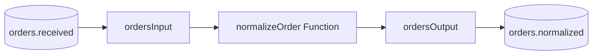

# Ánh xạ tên binding bằng spring.cloud.stream.function.bindings

## 1. Tên binding mặc định trong mô hình hàm

Spring Cloud Stream kết nối các hàm `Supplier`, `Function` và `Consumer` với broker thông qua binding. Mỗi cổng đầu vào hoặc đầu ra của hàm có một tên binding mặc định được suy ra từ tên bean hàm và vị trí cổng.

Với bean có tên `normalizeOrder`:

- `normalizeOrder-in-0` là binding đầu vào thứ nhất.
- `normalizeOrder-out-0` là binding đầu ra thứ nhất.

Hậu tố `in` và `out` biểu thị hướng dữ liệu; chỉ số `0` là cổng đầu tiên. Hàm có nhiều đầu vào hoặc đầu ra có thể có các cổng `in-1`, `out-1` và tiếp tục theo chỉ số tương ứng.

Các kiểu hàm thường gặp có cổng như sau:

| Kiểu hàm | Cổng mặc định | Ví dụ với bean |
|---|---|---|
| `Supplier<T>` | `<function>-out-0` | `dailyReport-out-0` |
| `Function<I, O>` | `<function>-in-0`, `<function>-out-0` | `normalizeOrder-in-0`, `normalizeOrder-out-0` |
| `Consumer<T>` | `<function>-in-0` | `recordAudit-in-0` |

Tên mặc định là khóa cấu hình cho destination, group, content type và các thuộc tính riêng của producer hoặc consumer. Ví dụ, cấu hình một hàm biến đổi có thể viết như sau:

```yaml
spring:
  cloud:
    function:
      definition: normalizeOrder
    stream:
      bindings:
        normalizeOrder-in-0:
          destination: orders.received
          group: order-normalizer
          content-type: application/json
        normalizeOrder-out-0:
          destination: orders.normalized
          content-type: application/json
```

Ứng dụng dùng `normalizeOrder-in-0` để nhận message từ `orders.received` và dùng `normalizeOrder-out-0` để gửi kết quả đến `orders.normalized`.

## 2. Vì sao cần ánh xạ tên binding

Tên tự sinh thường đủ rõ với hàm ngắn và ít cổng. Khi ứng dụng có nhiều hàm, tên hàm dài, function composition hoặc nhiều đầu vào/đầu ra, tên binding mặc định có thể khó đọc và lặp lại trong nhiều dòng cấu hình.

Spring Cloud Stream cho phép ánh xạ tên binding mặc định sang tên tùy chỉnh bằng thuộc tính:

```properties
spring.cloud.stream.function.bindings.<default-binding-name>=<custom-binding-name>
```

Ví dụ:

```properties
spring.cloud.stream.function.bindings.normalizeOrder-in-0=ordersInput
spring.cloud.stream.function.bindings.normalizeOrder-out-0=ordersOutput
```

Sau khi ánh xạ, `ordersInput` và `ordersOutput` là tên binding được dùng trong các thuộc tính cấu hình binding tương ứng. Ta có thể cấu hình destination, group, content type và consumer/producer properties bằng tên mới.

Ánh xạ chỉ đổi tên binding trong cấu hình. Nó không đổi tên bean Java `normalizeOrder`, không đổi function definition, không đổi payload và cũng không đổi tên destination trên broker. Destination vẫn được chỉ định riêng bằng thuộc tính `destination`.

## 3. Cấu hình ánh xạ bằng YAML

Ví dụ đầy đủ dưới đây đổi tên hai binding của hàm `normalizeOrder` thành `ordersInput` và `ordersOutput`:

```yaml
spring:
  cloud:
    function:
      definition: normalizeOrder
    stream:
      function:
        bindings:
          normalizeOrder-in-0: ordersInput
          normalizeOrder-out-0: ordersOutput
      bindings:
        ordersInput:
          destination: orders.received
          group: order-normalizer
          content-type: application/json
        ordersOutput:
          destination: orders.normalized
          content-type: application/json
```

Trong cấu hình này:

1. `spring.cloud.function.definition` chọn bean hàm `normalizeOrder` để kích hoạt.
2. `spring.cloud.stream.function.bindings` ánh xạ `normalizeOrder-in-0` thành `ordersInput` và `normalizeOrder-out-0` thành `ordersOutput`.
3. `spring.cloud.stream.bindings.ordersInput` cấu hình destination đầu vào, consumer group và định dạng message.
4. `spring.cloud.stream.bindings.ordersOutput` cấu hình destination đầu ra và định dạng message.

Có thể viết cùng cấu hình bằng file `.properties`:

```properties
spring.cloud.function.definition=normalizeOrder
spring.cloud.stream.function.bindings.normalizeOrder-in-0=ordersInput
spring.cloud.stream.function.bindings.normalizeOrder-out-0=ordersOutput
spring.cloud.stream.bindings.ordersInput.destination=orders.received
spring.cloud.stream.bindings.ordersInput.group=order-normalizer
spring.cloud.stream.bindings.ordersInput.content-type=application/json
spring.cloud.stream.bindings.ordersOutput.destination=orders.normalized
spring.cloud.stream.bindings.ordersOutput.content-type=application/json
```

Hai cách biểu diễn có cùng ý nghĩa. Trong dự án, nên chọn một phong cách cấu hình nhất quán để dễ rà soát và ghi đè theo profile môi trường.

## 4. Ví dụ với hàm Java

Bean hàm không cần biết tên alias của binding. Logic nghiệp vụ vẫn được khai báo bằng kiểu hàm Java:

```java
import java.util.function.Function;
import org.springframework.context.annotation.Bean;
import org.springframework.context.annotation.Configuration;

record OrderReceived(String orderId, long amount) {}
record NormalizedOrder(String orderId, long amount, String currency) {}

@Configuration
class OrderFunctions {

    @Bean
    Function<OrderReceived, NormalizedOrder> normalizeOrder() {
        return order -> new NormalizedOrder(
            order.orderId(),
            order.amount(),
            "VND"
        );
    }
}
```

Spring Cloud Stream vẫn nhận diện hàm có tên `normalizeOrder` và tạo các cổng mặc định `normalizeOrder-in-0`, `normalizeOrder-out-0`. Cấu hình ánh xạ cung cấp tên thay thế để tham chiếu các cổng đó trong phần cấu hình binding.

Luồng dữ liệu có thể hình dung như sau:



Alias `ordersInput` và `ordersOutput` giúp cấu hình thể hiện vai trò nghiệp vụ. Chúng không phải tên queue/topic bắt buộc phải tồn tại trên broker; tên broker thực tế là giá trị `destination` tương ứng.

## 5. Ánh xạ từng cổng của hàm nhiều đầu vào hoặc đầu ra

Với hàm có nhiều cổng, mỗi binding mặc định được ánh xạ độc lập. Ví dụ, hàm kết hợp thông tin đơn hàng và thông tin khách hàng có thể có hai đầu vào:

```java
import java.util.function.BiFunction;
import org.springframework.context.annotation.Bean;
import org.springframework.context.annotation.Configuration;

record OrderData(String orderId, String customerId) {}
record CustomerData(String customerId, String displayName) {}
record EnrichedOrder(String orderId, String customerName) {}

@Configuration
class EnrichmentFunctions {

    @Bean
    BiFunction<OrderData, CustomerData, EnrichedOrder> enrichOrder() {
        return (order, customer) -> new EnrichedOrder(
            order.orderId(),
            customer.displayName()
        );
    }
}
```

Với function có hai đầu vào, tên mặc định của các cổng là `enrichOrder-in-0` và `enrichOrder-in-1`; đầu ra là `enrichOrder-out-0`. Có thể đặt alias để làm rõ vai trò từng nguồn:

```yaml
spring:
  cloud:
    function:
      definition: enrichOrder
    stream:
      function:
        bindings:
          enrichOrder-in-0: orderInput
          enrichOrder-in-1: customerInput
          enrichOrder-out-0: enrichedOrders
      bindings:
        orderInput:
          destination: orders.received
          group: order-enrichment
        customerInput:
          destination: customers.snapshot
          group: order-enrichment
        enrichedOrders:
          destination: orders.enriched
```

Khi ánh xạ nhiều cổng, cần bảo đảm alias duy nhất trong phạm vi cấu hình. Không ánh xạ hai cổng khác nhau vào cùng một alias vì cấu hình sẽ trở nên mơ hồ và có thể khiến thuộc tính của hai binding xung đột.

Với `Supplier`, chỉ ánh xạ cổng đầu ra, ví dụ `dailyReport-out-0: reportOutput`. Với `Consumer`, chỉ ánh xạ cổng đầu vào, ví dụ `recordAudit-in-0: auditInput`. Không cần tạo alias cho cổng mà kiểu hàm không có.

## 6. Sử dụng alias trong các thuộc tính binding

Khi đã khai báo ánh xạ, hãy dùng alias trong các thuộc tính thuộc về binding đó. Các thuộc tính thường gặp gồm:

| Nhóm thuộc tính | Ví dụ | Mục đích |
|---|---|---|
| Destination | `bindings.ordersInput.destination` | Chỉ định topic, queue hoặc destination logic |
| Consumer group | `bindings.ordersInput.group` | Xác định phạm vi tiêu thụ độc lập |
| Content type | `bindings.ordersInput.content-type` | Chỉ định định dạng payload |
| Consumer properties | `bindings.ordersInput.consumer.*` | Điều chỉnh concurrency, partitioning hoặc hành vi consumer tùy binder |
| Producer properties | `bindings.ordersOutput.producer.*` | Điều chỉnh partitioning và hành vi producer tùy binder |

Ví dụ thêm concurrency cho đầu vào và partition key cho đầu ra:

```yaml
spring:
  cloud:
    function:
      definition: normalizeOrder
    stream:
      function:
        bindings:
          normalizeOrder-in-0: ordersInput
          normalizeOrder-out-0: ordersOutput
      bindings:
        ordersInput:
          destination: orders.received
          group: order-normalizer
          consumer:
            concurrency: 3
        ordersOutput:
          destination: orders.normalized
          producer:
            partition-key-expression: payload.orderId
            partition-count: 6
```

Trong ví dụ, thuộc tính `consumer.concurrency` được gắn với binding đầu vào `ordersInput`, còn `producer.partition-key-expression` được gắn với binding đầu ra `ordersOutput`. Các thuộc tính chi tiết và cách binder diễn giải chúng phụ thuộc broker cùng phiên bản binder.

Nếu vẫn cấu hình `destination` dưới tên mặc định sau khi đã ánh xạ nhưng ứng dụng lại dùng alias ở nơi khác, cấu hình sẽ khó hiểu và có thể không áp dụng vào binding mong muốn. Khi chuyển từ tên mặc định sang alias, cần cập nhật tất cả thuộc tính liên quan cùng lúc.

## 7. Khi nào nên dùng tên mặc định, khi nào nên ánh xạ

Tên mặc định có lợi thế là được suy ra trực tiếp từ tên hàm và cổng. Người đọc có thể tìm bean Java tương ứng mà không cần tra thêm bảng ánh xạ. Với một hoặc hai hàm đơn giản, dùng tên mặc định thường dễ bảo trì hơn.

Alias hữu ích khi:

- Tên hàm dài hoặc có cấu trúc composition khiến tên binding khó đọc.
- Hàm có nhiều cổng và cần tên thể hiện vai trò nghiệp vụ của từng nguồn/đích.
- Nhóm muốn giữ tên cấu hình ổn định trong khi tổ chức lại tên bean nội bộ, với điều kiện vẫn duy trì ánh xạ tương ứng.
- Một cấu hình môi trường cần tham chiếu binding bằng tên ngắn, rõ ràng và nhất quán.

Ánh xạ tạo thêm một lớp gián tiếp. Khi đọc cấu hình, người phát triển phải tìm cả tên mặc định lẫn alias mới biết binding nào được cấu hình. Vì vậy, không nên đổi tên mọi binding theo thói quen nếu tên mặc định đã rõ.

## 8. Quy tắc đặt alias dễ bảo trì

Một alias tốt nên ngắn, duy nhất, ổn định và thể hiện vai trò của cổng. Có thể dùng quy ước như `ordersInput`, `ordersOutput`, `customerInput` hoặc `auditEvents`. Tránh tên chung chung như `input1`, `output2` nếu có thể đặt tên theo miền nghiệp vụ.

Nên tuân theo các nguyên tắc sau:

1. Ánh xạ từ đúng tên binding mặc định, bao gồm tên hàm, hướng `in`/`out` và chỉ số cổng.
2. Đặt alias duy nhất cho từng binding trong cùng ứng dụng.
3. Dùng cùng một cách viết hoa/thường và quy tắc đặt tên trong toàn dự án.
4. Cập nhật mọi thuộc tính binding sang alias sau khi ánh xạ.
5. Ghi chú ánh xạ ở nơi nhóm có thể tìm thấy khi điều tra lỗi cấu hình.
6. Tránh dùng tên alias giống với destination nếu hai khái niệm có thể bị nhầm lẫn.
7. Không đưa dữ liệu không tin cậy trực tiếp vào tên binding hoặc destination động.

Ánh xạ không làm thay đổi quyền truy cập broker. Quyền vẫn được quyết định bởi destination và thông tin xác thực của binder. Nếu alias được dùng trong cấu hình Actuator hoặc công cụ quản trị, hãy xác minh tên binding được công bố bởi đúng phiên bản Spring Cloud Stream đang chạy.

## 9. Các lỗi thường gặp khi ánh xạ tên

### Dùng sai tiền tố cấu hình

Thuộc tính ánh xạ nằm dưới `spring.cloud.stream.function.bindings`. Nó khác với `spring.cloud.function.definition` và khác với `spring.cloud.stream.bindings`. Hãy kiểm tra đúng cấp cấu hình và đúng chính tả tên thuộc tính.

### Dùng tên alias ở phía trái

Phía trái của ánh xạ phải là tên binding mặc định được sinh từ function và cổng, ví dụ `normalizeOrder-in-0`. Phía phải là alias tùy chỉnh, ví dụ `ordersInput`. Đảo ngược hai vế sẽ không tạo ra ánh xạ mong muốn.

### Tiếp tục cấu hình bằng tên mặc định

Sau khi đổi tên, các thuộc tính binding nên tham chiếu alias. Nếu một số profile vẫn cấu hình bằng tên cũ, ứng dụng có thể có các mục cấu hình không được sử dụng hoặc cấu hình bị phân tán giữa hai tên. Kiểm tra file cấu hình cơ sở và các profile để tránh sai lệch.

### Ánh xạ nhầm chỉ số cổng

Với hàm nhiều đầu vào, `join-in-0` và `join-in-1` là hai cổng khác nhau. Nếu đổi chỗ alias, dữ liệu có thể được đưa vào sai tham số hàm. Hãy đối chiếu chữ ký hàm và ý nghĩa của từng cổng.

### Trùng alias

Hai binding dùng chung alias khiến cấu hình không thể thể hiện rõ destination hoặc thuộc tính consumer/producer nào thuộc về cổng nào. Đặt tên riêng cho từng binding và kiểm tra lại toàn bộ bảng ánh xạ.

### Nhầm alias với destination

Alias là tên binding trong cấu hình Spring Cloud Stream. Destination là tên tài nguyên logic trên broker. Ví dụ `ordersInput` có thể ánh xạ đến destination `orders.received`; broker không nhất thiết có topic hoặc queue tên `ordersInput`.

## 10. Quy trình kiểm tra cấu hình sau khi ánh xạ

Khi thêm hoặc đổi alias, thực hiện các bước kiểm tra sau:

1. Xác nhận function definition trỏ đến đúng bean hàm.
2. Liệt kê các cổng đầu vào/đầu ra mà chữ ký hàm yêu cầu.
3. Ghi lại tên mặc định của từng cổng theo tên hàm và chỉ số.
4. Kiểm tra mỗi tên mặc định được ánh xạ đến một alias duy nhất.
5. Tìm toàn bộ thuộc tính `spring.cloud.stream.bindings` và xác nhận chúng dùng alias tương ứng.
6. Khởi động ứng dụng với profile cần triển khai và kiểm tra log tạo binding.
7. Xác nhận consumer kết nối đúng destination, group và producer gửi đúng destination.
8. Gửi một message thử nghiệm để xác nhận dữ liệu đi qua đúng cổng và đúng hàm.
9. Kiểm tra các profile môi trường khác không ghi đè ánh xạ hoặc destination ngoài dự kiến.

Nếu ứng dụng có Actuator bindings endpoint, có thể dùng endpoint được bảo vệ để quan sát các binding đang hoạt động. Tên và khả năng điều khiển cụ thể cần được xác minh theo phiên bản framework. Khi lỗi xảy ra, log khởi động, tên function definition, tên binding mặc định, alias và destination là những thông tin cần đối chiếu đầu tiên.

## 11. Kết luận

`spring.cloud.stream.function.bindings` cung cấp cơ chế đặt tên thay thế cho các binding được sinh từ mô hình hàm. Nó giúp cấu hình dễ đọc hơn khi tên mặc định quá dài hoặc ứng dụng có nhiều cổng. Muốn sử dụng an toàn, cần hiểu rõ tên mặc định, ánh xạ từng cổng đúng hướng và chỉ số, sau đó dùng alias nhất quán trong các thuộc tính binding.

Hãy giữ ranh giới khái niệm rõ ràng: function definition chọn hàm; binding nối cổng hàm với hạ tầng message; alias là tên cấu hình của binding; destination chỉ nơi message được gửi đến hoặc nhận từ broker. Khi các khái niệm này không bị trộn lẫn, cấu hình Spring Cloud Stream sẽ dễ đọc, dễ vận hành và ít lỗi khi ứng dụng phát triển.

