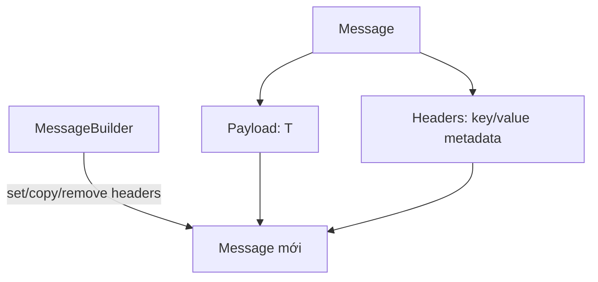

# Tạo và sao chép thông điệp bằng MessageBuilder

## 1. Message trong Spring Messaging

Spring Cloud Stream truyền dữ liệu giữa hàm ứng dụng và broker dưới dạng message. Trong Spring Messaging, một message gồm hai phần:

- **Payload:** dữ liệu chính, chẳng hạn một đối tượng `OrderCreated`, chuỗi hoặc mảng byte.
- **Headers:** metadata mô tả message, chẳng hạn content type, correlation ID, event ID, khóa nghiệp vụ hoặc thông tin định tuyến.

Kiểu `Message<T>` biểu diễn payload có kiểu `T` cùng tập header. `MessageBuilder<T>` cung cấp API để tạo một message mới hoặc tạo bản dựng dựa trên message hiện có. Ta có thể đặt, sao chép, bổ sung và loại bỏ header trước khi gọi `build()`.



Message là đối tượng bao dữ liệu dùng trong ứng dụng. Khi gửi qua Kafka, RabbitMQ hoặc Pulsar, binder và message converter sẽ chuyển message sang định dạng phù hợp với broker. Header nội bộ của Spring không nhất thiết được truyền nguyên trạng qua mạng; chỉ những metadata được binder hỗ trợ hoặc được ánh xạ vào giao thức broker mới có thể xuất hiện ở phía nhận.

## 2. Tạo message mới bằng MessageBuilder

Cách cơ bản nhất là dùng `MessageBuilder.withPayload(payload)` để bắt đầu tạo message. Sau đó, thêm các header cần thiết và gọi `build()`:

```java
import org.springframework.messaging.Message;
import org.springframework.messaging.support.MessageBuilder;
import org.springframework.messaging.MessageHeaders;
import org.springframework.util.MimeTypeUtils;

record OrderCreated(String orderId, long totalCents) {}

Message<OrderCreated> message = MessageBuilder
    .withPayload(new OrderCreated("ORD-1001", 259900L))
    .setHeader("eventId", "evt-8f21")
    .setHeader("eventType", "OrderCreated")
    .setHeader("aggregateId", "ORD-1001")
    .setHeader(MessageHeaders.CONTENT_TYPE, MimeTypeUtils.APPLICATION_JSON)
    .build();
```

Trong ví dụ:

- `withPayload` đặt payload của message.
- `setHeader` thêm metadata theo cặp tên/giá trị.
- `MessageHeaders.CONTENT_TYPE` là header content type chuẩn của Spring Messaging.
- `build()` hoàn tất message và trả về `Message<OrderCreated>`.

`MessageBuilder` cho phép đặt nhiều loại giá trị header, nhưng với message gửi qua broker nên ưu tiên kiểu dữ liệu đơn giản, có thể chuyển đổi hoặc serialize ổn định như chuỗi, số, boolean và các kiểu được binder hỗ trợ. Không nên đưa đối tượng Java tùy ý, channel nội bộ hoặc tham chiếu tài nguyên trong tiến trình vào header của message cần truyền qua mạng.

### Tạo message với payload là chuỗi hoặc byte array

Payload không bắt buộc là một record hoặc DTO. Có thể tạo message với chuỗi:

```java
Message<String> notification = MessageBuilder
    .withPayload("Đơn hàng ORD-1001 đã được xác nhận")
    .setHeader("eventType", "OrderConfirmed")
    .setHeader(MessageHeaders.CONTENT_TYPE, MimeTypeUtils.TEXT_PLAIN)
    .build();
```

Hoặc dùng `byte[]` khi ứng dụng đã có dữ liệu được mã hóa:

```java
import org.springframework.http.MediaType;

byte[] documentBytes = loadDocument();

Message<byte[]> documentMessage = MessageBuilder
    .withPayload(documentBytes)
    .setHeader("documentId", "DOC-77")
    .setHeader(MessageHeaders.CONTENT_TYPE, MediaType.APPLICATION_OCTET_STREAM)
    .build();
```

Content type mô tả định dạng dữ liệu để converter và thành phần nhận biết cách xử lý. Đặt header JSON không tự biến một đối tượng Java thành JSON; việc serialize vẫn do message converter hoặc cơ chế mã hóa được cấu hình thực hiện.

## 3. Sao chép message hiện có

Khi consumer nhận một `Message<T>`, đôi khi cần bổ sung metadata mà vẫn giữ nguyên payload và những header hiện có. `MessageBuilder.fromMessage(existingMessage)` tạo builder từ message đó:

```java
import org.springframework.messaging.Message;
import org.springframework.messaging.support.MessageBuilder;

Message<OrderCreated> auditedMessage = MessageBuilder
    .fromMessage(message)
    .setHeader("auditState", "checked")
    .setHeader("processedBy", "order-audit")
    .build();
```

Builder giữ payload và sao chép các header có thể sao chép từ message gốc, sau đó cho phép bổ sung hoặc thay đổi header trước khi build. Message ban đầu không bị sửa đổi. Kết quả là một message mới có cùng kiểu payload.

Đây là lựa chọn phù hợp khi chỉ cần thêm metadata và giữ nguyên payload. Nếu cần thay đổi kiểu hoặc nội dung payload, hãy tạo builder bằng `withPayload(newPayload)` rồi sao chép những header cần thiết.

## 4. Thay payload nhưng giữ metadata cần thiết

Một hàm `Function` thường nhận một message, biến đổi payload và phát ra message mới. Ví dụ, chuyển `OrderCreated` thành `OrderAccepted` nhưng vẫn giữ event ID và correlation ID:

```java
import java.util.function.Function;
import org.springframework.context.annotation.Bean;
import org.springframework.context.annotation.Configuration;
import org.springframework.messaging.Message;
import org.springframework.messaging.MessageHeaders;
import org.springframework.messaging.support.MessageBuilder;
import org.springframework.util.MimeTypeUtils;

record OrderCreated(String orderId, long totalCents) {}
record OrderAccepted(String orderId, long totalCents, String status) {}

@Configuration
class OrderFunctions {

    static final String EVENT_ID = "eventId";
    static final String CORRELATION_ID = "correlationId";

    @Bean
    Function<Message<OrderCreated>, Message<OrderAccepted>> acceptOrder() {
        return input -> {
            OrderCreated order = input.getPayload();
            OrderAccepted accepted = new OrderAccepted(
                order.orderId(), order.totalCents(), "ACCEPTED"
            );

            var builder = MessageBuilder.withPayload(accepted)
                .setHeader(MessageHeaders.CONTENT_TYPE, MimeTypeUtils.APPLICATION_JSON)
                .setHeader("eventType", "OrderAccepted");

            Object eventId = input.getHeaders().get(EVENT_ID);
            if (eventId != null) {
                builder.setHeader(EVENT_ID, eventId);
            }

            Object correlationId = input.getHeaders().get(CORRELATION_ID);
            if (correlationId != null) {
                builder.setHeader(CORRELATION_ID, correlationId);
            }

            return builder.build();
        };
    }
}
```

Ví dụ này chủ động chọn các header cần giữ thay vì sao chép toàn bộ. `eventId` giúp nhận diện sự kiện; `correlationId` giúp nối các bước xử lý của cùng một yêu cầu hoặc quy trình. Header `eventType` được cập nhật theo loại sự kiện đầu ra, còn content type được đặt phù hợp với payload mới.

Trong ứng dụng thực tế, hãy xác định rõ header nào có ý nghĩa xuyên suốt luồng và header nào chỉ có ý nghĩa ở một chặng. Nếu đổi payload nhưng giữ nguyên một header mô tả schema hoặc loại event cũ, consumer có thể diễn giải dữ liệu sai.

## 5. Các thao tác header thường dùng

`MessageBuilder` cung cấp nhiều phương thức để điều khiển header:

| Phương thức | Công dụng | Hành vi cần nhớ |
|---|---|---|
| `setHeader(name, value)` | Thêm hoặc thay giá trị header | Ghi đè giá trị cùng tên; giá trị `null` được dùng để loại bỏ header |
| `setHeaderIfAbsent(name, value)` | Chỉ đặt nếu header chưa tồn tại | Giữ giá trị đã có |
| `copyHeaders(map)` | Sao chép các cặp tên/giá trị từ map | Header được sao chép có thể ghi đè giá trị đang có |
| `copyHeadersIfAbsent(map)` | Sao chép các header còn thiếu | Không ghi đè header đã tồn tại |
| `removeHeader(name)` | Xóa một header | Hữu ích khi loại metadata không còn phù hợp |
| `removeHeaders(patterns...)` | Xóa các header khớp mẫu tên | Dùng cẩn trọng để không xóa metadata cần thiết |
| `build()` | Tạo message hoàn chỉnh | Hoàn tất quá trình dựng message |

### Đặt header chỉ khi chưa có

Khi một tầng xử lý muốn cung cấp giá trị mặc định mà vẫn tôn trọng giá trị do producer gửi, dùng `setHeaderIfAbsent`:

```java
Message<OrderCreated> enriched = MessageBuilder
    .fromMessage(message)
    .setHeaderIfAbsent("sourceSystem", "order-service")
    .setHeaderIfAbsent("schemaVersion", 1)
    .build();
```

Nếu message đã có `sourceSystem`, giá trị hiện tại được giữ. Nếu chưa có, builder thêm giá trị mặc định.

### Sao chép header từ map

`copyHeaders` hữu ích khi một thành phần đã chuẩn bị metadata trong map:

```java
import java.util.Map;

Map<String, Object> traceHeaders = Map.of(
    "correlationId", "corr-2026-001",
    "sourceSystem", "checkout"
);

Message<OrderCreated> traced = MessageBuilder
    .withPayload(new OrderCreated("ORD-1002", 149000L))
    .copyHeaders(traceHeaders)
    .build();
```

Nếu cần giữ giá trị đã được đặt trên builder, dùng `copyHeadersIfAbsent` thay cho `copyHeaders`:

```java
Message<OrderCreated> prioritized = MessageBuilder
    .withPayload(new OrderCreated("ORD-1003", 99000L))
    .setHeader("sourceSystem", "trusted-gateway")
    .copyHeadersIfAbsent(traceHeaders)
    .build();
```

Trong trường hợp này, `sourceSystem` vẫn là `trusted-gateway` vì header đã được đặt trước khi sao chép.

### Loại bỏ header

Khi chuyển message sang một ranh giới khác, có thể cần bỏ metadata tạm thời:

```java
Message<OrderCreated> cleanMessage = MessageBuilder
    .fromMessage(message)
    .removeHeader("temporaryDebugInfo")
    .removeHeader("internalRoutingHint")
    .build();
```

Chỉ xóa header khi đã hiểu nơi sử dụng nó. Một header có thể được binder, converter, interceptor hoặc thành phần xử lý tiếp theo sử dụng để định tuyến, xác nhận hoặc theo dõi.

## 6. Sao chép tất cả hay chỉ giữ một số header?

`copyHeaders(existingMessage.getHeaders())` tiện lợi khi chuyển tiếp message và muốn giữ phần lớn metadata. Tuy nhiên, sao chép toàn bộ header có thể mang theo thông tin chỉ có ý nghĩa trong phạm vi nội bộ của một ứng dụng hoặc một binder.

Ví dụ, header có thể chứa:

- Thông tin định tuyến nội bộ hoặc tên channel.
- Delivery tag, acknowledgement handle hoặc tham chiếu tài nguyên client.
- Header đặc thù Kafka, RabbitMQ hoặc Pulsar.
- Dữ liệu xác thực hoặc thông tin nhạy cảm.
- Content type hoặc event type của payload cũ.

Các header này có thể không hợp lệ ở destination mới, không serialize được hoặc làm lộ thông tin ngoài ý muốn. Khi biến đổi payload hoặc gửi message sang broker/destination khác, nên dùng allow-list: chỉ sao chép những header nghiệp vụ cần giữ.

```java
Message<OrderAccepted> output = MessageBuilder
    .withPayload(acceptedOrder)
    .setHeader("eventId", input.getHeaders().get("eventId"))
    .setHeader("correlationId", input.getHeaders().get("correlationId"))
    .setHeader("aggregateId", acceptedOrder.orderId())
    .setHeader("eventType", "OrderAccepted")
    .setHeader(MessageHeaders.CONTENT_TYPE, MimeTypeUtils.APPLICATION_JSON)
    .build();
```

Trong ví dụ này, payload mới có metadata phù hợp với sự kiện đầu ra. Không sao chép các header transport không cần thiết từ message đầu vào.

## 7. Header hệ thống và header nghiệp vụ

Không phải header nào cũng do ứng dụng tự do đặt. Spring Messaging quản lý một số header hệ thống như ID và timestamp. Những header này có thể được tạo tự động khi message được xây dựng; chúng có quy tắc bảo vệ riêng và không nên được dùng như nơi lưu ID nghiệp vụ.

Nên phân biệt:

| Nhóm header | Ví dụ | Cách sử dụng |
|---|---|---|
| Header hệ thống Spring | `id`, `timestamp`, `contentType` | Theo quy ước của Spring Messaging và converter |
| Header nghiệp vụ | `eventId`, `aggregateId`, `schemaVersion` | Do ứng dụng định nghĩa và thống nhất giữa producer/consumer |
| Header truy vết | `correlationId`, `traceId` | Theo dõi một quy trình qua nhiều thành phần |
| Header binder/broker | Header đặc thù Kafka, RabbitMQ hoặc Pulsar | Chỉ dùng theo hợp đồng của binder và broker tương ứng |

Không nên ghi đè ID hoặc timestamp do framework quản lý. Nếu cần định danh ổn định của một event qua nhiều lần giao lại, hãy tạo header nghiệp vụ như `eventId`. ID nội bộ của một đối tượng `Message` mới không nhất thiết là ID của sự kiện nghiệp vụ.

## 8. Header ảnh hưởng đến chuyển đổi và định tuyến như thế nào?

### Content type

Header `contentType` cùng cấu hình binding giúp Spring Cloud Stream và message converter xác định cách chuyển đổi payload. Ví dụ, payload Java có thể được chuyển thành JSON khi gửi đi nếu converter phù hợp được cấu hình. Khi consumer nhận dữ liệu, content type giúp chọn cách giải mã và chuyển thành kiểu đầu vào của hàm.

Đặt content type không thay thế bước serialize. Nếu payload là `byte[]`, chuỗi hoặc object, converter xử lý theo kiểu dữ liệu và cấu hình. Hãy kiểm tra cả header message lẫn `content-type` của binding khi điều tra lỗi chuyển đổi.

### Partition key và routing metadata

Một ứng dụng có thể đặt header nghiệp vụ như `aggregateId` hoặc `partitionKey`, sau đó cấu hình producer dùng header đó làm khóa phân vùng. Ví dụ:

```yaml
spring:
  cloud:
    stream:
      bindings:
        publishOrder-out-0:
          destination: orders.events
          producer:
            partition-key-expression: headers['aggregateId']
            partition-count: 6
```

Hàm tạo message có thể gắn `aggregateId`:

```java
Message<OrderCreated> outgoing = MessageBuilder
    .withPayload(orderCreated)
    .setHeader("aggregateId", orderCreated.orderId())
    .build();
```

Với cấu hình phù hợp, producer binder có thể sử dụng giá trị header làm khóa phân vùng. Cách biểu thức được đánh giá và cách khóa được ánh xạ phụ thuộc binder, phiên bản và cấu hình partitioning. Header cần có mặt trước khi message đi qua producer binding.

### Correlation và tracing

`correlationId` là metadata nghiệp vụ hoặc tích hợp giúp liên kết các message thuộc cùng một quy trình. `traceId` có thể được quản lý bởi hệ thống tracing và instrumentation. Khi chuyển message, hãy tuân thủ quy tắc tracing của ứng dụng và thư viện đang sử dụng; không tự tạo hoặc ghi đè trace header nếu hệ thống tracing đã quản lý chúng.

## 9. Message bất biến và giới hạn của việc sao chép

Sau khi `build()`, message và tập header được thiết kế để sử dụng theo mô hình bất biến. Muốn thay đổi header, hãy tạo builder mới từ message hiện tại và build ra message mới. Không sửa trực tiếp map header của message đã tạo.

Tuy nhiên, tính bất biến của message không tự động làm cho payload hoặc các đối tượng được lưu trong header trở nên bất biến. Nếu payload là một object mutable, nhiều message có thể cùng tham chiếu đến object đó. Thay đổi object sau khi build có thể làm dữ liệu quan sát được thay đổi ngoài dự kiến. Tương tự, một header chứa collection hoặc object mutable có thể bị thay đổi nếu code khác giữ tham chiếu đến nó.

Khi cần snapshot dữ liệu ổn định, hãy dùng record/DTO bất biến hoặc tạo bản sao phù hợp của payload và giá trị header. Với message gửi qua broker, ưu tiên dữ liệu có thể serialize rõ ràng và không phụ thuộc trạng thái của tiến trình gửi.

## 10. Ví dụ tích hợp trong Supplier, Function và Consumer

### Supplier tạo message

Supplier có thể phát message có payload và metadata:

```java
import java.util.UUID;
import java.util.function.Supplier;
import org.springframework.context.annotation.Bean;
import org.springframework.context.annotation.Configuration;
import org.springframework.messaging.Message;
import org.springframework.messaging.support.MessageBuilder;

record StockSnapshot(String sku, int available) {}

@Configuration
class StockFunctions {

    @Bean
    Supplier<Message<StockSnapshot>> stockSnapshot() {
        return () -> MessageBuilder
            .withPayload(new StockSnapshot("SKU-100", 42))
            .setHeader("eventId", UUID.randomUUID().toString())
            .setHeader("eventType", "StockSnapshot")
            .build();
    }
}
```

Mỗi lần supplier được gọi, ví dụ tạo một event ID mới cho snapshot mới. Với supplier polling, cần bảo đảm mỗi lần phát phản ánh một dữ liệu mới hoặc có cơ chế chống phát trùng nếu cùng một trạng thái được đọc lặp.

### Function biến đổi message

Function có thể nhận và trả về `Message` để kiểm soát header:

```java
import java.util.function.Function;
import org.springframework.context.annotation.Bean;
import org.springframework.messaging.Message;
import org.springframework.messaging.support.MessageBuilder;

@Bean
Function<Message<StockSnapshot>, Message<StockSnapshot>> enrichStock() {
    return input -> MessageBuilder
        .fromMessage(input)
        .setHeader("processedBy", "inventory-projection")
        .setHeaderIfAbsent("schemaVersion", 1)
        .build();
}
```

Ví dụ giữ payload và bổ sung metadata xử lý. Nếu Function thay đổi cấu trúc payload, nên tạo builder với payload mới và chỉ giữ những header còn đúng ý nghĩa.

### Consumer đọc payload và header

Consumer có thể nhận `Message<T>` để sử dụng cả payload lẫn metadata:

```java
import java.util.function.Consumer;
import org.springframework.context.annotation.Bean;
import org.springframework.messaging.Message;

@Bean
Consumer<Message<StockSnapshot>> recordStock() {
    return message -> {
        StockSnapshot snapshot = message.getPayload();
        String eventId = (String) message.getHeaders().get("eventId");
        String eventType = (String) message.getHeaders().get("eventType");

        // Kiểm tra eventId để hỗ trợ idempotency trước khi ghi dữ liệu.
        saveSnapshot(snapshot, eventId, eventType);
    };
}
```

Consumer chỉ nên dựa vào các header thuộc hợp đồng đã thống nhất. Nếu header tùy chọn có thể vắng mặt, hãy kiểm tra `null` và xác thực kiểu dữ liệu trước khi sử dụng.

## 11. Kiểm thử message và header

Khi kiểm thử hàm tạo hoặc biến đổi message, cần xác nhận cả payload lẫn các header quan trọng:

1. Payload có đúng kiểu và giá trị mong đợi hay không?
2. Event ID và correlation ID có được giữ hoặc tạo theo quy tắc hay không?
3. Content type có phù hợp với payload đầu ra hay không?
4. Header cũ nào được giữ, thay đổi hoặc loại bỏ?
5. Header binder/broker không cần thiết có bị chuyển tiếp ngoài ý muốn không?
6. Message có thể được serialize và deserialize theo hợp đồng của consumer hay không?

Ví dụ kiểm thử đơn giản:

```java
import static org.assertj.core.api.Assertions.assertThat;
import org.junit.jupiter.api.Test;
import org.springframework.messaging.Message;
import org.springframework.messaging.support.MessageBuilder;

record OrderCreated(String orderId, long totalCents) {}

class MessageBuilderTest {

    @Test
    void copiesBusinessHeadersWhenCreatingANewPayload() {
        Message<OrderCreated> input = MessageBuilder
            .withPayload(new OrderCreated("ORD-2001", 120000L))
            .setHeader("eventId", "evt-2001")
            .setHeader("correlationId", "corr-2001")
            .build();

        Message<String> output = MessageBuilder
            .withPayload("ORD-2001 accepted")
            .setHeader("eventId", input.getHeaders().get("eventId"))
            .setHeader("correlationId", input.getHeaders().get("correlationId"))
            .setHeader("eventType", "OrderAccepted")
            .build();

        assertThat(output.getPayload()).isEqualTo("ORD-2001 accepted");
        assertThat(output.getHeaders().get("eventId")).isEqualTo("evt-2001");
        assertThat(output.getHeaders().get("correlationId")).isEqualTo("corr-2001");
        assertThat(output.getHeaders().get("eventType")).isEqualTo("OrderAccepted");
    }
}
```

Đây là kiểm thử ở mức message trong ứng dụng. Kiểm thử tích hợp với Kafka, RabbitMQ hoặc Pulsar vẫn cần thiết để xác nhận header nào thực sự được binder truyền qua broker, kiểu dữ liệu được serialize ra sao và consumer nhận lại metadata nào.

## 12. Lỗi thường gặp và cách xử lý

### Header không xuất hiện ở consumer

Header có thể bị converter hoặc binder bỏ qua, không được ánh xạ sang header transport hoặc không serialize được. Kiểm tra kiểu dữ liệu header, cấu hình binder, message converter và giới hạn của broker. Đừng giả định mọi header nội bộ Spring đều được truyền qua mạng.

### Header mới ghi đè giá trị cũ

`copyHeaders` có thể ghi đè header đã được đặt. Nếu muốn giữ giá trị hiện có, dùng `copyHeadersIfAbsent` hoặc đặt header sau thao tác copy. Thứ tự gọi phương thức trên builder ảnh hưởng đến giá trị cuối cùng.

### Dữ liệu cũ bị giữ khi payload đã thay đổi

Khi dùng `fromMessage` hoặc sao chép toàn bộ header, content type, event type hoặc metadata schema cũ có thể không còn đúng. Hãy cập nhật hoặc loại bỏ header liên quan khi thay đổi payload.

### Không thể ghi đè header hệ thống

Một số header do Spring quản lý, như ID hoặc timestamp, có thể được bảo vệ hoặc tạo tự động. Dùng header nghiệp vụ riêng như `eventId` thay vì cố ghi đè header hệ thống.

### Message thay đổi sau khi đã build

Message có thể bất biến ở lớp vỏ nhưng payload hoặc giá trị header mutable vẫn có thể bị sửa qua tham chiếu khác. Dùng object bất biến hoặc tạo bản sao khi cần snapshot dữ liệu.

## 13. Nguyên tắc sử dụng MessageBuilder

- Dùng `withPayload` khi tạo message với payload mới.
- Dùng `fromMessage` khi muốn giữ payload và bắt đầu từ metadata của message hiện tại.
- Dùng `copyHeaders` khi chủ động muốn sao chép và chấp nhận ghi đè; dùng `copyHeadersIfAbsent` khi chỉ bổ sung header còn thiếu.
- Dùng `removeHeader` để loại bỏ metadata đã hết hiệu lực.
- Giữ event ID, correlation ID, aggregate key và schema version theo hợp đồng rõ ràng.
- Cập nhật content type và event type khi payload thay đổi.
- Chỉ chuyển tiếp header cần thiết; tránh sao chép mù quáng metadata nội bộ hoặc nhạy cảm.
- Không nhầm việc đặt content type với việc serialize payload.
- Kiểm thử cả payload, header và hành vi chuyển đổi qua broker thực tế.

`MessageBuilder` giúp tạo message có cấu trúc rõ ràng trong các hàm Spring Cloud Stream. Khi payload và header được quản lý có chủ đích, các dịch vụ có thể trao đổi sự kiện dễ theo dõi, hỗ trợ correlation và partitioning, đồng thời tránh mang theo metadata sai hoặc không an toàn qua ranh giới broker.

