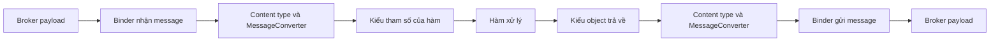

# Vai trò contentType và kiểu tham số trong chuyển đổi thông điệp

Trong Spring Cloud Stream, dữ liệu đi qua broker thường có dạng byte hoặc một biểu diễn mà broker có thể lưu trữ. Trong khi đó, hàm xử lý của ứng dụng thường làm việc với Java object như `OrderCreated`, `String` hoặc `Message<OrderCreated>`. **Chuyển đổi thông điệp** là bước kết nối hai thế giới đó. Hai thông tin quyết định cách chuyển đổi là `contentType` mô tả định dạng payload và kiểu tham số/giá trị trả về của hàm mô tả kiểu dữ liệu ứng dụng mong muốn.

Nếu hai phía thống nhất định dạng và kiểu dữ liệu, framework có thể chuyển JSON thành Java object khi nhận và chuyển Java object thành JSON khi gửi. Nếu khai báo sai content type, sai kiểu tham số hoặc cấu hình native serialization không phù hợp, message có thể không được chuyển đổi, tạo ra kiểu dữ liệu không mong đợi hoặc phát sinh lỗi lúc chạy.

## 1. Hai thông tin khác nhau: contentType và kiểu Java

`contentType` và kiểu tham số của hàm giải quyết hai câu hỏi riêng:

| Thông tin | Câu hỏi được trả lời | Ví dụ |
| --- | --- | --- |
| `contentType` | Payload đang được biểu diễn theo định dạng nào? | `application/json`, `text/plain`, `application/octet-stream` |
| Kiểu Java | Ứng dụng muốn nhận hoặc phát kiểu dữ liệu nào? | `OrderCreated`, `String`, `byte[]`, `Message<OrderCreated>` |

Ví dụ, `application/json` cho biết nội dung được biểu diễn theo JSON. Nó không cho biết JSON đó là một đơn hàng, khách hàng hay hóa đơn. Kiểu tham số `OrderCreated` cho framework biết cấu trúc Java đích mà ứng dụng muốn nhận.

Ngược lại, khai báo tham số là `OrderCreated` không tự mô tả dữ liệu trên broker đang là JSON, Avro hay một định dạng khác. Framework cần content type và converter phù hợp để diễn giải payload.

## 2. Chuyển đổi diễn ra ở đâu trong luồng message?

Spring Cloud Stream dùng cơ chế chuyển đổi message của Spring để chuyển payload giữa định dạng trên đường truyền và kiểu Java của hàm. Với luồng xử lý thông thường, có hai chiều:

1. **Inbound (nhận):** binder nhận dữ liệu từ broker, sau đó framework chuyển payload sang kiểu mà tham số hàm yêu cầu dựa trên content type và converter phù hợp.
2. **Outbound (gửi):** hàm trả về object hoặc `Message<?>`; framework chuyển payload sang định dạng được cấu hình cho binding đầu ra rồi binder gửi dữ liệu tới broker.



Binder đảm nhiệm giao tiếp với broker. Lớp chuyển đổi của Spring Cloud Stream xử lý việc diễn giải payload theo content type và kiểu Java. Khi bật chế độ native encoding hoặc decoding của một binder, một phần hoặc toàn bộ chuyển đổi ở framework có thể được bỏ qua để serializer/deserializer của broker đảm nhiệm việc đó.

## 3. Các content type thường gặp

`contentType` thường được biểu diễn bằng MIME type. Một số giá trị phổ biến:

| Content type | Dữ liệu thường gặp | Kiểu Java thường dùng |
| --- | --- | --- |
| `application/json` | Object được tuần tự hóa thành JSON | DTO, Java record, `Map` hoặc `String` chứa JSON tùy converter và cách cấu hình |
| `text/plain` | Văn bản | `String` |
| `application/octet-stream` | Dữ liệu nhị phân | `byte[]` |
| `avro/binary` | Dữ liệu Avro nhị phân nếu ứng dụng có converter/serializer tương ứng | Kiểu được schema và công cụ Avro quy định |
| `application/vnd.example.order+json` | JSON theo MIME type riêng của ứng dụng | DTO hoặc kiểu tương thích với converter |

Content type cần phản ánh định dạng payload thực tế. Ví dụ, nếu payload là JSON thì đặt `text/plain` có thể khiến converter xử lý nó như văn bản thay vì giải mã thành DTO. Tương tự, khai báo JSON cho một chuỗi văn bản không phải JSON có thể gây lỗi phân tích cú pháp.

Spring Cloud Stream thường có mặc định `application/json` cho content type khi không có giá trị cụ thể khác. Tuy vậy, nên khai báo rõ content type cho các binding trao đổi dữ liệu giữa dịch vụ độc lập để hợp đồng message dễ đọc và tránh phụ thuộc vào mặc định.

## 4. Cấu hình contentType cho binding

Content type có thể được cấu hình riêng cho binding đầu vào và đầu ra bằng thuộc tính `content-type`:

```yaml
spring:
  cloud:
    function:
      definition: acceptOrder
    stream:
      bindings:
        acceptOrder-in-0:
          destination: orders.created
          group: order-service
          content-type: application/json
        acceptOrder-out-0:
          destination: orders.accepted
          content-type: application/json
```

Trong ví dụ này, binding đầu vào đọc sự kiện JSON từ `orders.created`, còn binding đầu ra phát kết quả theo định dạng JSON tới `orders.accepted`. Cấu hình content type ở mỗi binding cho phép một hàm nhận dữ liệu theo định dạng của nguồn vào và phát dữ liệu theo định dạng mà consumer đầu ra mong đợi.

Một ứng dụng có thể dùng nhiều content type cho các binding khác nhau. Chẳng hạn, một hàm nhận `text/plain` từ một nguồn legacy, chuyển thành DTO rồi phát `application/json` cho các dịch vụ mới. Điều này giúp cô lập chuyển đổi định dạng ở ranh giới của ứng dụng.

## 5. Kiểu tham số quyết định object mà hàm nhận

Spring Cloud Stream kết hợp content type với chữ ký hàm để chọn cách chuyển đổi. Với một hàm nhận `OrderCreated`, framework cần chuyển payload đầu vào thành object `OrderCreated`:

```java
import java.math.BigDecimal;
import java.util.function.Function;

import org.springframework.context.annotation.Bean;
import org.springframework.context.annotation.Configuration;

public record OrderCreated(
        String orderId,
        String customerId,
        BigDecimal total
) {}

public record OrderAccepted(String orderId, String status) {}

@Configuration
public class OrderFunctions {

    @Bean
    public Function<OrderCreated, OrderAccepted> acceptOrder() {
        return order -> new OrderAccepted(order.orderId(), "ACCEPTED");
    }
}
```

Với binding `acceptOrder-in-0` có `content-type: application/json`, converter JSON có thể giải mã payload thành `OrderCreated`. Sau khi hàm trả về `OrderAccepted`, content type của binding đầu ra hướng dẫn framework chuyển object đó thành JSON trước khi gửi.

Kiểu Java phải phù hợp với schema JSON. Nếu JSON thiếu trường bắt buộc, sai kiểu dữ liệu hoặc có cấu trúc lồng nhau không tương thích, converter có thể phát sinh lỗi hoặc tạo object có giá trị mặc định/null tùy thư viện và cấu hình.

## 6. Nhận payload thuần hay nhận Message<T>?

Khi hàm chỉ cần dữ liệu nghiệp vụ, nhận trực tiếp kiểu payload thường đơn giản nhất:

```java
@Bean
public Function<OrderCreated, OrderAccepted> acceptOrder() {
    return order -> new OrderAccepted(order.orderId(), "ACCEPTED");
}
```

Khi cần đọc metadata như `correlationId`, `eventType` hoặc `source`, hàm có thể nhận `Message<OrderCreated>`:

```java
import org.springframework.messaging.Message;
import org.springframework.messaging.support.MessageBuilder;

@Bean
public Function<Message<OrderCreated>, Message<OrderAccepted>> acceptOrder() {
    return input -> {
        OrderCreated order = input.getPayload();
        String correlationId = input.getHeaders()
                .get("correlationId", String.class);

        OrderAccepted accepted = new OrderAccepted(order.orderId(), "ACCEPTED");

        return MessageBuilder.withPayload(accepted)
                .setHeader("correlationId", correlationId)
                .setHeader("eventType", "OrderAccepted")
                .build();
    };
}
```

`Message<T>` chứa payload có kiểu `T` và các headers. Content type vẫn mô tả định dạng payload; kiểu generic `T` cho biết kiểu payload mà hàm làm việc. Dùng `Message<T>` không thay thế việc khai báo content type đúng.

Nếu hàm chỉ cần payload, không cần nhận `Message<T>` rồi tự gọi `getPayload()`. Nếu cần metadata, hãy dùng `Message<T>` và chỉ chuyển tiếp các header có ý nghĩa. Một số header nội bộ hoặc giá trị không serialize được có thể không phù hợp để gửi qua broker.

## 7. Các kiểu payload phổ biến

### String

Với dữ liệu văn bản, hàm có thể nhận `String`:

```java
@Bean
public Function<String, String> normalizeCode() {
    return code -> code.trim().toUpperCase();
}
```

Nếu payload trên broker là văn bản thuần, dùng `text/plain`. Nếu chuỗi chứa JSON và muốn xử lý như một object JSON, cần cấu hình `application/json` và kiểu Java phù hợp, thay vì chỉ dựa vào việc kiểu tham số là `String`.

### byte[]

Khi ứng dụng cần xử lý dữ liệu nhị phân hoặc tự kiểm soát serialization, có thể nhận `byte[]`:

```java
@Bean
public Function<byte[], byte[]> inspectBinary() {
    return bytes -> bytes;
}
```

Với `application/octet-stream`, payload được xem là dữ liệu nhị phân. Ứng dụng chịu trách nhiệm giải mã hoặc chuyển đổi sang định dạng nghiệp vụ khi cần.

### DTO hoặc Java record

Với dữ liệu nghiệp vụ có cấu trúc, DTO/record giúp thể hiện rõ schema và kiểu dữ liệu. Đây thường là lựa chọn phù hợp cho các sự kiện JSON vì converter có thể ánh xạ trường JSON sang thuộc tính tương ứng.

### Map

`Map<String, Object>` hữu ích khi cấu trúc JSON linh hoạt hoặc chưa có DTO ổn định. Tuy nhiên, truy cập theo key làm giảm khả năng kiểm tra kiểu lúc biên dịch. Với hợp đồng sự kiện ổn định, nên ưu tiên DTO hoặc record.

## 8. Content type trong header và cấu hình binding

Spring Messaging có header chuẩn `contentType`. Trong một số trường hợp, message được tạo trực tiếp trong ứng dụng có thể mang content type ở header:

```java
import java.math.BigDecimal;

import org.springframework.messaging.Message;
import org.springframework.messaging.MessageHeaders;
import org.springframework.messaging.support.MessageBuilder;
import org.springframework.util.MimeTypeUtils;

Message<OrderCreated> message = MessageBuilder
        .withPayload(new OrderCreated(
                "ORD-1001", "CUS-42", new BigDecimal("125000.00")))
        .setHeader(MessageHeaders.CONTENT_TYPE, MimeTypeUtils.APPLICATION_JSON)
        .build();
```

Header này mang metadata định dạng cho message. Spring Cloud Stream cũng có thể lấy content type từ thuộc tính binding. Khi cả hai nguồn đều cung cấp giá trị, cơ chế content type của framework xét metadata message cùng cấu hình binding theo quy tắc ưu tiên của phiên bản đang dùng. Vì vậy, tránh đặt hai giá trị mâu thuẫn; nên thống nhất một hợp đồng định dạng rõ ràng và kiểm thử ở ranh giới broker.

Đừng nhầm header `contentType` với một trường JSON trong payload. Header mô tả cách diễn giải payload, còn một trường như `eventType` là dữ liệu/metadata nghiệp vụ do ứng dụng quy ước.

## 9. Native encoding và native decoding của Kafka

Với Kafka binder, ứng dụng có thể bật native encoding/decoding để dùng serializer và deserializer của Kafka thay cho cơ chế chuyển đổi message thông thường của Spring Cloud Stream. Cấu hình này hữu ích khi hệ thống đã chuẩn hóa serializer riêng, chẳng hạn Avro serializer hoặc một định dạng nhị phân chuyên biệt.

Ví dụ cấu hình minh họa:

```yaml
spring:
  cloud:
    stream:
      bindings:
        acceptOrder-in-0:
          destination: orders.created
          group: order-service
        acceptOrder-out-0:
          destination: orders.accepted
      kafka:
        bindings:
          acceptOrder-in-0:
            consumer:
              useNativeDecoding: true
          acceptOrder-out-0:
            producer:
              useNativeEncoding: true
```

Khi native decoding/encoding được bật, cần cấu hình Kafka deserializer/serializer tương ứng và bảo đảm kiểu dữ liệu đầu vào/đầu ra tương thích. Cơ chế chuyển đổi content type của Spring Cloud Stream không còn chịu trách nhiệm theo cách thông thường cho chiều đã bật native. Không nên bật native chỉ để xử lý lỗi converter mà chưa hiểu serializer/deserializer đang hoạt động.

Native encoding/decoding là cấu hình đặc thù của Kafka binder; không sao chép nguyên các thuộc tính này sang Rabbit binder hoặc Pulsar binder. Mỗi binder có cơ chế tích hợp và thuộc tính riêng.

## 10. Chuyển đổi ở đầu vào và đầu ra trong cùng một hàm

Một hàm có thể nhận một định dạng và phát một định dạng khác. Ví dụ, dịch vụ nhận văn bản mã đơn hàng từ hệ thống cũ, tra cứu dữ liệu và phát JSON:

```java
public record OrderSummary(String orderId, String status) {}

@Bean
public Function<String, OrderSummary> summarizeOrder() {
    return rawId -> new OrderSummary(rawId.trim(), "RECEIVED");
}
```

Cấu hình:

```yaml
spring:
  cloud:
    function:
      definition: summarizeOrder
    stream:
      bindings:
        summarizeOrder-in-0:
          destination: legacy.order-ids
          content-type: text/plain
        summarizeOrder-out-0:
          destination: orders.summary
          content-type: application/json
```

Ở đầu vào, framework chuyển dữ liệu văn bản thành `String`. Hàm biến đổi chuỗi thành `OrderSummary`. Ở đầu ra, framework tuần tự hóa object thành JSON. Cấu hình content type riêng cho từng binding làm rõ hợp đồng ở hai phía.

## 11. Converter và khả năng mở rộng

Spring cung cấp các message converter để xử lý những định dạng thông dụng. Nếu định dạng nghiệp vụ không được converter mặc định hỗ trợ, ứng dụng có thể bổ sung converter phù hợp hoặc sử dụng serializer/deserializer do binder hỗ trợ.

Khi xây dựng converter tùy chỉnh, cần xác định rõ:

- MIME type mà converter hỗ trợ.
- Kiểu Java nguồn và đích mà converter có thể xử lý.
- Cách xử lý payload rỗng, dữ liệu không hợp lệ và phiên bản schema.
- Quy tắc charset nếu định dạng là văn bản.
- Hành vi lỗi khi không thể chuyển đổi; không nên âm thầm biến dữ liệu lỗi thành object rỗng.

Converter nên có phạm vi hỗ trợ cụ thể, tránh nhận mọi MIME type hoặc mọi kiểu Java rồi xử lý theo suy đoán. Nếu nhiều converter cùng có thể xử lý một payload, thứ tự và điều kiện lựa chọn converter có thể ảnh hưởng kết quả. Hãy đăng ký converter theo cơ chế mà phiên bản Spring Cloud Stream sử dụng và viết kiểm thử cho cả chiều đọc lẫn chiều ghi.

## 12. Schema, tương thích và chuyển đổi an toàn

Chuyển đổi thành công ở cấp cú pháp không bảo đảm hai dịch vụ hiểu dữ liệu giống nhau. JSON có thể hợp lệ nhưng thiếu trường mà consumer cần hoặc thay đổi ý nghĩa của một trường. Vì vậy, content type cần đi cùng hợp đồng schema.

Một số nguyên tắc:

1. Duy trì tên trường và kiểu dữ liệu ổn định khi có thể.
2. Khi thêm trường mới, xác định giá trị mặc định hoặc cách consumer cũ bỏ qua trường chưa biết.
3. Khi đổi kiểu hoặc xóa trường, đánh giá ảnh hưởng đến consumer đang chạy phiên bản cũ.
4. Dùng version schema hoặc event version khi thay đổi không tương thích.
5. Kiểm thử producer và consumer ở các phiên bản có thể cùng tồn tại trong quá trình triển khai.
6. Theo dõi lỗi chuyển đổi và đưa message lỗi vào quy trình retry/DLQ phù hợp thay vì bỏ qua dữ liệu.

Với Avro, Protobuf hoặc schema registry, serializer/deserializer có thể quản lý schema ID và kiểm tra tương thích. Trong trường hợp này, content type và native serialization cần được cấu hình nhất quán với thư viện schema đang sử dụng.

## 13. Chẩn đoán lỗi chuyển đổi

Khi hàm không nhận được kiểu dữ liệu mong muốn hoặc message không gửi được, hãy kiểm tra theo trình tự:

1. **Định dạng thực tế:** payload trên broker là JSON, văn bản hay dữ liệu nhị phân? Có đúng với `content-type` không?
2. **Binding:** content type được cấu hình ở binding đầu vào/đầu ra nào? Có profile hoặc biến môi trường ghi đè không?
3. **Kiểu hàm:** tham số và giá trị trả về có đúng kiểu mà ứng dụng mong muốn không? Nếu dùng `Message<T>`, kiểu `T` có phù hợp payload không?
4. **Schema:** tên trường, kiểu dữ liệu, charset và phiên bản schema có tương thích không?
5. **Converter:** converter phù hợp có trên classpath và có hỗ trợ MIME type cùng kiểu Java này không?
6. **Native mode:** Kafka binder có bật `useNativeDecoding` hoặc `useNativeEncoding` không? Serializer/deserializer có được cấu hình tương ứng không?
7. **Header:** message có header `contentType` mâu thuẫn với cấu hình binding không? Các header cần thiết có được binder truyền qua không?

Một số lỗi thường gặp:

| Hiện tượng | Nguyên nhân có thể | Hướng xử lý |
| --- | --- | --- |
| Lỗi parse JSON | Payload không phải JSON hợp lệ hoặc content type khai báo sai | Kiểm tra payload thực tế, charset và `application/json`. |
| Không thể chuyển đổi sang DTO | Kiểu tham số không khớp schema hoặc converter không hỗ trợ kiểu đích | Kiểm tra record/DTO, tên trường, constructor và converter. |
| Hàm nhận `byte[]` trong khi mong muốn DTO | Payload đang được giữ ở dạng byte hoặc native decoding được bật | Kiểm tra content type, chữ ký hàm và cấu hình native. |
| Consumer đọc chuỗi thay vì object | Hàm nhận `String` hoặc content type được xử lý như văn bản | Kiểm tra kiểu tham số và cấu hình chuyển đổi JSON. |
| Producer lỗi serialization | Object trả về không được converter/serializer hỗ trợ | Kiểm tra kiểu trả về, converter, serializer và schema. |
| Dịch vụ mới đọc sai dữ liệu của dịch vụ cũ | Schema hoặc quy tắc tương thích đã thay đổi | Quản lý version schema và kiểm thử tương thích producer/consumer. |

Log của Spring Cloud Stream và binder thường cung cấp loại converter hoặc serializer gây lỗi. Có thể bật log chi tiết trong môi trường phát triển:

```yaml
logging:
  level:
    org.springframework.cloud.stream: DEBUG
    org.springframework.messaging: DEBUG
```

Tránh ghi toàn bộ payload có dữ liệu nhạy cảm vào log. Khi cần chẩn đoán, hãy dùng payload thử nghiệm đã loại bỏ thông tin cá nhân hoặc chỉ ghi metadata an toàn.

## 14. Kiểm thử chuyển đổi với test binder và broker thật

Test binder giúp kiểm tra hàm và binding trong môi trường test mà không cần broker thật. Có thể gửi payload JSON vào binding đầu vào, kiểm tra object mà hàm nhận được và xác minh payload đầu ra. Kiểm thử này hữu ích để phát hiện sai tên binding, sai kiểu hàm hoặc lỗi converter ở cấp ứng dụng.

Tuy nhiên, test binder không xác nhận đầy đủ cách Kafka, RabbitMQ hoặc Pulsar tuần tự hóa header và payload. Cần có integration test với binder/broker thực tế để kiểm tra serializer, deserializer, native mode, header mapping, kích thước message và tương thích schema.

Một bộ kiểm thử chuyển đổi nên có các trường hợp:

- JSON hợp lệ với đầy đủ trường.
- Trường tùy chọn bị thiếu hoặc có giá trị null.
- Kiểu trường sai, ví dụ chuỗi ở vị trí cần số.
- Payload rỗng hoặc không đúng MIME type.
- Header content type có giá trị khác cấu hình binding.
- Message được gửi và nhận qua broker với serializer/deserializer thực tế.

## Kết luận

`contentType` mô tả định dạng payload trên luồng message, còn kiểu tham số hoặc giá trị trả về của hàm xác định kiểu Java ứng dụng muốn xử lý. Spring Cloud Stream kết hợp hai thông tin này với converter để giải mã dữ liệu đầu vào và mã hóa dữ liệu đầu ra. Hãy khai báo content type rõ ràng cho từng binding, chọn kiểu Java phản ánh schema, dùng `Message<T>` khi cần metadata và kiểm tra riêng native serialization nếu dùng Kafka. Khi hợp đồng định dạng, kiểu dữ liệu và schema tương thích, các dịch vụ có thể trao đổi sự kiện ổn định hơn.
