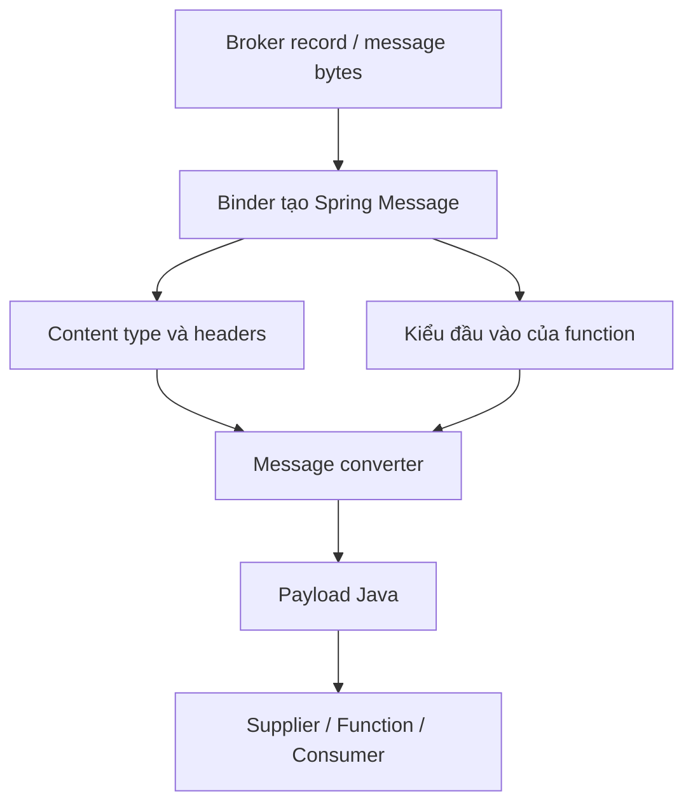

# Giới hạn suy luận kiểu với Object, collection và kiểu tổng quát

## 1. Vì sao Spring Cloud Stream đôi khi không biết kiểu dữ liệu cần tạo

Khi một message đến từ Kafka, RabbitMQ hoặc Pulsar, broker thường chỉ lưu payload dưới dạng byte và một số metadata. Spring Cloud Stream dùng content type, message converter và kiểu đầu vào của hàm để chuyển payload thành đối tượng Java. Việc chuyển đổi hoạt động tốt khi ứng dụng khai báo kiểu đích cụ thể, nhưng có thể không đủ thông tin khi kiểu đích là `Object`, collection thô hoặc kiểu tổng quát chưa được xác định.

Ví dụ, một JSON object có thể biểu diễn đơn hàng:

```json
{
  "orderId": "ORD-1001",
  "totalCents": 259900
}
```

Nếu hàm khai báo đầu vào là `OrderCreated`, converter có thể tạo đối tượng đúng kiểu. Nếu đầu vào chỉ là `Object`, dữ liệu JSON không tự cho biết ứng dụng muốn tạo `OrderCreated`, `PaymentRequest` hay một kiểu khác có cùng cấu trúc. Converter thường phải dùng một biểu diễn tổng quát như `Map`.

Vấn đề tương tự xuất hiện với `List`, `Map` hoặc `Envelope<T>`: tên kiểu collection cho biết cấu trúc bên ngoài, nhưng chưa chắc cho biết kiểu của từng phần tử hoặc tham số `T`.

## 2. Các nguồn thông tin dùng trong chuyển đổi

Trong luồng xử lý của Spring Cloud Stream, việc chuyển đổi thường dựa trên ba nhóm thông tin:

1. **Content type:** mô tả định dạng payload, ví dụ `application/json`, `text/plain` hoặc `application/octet-stream`.
2. **Kiểu đích của hàm:** kiểu tham số đầu vào như `OrderCreated`, `List<OrderCreated>`, `Message<OrderCreated>` hoặc `Object`.
3. **Message converter:** thành phần biết cách chuyển định dạng đầu vào sang kiểu Java đích.



Content type và kiểu Java giải quyết hai câu hỏi khác nhau. `application/json` cho biết dữ liệu có dạng JSON; nó không xác định JSON object phải trở thành lớp Java nào. Kiểu đích cung cấp thông tin đó nếu đủ cụ thể.

Nếu content type thiếu hoặc không phù hợp, converter có thể chọn cách xử lý khác hoặc không chuyển đổi được. Nếu content type đúng nhưng kiểu đích quá tổng quát, kết quả vẫn có thể là `Map`, `List` hoặc kiểu dữ liệu cơ bản thay vì DTO mong muốn.

## 3. Trường hợp đầu vào là Object

### Object không chỉ ra kiểu cụ thể

Xét hai kiểu hàm:

```java
@Bean
Consumer<OrderCreated> typedConsumer() {
    return order -> process(order.orderId(), order.totalCents());
}

@Bean
Consumer<Object> genericConsumer() {
    return payload -> processUnknown(payload);
}
```

Ở `typedConsumer`, chữ ký hàm cho converter biết kiểu đích là `OrderCreated`. Với `genericConsumer`, kiểu đích chỉ là `Object`. Converter không có đủ thông tin để suy ra lớp nghiệp vụ từ tên trường JSON.

Với Jackson và JSON không có kiểu đích cụ thể, object thường được giải mã thành `Map` (thường là `LinkedHashMap`), array thành `List` (thường là `ArrayList`), chuỗi thành `String`, số và boolean thành kiểu dữ liệu tương ứng. Chi tiết phụ thuộc converter và cấu hình đang dùng.

Do đó, đoạn code sau có thể gây `ClassCastException`:

```java
Consumer<Object> consumer = payload -> {
    OrderCreated order = (OrderCreated) payload;
    process(order.orderId(), order.totalCents());
};
```

Payload thực tế có thể là `LinkedHashMap`, không phải `OrderCreated`. Việc JSON có các trường `orderId` và `totalCents` không làm object tự biến thành DTO.

### Khi nào Object vẫn phù hợp?

`Object` hữu ích khi ứng dụng thật sự cần tiếp nhận nhiều kiểu payload và sẽ tự định tuyến hoặc chuyển đổi sau đó. Ví dụ, một gateway nhận nhiều loại event từ một destination dùng chung. Tuy nhiên, cần có hợp đồng để phân biệt loại message, chẳng hạn trường `eventType`, `schemaVersion` hoặc một schema được quản lý tập trung.

Không nên dùng `Object` chỉ vì muốn code ngắn hơn. Nếu một binding chỉ nhận một loại event, khai báo DTO cụ thể giúp converter, compiler và người đọc hiểu rõ hợp đồng dữ liệu.

## 4. Collection thô và collection có tham số kiểu

### Raw collection làm mất thông tin phần tử

Hai chữ ký sau không tương đương về thông tin kiểu:

```java
Consumer<List> rawListConsumer = items -> {
    Object first = items.get(0);
    processUnknown(first);
};

Consumer<List<OrderCreated>> orderListConsumer = orders -> {
    OrderCreated first = orders.get(0);
    process(first.orderId(), first.totalCents());
};
```

`List` thô không nói phần tử bên trong là kiểu gì. Khi giải mã JSON array, converter thường chỉ có thể tạo một collection chứa các giá trị tổng quát như `Map`, `String` hoặc số. Với `List<OrderCreated>`, chữ ký hàm giữ thông tin tham số kiểu trong metadata generic của class/method để framework có cơ hội chuyển từng phần tử thành `OrderCreated`.

Ví dụ bean hàm khai báo rõ kiểu phần tử:

```java
import java.util.List;
import java.util.function.Consumer;
import org.springframework.context.annotation.Bean;
import org.springframework.context.annotation.Configuration;

record OrderCreated(String orderId, long totalCents) {}

@Configuration
class BatchOrderFunctions {

    @Bean
    Consumer<List<OrderCreated>> receiveOrders() {
        return orders -> orders.forEach(order ->
            process(order.orderId(), order.totalCents())
        );
    }
}
```

Với JSON array chứa nhiều object đơn hàng, kiểu đích `List<OrderCreated>` cho converter biết kiểu phần tử mong muốn. Kết quả còn phụ thuộc message converter có hỗ trợ chuyển đổi collection và kiểu generic đó hay không.

### Collection lồng nhau

Thông tin generic càng quan trọng khi cấu trúc lồng nhau:

```java
Map<String, List<OrderCreated>> ordersByRegion;
```

Kiểu đích mô tả cả key, collection bên trong và kiểu phần tử. Nếu chỉ khai báo `Map` hoặc `Map<String, List>`, converter không biết cần tạo `OrderCreated` ở tầng trong. Payload có thể trở thành map lồng map/list với phần tử tổng quát.

Hãy khai báo đầy đủ kiểu ở ranh giới nhận message. Với cấu trúc dữ liệu phức tạp, một DTO rõ ràng thường dễ bảo trì hơn một tập hợp collection lồng nhau:

```java
record RegionOrders(String region, List<OrderCreated> orders) {}
```

## 5. Kiểu tổng quát và type erasure của Java

Java dùng type erasure để thực thi generics. Ở runtime, một đối tượng `List<OrderCreated>` không mang theo một thuộc tính runtime cho biết mọi phần tử của nó là `OrderCreated`; bản thân class của nó vẫn là `ArrayList` hoặc một implementation khác của `List`.

Tuy vậy, compiler thường lưu thông tin khai báo generic trong metadata của class hoặc method. Framework có thể đọc chữ ký như `Consumer<List<OrderCreated>>` bằng reflection và dùng thông tin đó khi chọn kiểu đích. Vì vậy, cần phân biệt:

- **Kiểu generic được khai báo cụ thể:** `List<OrderCreated>` có thông tin phần tử trong chữ ký để framework có thể sử dụng.
- **Raw type:** `List` không có tham số kiểu nên không chỉ ra kiểu phần tử.
- **Kiểu tổng quát chưa giải quyết:** `List<T>` chỉ nói phần tử có kiểu `T`, nhưng nếu `T` chưa được ràng buộc thành lớp cụ thể ở ngữ cảnh runtime thì framework không thể tự đoán.

### Ví dụ kiểu T chưa được xác định

```java
class GenericOrderConsumer<T> {

    void accept(List<T> items) {
        // T chưa xác định được ở đây nếu không có thông tin kiểu cụ thể.
    }
}
```

Nếu bean được tạo từ một lớp generic mà tham số `T` vẫn là type variable, framework có thể chỉ nhìn thấy kiểu chưa giải quyết. Một số cấu trúc kế thừa hoặc khai báo bean cụ thể cho phép Spring giải quyết generic thông qua metadata lớp; nhưng không nên mặc định rằng mọi `T` đều được suy ra từ dữ liệu JSON.

Nếu cần một kiểu cố định cho binding, hãy khai báo bean với kiểu cụ thể:

```java
@Bean
Consumer<List<OrderCreated>> receiveOrders() {
    return orders -> orders.forEach(this::processOrder);
}
```

Nếu cần tái sử dụng logic generic, có thể tách phần xử lý thuần Java thành generic service, còn bean function ở ranh giới broker giữ chữ ký cụ thể. Cách này giúp Spring Cloud Stream có thông tin kiểu ổn định.

## 6. Wrapper và DTO có generic

Một wrapper như `Envelope<T>` giúp chuẩn hóa metadata và payload:

```java
record Envelope<T>(
    String eventId,
    int schemaVersion,
    T data
) {}

record OrderCreated(String orderId, long totalCents) {}
```

Kiểu cụ thể `Envelope<OrderCreated>` cho biết `data` phải là `OrderCreated`. Ngược lại, `Envelope<?>`, `Envelope<Object>` hoặc `Envelope<T>` với `T` chưa được giải quyết có thể khiến converter chỉ tạo dữ liệu tổng quát cho phần `data`.

Khi khai báo function, nên giữ tham số kiểu cụ thể:

```java
@Bean
Consumer<Envelope<OrderCreated>> receiveOrderEnvelope() {
    return envelope -> process(
        envelope.data().orderId(),
        envelope.data().totalCents()
    );
}
```

Với wrapper lồng collection, hãy khai báo đầy đủ:

```java
import java.util.List;
import java.util.function.Consumer;
import org.springframework.context.annotation.Bean;
import org.springframework.context.annotation.Configuration;

@Configuration
class OrderBatchFunctions {

    @Bean
    Consumer<Envelope<List<OrderCreated>>> receiveOrderBatch() {
        return envelope -> envelope.data().forEach(this::processOrder);
    }

    private void processOrder(OrderCreated order) {
        // Xử lý từng đơn hàng trong batch.
    }
}
```

Đây là thông tin quan trọng để converter giải mã cả wrapper, collection và từng phần tử. Nếu kiểu đích bị rút gọn thành `Envelope` hoặc `Envelope<Object>`, dữ liệu bên trong có thể trở thành `Map` hoặc `List` tổng quát.

## 7. Chuyển đổi tường minh khi kiểu đích chưa đủ cụ thể

Có những tình huống ứng dụng cần nhận dữ liệu linh hoạt. Khi đó, hãy chuyển đổi tường minh sau khi xác định được loại event và kiểu đích.

### Dùng ObjectMapper.convertValue cho Map hoặc Object

Nếu converter đã biến JSON object thành `Map`, có thể chuyển map sang DTO bằng Jackson `ObjectMapper`:

```java
import com.fasterxml.jackson.databind.ObjectMapper;
import org.springframework.stereotype.Component;

@Component
class OrderPayloadMapper {

    private final ObjectMapper objectMapper;

    OrderPayloadMapper(ObjectMapper objectMapper) {
        this.objectMapper = objectMapper;
    }

    OrderCreated toOrderCreated(Object payload) {
        return objectMapper.convertValue(payload, OrderCreated.class);
    }
}
```

`convertValue` phù hợp khi payload đã là object trong bộ nhớ như `Map`. Nếu payload đang là JSON bytes hoặc chuỗi, có thể dùng `readValue` để giải mã trực tiếp.

### Dùng TypeReference cho collection generic

Khi cần chuyển đổi JSON thành `List<OrderCreated>`, `OrderCreated[].class` hoặc `List.class` không đủ để biểu diễn kiểu phần tử generic. Jackson cung cấp `TypeReference` để giữ thông tin kiểu:

```java
import com.fasterxml.jackson.core.type.TypeReference;
import com.fasterxml.jackson.databind.ObjectMapper;
import java.util.List;

class OrderBatchDecoder {

    private static final TypeReference<List<OrderCreated>> ORDER_LIST =
        new TypeReference<>() {};

    private final ObjectMapper objectMapper;

    OrderBatchDecoder(ObjectMapper objectMapper) {
        this.objectMapper = objectMapper;
    }

    List<OrderCreated> decode(Object payload) {
        return objectMapper.convertValue(payload, ORDER_LIST);
    }
}
```

Nếu đầu vào là JSON bytes:

```java
List<OrderCreated> orders = objectMapper.readValue(jsonBytes, ORDER_LIST);
```

`TypeReference` ghi nhận kiểu generic tại vị trí khai báo cụ thể. Nó không thể tự khôi phục một `T` đã bị để trống hoặc chưa được xác định ở nơi khác.

### Nhận byte[] và giải mã theo quyết định của ứng dụng

Với gateway đa loại event, có thể nhận payload dạng byte để ứng dụng tự chọn schema:

```java
import java.io.IOException;
import java.util.function.Consumer;
import com.fasterxml.jackson.databind.ObjectMapper;
import org.springframework.context.annotation.Bean;
import org.springframework.context.annotation.Configuration;
import org.springframework.messaging.Message;

@Configuration
class RawEventFunctions {

    @Bean
    Consumer<Message<byte[]>> routeRawEvents(ObjectMapper objectMapper) {
        return message -> {
            String eventType = message.getHeaders().get("eventType", String.class);
            byte[] body = message.getPayload();

            if ("OrderCreated".equals(eventType)) {
                try {
                    OrderCreated event = objectMapper.readValue(body, OrderCreated.class);
                    handleOrderCreated(event);
                } catch (IOException ex) {
                    throw new IllegalArgumentException("Invalid OrderCreated payload", ex);
                }
            } else {
                throw new IllegalArgumentException("Unsupported event type: " + eventType);
            }
        };
    }

    private void handleOrderCreated(OrderCreated event) {
        // Chuyển event đã giải mã sang bước nghiệp vụ tiếp theo.
    }
}
```

Đây là cách tiếp cận có chủ đích cho payload đa hình. Cần xác thực `eventType`, kiểm tra content type và giới hạn danh sách kiểu được phép. Trong ứng dụng thực tế, có thể bổ sung chính sách retry hoặc chuyển message không hợp lệ sang DLQ theo cấu hình binder.

## 8. Xử lý nhiều loại event trong cùng một destination

Một destination có thể chứa nhiều loại event. Không nên suy luận lớp Java chỉ từ tên trường hoặc thử ép kiểu lần lượt. Hãy thiết kế discriminator rõ ràng:

```json
{
  "eventType": "OrderCreated",
  "schemaVersion": 2,
  "data": {
    "orderId": "ORD-1001",
    "totalCents": 259900
  }
}
```

Ứng dụng có thể giải mã envelope trước, đọc `eventType` và `schemaVersion`, rồi chọn DTO đã đăng ký trong một registry tường minh. Registry chỉ nên chứa các lớp được ứng dụng cho phép:

```java
Map<String, Class<?>> eventTypes = Map.of(
    "OrderCreated", OrderCreated.class,
    "PaymentCompleted", PaymentCompleted.class
);
```

Sau khi tra được kiểu hợp lệ, có thể gọi `ObjectMapper.convertValue` với kiểu đó. Không nên bật Jackson default typing một cách thiếu kiểm soát cho dữ liệu không tin cậy, vì thông tin class trong payload có thể dẫn đến việc khởi tạo kiểu không mong muốn. Dùng discriminator, allow-list và schema version do ứng dụng quản lý.

Với hệ thống lớn hoặc nhiều producer/consumer độc lập, cân nhắc schema registry và định dạng có schema như Avro hoặc Protobuf. Schema registry giúp quản lý phiên bản và quy tắc tương thích; nó vẫn cần cấu hình serializer/deserializer tương ứng và hợp đồng giữa các bên.

## 9. Cấu hình content type và converter

Content type cần phản ánh định dạng thực tế của payload. Ví dụ:

```yaml
spring:
  cloud:
    function:
      definition: receiveOrders
    stream:
      bindings:
        receiveOrders-in-0:
          destination: orders.batch
          group: order-importer
          content-type: application/json
```

Nếu destination mang JSON array, hàm nên khai báo kiểu đầu vào có generic cụ thể:

```java
@Bean
Consumer<List<OrderCreated>> receiveOrders() {
    return orders -> orders.forEach(this::processOrder);
}
```

Không nên kỳ vọng `content-type: application/json` sẽ biến mọi object thành kiểu DTO mong muốn. Converter phải có khả năng xử lý kiểu đích, và kiểu đích phải mang đủ thông tin. Nếu dùng custom message converter, hãy kiểm tra thứ tự ưu tiên và loại MIME mà converter hỗ trợ để tránh converter khác xử lý trước.

Khi cần dữ liệu thô, có thể dùng `byte[]` và giải mã ở tầng ứng dụng. Cách này trao quyền kiểm soát cao hơn nhưng ứng dụng phải tự chịu trách nhiệm xác thực content type, schema, encoding và lỗi parse.

## 10. Lỗi thường gặp khi suy luận kiểu

| Triệu chứng | Nguyên nhân có thể | Hướng xử lý |
|---|---|---|
| `ClassCastException` khi ép `Object` thành DTO | JSON được giải mã thành `Map` hoặc kiểu tổng quát | Khai báo DTO cụ thể hoặc chuyển đổi tường minh |
| Phần tử của `List` là `LinkedHashMap` | Binding khai báo raw `List` hoặc `List<Object>` | Dùng `List<OrderCreated>` hoặc `TypeReference<List<OrderCreated>>` |
| Trường `data` trong wrapper là `Map` | Dùng `Envelope`, `Envelope<Object>` hoặc type variable chưa giải quyết | Dùng `Envelope<OrderCreated>` hoặc giải mã tường minh |
| Lỗi conversion/JSON parse | Content type sai, JSON không hợp lệ hoặc converter không hỗ trợ kiểu | Kiểm tra payload, content type, converter và schema |
| Chuyển đổi được nhưng sai loại event | Destination chứa nhiều schema nhưng thiếu discriminator rõ ràng | Dùng event type, schema version và registry allow-list |
| Mất metadata sau khi chuyển đổi | Chỉ chuyển payload hoặc header không được binder hỗ trợ | Xác định header cần giữ và kiểm tra mapping của binder |

Không nên giải quyết mọi lỗi bằng cách đổi tham số thành `Object`. Làm vậy thường trì hoãn lỗi từ thời điểm chuyển đổi sang thời điểm xử lý nghiệp vụ, nơi lỗi khó chẩn đoán hơn.

## 11. Kiểm thử kiểu đích và dữ liệu thực tế

Kiểm thử chuyển đổi nên bao gồm các trường hợp khác nhau:

1. JSON object vào DTO cụ thể như `OrderCreated`.
2. JSON object vào `Object` và xác nhận dạng dữ liệu tổng quát mà converter trả về.
3. JSON array vào `List<OrderCreated>` và kiểm tra kiểu của từng phần tử.
4. JSON array vào raw `List` để nhận diện giới hạn kiểu phần tử.
5. Wrapper generic như `Envelope<OrderCreated>` và `Envelope<List<OrderCreated>>`.
6. Kiểu tổng quát chưa giải quyết như `Envelope<T>` trong bean generic.
7. Content type thiếu, sai hoặc không được custom converter hỗ trợ.
8. Event type không nằm trong allow-list và schema version không được hỗ trợ.

Ví dụ kiểm thử với Jackson:

```java
import static org.assertj.core.api.Assertions.assertThat;
import com.fasterxml.jackson.core.type.TypeReference;
import com.fasterxml.jackson.databind.ObjectMapper;
import java.util.List;
import org.junit.jupiter.api.Test;

record OrderCreated(String orderId, long totalCents) {}

class OrderConversionTest {

    private final ObjectMapper mapper = new ObjectMapper();

    @Test
    void convertsArrayToTypedOrderList() throws Exception {
        String json = """
            [
              {"orderId":"ORD-1","totalCents":1000},
              {"orderId":"ORD-2","totalCents":2000}
            ]
            """;

        List<OrderCreated> orders = mapper.readValue(
            json,
            new TypeReference<List<OrderCreated>>() {}
        );

        assertThat(orders).hasSize(2);
        assertThat(orders.get(0).orderId()).isEqualTo("ORD-1");
    }
}
```

Kiểm thử này xác nhận khả năng giải mã của Jackson với một kiểu generic cụ thể. Để kiểm tra toàn bộ Spring Cloud Stream, cần kiểm thử thêm binding và converter được cấu hình trong ứng dụng. Test binder có ích để kiểm tra luồng function trong môi trường nhẹ; các khác biệt serialization header, broker record và custom converter cần được kiểm thử tích hợp với binder/broker tương ứng.

## 12. Quy tắc lựa chọn kiểu ở ranh giới message

- Ưu tiên DTO cụ thể khi một binding có hợp đồng dữ liệu cố định.
- Dùng `List<T>` hoặc `Map<K, V>` với tham số kiểu cụ thể; tránh raw collection.
- Không trông chờ framework suy ra `T` khi type variable chưa được giải quyết.
- Với payload đa hình, dùng discriminator và registry kiểu được phép.
- Với dữ liệu JSON động, cân nhắc `JsonNode` hoặc `Map<String, Object>` và chuyển đổi rõ ràng sau khi xác định schema.
- Dùng `TypeReference` hoặc API kiểu tương đương khi chuyển đổi collection generic bằng tay.
- Xác nhận content type, converter và kiểu đích cùng tương thích.
- Kiểm thử cả trường hợp hợp lệ, thiếu metadata, sai schema và kiểu không được hỗ trợ.

Spring Cloud Stream có thể tận dụng thông tin kiểu generic mà Java lưu trong chữ ký hàm, nhưng không thể đoán một kiểu nghiệp vụ mà ứng dụng chưa khai báo. `Object`, raw collection và type variable chưa giải quyết đều làm giảm thông tin mà converter có thể sử dụng. Thiết kế chữ ký function rõ ràng, dùng schema/discriminator khi có nhiều loại event và chuyển đổi tường minh ở ranh giới linh hoạt sẽ giúp lỗi kiểu được phát hiện sớm và dữ liệu được xử lý nhất quán.

