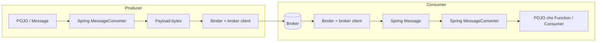

# Phân biệt chuyển đổi của framework với serialization của broker client

## Mục tiêu

Trong Spring Cloud Stream, ứng dụng thường làm việc với các đối tượng Java như `OrderCreated`, trong khi broker truyền và lưu dữ liệu theo định dạng byte cùng metadata. Để nối hai thế giới này, hệ thống cần chuyển đổi payload. Việc chuyển đổi có thể do cơ chế message conversion của Spring Cloud Stream thực hiện hoặc do serializer/deserializer của client và binder đảm nhiệm.

Hai cơ chế có liên quan nhưng không đồng nghĩa. **Message conversion của framework** chuyển payload giữa các kiểu dữ liệu trong mô hình Spring Messaging dựa trên content type và kiểu đích của hàm. **Serialization của broker client** biến key/value hoặc message body thành dạng wire format mà client/broker sử dụng; chiều nhận dùng deserializer hoặc schema tương ứng để khôi phục dữ liệu.

Bài học này giúp xác định cơ chế nào đang hoạt động, cách cấu hình content type, khi nào cần native encoding/decoding và cách kiểm thử tương thích dữ liệu khi triển khai với Kafka, RabbitMQ hoặc Pulsar.

Sau bài học, bạn có thể:

- Phân biệt message conversion, serialization và deserialization.
- Mô tả luồng chuyển đổi ở producer và consumer trong Spring Cloud Stream.
- Dùng content type và kiểu payload để chọn converter của framework.
- Nhận diện trường hợp binder dùng native serialization của broker client.
- Cấu hình Kafka Serializer/Deserializer khi chọn native encoding/decoding.
- Tránh cấu hình converter chồng lấn và kiểm thử định dạng dữ liệu ở đúng tầng.

## 1. Ba khái niệm cần phân biệt

### Message conversion

Message conversion là quá trình chuyển payload từ kiểu này sang kiểu khác trong mô hình Spring Messaging. Ví dụ, một payload POJO có thể được chuyển thành JSON bytes khi gửi; khi nhận, JSON bytes có thể được chuyển thành POJO theo kiểu tham số của function.

Cơ chế này làm việc với Spring `Message<?>`, payload, headers và content type. Converter có thể dựa vào `application/json`, `text/plain` hoặc MIME type khác để quyết định cách chuyển đổi.

### Serialization và deserialization

Serialization biến dữ liệu thành biểu diễn byte để truyền hoặc lưu. Deserialization làm chiều ngược lại. Broker client thường cung cấp serializer cho key/value hoặc message body, ví dụ Kafka `Serializer` và `Deserializer`, RabbitMQ client/binder message converter, hoặc Pulsar `Schema`.

Serialization có thể dùng JSON, Avro, Protobuf, String, byte array hoặc định dạng khác. Broker thường không cần biết lớp Java của ứng dụng; nó lưu và chuyển các byte cùng metadata theo giao thức.

### Wire format

Wire format là biểu diễn dữ liệu thực tế được gửi qua mạng hoặc lưu trong broker. Hai dịch vụ có thể cùng hiểu một sự kiện nghiệp vụ nhưng vẫn không tương thích nếu wire format khác nhau, ví dụ một bên gửi JSON còn bên kia giải mã như Avro.

| Khái niệm | Làm việc ở đâu? | Đầu vào/đầu ra thường gặp | Câu hỏi chính |
|---|---|---|---|
| Message conversion | Spring Messaging / Spring Cloud Stream | POJO, String, byte[], Spring Message | Payload Java nào được function nhận hoặc trả về? |
| Serialization | Client/binder trước khi gửi | Object/key/value → byte[] hoặc native message | Dữ liệu được ghi ra broker theo định dạng nào? |
| Deserialization | Client/binder khi nhận | byte[] hoặc native message → Object | Dữ liệu trên broker được khôi phục thành kiểu nào? |
| Wire format | Ranh giới truyền tin và lưu trữ | JSON, Avro, Protobuf, binary | Producer và consumer có cùng hợp đồng dữ liệu không? |

Trong một số đường đi, converter của framework tạo byte payload rồi binder chuyển byte đó cho client. Trong đường đi native, binder/client có thể dùng serializer riêng để mã hóa đối tượng. Vì vậy, không nên coi mọi ứng dụng đều chạy cả hai cơ chế theo cùng một chuỗi cố định; cần xác định chế độ của binding cụ thể.

## 2. Luồng chuyển đổi mặc định của Spring Cloud Stream

Ở chế độ message conversion của framework, ứng dụng có thể làm việc với POJO mà không tự gọi Jackson hay thao tác byte array.

Ví dụ DTO:

```java
public record OrderCreated(
        String eventId,
        String orderId,
        BigDecimal total
) {}
```

Một function nhận và trả payload trực tiếp:

```java
@Bean
Function<OrderCreated, OrderAccepted> acceptOrder(OrderService service) {
    return event -> service.accept(event);
}
```

Ở chiều gửi, Spring Cloud Stream sử dụng content type và converter phù hợp để chuyển payload sang biểu diễn truyền tin. Binder tiếp nhận message và gửi đến broker bằng client của nó. Ở chiều nhận, binder tạo Spring Message từ dữ liệu nhận được; framework chuyển payload sang kiểu mà function yêu cầu trước khi gọi hàm.



Đây là mô hình khái quát. Một số binder có thể thực hiện thêm chuyển đổi hoặc ánh xạ header riêng; khi bật native encoding/decoding, serializer/deserializer của client đảm nhiệm phần chuyển đổi payload thay cho đường converter mặc định của framework.

### Khai báo content type

Content type mô tả định dạng payload để framework chọn converter. Ví dụ:

```yaml
spring:
  cloud:
    function:
      definition: acceptOrder
    stream:
      bindings:
        acceptOrder-in-0:
          destination: orders.created
          group: order-service
          content-type: application/json
        acceptOrder-out-0:
          destination: orders.accepted
          content-type: application/json
```

Với cấu hình này, ứng dụng khai báo JSON là định dạng của payload trên binding. Function vẫn nhận `OrderCreated` và trả `OrderAccepted`; framework chịu trách nhiệm chuyển đổi ở ranh giới message.

Content type có thể được cung cấp bởi cấu hình binding hoặc metadata của message tùy đường đi và phiên bản. Nếu producer và consumer không thống nhất content type, hoặc header content type bị thiếu/sai, framework có thể chọn converter không phù hợp hoặc không chuyển đổi được payload.

## 3. Luồng native serialization của broker client

Một số binder cho phép bỏ qua message conversion mặc định để dùng cơ chế serialization/deserialization native của broker client. Với Kafka binder, các thuộc tính thường dùng là:

- `useNativeEncoding` ở producer binding: dùng Kafka serializer để mã hóa dữ liệu đầu ra.
- `useNativeDecoding` ở consumer binding: dùng Kafka deserializer để khôi phục dữ liệu đầu vào.

Ví dụ cấu hình Kafka native encoding/decoding:

```yaml
spring:
  cloud:
    stream:
      bindings:
        orderCreated-out-0:
          destination: orders.created
          producer:
            use-native-encoding: true
        orderCreated-in-0:
          destination: orders.created
          group: order-service
          consumer:
            use-native-decoding: true

      kafka:
        bindings:
          orderCreated-out-0:
            producer:
              configuration:
                key.serializer: org.apache.kafka.common.serialization.StringSerializer
                value.serializer: org.springframework.kafka.support.serializer.JsonSerializer
          orderCreated-in-0:
            consumer:
              configuration:
                key.deserializer: org.apache.kafka.common.serialization.StringDeserializer
                value.deserializer: org.springframework.kafka.support.serializer.JsonDeserializer
                spring.json.value.default.type: com.example.events.OrderCreated
                spring.json.trusted.packages: com.example.events
```

Các tên lớp và thuộc tính trong ví dụ là cấu hình Kafka client/Spring Kafka; cần kiểm tra phiên bản dependency và chính sách type mapping của ứng dụng. Không mở rộng trusted packages tùy tiện trong hệ thống nhận dữ liệu không đáng tin cậy.

Khi bật native encoding/decoding, serializer/deserializer native chịu trách nhiệm tạo và đọc wire format. Không trông chờ Spring MessageConverter mặc định tự chuyển POJO ở cùng binding như chế độ thông thường. Producer và consumer phải dùng serializer/deserializer tương thích; nếu một phía dùng JSON serializer còn phía kia dùng Avro deserializer, message sẽ không được giải mã đúng.

Không bắt buộc bật native encoding và native decoding cho mọi binding. Có thể dùng framework conversion cho luồng này và native serialization cho luồng khác, nhưng cấu hình của từng binding phải rõ ràng.

## 4. Content type không phải serializer

Hai khái niệm thường bị nhầm:

- `content-type: application/json` là metadata mô tả định dạng payload trong mô hình Spring Cloud Stream và giúp framework chọn converter.
- `value.serializer` là cấu hình Kafka client quyết định cách mã hóa giá trị record thành bytes khi dùng Kafka native serialization.

Đặt content type thành JSON không tự động cấu hình mọi serializer của Kafka client. Ngược lại, chọn JsonSerializer ở Kafka client không có nghĩa mọi Spring MessageConverter đều tham gia chuyển đổi.

Ví dụ, có thể có các trường hợp sau:

| Cấu hình | Cơ chế chính | Hệ quả |
|---|---|---|
| JSON content type, không bật native encoding/decoding | Framework MessageConverter | Framework chuyển POJO và payload JSON theo binding |
| Kafka native encoding/decoding bật, Kafka JsonSerializer/JsonDeserializer | Kafka client serializer/deserializer | Client chịu trách nhiệm JSON bytes và khôi phục kiểu |
| Native encoding bật nhưng serializer không tương thích | Kafka client serializer | Gửi lỗi hoặc wire format không khớp consumer |
| Consumer nhận bytes nhưng content type/kiểu đích không phù hợp | Framework converter hoặc deserializer tùy chế độ | Có thể lỗi conversion trước khi function xử lý |

Một message có thể chứa `contentType` header, nhưng không nên suy luận rằng header đó thay thế cấu hình serializer của client. Hãy kiểm tra binding đang dùng đường conversion nào.

## 5. Key và value có thể được serialize riêng

Trong Kafka, một record có key và value. Spring Cloud Stream function thường làm việc với payload tương ứng với value; key có thể được thiết lập qua header hoặc cơ chế partitioning của binder. Serializer cho key và value có thể khác nhau, ví dụ key là String còn value là JSON.

```yaml
spring:
  cloud:
    stream:
      bindings:
        orderCreated-out-0:
          destination: orders.created
          producer:
            use-native-encoding: true
      kafka:
        bindings:
          orderCreated-out-0:
            producer:
              configuration:
                key.serializer: org.apache.kafka.common.serialization.StringSerializer
                value.serializer: org.springframework.kafka.support.serializer.JsonSerializer
```

Khi key dùng để phân vùng theo order ID, hãy xác định key ở producer/binding theo cơ chế được binder hỗ trợ. Key ổn định có thể giúp các record cùng khóa được định tuyến vào cùng partition, từ đó hỗ trợ thứ tự theo key. Key không phải nội dung payload và serializer key không thay thế serializer value.

RabbitMQ không dùng cặp key/value giống Kafka. Routing key và exchange điều khiển định tuyến; message body được chuyển đổi bởi cơ chế AMQP/binder. Pulsar có message key và schema riêng; key và payload cũng có vai trò khác nhau. Đừng bê nguyên cấu hình serializer Kafka sang RabbitMQ hoặc Pulsar.

## 6. Vai trò của từng binder

### Kafka binder

Kafka client có các interface serializer/deserializer cho key và value. Khi dùng native encoding/decoding, cấu hình serializer/deserializer và kiểu đích cần đồng bộ giữa producer và consumer. Với JSON, có thể dùng serializer/deserializer của Spring Kafka; với Avro hoặc Protobuf, thường cần schema và serializer phù hợp, đôi khi kết hợp schema registry.

Nếu dùng framework conversion, Spring Cloud Stream xử lý chuyển đổi payload dựa trên content type và kiểu function. Kafka binder/client vẫn vận chuyển bytes và metadata record, nhưng không phải ứng dụng tự cấu hình một JsonSerializer native cho cùng payload theo cách mâu thuẫn.

### RabbitMQ binder

RabbitMQ dùng AMQP message body, properties và headers. Việc chuyển đổi body có thể liên quan đến Spring AMQP MessageConverter và cấu hình của Rabbit binder. Ví dụ, converter JSON có thể biến đối tượng Java thành JSON body và khôi phục payload khi nhận.

Cần phân biệt converter của Spring Cloud Stream với converter ở tầng Spring AMQP/Rabbit client. Chúng có thể tham gia ở các ranh giới khác nhau tùy chế độ binder. Khi tùy chỉnh converter hoặc bật native decoding/encoding theo khả năng binder, hãy xác minh converter nào thực sự được gọi và content type/header nào được truyền.

### Pulsar binder

Pulsar có cơ chế Schema để mô tả và mã hóa payload, chẳng hạn schema cho String, bytes, JSON, Avro hoặc Protobuf tùy client và binder. Khi dùng schema native, producer và consumer cần tương thích về schema và chiến lược schema evolution. Binder có thể cung cấp tích hợp với schema của Pulsar; khả năng cụ thể phụ thuộc phiên bản và cấu hình.

Không nên giả định Pulsar Schema, Kafka Serdes và Spring MessageConverter là cùng một abstraction. Chúng có API, metadata và quy tắc tương thích riêng.

| Binder | Cơ chế native phổ biến | Điều cần đồng bộ |
|---|---|---|
| Kafka | Kafka Serializer/Deserializer cho key/value | Serializer, deserializer, kiểu đích, schema/type mapping |
| RabbitMQ | AMQP body/properties và Spring AMQP MessageConverter | Converter hai phía, content type, header mapping |
| Pulsar | Pulsar Schema và client codec | Schema type, schema compatibility, kiểu payload |

## 7. Khi nào nên dùng framework conversion?

Framework conversion thường là lựa chọn thuận tiện khi:

- Ứng dụng xử lý POJO đơn giản và muốn giữ chữ ký Supplier/Function/Consumer rõ ràng.
- Các binding dùng định dạng phổ biến như JSON hoặc text.
- Muốn cấu hình content type ở cấp binding.
- Muốn hạn chế phụ thuộc trực tiếp vào Kafka Serdes, AMQP converter hoặc Pulsar Schema trong code nghiệp vụ.
- Không cần một wire format đặc thù do client quản lý.

Ví dụ consumer nhận POJO:

```java
@Bean
Consumer<OrderCreated> orderCreated(OrderService service) {
    return service::handle;
}
```

Framework conversion giúp adapter nhận payload đúng kiểu. Logic nghiệp vụ không cần gọi Jackson hoặc giải mã byte thủ công.

## 8. Khi nào nên dùng native serialization?

Native serialization phù hợp khi:

- Cần dùng Kafka Serdes hoặc Pulsar Schema cụ thể.
- Hệ thống có hợp đồng Avro/Protobuf hoặc schema registry.
- Cần kiểm soát chính xác cách key/value được mã hóa.
- Đang tích hợp với producer/consumer khác không dùng Spring Cloud Stream nhưng phải tuân theo cùng wire format.
- Muốn tận dụng khả năng schema hoặc serialization của broker client.

Đổi lại, cấu hình native làm ứng dụng gắn chặt hơn với khả năng của binder/client. Hãy giữ phần phụ thuộc đó ở adapter/configuration, không để domain service phụ thuộc Kafka Serializer hoặc Pulsar Schema API.

Không chọn native serialization chỉ vì nghĩ nó luôn nhanh hơn. Hiệu năng còn phụ thuộc payload, converter, serializer, kích thước message, nén, network và broker. Hãy đo trong điều kiện thực tế.

## 9. Các lỗi thường gặp

| Triệu chứng | Nguyên nhân có thể | Cách điều tra |
|---|---|---|
| Consumer không nhận được POJO | Content type sai hoặc converter không hỗ trợ kiểu | Kiểm tra content type, kiểu tham số function và log conversion |
| Lỗi deserialize trước khi function chạy | Native deserializer không tương thích bytes hoặc kiểu đích | Kiểm tra serializer phía producer, deserializer phía consumer và type mapping |
| JSON bị bọc thành chuỗi hoặc chuyển đổi hai lần | Cả converter và serializer cùng xử lý theo cấu hình không nhất quán | Xác định binding có bật native encoding/decoding không |
| Ứng dụng local chạy nhưng consumer khác không đọc được | Hai bên dùng wire format hoặc schema khác nhau | Kiểm tra bytes thực tế, schema version và serializer |
| Kafka key bị lỗi nhưng value đúng | Key serializer/deserializer không khớp | Kiểm tra cấu hình key riêng với value |
| RabbitMQ nhận body nhưng thiếu kiểu mong đợi | AMQP converter hoặc content type không tương thích | Kiểm tra message properties và converter hai phía |
| Pulsar từ chối schema hoặc không đọc được message | Schema type/compatibility không phù hợp | Kiểm tra schema được đăng ký và cấu hình client/binder |
| Thay đổi DTO làm consumer cũ lỗi | Schema evolution không tương thích | Thiết kế quy tắc tương thích và kiểm thử producer/consumer chéo phiên bản |

Không xử lý mọi lỗi deserialize bằng retry vô hạn. Nếu wire format hoặc schema không tương thích, retry không làm message hợp lệ; cần cách ly message, quan sát lỗi và xử lý theo quy trình schema/DLQ phù hợp.

## 10. Kiểm thử ở đúng tầng

Một unit test của use case không chứng minh wire format. Nên chia kiểm thử thành các tầng:

### Unit test cho logic ứng dụng

Kiểm tra use case với POJO/command thuần. Không cần tạo byte array hoặc khởi chạy broker nếu logic không liên quan đến serialization.

### Test cho framework MessageConverter

Kiểm tra chuyển đổi giữa POJO và message theo content type. Có thể dùng Spring Messaging converter phù hợp hoặc Test Binder để xác minh function nhận payload đúng kiểu. Kiểm tra cả trường hợp content type thiếu, sai hoặc payload không hợp lệ.

### Test cho native serializer/deserializer

Nếu dùng Kafka native encoding/decoding, kiểm tra serializer và deserializer cùng bộ cấu hình. Với JSON, xác minh bytes được tạo và khôi phục thành đúng kiểu; với Avro/Protobuf, kiểm tra schema và version. Với Pulsar, kiểm tra schema compatibility; với RabbitMQ, kiểm tra converter AMQP và message properties.

### Integration test với broker

Dùng Testcontainers hoặc môi trường broker kiểm thử để xác minh:

- Producer gửi wire format mà consumer đích giải mã được.
- Headers/content type được ánh xạ đúng.
- Key/value hoặc routing/schema hoạt động đúng.
- Message cũ và mới tương thích theo chính sách schema evolution.
- Lỗi conversion/deserialization được quan sát và chuyển xử lý đúng.
- Cấu hình native và framework conversion không bị bật chồng ngoài ý muốn.

Test Binder hữu ích cho hành vi framework, nhưng không thay thế kiểm thử serializer/deserializer native hoặc schema của broker thật.

## 11. Quy trình chọn và cấu hình cơ chế chuyển đổi

Khi tạo binding mới, thực hiện theo trình tự:

1. Xác định kiểu payload mà function nhận/trả về.
2. Xác định wire format mà producer và consumer phải trao đổi: JSON, Avro, Protobuf, text hay binary.
3. Chọn nơi chịu trách nhiệm chuyển đổi: Spring MessageConverter hay serializer/schema native của binder.
4. Nếu dùng framework conversion, khai báo content type phù hợp và kiểm tra converter hỗ trợ kiểu đích.
5. Nếu dùng native serialization, cấu hình serializer/deserializer tương ứng ở đúng binder và bật native encoding/decoding khi binder yêu cầu.
6. Kiểm tra riêng key và value nếu broker phân biệt chúng.
7. Viết test chuyển đổi và integration test trên broker đích.
8. Khi thay schema hoặc phiên bản DTO, kiểm tra tương thích ngược/tiến với producer và consumer đang chạy.

Ghi lại wire format, schema version, content type và cơ chế serializer trong tài liệu hợp đồng sự kiện. Thông tin này giúp nhóm vận hành điều tra message lỗi và giúp dịch vụ khác tích hợp mà không phải suy đoán từ code Java.

## Kết luận

Message conversion của Spring Cloud Stream chuyển payload trong mô hình Spring Messaging dựa trên content type và kiểu đích của function. Serialization/deserialization của broker client tạo và đọc wire format theo giao thức hoặc schema mà broker sử dụng. Hai cơ chế có thể phối hợp trong một luồng, nhưng chế độ native có thể thay thế đường conversion mặc định ở binding tương ứng.

Khi phát triển với Kafka, RabbitMQ hoặc Pulsar, hãy chọn rõ nơi chịu trách nhiệm mã hóa và giải mã, đồng bộ wire format giữa producer/consumer và kiểm thử trên đúng binder. Content type không thay thế serializer, còn serializer native không tự bảo đảm Spring MessageConverter đã được gọi.

