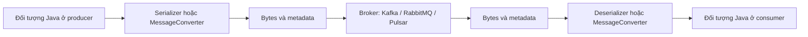

# Đồng bộ serializer và deserializer giữa bên phát và bên nhận

Trong một hệ thống xử lý sự kiện, producer và consumer thường chạy ở các tiến trình khác nhau. Producer có thể tạo một đối tượng Java như `OrderCreated`, nhưng broker truyền và lưu dữ liệu theo định dạng byte cùng metadata. Consumer phải diễn giải chính những byte đó thành kiểu dữ liệu mà ứng dụng hiểu được. Nếu serializer của producer và deserializer của consumer không thống nhất, message có thể không đọc được, bị chuyển đổi sai hoặc chỉ lỗi khi chạy production.

Với Spring Cloud Stream, binder kết nối hàm `Supplier`, `Function`, `Consumer` với Kafka, RabbitMQ hoặc Pulsar. Spring Cloud Stream có thể chuyển đổi payload thông qua message converter trước khi binder gửi message; hoặc ứng dụng có thể yêu cầu binder dùng serializer/deserializer native của broker. Hai cơ chế này có trách nhiệm khác nhau. Cần chọn một cơ chế rõ ràng cho từng binding và bảo đảm hai đầu dùng cùng wire format, schema và quy ước metadata.

## 1. Luồng dữ liệu từ producer đến consumer

Một message đi qua các bước chính:



Ví dụ producer tạo `OrderCreated`, serialize thành JSON rồi gửi. Consumer nhận JSON và deserialize thành `OrderCreated`. Hai bên cần thống nhất ít nhất các yếu tố sau:

- Định dạng byte trên đường truyền: JSON, Avro, Protobuf, String, byte array hoặc định dạng riêng.
- Schema và phiên bản schema: tên trường, kiểu dữ liệu, trường bắt buộc, giá trị mặc định và quy tắc tương thích.
- Content type hoặc schema metadata: cách consumer nhận biết định dạng cần đọc.
- Cách xử lý key và headers: serializer/deserializer của key, metadata của broker và header mapping.
- Quy tắc lỗi: điều gì xảy ra khi payload sai định dạng, schema không tương thích hoặc thiếu trường bắt buộc.

Chỉ cùng tên lớp Java ở hai ứng dụng không đủ để bảo đảm tương thích. Hai lớp có thể khác package, khác phiên bản hoặc khác cách serialize. Ngược lại, hai ứng dụng viết bằng ngôn ngữ khác nhau vẫn có thể trao đổi message nếu cùng tuân theo một wire contract độc lập với lớp Java.

## 2. Hai cơ chế chuyển đổi trong Spring Cloud Stream

### Message conversion do Spring Cloud Stream quản lý

Ở chế độ thông thường, hàm ứng dụng làm việc với payload Java. Spring Cloud Stream sử dụng `content-type` và message converter để chuyển đổi payload khi gửi hoặc nhận. Ví dụ:

```java
@Bean
Function<OrderCreated, OrderAccepted> acceptOrder() {
    return order -> new OrderAccepted(order.orderId(), order.total());
}
```

Với JSON, cấu hình binding có thể đặt content type:

```yaml
spring:
  cloud:
    function:
      definition: acceptOrder
    stream:
      bindings:
        acceptOrder-in-0:
          destination: orders.created
          group: order-processor
          content-type: application/json
        acceptOrder-out-0:
          destination: orders.accepted
          content-type: application/json
```

Producer gửi payload của kiểu `OrderCreated`; message converter chuyển đổi nó theo định dạng JSON. Consumer khai báo kiểu đầu vào và content type phù hợp để nhận lại đối tượng. Ở chế độ này, ứng dụng không cần tự cấu hình Kafka `JsonSerializer` hoặc `JsonDeserializer` chỉ để chuyển DTO thành JSON; binder và framework xử lý chuyển đổi theo cơ chế message conversion.

`content-type` là metadata mô tả định dạng nội dung, không phải tên lớp serializer. Nếu producer phát JSON nhưng consumer diễn giải payload như `text/plain` hoặc một định dạng nhị phân khác, quá trình chuyển đổi có thể thất bại. Hãy thống nhất content type ở hai binding và kiểm tra cả metadata thực tế trên message.

### Native encoding và native decoding

Khi bật native encoding/decoding, binder dùng serializer/deserializer của broker hoặc client để xử lý payload. Spring Cloud Stream không thực hiện cùng bước message conversion ở ranh giới đó. Hai thuộc tính lõi thường dùng là:

- `producer.use-native-encoding: true`: output binding dùng serializer native của binder/client.
- `consumer.use-native-decoding: true`: input binding dùng deserializer native của binder/client.

Ví dụ cấu hình vị trí hai thuộc tính:

```yaml
spring:
  cloud:
    stream:
      bindings:
        publishOrder-out-0:
          destination: orders.created
          producer:
            use-native-encoding: true
        receiveOrder-in-0:
          destination: orders.created
          group: order-processor
          consumer:
            use-native-decoding: true
```

Đoạn YAML trên chỉ bật cơ chế native; nó chưa chỉ ra serializer/deserializer cụ thể. Phần mở rộng của binder phải được cấu hình theo broker và phiên bản đang dùng. Producer và consumer phải thống nhất cả định dạng dữ liệu lẫn schema. Bật native encoding ở producer mà consumer vẫn dùng message converter theo giả định JSON có thể tạo ra lỗi giải mã; điều ngược lại cũng vậy.

Không trộn hai mô hình một cách vô tình. Hãy ghi rõ binding nào dùng message conversion và binding nào dùng native serialization. Nếu một phía dùng native còn phía kia dùng converter, chỉ triển khai khi đã xác định chính xác byte format và cách chuyển đổi tương ứng.

## 3. Phân biệt serializer, deserializer và message converter

| Thành phần | Vai trò | Phạm vi |
|---|---|---|
| Message converter | Chuyển payload của Spring `Message<?>` giữa kiểu Java và định dạng message | Tầng Spring Messaging/Spring Cloud Stream |
| Serializer | Chuyển đối tượng hoặc key thành byte/metadata để producer gửi | Phía producer của client/binder |
| Deserializer | Chuyển byte/metadata thành đối tượng hoặc key để consumer đọc | Phía consumer của client/binder |
| Schema/Schema registry | Mô tả cấu trúc dữ liệu và, nếu có, lưu trữ/kiểm tra các phiên bản schema | Hợp đồng dữ liệu giữa các hệ thống |

Một số binder tích hợp chặt chẽ với message converter; một số binder cho phép cấu hình native serializer/deserializer. Tên và vị trí thuộc tính mở rộng khác nhau. Đừng lấy tên thuộc tính của Kafka binder rồi áp dụng trực tiếp cho Rabbit binder hoặc Pulsar binder.

Ngoài value, producer và consumer còn phải đồng bộ kiểu key. Ví dụ Kafka có thể dùng `StringSerializer` cho key nhưng consumer lại cấu hình `LongDeserializer`; record có thể được gửi thành công nhưng consumer không đọc được key. Với RabbitMQ, routing key là một phần định tuyến của AMQP, không đồng nghĩa với Kafka record key. Với Pulsar, message key có cơ chế riêng và cần cấu hình theo schema/key policy của client/binder.

## 4. Đồng bộ serializer và deserializer với Kafka

Kafka lưu record dưới dạng key bytes, value bytes và headers. Producer cần serializer cho key và value; consumer cần deserializer tương ứng. Nếu dùng message conversion của Spring Cloud Stream, binder xử lý chuyển đổi theo `content-type`. Nếu dùng native encoding/decoding, cấu hình Kafka binder để client serialize/deserialize trực tiếp.

Ví dụ minh họa native JSON cho Kafka binder:

```yaml
spring:
  cloud:
    stream:
      bindings:
        publishOrder-out-0:
          destination: orders.created
          producer:
            use-native-encoding: true
        receiveOrder-in-0:
          destination: orders.created
          group: order-processor
          consumer:
            use-native-decoding: true
      kafka:
        bindings:
          publishOrder-out-0:
            producer:
              configuration:
                key.serializer: org.apache.kafka.common.serialization.StringSerializer
                value.serializer: org.springframework.kafka.support.serializer.JsonSerializer
          receiveOrder-in-0:
            consumer:
              configuration:
                key.deserializer: org.apache.kafka.common.serialization.StringDeserializer
                value.deserializer: org.springframework.kafka.support.serializer.JsonDeserializer
                spring.json.value.default.type: com.example.events.OrderCreated
                spring.json.trusted.packages: com.example.events
                spring.json.use.type.headers: false
```

Đây là ví dụ theo cấu hình Kafka binder và Spring Kafka; cần xác nhận tên thuộc tính và hành vi với phiên bản cụ thể đang dùng. Producer dùng `StringSerializer` cho key và `JsonSerializer` cho value. Consumer dùng `StringDeserializer` cho key và `JsonDeserializer` cho value, với kiểu đích mặc định `OrderCreated`. Tắt việc phụ thuộc vào type headers trong ví dụ giúp consumer dùng kiểu đích đã cấu hình thay vì yêu cầu package/class name của producer phải giống hệt.

`spring.json.trusted.packages` nên giới hạn ở package chứa các kiểu dữ liệu được phép deserialize. Tránh dùng wildcard tin cậy mọi package cho message đến từ broker hoặc producer không hoàn toàn tin cậy. Nếu dùng type headers, hãy cấu hình type mapping có kiểm soát và thống nhất alias giữa producer và consumer; không xem class name do producer gửi là một nguồn tin cậy.

Với Kafka, cần kiểm tra riêng:

- `key.serializer` khớp với `key.deserializer` về wire format.
- `value.serializer` khớp với `value.deserializer`.
- Kiểu đích và schema phù hợp với payload thực tế.
- Header type info, nếu dùng, được cấu hình thống nhất và an toàn.
- `content-type` không mâu thuẫn với chế độ native đang bật.
- Cấu hình binder được đặt đúng dưới `spring.cloud.stream.kafka.bindings.<bindingName>`.

Không phải mọi hệ thống đều cần `JsonSerializer`/`JsonDeserializer`. Nếu muốn hợp đồng độc lập với lớp Java, có thể dùng Avro, Protobuf hoặc schema-based serializer tương ứng. Khi đó consumer cần schema tương thích và cách tra cứu schema đúng theo cấu hình của tổ chức.

## 5. Đồng bộ chuyển đổi message với RabbitMQ

RabbitMQ dùng AMQP message properties, body và headers. Spring Cloud Stream Rabbit binder tích hợp với cơ chế chuyển đổi message của Spring; ở phía ứng dụng, content type và message converter quyết định cách biểu diễn payload. Khi dùng JSON, producer và consumer phải thống nhất định dạng body, content type và quy tắc ánh xạ vào DTO.

Ví dụ binding dùng JSON qua message conversion:

```yaml
spring:
  cloud:
    function:
      definition: processOrder
    stream:
      bindings:
        processOrder-in-0:
          destination: orders.created
          group: order-processor
          content-type: application/json
        processOrder-out-0:
          destination: orders.accepted
          content-type: application/json
```

Trong mô hình này, hãy cấu hình message converter phù hợp với phiên bản Spring AMQP và Rabbit binder nếu cần tùy biến. Kiểm tra `contentType` của AMQP message properties, kiểu body thực tế và cách consumer chuyển JSON thành DTO. Tên converter cụ thể có thể thay đổi giữa các thế hệ Spring AMQP; không sao chép cấu hình converter cũ mà chưa kiểm tra phiên bản.

RabbitMQ không sử dụng cặp `key.serializer`/`value.serializer` giống Kafka. Các thuộc tính như exchange, routing key, queue, delivery mode và acknowledgement thuộc cơ chế AMQP/binder. Nếu dùng custom converter hoặc kiểu payload đặc biệt, phải bảo đảm cả producer lẫn consumer cùng hiểu định dạng body. Một message JSON được gửi thành công vẫn có thể không được consumer chuyển đổi nếu content type hoặc converter không phù hợp.

## 6. Đồng bộ schema với Pulsar

Pulsar hỗ trợ schema ở cấp topic và client, với các dạng như bytes, string, JSON, Avro hoặc Protobuf tùy phiên bản client/binder. Schema cho biết cách encode/decode payload và có thể giúp broker kiểm tra tính tương thích khi producer gửi message. Khi dùng Pulsar binder, cần chọn schema type và kiểu Java phù hợp theo hướng dẫn của đúng phiên bản.

Ví dụ về hợp đồng dữ liệu JSON:

```java
public record OrderCreated(String orderId, long total) {}
```

Producer và consumer cùng hiểu schema của `OrderCreated`, hoặc các phiên bản schema tương thích. Nếu producer dùng schema Avro nhưng consumer cố đọc JSON, hai bên không thể giải mã chỉ vì tên trường giống nhau. Schema type, schema definition và dữ liệu serialize phải khớp.

Với Pulsar, hãy xác minh:

- Schema type mà producer đăng ký/khai báo và schema mà consumer mong đợi.
- Cấu hình schema validation/compatibility trên topic hoặc namespace.
- Kiểu Java và serializer/deserializer được hỗ trợ bởi binder/client phiên bản đang dùng.
- Cách xử lý khi schema mới không tương thích với schema đã đăng ký.
- Hành vi khi dùng `BYTES` hoặc schema không áp dụng, vì khi đó ứng dụng phải tự quản lý wire contract.

Không giả định mọi phiên bản Pulsar binder có cùng tên thuộc tính schema. Kiểm tra reference của binder và client đang được quản lý trong dependency BOM trước khi cấu hình.

## 7. Thiết kế schema để producer và consumer cùng tiến hóa

Đồng bộ serializer/deserializer không chỉ là chọn cùng JSON hoặc Avro. Hai bên cần thống nhất cách thay đổi schema trong khi các phiên bản ứng dụng có thể triển khai lệch thời điểm.

Các nguyên tắc phổ biến:

- Thêm trường mới dưới dạng tùy chọn hoặc có giá trị mặc định phù hợp để consumer cũ có thể bỏ qua.
- Tránh đổi kiểu dữ liệu của trường đang được sử dụng, ví dụ `long` thành chuỗi, nếu chưa có kế hoạch chuyển đổi tương thích.
- Tránh đổi tên hoặc xóa trường bắt buộc khi còn consumer phiên bản cũ.
- Dùng enum có quy tắc xử lý giá trị mới; consumer cũ không nên giả định chỉ có một tập giá trị bất biến.
- Quản lý schema version hoặc schema ID theo một quy ước rõ ràng.
- Kiểm tra tương thích ở cả chiều backward và forward theo cách triển khai thực tế.

Ví dụ schema JSON ban đầu:

```json
{
  "type": "object",
  "required": ["orderId", "total"],
  "properties": {
    "orderId": { "type": "string" },
    "total": { "type": "integer" }
  }
}
```

Một thay đổi có thể tương thích là thêm trường `currency` có giá trị mặc định hoặc cho phép thiếu. Consumer cũ thường bỏ qua trường không biết; consumer mới phải có cách xử lý message cũ chưa có `currency`. Xóa `orderId` hoặc đổi `total` thành cấu trúc khác có thể phá vỡ consumer đang chạy.

Nếu sử dụng schema registry, producer nên kiểm tra schema trước khi phát hành; CI nên xác minh chính sách compatibility. Schema registry không tự sửa message sai định dạng và không thay thế kiểm thử serializer/deserializer. Nếu không dùng registry, vẫn cần lưu trữ schema version và quy ước tương thích trong hợp đồng API sự kiện.

## 8. Tránh phụ thuộc vào Java native serialization

Java native serialization gắn dữ liệu với cấu trúc lớp Java và cơ chế deserialization của JVM. Nó làm hợp đồng khó chia sẻ với dịch vụ viết bằng ngôn ngữ khác, dễ gặp vấn đề khi thay đổi lớp và cần cân nhắc rủi ro bảo mật khi deserialize dữ liệu không tin cậy.

Với hệ thống sự kiện liên dịch vụ, ưu tiên định dạng có schema và hỗ trợ nhiều ngôn ngữ như JSON, Avro hoặc Protobuf. Dùng DTO dành riêng cho event thay vì phát trực tiếp entity của ORM hoặc đối tượng nội bộ có nhiều quan hệ. DTO ổn định giúp tránh việc thay đổi database model vô tình làm thay đổi wire format.

Nếu buộc phải dùng định dạng nhị phân riêng, tài liệu hóa schema, version, byte order, encoding và quy tắc tương thích. Không dùng tên lớp Java làm hợp đồng duy nhất giữa các service.

## 9. Xử lý lỗi serialization và deserialization

Lỗi có thể xảy ra ở nhiều giai đoạn:

| Giai đoạn | Ví dụ lỗi | Hướng xử lý |
|---|---|---|
| Producer serialize | Kiểu payload không được serializer hỗ trợ, thiếu trường bắt buộc | Xác thực DTO/schema trước khi gửi; ghi nhận lỗi publish |
| Broker nhận message | Message vượt giới hạn hoặc metadata không hợp lệ | Kiểm tra kích thước, giao thức và cấu hình broker |
| Consumer deserialize | Byte format sai, schema không tương thích, JSON sai cú pháp | Phân loại lỗi conversion; đưa message lỗi vào quy trình xử lý phù hợp |
| Consumer xử lý DTO | Deserialize thành công nhưng dữ liệu nghiệp vụ không hợp lệ | Validate nghiệp vụ và áp dụng retry/DLQ theo loại lỗi |

Không phải lỗi deserialization nào cũng đi vào cùng error handler của function. Một số lỗi xảy ra trước khi framework gọi hàm consumer; cách retry, seek, reject hoặc dead-letter phụ thuộc binder và client. Hãy kiểm tra log của binder, exception gốc và hành vi cụ thể với broker.

Tránh retry vô hạn đối với message có schema sai cố định. Retry chỉ hữu ích nếu lỗi có khả năng tự hết, chẳng hạn dịch vụ schema registry tạm thời không truy cập được. Message không thể deserialize nên được giữ lại cùng metadata cần thiết để điều tra và phát lại sau khi sửa lỗi, theo chính sách DLQ/parking lot của binder.

## 10. Quy trình kiểm tra hai đầu producer–consumer

Khi thêm một event hoặc thay đổi serializer, thực hiện theo trình tự:

1. **Xác định wire contract.** Chọn định dạng payload, schema, key, content type và các headers cần thiết.
2. **Chọn cơ chế chuyển đổi.** Dùng message conversion của Spring Cloud Stream hoặc native serializer/deserializer; ghi rõ lựa chọn cho từng binding.
3. **Cấu hình producer.** Xác nhận kiểu payload, serializer, key serializer, schema version và cách gửi metadata.
4. **Cấu hình consumer.** Xác nhận deserializer, key deserializer, kiểu DTO đích, schema version và chính sách tin cậy.
5. **So sánh hai phía.** Kiểm tra serializer/deserializer có cùng wire format, encoding, schema và quy tắc key/header.
6. **Kiểm thử message thực tế.** Publish một message mẫu, đọc lại bằng consumer độc lập hoặc công cụ phù hợp và xác nhận payload/metadata.
7. **Kiểm thử lỗi và tương thích.** Gửi payload sai, schema cũ/mới và xác nhận lỗi được phân loại, retry hoặc DLQ theo thiết kế.
8. **Triển khai có thứ tự.** Với thay đổi schema, triển khai consumer có khả năng đọc cả dữ liệu cũ và mới trước khi producer bắt đầu phát schema mới nếu yêu cầu tương thích backward.

Ví dụ kiểm thử logic JSON ở cấp ứng dụng:

```java
@Test
void producerAndConsumerUseTheSameOrderContract() throws Exception {
    ObjectMapper mapper = new ObjectMapper();
    OrderCreated event = new OrderCreated("ORD-42", 125_000);

    byte[] bytes = mapper.writeValueAsBytes(event);
    OrderCreated decoded = mapper.readValue(bytes, OrderCreated.class);

    assertEquals(event.orderId(), decoded.orderId());
    assertEquals(event.total(), decoded.total());
}
```

Kiểm thử này chỉ xác nhận round-trip của ObjectMapper và DTO. Nó không xác nhận Kafka serializer, Rabbit message converter hoặc Pulsar schema của ứng dụng đã cấu hình đúng. Cần thêm integration test với đúng binder và broker đang dùng, bao gồm key, content type, headers và lỗi schema.

## 11. Checklist trước khi phát hành

- [ ] Producer và consumer đã thống nhất wire format và schema version.
- [ ] Đã xác định binding dùng Spring message conversion hay native encoding/decoding.
- [ ] Key serializer và key deserializer tương thích.
- [ ] Value serializer và value deserializer tương thích.
- [ ] Content type hoặc schema type phản ánh đúng định dạng byte.
- [ ] Với Kafka JSON deserializer, kiểu đích và trusted packages được giới hạn rõ ràng.
- [ ] Với RabbitMQ, message converter và AMQP content type thống nhất.
- [ ] Với Pulsar, schema type và compatibility policy phù hợp.
- [ ] Không dùng Java native serialization làm hợp đồng liên dịch vụ nếu có thể tránh.
- [ ] Đã kiểm thử round-trip, schema cũ/mới, message sai và DLQ bằng binder/broker thực tế.
- [ ] Log không làm lộ payload hoặc metadata nhạy cảm khi xảy ra lỗi conversion.

Khi producer và consumer cùng tuân theo một wire contract, message có thể đi qua broker mà không phụ thuộc vào cách tổ chức lớp nội bộ của từng ứng dụng. Spring Cloud Stream cho phép chọn message conversion hoặc native serialization theo nhu cầu; điều quan trọng là cấu hình hai đầu đồng bộ, quản lý schema có chủ đích và kiểm thử bằng đúng binder trước khi triển khai.
