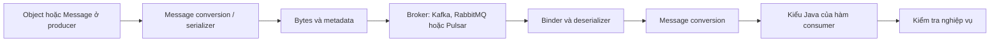

# Nhận diện lỗi contentType, dữ liệu sai định dạng và lỗi kiểu dữ liệu

Khi một message đi qua Spring Cloud Stream, dữ liệu phải được chuyển đổi đúng ở cả phía gửi và phía nhận. Producer có thể tạo một object Java, framework hoặc serializer chuyển object thành bytes, broker lưu và chuyển tiếp bytes, rồi consumer giải mã thành kiểu Java mà hàm `Supplier`, `Function` hoặc `Consumer` mong đợi. Lỗi ở bất kỳ bước nào cũng có thể khiến consumer không nhận được message hoặc nhận dữ liệu không đúng ý nghĩa.

Để chẩn đoán chính xác, cần phân biệt ba nhóm lỗi thường bị nhầm lẫn: `contentType` không mô tả đúng định dạng thực tế, payload không hợp lệ theo định dạng đã khai báo, và payload hợp lệ về cú pháp nhưng không thể ánh xạ vào kiểu dữ liệu đích. Sau khi chuyển đổi thành công, ứng dụng vẫn phải kiểm tra quy tắc nghiệp vụ như trường bắt buộc, số lượng dương hoặc trạng thái hợp lệ.

## 1. Đường đi của dữ liệu qua Spring Cloud Stream

Một luồng message điển hình có các bước sau:



Tùy binder và cấu hình native encoding/decoding, việc serialize và deserialize có thể do Spring Cloud Stream thực hiện hoặc do client của broker thực hiện. Vì vậy, lỗi không nhất thiết phát sinh trong thân hàm consumer. Một lỗi deserializer có thể xảy ra trước khi framework gọi function; lỗi converter có thể xảy ra khi framework chuyển payload sang tham số Java; lỗi nghiệp vụ chỉ xuất hiện sau khi đã có object Java.

Các thành phần cần xác định khi điều tra:

- **Binding:** tên input/output đang được ứng dụng sử dụng, ví dụ `processOrder-in-0`.
- **Destination:** topic, queue hoặc destination logic mà binding kết nối.
- **Content type:** media type được cấu hình ở binding hoặc mang theo trong message header.
- **Serializer/deserializer:** thành phần biến object thành bytes và khôi phục object từ bytes.
- **Converter:** thành phần chuyển payload giữa kiểu message và kiểu Java mà hàm yêu cầu.
- **Schema và quy tắc nghiệp vụ:** hợp đồng dữ liệu và các điều kiện mà ứng dụng kiểm tra sau khi chuyển đổi.

Nếu chỉ nhìn exception cuối cùng mà không xác định bước phát sinh, có thể sửa nhầm cấu hình hoặc retry một message chắc chắn không thể xử lý.

## 2. Phân biệt các nhóm lỗi

| Nhóm lỗi | Ví dụ | Dấu hiệu thường gặp | Vị trí cần kiểm tra |
|---|---|---|---|
| Sai `contentType` | Bytes là JSON nhưng header ghi `text/plain` | Consumer chọn converter không phù hợp hoặc nhận kiểu ngoài dự kiến | Binding config, message header và metadata trên broker |
| Sai định dạng payload | Header ghi `application/json` nhưng bytes bị cắt hoặc JSON sai cú pháp | Lỗi parse/deserialization | Bytes thực tế, producer serializer và đường truyền |
| Sai kiểu dữ liệu | JSON hợp lệ nhưng `quantity` là chuỗi không thể đổi thành số nguyên | Lỗi ánh xạ trường hoặc kiểu Java | DTO, schema, converter và phiên bản producer |
| Thiếu hoặc thừa trường | Consumer yêu cầu trường bắt buộc nhưng producer không gửi | Có thể chuyển đổi được nhưng dữ liệu thiếu hoặc lỗi do cấu hình strict mapping | Schema và quy tắc tương thích |
| Sai quy tắc nghiệp vụ | `quantity` bằng 0 hoặc `orderId` rỗng | Object tạo thành công nhưng validation thất bại | Validator và hợp đồng nghiệp vụ |
| Native serializer không tương thích | Producer và consumer dùng serializer/schema khác nhau | Lỗi xảy ra ở client/binder trước khi function chạy | Cấu hình serializer/deserializer, schema registry nếu có |

Ví dụ, ba payload sau không có cùng loại lỗi:

```text
Payload A: {"orderId":"ord-1","quantity":2
            -> JSON bị thiếu dấu đóng; sai định dạng.

Payload B: {"orderId":"ord-1","quantity":"two"}
            -> JSON hợp lệ; có thể không ánh xạ được quantity sang int.

Payload C: {"orderId":"ord-1","quantity":0}
            -> JSON và kiểu dữ liệu hợp lệ; có thể vi phạm quy tắc nghiệp vụ.
```

Không nên xử lý cả ba trường hợp như một lỗi kết nối broker hoặc một lỗi retry giống nhau.

## 3. Kiểm tra `contentType`

`contentType` cho biết cách diễn giải nội dung message. Trong Spring Cloud Stream, có thể khai báo mặc định theo binding trong `application.yml`:

```yaml
spring:
  cloud:
    function:
      definition: processOrder
    stream:
      bindings:
        processOrder-in-0:
          destination: orders
          group: inventory-service
          content-type: application/json
```

Producer có thể đặt content type trên message khi cần:

```java
Message<OrderCreated> message = MessageBuilder
        .withPayload(event)
        .setHeader(MessageHeaders.CONTENT_TYPE, MimeTypeUtils.APPLICATION_JSON)
        .build();
```

Một binding cũng có thể được cấu hình content type riêng. Hãy tránh để cấu hình binding và header của từng message mâu thuẫn với định dạng bytes thực tế. Khi điều tra, kiểm tra cả cấu hình đã được nạp theo profile lẫn header quan sát được ở consumer; không chỉ xem một file YAML nguồn.

### 3.1. Các dấu hiệu content type không khớp

- Producer gửi object JSON nhưng consumer nhận `String` hoặc `byte[]` ngoài dự kiến.
- Converter báo không tìm thấy converter phù hợp với kiểu payload và content type.
- Consumer cố parse văn bản thuần như JSON hoặc ngược lại.
- Cùng một destination nhưng các producer phát các định dạng khác nhau mà không có quy ước rõ.

Kiểm tra theo thứ tự:

1. Xác nhận định dạng thực tế của payload trước khi gửi: JSON, văn bản, bytes, Avro hay Protobuf.
2. Kiểm tra `content-type` trong cấu hình binding và header của message nếu producer tự đặt header.
3. Kiểm tra kiểu Java mà consumer khai báo, ví dụ `Consumer<OrderCreated>` hay `Consumer<String>`.
4. Xác nhận converter hoặc serializer tương ứng đã được cấu hình và có mặt trong ứng dụng.
5. Nếu bật native encoding/decoding, kiểm tra serializer/deserializer của binder; content type không thay thế cấu hình native.

### 3.2. Native encoding và conversion của framework

Khi dùng cơ chế conversion của Spring Cloud Stream, framework có thể chuyển đổi payload giữa bytes và kiểu Java dựa trên content type cùng converter có sẵn. Khi bật native encoding/decoding, binder/client có thể chịu trách nhiệm serialize hoặc deserialize. Hai đường đi này có cấu hình và điểm phát sinh lỗi khác nhau.

Không bật native decoding chỉ để che một lỗi converter nếu chưa xác định producer thực sự gửi bytes theo định dạng nào. Cũng không để producer serialize payload hai lần, ví dụ biến object thành JSON string rồi lại serialize string đó thành một chuỗi JSON khác. Hãy thống nhất rõ bên nào serialize, bên nào deserialize và kiểm thử đúng cấu hình binder đang chạy.

## 4. Nhận diện dữ liệu sai định dạng

Dữ liệu sai định dạng là dữ liệu không tuân theo cú pháp của định dạng được khai báo. Với JSON, các lỗi thường gặp gồm dấu ngoặc thiếu, dấu phẩy thừa, tên trường không được đặt trong dấu nháy kép hoặc giá trị bị cắt giữa chừng.

Ví dụ JSON lỗi:

```json
{"eventId":"evt-10","orderId":"ord-10","quantity":2
```

Ví dụ JSON hợp lệ:

```json
{
  "eventId": "evt-10",
  "orderId": "ord-10",
  "quantity": 2
}
```

Khi gặp lỗi parse, hãy kiểm tra bytes thực tế được producer phát ra, log serializer ở phía gửi và dữ liệu được lưu trong broker nếu có công cụ phù hợp. Đừng dựa vào một bản JSON được copy từ log đã bị escape hoặc cắt ngắn để kết luận message gốc sai. Log cần giới hạn kích thước và che thông tin nhạy cảm.

Các dấu hiệu thường gặp trong exception có thể gồm `JsonParseException`, `JsonMappingException`, `MessageConversionException` hoặc exception từ serializer/deserializer của client. Tên exception phụ thuộc thư viện và phiên bản; hãy đọc cả nguyên nhân gốc (`cause`) và stack trace để xác định lớp nào thất bại. Không kết luận chỉ từ tên exception ngoài cùng.

## 5. Nhận diện lỗi kiểu dữ liệu và schema

JSON có thể hợp lệ về cú pháp nhưng không tương thích với DTO consumer. Ví dụ producer gửi:

```json
{
  "eventId": "evt-10",
  "orderId": "ord-10",
  "quantity": "two"
}
```

Trong khi consumer khai báo:

```java
public record OrderCreated(
        String eventId,
        String orderId,
        int quantity) {}
```

Giá trị chuỗi `"two"` không thể ánh xạ thành `int` theo quy tắc thông thường. Những tình huống khác gồm số vượt phạm vi kiểu đích, ngày giờ sai định dạng, enum không có giá trị tương ứng, trường lồng nhau sai kiểu hoặc cấu trúc object khác schema.

### 5.1. Kiểm tra hợp đồng DTO

So sánh payload với DTO và schema đã công bố:

- Tên trường có đúng và có phân biệt chữ hoa/chữ thường theo cấu hình mapper không?
- Kiểu số có phù hợp với miền giá trị không? Dùng `long` hoặc `BigDecimal` khi miền giá trị yêu cầu.
- Ngày giờ có quy ước rõ ràng, ví dụ ISO-8601 UTC, và được chuyển về kiểu phù hợp không?
- Enum có xử lý được giá trị mới từ producer không?
- Trường mới có mặc định hợp lý khi consumer cũ nhận message không?
- Trường bắt buộc có được xác thực sau khi deserialize không?

Không nên tự động đổi mọi giá trị sai thành `null`, `0` hoặc một enum mặc định mà không có quy tắc nghiệp vụ. Việc ép kiểu âm thầm có thể làm message qua được converter nhưng tạo dữ liệu sai trong database.

### 5.2. Phân biệt lỗi chuyển đổi và lỗi validation

Chuyển đổi dữ liệu trả lời câu hỏi: “Bytes hoặc payload có thể tạo thành object Java theo kiểu đích không?” Validation trả lời câu hỏi: “Object đã tạo có hợp lệ với nghiệp vụ không?”

Ví dụ, `quantity: "two"` là lỗi chuyển đổi kiểu. `quantity: 0` có thể chuyển đổi thành công nhưng không hợp lệ theo quy tắc đặt hàng. Tách hai bước giúp log, metric và chính sách xử lý lỗi chính xác hơn.

```java
public record OrderCreated(String eventId, String orderId, int quantity) {}

@Component
public class OrderValidator {
    public void validate(OrderCreated event) {
        if (event.eventId() == null || event.eventId().isBlank()) {
            throw new InvalidOrderException("eventId is required");
        }
        if (event.orderId() == null || event.orderId().isBlank()) {
            throw new InvalidOrderException("orderId is required");
        }
        if (event.quantity() <= 0) {
            throw new InvalidOrderException("quantity must be positive");
        }
    }
}

@Bean
Consumer<OrderCreated> processOrder(OrderValidator validator, OrderService service) {
    return event -> {
        validator.validate(event);
        service.process(event);
    };
}
```

`InvalidOrderException` ở đây đại diện cho exception nghiệp vụ do ứng dụng định nghĩa. Cách framework/binder chuyển exception thành error message, retry hoặc DLQ phụ thuộc binder và cấu hình. Hãy phân loại exception một cách rõ ràng ở lớp xử lý lỗi.

## 6. Chẩn đoán theo từng bước

Khi consumer không xử lý được message, thực hiện điều tra theo trình tự sau để khoanh vùng:

1. **Xác định binding và destination.** Ghi lại tên binding, destination, consumer group/subscription, profile và binder đang hoạt động.
2. **Kiểm tra producer.** Xác nhận kiểu payload trước serialize, serializer được dùng, content type và phiên bản schema.
3. **Kiểm tra metadata khi gửi.** Ghi nhận content type, event ID, correlation ID và kích thước payload; không log dữ liệu bí mật.
4. **Xác định điểm lỗi.** Xem function có được gọi hay lỗi xảy ra ở broker client/deserializer/converter trước đó.
5. **Đọc nguyên nhân gốc.** Kiểm tra chuỗi `cause`, tên converter/serializer và trường dữ liệu được nêu trong exception.
6. **Đối chiếu payload với schema.** Tập trung vào trường sai kiểu, thiếu trường, enum mới, định dạng ngày giờ và giá trị vượt giới hạn.
7. **Thử tái hiện bằng một message mẫu đã ẩn dữ liệu nhạy cảm.** Dùng cùng content type và cùng phiên bản DTO/converter.
8. **Kiểm tra kết quả sửa bằng kiểm thử.** Xác nhận message hợp lệ được xử lý, message lỗi được phân loại và không bị retry vô hạn.

Bảng sau giúp chọn điểm kiểm tra đầu tiên:

| Triệu chứng | Nghi ngờ đầu tiên | Bước xác minh |
|---|---|---|
| Function không được gọi và consumer log báo deserialize | Native deserializer hoặc binder | Kiểm tra log client/binder và cấu hình native |
| Function không được gọi, log có lỗi converter | `contentType` hoặc converter | Kiểm tra content type và kiểu Java đích |
| Function được gọi nhưng dữ liệu sai hoặc thiếu | DTO/schema hoặc validation | Kiểm tra payload đã deserialize và quy tắc nghiệp vụ |
| Chỉ một số producer gây lỗi trên cùng destination | Producer dùng schema/content type khác | So sánh metadata và phiên bản producer |
| Lỗi xuất hiện sau khi deploy phiên bản mới | Thay đổi schema hoặc converter | So sánh hợp đồng trước/sau và kiểm tra tương thích ngược |

## 7. Xử lý message lỗi: retry, error channel và DLQ

Không phải mọi lỗi đều nên retry. Retry hữu ích khi nguyên nhân có thể tạm thời biến mất, ví dụ database timeout, dịch vụ phụ thuộc tạm ngừng hoặc lỗi mạng. Payload JSON sai cú pháp, trường có kiểu không thể chuyển đổi hoặc vi phạm quy tắc nghiệp vụ thường là lỗi xác định; gửi lại cùng bytes nhiều lần sẽ không làm dữ liệu trở nên hợp lệ.

| Loại lỗi | Hành động thường phù hợp |
|---|---|
| Lỗi mạng hoặc dịch vụ phụ thuộc tạm thời | Retry có giới hạn và backoff |
| Broker tạm thời không sẵn sàng | Để binder/client phục hồi kết nối theo cấu hình và theo dõi trạng thái |
| JSON sai cú pháp hoặc không ánh xạ được kiểu | Cách ly message, ghi nhận nguyên nhân và chuyển DLQ/error flow theo cấu hình |
| Schema không tương thích | Cách ly, sửa producer/schema hoặc triển khai consumer tương thích rồi mới phát lại |
| Vi phạm quy tắc nghiệp vụ | Từ chối hoặc chuyển quy trình xử lý nghiệp vụ; không retry vô hạn |

Spring Cloud Stream hỗ trợ xử lý lỗi qua cơ chế error handling của Spring Integration và các tính năng riêng của binder. Kafka binder, Rabbit binder và Pulsar binder có cơ chế, mức hỗ trợ và thuộc tính cấu hình retry/DLQ khác nhau; một số hành vi dựa trên chính sách của broker. Tên thuộc tính, điều kiện kích hoạt DLQ, cách giữ offset/acknowledgement và nội dung message được republish phải được kiểm tra theo binder cùng phiên bản đang dùng. Không sao chép nguyên cấu hình DLQ của Kafka sang RabbitMQ hoặc Pulsar.

Một chính sách consumer có thể giới hạn số lần thử:

```yaml
spring:
  cloud:
    stream:
      bindings:
        processOrder-in-0:
          consumer:
            maxAttempts: 3
            backOffInitialInterval: 1000
            backOffMaxInterval: 10000
            backOffMultiplier: 2.0
```

Đây là ví dụ chính sách retry của binding theo các thuộc tính consumer phổ biến. Hành vi thực tế và khả năng phân loại exception cần xác nhận với phiên bản Spring Cloud Stream/binder của ứng dụng. Cấu hình DLQ phải được bổ sung riêng theo binder.

### 7.1. Quy trình vận hành DLQ

DLQ chỉ giúp cách ly message không xử lý được. Đội vận hành vẫn cần:

- Cảnh báo khi số message DLQ tăng hoặc có message đầu tiên xuất hiện.
- Ghi lại event ID, destination, thời điểm, nguyên nhân lỗi và phiên bản consumer.
- Giới hạn quyền truy cập vì payload có thể chứa dữ liệu nhạy cảm.
- Xác định cách sửa dữ liệu hoặc schema trước khi phát lại.
- Đảm bảo phát lại không gây tác động nghiệp vụ trùng lặp bằng idempotency key ổn định.
- Theo dõi số message đang chờ xử lý và thời gian tồn tại trong DLQ.

Không phát lại toàn bộ DLQ ngay sau khi sửa code mà chưa kiểm tra nguyên nhân và tính idempotent của consumer. Nếu message sai do dữ liệu nguồn, cần sửa hoặc loại bỏ theo quy trình nghiệp vụ trước khi phát lại.

## 8. Kiểm thử lỗi chuyển đổi

Kiểm thử nên bao gồm cả payload hợp lệ và payload lỗi ở từng lớp. Test binder có thể giúp kiểm thử luồng binding trong phạm vi ứng dụng, nhưng không thay thế kiểm thử serializer/deserializer và header mapping với broker thực.

Ví dụ kiểm thử validator sau khi conversion đã tạo được object:

```java
@Test
void rejectsNonPositiveQuantity() {
    OrderCreated event = new OrderCreated("evt-1", "ord-1", 0);

    assertThatThrownBy(() -> validator.validate(event))
            .isInstanceOf(InvalidOrderException.class);
}
```

Với converter/serializer, hãy bổ sung các ca kiểm thử:

- JSON hợp lệ có đủ trường và đúng kiểu.
- JSON sai cú pháp hoặc bytes bị cắt.
- JSON hợp lệ nhưng có trường sai kiểu, ví dụ số được gửi thành chuỗi chữ.
- Trường bị thiếu, `null`, giá trị enum mới hoặc số vượt giới hạn.
- Content type không khớp payload.
- Producer và consumer dùng hai phiên bản schema cần kiểm tra tương thích.
- Native encoding/decoding được bật và tắt theo từng cấu hình cần hỗ trợ.
- Message lỗi đi vào đúng error flow/DLQ và message hợp lệ vẫn được xử lý.

Khi kiểm thử tích hợp, dùng broker tương ứng với môi trường triển khai. Xác nhận message lỗi không bị mất âm thầm, không tạo vòng retry vô hạn và có đủ metadata để điều tra. Với message phát lại từ DLQ, xác nhận consumer không thực hiện tác động nghiệp vụ hai lần.

## 9. Ghi log và quan sát có trách nhiệm

Log hữu ích nên cung cấp ngữ cảnh để điều tra mà không làm lộ toàn bộ payload. Các trường có thể ghi nhận gồm:

- Binding, destination và consumer group/subscription.
- Event ID và correlation ID.
- Content type và phiên bản schema.
- Tên exception, nguyên nhân gốc và trường dữ liệu gây lỗi nếu xác định được.
- Số lần retry, trạng thái DLQ và broker offset/partition hoặc metadata giao nhận tương ứng nếu có.

Tránh log token, mật khẩu, thông tin cá nhân hoặc payload đầy đủ. Nếu cần lưu payload lỗi để điều tra, hãy dùng kho lưu trữ có kiểm soát truy cập, thời hạn lưu và cơ chế che dữ liệu phù hợp. Metric nên tách số lỗi conversion, lỗi validation, lỗi phụ thuộc và số message vào DLQ để nhóm biết cần sửa producer, schema hay hạ tầng.

## 10. Danh sách kiểm tra trước khi triển khai

- [ ] Producer và consumer thống nhất `contentType` và định dạng bytes thực tế.
- [ ] Xác định rõ framework hay native serializer/deserializer chịu trách nhiệm chuyển đổi.
- [ ] DTO và schema có quy tắc tương thích khi thêm, đổi hoặc bỏ trường.
- [ ] Lỗi cú pháp, lỗi kiểu dữ liệu và lỗi validation được phân biệt.
- [ ] Exception được phân loại theo khả năng retry; lỗi dữ liệu xác định không bị retry vô hạn.
- [ ] DLQ/error flow được cấu hình và kiểm thử theo đúng binder/version.
- [ ] Log và metric có event ID, binding, content type và nguyên nhân lỗi nhưng không lộ dữ liệu nhạy cảm.
- [ ] Có kiểm thử payload sai định dạng, sai kiểu, thiếu trường và schema không tương thích.
- [ ] Quy trình sửa và phát lại message DLQ bảo đảm idempotency.

Chẩn đoán lỗi chuyển đổi dữ liệu hiệu quả bắt đầu bằng việc xác định message thất bại ở bước nào: serializer, broker client, binder, converter hay validation nghiệp vụ. Khi đã phân loại đúng lỗi `contentType`, lỗi định dạng và lỗi kiểu dữ liệu, nhóm có thể chọn cách sửa producer/schema, điều chỉnh converter hoặc cách ly message. Kết hợp retry có giới hạn, DLQ có quy trình và kiểm thử với broker thật giúp luồng Spring Cloud Stream dễ vận hành hơn khi nhiều phiên bản dịch vụ cùng trao đổi sự kiện.
