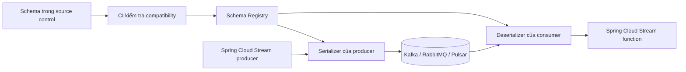

# Vai trò Schema Registry và lựa chọn cơ chế tích hợp

Trong hệ thống xử lý sự kiện, producer và consumer thường được phát triển, triển khai ở những thời điểm khác nhau. Producer có thể thêm trường mới, đổi cấu trúc payload hoặc phát hành phiên bản ứng dụng mới trong khi consumer cũ vẫn đang chạy. Nếu hai phía không thống nhất cấu trúc dữ liệu, message có thể không giải mã được hoặc consumer diễn giải sai ý nghĩa nghiệp vụ.

**Schema Registry** giúp quản lý schema của message tập trung, gắn schema với phiên bản hoặc định danh, kiểm tra quy tắc tương thích và hỗ trợ producer/consumer dùng đúng cấu trúc dữ liệu. Khi tích hợp Spring Cloud Stream, cần chọn cơ chế phù hợp với binder và broker: dùng message converter của Spring, serializer/deserializer có tích hợp registry, schema tích hợp của Pulsar hoặc một registry bên ngoài cho RabbitMQ.

## 1. Schema là hợp đồng dữ liệu

Schema mô tả cấu trúc và quy tắc của payload được trao đổi giữa các ứng dụng. Tùy định dạng, schema có thể khai báo:

- Tên record hoặc message và các trường dữ liệu.
- Kiểu dữ liệu của từng trường, chẳng hạn chuỗi, số, boolean, mảng hoặc đối tượng lồng nhau.
- Trường bắt buộc, trường tùy chọn và giá trị mặc định.
- Quy tắc biểu diễn enum, timestamp, decimal hoặc dữ liệu nhị phân.
- Thông tin phiên bản và các quy tắc tương thích khi cấu trúc thay đổi.

Ví dụ, sự kiện `OrderCreated` có thể được mô tả bằng JSON Schema:

```json
{
  "$schema": "https://json-schema.org/draft/2020-12/schema",
  "$id": "https://schemas.example.com/orders/order-created.json",
  "title": "OrderCreated",
  "type": "object",
  "required": ["eventId", "orderId", "occurredAt"],
  "properties": {
    "eventId": { "type": "string" },
    "orderId": { "type": "string" },
    "occurredAt": { "type": "string", "format": "date-time" },
    "customerId": { "type": ["string", "null"] },
    "source": { "type": "string", "default": "order-service" }
  },
  "additionalProperties": false
}
```

Schema này quy định các trường bắt buộc và kiểu dữ liệu hợp lệ. Producer cần tạo payload phù hợp với schema; consumer cần hiểu cùng hợp đồng hoặc một phiên bản tương thích. Schema không thay thế quy tắc nghiệp vụ: JSON Schema có thể xác nhận `orderId` là chuỗi, nhưng không tự xác minh đơn hàng đó có tồn tại trong hệ thống.

Các định dạng schema thường gặp:

| Định dạng | Đặc điểm | Trường hợp sử dụng |
|---|---|---|
| JSON Schema | Mô tả cấu trúc JSON, kiểu, ràng buộc và trường bắt buộc. | Tích hợp đa ngôn ngữ, payload JSON dễ đọc. |
| Avro | Định nghĩa record và kiểu dữ liệu; thường dùng kèm schema ID/registry trong hệ Kafka. | Luồng dữ liệu có schema tiến hóa và yêu cầu biểu diễn gọn. |
| Protobuf | Định nghĩa message và field number trong file `.proto`; hỗ trợ code generation. | Hệ thống nhiều ngôn ngữ cần hợp đồng nhị phân ổn định. |
| JSON không có schema registry | Cấu trúc được quản lý bằng code, tài liệu hoặc kiểm tra riêng. | Hệ thống nhỏ hoặc tích hợp đơn giản, nhưng cần kỷ luật phiên bản. |

## 2. Schema Registry giải quyết vấn đề gì?

Schema Registry là dịch vụ quản lý schema và các phiên bản của chúng. Tùy sản phẩm, registry có thể cung cấp API để đăng ký schema, tra cứu schema theo ID hoặc subject, kiểm tra tương thích trước khi đăng ký và quản lý quyền truy cập.

Registry thường giải quyết bốn nhu cầu:

1. **Lưu trữ hợp đồng tập trung:** producer và consumer tham chiếu cùng một định nghĩa thay vì duy trì các bản sao không đồng bộ.
2. **Quản lý phiên bản:** mỗi thay đổi schema có thể được lưu thành phiên bản mới, có thể truy vết và tra cứu.
3. **Kiểm tra tương thích:** ngăn thay đổi phá vỡ consumer hiện có hoặc producer mới theo chính sách đã chọn.
4. **Tra cứu khi serialize/deserialize:** serializer có thể đăng ký schema hoặc lấy schema theo ID để mã hóa/giải mã payload.

Registry không phải broker. Kafka, RabbitMQ và Pulsar đảm nhiệm truyền, định tuyến hoặc lưu trữ message; registry quản lý hợp đồng dữ liệu. Broker có thể lưu message ngay cả khi schema sai, trừ khi một thành phần kiểm tra schema được tích hợp vào đường gửi/nhận.



Sơ đồ là mô hình khái niệm. Tùy cơ chế tích hợp, registry có thể được truy cập lúc build, lúc khởi động, lúc serialize hoặc lúc deserialize; không phải mọi ứng dụng đều gọi registry cho từng message.

## 3. Subject, schema ID và phiên bản

Nhiều registry tổ chức schema theo một khóa logic như **subject**. Subject xác định nhóm schema thuộc một hợp đồng cụ thể. Ví dụ, registry có thể quản lý schema cho giá trị của topic `orders.events` và một subject khác cho key của cùng topic.

Với một số nền tảng như Confluent Schema Registry, chiến lược đặt subject có thể dựa trên tên topic và vai trò key/value, hoặc dựa trên tên record. Chiến lược subject ảnh hưởng cách registry xác định schema nào cần so sánh tương thích với schema mới. Cần thống nhất chiến lược giữa các producer và consumer; không nên giả định mọi registry đều dùng cùng quy tắc.

Một schema có thể có:

- **Subject:** tên nhóm hợp đồng mà schema thuộc về.
- **Version:** thứ tự phiên bản trong subject.
- **Schema ID:** định danh dùng để tra cứu schema trong registry.
- **Schema definition:** nội dung JSON Schema, Avro, Protobuf hoặc định dạng tương ứng.

Trong một số định dạng wire format, serializer ghi schema ID hoặc thông tin tham chiếu vào dữ liệu truyền đi. Consumer dùng ID đó để lấy đúng schema khi giải mã. Cách mã hóa ID, header hoặc phần mở đầu payload phụ thuộc serializer và registry; không có một wire format chung cho mọi sản phẩm.

Không nên tự tạo schema ID trong ứng dụng hoặc coi version của class Java là schema ID. Hãy để registry và serializer tương ứng quản lý định danh, đồng thời lưu schema source trong hệ thống quản lý phiên bản để review và tái tạo.

## 4. Schema evolution và compatibility

Schema evolution là quá trình thay đổi cấu trúc message theo thời gian mà vẫn giữ các ứng dụng đang triển khai hoạt động đúng. Trước khi thêm, đổi hoặc xóa trường, cần xem xét producer mới sẽ giao tiếp với consumer cũ ra sao và producer cũ sẽ giao tiếp với consumer mới ra sao.

Các chế độ tương thích thường gặp trong registry:

| Chế độ | Ý nghĩa khái quát | Hữu ích khi |
|---|---|---|
| Backward | Consumer dùng schema mới có thể đọc dữ liệu được ghi theo schema cũ. | Consumer được nâng cấp trước producer. |
| Forward | Consumer dùng schema cũ có thể đọc dữ liệu được ghi theo schema mới. | Producer được nâng cấp trước consumer. |
| Full | Hỗ trợ cả backward và forward trong phạm vi so sánh được định nghĩa. | Producer và consumer có thể nâng cấp theo thứ tự khác nhau. |
| Backward/Forward/Full Transitive | Kiểm tra tương thích với nhiều phiên bản trước đó thay vì chỉ phiên bản liền trước. | Hệ thống cần bảo đảm tương thích xuyên nhiều lần phát hành. |

Tên và chi tiết chế độ có thể khác theo registry; cần đọc chính sách của sản phẩm đang dùng. Compatibility cũng phụ thuộc định dạng schema và quy tắc cụ thể của từng trường.

### Ví dụ thay đổi tương thích

Giả sử schema ban đầu có các trường `eventId`, `orderId` và `occurredAt`. Thêm trường `source` tùy chọn có giá trị mặc định thường dễ tương thích hơn việc thêm một trường bắt buộc mà consumer cũ không biết cách cung cấp hoặc xử lý.

Các thay đổi thường cần thận trọng:

- Thêm trường bắt buộc không có default.
- Xóa trường mà consumer cũ vẫn đọc.
- Đổi kiểu dữ liệu, ví dụ `integer` thành `string`.
- Đổi ý nghĩa của trường nhưng giữ nguyên tên và kiểu.
- Thay đổi enum theo cách consumer cũ không nhận biết được giá trị mới.
- Thay đổi quy tắc nullability hoặc default.

Compatibility kỹ thuật không đảm bảo tương thích nghiệp vụ. Ví dụ, đổi ý nghĩa `amount` từ “đơn vị đồng” sang “đơn vị xu” vẫn có thể vượt qua kiểm tra kiểu dữ liệu nhưng làm sai kết quả nghiệp vụ. Khi đổi ý nghĩa, nên tạo trường hoặc event version mới và có kế hoạch chuyển đổi rõ ràng.

## 5. Quy trình đăng ký và sử dụng schema

Một quy trình điển hình gồm các bước:

1. Nhóm phát triển định nghĩa schema trong source control cùng với mã producer/consumer.
2. Pipeline CI kiểm tra cú pháp, lint và compatibility với phiên bản đã đăng ký.
3. Schema mới được đăng ký vào subject tương ứng sau khi vượt qua chính sách.
4. Producer dùng serializer tương thích để kiểm tra payload và tạo dữ liệu theo schema đã đăng ký.
5. Consumer dùng deserializer hoặc converter để đọc dữ liệu, lấy schema theo ID nếu wire format yêu cầu.
6. Theo dõi lỗi schema, lỗi deserialize và các phiên bản producer/consumer đang chạy.

Tùy chiến lược triển khai, schema có thể được đăng ký trước khi ứng dụng chạy (pre-registration), hoặc serializer đăng ký tự động khi phát hiện schema mới. Đăng ký trước giúp kiểm soát thay đổi trong CI/CD; đăng ký tự động tiện cho môi trường phát triển nhưng cần giới hạn quyền và tránh để ứng dụng production tự tạo schema không được review.

## 6. Các lựa chọn tích hợp với Spring Cloud Stream

Spring Cloud Stream cung cấp binding và binder để kết nối hàm ứng dụng với broker. Việc tích hợp schema registry nằm ở lớp chuyển đổi dữ liệu hoặc serializer/deserializer cụ thể. Có một số cách lựa chọn.

### 6.1. Dùng MessageConverter của Spring

Đây là cách tự nhiên khi ứng dụng trao đổi payload bằng JSON hoặc một định dạng được converter hỗ trợ. Binding khai báo `content-type`, framework chọn converter để chuyển giữa `Message<?>` và đối tượng Java.

```yaml
spring:
  cloud:
    function:
      definition: publishOrder
    stream:
      bindings:
        publishOrder-out-0:
          destination: orders.events
          content-type: application/json
```

Ví dụ này chỉ cấu hình định dạng JSON. Nó không tự kết nối tới Schema Registry. Nếu cần quản lý JSON Schema tập trung, ứng dụng cần thêm bước tích hợp registry, như kiểm tra schema trước khi gửi, converter có thể lấy schema từ registry hoặc validation trong pipeline.

Có thể dùng `MessageConverter` tùy chỉnh khi muốn giữ mô hình binding của Spring Cloud Stream nhưng cần chuyển đổi theo một registry hoặc một quy ước schema riêng. Converter cần xác định media type, kiểu đích, cách lấy schema, cách validate và cách xử lý lỗi. Cần đăng ký converter theo cơ chế được hỗ trợ ở phiên bản Spring Cloud Stream đang dùng.

### 6.2. Dùng serializer/deserializer native của Kafka

Với Kafka, một lựa chọn phổ biến là dùng serializer/deserializer của hệ sinh thái registry, chẳng hạn Avro, JSON Schema hoặc Protobuf serializer. Trong trường hợp đó, Kafka client serializer chịu trách nhiệm encode payload và có thể tương tác với Schema Registry.

Spring Cloud Stream Kafka binder hỗ trợ native encoding ở producer và native decoding ở consumer. Cấu hình khái quát:

```yaml
spring:
  cloud:
    stream:
      bindings:
        orderEvents-out-0:
          destination: orders.events
        orderEvents-in-0:
          destination: orders.events
          group: order-projection
      kafka:
        bindings:
          orderEvents-out-0:
            producer:
              useNativeEncoding: true
          orderEvents-in-0:
            consumer:
              useNativeDecoding: true
```

Khi bật native encoding/decoding, cần cấu hình đúng Kafka serializer/deserializer và các thuộc tính registry tương ứng theo phiên bản Kafka binder, Kafka client và thư viện serializer. Ví dụ, serializer cần biết địa chỉ registry, cơ chế xác thực và kiểu schema được dùng. Các thuộc tính này thường được chuyển tới Kafka client thông qua cấu hình binder hoặc cấu hình producer/consumer chuyên biệt.

Không bật native encoding chỉ vì muốn dùng Schema Registry. Phải bảo đảm producer serializer và consumer deserializer tương thích với nhau, kiểu payload Java phù hợp với Avro/JSON Schema/Protobuf, và ứng dụng xử lý đúng wire format. Khi native decoding được bật, message converter thông thường của Spring không còn chịu trách nhiệm chính cho bước decode payload đó.

### 6.3. Dùng schema tích hợp của Pulsar

Pulsar có cơ chế schema tích hợp với broker. Producer có thể khai báo schema cho topic và Pulsar kiểm tra schema của message theo cấu hình, đồng thời quản lý phiên bản và compatibility theo chính sách được hỗ trợ.

Khi dùng Spring Cloud Stream Pulsar binder, có thể lựa chọn cơ chế schema thông qua các tùy chọn riêng của binder/client. Cần kiểm tra tài liệu của đúng phiên bản Pulsar binder để biết cách khai báo schema type, cách xử lý schema JSON/Avro/Protobuf và cách cấu hình compatibility. Cơ chế này là schema management của Pulsar; không nên mặc định nó dùng cùng API hoặc cùng schema ID với Confluent Schema Registry.

### 6.4. Dùng registry bên ngoài với RabbitMQ

RabbitMQ là message broker, không cung cấp một Schema Registry tương đương Confluent như một phần mặc định của broker. Ứng dụng dùng RabbitMQ vẫn có thể quản lý schema bằng registry bên ngoài như Apicurio hoặc Confluent Schema Registry, hoặc dùng một cơ chế quản lý schema nội bộ.

Với Spring Cloud Stream Rabbit binder, message thường đi qua cơ chế conversion của Spring. Để dùng registry bên ngoài, có thể tích hợp converter/serializer trong ứng dụng, hoặc dùng một thành phần producer/consumer chuyên biệt thực hiện encode/decode theo hợp đồng. Cần bảo đảm payload, schema reference và metadata được truyền nguyên vẹn qua exchange/queue. Nếu registry ID nằm trong payload, consumer phải có thư viện phù hợp để tra cứu và giải mã.

Không nên nhầm RabbitMQ message persistence hoặc durable queue với schema compatibility. Queue bền vững bảo vệ message theo chính sách lưu trữ; nó không xác minh cấu trúc payload.

## 7. So sánh các lựa chọn tích hợp

| Cơ chế | Kafka | RabbitMQ | Pulsar |
|---|---|---|---|
| Spring MessageConverter | Có thể dùng cho payload theo content type. | Có thể dùng cho payload theo content type. | Có thể dùng tùy cấu hình binder và converter. |
| Native serializer/deserializer | Thường dùng với Kafka client serializer và registry bên ngoài. | Có thể tích hợp serializer/converter trong ứng dụng; không có native registry mặc định tương đương. | Có schema và serializer tích hợp với Pulsar client/broker. |
| Schema Registry bên ngoài | Phổ biến, ví dụ Confluent hoặc Apicurio. | Có thể dùng Confluent, Apicurio hoặc registry nội bộ. | Có thể dùng nếu kiến trúc yêu cầu, song song hoặc thay cho cơ chế schema native tùy thiết kế. |
| Kiểm tra schema | Registry/serializer hoặc validation ở ứng dụng. | Converter/validation hoặc thành phần tích hợp registry. | Cơ chế schema của Pulsar và/hoặc validation ứng dụng. |

Không có một lựa chọn tốt nhất cho mọi hệ thống. Quyết định phụ thuộc định dạng payload, broker, ngôn ngữ của producer/consumer, nhu cầu compatibility, độ trễ, khả năng vận hành và yêu cầu tránh phụ thuộc vào nhà cung cấp.

## 8. Quản lý schema trong source control và CI/CD

Schema là một phần của hợp đồng tích hợp, vì vậy nên được review và phát hành như mã nguồn. Một cấu trúc thư mục có thể tổ chức theo domain và event:

```text
schemas/
  orders/
    order-created.avsc
    order-created-v1.json
    order-created-v2.json
  payments/
    payment-authorized.proto
```

Không nhất thiết phải dùng đúng cấu trúc trên; điều quan trọng là có chủ sở hữu, quy tắc đặt tên và lịch sử thay đổi rõ ràng. Pipeline CI có thể thực hiện:

1. Kiểm tra cú pháp schema và quy tắc lint.
2. So sánh với phiên bản đang đăng ký trong registry.
3. Từ chối thay đổi vi phạm compatibility policy.
4. Sinh code Java hoặc các ngôn ngữ khác nếu dùng Avro/Protobuf.
5. Đăng ký schema mới theo quy trình có kiểm soát.
6. Chạy contract test giữa producer và consumer.

Nên tách quyền đọc schema và quyền đăng ký schema. Producer/consumer runtime thường chỉ cần đọc schema; pipeline phát hành hoặc nhóm quản trị schema mới cần quyền tạo phiên bản. Cách phân quyền này giảm nguy cơ một bản triển khai ngoài ý muốn tạo schema mới ảnh hưởng tới toàn hệ thống.

## 9. Quản lý lỗi khi tích hợp registry

Các lỗi thường gặp gồm:

- Registry không truy cập được do mạng, DNS, TLS hoặc xác thực.
- Producer cố đăng ký schema vi phạm compatibility policy.
- Serializer không tìm thấy subject hoặc schema ID.
- Consumer không lấy được schema cần thiết để giải mã.
- Payload được tạo theo schema khác với schema ID đi kèm.
- Producer và consumer dùng serializer/deserializer hoặc cấu hình wire format không tương thích.
- Schema đã đăng ký nhưng class Java sinh ra không đồng bộ với định nghĩa schema.

Ứng dụng cần phân loại lỗi và xác định hành vi phù hợp. Lỗi registry tạm thời có thể cần retry với backoff; lỗi compatibility hoặc schema sai thường cần dừng phát hành và sửa hợp đồng. Không nên retry vô hạn một schema không hợp lệ.

Với consumer, lỗi deserialize có thể xảy ra trước khi function được gọi. Vì vậy, chỉ đặt `try/catch` bên trong function không đủ để bắt mọi lỗi schema. Cần cấu hình error handling ở tầng binder/container, quan sát lỗi conversion và cân nhắc DLQ cho message không thể giải mã. Cách cấu hình chính xác phụ thuộc binder.

Không nên tự động bỏ message không giải mã được. Cần lưu thông tin định danh, destination, schema ID nếu có, exception và correlation ID để điều tra. Tránh ghi toàn bộ payload nhạy cảm vào log.

## 10. Bảo mật và độ sẵn sàng của Schema Registry

Registry nằm trên đường phát hoặc nhận dữ liệu trong một số cơ chế tích hợp. Nếu serializer cần gọi registry khi xử lý message mà registry ngừng hoạt động, luồng có thể bị chậm hoặc thất bại. Cần thiết kế registry như một thành phần vận hành quan trọng:

- Dùng TLS và xác thực giữa ứng dụng với registry.
- Phân quyền read/write theo ứng dụng hoặc pipeline phát hành.
- Lưu credential trong secret manager hoặc biến môi trường được bảo vệ.
- Theo dõi latency, tỷ lệ lỗi, số lần đăng ký và tình trạng lưu trữ schema.
- Dùng cache schema nếu serializer/registry hỗ trợ, đồng thời hiểu chính sách cache và hành vi khi schema chưa có trong cache.
- Có backup và kế hoạch khôi phục metadata registry.
- Tránh xóa subject/version đang được message tồn tại hoặc consumer cũ cần để giải mã.

Không nên coi việc broker vẫn hoạt động là đủ để bảo đảm luồng message nếu serializer phụ thuộc registry bên ngoài. Kiểm thử cả tình huống registry mất kết nối và khôi phục.

## 11. Kiểm thử hợp đồng và tương thích

Một bộ kiểm thử schema nên bao gồm nhiều lớp:

| Loại kiểm thử | Mục tiêu |
|---|---|
| Schema validation | Xác nhận payload hợp lệ với schema đang dùng. |
| Compatibility test | Xác nhận schema mới đáp ứng chính sách backward/forward/full. |
| Serialization test | Producer serializer tạo đúng wire format và schema reference. |
| Deserialization test | Consumer giải mã được message đã phát bởi phiên bản producer cần hỗ trợ. |
| Contract test | Producer và consumer độc lập vẫn hiểu cùng hợp đồng dữ liệu. |
| Integration test | Binder và broker thật truyền payload, schema ID/header và lỗi đúng như dự kiến. |
| Failure test | Kiểm tra registry mất kết nối, schema ID không tồn tại hoặc payload sai schema. |

Test Binder của Spring Cloud Stream hữu ích để kiểm thử function và binding trong phạm vi ứng dụng, nhưng không mô phỏng đầy đủ Schema Registry thật, native serializer hoặc schema enforcement của broker. Cần có kiểm thử tích hợp với registry/broker thực tế cho các hành vi đó.

## 12. Chọn cơ chế tích hợp phù hợp

Trước khi quyết định dùng Schema Registry nào và tích hợp ở tầng nào, hãy trả lời:

1. Producer và consumer dùng JSON, Avro, Protobuf hay định dạng khác?
2. Có cần code generation và kiểu dữ liệu mạnh ở nhiều ngôn ngữ không?
3. Broker đang dùng Kafka, RabbitMQ hay Pulsar, và binder phiên bản nào?
4. Broker có schema management tích hợp hay cần registry bên ngoài?
5. Schema được đăng ký trước trong CI/CD hay được serializer đăng ký tự động?
6. Compatibility policy nào phù hợp với thứ tự rollout producer/consumer?
7. Serializer/deserializer nằm trong Spring MessageConverter hay native client của binder?
8. Schema ID/version được truyền trong payload, header hay cơ chế riêng của broker?
9. Ứng dụng xử lý lỗi registry và message không giải mã được như thế nào?
10. Ai có quyền thay đổi schema và quy trình review/rollback ra sao?

Với luồng Kafka dùng Avro hoặc Protobuf và nhiều dịch vụ độc lập, serializer tích hợp Schema Registry thường là lựa chọn phổ biến. Với ứng dụng Spring Cloud Stream trao đổi JSON đơn giản, message converter cùng schema validation trong CI có thể đủ. Với Pulsar, hãy cân nhắc schema native trước khi thêm registry ngoài. Với RabbitMQ, cần chọn registry bên ngoài hoặc cơ chế quản lý schema ở tầng ứng dụng. Dù chọn cách nào, hợp đồng phải được quản lý phiên bản, kiểm tra tương thích và kiểm thử cùng producer/consumer trước khi phát hành.
