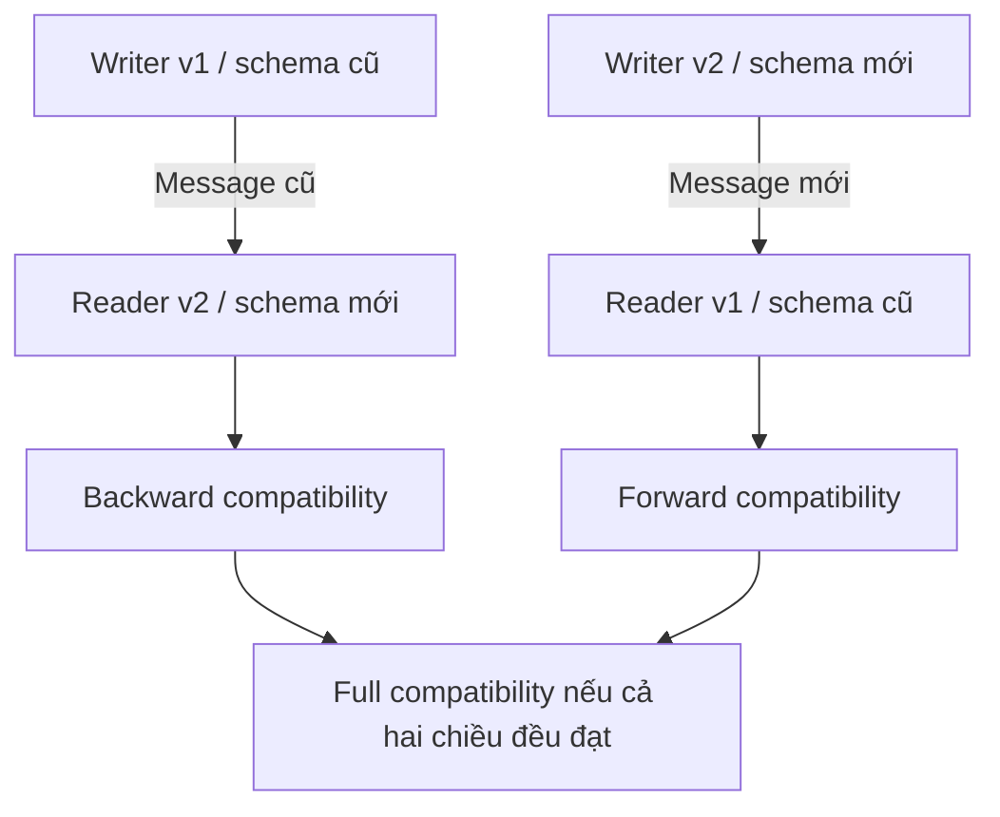
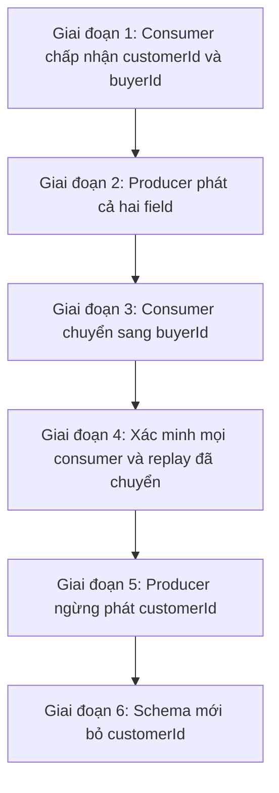

# Tương thích ngược, tương thích xuôi và thay đổi phá vỡ hợp đồng

Trong hệ thống xử lý sự kiện, producer và consumer thường được triển khai ở các thời điểm khác nhau. Một producer mới có thể phát message trong khi một số consumer vẫn chạy phiên bản cũ; một consumer mới có thể đọc backlog được tạo từ nhiều tháng trước; một nhóm khác có thể phát lại message từ dead-letter queue. Vì vậy, thay đổi cấu trúc event phải tính đến cả dữ liệu mới lẫn dữ liệu đã tồn tại.

**Tương thích ngược (backward compatibility)** và **tương thích xuôi (forward compatibility)** mô tả khả năng hai phiên bản schema hoặc hai phía ghi/đọc làm việc cùng nhau khi được triển khai lệch thời điểm. Một thay đổi phá vỡ hợp đồng có thể khiến message không giải mã được, consumer từ chối payload, hoặc tệ hơn là giải mã thành công nhưng diễn giải sai nghiệp vụ.

Bài này đặt các khái niệm đó trong bối cảnh Spring Cloud Stream: nhiều producer, nhiều consumer group, message được lưu giữ và phát lại qua Kafka, RabbitMQ hoặc Pulsar. Bạn sẽ học cách đánh giá thay đổi schema, chọn chiến lược rollout và kiểm thử hợp đồng trước khi phát hành.

## 1. Hợp đồng sự kiện gồm những gì?

Hợp đồng sự kiện là thỏa thuận giữa nơi phát và nơi nhận về cấu trúc, ý nghĩa và cách giao nhận của một sự kiện. Nó rộng hơn một class Java hoặc một file schema.

Một event có thể gồm:

- **Định danh:** event ID, event type, phiên bản hợp đồng và thời điểm xảy ra.
- **Payload:** các field, kiểu dữ liệu, quy tắc bắt buộc, giá trị mặc định và ý nghĩa nghiệp vụ.
- **Header:** correlation ID, causation ID, tenant, trace context, content type và metadata cần cho xử lý.
- **Routing:** destination, message key, routing key hoặc partition key.
- **Ngữ nghĩa:** thứ tự sự kiện, đơn vị đo, múi giờ, quy tắc null, idempotency và ý nghĩa của trạng thái.
- **Chính sách lưu giữ:** retention, replay, DLQ và thời gian một consumer có thể còn đọc dữ liệu cũ.

Ví dụ event `OrderCreated`:

```json
{
  "eventId": "evt-1001",
  "eventType": "OrderCreated",
  "occurredAt": "2026-11-24T09:30:00Z",
  "aggregateId": "order-42",
  "data": {
    "orderId": "order-42",
    "customerId": "customer-18",
    "total": 1250000
  }
}
```

Một thay đổi có thể giữ nguyên JSON nhưng vẫn phá vỡ hợp đồng. Chẳng hạn, field `total` trước đây tính bằng đồng Việt Nam, sau đó chuyển sang đơn vị nghìn đồng mà không đổi tên hoặc thêm metadata. Consumer vẫn parse được số, nhưng kết quả nghiệp vụ sai gấp một nghìn lần.

Vì vậy, đánh giá compatibility cần kiểm tra cả cấu trúc lẫn ý nghĩa. Trong hệ thống Spring Cloud Stream, binding và binder quyết định cách message được chuyển tới consumer; chúng không tự bảo đảm rằng mọi phiên bản consumer hiểu cùng một hợp đồng.

## 2. Phân biệt backward và forward compatibility

Hai khái niệm này được xác định theo chiều đọc/ghi. Cần nói rõ đang nhìn từ schema reader hay schema writer để tránh nhầm chiều.

- **Backward compatible:** reader dùng schema mới có thể đọc dữ liệu đã được writer cũ ghi theo schema cũ. Nói ngắn gọn: *consumer mới đọc được message cũ*.
- **Forward compatible:** reader dùng schema cũ có thể đọc dữ liệu được writer mới ghi theo schema mới. Nói ngắn gọn: *consumer cũ đọc được message mới*.
- **Full compatible:** đáp ứng cả hai chiều trên.
- **Không tương thích (breaking):** một hoặc cả hai chiều không còn được bảo đảm; hệ thống cần phối hợp triển khai, chuyển đổi dữ liệu hoặc tạo hợp đồng/version mới.

| Chiều tương thích | Writer | Reader | Câu hỏi thực tế |
|---|---|---|---|
| Backward | Schema cũ | Schema mới | Consumer mới có đọc được backlog cũ không? |
| Forward | Schema mới | Schema cũ | Consumer cũ có đọc được message mới không? |
| Full | Cũ và mới | Mới và cũ | Có thể triển khai producer/consumer theo thứ tự nào cũng được không? |

Sơ đồ:



Ví dụ: phiên bản 2 thêm field `currency` tùy chọn.

- Consumer mới đọc event phiên bản 1: nếu consumer xử lý được trường hợp thiếu `currency`, thay đổi có thể backward compatible.
- Consumer cũ đọc event phiên bản 2: nếu consumer bỏ qua field chưa biết và schema cho phép field mới, thay đổi có thể forward compatible.
- Nếu một trong hai phía từ chối field lạ hoặc yêu cầu field mới phải luôn hiện diện, chiều tương ứng sẽ thất bại.

Compatibility không phải thuộc tính tuyệt đối của một file schema. Nó phụ thuộc format, quy tắc reader/writer, cấu hình validator, serializer/deserializer và cách ứng dụng xử lý dữ liệu thiếu hoặc dư.

## 3. Đánh giá thay đổi field

Một quy tắc thực hành là kiểm tra riêng hai trường hợp: reader mới nhận dữ liệu cũ, và reader cũ nhận dữ liệu mới. Bảng sau là định hướng phổ biến; kết quả chính xác phụ thuộc Avro, Protobuf, JSON Schema và chính sách của consumer.

| Thay đổi | Backward: consumer mới đọc dữ liệu cũ | Forward: consumer cũ đọc dữ liệu mới |
|---|---|---|
| Thêm field tùy chọn, có cách xử lý khi thiếu | Thường có thể đạt | Thường có thể đạt nếu consumer cũ bỏ qua field lạ |
| Thêm field bắt buộc, không có default | Thường phá vỡ | Có thể đạt nếu reader cũ bỏ qua field lạ |
| Bỏ field tùy chọn | Thường có thể đạt nếu reader mới không cần field | Có thể phá vỡ nếu reader cũ còn yêu cầu field |
| Bỏ field bắt buộc | Reader mới có thể bỏ qua field cũ | Thường phá vỡ với reader cũ cần field |
| Đổi tên field | Thường phá vỡ nếu không có alias hoặc mapping | Thường phá vỡ nếu không phát cả tên cũ |
| Đổi kiểu dữ liệu | Phụ thuộc quy tắc chuyển kiểu của format | Phụ thuộc quy tắc chuyển kiểu của format |
| Đổi ý nghĩa hoặc đơn vị | Có thể parse nhưng sai nghiệp vụ | Có thể parse nhưng sai nghiệp vụ |
| Xóa enum symbol | Có thể làm reader mới không hiểu dữ liệu cũ | Có thể làm reader cũ không hiểu symbol mới nếu ngược lại |
| Đổi message key hoặc routing semantics | Có thể làm thay đổi phân vùng/thứ tự | Có thể làm consumer nhận dữ liệu sai luồng |

### Thêm field tùy chọn

Giả sử phiên bản 1 có:

```json
{
  "orderId": "order-42",
  "total": 1250000
}
```

Phiên bản 2 bổ sung `currency`:

```json
{
  "orderId": "order-42",
  "total": 1250000,
  "currency": "VND"
}
```

Consumer mới cần xử lý message cũ không có field này. Trong Java, không nên giả định deserializer luôn tự điền giá trị nghiệp vụ đúng. Hãy xử lý rõ trường hợp null hoặc thiếu:

```java
public record OrderCreated(
        String orderId,
        long total,
        String currency
) {
    public String effectiveCurrency() {
        return currency == null ? "VND" : currency;
    }
}
```

Giá trị `VND` chỉ hợp lệ nếu đó là quy tắc nghiệp vụ đã được xác nhận cho dữ liệu cũ. Nếu hệ thống từng xử lý nhiều loại tiền tệ, không được tự suy ra currency từ một giá trị mặc định chung; khi đó cần migration hoặc metadata rõ ràng.

Với JSON Schema, `default` là annotation mô tả giá trị mặc định. Validator hoặc JSON parser không bắt buộc tự chèn giá trị đó vào payload. Ứng dụng phải thực hiện logic fallback nếu muốn dùng default. Với Avro, default trong reader schema có vai trò trong schema resolution khi writer schema không có field tương ứng. Hai cơ chế này không được đánh đồng.

### Thêm field bắt buộc

Nếu phiên bản mới yêu cầu `currency` nhưng event cũ không có field này, consumer mới có thể không biết phải diễn giải `total` theo đơn vị tiền nào. Nếu không có default có căn cứ hoặc dữ liệu được migration, backward compatibility không đạt.

Với JSON Schema, thêm tên field vào mảng `required` khiến payload cũ thiếu field không còn hợp lệ với schema mới. Với Avro, reader schema cần default phù hợp khi đọc writer schema cũ không có field. Với Protobuf, field mới thường được thêm bằng field number mới; presence và giá trị mặc định cần được hiểu đúng theo proto2/proto3 và kiểu field.

### Bỏ hoặc đổi tên field

Nếu consumer cũ vẫn dùng `customerId`, xóa field này ngay sau khi producer chuyển sang `buyerId` có thể làm consumer cũ thất bại. Cách chuyển đổi an toàn hơn là phát cả hai field trong giai đoạn chuyển tiếp, giữ giá trị đồng nhất, nâng cấp consumer để đọc field mới, rồi chỉ xóa field cũ khi không còn consumer hoặc dữ liệu replay phụ thuộc nó.

Một số format có hỗ trợ alias hoặc cơ chế tương đương, nhưng alias chỉ có tác dụng nếu serializer, schema registry và reader thực sự áp dụng quy tắc đó. Đổi tên trong source code không tự tạo alias ở wire contract.

## 4. Khác biệt giữa Avro, Protobuf và JSON Schema

Cùng một thay đổi có thể có kết quả khác nhau giữa các schema format. Không dùng một bảng quy tắc chung để thay thế tài liệu của format thực tế.

### Avro

Avro hỗ trợ schema resolution giữa writer schema và reader schema. Reader schema có thể cung cấp default cho field không có trong writer schema. Field name, type, union branch, default và alias đều tham gia vào quá trình resolution.

Ví dụ field mới có default:

```json
{
  "type": "record",
  "name": "OrderCreated",
  "fields": [
    {"name": "orderId", "type": "string"},
    {"name": "total", "type": "long"},
    {"name": "currency", "type": "string", "default": "VND"}
  ]
}
```

Khi reader schema có field `currency` với default và writer schema cũ không có field đó, reader có thể sử dụng default khi resolution. Cần nhớ rằng default là hành vi của Avro schema resolution, không phải cam kết rằng payload JSON tương tự sẽ tự được bổ sung field.

Các thay đổi như đổi tên field cần alias đúng vị trí và đúng chiều reader/writer. Đổi type chỉ an toàn khi Avro định nghĩa promotion tương thích cho kiểu đó; không suy luận rằng mọi phép đổi kiểu số đều an toàn.

### Protobuf

Protobuf nhận diện field bằng **field number**, không phải chỉ bằng tên field. Khi xóa field, không được tái sử dụng field number hoặc tên đã dùng. Hãy đánh dấu chúng là `reserved` để tránh schema mới vô tình diễn giải dữ liệu cũ theo field khác.

Ví dụ:

```protobuf
syntax = "proto3";

message OrderCreated {
  string order_id = 1;
  int64 total = 2;
  string currency = 3;
}
```

Nếu field `currency` bị loại bỏ về sau, giữ số 3 trong reserved:

```protobuf
syntax = "proto3";

message OrderCreated {
  string order_id = 1;
  int64 total = 2;

  reserved 3;
  reserved "currency";
}
```

Không đổi field number của một field đang được phát. Việc đổi tên field thường không làm thay đổi wire format nếu field number và wire type giữ nguyên, nhưng có thể phá vỡ mã nguồn sinh tự động, JSON mapping hoặc consumer dựa vào tên. Thay đổi kiểu field cần kiểm tra wire type và semantics; một số kiểu có cùng wire type nhưng vẫn không tương thích về ý nghĩa hoặc phạm vi giá trị.

### JSON Schema

JSON Schema xác định tập payload hợp lệ thông qua `properties`, `required`, kiểu dữ liệu, constraint và các quy tắc như `additionalProperties`.

Ví dụ:

```json
{
  "type": "object",
  "properties": {
    "orderId": {"type": "string"},
    "total": {"type": "integer"},
    "currency": {"type": "string"}
  },
  "required": ["orderId", "total"],
  "additionalProperties": true
}
```

Ở đây `currency` là tùy chọn vì không có trong `required`. `additionalProperties: true` cho phép field chưa được liệt kê. Nếu schema cũ dùng `additionalProperties: false`, payload mới có field bổ sung có thể bị validator cũ từ chối. Đây là nguyên nhân phổ biến khiến một thay đổi tưởng như chỉ thêm field lại phá vỡ forward compatibility.

Cũng cần để ý constraint. Thu hẹp `maximum`, `minLength`, enum hoặc pattern có thể khiến dữ liệu trước đây hợp lệ trở thành không hợp lệ. Nới lỏng constraint thường dễ tương thích hơn, nhưng vẫn cần kiểm tra consumer có giả định miền giá trị cũ hay không.

## 5. Những thay đổi phá vỡ không thể nhìn thấy từ kiểu dữ liệu

Một event có thể hợp lệ về cú pháp nhưng sai hợp đồng về ngữ nghĩa. Các trường hợp sau cần được coi là thay đổi có rủi ro cao:

- Đổi đơn vị `total` từ VND sang USD hoặc từ đồng sang nghìn đồng mà không đổi field/contract.
- Đổi timestamp từ UTC sang giờ địa phương hoặc thay đổi quy ước bao gồm/không bao gồm múi giờ.
- Đổi `status` từ trạng thái cuối cùng sang trạng thái tạm thời nhưng vẫn giữ cùng tên.
- Đổi `customerId` từ ID nội bộ sang ID công khai có phạm vi duy nhất khác.
- Đổi ý nghĩa null: trước đây null là "chưa biết", sau đó null nghĩa là "không áp dụng".
- Đổi event key từ `orderId` sang `customerId`, làm thay đổi partition assignment và thứ tự xử lý.
- Đổi tên event type hoặc routing key khiến consumer không còn nhận được message.
- Chuyển field từ payload sang header hoặc ngược lại mà không cập nhật consumer.
- Thay đổi quy tắc deduplication hoặc event ID, làm một sự kiện được coi là mới hoặc trùng theo cách khác.

Những thay đổi này có thể không bị schema registry phát hiện nếu kiểu dữ liệu vẫn giống nhau. Chúng cần được ghi rõ trong mô tả event, test nghiệp vụ và quy trình review.

## 6. Compatibility policy trong Schema Registry

Schema Registry thường cho phép đặt policy để quyết định schema mới có được đăng ký so với schema hiện tại hoặc các phiên bản trước hay không. Các tên thường gặp:

| Policy | Ý nghĩa |
|---|---|
| `BACKWARD` | Schema mới đọc được dữ liệu được ghi bằng schema trước đó gần nhất |
| `FORWARD` | Schema trước đó đọc được dữ liệu được ghi bằng schema mới |
| `FULL` | Đáp ứng cả backward và forward với phiên bản được so sánh |
| `BACKWARD_TRANSITIVE` | Backward compatibility với tất cả phiên bản trước trong subject |
| `FORWARD_TRANSITIVE` | Forward compatibility với tất cả phiên bản trước trong subject |
| `FULL_TRANSITIVE` | Full compatibility với tất cả phiên bản trước trong subject |
| `NONE` | Không thực hiện kiểm tra compatibility theo policy |

Tên policy và chi tiết hành vi phụ thuộc registry. Không phải registry nào cũng hỗ trợ toàn bộ các chế độ hoặc định nghĩa chúng giống hệt nhau.

### Non-transitive và transitive

Giả sử có ba schema: v1, v2 và v3.

- Non-transitive thường so sánh schema mới với schema liền trước, ví dụ v3 với v2.
- Transitive kiểm tra schema mới với toàn bộ các phiên bản đã đăng ký trước đó, ví dụ v3 với v1 và v2.

Vì sao cần transitive? Một consumer có thể đã dừng nhiều ngày và quay lại đọc event v1 từ retention hoặc DLQ, dù producer hiện tại đã phát v3. Nếu chỉ kiểm tra v3 tương thích với v2, điều đó không chứng minh v3 có thể đọc toàn bộ dữ liệu v1.

Chọn policy theo khả năng triển khai và replay thực tế. Nếu consumer mới phải đọc mọi event còn nằm trong retention, backward transitive thường phù hợp hơn kiểm tra chỉ phiên bản gần nhất. Nếu cần rolling deployment theo chiều producer mới và consumer cũ, cần đánh giá forward compatibility tương ứng.

Schema Registry kiểm tra cấu trúc schema khi đăng ký. Nó không tự chứng minh code consumer xử lý đúng nghiệp vụ, không bảo đảm payload producer thực tế luôn hợp lệ và không tự migration message đã nằm trong broker.

## 7. Triển khai thay đổi an toàn theo chiến lược expand-and-contract

Một thay đổi có thể triển khai an toàn bằng cách mở rộng hợp đồng trước, di chuyển producer/consumer, rồi mới thu hẹp hoặc loại bỏ phần cũ. Chiến lược này thường được gọi là **expand-and-contract**.

Ví dụ đổi `customerId` thành `buyerId`:



Các bước cụ thể:

1. **Mở rộng consumer:** triển khai phiên bản có thể đọc cả field cũ và field mới. Chưa thay đổi producer.
2. **Mở rộng producer:** phát cả `customerId` và `buyerId`, với giá trị đồng nhất. Giữ nguyên event type và routing.
3. **Di chuyển consumer:** chuyển logic sang `buyerId`, theo dõi consumer group và DLQ để chắc chắn không còn phụ thuộc field cũ.
4. **Kiểm tra dữ liệu cũ:** xác định thời gian retention, backlog tối đa, message ở DLQ và các quy trình replay. Consumer cần tiếp tục đọc được event cũ trong toàn bộ cửa sổ đó.
5. **Ngừng field cũ:** chỉ khi mọi consumer, job replay và hệ thống ngoài đã chuyển xong mới ngừng phát `customerId`.
6. **Thu hẹp schema:** đăng ký schema loại bỏ field cũ theo policy đã chọn sau khi hết thời gian cần hỗ trợ dữ liệu cũ.

Không nên xóa field cũ ngay sau khi deploy producer mới. Consumer group có thể đang chạy phiên bản cũ, hoặc một consumer ít hoạt động có thể khởi động lại và đọc backlog sau đó.

### Rolling deployment của producer và consumer

Thứ tự deploy phụ thuộc chiều tương thích:

- Nếu thay đổi backward compatible, có thể deploy consumer mới trước để nó đọc được dữ liệu cũ; sau đó deploy producer mới.
- Nếu thay đổi forward compatible, có thể deploy producer mới trước khi mọi consumer được nâng cấp, miễn consumer cũ đọc được message mới.
- Nếu thay đổi full compatible, rolling deployment linh hoạt hơn vì cả hai chiều đều được hỗ trợ.
- Nếu không tương thích, cần deploy theo trình tự có kiểm soát, dùng event version/topic mới hoặc dual-publish trong giai đoạn chuyển tiếp.

Đây là hướng dẫn về schema reader/writer. Trước khi chọn thứ tự triển khai, hãy xác nhận serializer, deserializer, registry policy và code thực tế của consumer.

## 8. Spring Cloud Stream, nhiều consumer group và replay

Một topic hoặc destination có thể phục vụ nhiều consumer group. Ví dụ:

- `billing` tính tiền và cập nhật công nợ.
- `analytics` cập nhật báo cáo.
- `notification` gửi email hoặc push.
- `fraud-detection` đánh giá rủi ro.

Các group có thể nâng cấp ở thời điểm khác nhau và có backlog khác nhau. Một group đang theo kịp producer có thể đọc event v3, trong khi group khác vẫn đang đọc event v1 từ retention. Vì vậy, compatibility phải tính theo **consumer group chậm nhất còn được hỗ trợ**, không chỉ phiên bản ứng dụng vừa triển khai.

Trong Spring Cloud Stream, producer và consumer được nối bằng binding. `content-type` và message conversion xác định cách payload được chuyển đổi; binder chuyển message đến broker. Khi dùng native encoding/decoding hoặc schema registry integration, serializer/deserializer có thể thực hiện schema resolution trước khi hàm Java nhận payload. Khi dùng JSON converter thông thường, khả năng bỏ qua field lạ hoặc xử lý field thiếu phụ thuộc converter và cấu hình object mapper.

Ví dụ consumer nên chịu được field tùy chọn:

```java
public record OrderCreated(
        String orderId,
        String customerId,
        String buyerId,
        Long total
) {
    public String effectiveBuyerId() {
        return buyerId != null ? buyerId : customerId;
    }
}
```

Trong giai đoạn chuyển tiếp, consumer ưu tiên `buyerId` và fallback về `customerId`. Chỉ xóa fallback sau khi dữ liệu cũ không còn được đọc và mọi producer đã chuyển đổi.

### Kafka

Kafka lưu event trong topic theo retention. Consumer group có offset riêng, vì vậy group có thể tụt lại và đọc message cũ sau khi producer đã phát schema mới. Replay có thể xảy ra khi reset offset, tạo group mới hoặc khôi phục consumer từ một mốc trước đó.

Khi thay đổi schema, kiểm tra:

- Tất cả group còn dùng topic có thể đọc schema mới hay không.
- Consumer mới có đọc được toàn bộ event còn trong retention hay không.
- DLQ và quy trình replay có chứa event cũ hơn thời gian triển khai hay không.
- Key/partitioning có thay đổi khiến thứ tự theo aggregate bị ảnh hưởng không.

### RabbitMQ

RabbitMQ thường giữ message trong queue cho đến khi được ack hoặc bị loại theo policy. Một queue bị backlog lâu ngày có thể chứa message được phát từ phiên bản producer cũ. DLQ cũng có thể giữ message cũ để điều tra hoặc phát lại.

Khi rollout, cần kiểm tra queue depth, unacked messages, redelivery và DLQ. Đừng xóa field cũ khỏi producer trước khi queue và DLQ liên quan đã được xử lý theo kế hoạch.

### Pulsar

Pulsar subscription có cursor riêng và có thể giữ backlog tùy retention/backlog policy. Một subscription cũ có thể đọc lại message được phát trước khi producer nâng cấp. Nếu dùng schema enforcement của Pulsar, broker có thể kiểm tra schema đăng ký theo topic; tuy nhiên ứng dụng vẫn cần kiểm tra logic và khả năng consumer xử lý các phiên bản đã lưu.

## 9. Versioning hợp đồng sự kiện

Không phải mọi thay đổi đều cần tạo event type mới. Hãy phân biệt thay đổi tương thích với thay đổi ý nghĩa nghiệp vụ.

### Khi giữ cùng event type

Có thể giữ `OrderCreated` nếu chỉ bổ sung field tùy chọn, giữ nguyên ý nghĩa và có kế hoạch xử lý dữ liệu cũ. Schema Registry có thể quản lý các phiên bản schema khác nhau dưới cùng subject theo policy phù hợp.

### Khi tạo event type hoặc version mới

Tạo hợp đồng mới khi thay đổi ngữ nghĩa hoặc cấu trúc đến mức consumer cũ không thể diễn giải đúng. Ví dụ `OrderPriceRecalculated` có thể là event khác với `OrderUpdated` nếu nó mang một ý nghĩa nghiệp vụ mới và cần hành vi consumer riêng.

Có thể biểu diễn version trong metadata:

```json
{
  "eventId": "evt-2001",
  "eventType": "OrderCreated",
  "eventVersion": 2,
  "occurredAt": "2026-11-24T09:30:00Z",
  "data": {
    "orderId": "order-42",
    "buyerId": "customer-18",
    "total": 1250000,
    "currency": "VND"
  }
}
```

Version trong envelope giúp quan sát và định tuyến theo phiên bản hợp đồng, nhưng không tự thực hiện migration. Consumer vẫn phải có logic đọc version và xử lý tương ứng. Tránh tạo version mới chỉ vì thêm một field tùy chọn nếu schema evolution đã xử lý được thay đổi đó.

### Topic mới hay destination mới?

Tạo topic hoặc destination mới có thể cô lập hợp đồng không tương thích, nhưng làm tăng chi phí vận hành và đồng bộ dữ liệu. Chọn cách này khi cần tách luồng có chủ đích, chẳng hạn:

- Event v2 thay đổi ngữ nghĩa và không thể cùng tồn tại với consumer v1.
- Cần chuyển đổi dần consumer qua một destination mới.
- Muốn replay độc lập hoặc áp dụng retention khác nhau.
- Cần phân quyền hoặc SLA riêng cho luồng mới.

Nếu chỉ thêm field tương thích, giữ destination hiện tại thường đơn giản hơn. Dù chọn cách nào, phải có kế hoạch dual-publish, cutover, replay và ngừng destination cũ.

## 10. Kiểm thử contract và dữ liệu lịch sử

Một schema hợp lệ chưa chứng minh ứng dụng hoạt động đúng. Kiểm thử cần bao phủ producer, consumer, serializer/deserializer và dữ liệu lịch sử.

### Kiểm thử writer/reader theo chiều

Với mỗi thay đổi schema, tạo ít nhất hai nhóm test:

- **Backward test:** serialize fixture bằng schema cũ, deserialize bằng schema mới.
- **Forward test:** serialize fixture bằng schema mới, deserialize bằng schema cũ.

Nếu yêu cầu full compatibility, cả hai test đều phải pass. Nếu registry yêu cầu transitive compatibility, lặp lại với mọi schema lịch sử được hỗ trợ, không chỉ phiên bản gần nhất.

### Golden fixtures

Lưu một số event mẫu của từng phiên bản hợp đồng trong test resources. Ví dụ:

```text
src/test/resources/events/
  order-created-v1.json
  order-created-v2.json
  order-created-v3.json
```

Consumer test đọc từng fixture và xác minh:

- Payload được giải mã thành object đúng.
- Field thiếu được xử lý theo quy tắc đã định.
- Field lạ không làm consumer cũ lỗi nếu forward compatibility là yêu cầu.
- Giá trị nghiệp vụ, đơn vị, timestamp và enum được diễn giải đúng.
- Event ID và key vẫn bảo toàn để idempotency và ordering hoạt động.

### Contract test giữa producer và consumer

Producer test xác minh payload phát ra phù hợp schema và semantic contract. Consumer test xác minh nó đọc được tất cả phiên bản được hỗ trợ và thực hiện đúng side effect. Có thể dùng schema registry compatibility check trong CI để chặn schema không tương thích trước khi merge hoặc phát hành.

Test binder của Spring Cloud Stream hữu ích để kiểm tra function và binding logic. Integration test với Kafka, RabbitMQ hoặc Pulsar cần xác minh thêm serializer, native decoding, registry integration, retention/replay, DLQ và acknowledgement.

### Kiểm thử rollout

Tạo kịch bản hai phiên bản chạy đồng thời:

1. Chạy consumer v1.
2. Deploy consumer v2 có khả năng đọc cả v1 và v2.
3. Phát event từ producer v1 và xác minh cả consumer version đang hoạt động đọc được.
4. Deploy producer v2.
5. Phát event mới, xác minh consumer v1 vẫn đọc được nếu forward compatibility là yêu cầu.
6. Dừng consumer v1, replay event cũ và xác minh consumer v2 xử lý đúng.
7. Kiểm tra DLQ, retry và duplicate delivery trong quá trình chuyển đổi.

Đừng chỉ test một payload mới trong unit test. Lỗi compatibility thường xuất hiện ở thời điểm có nhiều phiên bản cùng chạy hoặc khi đọc dữ liệu cũ.

## 11. Xử lý khi phát hiện breaking change

Nếu đã phát hành một schema không tương thích, trước tiên xác định phạm vi ảnh hưởng:

- Producer nào đã phát event theo schema mới?
- Consumer group nào đã nhận hoặc từ chối event?
- Message còn nằm trong topic, queue, subscription backlog hay DLQ không?
- Có consumer nào đã commit offset/ack trước khi side effect hoàn tất không?
- Có thể rollback producer mà vẫn giữ consumer mới không?

Các lựa chọn khôi phục:

1. **Rollback producer:** chỉ khi producer cũ còn có thể hoạt động với dữ liệu và hạ tầng hiện tại.
2. **Hotfix consumer:** bổ sung khả năng đọc cả hai schema nếu có thể làm an toàn.
3. **Adapter hoặc upcaster:** chuyển event cũ sang model nội bộ mới trước khi xử lý nghiệp vụ.
4. **Replay có kiểm soát:** phát lại event sau khi consumer đã được sửa, dùng event ID để tránh side effect trùng.
5. **Tách version/destination:** nếu ngữ nghĩa đã thay đổi và không thể xử lý chung, đưa event mới sang contract riêng.
6. **Đối soát nghiệp vụ:** kiểm tra các side effect đã thực hiện trước khi retry hoặc replay.

Không xóa DLQ hoặc reset offset hàng loạt trước khi xác định message nào đã được xử lý. Việc phát lại có thể tạo side effect trùng nếu consumer không idempotent.

### Upcasting và adapter

Upcaster chuyển một event cũ sang dạng nội bộ mà consumer mới hiểu. Ví dụ event v1 dùng `customerId`, còn model nội bộ v2 dùng `buyerId`. Upcaster có thể ánh xạ field cũ sang field mới trước khi gọi handler.

```java
public OrderCreatedV2 upcast(OrderCreatedV1 oldEvent) {
    return new OrderCreatedV2(
            oldEvent.orderId(),
            oldEvent.customerId(),
            oldEvent.total(),
            "VND"
    );
}
```

Chỉ dùng giá trị mặc định như `VND` nếu dữ liệu lịch sử và quy tắc nghiệp vụ xác nhận điều đó. Nếu không thể suy ra, model mới nên biểu diễn trạng thái chưa biết hoặc yêu cầu enrichment từ nguồn dữ liệu có thẩm quyền.

## 12. Quy tắc thực hành trước khi thay đổi schema

Trước mỗi lần sửa event contract, hãy thực hiện checklist:

- Xác định tất cả producer và consumer group đang dùng event.
- Xác định thời gian retention, backlog và cửa sổ replay lớn nhất.
- Xác định chiều tương thích cần thiết cho thứ tự rollout dự kiến.
- Kiểm tra policy của Schema Registry và phạm vi transitive.
- Đánh giá cả cấu trúc lẫn ngữ nghĩa field, header, key và routing.
- Thêm field theo cách consumer cũ có thể bỏ qua; xử lý rõ dữ liệu thiếu ở consumer mới.
- Không tái sử dụng field number của Protobuf đã xóa; dùng reserved.
- Kiểm tra default theo đúng semantics của Avro, JSON Schema hoặc Protobuf.
- Giữ song song field cũ/mới trong giai đoạn expand-and-contract nếu cần.
- Chạy contract test với fixture của mọi phiên bản được hỗ trợ.
- Kiểm thử rolling deployment, retry, DLQ và replay.
- Theo dõi lỗi deserialize, schema ID/version, consumer lag và DLQ sau phát hành.
- Chỉ xóa field hoặc destination cũ khi đã hết mọi phụ thuộc và thời gian lưu giữ liên quan.

Tương thích ngược giúp consumer mới đọc được dữ liệu cũ; tương thích xuôi giúp consumer cũ đọc được dữ liệu mới. Full compatibility hỗ trợ rollout linh hoạt hơn, nhưng không bảo đảm mọi thay đổi ngữ nghĩa đều an toàn. Trong Spring Cloud Stream, nhiều consumer group, backlog và replay khiến thời gian hỗ trợ schema cũ có thể dài hơn vòng đời của một phiên bản ứng dụng. Hãy coi schema là hợp đồng sống lâu dài, kiểm tra hai chiều đọc/ghi và triển khai thay đổi theo từng giai đoạn có thể quan sát và khôi phục.

## Tài liệu tham khảo

- [Apache Avro — Specification: Schema Resolution](https://avro.apache.org/docs/current/specification/)
- [Protocol Buffers — Updating A Message Type](https://protobuf.dev/programming-guides/proto3/#updating)
- [JSON Schema — Understanding JSON Schema](https://json-schema.org/understanding-json-schema/)
- [Confluent Schema Registry — Schema Evolution and Compatibility](https://docs.confluent.io/platform/current/schema-registry/fundamentals/schema-evolution.html)
- [Spring Cloud Stream — Reference Documentation](https://docs.spring.io/spring-cloud-stream/reference/)

