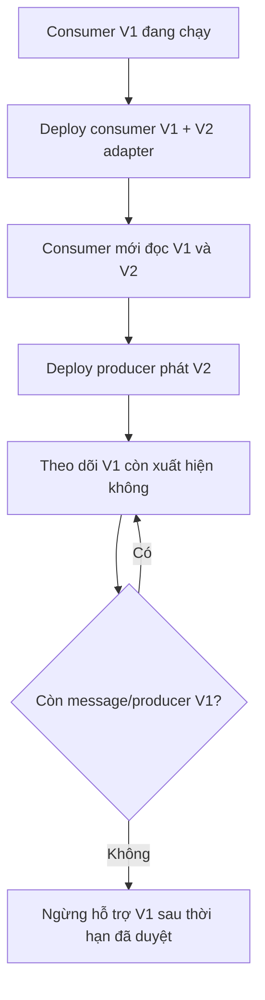

# Quản lý phiên bản sự kiện và triển khai nhiều phiên bản song song

Trong một hệ thống event-driven, producer và consumer thường được triển khai độc lập. Khi producer thay đổi cấu trúc hoặc ý nghĩa của sự kiện, không phải mọi consumer đều được nâng cấp cùng lúc. Một consumer cũ có thể vẫn đang chạy trong production, một consumer mới có thể đang được rollout từng phần, và broker có thể còn lưu message được phát từ nhiều ngày hoặc nhiều tháng trước. Vì vậy, hợp đồng sự kiện cần được version hóa và có chiến lược tương thích trong suốt vòng đời của message.

Spring Cloud Stream cung cấp mô hình hàm `Supplier`, `Function`, `Consumer`, binding và binder để kết nối ứng dụng với Kafka, RabbitMQ hoặc Pulsar. Các thành phần này vận chuyển message theo hợp đồng đã định; chúng không tự quyết định ý nghĩa của phiên bản event hoặc làm cho mọi thay đổi schema trở nên tương thích. Nhóm phát triển phải xác định phiên bản hợp đồng, cách consumer đọc các phiên bản đang tồn tại và trình tự triển khai producer/consumer để tránh mất message hoặc thay đổi sai ý nghĩa nghiệp vụ.

## 1. Phân biệt event version và schema version

Hai khái niệm này liên quan nhưng không hoàn toàn giống nhau:

- **Event version** mô tả phiên bản của hợp đồng sự kiện và ý nghĩa nghiệp vụ mà producer cam kết. Ví dụ `OrderCreated v2` có thể thay đổi cách biểu diễn địa chỉ giao hàng hoặc bổ sung quy tắc nghiệp vụ.
- **Schema version** mô tả phiên bản cấu trúc dữ liệu dùng để serialize/deserialize, chẳng hạn tên trường, kiểu dữ liệu, trường bắt buộc và giá trị mặc định.

Một thay đổi schema nhỏ có thể không làm thay đổi ý nghĩa event. Ngược lại, thay đổi ý nghĩa nghiệp vụ có thể cần event version mới ngay cả khi JSON vẫn có cùng các trường. Không nên dùng số phiên bản schema như bằng chứng duy nhất rằng hai message có cùng ngữ nghĩa.

Một envelope sự kiện có thể mang metadata như sau:

```json
{
  "eventId": "evt-01J8Q7M4",
  "eventType": "com.example.orders.OrderCreated",
  "eventVersion": 2,
  "occurredAt": "2026-11-24T09:30:00Z",
  "aggregateId": "ORD-1001",
  "payload": {
    "orderId": "ORD-1001",
    "total": 250000,
    "currency": "VND"
  }
}
```

`eventVersion` là một phần của hợp đồng được công bố. Có thể đặt version trong payload envelope, header hoặc metadata của schema registry tùy hệ thống. Hãy chọn một nguồn sự thật rõ ràng và giữ cách diễn giải nhất quán qua broker, DLQ, replay và công cụ quan sát. Nếu version nằm trong header, phải kiểm tra header mapping của binder và bảo đảm metadata đó được giữ lại khi message được chuyển tiếp.

## 2. Chọn chiến lược version hóa

Không phải mọi thay đổi đều cần tạo topic mới hoặc tăng major version. Hãy phân loại thay đổi theo mức độ tương thích:

| Loại thay đổi | Ví dụ | Hướng xử lý thường phù hợp |
|---|---|---|
| Bổ sung tùy chọn | Thêm `salesChannel` có thể vắng mặt | Có thể giữ cùng event version nếu consumer cũ bỏ qua trường mới và consumer mới xử lý được message cũ |
| Bổ sung bắt buộc | Thêm `warehouseId` mà logic mới không thể thiếu | Cần giá trị mặc định, giai đoạn chuyển tiếp hoặc event version mới |
| Đổi kiểu | `total` từ số nguyên sang object gồm amount/currency | Thường là thay đổi không tương thích; dùng version mới hoặc adapter |
| Đổi tên/xóa trường | `customerId` thành `buyerId` | Cần thời gian chuyển tiếp hoặc version mới |
| Đổi ý nghĩa | `total` chuyển từ tổng trước thuế sang tổng sau thuế | Là thay đổi ngữ nghĩa; phải công bố hợp đồng mới rõ ràng |
| Đổi quy tắc nghiệp vụ | `OrderCreated` chỉ phát sau khi thanh toán | Có thể cần event type mới vì tên cũ không còn mô tả đúng sự kiện |

Các quy tắc thực hành:

- Giữ event bất biến sau khi phát hành. Khi ý nghĩa hoặc dữ liệu đã được consumer sử dụng, không sửa lịch sử message để phù hợp với code mới.
- Ưu tiên thay đổi cộng thêm và tùy chọn khi có thể; consumer nên bỏ qua trường không biết.
- Không tái sử dụng một trường đã xóa cho ý nghĩa mới.
- Dùng version rõ ràng cho thay đổi phá vỡ tương thích.
- Công bố schema và ví dụ message để các nhóm consumer có thể chuẩn bị trước.
- Xác định thời hạn hỗ trợ phiên bản cũ và chủ sở hữu quyết định ngừng hỗ trợ.

## 3. Backward, forward và full compatibility

Khi thay đổi schema, cần xác định phiên bản mới tương thích theo chiều nào:

| Chế độ | Ý nghĩa khái quát | Câu hỏi kiểm tra |
|---|---|---|
| Backward compatibility | Consumer/schema mới có thể đọc dữ liệu được ghi theo schema cũ | Consumer mới có đọc được message cũ còn trong topic hoặc DLQ không? |
| Forward compatibility | Consumer/schema cũ có thể đọc dữ liệu được ghi theo schema mới | Consumer cũ có bỏ qua trường mới hoặc xử lý giá trị mới an toàn không? |
| Full compatibility | Đáp ứng cả backward và forward compatibility | Producer mới và consumer cũ, đồng thời producer cũ và consumer mới, có thể cùng hoạt động không? |

Một số schema registry còn hỗ trợ kiểm tra tương thích xuyên suốt nhiều phiên bản (transitive), thay vì chỉ so sánh phiên bản mới với phiên bản ngay trước đó. Điều này quan trọng khi hệ thống lưu message lâu hoặc consumer có thể replay từ offset cũ. Cần chọn chính sách registry phù hợp với định dạng schema và cách triển khai; JSON, Avro và Protobuf có quy tắc tương thích khác nhau.

Ví dụ, thêm một trường tùy chọn `currency` thường có thể tương thích nếu consumer cũ bỏ qua trường chưa biết và consumer mới có mặc định khi đọc message cũ. Nhưng nếu đổi `total` từ số sang object, consumer cũ có thể không parse được message mới. Đừng kết luận một thay đổi là tương thích chỉ vì JSON vẫn hợp lệ về cú pháp.

## 4. Đưa version vào hợp đồng và mô hình Java

Có thể biểu diễn các phiên bản bằng DTO riêng:

```java
public record OrderCreatedV1(
    String orderId,
    long total
) {}

public record OrderCreatedV2(
    String orderId,
    long total,
    String currency
) {}
```

Consumer cần hỗ trợ song song có thể chuyển từng DTO về một mô hình nội bộ ổn định:

```java
public record OrderCreatedCommand(
    String orderId,
    long total,
    String currency
) {}

public final class OrderEventMapper {
    public OrderCreatedCommand fromV1(OrderCreatedV1 event) {
        return new OrderCreatedCommand(
            event.orderId(), event.total(), "VND");
    }

    public OrderCreatedCommand fromV2(OrderCreatedV2 event) {
        return new OrderCreatedCommand(
            event.orderId(), event.total(), event.currency());
    }
}
```

Đây là ví dụ cho thay đổi mà V1 chưa có trường tiền tệ và hệ thống có quy ước mặc định `VND`. Chỉ dùng mặc định đó nếu nó đúng với miền nghiệp vụ; không tự gán giá trị mặc định để làm cho dữ liệu parse được trong khi ngữ nghĩa không rõ. Nếu không thể suy ra currency an toàn, consumer phải từ chối hoặc đưa message vào luồng xử lý lỗi để điều tra.

Adapter giúp phần nghiệp vụ làm việc với một mô hình nội bộ, trong khi lớp tích hợp chịu trách nhiệm đọc nhiều hợp đồng bên ngoài. Khi thêm V3, có thể bổ sung mapper mới mà không phải thay đổi toàn bộ logic nghiệp vụ. Đặt adapter gần ranh giới message để không làm rò rỉ DTO phiên bản cụ thể vào domain model.

## 5. Consumer đọc nhiều phiên bản trong Spring Cloud Stream

Nếu message có envelope với `eventVersion`, consumer có thể dispatch theo version sau khi deserialize envelope. Ví dụ đơn giản với payload đã được chuyển đổi thành một kiểu trung gian:

```java
public record EventEnvelope(
    String eventId,
    String eventType,
    int eventVersion,
    JsonNode payload
) {}

@Bean
Consumer<EventEnvelope> consumeOrderCreated(OrderEventHandler handler) {
    return envelope -> {
        if (!"com.example.orders.OrderCreated".equals(envelope.eventType())) {
            throw new IllegalArgumentException("Unsupported event type");
        }

        switch (envelope.eventVersion()) {
            case 1 -> handler.handleV1(
                objectMapper.treeToValue(envelope.payload(), OrderCreatedV1.class));
            case 2 -> handler.handleV2(
                objectMapper.treeToValue(envelope.payload(), OrderCreatedV2.class));
            default -> throw new UnsupportedEventVersionException(
                envelope.eventType(), envelope.eventVersion());
        }
    };
}
```

Ví dụ minh họa cách định tuyến theo version; cần tiêm `ObjectMapper` và xử lý exception theo cấu trúc ứng dụng thực tế. Quan trọng là payload được parse vào DTO đúng phiên bản sau khi đã đọc metadata version. Không deserialize thẳng payload V2 vào DTO V1 rồi hy vọng các trường tự chuyển đổi chính xác.

Với nhiều loại event, có thể dùng một envelope chung và registry các handler theo cặp `(eventType, eventVersion)`. Cách này dễ mở rộng hơn một chuỗi `if/else` dài. Cần quy định rõ hành vi với event type/version chưa hỗ trợ: từ chối có kiểm soát, chuyển DLQ hoặc parking lot và ghi đủ metadata để điều tra. Không bỏ qua âm thầm message không hiểu vì sẽ làm mất dữ liệu nghiệp vụ.

## 6. Triển khai nhiều phiên bản song song bằng expand–migrate–contract

Một quy trình rollout an toàn thường có ba giai đoạn:

1. **Expand:** mở rộng consumer để đọc được cả schema cũ và mới; thêm trường tùy chọn hoặc adapter mà chưa yêu cầu producer chuyển đổi ngay.
2. **Migrate:** triển khai consumer mới đến đủ instance, xác nhận khả năng xử lý cả hai phiên bản, sau đó chuyển producer sang phát phiên bản mới theo kế hoạch.
3. **Contract:** khi không còn producer/consumer cũ, message cũ đã hết thời hạn lưu giữ hoặc có kế hoạch replay tương ứng, mới loại bỏ adapter và hỗ trợ version cũ.

Sơ đồ triển khai:



Trình tự cụ thể phụ thuộc hướng tương thích. Với thay đổi mà consumer cũ không đọc được message mới, bắt buộc nâng consumer hoặc triển khai adapter trước khi producer bắt đầu phát V2. Nếu consumer mới đọc được cả V1 và V2, có thể rollout consumer trước, sau đó mới nâng producer.

Không xóa code V1 ngay khi producer mới đã phát hành. Broker có thể còn message cũ, consumer có thể bị rollback, DLQ có thể được replay và một hệ thống tích hợp ngoài có thể vẫn phát phiên bản cũ. Xác định thời hạn lưu giữ tối đa, lịch replay và các producer ngoài phạm vi kiểm soát trước khi loại bỏ hỗ trợ.

## 7. Chạy song song bằng topic hoặc destination versioned

Có hai cách thường gặp để phân phối phiên bản:

| Cách | Mô tả | Phù hợp khi |
|---|---|---|
| Một destination, version trong envelope | V1 và V2 cùng nằm trong một topic/queue; consumer dispatch theo `eventVersion` | Các phiên bản có cùng mục đích, cùng quyền truy cập và consumer có thể đọc envelope chung |
| Destination riêng theo version | Ví dụ `orders.created.v1` và `orders.created.v2` | Wire format phá vỡ tương thích hoặc cần rollout/retention/ACL riêng |

Một destination chung giảm số lượng tài nguyên broker và giữ một luồng sự kiện theo thứ tự partition/key, nhưng consumer phải hiểu mọi version đang được phát. Destination riêng giúp tách biệt hợp đồng và quyền triển khai, nhưng làm tăng số topic/queue, cấu hình binding, giám sát và khả năng phải đồng bộ dữ liệu giữa hai luồng.

Ví dụ cấu hình hai input binding cho hai destination:

```yaml
spring:
  cloud:
    function:
      definition: consumeOrderV1;consumeOrderV2
    stream:
      bindings:
        consumeOrderV1-in-0:
          destination: orders.created.v1
          group: order-processor
          content-type: application/json
        consumeOrderV2-in-0:
          destination: orders.created.v2
          group: order-processor
          content-type: application/json
```

Ví dụ chỉ minh họa hai binding. Nếu cùng một ứng dụng khai báo nhiều function bean, cú pháp danh sách function và tên binding phải được xác nhận theo phiên bản Spring Cloud Function/Spring Cloud Stream đang dùng. Có thể tách consumer V1 và V2 thành hai ứng dụng/bean riêng rồi chuyển về cùng application service.

Nếu producer phát đồng thời lên V1 và V2, hãy xem đó là dual publish có rủi ro: một lần gửi có thể thành công ở destination này nhưng thất bại ở destination kia. Dùng outbox hoặc quy trình phát lại có idempotency nếu cần bảo đảm cả hai luồng nhận được sự kiện. Không giả định hai binding khác nhau tự động nằm trong cùng một transaction.

## 8. Quản lý producer cũ, consumer cũ và rollback

Trong quá trình rollout, các tổ hợp sau có thể cùng tồn tại:

| Producer | Consumer | Điều kiện để an toàn |
|---|---|---|
| V1 | V1 | Hợp đồng hiện tại hoạt động như trước |
| V1 | V2 | Consumer V2 phải đọc được dữ liệu V1 hoặc có adapter |
| V2 | V1 | Consumer V1 phải bỏ qua cấu trúc mới và hiểu đúng ý nghĩa; nếu không, không được chuyển producer trước |
| V2 | V2 | Hai bên thống nhất schema và semantics V2 |

Trước rollout, kiểm tra ma trận tương thích thực tế và xác định tổ hợp nào được phép chạy. Rollback producer về V1 sau khi đã phát V2 không làm các message V2 đã lưu biến mất. Consumer phải tiếp tục hỗ trợ V2 cho đến khi các message đó được xử lý hoặc hết hạn theo chính sách. Tương tự, rollback consumer chỉ an toàn nếu consumer cũ vẫn đọc được các message mới đang tồn tại.

Một cách giảm rủi ro là giữ adapter đọc nhiều phiên bản trong một khoảng thời gian dài hơn thời gian rollout. Khi cần rollback, chỉ thay phiên bản ứng dụng, không cần thay đổi lịch sử message. Tuy nhiên, adapter phải được kiểm thử và giám sát như code production; không để các nhánh version cũ không được dùng đến nhưng không có kiểm thử.

## 9. Replay, retention và DLQ khi có nhiều version

Message lịch sử có thể được đọc lại khi dựng projection, phục hồi dữ liệu hoặc điều tra sự cố. Do đó, thời gian hỗ trợ schema phải bao phủ thời gian lưu giữ message và các bản sao được lưu ở DLQ, backup hoặc archive.

Trước khi ngừng một version, trả lời các câu hỏi:

- Topic/queue chính còn message version cũ trong khoảng thời gian nào?
- DLQ và parking lot có retention dài hơn topic chính không?
- Có quy trình replay từ offset cũ hoặc archive không?
- Consumer mới có thể đọc tất cả version được replay không?
- Nếu cần chuyển đổi lịch sử, ai sở hữu job migration và cách kiểm tra kết quả?

Không sửa trực tiếp message lịch sử chỉ để phù hợp với consumer mới. Nếu cần chuẩn hóa dữ liệu, dùng upcaster hoặc migration pipeline có thể kiểm thử, ghi nhận phiên bản nguồn và bảo đảm chạy lặp an toàn. Giữ lại event gốc khi cần audit hoặc replay.

## 10. Kiểm thử hợp đồng và rollout

Kiểm thử versioning cần nhiều hơn một unit test cho DTO:

- **Schema compatibility test:** kiểm tra schema mới với chính sách backward/forward/full đã chọn.
- **Golden message test:** lưu các payload V1/V2 đại diện và xác nhận consumer mới đọc đúng.
- **Cross-version integration test:** producer V1 gửi đến consumer V2 và ngược lại trong những tổ hợp được phép.
- **Unknown version test:** xác nhận event version chưa hỗ trợ đi vào error/DLQ flow có thể quan sát.
- **Replay test:** đọc message cũ từ broker hoặc fixture archive bằng phiên bản consumer sắp phát hành.
- **Rollback test:** khôi phục consumer hoặc producer cũ trong khi destination vẫn có message phiên bản mới.
- **Dual-publish test:** nếu dùng hai destination, mô phỏng lỗi một lần publish thành công và lần còn lại thất bại.

Spring Cloud Stream Test Binder hữu ích để kiểm tra function và binding trong phạm vi ứng dụng. Nó không thay thế kiểm thử với Kafka, RabbitMQ hoặc Pulsar thật khi cần xác minh schema, serializer, retention, partition ordering, redelivery hoặc DLQ. Tạo integration test theo đúng binder và định dạng dữ liệu production.

## 11. Quan sát và quản trị vòng đời version

Theo dõi số lượng message theo `eventType` và `eventVersion`, số consumer đang xử lý từng version, tỷ lệ conversion error, DLQ count, consumer lag và tuổi của message cũ nhất. Nếu dùng topic riêng, dashboard cần phân biệt từng destination. Nếu dùng một topic chung, log và metric cần gắn version để nhận biết producer cũ còn phát hay không.

Đặt chính sách vòng đời cho từng event contract:

- Nhóm sở hữu event và người phê duyệt thay đổi.
- Nơi công bố schema, ví dụ schema registry hoặc repository hợp đồng.
- Chính sách compatibility và quy trình review breaking change.
- Các version đang được hỗ trợ, ngày ngừng phát và ngày ngừng đọc.
- Thời hạn retention, replay và hỗ trợ DLQ.
- Hướng dẫn migration và rollback cho consumer/producer.

Không xóa version cũ chỉ dựa vào việc không thấy message mới trong một khoảng thời gian ngắn. Hãy xác nhận mọi producer đã chuyển đổi, message tồn đọng đã được xử lý và quy trình replay không còn cần version đó.

## 12. Checklist trước khi phát hành version mới

- [ ] Đã xác định thay đổi là tương thích hay phá vỡ tương thích.
- [ ] Event version và schema version có ý nghĩa rõ ràng, không bị dùng thay thế tùy tiện.
- [ ] Schema mới đã được kiểm tra theo backward/forward/full compatibility phù hợp.
- [ ] Consumer mới có thể đọc message cũ và xử lý đúng semantics.
- [ ] Producer cũ và consumer cũ có thể tiếp tục hoạt động trong thời gian rollout.
- [ ] Đã chọn dùng một destination có version trong envelope hay destination riêng theo version.
- [ ] Nếu dual publish, đã xử lý partial failure bằng outbox/idempotency hoặc quy trình tương đương.
- [ ] DLQ, retention, archive và replay đã được tính vào thời hạn hỗ trợ version cũ.
- [ ] Đã kiểm thử golden message, cross-version, unknown version và rollback.
- [ ] Có metric để biết producer cũ đã ngừng phát và consumer đã xử lý hết message cũ.

Version hóa sự kiện giúp producer và consumer có thể nâng cấp độc lập mà vẫn trao đổi dữ liệu đúng nghĩa. Khi hợp đồng được công bố rõ, consumer có adapter cho các phiên bản đang tồn tại, rollout theo expand–migrate–contract và kiểm thử cả replay lẫn rollback, hệ thống Spring Cloud Stream có thể vận hành nhiều phiên bản song song mà không làm gián đoạn luồng nghiệp vụ.
