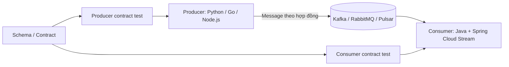

# Kiểm thử hợp đồng với bên phát và bên nhận khác ngôn ngữ

## Mục tiêu

Trong hệ thống xử lý sự kiện, bên phát và bên nhận thường được viết bằng những ngôn ngữ hoặc framework khác nhau. Một dịch vụ Python có thể phát sự kiện lên Kafka, trong khi consumer Java dùng Spring Cloud Stream; một ứng dụng Go có thể gửi message qua RabbitMQ cho dịch vụ Java; hoặc một producer Node.js có thể ghi dữ liệu vào Pulsar. Các thành phần chỉ phối hợp được khi cùng hiểu một hợp đồng message ổn định.

**Kiểm thử hợp đồng (contract testing)** xác minh rằng message do producer tạo ra phù hợp với cấu trúc và ý nghĩa mà consumer mong đợi. Kiểm thử này tập trung vào dữ liệu trao đổi và cách diễn giải dữ liệu giữa các dịch vụ, không phụ thuộc vào việc hai bên dùng cùng ngôn ngữ hay cùng class model.

Bài học này trình bày cách định nghĩa hợp đồng độc lập ngôn ngữ, kiểm thử cả producer lẫn consumer, xử lý khác biệt kiểu dữ liệu và quản lý thay đổi schema khi triển khai Spring Cloud Stream cùng Kafka, RabbitMQ hoặc Pulsar.

Sau bài học, bạn có thể:

- Xác định nội dung cần có trong một hợp đồng message.
- Dùng JSON Schema hoặc schema định dạng khác làm hợp đồng trung lập với ngôn ngữ.
- Kiểm tra producer tạo message đúng schema và consumer đọc được message đó.
- Nhận diện khác biệt giữa kiểu dữ liệu Java, Python và wire format.
- Phân biệt kiểm thử schema, consumer-driven contract và integration test với broker.
- Đánh giá thay đổi schema theo khả năng tương thích trước khi phát hành.

## 1. Vì sao cần kiểm thử hợp đồng giữa các ngôn ngữ?

Một class Java và một class Python có thể mô tả cùng một khái niệm nghiệp vụ nhưng không tự động tương thích. Ví dụ:

- Java dùng `long`, trong khi Python dùng số nguyên có độ lớn tùy ý.
- Java `BigDecimal` có thể giữ độ chính xác thập phân, còn Python `float` dùng số dấu phẩy động nhị phân.
- Java `Instant` biểu diễn một thời điểm, còn Python có thể tạo datetime có hoặc không có timezone.
- Một ngôn ngữ có thể phân biệt trường bị thiếu với trường có giá trị `null`; code của ngôn ngữ khác có thể gộp hai trường hợp.
- Enum hoặc tên thuộc tính có thể được xử lý khác nhau giữa các thư viện serialization.

Nếu chỉ kiểm thử từng dịch vụ riêng lẻ, producer có thể vượt qua unit test và consumer cũng vượt qua unit test, nhưng hai bên vẫn không hiểu cùng một message. Contract test đặt một hợp đồng chung ở giữa để kiểm tra tính tương thích.



Hợp đồng là tài liệu và artifact có thể được đọc bởi nhiều ngôn ngữ. Nó mô tả wire format, trường bắt buộc, kiểu dữ liệu, ý nghĩa, metadata quan trọng và quy tắc tương thích. Hợp đồng không nên phụ thuộc vào tên package Java, tên class Python hay cấu trúc nội bộ của một dịch vụ.

## 2. Hợp đồng message gồm những gì?

Một hợp đồng sự kiện tốt thường mô tả các phần sau:

| Thành phần | Câu hỏi cần trả lời | Ví dụ |
|---|---|---|
| Event identity | Một sự kiện được nhận diện thế nào? | `eventId` duy nhất và ổn định |
| Event type | Đây là loại sự kiện nào? | `payment.captured` |
| Payload schema | Có trường nào, kiểu gì, bắt buộc hay tùy chọn? | `orderId: string`, `amountMinor: integer` |
| Semantics | Trường có ý nghĩa gì, đơn vị nào, giới hạn nào? | `amountMinor` là số đơn vị tiền nhỏ nhất |
| Time | Thời điểm dùng timezone và định dạng nào? | ISO 8601 UTC |
| Metadata | Correlation, tenant hoặc trace context nào cần truyền? | `correlationId` |
| Transport | Message được gửi ở destination nào, content type gì? | topic `payments.captured`, JSON |
| Evolution | Có thể thêm, bỏ hoặc đổi trường theo quy tắc nào? | Chỉ thêm trường optional trong minor evolution |

Cần phân biệt **payload contract** và **transport contract**. Payload contract mô tả dữ liệu nghiệp vụ. Transport contract mô tả cách message được gửi qua Kafka, RabbitMQ hoặc Pulsar, bao gồm destination, key, headers và chính sách giao nhận liên quan. Contract test cho schema không chứng minh consumer group, partition, retry hoặc acknowledgment hoạt động đúng; các hành vi đó cần integration test riêng.

Một hợp đồng không chỉ là danh sách tên trường. Nó cần mô tả ý nghĩa và quy tắc dữ liệu. Ví dụ, `amount` có thể là 125.50 đơn vị tiền tệ, 12550 cent hoặc một chuỗi đã định dạng. Nếu không ghi rõ đơn vị và độ chính xác, hai bên có thể cùng deserialize thành công nhưng tính toán nghiệp vụ sai.

## 3. Định nghĩa hợp đồng trung lập ngôn ngữ bằng JSON Schema

JSON Schema là một lựa chọn phổ biến khi producer và consumer trao đổi JSON. Schema có thể được dùng từ Java, Python, Go, JavaScript và nhiều ngôn ngữ khác.

Ví dụ sự kiện `PaymentCapturedV1`:

```json
{
  "$schema": "https://json-schema.org/draft/2020-12/schema",
  "$id": "https://contracts.example.com/events/payment-captured-v1.schema.json",
  "title": "PaymentCapturedV1",
  "type": "object",
  "required": [
    "eventId",
    "eventType",
    "occurredAt",
    "orderId",
    "amountMinor",
    "currency"
  ],
  "properties": {
    "eventId": {
      "type": "string",
      "minLength": 1
    },
    "eventType": {
      "const": "payment.captured"
    },
    "occurredAt": {
      "type": "string",
      "format": "date-time"
    },
    "orderId": {
      "type": "string",
      "minLength": 1
    },
    "amountMinor": {
      "type": "integer",
      "minimum": 0
    },
    "currency": {
      "type": "string",
      "pattern": "^[A-Z]{3}$"
    },
    "paymentReference": {
      "type": ["string", "null"]
    }
  },
  "additionalProperties": true
}
```

Schema quy định:

- Sáu trường bắt buộc phải có.
- `eventType` phải có giá trị `payment.captured`.
- `occurredAt` dùng định dạng ngày giờ theo RFC 3339/ISO 8601 được JSON Schema date-time hỗ trợ.
- `amountMinor` là số nguyên không âm, biểu diễn đơn vị tiền nhỏ nhất.
- `currency` là mã tiền tệ ba ký tự viết hoa.
- `paymentReference` có thể bị thiếu hoặc có giá trị `null`, theo schema trên.
- `additionalProperties: true` cho phép consumer gặp thêm trường mà nó chưa biết; code consumer vẫn cần bỏ qua hoặc xử lý trường mở rộng một cách có chủ đích.

Nếu muốn cấm trường lạ, có thể đặt `additionalProperties: false`. Cách này giúp phát hiện producer gửi dữ liệu ngoài hợp đồng nhưng có thể làm consumer cũ từ chối message khi producer thêm trường mới. Hãy chọn chính sách dựa trên chiến lược evolution của toàn hệ thống, không bật strict mode một cách máy móc.

Ví dụ payload JSON hợp lệ:

```json
{
  "eventId": "evt-7f2a",
  "eventType": "payment.captured",
  "occurredAt": "2026-11-24T05:30:00Z",
  "orderId": "order-42",
  "amountMinor": 12550,
  "currency": "VND",
  "paymentReference": "pay-8831"
}
```

Hợp đồng không yêu cầu producer phải dùng class Java hay Python cụ thể. Bất kỳ producer nào tạo JSON thỏa schema và ý nghĩa đã thống nhất đều có thể phát sự kiện.

## 4. Giữ kiểu dữ liệu nhất quán giữa các ngôn ngữ

Một số quy tắc dữ liệu cần ghi rõ trong contract:

### Tiền tệ và số thập phân

Tránh dùng số dấu phẩy động nhị phân để biểu diễn tiền. Ví dụ `125.50` có thể được đọc thành float với sai số biểu diễn. Có hai cách phổ biến:

- Dùng số nguyên theo đơn vị nhỏ nhất, ví dụ `amountMinor: 12550` cho 125.50 với loại tiền có hai chữ số thập phân.
- Dùng chuỗi thập phân có định dạng được quy định rõ, ví dụ `amount: "125.50"`, rồi parse bằng kiểu decimal chính xác ở mỗi ngôn ngữ.

Nếu dùng số nguyên, hợp đồng phải quy định currency và quy tắc scale. Không mặc định mọi loại tiền đều có cùng số chữ số thập phân.

### Thời gian

Dùng timestamp có timezone, thường là UTC và hậu tố `Z`, ví dụ `2026-11-24T05:30:00Z`. Tránh chuỗi ngày giờ không có offset vì producer và consumer có thể diễn giải theo timezone máy chủ khác nhau.

### Null và trường bị thiếu

Phân biệt rõ ba trường hợp:

- Trường bắt buộc có giá trị.
- Trường tùy chọn có thể bị bỏ qua.
- Trường cho phép `null`.

Trong JSON Schema, `required` quyết định trường phải xuất hiện; kiểu `["string", "null"]` cho phép giá trị null nhưng không tự làm trường bắt buộc. Muốn trường bắt buộc nhưng có thể null, cần vừa đưa tên vào `required`, vừa cho phép kiểu null.

### Enum và giá trị mở rộng

Consumer nên có chiến lược khi gặp giá trị enum mới. Một consumer dùng switch exhaustive có thể lỗi khi producer bổ sung trạng thái. Nếu cần khả năng mở rộng, quy định rõ cách xử lý giá trị chưa biết, chẳng hạn ghi nhận và chuyển vào nhánh `UNKNOWN` hoặc từ chối có kiểm soát.

### Unicode, tên trường và giới hạn số

Quy định rõ casing của JSON field, encoding UTF-8, phạm vi số nguyên và giới hạn độ dài chuỗi. Không giả định mọi ngôn ngữ có cùng giới hạn số nguyên hoặc cùng quy tắc chuyển kiểu.

## 5. Producer khác ngôn ngữ: ví dụ Python phát JSON lên Kafka

Producer Python có thể serialize payload theo JSON rồi gửi bytes. Ví dụ sử dụng client `confluent-kafka`:

```python
import json
from datetime import datetime, timezone
from confluent_kafka import Producer

producer = Producer({
    "bootstrap.servers": "localhost:9092"
})

event = {
    "eventId": "evt-7f2a",
    "eventType": "payment.captured",
    "occurredAt": datetime.now(timezone.utc).isoformat(),
    "orderId": "order-42",
    "amountMinor": 12550,
    "currency": "VND",
    "paymentReference": "pay-8831"
}

payload = json.dumps(
    event,
    ensure_ascii=False,
    separators=(",", ":")
).encode("utf-8")

producer.produce(
    topic="payments.captured",
    key=event["orderId"].encode("utf-8"),
    value=payload,
    headers=[
        ("correlationId", b"corr-900")
    ]
)

producer.flush()
```

Đây là ví dụ minh họa cách gửi JSON bytes; producer cần validate event theo schema trước khi publish trong pipeline thực tế. Trong hệ thống production, nên cấu hình callback/error handling, timeout, retry và xác nhận gửi phù hợp. `flush()` giúp chờ các message còn trong producer queue được xử lý trước khi tiến trình kết thúc, nhưng không chứng minh consumer nghiệp vụ đã xử lý message.

Ở ví dụ này:

- JSON payload là phần dữ liệu theo contract.
- Kafka key là `orderId`, dùng cho định tuyến/partitioning theo cấu hình producer.
- `correlationId` là header metadata, không thay thế event ID.
- Python class hay type annotation không phải một phần của wire contract.

Nếu dùng Avro hoặc Protobuf với schema registry, producer sẽ dùng serializer/schema integration tương ứng thay cho việc tự gọi `json.dumps`. Contract test vẫn cần kiểm tra schema và bytes mà consumer thực sự đọc.

## 6. Consumer Java dùng Spring Cloud Stream

Consumer Java có thể nhận payload theo DTO tương ứng:

```java
public record PaymentCapturedV1(
        String eventId,
        String eventType,
        Instant occurredAt,
        String orderId,
        long amountMinor,
        String currency,
        String paymentReference
) {}
```

Spring Cloud Stream binding:

```java
@Bean
Consumer<PaymentCapturedV1> paymentCaptured(PaymentService service) {
    return event -> service.recordCaptured(
            event.eventId(),
            event.orderId(),
            event.amountMinor(),
            event.currency()
    );
}
```

Cấu hình binding JSON:

```yaml
spring:
  cloud:
    function:
      definition: paymentCaptured
    stream:
      bindings:
        paymentCaptured-in-0:
          destination: payments.captured
          group: billing-service
          content-type: application/json
```

Jackson cần được cấu hình để đọc kiểu thời gian như `Instant` (thông thường qua Java Time module trong cấu hình Jackson của Spring Boot). Nếu DTO dùng `paymentReference` có thể thiếu hoặc null, kiểu Java và validation phải phản ánh đúng hợp đồng. Ví dụ trên dùng String có thể null; nếu cần phân biệt missing và explicit null thì cần cách biểu diễn/validation rõ ràng hơn.

Không nên cho rằng deserialize thành công là contract đã được thỏa mãn. Consumer còn cần kiểm tra ý nghĩa: `amountMinor` không âm, currency được hỗ trợ, event type đúng và event ID có định dạng hợp lệ. Một schema validator ở biên có thể kiểm tra cấu trúc; application/domain vẫn chịu trách nhiệm các quy tắc nghiệp vụ.

## 7. Kiểm thử hợp đồng phía producer

Producer contract test xác minh message được tạo ra đúng với schema và semantics đã công bố. Test nên sử dụng cùng schema artifact mà consumer dùng, thay vì tự viết một bản schema gần giống trong từng repository.

Một cách làm:

1. Tạo event mẫu bằng code producer.
2. Serialize bằng đúng serializer dùng trong production.
3. Parse lại bytes hoặc message body.
4. Validate nội dung với schema đã công bố.
5. Kiểm tra các điều kiện ngữ nghĩa mà schema không mô tả được, như currency hợp lệ trong phạm vi hệ thống, event ID duy nhất hoặc timestamp nằm trong khoảng hợp lý.
6. Nếu dùng headers, kiểm tra header ứng dụng cần có và kiểu dữ liệu của nó.

Ví dụ Python dùng thư viện `jsonschema` để validate payload trước khi publish:

```python
import json
from jsonschema import Draft202012Validator

with open("contracts/payment-captured-v1.schema.json", encoding="utf-8") as file:
    schema = json.load(file)

validator = Draft202012Validator(schema)
errors = sorted(
    validator.iter_errors(event),
    key=lambda error: list(error.path)
)

assert not errors, [
    f"{list(error.path)}: {error.message}"
    for error in errors
]
```

Trong pipeline producer, test này nên chạy với event mẫu được tạo từ code thực tế. Nếu test chỉ validate một JSON fixture tĩnh mà không đi qua serializer hoặc mapping của producer, nó không phát hiện được lỗi do code tạo message.

## 8. Kiểm thử hợp đồng phía consumer

Consumer contract test xác minh rằng consumer chấp nhận message theo hợp đồng đã thống nhất và xử lý đúng các trường quan trọng.

Ví dụ Java test đọc fixture JSON dùng chung:

```java
@Test
void shouldReadPaymentCapturedContractFixture() throws Exception {
    var mapper = new ObjectMapper()
            .registerModule(new JavaTimeModule());

    PaymentCapturedV1 event = mapper.readValue(
            getClass().getResourceAsStream(
                    "/contracts/payment-captured-v1-valid.json"
            ),
            PaymentCapturedV1.class
    );

    assertEquals("evt-7f2a", event.eventId());
    assertEquals("payment.captured", event.eventType());
    assertEquals("order-42", event.orderId());
    assertEquals(12550L, event.amountMinor());
    assertEquals("VND", event.currency());
}
```

Sau khi deserialize, có thể gọi handler/use case với event fixture để xác minh consumer sử dụng đúng dữ liệu. Cần có thêm fixture cho trường optional bị thiếu, trường null nếu được phép, giá trị enum chưa biết, timestamp không hợp lệ và message thiếu trường bắt buộc.

Consumer test nên kiểm tra cả khả năng tương thích và cách xử lý lỗi. Ví dụ, nếu producer thêm một trường optional mà consumer không dùng, consumer cũ cần tiếp tục đọc được message mới theo chính sách schema. Nếu một trường bắt buộc bị thiếu, consumer cần từ chối message có quan sát và xử lý theo error/DLQ policy, thay vì tạo dữ liệu mặc định âm thầm.

## 9. Consumer-driven contract và provider verification

Schema validation kiểm tra cấu trúc message. Trong một số hệ thống, consumer còn cần xác định rõ những trường và giá trị mà nó thực sự phụ thuộc. Đây là nơi **consumer-driven contract testing** có ích.

Quy trình tổng quát:

1. Consumer mô tả message tối thiểu mà nó cần để thực hiện hành vi.
2. Consumer tạo contract artifact hoặc expectation cho message.
3. Producer/provider chạy verification test để xác minh message thực tế mà nó phát có thỏa contract.
4. Contract verification được chạy trong CI trước khi publish phiên bản producer.
5. Contract đã được xác minh được lưu trong nơi quản lý version để các nhóm biết phiên bản producer nào tương thích với consumer nào.

Với message bất đồng bộ, có thể dùng công cụ hỗ trợ asynchronous/message contracts như Pact message testing hoặc một bộ kiểm thử schema chung. Công cụ cụ thể và API phụ thuộc ngôn ngữ, framework và phiên bản. Điều quan trọng là provider verification phải kiểm tra output do code producer thực sự tạo ra, không chỉ validate một file mẫu không liên quan đến đường phát message.

Consumer-driven contract không thay thế schema registry. Hai cách có thể bổ trợ nhau:

- Schema registry quản lý schema, version và compatibility ở wire level.
- Consumer-driven contract thể hiện nhu cầu thực tế của từng consumer và có thể kiểm tra các điều kiện mà schema cấu trúc không mô tả.

Nếu có nhiều consumer, một thay đổi chỉ hợp lệ khi đáp ứng chính sách tương thích của schema và không phá vỡ contract mà consumer đang sử dụng.

## 10. Kiểm soát schema evolution

Schema thay đổi theo thời gian khi nghiệp vụ thêm trường hoặc đổi cách biểu diễn. Trước khi phát hành, cần xác định thay đổi tương thích theo chiều nào.

| Thay đổi | Rủi ro | Hướng đánh giá |
|---|---|---|
| Thêm trường optional có giá trị mặc định hợp lý | Thường tương thích nếu consumer bỏ qua trường lạ | Kiểm tra consumer cũ và schema policy |
| Thêm trường required | Producer cũ không gửi trường mới; consumer cũ có thể không biết trường | Thường là breaking change |
| Xóa trường đang dùng | Consumer cũ có thể không xử lý được | Breaking change nếu còn consumer phụ thuộc |
| Đổi tên trường | Tương đương xóa trường cũ và thêm trường mới | Dùng giai đoạn chuyển tiếp hoặc version mới |
| Đổi kiểu dữ liệu | Có thể lỗi deserialize hoặc đổi semantics | Xem là breaking trừ khi có chứng minh tương thích |
| Thêm giá trị enum | Consumer exhaustive có thể lỗi | Consumer cần xử lý giá trị chưa biết |
| Thay đơn vị hoặc ý nghĩa trường | Schema vẫn hợp lệ nhưng nghiệp vụ sai | Thay đổi semantics, cần version/migration |
| Siết validation hoặc giới hạn | Dữ liệu cũ có thể không còn hợp lệ | Kiểm tra dữ liệu thực và policy compatibility |

Các thuật ngữ thường dùng:

- **Backward compatibility:** consumer mới có thể đọc dữ liệu được tạo theo schema cũ.
- **Forward compatibility:** consumer cũ có thể đọc dữ liệu theo schema mới trong giới hạn đã định.
- **Full compatibility:** đáp ứng cả backward và forward compatibility theo chính sách của hệ thống.

Cách kiểm tra chính xác phụ thuộc schema format và registry. Avro, Protobuf và JSON Schema có quy tắc evolution khác nhau; không suy ra một thay đổi an toàn trong JSON Schema cũng an toàn trong Avro hoặc Protobuf.

Một chiến lược phổ biến là ưu tiên thay đổi additive: thêm trường optional, giữ nguyên ý nghĩa trường cũ và triển khai consumer có khả năng bỏ qua trường không biết. Nếu cần đổi semantics hoặc loại bỏ trường, dùng quá trình migration có thời gian overlap hoặc phát phiên bản event type mới.

## 11. Test dữ liệu cũ và mới trong cùng pipeline

Một contract suite tốt không chỉ test một JSON mẫu mới nhất. Nên lưu các fixture đại diện cho những phiên bản còn được hỗ trợ:

```text
contracts/
└── payment-captured/
    ├── v1/
    │   ├── schema.json
    │   ├── valid-minimal.json
    │   ├── valid-full.json
    │   └── invalid-missing-event-id.json
    └── v2/
        ├── schema.json
        ├── valid-minimal.json
        └── valid-with-payment-method.json
```

Đây là cấu trúc minh họa; repository có thể tổ chức artifact theo quy ước riêng.

Các test cần bao gồm:

- Producer hiện tại tạo message thỏa schema hiện tại.
- Consumer hiện tại đọc được fixture của các phiên bản cũ còn được hỗ trợ.
- Consumer cũ được kiểm tra với message mới nếu chính sách yêu cầu forward compatibility.
- Message thiếu trường bắt buộc bị từ chối.
- Message có trường optional bị thiếu hoặc null được xử lý đúng.
- Giá trị enum mới không làm consumer dừng ngoài dự kiến.
- Serializer tạo đúng wire format và encoding UTF-8.
- Header ứng dụng quan trọng được truyền theo đúng transport contract.

Không xóa fixture cũ chỉ vì producer đã nâng version. Fixture là bằng chứng cho khả năng tương thích mà hệ thống cam kết với các message đã lưu trong broker, DLQ hoặc kho lưu trữ replay.

## 12. Phân biệt contract test, binder test và end-to-end test

Ba loại test trả lời những câu hỏi khác nhau:

| Loại test | Câu hỏi | Thành phần cần chạy |
|---|---|---|
| Contract/schema test | Message có tuân theo schema và semantics đã công bố không? | Producer/consumer code, schema artifact và fixture |
| Binder integration test | Spring Cloud Stream có map payload, headers, binding và lỗi đúng không? | Spring context và Test Binder hoặc binder test support |
| Broker integration test | Broker thật có lưu, định tuyến, giao lại và cung cấp metadata như mong đợi không? | Kafka, RabbitMQ hoặc Pulsar test instance |
| End-to-end test | Toàn bộ luồng giữa nhiều dịch vụ có tạo kết quả nghiệp vụ đúng không? | Các service và hạ tầng tích hợp liên quan |

Test Binder hữu ích để kiểm tra function và binding ở mức Spring Cloud Stream, nhưng không chứng minh producer Python ngoài hệ thống đã serialize đúng hoặc Kafka/RabbitMQ/Pulsar thật sẽ giữ metadata giống test. Contract test cần được chạy độc lập với broker khi có thể; broker integration test bổ sung bằng chứng về transport.

## 13. Tích hợp contract test vào CI/CD

Một pipeline phát hành có thể chạy theo thứ tự:

1. Kiểm tra schema artifact hợp lệ và có version.
2. Validate fixture hợp lệ và fixture không hợp lệ.
3. Chạy producer contract test với message được tạo bởi code hiện tại.
4. Chạy consumer contract test với các fixture/version còn được hỗ trợ.
5. Chạy provider verification cho các consumer contract liên quan.
6. Kiểm tra schema compatibility theo chính sách registry hoặc công cụ đã chọn.
7. Chạy binder/broker integration test cho các hành vi phụ thuộc transport.
8. Chỉ phát hành khi các hợp đồng bắt buộc đều đạt.

Khi có nhiều producer/consumer, có thể quản lý ma trận tương thích:

| Producer version | Consumer version | Kết quả |
|---|---|---|
| P1 | C1 | Đã xác minh |
| P2 | C1 | Cần kiểm tra forward compatibility |
| P2 | C2 | Đã xác minh |
| P3 | C1 | Không phát hành nếu contract bị phá vỡ |

Ma trận phải dựa trên kết quả test và chính sách hỗ trợ phiên bản thực tế, không tự đánh dấu tương thích chỉ vì version tăng theo thứ tự.

Nên lưu metadata cho contract: owner, event type, schema version, trạng thái hỗ trợ, consumer phụ thuộc và ngày dự kiến ngừng hỗ trợ. Khi thay đổi contract, thông báo cho nhóm sở hữu consumer qua quy trình phát hành của tổ chức và có kế hoạch migration.

## 14. Lỗi thường gặp khi kiểm thử hợp đồng đa ngôn ngữ

| Lỗi | Nguyên nhân | Cách khắc phục |
|---|---|---|
| Java đọc được nhưng Python validation thất bại | Hai bên dùng schema hoặc quy tắc format khác | Dùng cùng schema artifact và validator phù hợp |
| JSON parse thành công nhưng nghiệp vụ sai | Đơn vị tiền, timezone hoặc semantics không được định nghĩa | Ghi rõ đơn vị, timezone và ý nghĩa trường |
| Consumer cũ lỗi khi producer thêm trường | Parser/schema validation từ chối unknown field | Quy định chính sách unknown fields và test evolution |
| Producer test pass nhưng message thực tế sai | Test chỉ validate fixture tĩnh | Validate bytes được tạo bởi producer code và serializer thật |
| Header biến mất qua broker | Binder không map header hoặc header native khác nhau | Test transport contract theo từng binder |
| Message bị deserialize thành kiểu sai | Content type hoặc serializer/deserializer không đồng nhất | Kiểm tra wire format và cấu hình hai phía |
| Consumer bị lỗi với enum mới | Code giả định enum chỉ có tập giá trị cũ | Có nhánh unknown hoặc versioning có kiểm soát |
| Contract test pass nhưng message không đến consumer | Contract test không kiểm tra broker delivery | Bổ sung broker integration test |

## Kết luận

Kiểm thử hợp đồng giúp producer và consumer khác ngôn ngữ phối hợp qua một wire contract trung lập. JSON Schema, Avro hoặc Protobuf mô tả cấu trúc và quy tắc dữ liệu; producer contract test kiểm tra message được tạo ra, consumer contract test kiểm tra khả năng đọc và xử lý, còn provider verification xác nhận producer đáp ứng kỳ vọng của consumer.

Với Spring Cloud Stream, hãy giữ schema và DTO tại biên tích hợp, dùng cùng contract artifact giữa các ngôn ngữ và kiểm tra schema evolution trước khi phát hành. Contract test chứng minh khả năng tương thích dữ liệu; binder/broker integration test tiếp tục xác minh content type, header mapping, routing và giao nhận thực tế trên Kafka, RabbitMQ hoặc Pulsar.

