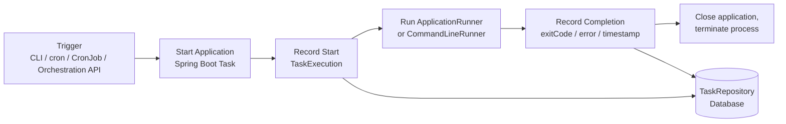

# What Is Spring Cloud Task and the Finite Task Problem

## Lesson Objectives

After this lesson, you will be able to:

- Explain how a **finite, short-lived task** differs from a continuously running service application.
- Correctly state the responsibility of **Spring Cloud Task**: recording the lifecycle and outcome of **each run** of a Spring Boot application.
- Distinguish between `TaskExecution`, `TaskRepository`, `TaskExplorer`, `TaskConfigurer`, and the business processing logic.
- Create a minimal Task application, pass input arguments, inspect execution records, and recognize failure cases.
- Know when to combine Spring Batch, a scheduler, or an orchestration platform; recognize what Spring Cloud Task does not handle on its own.

## 1. The Problem: Work That Needs to Finish and Exit

Suppose a rental management system needs to **reconcile the previous day's transactions**. Every night, the system must read payment data, check for discrepancies, write the reconciliation results, and terminate. Operators need to be able to answer:

1. When did the task start, and has it finished yet?
2. Did the run on November 24 succeed or fail?
3. When re-running for the same date, could the system duplicate data?
4. If the process has already stopped, where is the result information stored for lookup?

Writing a Spring Boot application with `CommandLineRunner` or `ApplicationRunner` is enough to **run the work**. However, merely printing logs and exiting does not fully solve the need to **track execution history**. Logs might reside on a terminated machine, each run has a different PID, and there is no unified record to query.

**Spring Cloud Task** adds lifecycle tracking for Spring Boot applications that have a start point and an end point. Once the work is complete, the process can exit normally. A new run gets a new execution record, even with the same application code and task name.

Typical scenarios:

| Scenario | Clear End Point |
| --- | --- |
| Importing a CSV file from a partner | The file has been processed and the results have been written |
| Generating an end-of-day report | The report has been saved or published |
| Synchronizing data on demand | The dataset within the requested scope has been synchronized |
| One-time data migration | Transformation and verification steps are complete |
| Payment reconciliation | Discrepancies have been identified, saved, and summarized |

A finite task **does not necessarily run fast**: it may take a few seconds or several hours. The key point is that the work **is expected to terminate**, unlike an API server, consumer, or background service that is expected to run continuously.

## 2. What Does Spring Cloud Task Actually Do?

Spring Cloud Task is a project in the Spring Cloud ecosystem that helps build and track **Spring Boot processes with a finite lifecycle**. It uses the familiar Spring Boot structure to initialize the application, run business logic, and then record the execution result.

General model:



**Spring Cloud Task's responsibility** is to create and update a record for each run, provide APIs to query history, and offer extension points around the lifecycle. **The business code's responsibility** is to perform data ingestion, reconciliation, result delivery, etc., and decide when to report an error.

Spring Cloud Task **does not provide out of the box** a cron scheduler, per-record checkpointing, exactly-once execution guarantees, system-wide retry mechanisms, or execution timeouts. Those requirements must be designed using the application, Spring Batch, or an appropriate orchestration platform.

### Distinguishing Core Concepts

| Component | Role |
| --- | --- |
| `TaskExecution` | A **physical run** of the Task application: ID, name, start/end timestamps, exit code, error message, arguments, etc. |
| `TaskRepository` | Responsible for **creating and updating** `TaskExecution` records; typically backed by a relational database |
| `TaskExplorer` | API for **reading/querying** stored execution information |
| `TaskLifecycleListener` | Infrastructure component that observes Task start/end events to update the repository |
| `TaskExecutionListener` | Extension point for the application to react to task startup, completion/success, or failure events |
| `TaskConfigurer` | Strategy for configuring the repository, explorer, and transaction manager; defaults to `DefaultTaskConfigurer` |
| `ApplicationRunner` / `CommandLineRunner` | Where **business logic** starts after Spring Boot initializes the application |

A `TaskExecution` is not a job definition or a schedule. For example, a task with `taskName = "daily-reconciliation"` running twice will create **two different `executionId` values**; both still belong to the same task name. Input arguments such as `--businessDate=2026-11-24` describe a specific run, but **do not by themselves make it a unique single run**.

## 3. Lifecycle of a Run

1. **Startup:** an external system or user runs the Spring Boot application. The framework initializes the `ApplicationContext`.
2. **Record start:** after the context is built successfully, before `ApplicationRunner`/`CommandLineRunner` beans run, Spring Cloud Task creates a `TaskExecution` record in `TaskRepository`.
3. **Execution:** code inside the runners executes with the process arguments. The application can access business services, transactions, databases, or external systems.
4. **Completion or failure:** when the runners complete or an error captured by the framework occurs, completion information and the exit code are updated in the record.
5. **Process termination:** the application should release resources and exit once the work is done. You can configure closing the `ApplicationContext` after the Task completes using `spring.cloud.task.closecontext-enabled=true`.

An **illustrative** data example of a record:

| Property | Example Value | How to Read It |
| --- | --- | --- |
| `executionId` | `157` | ID distinguishing this run from other runs |
| `taskName` | `daily-reconciliation` | Task name |
| `startTime` | `2026-11-24 02:00:01` | Start timestamp |
| `endTime` | `2026-11-24 02:01:08` | Completion timestamp |
| `exitCode` | `0` | Success according to exit code convention |
| `arguments` | `[--businessDate=2026-11-23]` | Arguments passed at runtime |

Typically, `exitCode = null` while the Task is **running**, `0` indicates success, and a non-`0` code indicates failure. You should not assume every record with `endTime = null` is still active: the process might have been forcibly terminated or the server may have crashed before updating the result.

Two limitations to understand properly:

- If the `ApplicationContext` **fails to initialize**, Spring Cloud Task might not have recorded any `TaskExecution` yet. Therefore, you still need to monitor logs, the process exit code, and the status of the task execution system.
- If the JVM is killed abruptly, such as via `SIGKILL`, the record may be missing an end time. Cleaning up stale/hanging records must rely on orchestration data and operational policy, and must not blindly assume the task succeeded.

## 4. Example: Minimal Spring Cloud Task Application

The following example accepts a business date parameter, simulates a reconciliation run, and terminates. This is an exercise **illustrating the lifecycle**; the two print statements must be replaced with actual reconciliation logic in a production build.

### 4.1. Project Initialization

Create a Spring Boot project using [Spring Initializr](https://start.spring.io/) with Java 17 or higher and a **compatible** pair of Spring Boot/Spring Cloud Task versions. Select dependencies:

- **Task** (`org.springframework.cloud:spring-cloud-starter-task` starter).
- **H2 Database** for local experimentation.

If declared with Maven, the corresponding dependencies section is:

```xml
<dependencies>
    <dependency>
        <groupId>org.springframework.cloud</groupId>
        <artifactId>spring-cloud-starter-task</artifactId>
    </dependency>
    <dependency>
        <groupId>com.h2database</groupId>
        <artifactId>h2</artifactId>
        <scope>runtime</scope>
    </dependency>
</dependencies>
```

The snippet above is a **dependencies excerpt**, not a complete `pom.xml`: keep the Spring Boot parent configuration and compatible Spring Cloud version management generated by Spring Initializr. Do not arbitrarily pick a starter version that differs from the project's BOM.

### 4.2. Writing Single-Run Code

```java
package com.example.reconciliation;

import java.time.LocalDate;
import java.util.List;

import org.springframework.boot.ApplicationRunner;
import org.springframework.boot.SpringApplication;
import org.springframework.boot.autoconfigure.SpringBootApplication;
import org.springframework.cloud.task.configuration.EnableTask;
import org.springframework.context.annotation.Bean;

@SpringBootApplication
@EnableTask
public class ReconciliationTaskApplication {

    public static void main(String[] args) {
        SpringApplication.run(ReconciliationTaskApplication.class, args);
    }

    @Bean
    ApplicationRunner reconcileRunner() {
        return arguments -> {
            List<String> dates = arguments.getOptionValues("businessDate");
            if (dates == null || dates.size() != 1) {
                throw new IllegalArgumentException(
                    "Exactly one --businessDate=yyyy-MM-dd argument is required"
                );
            }

            LocalDate businessDate = LocalDate.parse(dates.get(0));
            System.out.println("Starting reconciliation for date " + businessDate);

            // In a real application: call the reconciliation service and save results to the DB.
            // The service must safely handle re-running the same businessDate.

            System.out.println("Reconciliation completed");
        };
    }
}
```

Here:

- `@SpringBootApplication` bootstraps the Spring Boot application; `@EnableTask` enables Task configuration as shown in the official documentation.
- `ApplicationRunner` runs after the context is created; `ApplicationArguments` provides options passed from the command line.
- If `businessDate` is missing or invalid, the code throws an exception. Spring Cloud Task records the failure once the lifecycle has started, rather than marking a run as successful.
- Once the runner **finishes executing, the business work is done**; a simple Task does not need to expose HTTP endpoints or keep a consumer running indefinitely.

### 4.3. Configuration for the Demo

Create `src/main/resources/application.yml`:

```yaml
spring:
  application:
    name: daily-reconciliation
  main:
    web-application-type: none
  datasource:
    url: jdbc:h2:mem:taskdb
    driver-class-name: org.h2.Driver
    username: sa
    password: ""
  cloud:
    task:
      closecontext-enabled: true
```

`spring.application.name` is used as the default Task name. `web-application-type: none` prevents the application from starting an unnecessary web server. `closecontext-enabled: true` instructs the context to close once the Task completes.

**Note on H2 in-memory:** repository data in this example is lost when the JVM exits; it is only suitable for quick observation in logs or experimentation. To inspect history **after** the task terminates, use a database with persistent storage such as PostgreSQL, MySQL, or file-based H2 in a development environment.

Package and run:

```bash
./mvnw package
java -jar target/reconciliation-task-0.0.1-SNAPSHOT.jar --businessDate=2026-11-23
```

The JAR filename must be replaced according to the actual `artifactId` and `version` generated by your project. When run successfully, the expected business log contains two lines:

```text
Starting reconciliation for date 2026-11-23
Reconciliation completed
```

At the same time, Spring Cloud Task writes run information to `TaskRepository`. To observe this in logs while learning, you can add `logging.level.org.springframework.cloud.task: DEBUG`; do not leave DEBUG enabled persistently in production.

### 4.4. Querying History with a Persistent Database

When connecting to a relational database containing the Task tables (instead of H2 in-memory), an illustrative query is:

```sql
SELECT
    TASK_EXECUTION_ID,
    TASK_NAME,
    START_TIME,
    END_TIME,
    EXIT_CODE,
    ERROR_MESSAGE
FROM TASK_EXECUTION
ORDER BY TASK_EXECUTION_ID DESC;
```

`TASK_EXECUTION` is the default metadata table, not the table storing reconciled transaction rows. The `TASK_EXECUTION_PARAMS` table holds execution parameters, while business data requires the application's own tables. The default table prefix is `TASK_` and can be customized through Spring Cloud Task configuration.

In production, configure a persistent `DataSource` and manage the schema using migrations or DDL scripts appropriate for your database engine. When your organization manages DDL independently, you can set `spring.cloud.task.initialize-enabled=false` **after** the repository tables are fully provisioned. If the application has multiple `DataSource` beans, you must designate the datasource for Task via `TaskConfigurer`.

## 5. Properly Understanding Success, Failure, and Re-runs

| Scenario | Observable Sign | What to Keep in Mind |
| --- | --- | --- |
| Runner completes normally | Has `endTime`; typically `exitCode=0` | Technical success does not necessarily mean business data is valid |
| Runner throws an exception | Has error information and a non-`0` exit code if the error is recorded | Logs and sufficient context must be preserved for investigation |
| Application initialization fails very early | There may be **no** `TaskExecution` | Check both JVM logs and the orchestrator's status |
| JVM is killed abruptly | The record may not have `endTime` updated | Must not assume by default that it succeeded or is still running forever |
| Same arguments are run a second time | Generates a new `executionId` | Task does not automatically prevent duplicate business side effects |

For example: the reconciliation for `2026-11-23` writes 70% and then the process crashes. On a re-run, the system might reprocess that 70%. **Spring Cloud Task only records run history; it does not guarantee idempotency** (calling multiple times without duplicating the final result).

For data with real-world side effects, design additionally:

1. **Business key** defining scope: for example `(partnerId, businessDate)`.
2. **Idempotency/unique constraint** on the target data or corresponding processing state.
3. **Transactions and recovery points** so partial updates are not saved in an inconsistent state.
4. **Retry policy** distinguishing transient errors (connection loss) from data errors (invalid date).
5. **Concurrency limits** if two reconciliation runs for the same scope could collide.

Spring Cloud Task has the `spring.cloud.task.single-instance-enabled=true` option to prevent two Tasks **with the same name** from running concurrently; this feature requires Spring Integration dependencies per the documentation. It does not replace business-key locking by `businessDate`, nor does it guarantee exactly-once delivery to external systems.

## 6. How Do Task, Batch, Schedulers, and Long-Running Services Differ?

| Tool / Deployment Approach | Primary Problem Solved | When to Choose |
| --- | --- | --- |
| **Spring Cloud Task** | Tracks **a single run** of a finite application: start time, end time, exit code, arguments | When you want Spring Boot tasks to have centralized execution history |
| **Spring Batch** | Processes data via `Job` / `Step`, chunks, transactions, retries, restarts, and detailed state | Large-volume ingestion/transformation requiring checkpoints or controlled restarts |
| **`@Scheduled` in Spring** | Triggers a method on a schedule **within a running process** | Suitable for lightweight tasks inside an existing service |
| **Cron / Kubernetes CronJob / Orchestrator** | Decides **when, where**, and with what policy to launch the process | Need scheduled runs, on-demand runs, or process-level resource, timeout, and retry management |
| **Spring Cloud Data Flow** | Orchestrates and manages deployment/launching of data, task, and batch applications on supported platforms | Need to manage many tasks and workflows at the system level |

Spring Cloud Task and Spring Batch **complement each other**. For example, a Task can launch a Spring Batch Job; Task tracks **the entire process**, while Batch tracks **JobExecution/StepExecution** and internal checkpoints. When adding the `spring-cloud-task-batch` module, `TaskBatchExecutionListener` can link `JobExecution` with `TaskExecution`.

An important note: a Spring Batch Job failure **does not always automatically turn into a non-zero exit code for the Task process**. The Spring Cloud Task documentation mentions the `spring.cloud.task.batch.fail-on-job-failure=true` setting to treat a failed Batch Job as a Task failure; you should verify the exit code policy and orchestration system when deploying.

## 7. Architecture Choices and Safe Operations

To deploy finite tasks outside a sandbox/test environment, you should check the following points:

**Store metadata persistently.** `TaskRepository` needs a persistent datasource, properly scoped access permissions, backups, and a schema migration mechanism. Do not use H2 in-memory for post-termination audit needs. `TASK_EXECUTION` data is metadata; do not confuse it with business tables or treat it as the sole monitoring system.

**Protect input secrets.** Command-line arguments may be recorded in Task metadata; avoid passing passwords, tokens, or access keys in `--arguments`. Use the runtime environment's secret management mechanism and do not write sensitive information into logs or `errorMessage`.

**Define business outcomes.** `exitCode=0` only confirms the process reported that it finished successfully. If a report is generated but rows are missing, the application still needs to validate business conditions and explicitly report an error. You should have metrics such as processed record count, total discrepancy, error count, and a correlation ID tied to the run.

**Ensure controlled termination.** Do not keep unnecessary web servers, background threads, or connections open; handle shutdown signals, timeouts, resource cleanup, and process monitoring from the orchestrator. A record missing `endTime` is not sufficient to conclude that the process is still alive.

**Design for safe re-runs.** Use business keys, constraints, and appropriate progress persistence; do not rely on `executionId` as the sole mechanism against duplicate processing. If you need step-by-step checkpoints or granular restarts, consider Spring Batch.

**Clarify the unit of observation.** In a real-world system, you should link `taskName`, `executionId`, `businessDate`, the scheduler/container job ID, and the correlation ID in logs. That way, when a report is missing, you can trace from the business requirement to the exact run and corresponding error.

## 8. Applying This: Designing a Daily Reconciliation Task

A reasonable approach for the problem stated at the start:

1. **Kubernetes CronJob** (or an equivalent cron/orchestrator) runs the application at 02:00, passing `--businessDate`.
2. **Spring Cloud Task** records one `TaskExecution` per invocation.
3. **The business application** validates arguments, reads transactions, reconciles them, and persists state keyed by `(partnerId, businessDate)`.
4. **Spring Batch** is added if transaction volume is large and requires chunking, retries, and restarts by `Step`.
5. **Monitoring** combines the process exit code, `TaskExecution` history, and business results; alerting if no run appears or if a record remains hanging past a threshold.

Knowledge-check scenario: if the same cron accidentally triggers **twice** with `--businessDate=2026-11-23`, Spring Cloud Task will create two separate history records. To avoid generating two identical reports, the solution lies in the application's **idempotency and concurrency coordination**, not in reusing the same `executionId`.

### Key Takeaways

- **Spring Cloud Task = lifecycle and metadata of a finite-lived Spring Boot process**.
- **`TaskExecution` = one run**, while `taskName` = the common name of the task.
- **`TaskRepository` stores execution results**, `TaskExplorer` supports lookups; the application remains responsible for business logic.
- **Spring Batch handles granular data processing, and schedulers trigger on a schedule**; all three can be combined with Spring Cloud Task.
- Safe operations require a persistent database, failure detection outside the repository, reliable exit codes, and a re-run design that does not duplicate data.

## References

- [Spring Cloud Task — Getting started](https://docs.spring.io/spring-cloud-task/reference/getting-started.html)
- [Spring Cloud Task — Features: lifecycle, repository, configuration](https://docs.spring.io/spring-cloud-task/reference/features.html)
- [Spring Cloud Task — Batch integration](https://docs.spring.io/spring-cloud-task/reference/batch.html)
