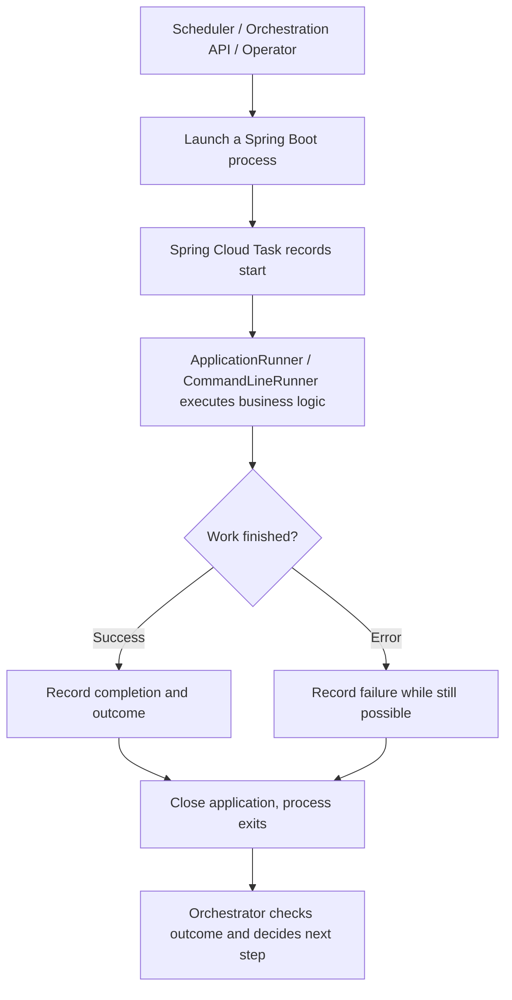
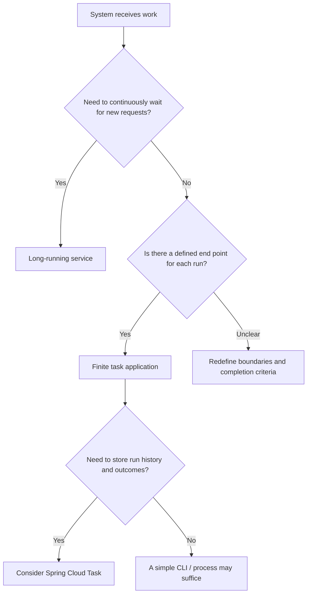

# Short-Lived Processes and Long-Running Services

In the Spring ecosystem, not every application needs to run around the clock. A service that handles HTTP requests or consumes messages typically must remain active; conversely, a program that exports an end-of-day report can start up, finish its work, and exit. **Spring Cloud Task** is designed for the second type of application: a Spring Boot application with a finite runtime, while recording information about each execution for monitoring and operations.

This lesson belongs to the **Overview** chapter of the **SPRING_CLOUD_TASK** module. Distinguishing between the two execution models is the foundation for understanding why Spring Cloud Task needs `TaskRepository`, how to handle arguments and errors, how to trigger tasks on a schedule or on demand, and when to integrate with Spring Batch.

## Learning Objectives

After this lesson, you will be able to:

- Explain the lifecycle and differences between a **short-lived process** (*finite/short-lived process*) and a **long-running service** (*long-running service*).
- Choose the appropriate model for real-world requirements such as APIs, queue processing, scheduled reporting, and on-demand tasks.
- Describe the role of Spring Cloud Task in recording each individual execution, rather than confusing it with a scheduling tool.
- Outline how to build, run, observe, and handle errors for a Spring Boot task with a clear termination point.

## 1. Two Application Lifecycle Models

### 1.1. Short-Lived Processes: Having a Start and an End

A **short-lived process** is a process created to carry out a finite unit of work. When the work finishes or cannot continue due to an error, the process terminates and returns control to the environment that launched it. "Short-lived" refers to a **bounded lifecycle**, not necessarily running for a few seconds: a data import taking two hours still belongs to this model if it has a defined termination condition.

For example: at 01:00 every day, the system runs a program to aggregate the previous day's transactions. The program reads the target processing date, queries data, writes the report, saves the results, and exits. The next day, the orchestrator creates **a new run**, with its own execution ID and outcome.

A typical run consists of the following steps:

1. **Triggering:** a scheduler, operator, or another system requests to run the task.
2. **Initialization:** creates the process, loads configuration, and connects to required resources.
3. **Execution:** validates arguments and processes the assigned workload.
4. **Termination:** records success/failure, closes resources, and stops the process.

The key point is that **each run is an independently observable event**: when it ran, with what arguments, what the outcome was, how long it took, and whether it needs to be re-run.

### 1.2. Long-Running Services: Always Ready to Serve

A **long-running service** is designed to stay alive until it is intentionally stopped, redeployed, or crashes. Its work typically arrives continuously without a time boundary, such as:

- A REST API constantly listening for requests from client applications.
- A consumer continuously receiving and processing messages from a queue.
- A WebSocket server maintaining connections with multiple users.
- An orchestrator that must stay running continuously to accept and dispatch tasks to other processes.

An HTTP request might finish in 200 ms, but that **does not turn the entire API server into a short-lived process**: the server process continues listening for the next request. Similarly, a consumer that finishes processing each message but does not exit after each message is still a long-running service.

### 1.3. Comparison Table

| Criterion | Short-Lived Process | Long-Running Service |
| --- | --- | --- |
| Purpose | Complete a defined block of work | Stay ready to accept and process new work |
| Lifecycle | Startup → execute → terminate | Startup → repeatedly listen/process → stop when needed |
| Trigger mechanism | Schedule, event, manual action, call from another system | Usually started on deployment and maintains a desired instance count |
| Success signal | Outcome and exit code of **the run** | Health, availability, and quality of service over time |
| Monitoring | Start/end timestamps, arguments, errors, retry count | Uptime, throughput, latency, error rate, connection status |
| Scaling | Run multiple independent execution instances, with duplicate control | Scale up/down the number of serving instances |
| Examples | Nightly CSV export, reconciliation, data cleanup, one-time data migration | Ordering API, authentication service, persistent Kafka consumer |

**Processing duration does not determine the model.** The deciding question is: *after completing the current unit of work, does the process have any reason to keep waiting for the next unit of work?*

## 2. Where Does Spring Cloud Task Fit In?

Spring Cloud Task adds **execution lifecycle** management for Spring Boot applications that have a termination point. In common usage, a task is deployed as an application without starting a web server, executes business logic via `ApplicationRunner` or `CommandLineRunner`, and then exits.

Spring Cloud Task records metadata about the run through components such as:

| Concept | Role |
| --- | --- |
| `TaskExecution` | Represents a single run: task name, execution identifier, start/end timestamps, exit code, error message, and related details. |
| `TaskRepository` | Creates/updates execution records; when configured with an appropriate datasource and schema, metadata can be stored persistently in a database. |
| `TaskExplorer` | Queries the history and details of stored executions. |
| `TaskExecutionListener` | Extension point to react to task lifecycle events when customization is needed. |

A new run typically creates a new `TaskExecution` record. Thanks to this, two report exports with the same name running on two different days remain distinguishable. **Execution metadata does not replace business data**: the report file, reconciled data, or updated records must still be stored in the business system or an appropriate storage location.



The diagram illustrates the normal path. If the process is **forcibly killed**, loses power, or loses its database connection, the execution record might not have an end time even though the process has actually stopped. Therefore, the operational system must cross-check external process status against metadata in `TaskRepository`.

### Spring Cloud Task Is Not a Scheduler

Spring Cloud Task helps **record and manage information about a single run**. It does not decide on its own that a task should run at 01:00, does not automatically create recurring runs, and does not manage retries by default. You can use cron, a Kubernetes `CronJob`, a workflow orchestration system, or another service to **spawn a new process** for each execution.

Placing `@Scheduled` inside an always-running Spring Boot service is a valid pattern for many problems, but those periodic method invocations still belong to **the same living process**. They do not automatically become separate Spring Cloud Task executions. If the goal is to independently manage each run, you must design the launch and termination boundaries accordingly.

## 3. Choosing a Model Based on Real-World Requirements

Consider four scenarios:

1. **Order lookup API:** must always accept new requests → long-running service.
2. **Revenue aggregation at 01:00:** finishes processing one day's dataset and stops → short-lived process; suited for Spring Cloud Task.
3. **Consumer processing orders from Kafka:** each event processes quickly, but the consumer must wait for the next event → long-running service.
4. **User clicks "Export Large Report":** the API receives the request and delegates to an orchestrator to launch a separate process; the API stays up, while the report-generation process terminates after processing → **combination of both models**.

You can apply the following decision flow:



The "on-demand report export" example also shows that **how work is triggered does not determine the application type**. An HTTP request can trigger a finite task; conversely, a job running every minute can be implemented as a persistent service if deployment requirements fit.

## 4. Sketching a Spring Cloud Task Application

The following code illustrates a Spring Boot application that exposes no API, accepts a date argument, and performs a single processing run. Assume the project has declared compatible Spring Boot and Spring Cloud Task dependencies. The `System.out.println` part represents the report generation business logic and must be replaced with an actual service.

```java
import java.time.LocalDate;
import java.util.List;

import org.springframework.boot.ApplicationRunner;
import org.springframework.boot.SpringApplication;
import org.springframework.boot.autoconfigure.SpringBootApplication;
import org.springframework.cloud.task.configuration.EnableTask;
import org.springframework.context.ConfigurableApplicationContext;
import org.springframework.context.annotation.Bean;

@SpringBootApplication
@EnableTask
public class DailyReportTaskApplication {

    public static void main(String[] args) {
        ConfigurableApplicationContext context =
                SpringApplication.run(DailyReportTaskApplication.class, args);
        int exitCode = SpringApplication.exit(context);
        System.exit(exitCode);
    }

    @Bean
    ApplicationRunner generateDailyReport() {
        return arguments -> {
            List<String> values = arguments.getOptionValues("businessDate");
            if (values == null || values.size() != 1) {
                throw new IllegalArgumentException(
                        "Exactly one --businessDate=YYYY-MM-DD must be passed");
            }

            LocalDate businessDate = LocalDate.parse(values.get(0));
            // Replace with real business logic: read data, generate report, save results.
            System.out.println("Processed report for date " + businessDate);
        };
    }
}
```

Example `application.yml` configuration:

```yaml
spring:
  application:
    name: daily-report
  main:
    web-application-type: none
  cloud:
    task:
      name: daily-report
```

Run the packaged JAR:

```bash
java -jar daily-report.jar --businessDate=2026-11-24
```

Execution flow breakdown:

1. Spring Boot starts the application in non-web mode.
2. Spring Cloud Task hooks into the application lifecycle to record the run.
3. `ApplicationRunner` receives `businessDate`, validates the format, and executes the work **once**.
4. When the runner finishes, the application closes the context and returns the process exit code. If the runner throws an error, startup/execution fails and must be captured and handled appropriately by the runtime environment.

In environments where you need to query run history **across separate startups**, you must configure a `DataSource` pointing to a suitable database and prepare the Spring Cloud Task metadata schema matching your version; in production, schema should be managed via a controlled migration process. Simply adding `@EnableTask` without configuring persistent storage means you **should not assume** history is retained in a database after the process exits.

> **Note on the example:** A runnable program does not automatically mean an operationally safe task. A production implementation requires contextual logging, transaction and resource management, a defined retry mechanism, and a strategy to avoid duplicate processing.

## 5. Tracking Outcomes: Distinguishing Three Status Layers

For a finite process, there are at least three distinct questions:

| Status Layer | Question | Example |
| --- | --- | --- |
| **Process** | Is the process still running or has it exited? What is the OS exit code? | Container terminates with exit code `0` or an error code. |
| **Task Execution** | Which run did Spring Cloud Task record, when did it start/end, and what was the outcome? | `TaskExecution` has an identifier, timestamps, exit code, and related messages. |
| **Business** | Did the target data achieve the expected business result? | The report was saved completely, for the right date, without duplicate records. |

These three layers are often related but **not strictly equivalent**. A process can exit successfully while the report is incomplete because business logic skipped validation; or the report might already be written while the process crashes before updating the final metadata. Therefore, to confirm completion, combine exit codes, Spring Cloud Task records, and business success criteria.

When handling errors, avoid writing code like `catch (Exception e) { log.error(...); }` and then exiting normally if the actual work failed. If you catch an exception to add context, rethrow it or report failure via an appropriate mechanism so the orchestrator does not mistake it for completion.

## 6. Scheduling, On-Demand Execution, and Avoiding Overlap

Spring Cloud Task can be triggered from multiple sources, but each trigger should establish a **clear execution boundary**:

| Need | Typical Implementation | What to Control |
| --- | --- | --- |
| Run nightly | Cron, Kubernetes `CronJob`, or external scheduler spawning a new process/container | Timezone, business date, backfill/catch-up runs, overlapping runs |
| Run manually | Operator invokes command with explicit arguments | Access control, argument validation, audit trail of who requested it |
| Run after event | Service receiving an event delegates work to a task-launching system | Duplicate launches, concurrency limits, launch acknowledgment |
| Run on demand from API | API accepts request and calls an orchestrator to run a separate task | Do not hold the HTTP connection waiting for the entire job; provide an ID to query results |

For example, a report schedule at 01:00 does not guarantee that the previous day's task has finished. If two runs modify the same dataset simultaneously, there is a risk of duplicate reports or overwritten results. Choose an explicit policy: disallow overlapping runs, use locking by business date, or allow parallel execution when runs operate on independent data partitions.

For safe re-runs, design the task to be **idempotent** where possible: running the same input multiple times does not produce additional erroneous results. For instance, a report keyed by `businessDate` has a unique key on date and report type, using controlled upsert logic instead of always inserting a new record.

## 7. When to Combine with Spring Batch?

Spring Cloud Task and Spring Batch solve problems at two different levels:

- **Spring Cloud Task** focuses on a *single application execution* with a termination point: when it starts, when it stops, and what outcome it exits with.
- **Spring Batch** focuses on *batch data processing pipelines*: `Job`, `Step`, reading/processing/writing data, checkpoints, skip/retry, and restartability based on job configuration.

An application can use **both**: Spring Cloud Task records the application run, while Spring Batch manages the steps of importing one million rows of data. You do not need Spring Batch if the task merely calls an API or executes a simple operation; conversely, for multi-step data processing requiring checkpoints and restarts, Spring Batch is worth considering.

Do not confuse "re-running a process" with "resuming from the last processed position". Re-running an entire Spring Cloud Task **does not automatically** know the last successfully processed data row. Checkpoint-based resumption must be designed at the business layer or handled via the appropriate Spring Batch mechanism.

## 8. Principles for Safe Operations

Before deploying a finite task to production, be able to answer the following:

1. **Deterministic input:** use valid arguments, configuration versions, and explicit business dates. Avoid passing passwords/tokens in command-line arguments or logs since they can appear in monitoring tools and metadata.
2. **Deterministic termination:** do not accidentally start a web server, infinite loop, persistent consumer, or background thread that prevents the process from exiting.
3. **Observable failures:** report errors properly without swallowing exceptions; the orchestrator checks exit codes and completion deadlines rather than merely checking whether the process ever started.
4. **Bounded retries:** set retry limits, backoff intervals, and retryable conditions. Distinguish transient errors from invalid input data.
5. **Prevent duplicate runs:** define business keys, limit concurrent task instances, and ensure consistent data updates.
6. **Resources and timeouts:** configure timeouts, CPU/memory limits, close connections, and handle shutdown signals properly.
7. **History tracking:** store metadata in an appropriate database, attach execution IDs to logs, and monitor failure counts and overdue runs.
8. **Anomaly reconciliation:** detect execution records that have not ended when the actual container/process has died; do not rely solely on a single status source.

**Incident example:** the orchestrator does not see the November 24 report and immediately re-launches with the same arguments. If the first run already wrote the file successfully but crashed before updating its status, the new run may create duplicates. Good design checks output by business key, decides whether to continue, perform a controlled overwrite, or skip, and records the corresponding result.

## 9. Self-Check Knowledge

**Scenario A.** A Spring Boot application uses `@Scheduled(fixedDelay = 60000)` and runs continuously to check data. Is each minute's check an independent Spring Cloud Task?

**Hint:** No. Periodic invocations happen inside the same process. To track each finite run individually, you need to reorganize the process lifecycle or implement a dedicated tracking mechanism per execution.

**Scenario B.** A data import job runs for three hours and then exits. Is it too long to use Spring Cloud Task?

**Hint:** No. The key criterion is that the work has a defined end point; long execution times simply add requirements around timeouts, resources, checkpoints, and recovery.

**Scenario C.** A system returns exit code `0`, but 20% of report records are missing. Should the task be considered successful?

**Hint:** Do not rely on the exit code alone. You need business outcome verification criteria such as expected record counts, checksums, or a verified completion state.

**Design exercise.** Sketch a daily report export feature with an API accepting requests, a Spring Cloud Task process generating the file, a database storing `TaskExecution`, and a file storage system. Specify: required arguments, a lock to prevent duplicate report generation, how users query results, retry conditions, and how to detect tasks running past their deadline.

## 10. Key Takeaways

- **Long-running services** are suited for continuously waiting for and serving new requests; **short-lived processes** are suited for work with a start and end boundary.
- **Spring Cloud Task** adds execution history tracking for finite Spring Boot applications via `TaskExecution`, `TaskRepository`, and related components.
- **A scheduler or orchestration system** decides when to create a new run; Spring Cloud Task does not replace them.
- A technically successful run must be verified against **business outcomes**; re-runs require deduplication mechanisms and error controls.
- When batch data processing requires steps, checkpoints, and restarts, evaluate **combining Spring Cloud Task with Spring Batch**.
