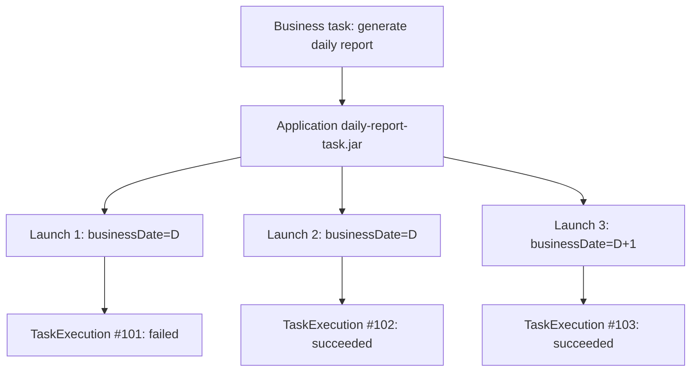
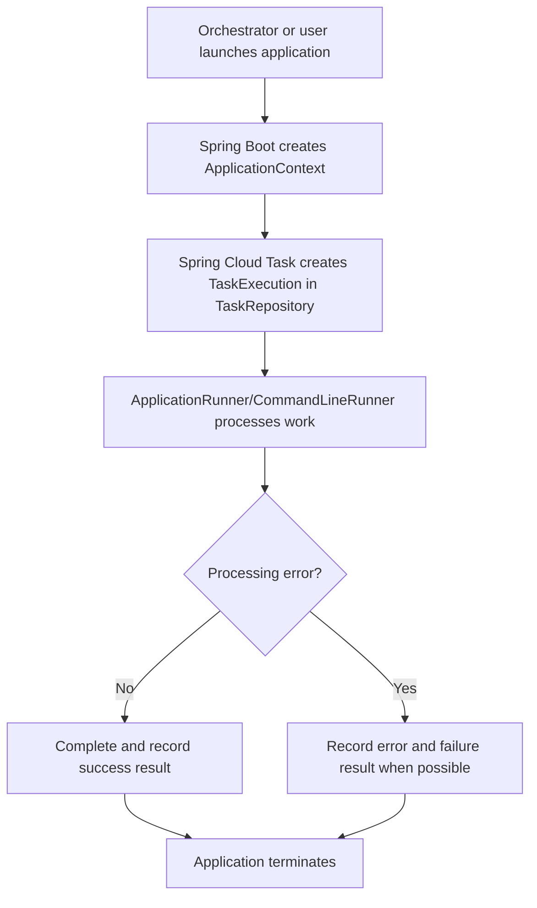

# Tasks, Task Applications, and Task Executions in Spring Cloud Task

## 1. Why Distinguish These Three Concepts?

A typical Spring Boot program can run continuously to accept HTTP requests. By contrast, **Spring Cloud Task** is designed for programs with finite work: launched, processing a defined workload, and then terminating. Examples include end-of-day transaction reconciliation, one-time data synchronization, scheduled report generation, or importing a data file.

To design and operate this kind of program properly, you must distinguish between a **task** (*task*), a **task application** (*task application*), and a **task execution** (*task execution*). They are related, but they are not synonymous.

| Concept | Answers the Question | Revenue Report Example |
| --- | --- | --- |
| **Task** | *What work needs to be done?* | Aggregate revenue for a business day. |
| **Task Application** | *Which program performs that work?* | The `revenue-report-task.jar` file, containing Java code, configuration, libraries, and aggregation logic. |
| **Task Execution** | *Which specific run occurred and what was the outcome?* | The 01:00 run on Nov 24 failed; the retry run at 01:15 succeeded. |

In Spring Cloud Task, a single run is represented by a **`TaskExecution`** object and its information is stored by **`TaskRepository`**. This is the key piece that helps the system answer "did the task run, when did it run, and did it finish?" even after the Java process has exited.

## 2. Task: A Unit of Work with an End Point

A **task** is a business or technical concept describing a unit of work with clear start and end conditions. It can be "generate report for day D", "read file F and write valid records", or "send a sync request for partner P".

A task typically has:

- **Inputs**: processing date, customer ID, file path, or data batch identifier.
- **Processing steps**: read data, validate, transform, write results, call external services.
- **Completion criteria**: all work has been processed and results are verified.
- **Failure or re-run rules**: stop, record error, retry safely, or resume from a checkpoint.

For example, the `generate-daily-report` task takes `businessDate=2026-11-23`. Its job is to fetch data for that exact date, compute metrics, and save the report. The task name describes the **type of work**; the arguments specify the **dataset to process**.

Not every small step needs to be a separate Spring Cloud Task. A single run can execute multiple sequential processing steps. How tasks are split depends on operational boundaries: when you need independent launching, independent tracking, independent retries, and independent success/failure determination.

## 3. Task Application: Source Code and Execution Process

A **task application** is a Spring Boot application configured to run finite work. It can be packaged as a JAR or container image and deployed on a server, Kubernetes, or another orchestration platform.

A Spring Cloud Task application typically has the following components:

| Component | Role |
| --- | --- |
| `@SpringBootApplication` | Initializes the Spring Boot application and required beans. |
| `@EnableTask` | Enables Spring Cloud Task lifecycle infrastructure. |
| `ApplicationRunner` or `CommandLineRunner` | Contains the entry point to execute logic after the application initializes. |
| `DataSource` and `TaskRepository` | Records information about each run into a database. |
| External launching mechanism | Decides *when* to run the JAR/container and passes arguments. |

An **application build** can be launched multiple times without rebuilding source code. Each normal launch of an application with Spring Cloud Task enabled corresponds to a distinct `TaskExecution` record with its own identifier. If you want to handle multiple types of work within the same application, you can branch logic via arguments; however, keep task boundaries clear so tracking does not become ambiguous.



The diagram above illustrates three launches from **the same application**. The first two use the same business argument yet are still **two distinct executions**. The IDs `#101`, `#102`, and `#103` are illustrative data only.

## 4. Task Execution: The Trace of a Specific Run

**`TaskExecution`** is the lifecycle tracking model for **a single launch**, not a static job definition and not the JAR file itself. Each record typically identifies:

- **`executionId`**: unique identifier of the execution in the repository.
- **`taskName`**: name used to categorize the task; multiple runs can share the same name.
- **`startTime`, `endTime`**: recorded start and end timestamps.
- **`exitCode`, `exitMessage`**: termination outcome and diagnostic information.
- **Launch arguments**: inputs passed to the run, if recorded per configuration.

Exact columns and supporting tables depend on the Spring Cloud Task schema version in use. With standard JDBC configuration, the `TASK_EXECUTION` table holds lifecycle data, while a table such as `TASK_EXECUTION_PARAMS` stores launch arguments. **`TaskRepository`** handles writing and updating these records; **`TaskExplorer`** supports querying execution history.

Example of a *hypothetical* history:

| `executionId` | `taskName` | Business Argument | Start | End | Outcome |
| --- | --- | --- | --- | --- | --- |
| `101` | `daily-report-task` | `businessDate=2026-11-23` | 01:00 | 01:02 | Error, non-zero exit code |
| `102` | `daily-report-task` | `businessDate=2026-11-23` | 01:15 | 01:18 | Success, exit code 0 |
| `103` | `daily-report-task` | `businessDate=2026-11-24` | 01:00 next day | 01:03 next day | Success, exit code 0 |

From this table we can see:

1. `101` and `102` **are not the same execution**. The subsequent run is a new attempt even with the same name and arguments.
2. One `taskName` can be associated with many history records.
3. Having a `TaskExecution` record does not mean the business data was processed correctly. You must still verify the actual work outcome.

A process that stops abruptly, loses database connectivity, or is forcibly killed might **not update `endTime` and the final result in time**. Therefore, a record without an end time does not automatically prove the process is still running. The monitoring system must cross-check container/process status and orchestration state.

## 5. Lifecycle of a Run

The basic flow when launching a Spring Cloud Task application is:



A few points to understand in the diagram:

**At startup:** Spring Cloud Task infrastructure creates the execution object and persists startup information via `TaskRepository`. If application initialization or repository connection fails too early, the record may not have been created yet.

**During execution:** `ApplicationRunner` or `CommandLineRunner` performs the work. Although logs and business data can be written during execution, Spring Cloud Task does not infer per-record or per-algorithm-step progress on its own.

**At completion:** The infrastructure updates completion info when the application lifecycle completes normally. Unhandled exceptions in the runner can cause the run to fail and be recorded if the infrastructure is still operational. The Java process exit code, the exit code stored in `TaskExecution`, and the orchestrator's status must be configured/reconciled consistently, especially when the application maps errors to custom exit codes.

**Once the process has stopped:** History can be queried from the database, instead of keeping the Java process alive to know the outcome.

## 6. Example: A Minimal Spring Cloud Task Application

Suppose you need to generate a revenue report for a date passed at startup. The application receives the `--businessDate` argument, validates its format, and executes the work. The example below clearly shows where processing logic belongs; actual report querying and persistence will be implemented inside the business service.

```java
import java.time.LocalDate;
import java.util.List;

import org.springframework.boot.ApplicationRunner;
import org.springframework.boot.SpringApplication;
import org.springframework.boot.autoconfigure.SpringBootApplication;
import org.springframework.cloud.task.configuration.EnableTask;
import org.springframework.context.annotation.Bean;

@SpringBootApplication
@EnableTask
public class DailyReportTaskApplication {

    public static void main(String[] args) {
        SpringApplication.run(DailyReportTaskApplication.class, args);
    }

    @Bean
    ApplicationRunner generateReport() {
        return arguments -> {
            List<String> values = arguments.getOptionValues("businessDate");
            if (values == null || values.size() != 1) {
                throw new IllegalArgumentException(
                    "Exactly one --businessDate=yyyy-MM-dd must be passed"
                );
            }

            LocalDate businessDate = LocalDate.parse(values.get(0));
            System.out.println("Starting report generation for " + businessDate);

            // TODO: call the business service to aggregate and save the report.
            // If processing fails, throw an exception to record the failure.

            System.out.println("Completed report for " + businessDate);
        };
    }
}
```

In a real project, you must declare the **Spring Cloud Task starter** (`spring-cloud-starter-task`), an appropriate JDBC driver, and required Spring Boot dependencies. The Spring Cloud version must be compatible with the Spring Boot version; use the published dependency-management BOM for that version pair.

Example configuration when using PostgreSQL to store execution history:

```yaml
spring:
  application:
    name: daily-report-task
  main:
    web-application-type: none
  cloud:
    task:
      name: daily-report-task
  datasource:
    url: ${TASK_DB_URL}
    username: ${TASK_DB_USER}
    password: ${TASK_DB_PASSWORD}
```

The application is launched, for example:

```bash
java -jar daily-report-task.jar --businessDate=2026-11-23
```

To run this example with PostgreSQL, you must provide the `TASK_DB_URL`, `TASK_DB_USER`, and `TASK_DB_PASSWORD` environment variables, an account with appropriate permissions, and the **exact version of the Spring Cloud Task table schema**. In production, schema creation/updates should be managed via controlled migrations rather than assuming the application has permissions to auto-create tables on every run.

If the command above is executed again, the application processes **the same business date**, but Spring Cloud Task records **a new run**. It does not reject duplicate runs on its own, nor does it automatically guarantee that only one report is written in the business table.

### Distinguishing Three Types of Data

| Data | Where Typically Stored | Purpose |
| --- | --- | --- |
| Application configuration and arguments | Config files, environment variables, command-line arguments | Defines *what* the application will do on startup. |
| `TaskExecution` history | `TaskRepository` database | Shows *how* the run unfolded. |
| Business outcomes | Report tables, exported files, object storage, target API | Stores the *actual output* produced by the task. |

`TaskRepository` recording success does not replace business data validation, transactions, reconciliation, and result verification steps.

## 7. Task Name, Arguments, and Re-runs

When an application can run multiple times, the **task name** and **business arguments** play distinct roles:

- `taskName`, e.g., `daily-report-task`, is a stable label for finding executions of the same type.
- `businessDate`, e.g., `2026-11-23`, selects the data scope the execution must process.
- `executionId` identifies **a specific run** assigned by the repository; it should not be used as the report's business key.

If a schedule automatically re-launches after a failure, another `TaskExecution` is created. Therefore, the business logic must define **idempotency** (the ability to re-run with the same input without causing duplicate or incorrect results). For example, you can use a unique key `(report_type, business_date)` with an `upsert` strategy, or write to a staging area and swap in the final result after verification succeeds.

Beyond repeated runs, you must also consider **concurrent runs**. Two processes could simultaneously receive `businessDate=2026-11-23`. Recording two `executionId` values in history does not prevent two processes from contending over the same data. If the business requires only one processing run at a time, you need locks, unique constraints, orchestration controls, or an appropriate concurrency-limiting feature, and you must test how they behave in your deployment environment.

Do not pass passwords, tokens, or sensitive data in arguments if they can be recorded in `TaskExecution`, logs, or exposed through administration tools. Use a secret manager or controlled environment variables when appropriate.

## 8. Who Decides When to Run?

Spring Cloud Task primarily manages **the lifecycle and history of an execution**; scheduling or triggering usually lives outside the application:

| Trigger Type | Example | What to Watch For |
| --- | --- | --- |
| On demand | Operator runs the JAR with specific arguments. | Record who/what requested the trigger in the orchestrator if auditability is needed. |
| Scheduled | Cron, Kubernetes CronJob, or platform scheduler. | Control retries, schedule overlap, and concurrency limits. |
| Event-driven | A service detects a new file and requests running a task container. | Input identification, event validation, and handling duplicate event deliveries. |
| Workflow-driven | Orchestrator runs task B after A succeeds. | Distinguish execution status from the business outcomes required as conditions. |

A finite execution process should terminate after completing its work; do not keep the application running indefinitely just to wait for the next scheduled trigger. The orchestrator can use the process exit code to decide whether to retry, alert, or run the next step, while using `TaskExplorer`/the history datastore to inspect details.

## 9. Relationship with Spring Batch

Spring Cloud Task and Spring Batch can work together, but they have **different tracking scopes**.

| Spring Cloud Task | Spring Batch |
| --- | --- |
| Tracks **a single run of the task application** via `TaskExecution`. | Tracks **a single run of a data-processing job** via `JobExecution`, `StepExecution` records, and batch state. |
| Suitable for many finite workloads, including non-chunked tasks. | Provides job/step, chunk, checkpoint, restart, and large-volume processing mechanisms. |
| Cares about application launch, termination, and execution outcome. | Cares about progress, failures, and restartability at the job/step/item level. |

For example, a Spring Cloud Task application can launch a Spring Batch job importing 100,000 rows. **`TaskExecution`** records the run of the application hosting the job; **`JobExecution`** and **`StepExecution`** record Spring Batch's processing state. When properly integrated, identifiers can be linked to trace from the application run to the batch job. Do not confuse Task's `executionId` with Batch's `jobExecutionId` or assume by default that they share the same status.

## 10. End-to-End Operational Scenario

An operations team needs to reconcile payments for `2026-11-23` at 02:00:

1. The scheduler launches the image containing `payment-reconciliation-task`, passing `--businessDate=2026-11-23`.
2. Spring Cloud Task records a new `TaskExecution`. The application reads transactions and compares figures with the partner.
3. The partner returns a transient error. The runner throws an error; if the lifecycle and database connection remain intact, the execution finishes with failure information.
4. Based on the retry policy, the orchestrator re-launches the task. The retry run has a new `executionId` but uses the same `businessDate`.
5. The application processes using idempotency rules, avoiding duplicate writes for partially completed work. Upon successful completion, reconciliation results reside in the business datastore and run history resides in `TaskRepository`.

In this scenario, three different questions lead to three different places to inspect:

- **"What needs to be reconciled?"** → Task definition and the `businessDate` argument.
- **"What code is deployed?"** → JAR/image application version and runtime configuration.
- **"What happened to the 02:00 run?"** → `TaskExecution`, logs, traces from the orchestrator, and related business outcomes.

## 11. Common Misconceptions

**"If a task fails, the retry will update the old record."** Incorrect in the standard launch model. A retry is a **new execution**; the old record remains useful for history and incident analysis.

**"TaskRepository contains all result data."** Incorrect. It stores lifecycle metadata; business outcomes must have their own storage and verification mechanism.

**"A `TaskExecution` with a null `endTime` means it is still running."** Not necessarily. The process may have been killed or lost connectivity before updating the record.

**"Adding `@EnableTask` gives automatic scheduling."** Incorrect. Schedules, event triggers, and retry policies must be provided by an orchestrator or custom design.

**"Same arguments mean it runs only once."** Incorrect. Independent launches can receive the same arguments; preventing duplicate data is the responsibility of business design and orchestration.

## 12. Key Takeaways and Self-Check

A quick way to remember: a **task** is *the work to be done*; a **task application** is *the program doing that work*; a **task execution** is *the record of a single run of that program*. Spring Cloud Task provides tracking via `TaskRepository`, while scheduling, output data, safe re-runs, and system-wide monitoring require additional design.

Answer these three questions yourself:

1. If the same JAR runs twice with the same `--businessDate`, how many executions will there be and why?
2. Why can't you look solely at `exitCode` to conclude that the business report is completely accurate?
3. If a process is terminated via a forced kill signal, what sources besides `TaskRepository` should you rely on to determine its true state?

**Guiding answers:** (1) Typically two distinct `TaskExecution` records; (2) completion metadata does not replace quality and consistency checks on the output data; (3) cross-check process/container status, logs, the orchestrator, and business data.
