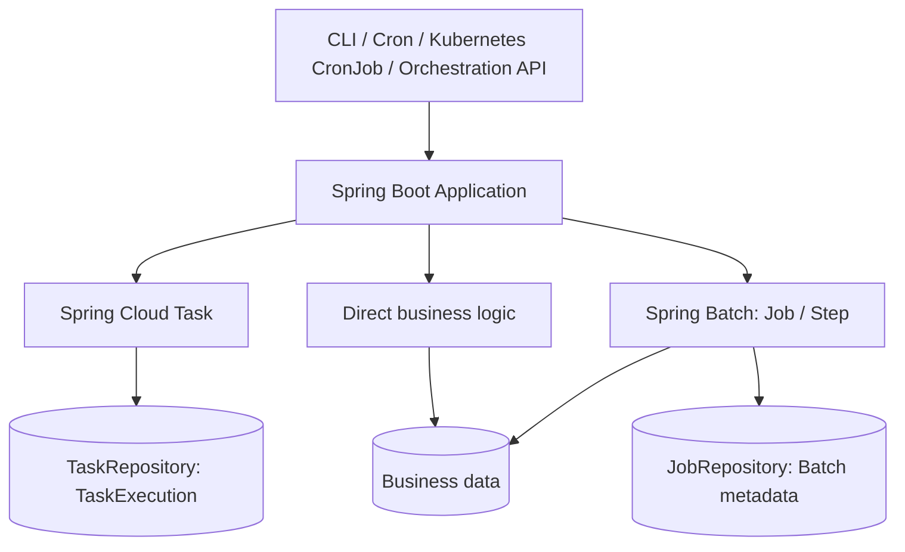
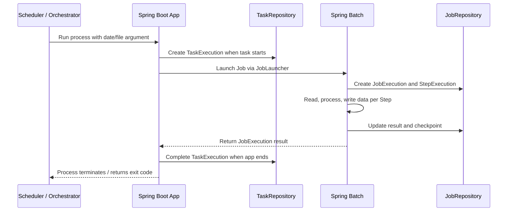
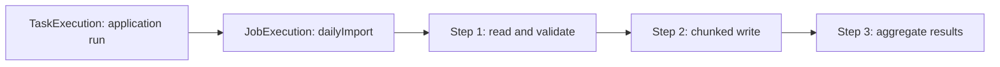

# Relationship Between Spring Boot, Spring Cloud Task, and Spring Batch

## Lesson Objectives

When building a program that only runs for a finite duration, such as nightly data synchronization, on-demand report export, or end-of-day transaction reconciliation, three names—**Spring Boot**, **Spring Cloud Task**, and **Spring Batch**—often appear together. They belong to different layers of responsibility and can be used independently or combined.

After this lesson, you will be able to:

- Distinguish the roles of Spring Boot, Spring Cloud Task, and Spring Batch.
- Describe the lifecycle of a task run and where execution state and results are stored.
- Explain the difference between `TaskRepository` and `JobRepository`, and between `TaskExecution` and `JobExecution`.
- Choose an appropriate architecture for simple tasks, batch data processing, or scheduled/on-demand processing.
- Recognize the points that must be handled when a task fails, re-runs, and is deployed in a production environment.

## 1. Three Technologies Solving Three Problem Domains

### Spring Boot: Application Runtime Foundation

**Spring Boot** provides application startup mechanisms, bean management, configuration, dependencies, database connectivity, and integration with the Spring ecosystem. A Boot application can be a long-running HTTP service, or it can be a **run-once-and-exit process**.

For non-HTTP applications, logic can run via `ApplicationRunner` or `CommandLineRunner` after the Application Context initializes. Spring Boot by itself does not provide a model for tracking task run history in `TaskRepository` or batch processing steps in `JobRepository`.

### Spring Cloud Task: Managing the Lifecycle of a Finite Run

**Spring Cloud Task** builds on Spring Boot to manage an application with a clear start and end point. Each launch creates a **`TaskExecution`** entity, recording details such as start time, end time, status/outcome, and exit code according to the configuration capabilities of the version in use. Metadata is stored via **`TaskRepository`**, typically using a relational database.

The key point to understand is that **one `TaskExecution` represents one run of the task application**, regardless of whether inside the application it merely makes a single API call, processes a file, or orchestrates multiple jobs. Spring Cloud Task helps answer "Which task application ran, when, and how did it finish?".

Spring Cloud Task **does not become a scheduler by itself**: instructing a process to run at 1:00 AM or when a user clicks a button is still handled by cron, Kubernetes CronJob, an orchestration system, or another service.

### Spring Batch: Organizing Batch Data Processing

**Spring Batch** focuses on business logic that needs to process large volumes of data or multi-step workflows. A `Job` can consist of multiple `Step` instances; each `Step` can run as a tasklet or chunk-oriented processing with `ItemReader`, `ItemProcessor`, and `ItemWriter` components.

Spring Batch supports concepts such as job parameters, step checkpoints/state, transactions, policy-based retry/skip, and restartability where appropriate. **`JobRepository`** stores metadata for `JobInstance`, `JobExecution`, `StepExecution`, and `ExecutionContext` to track which jobs have run and which parts can resume.

Spring Batch does not require Spring Cloud Task to operate. A Batch job can still run inside a Spring Boot application, via an internal schedule, or triggered by another process/service.

| Question | Spring Boot | Spring Cloud Task | Spring Batch |
| --- | --- | --- | --- |
| Primary role | Bootstraps and configures the application | Tracks the lifecycle of **a single application run** | Organizes **batch processing jobs/steps** |
| Observable execution unit | Application Context / process | `TaskExecution` | `JobInstance`, `JobExecution`, `StepExecution` |
| Dedicated history metadata | None built-in for tasks | `TaskRepository` | `JobRepository` |
| Chunking, retry, skip, restart mechanisms | Not built-in like Batch | Does not replace Batch | Yes, per job/step configuration |
| How it is launched | CLI, server, container, another service | Launching a Boot app with Task integration | `JobLauncher`, auto-run mechanism, or orchestrator |
| Can it be used standalone? | Yes | Requires a Spring Boot application | Can be used with Spring Boot without Task |

## 2. Architectural Relationship: Boot Is the Base, Task and Batch Are Two Add-On Capabilities



The diagram shows **combinable options**, not a requirement that an application use every component. Both direct logic and Spring Batch jobs run inside the Boot application. When Spring Cloud Task is enabled, the application's lifecycle is recorded at the task level. When Spring Batch is present, job/step-level work details are managed at the Batch level.

Three common combinations:

1. **Plain Spring Boot:** very short tasks with minimal specialized audit requirements, runnable via `ApplicationRunner`.
2. **Spring Boot + Spring Cloud Task:** need to record each application run's history in a database while business processing is relatively straightforward.
3. **Spring Boot + Spring Cloud Task + Spring Batch:** need both application run history and orchestration, tracking, and recovery mechanisms for batch processing.

Additionally, **Spring Boot + Spring Batch** is also a valid architecture when only job/step metadata is needed and task lifecycle metadata is unnecessary.

## 3. How Does a Run Actually Unfold?

Suppose a system needs to import transaction data every night. A typical sequence when using all three technologies:



This is the **logical** lifecycle. Callback ordering, how the application closes its context, whether `JobLauncher` is synchronous, and actual exit code mapping depend on the version and configuration. For example, if `JobLauncher` runs asynchronously, returning from `run()` does not mean the job has finished; the task must have an appropriate waiting/status-aggregation mechanism before exiting.

Two operational questions have different answers:

- **"Did this morning's 02:00 application run succeed?"** Query `TaskExecution` via `TaskRepository` and combine with the process exit code.
- **"How far did the write step of the transaction import job get, and can it be restarted?"** Query `JobExecution`, `StepExecution`, and `ExecutionContext` via `JobRepository`.

When integrating Task and Batch, metadata can record **the link between a task execution and a job execution** to trace from the application down to the inner job. This is a reference relationship between two execution types, not merging the two repositories into one. A single task execution might launch zero jobs or multiple jobs; do not assume there is always a one-to-one relationship.

## 4. How Does `TaskRepository` Differ from `JobRepository`?

### `TaskRepository`: Application-Level Observability

Each launch of a Task application is identified by its own `TaskExecution`. Information commonly used in operations includes task name, start/end timestamps, exit code, and error/result details depending on the version. If a task is invoked multiple times in a day, each run has its own history to inspect.

`TaskRepository` does not track per-record checkpoints and cannot tell from task metadata alone which chunk to resume from. If a task fails halfway through a 1-million-row file, developers must either design re-run safety themselves or use Spring Batch mechanisms.

### `JobRepository`: Job/Step-Level Observability and Recovery

Spring Batch distinguishes three easily confused concepts:

- **`JobInstance`:** the logical identity of a job, typically defined by *job name and identifying `JobParameters`*.
- **`JobExecution`:** a single run attempt of a `JobInstance`; one instance can have multiple executions when performing a valid restart after failure.
- **`StepExecution`:** a single execution of a step within a job; stores read/write counts, status, errors, and context for control or restart.

For example, the `dailyImport` job with identifying parameter `businessDate=2026-11-24` corresponds to one logical job for that date. Re-running with the same parameter after a failure can create a new `JobExecution` for the same `JobInstance`, if the job is configured as restartable and its status permits. If the instance is already completed, Spring Batch normally prevents re-running the same instance as a new job; proactively select identifying parameters or a reprocessing policy rather than adding a random value just to bypass duplicate checks.

**Data note:** the two repositories have distinct responsibilities and metadata schemas. They can share one database if configured appropriately, or use separate datasources depending on design. Permissions, table initialization/migration, schema compatibility, and transactions must be managed according to the deployed versions of Spring Boot/Spring Cloud Task/Spring Batch.

## 5. Example 1: Spring Boot + Spring Cloud Task for a Simple Task

A daily report export requirement does not need chunking or step-by-step restarts. The Boot application takes a command-line argument, calls a service, and exits. Adding Spring Cloud Task gives the system run history.

Typical dependencies (versions managed via compatible Spring Boot and Spring Cloud BOMs):

```xml
<dependency>
    <groupId>org.springframework.boot</groupId>
    <artifactId>spring-boot-starter</artifactId>
</dependency>
<dependency>
    <groupId>org.springframework.cloud</groupId>
    <artifactId>spring-cloud-starter-task</artifactId>
</dependency>
<!-- Add the JDBC driver and database access dependencies appropriate for your project. -->
```

Example startup class, where `ReportService` is a business bean defined by the project:

```java
import java.time.LocalDate;
import java.util.List;

import org.springframework.boot.ApplicationRunner;
import org.springframework.boot.SpringApplication;
import org.springframework.boot.autoconfigure.SpringBootApplication;
import org.springframework.cloud.task.configuration.EnableTask;
import org.springframework.context.annotation.Bean;

@SpringBootApplication
@EnableTask
public class DailyReportTaskApplication {

    public static void main(String[] args) {
        SpringApplication.run(DailyReportTaskApplication.class, args);
    }

    @Bean
    ApplicationRunner generateReport(ReportService reportService) {
        return args -> {
            List<String> values = args.getOptionValues("report-date");
            if (values == null || values.size() != 1) {
                throw new IllegalArgumentException("Exactly one --report-date=yyyy-MM-dd is required");
            }
            LocalDate date = LocalDate.parse(values.get(0));
            reportService.generateFor(date);
        };
    }
}
```

With configuration that disables the HTTP server:

```yaml
spring:
  main:
    web-application-type: none
  datasource:
    url: jdbc:postgresql://db.example.internal:5432/taskdb
    username: task_app
    password: ${TASK_DB_PASSWORD}
```

Example invocation from a scheduler or CLI:

```bash
java -jar daily-report-task.jar --report-date=2026-11-24
```

In this example, Spring Boot handles creating the Application Context and running `ApplicationRunner`; Spring Cloud Task handles run metadata. `ReportService` decides the business logic. You must prepare the `TaskRepository` schema according to the exact version's documentation before running in production. The application must terminate after processing; a web server or forever-running threads will prevent the process from being a finite task as intended.

When an error occurs, do not simply `catch`, log it, and return normally. If an error genuinely causes the task to fail, let it be reflected in the task status and process exit code via `ExitCodeGenerator`/`SpringApplication.exit` or an appropriate error-handling policy. **OS exit code, task status, and Batch job status are three separate signals to verify individually**, not guaranteed to stay synchronized automatically as desired.

## 6. Example 2: Adding Spring Batch for Large Data Imports

With a file of millions of transactions, a read/transform/write step may need chunked transactions, row counts, and the ability to restart from saved state. In that case, Spring Batch fits the **internal processing**, while Spring Cloud Task manages **the application run hosting the job**.

Add the Boot starter dependency for Batch:

```xml
<dependency>
    <groupId>org.springframework.boot</groupId>
    <artifactId>spring-boot-starter-batch</artifactId>
</dependency>
```

Suppose the project already defines a `Job dailyImportJob` bean containing steps to read the file, validate data, and write to the database. One way to explicitly launch the job inside a task is to call `JobLauncher` with business parameters:

```java
import java.util.List;

import org.springframework.batch.core.BatchStatus;
import org.springframework.batch.core.Job;
import org.springframework.batch.core.JobExecution;
import org.springframework.batch.core.JobParameters;
import org.springframework.batch.core.JobParametersBuilder;
import org.springframework.batch.core.launch.JobLauncher;
import org.springframework.boot.ApplicationRunner;
import org.springframework.context.annotation.Bean;

@Bean
ApplicationRunner runDailyImport(JobLauncher jobLauncher, Job dailyImportJob) {
    return args -> {
        List<String> dates = args.getOptionValues("business-date");
        if (dates == null || dates.size() != 1) {
            throw new IllegalArgumentException("Missing --business-date=yyyy-MM-dd");
        }

        JobParameters parameters = new JobParametersBuilder()
                .addString("businessDate", dates.get(0))
                .toJobParameters();

        JobExecution execution = jobLauncher.run(dailyImportJob, parameters);
        if (execution.getStatus() != BatchStatus.COMPLETED) {
            throw new IllegalStateException(
                    "Job dailyImport did not complete: " + execution.getStatus());
        }
    };
}
```

This is an **illustrative bean configuration snippet**, placed in a `@Configuration` or `@SpringBootApplication` class of the project. The example assumes `JobLauncher` **runs synchronously**; with an asynchronous launcher, you must wait for or observe the final outcome before concluding. When explicitly invoking a job from a runner, prevent Boot's automatic job launching mechanism (for example, by setting `spring.batch.job.enabled=false` in supported versions) to avoid running it twice.

The processing chain can be represented as follows:



If the write step fails midway:

1. `JobRepository` saves the failed job/step state and appropriate context to restart according to the step's configuration.
2. The current application run terminates with a failure result if the application propagates the error outward and updates the task outcome properly.
3. The scheduler can re-run the application, creating a **new `TaskExecution`**. Whether the job can resume from a checkpoint depends on **`JobInstance`/`JobParameters` and Spring Batch's restart policy**.

Therefore, **re-running a task** and **restarting a Batch job** are not a single operation. A task re-run might create a new execution for the same Batch instance, or initialize a different Batch instance if identifying parameters change.

## 7. Choosing Technologies by Scenario

| Scenario | Recommended Choice | Reason |
| --- | --- | --- |
| Small program running once, no database history needed | Spring Boot | `ApplicationRunner`/`CommandLineRunner` is usually enough. |
| Export a report or call an API once and must store run history | Spring Boot + Spring Cloud Task | Provides `TaskExecution`, timestamps, and application-level outcomes. |
| Large file import with multiple steps, chunking, and checkpoint restarts | Spring Boot + Spring Batch | `JobRepository` manages job/step details. |
| Scheduled large data import needing correlation between process status and individual steps | Spring Boot + Spring Cloud Task + Spring Batch | Observes both task lifecycle and Batch progress. |
| Needs to run automatically at 2:00 AM daily | One of the combinations above **plus an external scheduler** | Cron/CronJob/orchestrator decides trigger timing; Task does not replace a scheduler. |
| Needs a continuously running HTTP endpoint and occasional job triggers | Spring Boot service + Spring Batch, consider separating worker task | HTTP service and finite processes have different operational lifecycles. |

Do not add Spring Batch just because an application is called a "task". If the work is only a relatively small operation, Batch can introduce unnecessary complexity. Conversely, `TaskRepository` alone will not be enough to handle step-by-step restarts for a large data pipeline.

## 8. Important Operational Boundaries

### Schedules and On-Demand Triggers

Spring Cloud Task records **runs**, not cron schedules. Depending on your platform, you can use cron, Kubernetes CronJob, an orchestration system, or an API service to spawn the task process. In containerized environments, prefer the model where **one trigger spawns one terminable process/container**, and let the orchestrator read exit codes, time limits, retry counts, and resource limits.

### Parameters and Identity

Distinguish **application arguments** like `--business-date` and `--input-file` from Batch **`JobParameters`**. The application must explicitly pass the required values into the job; there is no guarantee that every CLI argument automatically becomes a Batch parameter with the right identifying semantics. For retryable work, use stable business keys (reconciliation date, request ID, batch ID) and define which values identify a `JobInstance`.

### Failures, Retries, and Idempotency

Repeating a task does not automatically guarantee data safety. If a run writes 70% of the data and gets interrupted, the next run may write duplicates if the business logic lacks unique keys, upserts, transactions, or deduplication mechanisms. With Batch, checkpoints help track processing position when readers/writers and steps are properly configured; you must still design business logic to be **idempotent** on retries or full re-runs.

These mechanisms operate at different scopes: Spring Batch can retry an operation inside a step; the scheduler can re-run the entire container; Spring Cloud Task records a new run. Explicitly specify which actor handles retries, retry limits, and permitted conditions.

### Batch Status Does Not Automatically Guarantee Task Exit Code

A `JobExecution` ending with `FAILED` while the caller code catches the error and returns normally can mislead the scheduler into thinking the process succeeded. When integrating, you must propagate failure outcomes to the application level and to the calling system using a clear policy, and test real job failure cases. With an asynchronous launcher, avoid terminating the task while the Batch job is still running.

### Repository, Schema, and Monitoring

In production, use a persistent database and version-compatible schemas for Task/Batch metadata; manage migrations, backups, permissions, and history cleanup per policy. Do not rely on an embedded in-memory database if you need traceability after a container exits. Monitor both **process status** (exit code, duration, timeouts) and **operational metadata** (`TaskExecution`, `JobExecution`, error record counts, and checkpoints).

### Concurrency and Resource Limits

Two launch requests for the same business date could arrive nearly simultaneously. Define locking/deduplication policies at the orchestration or business layer; with Batch, verify how `JobInstance` identification and running execution states behave. Limit memory, database connections, chunk size, and worker count so finite processes do not overload shared systems.

## 9. Reading a Scenario End to End

An e-commerce system needs to reconcile orders for `2026-11-24`:

1. **Scheduler** triggers a container at 02:00 and passes `--business-date=2026-11-24`.
2. **Spring Boot** initializes dependencies, connects to the database, and runs task startup code.
3. **Spring Cloud Task** writes a `TaskExecution` for this run, e.g., used to answer "when did the reconciliation container start and end?".
4. **Spring Batch** executes `dailyReconciliationJob`, consisting of steps to load orders, compare payment transactions, and write discrepancies; `JobRepository` records each execution and its steps.
5. If the job fails, the application reflects failure at the task level and returns an appropriate exit code; the scheduler decides on retries per policy.
6. When re-running for the same date with stable identifying parameters, Spring Batch determines restartability based on job/step status, while Spring Cloud Task records a new application run.

From this scenario, operators query **TaskRepository** to see *the history of each application run*, while incident analysts query **JobRepository** to see *which step failed and where processing can resume*.

## 10. Self-Check Questions

1. Does a Boot application that runs `ApplicationRunner` and exits strictly require Spring Cloud Task? If not, what need does adding Task solve?
2. Why can't `TaskExecution` replace `StepExecution` when processing large data files?
3. When the scheduler retries the entire container, why is there usually a new `TaskExecution` but not necessarily a new Batch `JobInstance`?
4. If a Batch job fails yet the process returns exit code `0`, what might the operational system misunderstand?
5. A job needs to run at 02:00 daily without needing chunking. Which components do you choose and who is responsible for scheduling?

**Key takeaway:** Spring Boot provides the runtime environment; Spring Cloud Task records finite application lifecycles via `TaskRepository`; Spring Batch provides the job/step model and batch processing mechanisms via `JobRepository`. They complement each other based on requirements, rather than being three names for the same functionality.
