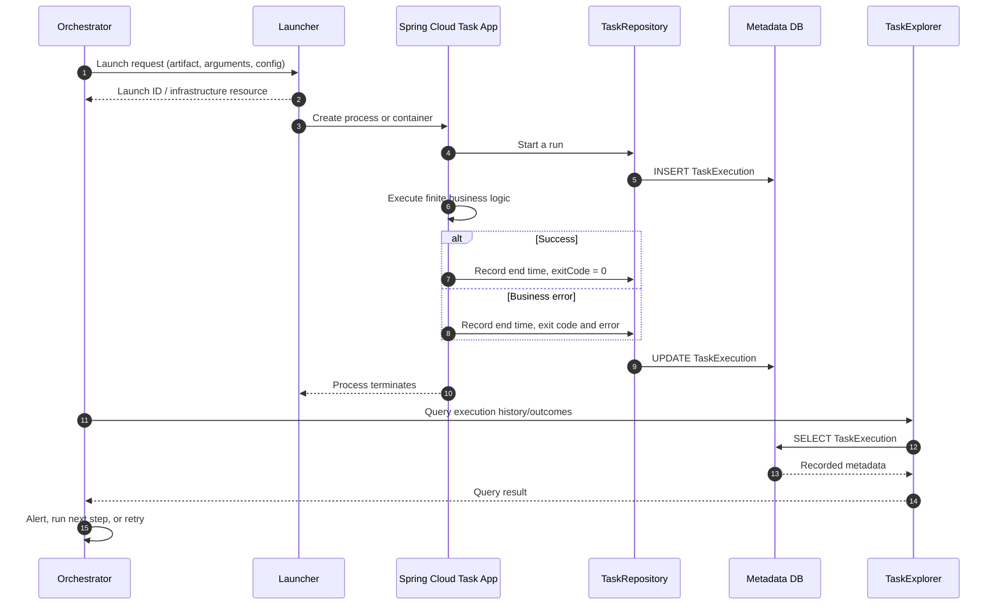

# Roles of the Task Repository, Launcher, and Orchestrator

A **Spring Cloud Task** application performs work with a clear start and end point: transaction reconciliation, data ingestion, report generation, resource cleanup, or running an on-demand processing workflow. Once finished, the process stops. In a production environment, simply writing the business processing logic is not enough: the system also needs to know **which run occurred, who launched it, what the outcome was, and when to run next**.

Three roles address distinct needs:

- **Execution repository (TaskRepository):** records the lifecycle and outcome of each run into a database.
- **Launcher:** creates a new application execution in the runtime environment, such as a Java process or a Kubernetes Job.
- **Orchestrator:** decides *when, with what arguments, in what order, and under what policy* tasks are launched, monitored, and followed up.

These are **architectural roles**, not necessarily three Java components living inside the same application. Spring Cloud Task directly provides task lifecycle tracking; deployment, remote launching, and orchestration mechanisms are typically handled by an external platform.

## 1. TaskRepository: Recording the Truth About a Run

**`TaskRepository`** is the Spring Cloud Task component responsible for storing execution information. When the application is configured with Spring Cloud Task and an appropriate datasource, the task lifecycle mechanism creates a `TaskExecution` record when the task starts and updates the record when the task ends.

Each **`TaskExecution`** describes *a single run*, not the task definition. Two runs sharing the name `dailyReconcile` still have two separate execution IDs. Depending on the version and configuration, metadata typically includes:

| Information | Meaning |
| --- | --- |
| Execution ID (`executionId`) | Uniquely identifies a run in the execution repository. |
| Task name (`taskName`) | Groups runs of the same type of work. |
| Start/end timestamps | Used for duration tracking, history, and diagnostics. |
| Exit code (`exitCode`) | Indicates the process termination outcome; common convention: `0` is success, non-`0` is failure. |
| Exit/error message | Helps identify the cause of failure; does not replace detailed logs. |
| Run arguments | Helps trace which dataset the task was requested to process. |

Spring Cloud Task metadata tables, such as `TASK_EXECUTION` and related parameter tables, must exist in the database using a **schema compatible with the deployed library version**. In production systems, schemas should be managed through a migration process and appropriate access permissions.

<svg xmlns="http://www.w3.org/2000/svg" width="640" height="170" viewBox="0 0 640 170" role="img" aria-label="Three runs with the same task name stored as three independent TaskExecution records">
  <rect x="6" y="8" width="628" height="154" rx="14" fill="#f7f9fc" stroke="#c6d3e3"/>
  <text x="25" y="35" font-size="17" font-weight="600" fill="#20344f">One taskName: dailyReconcile</text>
  <g font-size="14" fill="#20344f">
    <rect x="24" y="51" width="187" height="91" rx="9" fill="#e6f4ea" stroke="#8fcba0"/>
    <text x="37" y="77" font-weight="600">TaskExecution #101</text>
    <text x="37" y="100">Completed</text>
    <text x="37" y="122">exitCode = 0</text>
    <rect x="227" y="51" width="187" height="91" rx="9" fill="#fff2da" stroke="#e8b75d"/>
    <text x="240" y="77" font-weight="600">TaskExecution #102</text>
    <text x="240" y="100">Ended with error</text>
    <text x="240" y="122">exitCode = 1</text>
    <rect x="430" y="51" width="187" height="91" rx="9" fill="#e6f4ea" stroke="#8fcba0"/>
    <text x="443" y="77" font-weight="600">TaskExecution #103</text>
    <text x="443" y="100">Retry succeeded</text>
    <text x="443" y="122">exitCode = 0</text>
  </g>
</svg>

### Writing Data and Reading Data Are Two Different Responsibilities

- **`TaskRepository`** primarily provides operations to manage execution records, including creating and updating lifecycle metadata.
- **`TaskExplorer`** provides an interface to query the history and status of recorded executions. Dashboards, admin pages, or monitoring logic can use it to look up runs and inspect outcomes.

Do not use metadata tables as a job queue. Having a `TaskExecution` record does **not** spawn a new process; editing a row in the table does **not** replace launching. Likewise, `TaskRepository` records execution status—it does not guarantee single business processing, does not distribute tasks, and does not organize run schedules on its own.

> **Limitation to know:** If the container or host stops abruptly, or the application encounters an error before connecting to the database, the record may be missing or lack an updated end time. Therefore, metadata must be cross-checked against process/container status, logs, and the monitoring system.

## 2. Launcher: Turning a Request into a Running Process

A **launcher** receives a request to run an application and performs a concrete action on the infrastructure: spawning a `java -jar` process, submitting a request to create a Kubernetes Job, or calling a cloud platform deployment API. It must pass the required inputs such as artifact/image, command-line arguments, environment variables, resource configuration, and connection details.

Two common interpretations must be distinguished:

1. At the **conceptual** level, a launcher is any mechanism that actually starts the task application: a shell script, CI pipeline, Kubernetes Job controller, or a dedicated service.
2. In the Spring ecosystem, **Spring Cloud Deployer's `TaskLauncher`** interface is used by systems like **Spring Cloud Data Flow** to request the platform to run a task application. It belongs to the deployment/launching layer—it is **not** Spring Cloud Task's `TaskRepository` and not `JobLauncher` used to run a Spring Batch Job inside an application.

A launcher can know **whether the process-creation request was sent**, the deployment ID/external ID, and infrastructure status; however, that is not enough to conclude the business work succeeded. For example, a Kubernetes Job being created successfully only means the deployment request was accepted. The application can still fail at startup, lose database connectivity, or fail midway.

Therefore, distinguish:

| ID / Status | Created By | Answers Which Question? |
| --- | --- | --- |
| Launch ID / Infrastructure resource ID | Launcher or runtime platform | Which process/container was created, and what state is it in? |
| `TaskExecution.executionId` | `TaskRepository` inside the application | Which business run was recorded and how did it finish? |
| Business request ID (if any) | Calling / orchestrating system | Which reconciliation request or data period is being processed? |

These three IDs can all differ. If end-to-end traceability is required, design a **correlation ID** passed via arguments or metadata and written to logs/monitoring. Do not assume the framework automatically unifies all of these IDs.

## 3. Orchestrator: Deciding What to Run, When, and What to Do Next

An **orchestrator** manages operational policies across multiple runs. Typical responsibilities include:

- Receiving launch commands manually, from APIs, events, or recurring schedules.
- Determining execution order, e.g., aggregating a report only after data ingestion finishes.
- Selecting application version, arguments, timing, execution infrastructure, and concurrency level.
- Monitoring both launch status and `TaskExecution` outcomes; applying timeouts, alerts, or policy-based retries.
- Recording request audit trails, enforcing launch permissions, and preventing unintended duplicate runs.

Examples of orchestration levels:

| Need | Common Implementation | Responsible Party |
| --- | --- | --- |
| One-off run requested by an operator | Shell/CLI, pipeline, or Job-creating API | The invocation acts as the launch; the operator decides timing. |
| Daily runs, independent executions | Kubernetes CronJob or process-spawning scheduler | Scheduling and process creation are handled by the platform; the app records `TaskExecution`. |
| Dependent task chain managing multiple apps | Spring Cloud Data Flow or another workflow orchestrator | Orchestrates the run chain and invokes the launcher on target infrastructure. |
| Multi-step processing *within a single application* | Spring Batch with `Job`/`Step` | Spring Batch orchestrates internal processing steps; Spring Cloud Task records the outer application lifecycle. |

Simply placing `@Scheduled` inside a continuously running web service **does not automatically turn each trigger into a Spring Cloud Task**. If you need separate execution records and a process that exits after processing, the scheduler should launch a finite task application or you must explicitly design an equivalent tracking mechanism.

## 4. Coordination Flow from Request to Result

The diagram below illustrates the case where the orchestrator calls a launcher to create a new task application. The metadata repository resides in a separate or shared database, depending on deployment:



Real-world systems may reorder a few events or retrieve status via platform APIs instead of direct queries. The diagram emphasizes **two layers of observation**: the launcher/platform knows whether the process is alive; the Spring Cloud Task repository knows the application metadata that was recorded in time.

### Example: End-of-Day Revenue Reconciliation

Suppose a system needs to run the `reconcileDailyRevenue` task for `2026-11-24`:

1. At 01:00, the orchestrator creates a request with `businessDate=2026-11-24` and a dedicated request ID, e.g., `reconcile-20261124`.
2. The launcher creates a Kubernetes Job using the application image and passes the required arguments.
3. The application starts, Spring Cloud Task creates a `TaskExecution` record; the business logic reads the reconciliation date and updates the data.
4. When processing finishes, the application closes the process and writes the outcome to metadata. The orchestrator can reconcile Job status with `TaskExecution` history, then trigger the report-publishing step or send alerts.
5. If the run fails and is re-launched, **a new `TaskExecution`** appears. The business logic must guard against duplicate processing for the same `businessDate`, rather than relying on `TaskRepository` having stored the previous run's record.

The `businessDate` information is a business input; it is not by default a unique key of `TaskExecution`. You can use business keys, concurrency controls, upserts/transactions, or appropriate idempotency mechanisms to avoid recording revenue twice.

An illustrative manual launch command:

```bash
java -jar revenue-reconciliation-task.jar \
  --spring.cloud.task.name=reconcileDailyRevenue \
  --businessDate=2026-11-24 \
  --requestId=reconcile-20261124
```

This is only **how arguments are passed when running the application**. Provisioning the database, creating metadata tables, installing Spring Cloud Task libraries, and handling arguments must still be configured in the application. When running in a container, ensure the process actually exits after completion and returns the proper exit code to the platform.

## 5. Assigning Responsibility When Errors Occur

| Scenario | Where to Inspect? | Remediation Approach |
| --- | --- | --- |
| Launcher fails to create Job/container | Launcher status, platform API, permissions, and quotas | Fix configuration/permissions/resources; cannot yet conclude a `TaskExecution` exists. |
| Container is created, but app cannot connect to metadata DB | Startup logs, `TaskRepository` connection and schema | Restore DB/configuration; metadata may not have been created yet. |
| Task is killed/OOMed mid-processing | Process status, Kubernetes events, logs, and task record | Resolve infrastructure root cause, detect records missing end timestamps. |
| Business logic throws an exception | Business logs, exit code, `TaskExecution` | Log errors with sufficient context; let the error reflect accurately in exit code and retry policy. |
| Orchestrator times out waiting, yet task is still running | Platform status and `TaskExecution` | Verify whether the task is still alive before re-running to avoid two concurrent runs. |
| Retry produces duplicate results | Business data and request key | Add idempotency and concurrency control; metadata does not prevent duplicate writes. |

Do not infer that "the launcher reported success" means "the business work completed successfully". Conversely, if the application finished processing but failed to update metadata, observation sources may be inconsistent; the orchestration system must have a state reconciliation policy.

## 6. Design Principles for Safe Operations

**Clear boundaries of responsibility.** Business code focuses on processing a finite unit of work; `TaskRepository` manages execution history; the launcher manages launch resources; the orchestrator manages schedules, dependencies, and continuation policies. Do not put full scheduling logic inside the task application if infrastructure already provides a scheduler.

**Traceable inputs.** Record task name, request ID, data period, and deployment version in logs or appropriate metadata. Avoid putting passwords, tokens, or sensitive data into command-line arguments or metadata tables.

**Transparent termination.** The application must actually stop when work is done; errors must produce a failure result rather than being caught and ignored. The orchestrator should check both the process exit code and task metadata when available.

**Controlled retries.** A retry is a new run; do not treat it as "continuing" the old `TaskExecution` record. Only retry under an explicit policy, with limits, backoff, and measures to avoid duplicate data.

**Reliable metadata database.** Provision the exact version's schema, size the connection pool appropriately for concurrent tasks, use least-privilege permissions, and follow backup/migration procedures. Do not manually alter active records.

**Multi-source monitoring.** Track success/failure counts, durations, long-running tasks, resource status, and logs. Cross-check `TaskExecution` against infrastructure info when abandoned records appear.

## 7. Relationship to Spring Batch

Spring Cloud Task and Spring Batch can complement each other:

- **Spring Cloud Task** describes the lifecycle of a **finite-lived application**, from process startup to termination.
- **Spring Batch** describes the lifecycle of a **batch-processing Job/Step** inside the application, with its own `JobRepository` storing job, step, and checkpoint state.
- A Spring Cloud Task application can launch a Spring Batch Job; in that case, `TaskExecution` and `JobExecution` information belong to **two different execution models**. Spring Cloud Task provides a mechanism to link task and batch metadata in appropriate integration setups, but do not assume the two execution IDs are equal.
- **Spring Batch `JobLauncher`** launches a batch job within the Spring Batch context; **Spring Cloud Deployer `TaskLauncher`** launches an *application* on infrastructure. Choosing the wrong launcher layer leads to confusion during deployment and error handling.

When building scheduled, on-demand, or multi-step processing systems, determine upfront: **who makes the decision to run, who creates the process, who records the outcome, and who decides the next action**. These four answers will place the right responsibilities on the orchestrator, launcher, `TaskRepository`/`TaskExplorer`, and the business logic of the Spring Cloud Task application.
