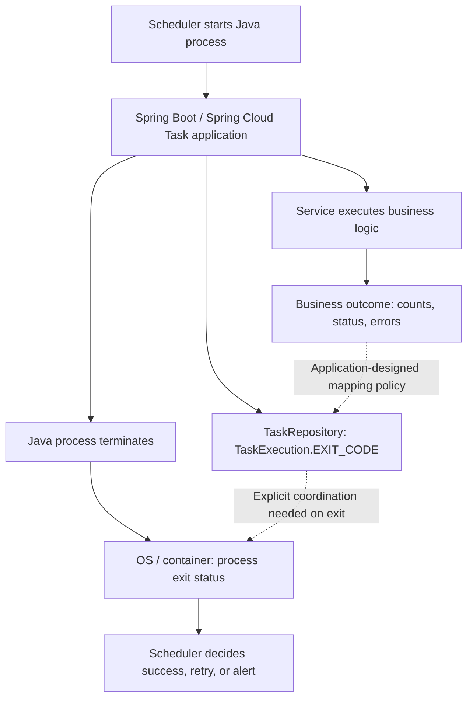
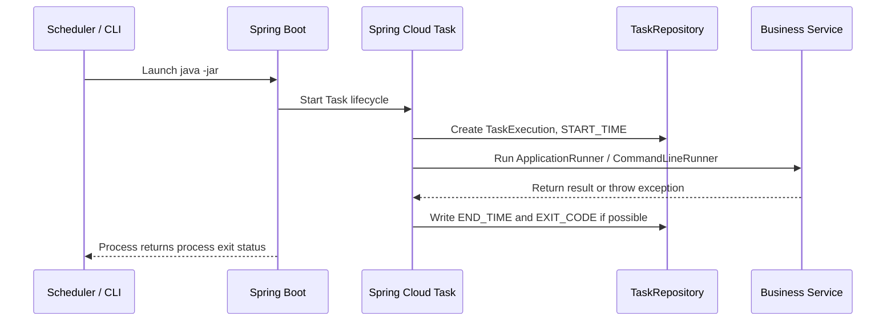
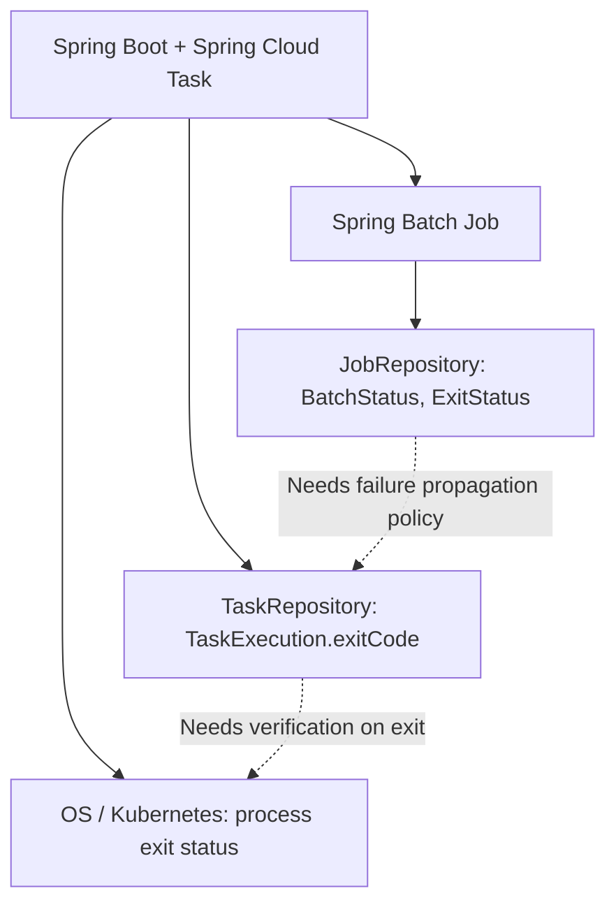

# Distinguishing Business Outcomes, Task Exit Codes, and Process Exit Codes

## 1. The Problem: Three Outcomes May Differ

In the **Results and Exit Codes** chapter of **Spring Cloud Task**, we need to distinguish three layers of information when a **short-lived Spring Boot application** finishes: the **business outcome**, the **exit code recorded in `TaskExecution`**, and the **Java process exit code observed by the operating system**. This distinction is critical when a task runs on a schedule, is triggered on demand, integrates with **Spring Batch**, or is automatically retried by a scheduler after a failure.

Suppose an application synchronizes 1,000 orders. The program successfully writes 950 orders while 50 are rejected, then prints `Finished` and terminates. The system may observe three different pieces of information:

- **Business outcome:** 950 succeeded, 50 rejected; depending on policy, the status may be *partial success* or *failure*.
- **Task exit code:** an integer in `TaskExecution.exitCode`, typically stored in the `TASK_EXECUTION.EXIT_CODE` column of **TaskRepository**.
- **Process exit code:** the status code the operating system receives from the Java process; a shell, Kubernetes Job, or scheduler may use it to determine success and decide on retries.

If the code only logs the 50 failed orders and returns normally, `EXIT_CODE` may be `0` and the process may also return `0`. This **does not prove** that all 1,000 orders were completed. Conversely, business data may have been written successfully, yet the process is killed before updating TaskRepository, causing the scheduler to report a failure while Task metadata does not reflect the final outcome.

After this lesson, you will be able to:

1. Interpret the three outcome layers separately and identify cases where they diverge.
2. Understand how Spring Cloud Task records `EXIT_CODE`, `EXIT_MESSAGE`, and `ERROR_MESSAGE` in `TaskRepository`.
3. Map errors to exit codes with `ExitCodeExceptionMapper` and understand the limits of `ExitCodeGenerator` / `SpringApplication.exit()`.
4. Design an appropriate exit code policy for schedulers, containers, and retryable tasks.
5. Query Task metadata, inspect the process exit code, and reconcile `BatchStatus` / `ExitStatus` when using Spring Batch.

## 2. The Three Outcome Layers and Their Owners

| Outcome layer | Who decides? | Typical information | Purpose |
| --- | --- | --- | --- |
| **Business outcome** | Business service and product rules | `SUCCESS`, `PARTIAL`, `FAILED`, `NO_WORK`; succeeded/failed record counts, request ID | Know whether the request was processed accurately and completely |
| **Task exit code** | Spring Cloud Task lifecycle combined with Spring Boot error handling/mapping | `TaskExecution.exitCode` / `TASK_EXECUTION.EXIT_CODE`; `EXIT_MESSAGE`, `ERROR_MESSAGE` | Track the history of **a single application run** in the database |
| **Process exit code** | JVM/application and operating system/container runtime | OS exit status reported by `java -jar`, shell, Kubernetes Pod, or scheduler | Infrastructure signal for marking completion/failure, monitoring, and retries |

The three layers are related, but they are **not automatically identical**:



A **business outcome** can be a multi-field object or a domain database record, whereas the two exit codes are primarily **integers**. Therefore, you cannot collapse every business detail into a single number without losing information. Store detailed business outcomes in the appropriate system, and use exit codes to convey a well-defined, coarse-grained signal.

### A Common Convention

Many schedulers treat **exit status 0** as success and **non-zero** as failure. However, the specific meaning of non-zero codes is defined by the application and orchestration system. An internal convention might look like this:

| Example code | Team-defined meaning | What should the scheduler do? |
| --- | --- | --- |
| `0` | Request met completion criteria, including valid `NO_WORK` cases | Mark as succeeded |
| `2` | Invalid input or missing required parameter | Do not retry as-is; fix the input |
| `10` | Transient error such as external service timeout | Retry with limit and backoff |
| `20` | Unacceptable business outcome requiring manual intervention | Alert/investigate, avoid blind retries |
| `30` | Partial success, but the contract requires full processing | Record completed portion and apply compensation/recovery policy |

This is an **example convention**, not standard codes provided by Spring Cloud Task. Another system may use different codes. When running on Unix/Linux, many shells retain only the lower bits of the process exit code (typically the 0–255 range); avoid arbitrarily choosing overly large codes. Do not rely solely on a non-zero code to assume an error is retryable.

## 3. When Does Spring Cloud Task Write `EXIT_CODE`?

Spring Cloud Task creates metadata for a run in `TaskRepository` once the Spring Boot application has initialized its context to the appropriate lifecycle phase, before `ApplicationRunner` / `CommandLineRunner` beans execute their logic. When the runners finish or the framework observes a startup/execution error via its event mechanism, it updates the run's metadata.

In the standard JDBC schema:

- `TASK_EXECUTION_ID` is the ID of **one Task run**, not a business ID.
- `START_TIME` is the timestamp when the framework starts tracking the Task.
- `END_TIME` is updated when the framework records a successful or failed termination.
- `EXIT_CODE` usually remains **`NULL` while running** and is populated once a final result is known; in the documented default behavior, success is `0`, and an `ApplicationFailedEvent` failure without another mapping is `1`.
- `EXIT_MESSAGE` is a descriptive termination message that can be set via `TaskExecutionListener`.
- `ERROR_MESSAGE` may contain error details/stack trace if an exception is recorded by the framework.

Errors occurring **before `TaskExecution` is created**, loss of repository connectivity, or an abrupt JVM kill can leave metadata **missing or incompletely updated**. Therefore, `END_TIME IS NULL` does not prove the process is still running, and `EXIT_CODE IS NULL` should not be automatically interpreted as failure.



Each tier has its **own write timing and transaction scope**. A committed business operation is not necessarily rolled back just because updating `TaskRepository` in a later step fails.

### `EXIT_CODE` Is a Technical Run-Level Status

Do not treat the Task exit code as a complete business results table. For example, `EXIT_CODE=0` proves that **under the current error-handling and mapping configuration**, the framework recorded a successful run. It does not prove that:

- the number of processed records equals the total number of requested records;
- external systems successfully received all asynchronous requests;
- no records were skipped according to business policy;
- duplicate data was not written during retries;
- the container and scheduler also exited successfully.

To conclude that a business operation succeeded, combine the outcome defined by the domain service with the corresponding persisted evidence.

## 4. Real-World Divergence Scenarios

| Scenario | Business outcome | `TaskExecution.EXIT_CODE` | Process exit status | Cause / what to inspect |
| --- | --- | --- | --- | --- |
| All records processed, application exits normally | Succeeded | Usually `0` | Usually `0` | Standard flow when both repository and exit path work |
| Some records fail but code only logs them | Partial success/failure | May be `0` | May be `0` | Exception swallowed; missing business outcome mapping |
| Runner throws an unhandled exception | Failed | Usually non-zero if recorded | Usually non-zero if Boot/launcher propagates error | Depends on error handling and when the exception occurs |
| Business work completes, metadata DB lost before final update | May have succeeded | May be `NULL` or incomplete | May be non-zero | Metadata failure does not prove business data was not written |
| JVM killed / OOM before completion | Undetermined or partially completed | May be `NULL` | Usually non-zero per runtime | Callbacks and final write may not run |
| Batch job `FAILED` but runner does not propagate error to Task level | Batch failure | May be `0` | May be `0` | Needs a Batch → Task → OS mapping policy |
| Task code recorded as non-zero, but launcher/wrapper returns `0` | Task reported failure | Non-zero | `0` | Process exit path masked or ignored the error code |
| Task records `0` but a subsequent wrapper shell command/step fails | Task recorded success | `0` | Wrapper/scheduler may report failure | The outer script's exit code is not necessarily Java's code |

The words `may` and `usually` in the table are intentional: the application shutdown mechanism, Boot/Cloud Task version, events, and orchestration environment determine the actual result. When investigating incidents, gather **all three sources** rather than inferring from a single column.

## 5. Designing Business Outcomes Before Choosing Exit Codes

Define **success criteria** for each task instead of assuming that no exception means success.

For instance, a report-sending job might allow 3 recipients with invalid email addresses and still count as `SUCCESS_WITH_WARNINGS`; a money-transfer job might require **100% of transactions to succeed** or be marked failed. Two business operations with the same 3 data errors cannot share the same decision.

One design approach is to return a structured result object from the service:

```java
public record BusinessResult(
        int requested,
        int succeeded,
        int rejected,
        boolean retryable,
        String summary) {

    public boolean fullyCompleted() {
        return succeeded == requested && rejected == 0;
    }
}
```

Then the business orchestration layer decides:

1. **Completed:** record the outcome and let the runner return normally.
2. **No valid work:** record outcome `NO_WORK`; treat as success only when policy permits.
3. **Acceptable partial success:** persist detailed metrics; the Task may be allowed to exit with `0`, but warnings must be clearly reported.
4. **Unacceptable partial success:** persist what succeeded, emit an error signal with a distinct code for the scheduler/operator to handle.
5. **Retryable failure:** signal the error category to the orchestrator; ensure subsequent runs do not produce duplicate side effects.
6. **Invalid input:** report an error code that should not be retried as-is.

A single `EXIT_CODE` field cannot hold all of `requested`, `succeeded`, and `rejected`. If the data requires long-term lookup, store the business outcome in a dedicated audit/domain table with `requestId` and a foreign/reference link to `TASK_EXECUTION_ID` where appropriate. `EXIT_MESSAGE` should only be a **short summary without secrets**, not a result data store.

## 6. Example: Mapping Business Errors to Task Exit Codes

Suppose an application handles four scenarios that can be simulated with `--scenario=success|partial|transient|invalid`. The example below assigns specific codes to exceptions using `ExitCodeExceptionMapper`; in a real system, the business service processing and persisting outcomes replaces the simulation.

Required dependencies include `spring-boot-starter`, `spring-cloud-starter-task`, and a JDBC driver for a persistent `TaskRepository`; use compatible Spring Boot/Spring Cloud versions. Configure the application as non-web:

```yaml
spring:
  application:
    name: results-demo
  main:
    web-application-type: none
  datasource:
    url: jdbc:postgresql://localhost:5432/task_demo
    username: task_user
  cloud:
    task:
      name: results-demo
```

The configuration example above assumes the database and metadata schema have already been prepared and the password is supplied through a secure configuration source such as the `SPRING_DATASOURCE_PASSWORD` environment variable. DDL and automatic table initialization must be verified against the Spring Cloud Task version in use.

### 6.1. Startup Class and Business Scenarios

```java
package com.example.results;

import java.util.List;

import org.slf4j.Logger;
import org.slf4j.LoggerFactory;
import org.springframework.boot.ApplicationRunner;
import org.springframework.boot.ExitCodeExceptionMapper;
import org.springframework.boot.SpringApplication;
import org.springframework.boot.autoconfigure.SpringBootApplication;
import org.springframework.cloud.task.configuration.EnableTask;
import org.springframework.context.annotation.Bean;

@SpringBootApplication
@EnableTask
public class ResultsTaskApplication {
    private static final Logger log =
            LoggerFactory.getLogger(ResultsTaskApplication.class);

    public static void main(String[] args) {
        SpringApplication.run(ResultsTaskApplication.class, args);
    }

    @Bean
    ApplicationRunner runBusinessTask() {
        return args -> {
            List<String> values = args.getOptionValues("scenario");
            if (values == null || values.size() != 1) {
                throw new ValidationFailure(
                        "Exactly one --scenario=success|partial|transient|invalid is required");
            }

            String scenario = values.get(0);
            switch (scenario) {
                case "success" -> {
                    BusinessResult result =
                            new BusinessResult(100, 100, 0);
                    log.info("BusinessResult={}", result);
                }
                case "partial" -> {
                    BusinessResult result =
                            new BusinessResult(100, 95, 5);
                    log.warn("BusinessResult={}", result);
                    // Assume business rules require full 100/100 completion.
                    throw new PartialBusinessFailure(
                            "5 records were rejected");
                }
                case "transient" -> throw new RetryableFailure(
                        "Target service temporarily unresponsive");
                case "invalid" -> throw new ValidationFailure(
                        "Invalid parameter or input data");
                default -> throw new ValidationFailure(
                        "Unsupported scenario: " + scenario);
            }
        };
    }

    @Bean
    ExitCodeExceptionMapper exitCodeExceptionMapper() {
        return exception -> {
            // The framework may wrap exceptions: walk the cause chain.
            for (Throwable cause = exception; cause != null;
                    cause = cause.getCause()) {
                if (cause instanceof ValidationFailure) {
                    return 2;
                }
                if (cause instanceof RetryableFailure) {
                    return 10;
                }
                if (cause instanceof PartialBusinessFailure) {
                    return 30;
                }
            }
            return 1; // Unclassified error.
        };
    }

    record BusinessResult(int requested, int succeeded, int rejected) {}

    static class ValidationFailure extends RuntimeException {
        ValidationFailure(String message) {
            super(message);
        }
    }

    static class RetryableFailure extends RuntimeException {
        RetryableFailure(String message) {
            super(message);
        }
    }

    static class PartialBusinessFailure extends RuntimeException {
        PartialBusinessFailure(String message) {
            super(message);
        }
    }
}
```

This is a **single-file Java example** using modern Java syntax (switch expressions and records compatible with Java 17 and later). The `ExitCodeExceptionMapper` bean uses Spring Boot's API to map **unhandled** exceptions to exit codes. Spring Cloud Task can record that code in `TaskExecution` when it receives the failure event and the repository update succeeds.

Crucially, the `partial` branch **produced a business outcome with 95 successes**, then intentionally treated it as a *failure* because the contract required 100/100. In production, persist `BusinessResult` to durable storage before throwing if lookup is needed; do not rely solely on logs or exception messages.

### 6.2. Running Each Scenario

```bash
java -jar results-demo.jar --scenario=success
java -jar results-demo.jar --scenario=partial
java -jar results-demo.jar --scenario=transient
java -jar results-demo.jar --scenario=invalid
```

With proper configuration, the expected Task codes under the example policy are `0`, `30`, `10`, and `2`, respectively. **Verify the actual behavior** in the database and the process exit status; do not assume that declaring a mapper guarantees both values match across every failure path or execution method.

If you catch those exceptions inside the runner, only call `log.error(...)`, and return, `ExitCodeExceptionMapper` will **not be invoked for swallowed exceptions**; the task may record `0` even though the business operation just failed.

### 6.3. Setting an Intentional Exit Message

`ExitCodeExceptionMapper` determines the **integer**; `TaskExecutionListener` can add a **short** descriptive message:

```java
import org.springframework.cloud.task.listener.TaskExecutionListener;
import org.springframework.cloud.task.repository.TaskExecution;
import org.springframework.stereotype.Component;

@Component
public class TaskResultListener implements TaskExecutionListener {
    @Override
    public void onTaskStartup(TaskExecution execution) {
        // Log startup if needed.
    }

    @Override
    public void onTaskEnd(TaskExecution execution) {
        // Do not force "SUCCESS" if the actual outcome has not been verified.
    }

    @Override
    public void onTaskFailed(TaskExecution execution, Throwable cause) {
        execution.setExitMessage(
                "Task failed: " + cause.getClass().getSimpleName());
    }
}
```

Listeners execute at lifecycle hooks and are not guaranteed to run if the process is forcefully killed. `EXIT_MESSAGE` is for concise messages; `ERROR_MESSAGE` typically holds exception details recorded by the framework. Do not write passwords, tokens, customer data, or full payloads into these fields. If multiple listeners set the exit message, callback order and precedence must be checked against the documentation for your version.

## 7. Process Exit Code: What Spring Boot and the OS Actually Return

A Java process can terminate naturally after the `main` method completes, or explicitly call `System.exit(int)`. `SpringApplication.exit(context)` is Spring Boot's API to **close the context and obtain an exit code via the `ExitCodeGenerator` mechanism**; the return value from this API is **not yet the OS exit code** until it is passed to `System.exit(...)` or applied by a launcher.

Boot's example illustrates passing the code when the application has started and completed:

```java
import org.springframework.boot.SpringApplication;
import org.springframework.context.ConfigurableApplicationContext;

public static void main(String[] args) {
    ConfigurableApplicationContext context =
            SpringApplication.run(ResultsTaskApplication.class, args);
    int exitCode = SpringApplication.exit(context);
    System.exit(exitCode);
}
```

The snippet above is an **alternative to the `main` method** in Section 6, not code to add alongside it. It demonstrates returning an exit code once `SpringApplication.run` has returned a context. If an error occurs **during startup or inside a runner**, `SpringApplication.run` may throw an exception before returning a context: the `SpringApplication.exit(context)` path will not run along this normal branch. In that case, Spring Boot handles the failure event/exit code through its own mechanism; test it rather than assuming the OS code always equals `EXIT_CODE`.

Spring Boot also supports:

- **`ExitCodeExceptionMapper`:** maps exceptions to codes when an error occurs; well suited to classifying input errors, transient failures, and business failures.
- **`ExitCodeGenerator`:** a bean or exception that can supply an exit code during Boot shutdown; `SpringApplication.exit(context)` can read registered generators.
- **`System.exit(int)`:** the direct way for the JVM to return a status to the operating system; calling it too early can bypass shutdown or Task recording hooks if designed improperly.

An **illustrative-only** `ExitCodeGenerator` bean example:

```java
@Bean
ExitCodeGenerator maintenanceExitCode() {
    return () -> 15;
}
```

If this bean always returns `15`, it can cause successful runs to receive a non-zero exit code when Spring Boot collects codes; therefore, **do not register a bean returning a hardcoded error code** in production. The code must reflect the final outcome of that specific run and align with business policy.

### Checking from the Shell

In bash/zsh on Linux or macOS, run **a single Java command** and read the status **immediately afterward**:

```bash
java -jar results-demo.jar --scenario=transient
echo $?
```

In PowerShell:

```powershell
java -jar results-demo.jar --scenario=transient
$LASTEXITCODE
```

`$?` in bash and `$LASTEXITCODE` in PowerShell in these two examples reflect the **status the shell observes from the process**, without reading the `TASK_EXECUTION.EXIT_CODE` column directly. If you run with `mvn spring-boot:run` or `gradle bootRun`, the shell usually receives the exit status of the **build tool**, which may differ in presentation or from the Java exit code. Test with `java -jar` when you need to know the signal a container actually receives.

In a shell script with multiple commands, the final exit code can be overwritten by subsequent commands. For example, a script that runs Java unsuccessfully and then executes `echo "done"` successfully may return `0` unless it explicitly preserves the exit status. A proper wrapper must capture the Java exit code and propagate it to the orchestrator according to team policy.

## 8. Inspecting Task Metadata in the Database

With the standard Spring Cloud Task JDBC schema on PostgreSQL, inspect the latest runs:

```sql
SELECT TASK_EXECUTION_ID,
       TASK_NAME,
       START_TIME,
       END_TIME,
       EXIT_CODE,
       EXIT_MESSAGE,
       ERROR_MESSAGE
FROM TASK_EXECUTION
ORDER BY TASK_EXECUTION_ID DESC
LIMIT 20;
```

If you need classification for a dashboard display, a read-only query can be:

```sql
SELECT TASK_EXECUTION_ID,
       TASK_NAME,
       CASE
           WHEN END_TIME IS NULL THEN 'NOT_RECORDED_AS_ENDED'
           WHEN EXIT_CODE IS NULL THEN 'EXIT_CODE_UNKNOWN'
           WHEN EXIT_CODE = 0 THEN 'TASK_RECORDED_SUCCESS'
           ELSE 'TASK_RECORDED_FAILURE'
       END AS DISPLAY_STATE,
       EXIT_CODE
FROM TASK_EXECUTION
ORDER BY TASK_EXECUTION_ID DESC
LIMIT 20;
```

The statuses in `DISPLAY_STATE` are **application-derived labels**, not official Spring Cloud Task enums. When `END_TIME IS NULL`, also check the orchestration system to see whether the process is still running, was killed, or metadata got stuck. When `EXIT_CODE=0`, verify the business outcome if the decision affects data or money.

If the schema uses a custom prefix or schema name, adjust the table names and read permissions accordingly. Dashboard accounts only need appropriate query privileges, not permission to modify `EXIT_CODE` or `END_TIME`. Do not destroy incident evidence by manually updating incomplete records.

## 9. Running Spring Batch Inside Spring Cloud Task

**Spring Batch** has its own **`BatchStatus`** and **`ExitStatus`**:

- `BatchStatus` describes the execution status of a Job/Step at the Batch layer, such as `COMPLETED` or `FAILED`.
- `ExitStatus` provides a **string** code and description at the Batch layer, such as `COMPLETED`, `FAILED`, or a custom code.
- Cloud Task's `TaskExecution.exitCode` is an **integer** in the metadata of a single application run.
- Process exit status is an **integer** captured by the operating system/container.



A common pitfall: a Batch job ends with `BatchStatus.FAILED`, yet Boot's runner finishes normally, so **the Task may return `0`**. According to the Spring Cloud Task documentation, when using the appropriate Batch/Boot integration, you can enable:

```yaml
spring:
  cloud:
    task:
      batch:
        fail-on-job-failure: true
```

This property maps a `FAILED` Batch job to a Task error code (defaulting to `1`, or a custom code under supported mechanisms), **within the corresponding integration configuration and version**. If the application invokes Batch via a custom runner, runs asynchronously, or applies custom policies, verify that the property applies to your flow; when necessary, wait for `JobExecution` to finish and propagate the failure status up to the Task.

Example result handling when **`JobLauncher` runs synchronously**:

```java
JobExecution execution = jobLauncher.run(job, jobParameters);
if (execution.getStatus() != BatchStatus.COMPLETED) {
    throw new IllegalStateException(
            "Batch job did not complete: " + execution.getStatus());
}
```

This snippet belongs inside a runner/service bean injected with `jobLauncher`, `job`, and `jobParameters`, not a standalone program. If the launcher runs **asynchronously**, returning from `run` **does not prove the job has reached a terminal state**; you must wait/monitor before deciding the Task outcome.

Do not arbitrarily convert Batch's `"FAILED"` string directly into an integer. Establish a clear mapping policy and test the **Batch failed → Task nonzero → process nonzero → scheduler detects failure** chain while storing detailed results in `JobRepository`.

## 10. Operating System Signals and Infrastructure Failures

Schedulers and container runtimes can terminate a task in ways that Spring Cloud Task **does not fully control**:

| Event | What can be observed | Handling principle |
| --- | --- | --- |
| Task completes and JVM exits cleanly | Task has `END_TIME`, `EXIT_CODE`; process has status | Reconcile against business outcome |
| `SIGTERM` and orderly shutdown | Shutdown hooks may run, but completion of all processing/metadata writes is not guaranteed | Configure grace period, timeouts, and test signal handling |
| `SIGKILL` or forced termination | No Java callbacks; `END_TIME` may remain empty; runtime reports signal/error code | Check container logs, termination reason, and committed data |
| OOMKilled | Container runtime may report OOM reason and non-zero exit status | Check memory limits, heap, metrics, and business data |
| Lost TaskRepository connection at finish | Task may finish business work but lack exit code or end time | Investigate connectivity and transactions; do not retry before assessing idempotency |
| Outer script swallows errors | Java fails, but script/step returns `0` | Fix the wrapper to preserve exit status |

In some Unix/container environments, code `137` frequently appears when a process is terminated by `SIGKILL`, but it must not be treated as sufficient proof of **OOM**. Check the platform-reported termination reason (such as Pod/container status) along with logs and metrics; an exit code alone cannot identify what triggered the kill.

An important operational point: **`TaskRepository` stores framework-recorded history, while Kubernetes Job/CronJob or the scheduler tracks process lifecycles**. An abruptly terminated task can leave an unfinished `TaskExecution` while the infrastructure has already marked the attempt as failed. Dashboards should combine both data sources rather than treating one source as the sole truth.

## 11. Designing Retries Based on Error Type and Data State

Consider a data synchronization example with three error categories:

1. **Not retryable as-is:** file missing required columns, invalid date parameter; input must be fixed.
2. **Retryable if safe:** external service timeout, temporary database connection drop; requires backoff, retry limits, and an idempotency key.
3. **Requires investigation/compensation:** partial writes already occurred or operations spanned multiple transactions; check impact before rerunning.

Exit codes classify the **high-level signal**, while retry decisions must also check `requestId`, business date, Task metadata, and actual state in the target system. **Each retry attempt may create a new `TaskExecution`**, and Spring Cloud Task does not automatically deduplicate business side effects.

Before enabling automatic retries, design:

- Business keys and idempotency conventions, such as `requestId` or `businessDate + tenantId`.
- Maximum retry counts, backoff, and timeouts in the scheduler.
- The ability to query per-attempt outcomes, even when `TaskRepository` has no record due to early startup failure.
- Policies for partial success: skip, backfill missing items, roll back, or compensate.
- Alerting when the Task exit code and process exit code differ, or when a Task lacks `END_TIME` for too long.
- Source-of-truth precedence rules when Batch, Task, and the scheduler report different states.

**Do not retry solely because `EXIT_CODE != 0`.** A validation error will keep failing until a human or upstream system fixes the data. Conversely, `EXIT_CODE=0` is not enough to ignore a critical business warning.

## 12. Lab: Reconciling All Three Layers

Using the sample application from Section 6 with a prepared PostgreSQL metadata database:

1. Run `--scenario=success`. Record the business metrics, `TASK_EXECUTION_ID`, `EXIT_CODE`, and process exit status.
2. Run `--scenario=partial`. Confirm it simulated 95 succeeded and 5 failed records; verify the mapped Task code `30` if recorded and the actual process exit code.
3. Run `--scenario=transient` and `--scenario=invalid`. Compare the mapped codes and decide **which error should be retried**.
4. Temporarily modify the runner to catch `PartialBusinessFailure`, **only log it, and return**; rerun to observe the risk of false success. Then revert the code.
5. Run a command through a shell or wrapper and read the exit status; try adding a succeeding shell command afterward to see why the wrapper's exit code may no longer be Java's code.
6. Under controlled test conditions, forcefully terminate a running process; inspect Task metadata and runtime status. Do not manually populate `END_TIME` to fake completion.
7. If your project uses Spring Batch, trigger a `BatchStatus.FAILED` case and inspect Task/OS codes before and after enabling the appropriate Batch failure mapping policy.

### Self-Check Questions

1. A task processes 1,000 rows, 50 are rejected, yet `EXIT_CODE=0`. Can you claim business success? Which data sources do you need?
2. Why are `TaskExecution.exitCode` and the process exit status both integers, yet still able to diverge?
3. When `END_TIME` and `EXIT_CODE` are still `NULL` but Kubernetes has marked the Pod as failed, what should you inspect before retrying?
4. How does `ExitCodeExceptionMapper` differ from `ExitCodeGenerator`? What mechanism turns a Spring Boot exit code into an OS exit code?
5. How do `BatchStatus.FAILED` and `ExitStatus.FAILED` differ from a Task's `EXIT_CODE`?
6. If a service committed business data but the repository lost connectivity while writing the exit code, why can retrying the entire task be dangerous?
7. Why should validation errors not be retried the same way as timeout errors?
8. Why can a script invoking Java return `0` even though Java just failed?

## 13. References

- [Spring Cloud Task — Features: The TaskExecution, Mapping Exit Codes, Task Execution Listener](https://docs.spring.io/spring-cloud-task/reference/features.html).
- [Spring Cloud Task — Batch Job Exit Codes](https://docs.spring.io/spring-cloud-task/reference/batch.html).
- [Spring Boot — SpringApplication: Application Exit](https://docs.spring.io/spring-boot/reference/features/spring-application.html).

**Key Takeaway:** The **business outcome** answers *did we do the right work completely?*; the **Task exit code** answers *how did Spring Cloud Task record the end of the run?*; and the **process exit code** answers *what signal did the OS or scheduler receive?* Designing explicit mappings and verifying all three layers prevents false successes, misguided retries, and lost business impact tracking when a short-lived process fails.
