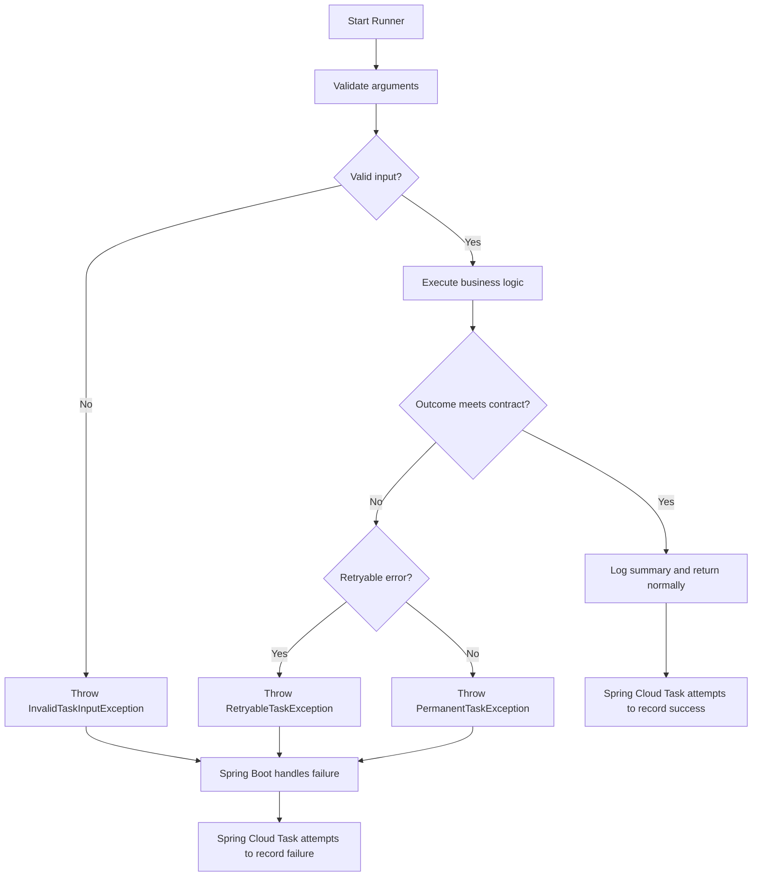
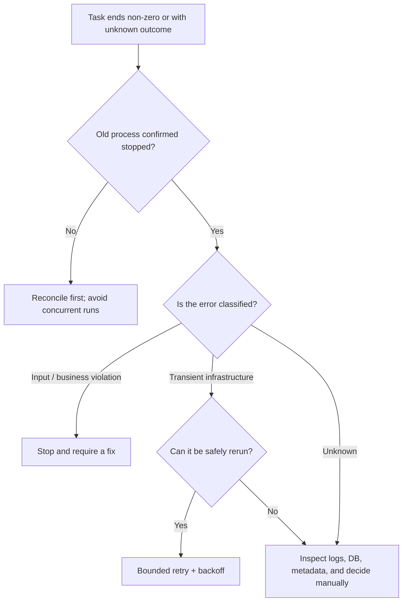

# Conventions for Success, Failure, and Unhandled Errors

## 1. Why Does a Task Need a Clear Outcome Convention?

**Spring Cloud Task** helps build short-lived Spring Boot applications: the application starts, accepts arguments, performs a unit of work, records its lifecycle via `TaskRepository`, and terminates. Tasks typically run on a schedule, on demand, inside a Kubernetes Job, or as a step in a data pipeline. When the process stops, the orchestrator needs to know whether to **mark it complete**, **retry**, or **require intervention**.

A real-world scenario: a Task imports 1,000 records, processes 950, skips 30 duplicates, and detects 20 invalid records. If the process does not throw an exception, should it be considered a success? The answer depends on the **business contract**: if 20 invalid records are allowed to be skipped, the Task can succeed with statistics; if all 1,000 records are required to be processed, the Task must report failure. Spring Cloud Task cannot infer this rule from the count of processed records.

Another scenario: the Task successfully writes business data, but is abruptly terminated before updating its completion status in the database. In that case, business data and Task tracking metadata may disagree. Therefore, we must distinguish the **business outcome**, the **outcome recorded by `TaskRepository`**, and the **process exit code**.

After this lesson, you will be able to:

- Define what constitutes success, transient failure, and permanent failure.
- Distinguish legitimately handled exceptions from unhandled errors in an `ApplicationRunner`.
- Understand how Spring Boot and Spring Cloud Task reflect outcomes through exceptions, exit codes, and `TaskExecution`.
- Map error causes into appropriate signals for a scheduler without losing stack traces.
- Determine when retries are warranted and how to avoid duplicate processing after an uncertain run.

## 2. Three Different Perspectives on the Same Execution

| Perspective | Information source | Meaning | Limitation |
| --- | --- | --- | --- |
| **Business** | Application database, outcome reports, checkpoints | Did the work satisfy acceptance criteria? | Does not itself tell you how the JVM exited |
| **Spring Cloud Task** | `TaskExecution` in `TaskRepository` | How did the framework record the run and exit code? | May fail to record if initialization fails or the process is killed |
| **Process** | OS exit code, Job/Pod status, logs | Did the orchestrator observe the process succeeding or failing? | The exit code does not indicate exactly which data was committed |

For a typical Task, `TaskRepository` stores a `TaskExecution` per run. Key attributes to examine:

| Attribute | Purpose |
| --- | --- |
| `executionId` / `TASK_EXECUTION_ID` | ID of a single execution; a retry run typically gets a new ID |
| `taskName` / `TASK_NAME` | Logical name of the Task |
| `startTime` / `START_TIME` | Start timestamp recorded by the framework |
| `endTime` / `END_TIME` | End timestamp, if updated |
| `exitCode` / `EXIT_CODE` | Result code stored at the Spring Cloud Task level |
| `exitMessage` / `EXIT_MESSAGE` | Short summary message of the outcome, if present |
| `errorMessage` / `ERROR_MESSAGE` | Recorded error information, if present |

Column names are illustrative of the standard JDBC schema; always verify against the DDL of the Spring Cloud Task version and database engine in use.

**Key point:** `EXIT_CODE` in the repository and the **process exit code** are two related values, but they are not identical in every scenario. A process can die before writing `EXIT_CODE`, or application logic can customize how codes are produced. Never inspect only one value and assume the business outcome.

## 3. Defining the Outcome Contract Before Writing the Runner

### 3.1. Success Is a Business Condition

For a report-export Task, success may mean the file was created, data is complete, and the result is stored in an accessible location. For an order-sync Task, success may require all valid records to be processed and duplicate records to be skipped according to rules.

The outcome contract should specify:

1. **Mandatory conditions:** which steps or constraints must complete.
2. **Acceptable cases:** such as no input data, records already processed in an earlier run, or a bounded number of records skipped by policy.
3. **Unacceptable cases:** such as missing required input, malformed data structure, or failure to write critical data.
4. **Retryability:** which causes can resolve themselves on rerun, and which only resolve after fixing data or configuration.
5. **Signaling mechanism:** exceptions, exit codes, logs/metrics, and status stored in the repository.

A reference convention table:

| Business outcome | Classification | What should the Runner do? | External handling |
| --- | --- | --- | --- |
| Processing completed | **Success** | Return normally | Finish |
| No records to process | **Success**, if contract permits | Return normally, log count 0 | Finish |
| Duplicate records already processed earlier | **Success / idempotent skip**, if contract permits | Return normally, log skipped count | Finish |
| Some invalid records permitted to be skipped | **Success with warnings**, if threshold is explicit | Record stats and finish normally | Monitor warnings |
| Invalid required parameter | **Input failure** | Throw descriptive exception | Fix command/config before retrying |
| Data violates core constraint | **Business failure** | Throw exception or emit supported failure signal | Fix data/rules |
| Dependent service temporarily unavailable | **Retryable failure** | Let appropriate exception propagate | Retry with limits and backoff |
| Process killed, commit status unknown | **Indeterminate outcome** | No guarantee final callback ran | Reconcile and check idempotency before retrying |

Do not lump every non-`0` situation into an "immediate retry" policy. Retrying a command syntax error indefinitely will not fix the root cause; conversely, a transient connection error can recover if data processing is idempotent.

### 3.2. Is Success with Warnings a Failure?

There is no universal mandatory rule. For example, importing 1,000 rows and skipping 10 duplicates may be completely valid. However, if 10 rows are skipped due to formatting errors when the contract requires full ingestion, succeeding cleanly hides lost data.

A business result return type:

```java
record ImportSummary(
        long imported,
        long skippedAsDuplicate,
        long invalid) {

    boolean satisfiesPolicy() {
        // Illustrative convention: invalid records are not allowed.
        return invalid == 0;
    }
}
```

The Runner is responsible for turning `ImportSummary` into the **final outcome**; Spring Cloud Task does not automatically infer that `invalid > 0` is an error. Another threshold can be accepted, provided it is explicitly documented and tested.

## 4. Normal Completion and the Meaning of Exceptions

### 4.1. Runner Returns Normally

Spring Boot invokes `ApplicationRunner` or `CommandLineRunner` after initializing the application. If `run(...)` returns and no mandatory work remains incomplete, Spring Cloud Task can typically record the execution as succeeded; the default result code on success is typically `0`.

```java
@Bean
ApplicationRunner successfulRunner(ImportService service) {
    return args -> {
        ImportSummary summary = service.importData();
        if (!summary.satisfiesPolicy()) {
            throw new IllegalStateException(
                    "Invalid data present: " + summary.invalid());
        }
        System.out.printf(
                "Success: imported=%d, skipped=%d%n",
                summary.imported(),
                summary.skippedAsDuplicate());
    };
}
```

The snippet above illustrates **a bean declaration inside a Spring configuration class**; `ImportService` must be implemented according to business rules. If `invalid` is non-zero, the Runner must not return normally because this example's contract rejects invalid data.

### 4.2. What Is an Unhandled Exception?

In this context, an **unhandled exception** is an error that escapes `run(...)` because it was not caught, or was caught to add context and then rethrown. Example:

```java
@Bean
ApplicationRunner failingRunner(ImportService service) {
    return args -> {
        service.importData(); // May throw IllegalStateException.
    };
}
```

If an exception escapes the Runner, Spring Boot treats the application run as failed. Once Spring Cloud Task infrastructure is ready, the framework attempts to store the failure outcome and exception details in `TaskRepository`. The process usually exits non-zero, though you should not guess the **exact number** without verifying exit code mapping, the launch path, and the framework version.

In very early failure cases (bean creation, opening the `DataSource`, reading configuration, creating Task tables), `TaskRepository` may not be operational yet. In that case, you may see a **non-zero process exit code without a corresponding `TaskExecution`**.

### 4.3. Catching and Ignoring Errors Causes False Success

```java
@Bean
ApplicationRunner unsafeRunner(ImportService service) {
    return args -> {
        try {
            service.importData();
        } catch (RuntimeException ex) {
            System.err.println("Error: " + ex.getMessage());
            // Not rethrown: Runner may finish normally.
        }
    };
}
```

If every record is required to be processed, the example above causes **false success**: the Task may receive a successful outcome even though the work failed. Fix:

```java
@Bean
ApplicationRunner safeRunner(ImportService service) {
    return args -> {
        try {
            service.importData();
        } catch (RuntimeException ex) {
            System.err.println("Import failed: " + ex.getMessage());
            throw ex;
        }
    };
}
```

If you only need to add logging without translating the exception, let the error propagate naturally and rely on centralized logging. Avoid logging the same stack trace repeatedly across too many layers. Only catch and suppress **error categories permitted by the contract** and record corresponding metrics.

### 4.4. Asynchrony Changes Completion Timing

A Runner that spawns a `CompletableFuture` or background work and returns immediately may be recorded as succeeded **before the background work finishes**. For short-lived tasks, wait on mandatory work and ensure its errors propagate back to the Task execution path:

```java
CompletableFuture<Void> pending =
        CompletableFuture.runAsync(() -> performImport());
pending.join(); // If the background task fails, join throws CompletionException.
```

The example assumes `performImport()` is an already-defined business method. In production, explicitly manage the executor, timeouts, and shutdown; `join()` does not replace time limits or safe cancellation mechanisms.

## 5. Exit Code Conventions for Spring Cloud Task

### 5.1. Distinguishing Three Concepts

| Concept | Where it is observed | What it is used for |
| --- | --- | --- |
| `TaskExecution.exitCode` | `TASK_EXECUTION.EXIT_CODE` | History of Task outcomes in the repository |
| Process exit code | Shell, scheduler, Kubernetes Job/Pod | Deciding process success/failure and retry policy |
| Business outcome | Business tables, summaries, report files | Verifying the task met acceptance criteria |

Without customization or incidents, both Task metadata and the process typically reflect the same success/failure direction. Still, verify **both codes** in integration tests. If the process is forcefully killed, the repository may fail to record the end time and exit code.

### 5.2. Proposed Application Code Table

Spring Cloud Task **does not require** every application to use the same detailed code table below. This is a **team-defined convention** for orchestrator decision-making:

| Exit code | Proposed meaning | Automatic retry? |
| --- | --- | --- |
| `0` | Completed per contract, including valid skips | No |
| `1` | Unclassified error or software bug | Analyze; do not retry indefinitely |
| `2` | Missing parameter, syntax error, or out-of-range value | No; fix input |
| `3` | Classified transient infrastructure error | Yes, with limits, backoff, and idempotency |
| `4` | Unrecoverable data/business rule violation | No; requires intervention |

Codes `2`, `3`, and `4` are meaningful only if the application and scheduler **agree on the same contract**. Some orchestrators distinguish only `0` vs. **non-zero**, in which case additional logs/metrics or an external controller are needed to know which failures are retryable. Numeric codes do not replace structured error details.

### 5.3. Mapping Exceptions with Spring Boot

Spring Boot provides `ExitCodeExceptionMapper` to map exceptions to exit codes. A practical issue is that the framework may **wrap** the original exception when a Runner fails. Therefore, the mapper should walk the cause chain if you want to classify by application-thrown exceptions:

```java
import org.springframework.boot.ExitCodeExceptionMapper;
import org.springframework.context.annotation.Bean;
import org.springframework.context.annotation.Configuration;

@Configuration
class TaskExitCodeConfiguration {

    @Bean
    ExitCodeExceptionMapper taskExitCodeMapper() {
        return exception -> {
            for (Throwable cause = exception;
                    cause != null;
                    cause = cause.getCause()) {

                if (cause instanceof InvalidTaskInputException) {
                    return 2;
                }
                if (cause instanceof RetryableTaskException) {
                    return 3;
                }
                if (cause instanceof PermanentTaskException) {
                    return 4;
                }
            }
            return 1;
        };
    }
}
```

The three exceptions in the example can be defined as custom runtime classes:

```java
class InvalidTaskInputException extends RuntimeException {
    InvalidTaskInputException(String message) {
        super(message);
    }
}

class RetryableTaskException extends RuntimeException {
    RetryableTaskException(String message) {
        super(message);
    }
}

class PermanentTaskException extends RuntimeException {
    PermanentTaskException(String message) {
        super(message);
    }
}
```

In real projects, place them in a dedicated exception package and add constructors accepting `Throwable cause` when preserving the root cause. Throw `RetryableTaskException` only when the error is **truly recoverable**; do not lump every `SQLException` or data error into the retryable category.

**Distinguish the mapper's role:** `ExitCodeExceptionMapper` participates in **Spring Boot's** exit code mechanism. How that code is reflected in `TaskExecution` and the OS exit code must be verified against your current version, launch mechanism, and Spring Cloud Task configuration. Do not assume that merely registering a mapper keeps all status sources aligned.

### 5.4. Avoid Calling `System.exit` Inside a Runner

Calling `System.exit(...)` directly from business logic can block the normal completion path, preventing the framework from updating the repository or closing resources in time. An example of **what not to do**:

```java
if (invalidInput) {
    System.exit(2); // Abrupt exit from inside the Runner.
}
```

Replace with:

```java
if (invalidInput) {
    throw new InvalidTaskInputException(
            "Missing --source=<source-name>");
}
```

Spring Boot provides both `ExitCodeGenerator` and `SpringApplication.exit(...)` to control exit codes at the application lifecycle layer. When using those mechanisms, verify context shutdown and the OS exit code returned on your deployment platform. Never use `System.exit(0)` to mask an exception, as it can trick the scheduler into treating a failed run as successful.

## 6. Hands-On Example: A Task That Classifies Outcomes

We will build a Spring Cloud Task application accepting `--import-id` and a test parameter `--simulate-error`. The application uses PostgreSQL and Spring JDBC to insert a unique import key. The goal is to observe:

- First run: inserts the key and finishes successfully.
- Rerun: detects the key already exists, skips validly, and finishes successfully.
- Simulated transient error: exception escapes Runner, transaction rolls back.
- Simulated business error: classified exception that should not be retried with the same command.
- Invalid input: fails immediately in the Runner without writing business data.

### 6.1. Database Preparation

On PostgreSQL, create the business table:

```sql
CREATE TABLE imported_items (
    import_id VARCHAR(80) PRIMARY KEY,
    created_at TIMESTAMPTZ NOT NULL DEFAULT CURRENT_TIMESTAMP
);
```

The application needs compatible dependencies: Spring Boot, Spring Cloud Task starter, Spring JDBC, and the PostgreSQL JDBC driver. Spring Cloud Task's `TASK_*` metadata tables must be created using the right DDL for your version and database—for example via Flyway or Liquibase—before running.

Example `application.yml`:

```yaml
spring:
  application:
    name: import-results-task
  main:
    web-application-type: none
  datasource:
    url: ${TASK_DB_URL:jdbc:postgresql://localhost:5432/taskdb}
    username: ${TASK_DB_USER:task_user}
    password: ${TASK_DB_PASSWORD}
  cloud:
    task:
      initialize-enabled: false
      closecontextEnabled: true
```

`initialize-enabled: false` indicates that a migration step already prepares the Task tables. Pass passwords via environment variables or a secret manager rather than command-line arguments, since arguments can be written to logs or Task metadata.

### 6.2. Service: Transactions and Safe Reruns

```java
import org.springframework.jdbc.core.JdbcTemplate;
import org.springframework.stereotype.Service;
import org.springframework.transaction.annotation.Transactional;

record ImportResult(boolean inserted) {}

@Service
public class ImportService {
    private final JdbcTemplate jdbc;

    public ImportService(JdbcTemplate jdbc) {
        this.jdbc = jdbc;
    }

    @Transactional
    public ImportResult importOne(String importId, String failureMode) {
        int inserted = jdbc.update(
                """
                INSERT INTO imported_items (import_id)
                VALUES (?)
                ON CONFLICT (import_id) DO NOTHING
                """,
                importId);

        if ("temporary".equals(failureMode)) {
            throw new RetryableTaskException(
                    "Simulated transient error before commit");
        }
        if ("permanent".equals(failureMode)) {
            throw new PermanentTaskException(
                    "Simulated business rule violation before commit");
        }

        return new ImportResult(inserted == 1);
    }
}
```

`ON CONFLICT ... DO NOTHING` is **PostgreSQL** syntax. In a real application, design idempotency keys around business semantics; not every operation can use this pattern. If a runtime exception escapes a `@Transactional` method invoked through a Spring proxy, that run's `INSERT` statement rolls back according to default transaction rules.

### 6.3. Runner Validating Input and Reporting Outcomes

```java
import java.util.List;
import org.springframework.boot.ApplicationArguments;
import org.springframework.boot.ApplicationRunner;
import org.springframework.boot.SpringApplication;
import org.springframework.boot.autoconfigure.SpringBootApplication;
import org.springframework.cloud.task.configuration.EnableTask;
import org.springframework.context.annotation.Bean;

@SpringBootApplication
@EnableTask
public class ImportResultsTaskApplication {

    public static void main(String[] args) {
        SpringApplication.run(ImportResultsTaskApplication.class, args);
    }

    @Bean
    ApplicationRunner importRunner(ImportService service) {
        return args -> {
            String importId = requiredSingle(args, "import-id");
            String failureMode =
                    optionalSingle(args, "simulate-error", "none");

            if (!List.of("none", "temporary", "permanent")
                    .contains(failureMode)) {
                throw new InvalidTaskInputException(
                        "--simulate-error only accepts none, temporary, permanent");
            }

            ImportResult result = service.importOne(importId, failureMode);
            if (result.inserted()) {
                System.out.println("Success: imported " + importId);
            } else {
                System.out.println(
                        "Success: already exists, skipped " + importId);
            }
        };
    }

    private static String requiredSingle(
            ApplicationArguments args, String name) {
        List<String> values = args.getOptionValues(name);
        if (values == null || values.size() != 1
                || values.get(0).isBlank()) {
            throw new InvalidTaskInputException(
                    "Exactly one --" + name + "=<value> is required");
        }
        return values.get(0);
    }

    private static String optionalSingle(
            ApplicationArguments args, String name, String fallback) {
        if (!args.containsOption(name)) {
            return fallback;
        }
        return requiredSingle(args, name);
    }
}
```

`InvalidTaskInputException`, `RetryableTaskException`, `PermanentTaskException`, and the mapper from Section 5.3 must be placed in the same package or imported accordingly. This illustrative application can be built once the project has the right dependencies, database, and Spring Cloud Task DDL configured. In practice, **do not keep `--simulate-error` in production builds**: it is solely for testing.

### 6.4. Commands and Expected Outcomes

Assuming the built JAR is named `target/import-results-task.jar` (replace with the actual filename):

| Command | Business outcome | Typical Task/process outcome |
| --- | --- | --- |
| `--import-id=A1` | Inserts `A1` | Succeeded |
| `--import-id=A1` second time | No duplicate insert, validly skipped | Succeeded with a new `TaskExecution` |
| `--import-id=B2 --simulate-error=temporary` | `B2` rolled back | Failed; retryable |
| `--import-id=C3 --simulate-error=permanent` | `C3` rolled back | Failed; should not be retried as-is |
| `--import-id=` | No data written | Input failure |

First run:

```bash
java -jar target/import-results-task.jar --import-id=A1
```

Second run with the same key:

```bash
java -jar target/import-results-task.jar --import-id=A1
```

Failure path run:

```bash
java -jar target/import-results-task.jar --import-id=B2 --simulate-error=temporary
```

To inspect the exit code on **Bash**, run `echo $?` immediately after the `java` command. In **PowerShell**, read `$LASTEXITCODE` immediately after the Java command. The exact exit code in this example must be verified with your Spring Boot/Task version and launch method; do not rely solely on the mapper in Section 5.

Verify business data:

```sql
SELECT import_id, created_at
FROM imported_items
ORDER BY import_id;
```

After the runs above, only `A1` is expected, because both simulated failure paths occurred **before commit**. If a Task fails after an already-committed transaction, the result may differ.

### 6.5. Inspecting the Repository

On the standard JDBC schema:

```sql
SELECT TASK_EXECUTION_ID,
       TASK_NAME,
       START_TIME,
       END_TIME,
       EXIT_CODE,
       EXIT_MESSAGE,
       ERROR_MESSAGE
FROM TASK_EXECUTION
ORDER BY TASK_EXECUTION_ID DESC;
```

When the repository is operational, there is typically one metadata row **per launch**, including reruns with the same `--import-id=A1`. For failed terminations, the framework attempts to update error details. However, not every failure is guaranteed to produce a record if initialization or the final write fails.

Do not expect every `ERROR_MESSAGE` to follow a fixed text format or always contain a full stack trace. Read application logs to see the root cause and cross-check with the process exit code.

## 7. Handled Errors vs. Unhandled Errors: A Critical Boundary

### 7.1. Catching Errors at the Right Layer

An error can be handled inside a service if the business contract **permits immediate recovery**. For example, a duplicate record can be counted in `skippedAsDuplicate` and processing can continue. In that case, no final exception needs to be thrown if the overall result still meets acceptance criteria.

Conversely, an error that prevents the work from meeting success criteria must be communicated to the Runner via an exception, a strongly typed result, or a designed failure mechanism. Never turn a genuine failure into a success merely by wrapping it in a `catch`.



Key takeaway of the diagram: **an exception is a signal**, not self-explanatory business data. The business layer must define when an exception may be ignored and when it must raise a terminal failure.

### 7.2. Exceptions and Transactions

Under default `@Transactional` settings, a `RuntimeException` or `Error` escaping a Spring-managed method generally triggers a transaction rollback. **Checked exceptions** do not roll back automatically under common default rules unless `rollbackFor` or a suitable global rollback rule is configured.

```java
import java.io.IOException;
import org.springframework.transaction.annotation.Transactional;

@Transactional(rollbackFor = IOException.class)
public void importFromFile() throws IOException {
    // Write SQL and read file.
    // An escaping IOException triggers rollback.
}
```

This illustrates **a method inside a Spring bean** invoked through a proxy; it is not a standalone Java class. Rollback applies only to resources participating in the transaction. Previously committed steps or HTTP calls to external systems **are not automatically undone** just because the Task ultimately fails.

### 7.3. Why Preserve Original Error Information?

If you turn every error into `new RuntimeException("Task failed")` while dropping the original cause, logs lose information about SQL, connectivity, or input data. When adding context:

```java
try {
    callExternalDependency();
} catch (TemporaryDependencyException ex) {
    throw new RetryableTaskException(
            "Dependent service temporarily unresponsive", ex);
}
```

The snippet illustrates the mechanism; define `TemporaryDependencyException` according to the client in use and add a `RetryableTaskException(String, Throwable)` constructor. **Classifying an error as transient** must be based on actual error characteristics, such as timeouts confirmed by the provider to be retryable; do not automatically classify every HTTP error as retryable.

## 8. When a Task Terminates Outside Normal Error Paths

### 8.1. Very Early Failures

If the JDBC URL is wrong, a dependency is missing, a bean cannot be created, or `TASK_*` tables do not yet exist, the Runner may **never run**. `TaskRepository` may not yet be in a state to record `TaskExecution`. The process can still exit with an error and the scheduler still receives a failure signal.

Therefore, **not seeing a `TaskExecution` does not mean the program was never launched**. Check startup logs, scheduler/Pod status, and deployment metrics.

### 8.2. Kills, Timeouts, or Crashes

If the process receives `kill -9`, the container is forcefully stopped, or the host loses power, there is no guarantee that `finally` blocks, `TaskExecutionListener`, or context-close callbacks will execute. In that situation:

- `START_TIME` may already have been saved.
- `END_TIME` and `EXIT_CODE` may remain un-updated.
- Already-committed business transactions remain persisted.
- Uncommitted transactions are normally rolled back by the database when the connection drops.

**An indeterminate state must not be converted into "immediately retryable failure" solely from a record missing `END_TIME`.** First verify whether the old process is still alive, check business locks, and inspect which work already completed.

### 8.3. Controlled Termination

If the orchestrator sends a stop signal and grants shutdown time, the Task should stop starting new work, wait for active work to reach a safe commit boundary, release connections/executors, and let the framework attempt to save the final outcome. Do not rely completely on graceful shutdown because container timeouts may kill the JVM before cleanup completes.

## 9. Monitoring and Outcome Reconciliation

### 9.1. Querying the Latest Runs

```sql
SELECT TASK_EXECUTION_ID,
       TASK_NAME,
       START_TIME,
       END_TIME,
       EXIT_CODE,
       ERROR_MESSAGE
FROM TASK_EXECUTION
ORDER BY TASK_EXECUTION_ID DESC
LIMIT 20;
```

This query illustrates PostgreSQL with an unmodified table prefix. In some databases, row-limiting syntax differs from `LIMIT`. Beyond metadata, monitor Task duration, counts of succeeded/skipped/failed records, and the health of critical dependencies.

### 9.2. Finding Records Missing an End Time

```sql
SELECT TASK_EXECUTION_ID,
       TASK_NAME,
       START_TIME,
       EXIT_CODE
FROM TASK_EXECUTION
WHERE END_TIME IS NULL
ORDER BY START_TIME;
```

Do not treat every returned row as a failure: a Task may **still be legitimately running** or may have **been interrupted**. Cross-check process status, schedule, heartbeats (if any), and business deadlines.

### 9.3. Combining Multiple Signal Sources

| Source | What to record | What it is used for |
| --- | --- | --- |
| Application logs | Task name, run identifier, contextualized errors, processing counts | Root-cause investigation |
| `TaskRepository` | `TaskExecution`, start/end time, exit code | Execution history |
| Business database | Idempotency keys, checkpoints, final outcomes | Reconciling actual data |
| Scheduler/Kubernetes Job | Attempt count, process exit code, timeout, termination reason | Automating retries/alerts |
| Metrics/alerts | Success rate, duration, consecutive failures, skipped records | Early anomaly detection |

Never put passwords, tokens, or sensitive data in CLI arguments, `exitMessage`, or logs. Command lines can appear in process management tools, and portions of arguments may be persisted into Task metadata.

## 10. Retries: Conditional, Bounded, and Safe

### 10.1. Retry Decision Flow



A solid retry policy specifies **maximum attempts, wait intervals, backoff, timeouts, and alerting when attempts are exhausted**. Also assess whether an error risks an infinite loop (such as a schema mismatch).

### 10.2. Idempotency Is Foundational

Suppose a Task commits 90 orders and then loses power. The scheduler only sees a failed process or missing exit code and reruns the entire job. If the application simply inserts rows without a business key, 90 orders could be processed twice.

Ways to reduce risk:

- Use business keys and unique constraints in the database.
- Allow only valid state transitions, e.g., `PENDING → PROCESSED` via `UPDATE ... WHERE state = 'PENDING'`.
- Record checkpoints or processed markers, wrapped in transactions where consistency is required.
- When calling external APIs/systems, use an appropriate idempotency key or outbox pattern.

`TaskRepository` records that the Task ran; it **does not automatically guarantee exactly-once** execution for business operations. A rerun can create a new `TaskExecution` even when every business record is properly skipped.

### 10.3. How Does the Scheduler Decide?

With cron, Kubernetes Job/CronJob, or other orchestrators, configure logic that uses the **process exit code** and error information. Many schedulers understand only success (`0`) and failure (non-zero), so they may retry even invalid-parameter errors unless additional policy is added.

Do not assume that because you have an `ExitCodeExceptionMapper`, Kubernetes automatically knows code `3` is retryable and code `4` is permanent. That classification must be **expressed in the orchestration system** or a controller layer inspecting structured signals.

## 11. Coordinating Spring Cloud Task with Spring Batch

When a Task launches a Spring Batch Job, there are at least two sets of metadata:

| Layer | Metadata | Tracks |
| --- | --- | --- |
| Spring Cloud Task | `TaskExecution` in `TASK_*` | One Task process run |
| Spring Batch | `JobExecution` and `StepExecution` in `BATCH_*` | One Job and its Step executions |

`BatchStatus.FAILED` on a `JobExecution` cannot replace the process exit code across every architecture. In particular, if a Runner calls `JobLauncher` itself, receives a failed `JobExecution`, logs it, and returns normally, the Task layer may be marked as completed normally.

An **illustrative classification snippet** after running a Job:

```java
JobExecution execution = jobLauncher.run(job, jobParameters);

if (execution.getStatus() != BatchStatus.COMPLETED) {
    throw new PermanentTaskException(
            "Batch Job did not complete: " + execution.getStatus());
}
```

This snippet assumes `jobLauncher`, `job`, and `jobParameters` are initialized, along with the necessary imports for `JobExecution`, `BatchStatus`, and Spring Batch APIs. In real applications, do not treat **every** Batch status other than `COMPLETED` as a permanent failure: classify by `ExitStatus`, failed Step cause, and restart policy. Spring Batch provides its own restart mechanism keyed by `JobParameters`; retrying the entire Task without checking `JobRepository` state can cause unintended behavior.

If using automatic Task–Batch integration, inspect how your deployed version synchronizes exit codes rather than duplicating manual propagation logic.

## 12. Common Pitfalls

| Symptom | Possible cause | Resolution |
| --- | --- | --- |
| Task reports success despite missing processed data | Runner caught exception without rethrowing; summary not checked | Define success contract and preserve error signals |
| Process exit code differs from expected value | Exception was wrapped; mapper inactive for the launch path | Inspect cause chain, `SpringApplication` invocation, and shell/Job behavior |
| `TaskExecution` does not exist | Context/repository initialization failed before metadata write | Check startup logs, schema, `DataSource`, and process output |
| `END_TIME` stays null for a long time | Task is still running or was interrupted | Cross-check scheduler, process, timeouts, and data |
| Transient error retried forever | No max attempt count or backoff | Add retry budget, error classification, and alerts |
| Configuration error gets retried | Only `0` vs. non-`0` distinguished | Separate input/permanent errors from recoverable errors |
| Task retry duplicates data | Missing business keys and checkpoints | Add idempotency and appropriate transactions |
| Spring Batch fails but Task succeeds | Runner ignored `JobExecution` or `ExitStatus` | Propagate Batch outcome according to policy |
| Process exits successfully too early | Runner did not wait for async work | Await Future completion, check exceptions and timeouts |
| Sensitive data exposed in metadata/logs | Tokens/passwords passed via CLI or messages | Use a secret manager; restrict log/metadata contents |

## 13. Exercises and Applied Questions

**Exercise 1 — Defining Success.** A Task imports 1,000 rows, succeeds on 980, validly skips 10, and detects 10 invalid rows. Write two different outcome contracts (one allowing and one disallowing invalid rows) and determine the Task status in each case.

**Exercise 2 — Swallowed Exceptions.** Given a Runner that catches `DataAccessException` and only logs it, explain why the Task can report success. Fix the Runner to preserve the root cause and report failure.

**Exercise 3 — Exit Code Mapping.** Add `InvalidTaskInputException`, `RetryableTaskException`, and `PermanentTaskException` to the sample Task; verify the process exit code in the actual runtime environment, including when exceptions are wrapped by Spring Boot.

**Exercise 4 — Rollback.** Run `--import-id=B2 --simulate-error=temporary`, then compare the business table and `TASK_EXECUTION`. Explain why `B2` could roll back while the failure metadata still exists.

**Exercise 5 — Forced Termination.** In a test environment, kill a Task while it is executing multiple transactions. Find runs lacking `END_TIME` and identify what information must be checked before retrying.

**Exercise 6 — Scheduler.** Design a policy with at most 3 retries, exponential backoff, and alerting. Specify which error groups are retried, which require fixing input, and how to prevent concurrent runs for the same `import-id`.

**Exercise 7 — Spring Batch.** A `JobExecution` returns `FAILED`, yet the Runner finishes normally. Describe how to propagate the Batch outcome into a Task signal and when Batch's own restart mechanism should be used.

## 14. Self-Assessment Criteria

You understand this topic when you can explain and apply the following principles:

1. **Success** must rest on explicit business conditions, not simply on a method returning.
2. **Unhandled errors** escaping the Runner give the framework a chance to record failure, though metadata persistence depends on system health.
3. **Task exit code, process exit code, and business outcome** are distinct signals that must be reconciled.
4. **Caught exceptions** should be suppressed only when permitted by the business contract and accompanied by accurate metrics.
5. **Transaction rollback** does not undo previously committed work or operations outside the database.
6. **Retries** require error classification, attempt limits, and idempotency design to avoid duplicate processing.
7. When integrating **Spring Batch**, evaluate `JobExecution` outcomes and decide explicitly how failures propagate to the Task layer.

## References

- [Spring Cloud Task Reference](https://docs.spring.io/spring-cloud-task/reference/): Task lifecycle, repository, outcomes, and operational features.
- [Spring Cloud Task — Features](https://docs.spring.io/spring-cloud-task/reference/features.html): `TaskExecution`, exit codes, and callback mechanisms.
- [Spring Boot — SpringApplication](https://docs.spring.io/spring-boot/reference/features/spring-application.html): `ApplicationRunner`, `CommandLineRunner`, and exit codes.
- [Spring Boot API — ExitCodeExceptionMapper](https://docs.spring.io/spring-boot/api/java/org/springframework/boot/ExitCodeExceptionMapper.html): contract for mapping exceptions to exit codes.
- [Spring Framework — Transaction Rollback](https://docs.spring.io/spring-framework/reference/data-access/transaction/declarative/rolling-back.html): default rollback rules and `rollbackFor`.
- [Spring Batch Reference](https://docs.spring.io/spring-batch/reference/): `JobExecution`, `StepExecution`, `ExitStatus`, and restart handling.
