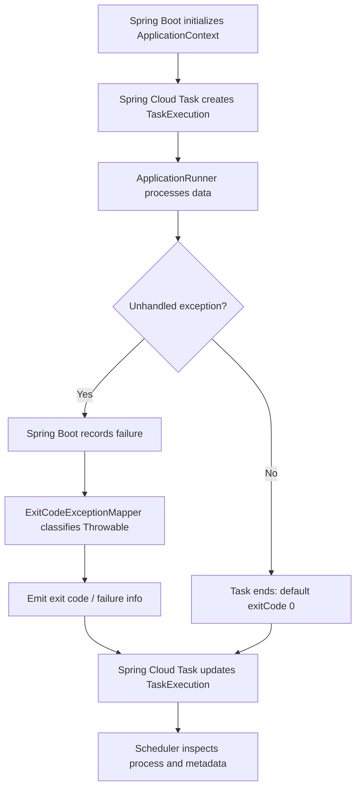
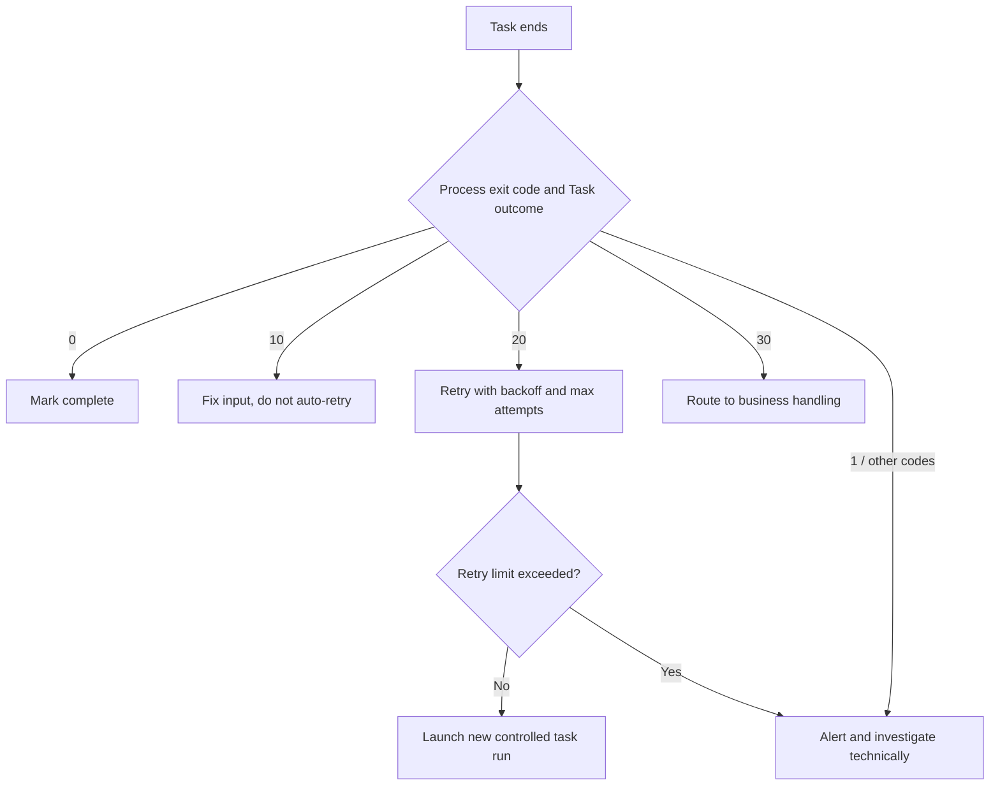

# Mapping Exceptions with `ExitCodeExceptionMapper`

## Lesson Goals

A **Spring Cloud Task** application is built to run for a finite duration: process data, record the outcome in `TaskRepository`, and terminate. When executed on a schedule or on demand, the orchestrator needs to distinguish input errors, transient connection failures, and unrecoverable business errors. If every failure returns the same code, operators have a hard time deciding whether to retry or investigate.

**`ExitCodeExceptionMapper`** is an interface provided by **Spring Boot** to translate an unhandled exception into an **integer exit code**. **Spring Cloud Task** uses that result in the run's metadata when the lifecycle permits recording the failure. Exit codes help the orchestrator make decisions, but they do not replace logs, error messages, or business state.

After this lesson, you will:

- Understand why exit code classification matters and how Spring Boot invokes `ExitCodeExceptionMapper`.
- Create a mapper bean for business exceptions and walk the cause chain (`cause chain`).
- Distinguish the exit code in `TaskExecution`, the process exit code, and `exitMessage` / `errorMessage`.
- Recognize scenarios where the mapper **does not behave as expected**, especially listener errors, failures before context creation, and killed processes.
- Build test scenarios and a safe retry policy for scheduled tasks as well as tasks running with Spring Batch.

## 1. What Problem Do Exit Codes Solve?

Suppose an `invoice-import-task` application runs nightly to import invoices. Four outcomes are possible:

| Execution outcome | Proposed exit code | Orchestrator action |
| --- | ---: | --- |
| Import succeeded | `0` | Mark complete; do not retry |
| `--business-date` argument missing or malformed | `10` | Reject request; fix input |
| Partner service temporarily unresponsive | `20` | Retryable with backoff and attempt limit |
| Invoices rejected by business rules | `30` | Do not auto-retry; escalate for business handling |
| Unexpected exception | `1` | Technical alert; inspect logs |

**The code table above is an application convention**, not a standard code list defined by Spring Cloud Task. By common convention, `0` denotes success and non-zero codes denote failure or a condition needing attention. When defining custom codes, document their meaning clearly and ensure all components (scheduler, pipeline, dashboard, operators) share the same contract.

Why not catch every exception and return a `"FAILED"` string? Because a process can appear to end normally from the framework's perspective if the application **swallows the exception**. In that case `TaskExecution.exitCode` could be `0`, leaving the orchestrator unaware of the business failure. If an error must fail the run, let the appropriate exception propagate or explicitly use a framework-supported failure signaling mechanism.

## 2. The `ExitCodeExceptionMapper` Interface and Task Lifecycle

Spring Boot defines a functional interface (`functional interface`):

```java
package org.springframework.boot;

@FunctionalInterface
public interface ExitCodeExceptionMapper {
    int getExitCode(Throwable exception);
}
```

This is a **condensed API signature for explanation**, not Spring Boot's full source code. The method receives the failing `Throwable` and returns an `int`. Because it is a functional interface, you can register it as a `@Bean` returning a lambda or write a class that `implements ExitCodeExceptionMapper`.

Typical flow when an `ApplicationRunner` throws an exception:



Key points:

1. Spring Cloud Task records the start after `ApplicationContext` has bootstrapped enough for Task infrastructure, and **before `ApplicationRunner`/`CommandLineRunner` beans run**.
2. While the task is running, `TaskExecution.exitCode` is typically `null` (SQL `NULL`); that means **no final result yet**, not success.
3. When runners finish without errors, the default recorded code is `0`. When an `ApplicationFailedEvent` occurs without a generated code, the typical code is `1`. When `ExitCodeExceptionMapper` is invoked and returns an appropriate code, Spring Cloud Task can record that code in `TaskExecution`.
4. A very early failure that prevents `ApplicationContext` from initializing can result in **no `TaskExecution` being created**. Having a mapper in your source code does not guarantee the mapper bean was initialized in time.
5. A record with `exitCode = NULL` lingering for too long **does not prove the task is still running**: the process may have been killed or lost the ability to update the repository.

The two components serve distinct roles: Spring Boot supplies the exception-mapping strategy; Spring Cloud Task persists the **execution history** in `TaskRepository`. See [Spring Cloud Task – Features](https://docs.spring.io/spring-cloud-task/reference/features.html) and [Spring Boot – `ExitCodeExceptionMapper` API](https://docs.spring.io/spring-boot/api/java/org/springframework/boot/ExitCodeExceptionMapper.html).

## 3. End-to-End Example: Mapping Four Exception Categories

This lab builds a task accepting `--business-date=YYYY-MM-DD` and an optional `--simulate=...` flag to deliberately exercise failure paths. The project uses a compatible set of **Java, Spring Boot, and Spring Cloud** versions, with the `spring-cloud-starter-task` dependency and an H2 driver for testing. If your project already has a persistent `TaskRepository`, keep your existing DB configuration.

Required Maven dependencies (the project's Spring Cloud BOM manages starter versions):

```xml
<dependencies>
    <dependency>
        <groupId>org.springframework.cloud</groupId>
        <artifactId>spring-cloud-starter-task</artifactId>
    </dependency>
    <dependency>
        <groupId>com.h2database</groupId>
        <artifactId>h2</artifactId>
        <scope>runtime</scope>
    </dependency>
</dependencies>
```

The Spring Cloud BOM must be imported in the POM's `dependencyManagement`; the Spring Boot parent/BOM must belong to a compatible release line. Do not pin a `spring-cloud-starter-task` version that conflicts with the BOM. This snippet is only a **dependency fragment** to be placed inside a valid Spring Boot `pom.xml`.

### 3.1. Declaring Custom Error Types

Three exceptions represent three independent handling decisions:

- `InvalidTaskInputException`: the caller supplied bad input; fix the input.
- `TemporaryPartnerException`: recoverable external error; retryable according to policy.
- `BusinessRejectedException`: data violates rules; requires intervention or data correction.

These error types do not have to implement `ExitCodeGenerator`. We use a centralized mapper bean to keep the code table easy to look up.

### 3.2. Writing the Application and Registering the Mapper

Create `src/main/java/com/example/task/InvoiceImportTaskApplication.java`:

```java
package com.example.task;

import java.time.LocalDate;
import java.time.format.DateTimeParseException;
import java.util.List;

import org.springframework.boot.ApplicationRunner;
import org.springframework.boot.ExitCodeExceptionMapper;
import org.springframework.boot.SpringApplication;
import org.springframework.boot.autoconfigure.SpringBootApplication;
import org.springframework.cloud.task.configuration.EnableTask;
import org.springframework.context.annotation.Bean;

@SpringBootApplication
@EnableTask
public class InvoiceImportTaskApplication {

    public static void main(String[] args) {
        SpringApplication.run(InvoiceImportTaskApplication.class, args);
    }

    @Bean
    ApplicationRunner importInvoices() {
        return args -> {
            List<String> dates = args.getOptionValues("business-date");

            if (dates == null || dates.size() != 1
                    || dates.get(0).isBlank()) {
                throw new InvalidTaskInputException(
                        "Exactly one --business-date=YYYY-MM-DD is required");
            }

            LocalDate businessDate;
            try {
                businessDate = LocalDate.parse(dates.get(0));
            } catch (DateTimeParseException ex) {
                throw new InvalidTaskInputException(
                        "business-date must follow the YYYY-MM-DD format", ex);
            }

            String mode = "none";
            List<String> simulated = args.getOptionValues("simulate");
            if (simulated != null) {
                if (simulated.size() != 1 || simulated.get(0).isBlank()) {
                    throw new InvalidTaskInputException(
                            "--simulate must have exactly one value");
                }
                mode = simulated.get(0);
            }

            switch (mode) {
                case "none" -> System.out.println(
                        "Imported invoices for date " + businessDate);
                case "retryable" -> throw new TemporaryPartnerException(
                        "Partner service is temporarily unavailable");
                case "rejected" -> throw new BusinessRejectedException(
                        "Business rules rejected the data");
                case "unexpected" -> throw new IllegalStateException(
                        "Unclassified error");
                default -> throw new InvalidTaskInputException(
                        "Invalid --simulate value: " + mode);
            }
        };
    }

    @Bean
    ExitCodeExceptionMapper invoiceImportExitCodeMapper() {
        return error -> {
            // Exceptions in the runner may be wrapped by Boot inside another exception.
            // Walk the cause chain to avoid depending on a specific wrapper class.
            for (Throwable current = error;
                    current != null; current = current.getCause()) {

                if (current instanceof InvalidTaskInputException) {
                    return 10;
                }
                if (current instanceof TemporaryPartnerException) {
                    return 20;
                }
                if (current instanceof BusinessRejectedException) {
                    return 30;
                }
            }

            return 1; // All other errors are unexpected failures.
        };
    }

    static final class InvalidTaskInputException extends RuntimeException {
        InvalidTaskInputException(String message) {
            super(message);
        }
        InvalidTaskInputException(String message, Throwable cause) {
            super(message, cause);
        }
    }

    static final class TemporaryPartnerException extends RuntimeException {
        TemporaryPartnerException(String message) {
            super(message);
        }
    }

    static final class BusinessRejectedException extends RuntimeException {
        BusinessRejectedException(String message) {
            super(message);
        }
    }
}
```

**Which part actually performs the mapping?** It is the `invoiceImportExitCodeMapper()` bean returning an `ExitCodeExceptionMapper`. Spring Boot discovers this bean in the application context and calls `getExitCode(Throwable)` when handling the appropriate failure path. We do not manually invoke the mapper inside `ApplicationRunner`.

The `for` loop follows `getCause()` to inspect root causes. When a runner throws an exception, the framework or a library may add a wrapper before the failure event is processed. If you only check `error instanceof TemporaryPartnerException` on the outermost layer, code `20` might never be selected. However, walking the cause chain needs design discipline: only map **exception types actually owned by the application**, and avoid matching a broad exception like `RuntimeException` ahead of specific types.

**Note:** `return 1` at the end is an intentional fallback for unknown exceptions, not a mandatory interface requirement. An implementation returning `0` for an exception could mislead the orchestrator into treating a failed run as a success; do not do that if it should still count as a failure.

### 3.3. Test Configuration

Create `src/main/resources/application.yml`:

```yaml
spring:
  application:
    name: invoice-import-task
  main:
    web-application-type: none
  datasource:
    url: jdbc:h2:mem:invoice_task;DB_CLOSE_DELAY=-1
    username: sa
    password: ""
  cloud:
    task:
      initialize-enabled: true

logging:
  level:
    org.springframework.cloud.task: DEBUG
```

With `web-application-type: none`, the application does not start an HTTP server; a simple task can terminate once the runner and framework lifecycle complete. In-memory H2 is for experimentation only; history disappears when the JVM exits. To observe multiple runs from an external monitoring system, connect PostgreSQL or a supported database, create the version-appropriate Task schema, and manage migrations, access permissions, and credentials.

Build and run the actual JAR; the filename below is an example and should match your project's `artifactId`:

```bash
./mvnw clean package

# Success.
java -jar target/invoice-import-task.jar --business-date=2026-11-23

# Invalid input.
java -jar target/invoice-import-task.jar --business-date=wrong-date

# Transient service error.
java -jar target/invoice-import-task.jar \
  --business-date=2026-11-23 --simulate=retryable

# Rejected by business rules.
java -jar target/invoice-import-task.jar \
  --business-date=2026-11-23 --simulate=rejected

# Unexpected error.
java -jar target/invoice-import-task.jar \
  --business-date=2026-11-23 --simulate=unexpected
```

On Windows, use `mvnw.cmd` instead of `./mvnw`. In a Linux/macOS shell, run `echo $?` **immediately after** the `java -jar` command to read the process exit code before running another command. In PowerShell, check `$LASTEXITCODE` right after the command:

```powershell
java -jar target/invoice-import-task.jar --business-date=wrong-date
$LASTEXITCODE
```

Do not use `mvn spring-boot:run` to directly verify the **JAR's** exit code: that command introduces Maven and its plugin as an intermediary layer. In CI/schedulers, run the packaged artifact using the exact mechanism used in production.

### 3.4. Expected Results

| Test command | Final exception (if any) | Proposed mapper code |
| --- | --- | ---: |
| `--business-date=2026-11-23` | None | `0` (default on success) |
| `--business-date=wrong-date` | `InvalidTaskInputException` | `10` |
| `--business-date=2026-11-23 --simulate=retryable` | `TemporaryPartnerException` | `20` |
| `--business-date=2026-11-23 --simulate=rejected` | `BusinessRejectedException` | `30` |
| `--business-date=2026-11-23 --simulate=unexpected` | `IllegalStateException` | `1` |
| Missing `--business-date` | `InvalidTaskInputException` | `10` |

These are the **expected results of the example** and must be verified on your specific Boot/Cloud version and launcher setup. Database connection failures, configuration parsing errors, or bootstrap failures before the mapper bean is created can follow a different path. Do not assume every JVM failure is guaranteed to receive the exact code shown in the table.

## 4. `TaskRepository` Outcomes vs. Process Exit Codes

With Spring Cloud Task, `TaskExecution` typically stores the following fields:

| Field | Purpose |
| --- | --- |
| `executionId` | Uniquely identifies a physical execution |
| `taskName` | Task name; typically tied to `spring.application.name` |
| `startTime` and `endTime` | Start and end timestamps recorded by the framework |
| `exitCode` | Numeric result: `null` while undecided; `0` or another code once finished |
| `exitMessage` | Summary message the application can write via `TaskExecutionListener` |
| `errorMessage` | Error details recorded by the framework on corresponding failure paths |
| `arguments` | List of arguments passed to the process |

With a persistent database and default schema, you can query:

```sql
SELECT
    TASK_EXECUTION_ID,
    TASK_NAME,
    START_TIME,
    END_TIME,
    EXIT_CODE,
    EXIT_MESSAGE
FROM TASK_EXECUTION
WHERE TASK_NAME = 'invoice-import-task'
ORDER BY TASK_EXECUTION_ID DESC;
```

To find runs without a final code:

```sql
SELECT TASK_EXECUTION_ID, START_TIME, END_TIME
FROM TASK_EXECUTION
WHERE TASK_NAME = 'invoice-import-task'
  AND EXIT_CODE IS NULL
ORDER BY START_TIME;
```

SQL must use `IS NULL`, not `EXIT_CODE = NULL`. Distinguish `NULL` from `0`: `NULL` means **no code has been saved yet**, whereas `0` is the **conventional success exit code**. If a record stays `NULL` for too long, inspect the process/container and logs to see whether it is still running or was killed; never assume it is still active.

The **process exit code** is the status observed by the operating system, container runtime, or scheduler; **`TaskExecution.exitCode`** is the metadata Spring Cloud Task saved to the DB. Under normal paths the two sides align, yet exceptions occur: the JVM is killed abruptly; network errors prevent updating the repository; the mapper bean has not been initialized; or a launcher/shell script masks the return code. Therefore, check **both** when codes drive retry decisions and alerts.

For example: the scheduler sees the container OOM-killed by the system, while `TaskExecution.exitCode` remains `NULL` because Spring never had a chance to write the outcome. That is not a bug in the exception mapping table, nor should you manually edit SQL to "sync" success or failure.

## 5. When Is `ExitCodeExceptionMapper` Not Applied?

| Scenario | What to understand | Appropriate action |
| --- | --- | --- |
| `ApplicationRunner` throws an unhandled exception | Failure path goes through Boot/Task failure handling; mapper is the right tool | Map specific exceptions and verify the final code |
| Runner uses `try/catch`, only logs, and returns normally | Framework may consider the task succeeded; mapper never sees the exception | Rethrow the exception or report failure via an official mechanism |
| Application fails to start before context/mapper bean exists | Mapper may not be created; Task record may not exist | Monitor process exit, bootstrap logs, and configuration |
| Exception in `TaskExecutionListener`'s `onTaskStartup`/`onTaskEnd`/`onTaskFailed` | Spring Cloud Task has its own exit code rules; **`ExitCodeExceptionMapper` cannot force the code** for these listener errors | Check `ExitCodeEvent`, `ExitCodeGenerator`, and Task defaults; fix the listener |
| Process receives `SIGKILL` / OOM-kill | JVM has no opportunity to run all callbacks | Combine scheduler/container status with metadata |
| Error in async work after the runner returns | Task may already be finalized before async error is surfaced | Await future/job completion or design explicit synchronization |
| Spring Batch Job returns `BatchStatus.FAILED` but Boot runner does not throw | Task may still receive `0` under default Batch/Boot settings | Enable Job-to-Task failure propagation and test it |

### Exceptions Inside Listeners Are a Special Case

The Spring Cloud Task documentation explicitly notes: when an `onTaskStartup`, `onTaskEnd`, or `onTaskFailed` handler throws an exception, **`ExitCodeExceptionMapper` cannot override the code for that situation**. The system considers a published `ExitCodeEvent`, or an `ExitCodeGenerator` on the exception if present, and then falls back to defaults. For startup failures originating from `onTaskStartup`, the application code is `1` per the documented rules. Therefore, do not rely on a mapper to fix logic errors inside a listener or use listeners to run heavy business logic.

Remember this mechanism covers **errors originating inside the listener itself**, which is different from a listener bean being invoked to write an `exitMessage` for a business failure.

### How Does `ExitCodeGenerator` Differ from `ExitCodeExceptionMapper`?

- `ExitCodeExceptionMapper`: a **strategy accepting a `Throwable`** and mapping it to a code; well suited when you want one centralized policy classifying multiple exception classes.
- `ExitCodeGenerator`: an object or exception that supplies its own code via `getExitCode()`. Spring Boot can retrieve codes from generators during the appropriate shutdown path.
- `ExitCodeEvent`: an event publishing the resolved exit code; listeners can observe it for recording or integration.

Do not deploy multiple mechanisms returning conflicting codes without a verification convention. In a large application, choose **one place to manage the code table** and test the end-to-end exit path to confirm where the framework gets its code. See [Spring Boot – Application Exit](https://docs.spring.io/spring-boot/reference/features/spring-application.html#features.spring-application.application-exit) and [Spring Cloud Task – Task Execution Listener](https://docs.spring.io/spring-cloud-task/reference/features.html#task-execution-listener).

## 6. Unit Test Template for Mapping Logic

Because the mapping is a pure function (takes an exception, returns an integer), test it independently before running end-to-end tests. With **JUnit 5**, you can test an instantiated mapper bean:

```java
package com.example.task;

import static org.junit.jupiter.api.Assertions.assertEquals;

import org.junit.jupiter.api.Test;
import org.springframework.boot.ExitCodeExceptionMapper;

class InvoiceImportExitCodeMapperTest {

    private final ExitCodeExceptionMapper mapper =
            new InvoiceImportTaskApplication().invoiceImportExitCodeMapper();

    @Test
    void mapsKnownErrorsEvenWhenWrapped() {
        Throwable nested = new IllegalStateException(
                "runner failed",
                new InvoiceImportTaskApplication.TemporaryPartnerException(
                        "remote service unavailable"));

        assertEquals(20, mapper.getExitCode(nested));
    }

    @Test
    void mapsUnknownErrorToOne() {
        assertEquals(1, mapper.getExitCode(
                new IllegalStateException("unexpected")));
    }

    @Test
    void mapsBadInputToTen() {
        assertEquals(10, mapper.getExitCode(
                new InvoiceImportTaskApplication.InvalidTaskInputException(
                        "missing date")));
    }
}
```

Running tests requires JUnit/Jupiter dependencies and the appropriate test plugin (usually included in `spring-boot-starter-test`). This unit test verifies **mapping logic and cause-chain traversal**, not that Spring Boot registered the bean or that Spring Cloud Task persisted the right code to the DB. For operational readiness, add **integration tests running the real JAR**, reading the process exit code, and querying `TaskRepository`.

Note: since this is a tutorial, the sample code is meant to be integrated into an existing project with a valid build; it does not replace a full `pom.xml` or production database provisioning workflow.

## 7. Mapping Codes for Controlled Retries and Error Handling

Exit codes are only useful when the scheduler understands their meaning and governs retries. Example convention:



Checklist before enabling auto-retry:

1. **Idempotency:** the invoice-import task might have persisted 60% of records before a network failure. On retry, you need a business key such as `tenantId + businessDate + importId`, a unique constraint, or an upsert/checkpoint mechanism to prevent duplicate imports.
2. **Transactions and side effects:** rolling back a database transaction does not undo sent emails or external API calls. Design an outbox, deduplication, or compensation mechanism where needed.
3. **Retry limits:** code `20` only signals a *potentially recoverable* error; it does not guarantee the next retry will succeed. Use exponential backoff, jitter, timeouts, and attempt caps.
4. **Task infrastructure failures:** if the DB storing `TaskExecution` is unavailable, the process exit code and scheduler logs become essential sources of truth.
5. **Safe messages:** never put passwords, tokens, or personal data into exception messages, `exitMessage`, `errorMessage`, or command-line arguments; those fields can be persisted or shipped to centralized logs.

Pick non-`0` codes for retryable errors, but never configure a job scheduler to blindly **retry every non-`0` code**. Automated rules should read the code-table contract and system state.

## 8. Combining with Spring Batch

Spring Cloud Task records a `TaskExecution` for the **application process**; Spring Batch records `JobExecution` and `StepExecution` for the **job and its processing steps**. A Job can be `FAILED` while the Spring Boot application still terminates normally; in that case, the Task can receive code `0` unless Batch-to-Task failure propagation is configured.

Per the Spring Cloud Task documentation, if your project integrates Spring Batch and should report a failure code when a Batch Job has `BatchStatus.FAILED`, you can use:

```yaml
spring:
  cloud:
    task:
      batch:
        fail-on-job-failure: true
```

Depending on the version, the integration may use an alternate runner and `ExitCodeGenerator` to lift the Job outcome to the Task. Do not rely solely on `ExitCodeExceptionMapper` to infer a `FAILED` Batch Job: the mapper only handles **exceptions** along the failure path, whereas a Job's `BatchStatus` and `ExitStatus` are separate result structures. Inspect `JobExecution`, `TaskExecution`, and the process exit code together after integration. See [Spring Cloud Task – Batch Job Exit Codes](https://docs.spring.io/spring-cloud-task/reference/batch.html).

## 9. Four Scenarios to Reason Through

**Scenario A — Runner catches error and continues:** A partner call throws `TemporaryPartnerException`. The Runner catches it, logs it, and returns normally. What code may be recorded, and why?

**Hint:** The framework may record `0` because no failure exception escaped. The mapper bean never receives the error. If the business operation must fail, do not swallow the exception; clean up/close resources and rethrow according to contract.

**Scenario B — Wrapped exception:** The Runner throws `InvalidTaskInputException`, yet Spring Boot passes an `IllegalStateException` wrapping it as the cause to the mapper. If you only check `instanceof InvalidTaskInputException` on the outermost `Throwable`, what happens?

**Hint:** You may get the fallback `1` instead of `10`. Walking `getCause()` as shown in the example detects the application-owned error.

**Scenario C — Listener throws an error:** An `@AfterTask` listener throws `RuntimeException` and the mapper bean tries to return `30`. Is code `30` guaranteed to be used?

**Hint:** No. Errors from `TaskExecutionListener` follow separate rules, and Spring Cloud Task documentation states `ExitCodeExceptionMapper` cannot override those listener errors. Fix the listener, and check events/generators and actual exit codes.

**Scenario D — Unfinalized repository record:** The scheduler sees the container died, while the DB has `EXIT_CODE IS NULL`. Should you declare it a success and update the column straight to `0`?

**Hint:** No. Reconcile logs, process/container exit status, business outcomes, and repository issues. A run may have partially processed data before the JVM was killed; arbitrarily editing records corrupts history and hides duplicate-processing risks on retry.

## 10. Pre-Deployment Checklist

- [ ] An exit code table is shared and understood by all systems invoking the task; `0` is reserved strictly for success.
- [ ] `ExitCodeExceptionMapper` is registered as a bean in the task's `ApplicationContext` with a non-`0` fallback.
- [ ] The mapper walks the `cause chain` when runner exceptions may be wrapped by the framework, while only mapping application-controlled types.
- [ ] Critical business errors are never caught and ignored when the task must be marked failed.
- [ ] Unit tests cover every error category, plus integration tests running the real JAR and reconciling the process exit code with `TaskRepository`.
- [ ] Monitoring covers missing Task records, `EXIT_CODE IS NULL` lingering too long, and startup failures before the context is ready.
- [ ] Listeners do not contain complex business logic prone to throwing errors; special rules for listener exceptions are understood.
- [ ] Scheduler retries are conditional, bounded, and backed by idempotency keys rather than retrying every error blindly.
- [ ] Metadata/task correlation IDs are stored to trace logs and run timestamps; sensitive data is masked in arguments and error messages.
- [ ] When using Spring Batch, `BatchStatus`/`ExitStatus` and `fail-on-job-failure` are configured and verified rather than assuming a failed Job always throws an exception to the mapper.

## Review Questions

1. Is `ExitCodeExceptionMapper` defined by Spring Boot or Spring Cloud Task? How does Spring Cloud Task use its result?
2. Why can an exception that is caught and ignored cause the final exit code to be `0`?
3. Why should you inspect `getCause()` when mapping exceptions from a runner?
4. When `TaskExecution.exitCode` is `null`, can you conclude the task is still running?
5. Do exceptions inside `TaskExecutionListener` always pass through the mapper?
6. If a Spring Batch Job has `BatchStatus.FAILED`, is the Task guaranteed to receive a non-`0` code?
7. When a scheduler retries on code `20`, what safeguards are needed to avoid repeated data side effects?

**Short Answers:** (1) Defined by Spring Boot; Task stores the code in metadata when updating the outcome; (2) the framework sees the runner finish normally; (3) the error may sit inside a wrapper; (4) no, metadata may be unfinalized or stalled; (5) no, listeners have separate rules; (6) not by default—requires configuration and integration testing; (7) idempotency, retry limits, backoff, and side-effect checks.

## Official Documentation

1. [Spring Boot – `ExitCodeExceptionMapper` API](https://docs.spring.io/spring-boot/api/java/org/springframework/boot/ExitCodeExceptionMapper.html) — `getExitCode(Throwable)` signature and mapping role.
2. [Spring Boot – SpringApplication / Application Exit](https://docs.spring.io/spring-boot/reference/features/spring-application.html) — `ApplicationRunner`, `ExitCodeGenerator`, and application exit paths.
3. [Spring Cloud Task – Features](https://docs.spring.io/spring-cloud-task/reference/features.html) — `TaskExecution.exitCode`, exception mapping, and limits with `TaskExecutionListener`.
4. [Spring Cloud Task – Getting Started](https://docs.spring.io/spring-cloud-task/reference/getting-started.html) — Task initialization, runners, and logs transitioning from `exitCode=null` to the final outcome.
5. [Spring Cloud Task – Batch](https://docs.spring.io/spring-cloud-task/reference/batch.html) — Spring Batch integration and `fail-on-job-failure` configuration.

**Key Principle:** `ExitCodeExceptionMapper` turns an **unhandled exception** into an **operationally meaningful numeric code**. A reliable task combines proper code mapping, `TaskRepository` data, process exit codes, logs, and a safe retry policy.
