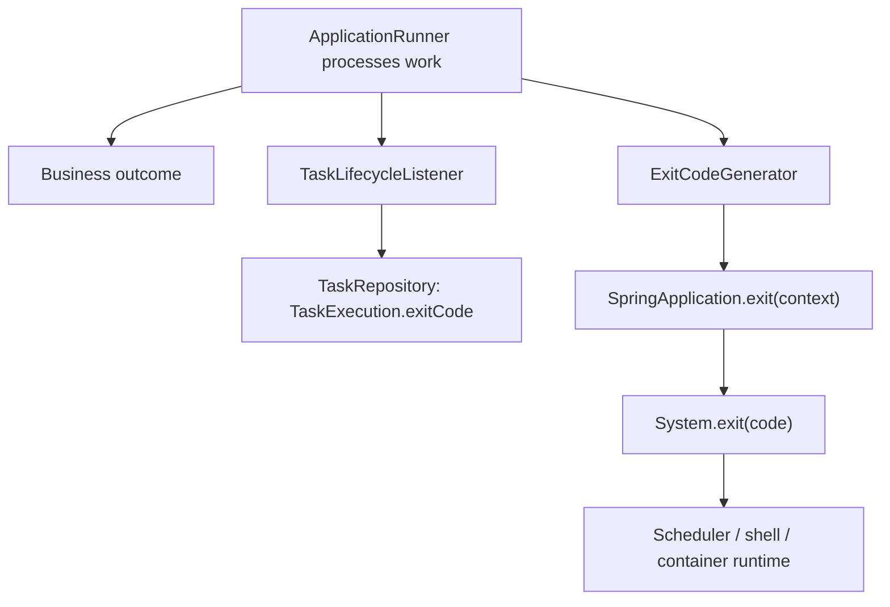
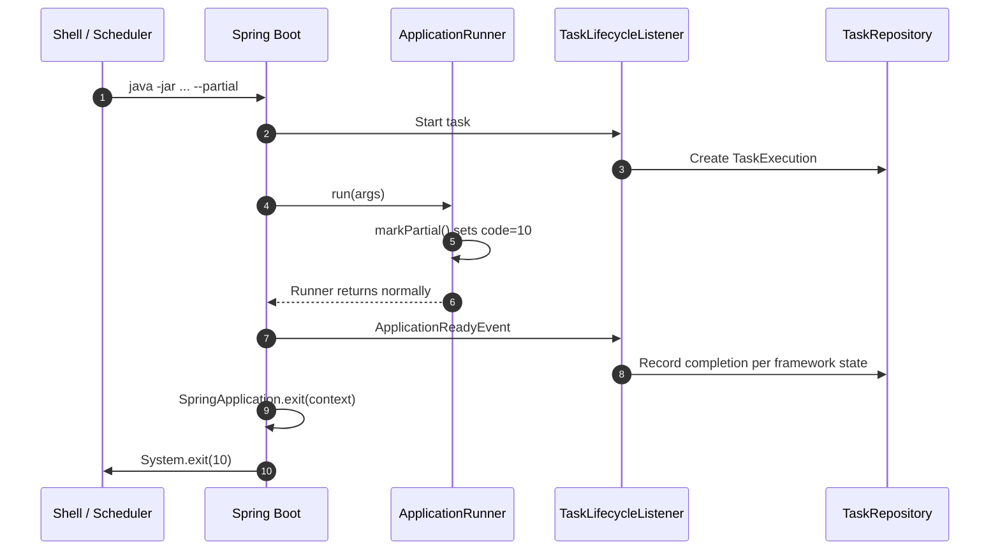

# Supplying Exit Codes via `ExitCodeGenerator` in Spring Cloud Task

## 1. Why Does a Task Need an Exit Code?

A **Spring Cloud Task** application performs a finite unit of work and terminates: importing data, reconciling settlements, generating reports, or executing a step in a scheduled pipeline. When the task stops, external systems need a concise signal to know whether to run the next step, raise an alert, or retry. The **exit code** serves this purpose.

For example, a `daily-settlement` application processing transactions for `2026-11-23` might exit with:

| Example code | Application-defined meaning | Expected handling |
| --- | --- | --- |
| `0` | Completed normally | Allow dependent steps to proceed. |
| `10` | Partially completed; remaining records need reconciliation | Send an alert and process pending records. |
| `20` | Invalid input | Check parameters; do not retry as-is. |
| `30` | Dependent service temporarily unavailable | Consider retrying with limits and backoff. |

Codes `10`, `20`, and `30` are **example conventions**, not predefined error codes built into Spring Cloud Task. The orchestrator must understand that convention before deciding to retry or alert. Depending on the environment, the operating system or container runtime may also assign its own codes when a process is stopped by a signal.

This lesson in the **Results and Exit Codes** chapter focuses on Spring Boot's `ExitCodeGenerator` interface and how it relates to the execution metadata Spring Cloud Task stores in `TaskRepository`. After this lesson, you will be able to:

- Intentionally supply exit codes using `ExitCodeGenerator`.
- Use `SpringApplication.exit(...)` and `System.exit(...)` to propagate codes to the operating system.
- Distinguish the **process** exit code from `TaskExecution.exitCode` stored in the **database**.
- Map business errors to appropriate codes; understand the roles of `ExitCodeEvent` and `ExitCodeExceptionMapper`.
- Verify actual behavior when a task succeeds, finishes with warnings, fails, or is terminated abnormally.

## 2. Three Outcome Layers to Distinguish

In a Spring Cloud Task application, the same term "exit code" can appear in different places:

| Layer | Object / storage location | Who uses it? |
| --- | --- | --- |
| **Business outcome** | Transaction data, reports, error tables, or output files | Users and business systems verifying processed content. |
| **Metadata exit code** | `TaskExecution.exitCode`, typically the `EXIT_CODE` column of `TASK_EXECUTION` | `TaskRepository`, `TaskExplorer`, history views, and monitoring tools. |
| **Process exit code** | Process status returned to the OS when the JVM exits | Shell, Kubernetes Job/CronJob, scheduler, and orchestrator. |

The three layers are related, but they **do not automatically stay identical in every program structure**. A report can finish writing yet contain incomplete figures; a process returning `0` does not replace business data verification. Conversely, if the exit code is computed **after** Spring Cloud Task has finalized its metadata, the database value may differ from the OS exit code.



The diagram depicts **responsibilities**, not a claim that all branches happen simultaneously. When the code is computed and when Spring Cloud Task updates its record both matter.

## 3. What Is `ExitCodeGenerator`?

**`ExitCodeGenerator`** is an interface provided by Spring Boot in package `org.springframework.boot`:

```java
package org.springframework.boot;

public interface ExitCodeGenerator {
    int getExitCode();
}
```

When `SpringApplication.exit(context)` is called, Spring Boot can collect codes from beans implementing this interface. The returned value is a Java integer; in practice, choose **positive, small, stable** codes supported by your orchestrator. `0` normally indicates successful termination, while non-zero codes indicate conditions requiring attention per application convention.

Distinguishing commonly confused components:

| API | Defined in | Responsibility |
| --- | --- | --- |
| `ExitCodeGenerator` | Spring Boot | Computes an exit code from a bean's or exception's state. |
| `SpringApplication.exit(context)` | Spring Boot | Computes the exit code for application shutdown via Boot's mechanism and closes the context. |
| `System.exit(code)` | Java | Terminates the JVM and returns the exit code to the calling process. |
| `ExitCodeEvent` | Spring Boot | Announces that an exit code has been determined. |
| `ExitCodeExceptionMapper` | Spring Boot | Maps a `Throwable` to an exit code on the error-handling path. |
| `TaskLifecycleListener` | Spring Cloud Task | Updates `TaskExecution` start and end metadata according to application lifecycle. |
| `TaskRepository` | Spring Cloud Task | Persists execution results, including `exitCode`, to the database. |

**Key point:** simply adding an `ExitCodeGenerator` bean does not mean the JVM will automatically call `System.exit(...)` with that bean's code, nor does it guarantee `TaskExecution.exitCode` will receive the same code. Those steps must be designed and tested explicitly.

## 4. Basic Usage: Returning a Code from an `ExitCodeGenerator` Bean

Minimal example: the application has a bean returning code `10`, and `main` forwards that code to the operating system.

```java
import org.springframework.boot.ExitCodeGenerator;
import org.springframework.boot.SpringApplication;
import org.springframework.boot.autoconfigure.SpringBootApplication;
import org.springframework.cloud.task.configuration.EnableTask;
import org.springframework.context.ConfigurableApplicationContext;
import org.springframework.context.annotation.Bean;

@SpringBootApplication
@EnableTask
public class SampleTaskApplication {

    public static void main(String[] args) {
        ConfigurableApplicationContext context =
            SpringApplication.run(SampleTaskApplication.class, args);
        int code = SpringApplication.exit(context);
        System.exit(code);
    }

    @Bean
    ExitCodeGenerator exitCodeGenerator() {
        return () -> 10;
    }
}
```

When the application starts successfully, `SpringApplication.exit(...)` computes the code from the bean; `System.exit(...)` passes it back to the shell. The example intentionally returns `10` to illustrate the flow; **never return a hardcoded non-`0` code** for every run in a real application.

Two additional points to note:

1. If you only call `SpringApplication.run(...)` and let `main` return, the bean's code is not automatically used as the JVM's exit code. The example above explicitly calls `SpringApplication.exit(...)` and `System.exit(...)` to make the intent clear.
2. Spring Cloud Task typically writes completion metadata upon receiving `ApplicationReadyEvent`, after synchronous runners finish. By the time `main` calls `SpringApplication.exit(context)`, metadata may **already be finalized**. Thus, even if the shell receives `10`, **do not assume** the `TASK_EXECUTION.EXIT_CODE` column also became `10` solely from the bean above.

When multiple `ExitCodeGenerator` beans exist, Spring Boot evaluates generators in managed order and uses the **first non-`0` code**; `Ordered` or `@Order` can clarify precedence. Even so, a task application should have one unified exit code strategy to avoid contention among beans.

## 5. Practical Example: Exit Codes Varying by Business Outcome

In a reconciliation task, a run may complete fully or partially. We use a bean that holds outcome state and implements `ExitCodeGenerator`. The runner updates that state, and `main` returns the code to the operating system.

### 5.1. Bean Holding the Outcome

```java
import org.springframework.boot.ExitCodeGenerator;
import org.springframework.stereotype.Component;

@Component
public class SettlementOutcome implements ExitCodeGenerator {

    private int exitCode = 0;

    public void markPartial() {
        this.exitCode = 10;
    }

    @Override
    public int getExitCode() {
        return exitCode;
    }
}
```

In this example, `0` is the default state when no issues are found; `markPartial()` sets code `10` when unresolved transactions remain. Because the sample runner runs synchronously on a single thread, simple state storage suffices for illustration. If multiple threads update the outcome concurrently, use synchronization or thread-safe data structures.

### 5.2. Short-Lived Application

```java
import org.springframework.boot.ApplicationRunner;
import org.springframework.boot.SpringApplication;
import org.springframework.boot.autoconfigure.SpringBootApplication;
import org.springframework.cloud.task.configuration.EnableTask;
import org.springframework.context.ConfigurableApplicationContext;
import org.springframework.context.annotation.Bean;

@SpringBootApplication
@EnableTask
public class SettlementTaskApplication {

    public static void main(String[] args) {
        ConfigurableApplicationContext context =
            SpringApplication.run(SettlementTaskApplication.class, args);
        System.exit(SpringApplication.exit(context));
    }

    @Bean
    ApplicationRunner settlementRunner(SettlementOutcome outcome) {
        return arguments -> {
            // TODO: replace with actual settlement logic and result verification.
            boolean hasUnresolvedItems = arguments.containsOption("partial");

            if (hasUnresolvedItems) {
                outcome.markPartial();
                System.out.println("Settlement has unresolved transactions");
            } else {
                System.out.println("Settlement completed");
            }
        };
    }
}
```

Successful run:

```bash
java -jar settlement-task.jar
```

Partial completion run:

```bash
java -jar settlement-task.jar --partial
```

After the runner finishes, `SettlementOutcome.getExitCode()` returns `0` or `10`; `SpringApplication.exit(context)` uses that value, and `System.exit(code)` returns it to the operating system. This is an **example of a process exit code**. To use this code on a dashboard backed by `TaskExecution`, you must understand and verify the metadata recording mechanism in the next section.

### 5.3. Metadata Configuration for Spring Cloud Task

```yaml
spring:
  application:
    name: settlement-worker
  main:
    web-application-type: none
  cloud:
    task:
      name: daily-settlement
  datasource:
    url: ${TASK_DB_URL}
    username: ${TASK_DB_USER}
    password: ${TASK_DB_PASSWORD}
```

To run this example, you need the `spring-cloud-starter-task` dependency, an appropriate JDBC driver, the version-matching Spring Cloud Task metadata schema, and a reachable database. Spring Boot, Spring Cloud, and JDK versions must be compatible. The example uses an application with no HTTP server; a persistent metadata datasource lets you inspect runs after the JVM has exited.

## 6. Why Can the Process Code and `TaskExecution` Code Differ?

Spring Cloud Task tracks the application lifecycle using `TaskLifecycleListener`. Typically, the framework creates metadata on context startup and updates the outcome when synchronous `ApplicationRunner`/`CommandLineRunner` beans finish, via `ApplicationReadyEvent` or the failure-handling path.

For the `SettlementOutcome` example, trace the sequence:



`TaskLifecycleListener` does not automatically re-read values from every `ExitCodeGenerator` bean **after** the record has already been finalized. In Spring Cloud Task's implementation, the code stored in `TaskExecution` is influenced by received `ExitCodeEvent` events and error-handling paths. Consequently, a case where the runner **returns normally** while a bean only supplies code `10` during `SpringApplication.exit(...)` can yield **process code `10`, metadata `0`**.

This is not a reason to abandon `ExitCodeGenerator`, but a reason to decide explicitly which system determines the outcome and **test both sources**. In particular, if the orchestrator reads the process exit code to decide retries while a dashboard reads `TASK_EXECUTION.EXIT_CODE`, the two systems must follow a consistent rule or explicitly document intentional differences.

## 7. When You Need to Record a Custom Code in Metadata: `ExitCodeEvent`

Spring Boot publishes `ExitCodeEvent`, carrying a resolved exit code. In Spring Cloud Task versions that support listening to this event, `TaskLifecycleListener` can use the code from **an event received before the task is finalized**.

We can add an event publication step to the runner in Section 5 once the outcome is known, **before the runner returns**:

```java
import org.springframework.boot.ApplicationRunner;
import org.springframework.boot.ExitCodeEvent;
import org.springframework.context.ApplicationEventPublisher;
import org.springframework.context.annotation.Bean;

@Bean
ApplicationRunner settlementRunner(SettlementOutcome outcome,
                                   ApplicationEventPublisher events) {
    return arguments -> {
        boolean hasUnresolvedItems = arguments.containsOption("partial");

        if (hasUnresolvedItems) {
            outcome.markPartial();
            // Notify code=10 while TaskExecution is not yet finalized.
            events.publishEvent(new ExitCodeEvent(this, outcome.getExitCode()));
        }
    };
}
```

The snippet above is an **alternative version** of the `settlementRunner` bean from Section 5.2; do not register both runner beans simultaneously in the same exercise. Its purpose is to illustrate when the event is published; actual work must complete before emitting the outcome.

In a synchronous flow with a healthy listener, code `10` is already available when `ApplicationReadyEvent` fires. Spring Cloud Task can then persist that code into `TaskExecution`, while `SpringApplication.exit(...)` continues reading `10` from `SettlementOutcome` to return to the operating system.

Notes before using this pattern in production:

- `ExitCodeEvent` is an infrastructure event; manual publishing must be controlled so multiple places do not emit conflicting codes.
- Verify behavior against your **specific Spring Cloud Task/Spring Boot versions**, since event ordering and lifecycle hooks determine which code gets persisted.
- If a process has already failed and cannot write to the repository, publishing an event does not itself guarantee the record is updated.
- Centralize outcome determination in one component and reuse that same result for both metadata and the process exit code.

If you only need a process exit code for the scheduler to act on, the `ExitCodeGenerator` example in Section 5 already demonstrates the primary mechanism. Add event coordination only when operational requirements genuinely need consistent repository status for non-throwing completion paths.

## 8. Mapping Exceptions to Exit Codes

Beyond regular beans, **exceptions can implement `ExitCodeGenerator`**. This fits situations where work cannot complete and the failure type must be conveyed clearly.

```java
import org.springframework.boot.ExitCodeGenerator;

public class InvalidInputException extends RuntimeException
        implements ExitCodeGenerator {

    public InvalidInputException(String message) {
        super(message);
    }

    @Override
    public int getExitCode() {
        return 20;
    }
}
```

Inside the runner:

```java
@Bean
ApplicationRunner validateInput() {
    return args -> {
        if (!args.containsOption("businessDate")) {
            throw new InvalidInputException("Missing --businessDate");
        }
        // TODO: validate the business date and execute business logic.
    };
}
```

Spring Boot supports deriving an exit code from an exception implementing `ExitCodeGenerator` on the error-handling path; Spring Cloud Task can receive the `ExitCodeEvent` emitted by Boot and record the corresponding code on failure termination. If no code is supplied, Task's standard failure path typically uses `1`.

**Limitation to remember:** an unhandled exception can cause `SpringApplication.run(...)` to throw before execution reaches `System.exit(SpringApplication.exit(context))`. Therefore, seeing code `20` written to metadata **does not automatically guarantee** the shell also receives `20`; test the actual process exit code and, if needed, add an error-handling strategy at the application entry point. Never swallow exceptions just to force the program to report success.

### 8.1. When Should `ExitCodeExceptionMapper` Be Used?

When you do not want to modify exception classes to implement an interface, use Spring Boot's `ExitCodeExceptionMapper`:

```java
import org.springframework.boot.ExitCodeExceptionMapper;
import org.springframework.context.annotation.Bean;

@Bean
ExitCodeExceptionMapper exitCodeExceptionMapper() {
    return exception -> {
        if (exception instanceof IllegalArgumentException) {
            return 20;
        }
        return 1;
    };
}
```

This example separates input errors from all remaining errors. In real flows, exceptions may be wrapped across multiple layers by the framework; inspect `cause` carefully to identify the true root type instead of mapping everything to `1`.

`ExitCodeExceptionMapper` and `ExitCodeGenerator` solve two different styles of supplying codes: one **maps unhandled errors**, while the other **returns a code from a bean or exception directly**. Error callbacks in Spring Cloud Task's `TaskExecutionListener` follow their own rules; do not assume a mapper will override codes for errors raised inside those callbacks.

## 9. Meaning of `0`, Non-Zero Codes, and Abnormal Termination

In orchestration systems, `0` typically means success and non-zero means action is needed. However, **the meaning of individual codes is not built in**: the application and operations platform must agree on them.

An example exit code contract:

| Code | Outcome category | Should auto-retry? |
| --- | --- | --- |
| `0` | Completed successfully | No. |
| `10` | Partial completion requiring intervention | Depends on data state and business rules. |
| `20` | Invalid parameter/input | Usually do not retry with unchanged input. |
| `30` | Transient dependency issue | May retry with limits, backoff, and idempotency. |

Choose codes that do not collide with container runtime, orchestrator, or shell conventions. On many Unix systems, only the lowest 8 bits of the process exit code are reflected in the shell, so avoid negative or overly large values and assuming they are preserved intact. OS signal-related codes may be reported differently by each platform; **never treat a signal code as the sole conclusion about business logic**.

When the JVM receives `kill -9`, the host loses power, or the container is forcefully stopped, Spring Cloud Task may **never get an opportunity to update** `endTime`/`exitCode`. In those cases, container status, scheduler status, and logs are essential sources for reconciliation, while metadata may remain `null` or incomplete.

## 10. Measuring Process Codes and Database Codes

To avoid confusion, inspect **both the shell return code** and the **code in `TaskRepository`** after each test case.

### 10.1. Checking from the Shell

On Linux or macOS:

```bash
java -jar settlement-task.jar --partial
code=$?
printf 'Process exit code: %s\n' "$code"
```

In Windows PowerShell:

```powershell
java -jar settlement-task.jar --partial
$code = $LASTEXITCODE
Write-Output "Process exit code: $code"
```

Capture the status **immediately after the Java command**, before running any other commands that could overwrite the exit code variable.

### 10.2. Querying Metadata in the Database

With the standard Spring Cloud Task JDBC schema, use this reference SQL:

```sql
SELECT TASK_EXECUTION_ID,
       TASK_NAME,
       START_TIME,
       END_TIME,
       EXIT_CODE,
       EXIT_MESSAGE,
       ERROR_MESSAGE
FROM TASK_EXECUTION
WHERE TASK_NAME = 'daily-settlement'
ORDER BY TASK_EXECUTION_ID DESC;
```

Verify table/column names against the schema of your exact version and DBMS. `TaskExplorer` is another API for querying history. While a task is **running**, `exitCode` usually has no value yet; once the Task finishes and the repository update succeeds, the code reflects the terminal outcome.

### 10.3. Verification Matrix

| Scenario | Expected process code | What to check in `TaskExecution` |
| --- | --- | --- |
| Runner succeeds, generator returns `0` | `0` | `endTime` is set with the appropriate completion code. |
| Runner returns normally, generator returns `10` in `SpringApplication.exit` | `10` | **May still be `0`** if Task finalized before Boot evaluated the bean. |
| Runner sends `ExitCodeEvent(10)` before completion, generator also returns `10` | `10` | Verify the record received `10` on your actual version. |
| Runner throws an exception with code `20` | Do not assume without testing the app entry point | Check `ExitCodeEvent`, `ApplicationFailedEvent`, `exitCode`, and `errorMessage`. |
| Metadata DB is unreachable | Depends on startup/shutdown failure behavior | Record may be missing or incomplete. |
| Process is forcefully stopped | Code determined by orchestration environment | `endTime`/`exitCode` may remain un-updated. |

Test runs using in-memory H2 only verify single-process behavior; to compare across multiple runs, use a persistent database such as PostgreSQL or an appropriate metadata store.

## 11. Common Mistakes When Supplying Exit Codes

| Symptom | Common cause | Resolution |
| --- | --- | --- |
| `ExitCodeGenerator` was written, yet the shell always sees `0` | Application does not forward the code to `System.exit(...)`. | Compute the code via `SpringApplication.exit(context)` and return it to the JVM at the designed entry point. |
| Shell receives `10`, yet `TASK_EXECUTION.EXIT_CODE` is `0` | Task finalized before `SpringApplication.exit(...)` evaluated the bean. | Check event timing and metadata recording; coordinate explicitly if synchronization is needed. |
| Every run reports the same non-`0` code | Generator returns a constant or state is never updated. | Derive the code from actual work outcomes; test all branches. |
| Input errors turn into success | Runner catches and logs the exception, then returns normally. | Throw the appropriate error, or mark the outcome and supply consistent exit codes. |
| Queries find no `TaskExecution` | Context failed to initialize or `TaskRepository` connection is wrong. | Check logs, database, schema, and orchestrator before assuming the task never ran. |
| `exitCode` stays `null` for a long time | Process has not finished or was stopped without updating the repository. | Reconcile process/container status, logs, and start time. |
| Spring Batch reports job failure, yet the shell reports `0` | Batch status was not mapped to an application exit code. | Define a policy converting `JobExecution`/`ExitStatus` into Spring Boot and Task outcomes. |
| Scheduler keeps retrying input errors | Every non-`0` code is treated as transient. | Separate data-fix errors from retryable errors; enforce attempt limits. |

In particular, **do not call `System.exit(...)` in the middle of a runner** just to return an error code. Abruptly exiting the JVM can prevent Spring Cloud Task from finishing `TaskExecution` updates, bypassing cleanup, shutdown hooks, and resource release. Let the work lifecycle finish in a controlled manner before returning a code to the OS.

## 12. Relationship to Scheduling, Retries, and Spring Batch

### 12.1. Schedulers Use Process Codes to Decide

A schedule or orchestrator typically observes the process exit code. It may retry on code `30`, stop immediately on `20`, or raise an alert on `10`. These rules belong to the **orchestrator and operational contract**; Spring Cloud Task does not schedule jobs or enforce full retry policies itself.

To retry safely, work must be **idempotent**: rerunning for the same business date must not duplicate records or corrupt balances. Each rerun normally creates a new `TaskExecution.executionId`, even when `taskName` and business parameters are identical.

### 12.2. Spring Batch Has Its Own Status Model

When a Spring Cloud Task application runs Spring Batch, three outcomes must be tracked:

| Outcome | Model | Purpose |
| --- | --- | --- |
| Batch Job/Step | `JobExecution`, `BatchStatus`, `ExitStatus` | Expresses processing status of the job and its steps. |
| Spring Cloud Task | `TaskExecution.exitCode` | Records the application run's termination code. |
| JVM Process | OS exit code | Reports the outcome to a scheduler or container runtime. |

A failed Batch job **does not by itself prove** the other two codes were mapped as required. If the application catches the Batch failure, logs it, and returns normally, the Task may record success. Conversely, a startup failure can leave no Task record even though the scheduler sees the process fail.

When integrating with Spring Batch, explicitly define which job statuses map to `0`, `10`, `20`, or other codes, and test all three layers. Some versions or integration setups include a built-in generator for Batch; still verify it against your real application's configuration and exit path.

## 13. Deployment Conventions and Operational Safety

A well-designed exit code contract typically meets these requirements:

1. **Stable:** the same outcome type consistently returns the same code across compatible application versions.
2. **Distinct:** separates non-retryable failures (bad input) from transient failures (external outage).
3. **Timely:** decides the code once the business outcome is known; the runner does not return before core work genuinely completes.
4. **Observable:** concisely logs the reason and exit code, while verifying outcomes in `TaskRepository` and business storage.
5. **Secret-free:** codes are status numbers, and error messages must never expose tokens or sensitive data.
6. **Orchestrator-compatible:** uses only codes within the range supported by the environment, with consistent retry/alert policies.
7. **Safe recovery:** when metadata is incomplete due to JVM/DB failures, defines a reconciliation procedure to prevent duplicate runs.

For example, in a reconciliation system, even with `exitCode=0`, verify reconciled record counts, discrepancies, and output data. With `exitCode=30`, avoid unbounded retries if the partner may have received part of the request before the connection dropped.

## 14. Self-Check

**Q1.** Is the `ExitCodeGenerator` interface provided by Spring Boot or Spring Cloud Task? What is its key method?

**Q2.** Why does the shell still see `0` even with a bean returning `10` if the application only calls `SpringApplication.run(...)` and exits?

**Q3.** Why might the shell receive `10` while `TASK_EXECUTION.EXIT_CODE` is `0` after the runner succeeds?

**Q4.** Should you call `System.exit(20)` directly inside an `ApplicationRunner` when detecting bad data? Why or why not?

**Q5.** How do you distinguish a data error that should not be retried from a network error that warrants bounded retries?

**Q6.** In an application integrating Spring Batch, are `JobExecution.ExitStatus`, `TaskExecution.exitCode`, and the process exit code a single unified value?

**Suggested Answers:** (1) Spring Boot, `int getExitCode()`; (2) no step computes and forwards the code to the OS; (3) metadata may finalize at `ApplicationReadyEvent` before `SpringApplication.exit(...)` evaluates the bean; (4) no, because it can bypass repository completion and cleanup; (5) define distinct codes and scheduler retry policies; (6) no, mapping and verification are needed at each layer.

## 15. Conclusion

**`ExitCodeGenerator` enables Spring Boot applications to return meaningful exit codes to the operating system**, which is especially valuable for short-lived Spring Cloud Task applications. On normal completion paths, `SpringApplication.exit(context)` computes the code and `System.exit(code)` forwards it to the scheduler or shell. On failure paths, exceptions implementing `ExitCodeGenerator` or an `ExitCodeExceptionMapper` can express the failure category more precisely.

Crucially, **`TaskExecution.exitCode` and the process exit code are determined at different moments**. Inspect both; if you need unified codes on non-throwing completion paths, design the timing of outcome notifications appropriately. Combining exit codes with logs, business data, `TaskRepository`, retry policies, and Spring Batch statuses ensures reliable tracking, error handling, and safe operations.

**Official References:**

- [Spring Boot — SpringApplication: Application Exit](https://docs.spring.io/spring-boot/reference/features/spring-application.html)
- [Spring Cloud Task — Features: TaskExecution and Mapping Exit Codes](https://docs.spring.io/spring-cloud-task/docs/current/reference/html/features.html)
- [Spring Boot — ExitCodeEvent API](https://docs.spring.io/spring-boot/api/java/org/springframework/boot/ExitCodeEvent.html)
- [Spring Cloud Task — Reference Guide](https://docs.spring.io/spring-cloud-task/reference/)
