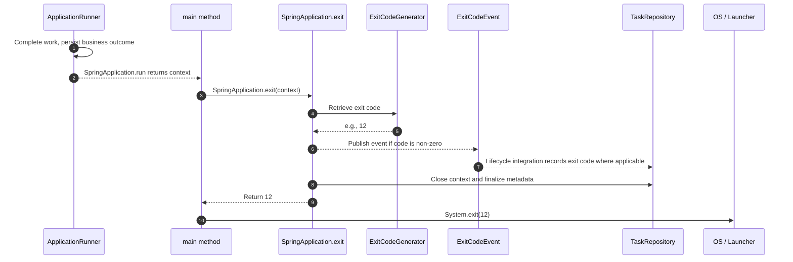

# The Role of `ExitCodeEvent` and `SpringApplication.exit`

A **Spring Cloud Task** application is designed to run for a finite duration: receive parameters, perform work, persist execution results in a database, and exit. If a report-generation task fails yet the process still returns **exit code `0`**, cron, Kubernetes Jobs, or an orchestrator may mistakenly believe the job succeeded. Conversely, if the application terminates with an error code while the **`TaskExecution`** record remains un-updated, operators may observe two inconsistent outcomes.

In the **Results and Exit Codes** chapter, two related components must be clearly understood:

- **`ExitCodeEvent`** is an event published by **Spring Boot** when a non-`0` exit code is determined during application shutdown or corresponding error handling. It lets listeners, including task lifecycle integrations, observe the exit code.
- **`SpringApplication.exit(...)`** is a **Spring Boot** API that closes the `ApplicationContext` and collects the exit code supplied by `ExitCodeGenerator` beans. This method **returns an integer**, but **does not itself call `System.exit(...)`** to terminate the JVM with that number.

Spring Cloud Task adds **`TaskExecution`** recording via **`TaskRepository`**. For reliable operations, clearly distinguish data in the repository from the actual status observed by the operating system and launcher.

After this lesson, you can explain the relationship between `ExitCodeGenerator`, `ExitCodeEvent`, `SpringApplication.exit`, and `TaskExecution.exitCode`; write a task with business exit codes; verify exit codes in the terminal and database; and avoid common mistakes when integrating Spring Batch, schedules, and retry mechanisms.

## 1. At Least Two Places to Check the Exit Code

An execution typically offers two ways to observe the outcome:

| Observation point | Value | Consuming components |
| --- | --- | --- |
| **Operating system** | Java process exit code, usually `0` for success and non-zero for failure | Shell, cron, CI/CD, container runtime, Kubernetes Job, launcher |
| **Spring Cloud Task metadata** | `TaskExecution.exitCode` stored in `TaskRepository` | `TaskExplorer`, operations dashboards, monitoring services, and orchestrators |

For example, a `dailyReport` task may return OS code `12` to signal "invalid input parameter." If connectivity and metadata recording remain operational, the system should also record corresponding completion details in `TaskExecution` for historical lookup.

However, **never assume the two values are always identical**:

- The OS code may be non-`0` because the JVM was killed, ran out of memory, or the container stopped before metadata could be written.
- Code may update state in memory without calling `System.exit(...)`, causing the process to return an unexpected code.
- Database metadata connectivity failures may prevent creating or updating `TaskExecution`.
- A custom runner may catch an error and return normally; Spring Boot does not know the business operation failed so it cannot emit a failure outcome.

That is why **process exit code, `TaskExecution` records, logs, and business outcomes** must all be observed when orchestrating scheduled or on-demand tasks.

## 2. The Role of `ExitCodeEvent`

`ExitCodeEvent` belongs to Spring Boot (typically imported via `org.springframework.boot.ExitCodeEvent`). When Spring Boot resolves a **non-`0`** exit code along a framework-supported exit path, it can publish this event to active listeners in the `ApplicationContext`.

In the Spring Cloud Task ecosystem, listening to exit events helps execution recording in `TaskRepository` reflect the exit code supplied via Spring Boot. Depending on the version and error path, execution metadata can be updated during the corresponding lifecycle callback.

**Understand three exact limitations:**

1. `ExitCodeEvent` carries **exit code** information—it is neither a request to restart the task nor an automatic retry signal.
2. This event **does not itself change the JVM's exit code**. The exit code seen by the shell still depends on how the application exits, such as `System.exit(exitCode)`.
3. `ExitCodeEvent` **is not necessarily emitted on success**; do not treat it as an "every task finished" callback. To observe the full Spring Cloud Task lifecycle, use `TaskExecution` metadata, `TaskExplorer`, or `TaskExecutionListener` as needed.

### Listening to the Event for Logging

A bean can listen for exit events to add diagnostic logging:

```java
package com.example.reporttask;

import org.springframework.boot.ExitCodeEvent;
import org.springframework.context.event.EventListener;
import org.springframework.stereotype.Component;

@Component
public class ExitCodeAuditListener {

    @EventListener
    public void onExitCode(ExitCodeEvent event) {
        System.err.println(
            "Spring Boot resolved exit code: " + event.getExitCode()
        );
    }
}
```

This listener only **observes**; it does not call `System.exit(...)` and is not the right place to persist full business data. During certain startup failures or abrupt process deaths, the bean may not yet exist or the event may never be published.

> **Do not arbitrarily publish `ExitCodeEvent` manually as a way to "set the exit code."** Publishing an event does not guarantee the operating system receives that code. The normal flow is to let Spring Boot **compute the exit code** via `ExitCodeGenerator` or exception mapping, and then let the framework publish the event and return the code on shutdown.

## 3. What Does `SpringApplication.exit(...)` Do?

API:

```java
int exitCode = SpringApplication.exit(applicationContext);
```

Typically performs two related tasks:

- Collects exit codes from `ExitCodeGenerator` beans in the context and any generators passed directly to the call (if any), then resolves the application exit code according to your Spring Boot version's rules.
- Closes the `ApplicationContext` through the Spring lifecycle; when a non-`0` exit code is produced, Spring Boot can publish `ExitCodeEvent` before finishing shutdown.

The method **returns an integer**. To turn that number into the **process** exit code when running as a standalone CLI:

```java
ConfigurableApplicationContext context =
    SpringApplication.run(ReportTaskApplication.class, args);
int exitCode = SpringApplication.exit(context);
System.exit(exitCode);
```

**`SpringApplication.exit` is not equivalent to `System.exit`.** Calling `SpringApplication.exit(context)` alone closes the context, yet if you do not pass its result to JVM termination, the shell may receive `0` when `main` returns normally. Conversely, calling `System.exit(9)` directly can terminate the JVM too abruptly, preventing context-close callbacks and metadata updates from running as expected.

Sequence diagram when a task exits intentionally:



Detailed callback ordering depends on framework version and context state; the diagram mainly highlights the **outcome propagation path** from business logic, through Spring Boot, to the execution repository and operating system.

### Recognizing an Important `main` Pitfall

If an `ApplicationRunner` throws an exception inside `SpringApplication.run(...)`, `run` may **never return a context** to the next line in `main`. In that case, the snippet:

```java
var context = SpringApplication.run(App.class, args);
System.exit(SpringApplication.exit(context));
```

is not guaranteed to execute its second line. Spring Boot uses separate startup-failure and exception-handling paths. Therefore, **do not rely on code after `run` to catch every runner failure**. Let errors propagate properly, use `ExitCodeExceptionMapper` or an appropriate `ExitCodeGenerator` when mapping error codes, and verify behavior on your target version.

## 4. `ExitCodeGenerator`: Source of Business Exit Codes

`ExitCodeGenerator` is a tiny Spring Boot interface:

```java
public interface ExitCodeGenerator {
    int getExitCode();
}
```

An application can register beans implementing this interface. When `SpringApplication.exit(...)` is invoked, Spring Boot gathers the matching generators to resolve the exit code. An illustrative convention:

| Code | Report application meaning | Suggested handling |
| ---: | --- | --- |
| `0` | Processed successfully | Do not retry. |
| `10` | No data for requested period | Per policy: accept "no data" or flag status for monitoring. |
| `12` | Invalid input parameter | Fix parameter; do not auto-retry with same input. |
| `20` | Dependency temporarily unavailable | Retryable with limits/backoff. |
| `30` | Business rule violation | Requires business review before rerunning. |

These codes **are an example convention**, not a fixed list defined by Spring Cloud Task. Most orchestration tools default to treating **`0` as success and non-`0` as failure**. If code `10` should still be treated as acceptable, configure the orchestrator's policy accordingly.

### Example: Report Export Task with a "No Data" Code

The example below uses Spring Boot, Spring Cloud Task, `ApplicationRunner`, and an `ExitCodeGenerator` bean:

```java
package com.example.reporttask;

import org.springframework.boot.ApplicationArguments;
import org.springframework.boot.ApplicationRunner;
import org.springframework.boot.ExitCodeGenerator;
import org.springframework.boot.SpringApplication;
import org.springframework.boot.autoconfigure.SpringBootApplication;
import org.springframework.cloud.task.configuration.EnableTask;
import org.springframework.context.ConfigurableApplicationContext;
import org.springframework.context.annotation.Bean;

@SpringBootApplication
@EnableTask
public class ReportTaskApplication {

    public static void main(String[] args) {
        ConfigurableApplicationContext context =
            SpringApplication.run(ReportTaskApplication.class, args);

        int exitCode = SpringApplication.exit(context);
        System.exit(exitCode);
    }

    @Bean
    RunOutcome runOutcome() {
        return new RunOutcome();
    }

    @Bean
    ExitCodeGenerator taskExitCode(RunOutcome outcome) {
        return outcome::getExitCode;
    }

    @Bean
    ApplicationRunner generateReport(RunOutcome outcome) {
        return args -> {
            if (args.containsOption("no-data")) {
                System.out.println("No data available to generate report");
                outcome.setExitCode(10);
                return;
            }

            if (args.containsOption("simulate-error")) {
                // Business failure exception while the runner is executing.
                throw new IllegalStateException("Unable to generate report");
            }

            // Replace with actual report generation logic.
            System.out.println("Report generated");
        };
    }

    static final class RunOutcome {
        private volatile int exitCode = 0;

        int getExitCode() {
            return exitCode;
        }

        void setExitCode(int exitCode) {
            this.exitCode = exitCode;
        }
    }
}
```

Explanation:

1. `ApplicationRunner` executes finite work after context startup.
2. `RunOutcome` holds the work's outcome. The example uses `10` when no data exists and `0` when the report is generated.
3. `ExitCodeGenerator` reads the outcome set by the runner so `SpringApplication.exit(context)` can retrieve the code.
4. `System.exit(exitCode)` reports the result to the OS/launcher after the context closes.
5. If `simulate-error` causes the runner to throw, `SpringApplication.run` may fail **before** reaching `SpringApplication.exit` in `main`. To assign specific codes on that failure path, use the exception-mapping mechanism described in the next section.

In standalone CLI applications, calling `System.exit` in `main` is a deliberate choice to propagate the OS exit code. Avoid calling it deep inside a service or runner, where it can bypass context shutdown, listeners, and final status recording. In embedded environments or integration tests, `System.exit` is usually omitted.

### Configuring a Persistent `TaskRepository` for the Example

To observe `TaskExecution` across multiple runs, add `spring-cloud-starter-task`, `spring-boot-starter-jdbc`, and your database driver, using a **compatible** Spring Boot / Spring Cloud release train.

Example `application.yml` with **file-based** H2 for local experimentation:

```yaml
spring:
  main:
    web-application-type: none
  application:
    name: report-task
  datasource:
    url: jdbc:h2:file:./report-task-metadata
    driver-class-name: org.h2.Driver
    username: sa
    password: ""
  cloud:
    task:
      name: dailyReport
      initialize-enabled: true
```

File-based H2 retains history after the process stops as long as you always run from the **same working directory**. Automatic schema initialization suits local practice; production should use versioned migrations and a suitably reliable database. Metadata tables belong to **`TaskRepository`**, not as storage for report files or full business data.

## 5. When Throwing Exceptions: `ExitCodeExceptionMapper` and Error Codes

Distinguish two kinds of outcomes:

- **Intentionally handled business outcomes:** the runner finishes and notes "no data available." `ExitCodeGenerator` is a straightforward choice to return a meaningful code.
- **Errors failing the runner or startup:** an exception escapes. Spring Boot provides error handling where **`ExitCodeExceptionMapper`** can map exception types to exit codes when registered and invoked on the right handling path.

Illustrative mapper example:

```java
import org.springframework.boot.ExitCodeExceptionMapper;
import org.springframework.context.annotation.Bean;

@Bean
ExitCodeExceptionMapper exitCodeExceptionMapper() {
    return exception -> {
        Throwable current = exception;
        while (current != null) {
            if (current instanceof IllegalArgumentException) {
                return 12;
            }
            current = current.getCause();
        }
        return 1;
    };
}
```

Place this in a Spring configuration class or a `@SpringBootApplication` class that defines `@Bean`s. Walking `getCause()` handles exceptions wrapped by the framework. Real applications should define **specific exception types** for input errors, business errors, and transient errors rather than mapping broadly on incidental platform exceptions.

**Lifecycle note:** if an error occurs before beans are registered, the mapper may not be available. How Spring Boot derives codes from exceptions and publishes `ExitCodeEvent` also depends on the error path. Test realistic scenarios on your chosen version and **never promise that every exception converts into a custom code**.

Do not **swallow exceptions** and let the runner return normally:

```java
// Wrong if the business operation failed and still must report failure:
try {
    exportReport();
} catch (Exception ex) {
    log.error("Report export failed", ex);
    // Not rethrown and no exit code set -> risks reporting false success.
}

// When an error must fail the task:
try {
    exportReport();
} catch (Exception ex) {
    log.error("Report export failed", ex);
    throw ex;
}
```

This is an **illustrative error-handling snippet**, assuming `exportReport()` and `log` are defined in the service. For known non-throwing outcomes, set an explicit exit code via `ExitCodeGenerator` and confirm a path invokes `SpringApplication.exit`.

## 6. Running, Checking OS Codes, and Reading Metadata

Suppose you packaged `target/report-task-0.0.1-SNAPSHOT.jar`. Run three cases from the project root:

**Success:**

```bash
java -jar target/report-task-0.0.1-SNAPSHOT.jar
echo $?
```

**No data, business code `10`:**

```bash
java -jar target/report-task-0.0.1-SNAPSHOT.jar --no-data
echo $?
```

**Exception thrown:**

```bash
java -jar target/report-task-0.0.1-SNAPSHOT.jar --simulate-error
echo $?
```

In Bash, `$?` is the exit code of the immediately preceding command: run `echo $?` **right after `java -jar`**. In PowerShell:

```powershell
java -jar .\target\report-task-0.0.1-SNAPSHOT.jar --no-data
$LASTEXITCODE
```

With the example configured properly, expect the success run to return `0`; `--no-data` to return `10` after `SpringApplication.exit` fetches the code from the generator and `System.exit` passes it to the OS. The `--simulate-error` path will report failure, though the **exact code** depends on exception handling and whichever mapper/generator beans are active at failure time.

In the metadata store, query:

```sql
SELECT
    TASK_EXECUTION_ID,
    TASK_NAME,
    START_TIME,
    END_TIME,
    EXIT_CODE,
    EXIT_MESSAGE
FROM TASK_EXECUTION
ORDER BY TASK_EXECUTION_ID DESC;
```

Column names and schema must match your Spring Cloud Task version. Keep these points in mind:

- One `java -jar` invocation creates one **`TaskExecution` run** if the application boots far enough to record metadata.
- Rerunning with the same task name creates a new `TASK_EXECUTION_ID` rather than overwriting the prior record.
- `EXIT_CODE` reflects the state **Spring Cloud Task managed to save**, not absolute proof of the OS exit code if the container died abruptly.
- `EXIT_MESSAGE` and logs aid diagnostics; never place sensitive data or stack traces containing secrets into that field.

When inspecting `ExitCodeEvent`, cross-check three sources: `ExitCodeAuditListener` logs, the shell exit code, and the `TASK_EXECUTION` row. If they differ, check **whether the event fired, whether the context closed cleanly, whether the database stayed connected, and whether `System.exit` received the right code**.

## 7. Common Sources of Confusion

| Scenario | What actually happens | How to handle |
| --- | --- | --- |
| Calling `SpringApplication.exit(context)` and letting `main` exit normally | Context closes and API returns the code, yet the OS may receive `0` | For CLIs that must forward the OS code, use `System.exit(SpringApplication.exit(context))` in `main`. |
| Calling `System.exit(12)` mid-runner | JVM may stop before the framework updates metadata | Supply the code via a generator, let the runner finish/propagate errors, and close the context normally. |
| Runner throws before `run` returns a context | Lines after `SpringApplication.run` do not execute | Use appropriate exception mapping; verify OS code and `TaskExecution` on the failure path. |
| `ExitCodeGenerator` bean always returns `0` | Exit path has no idea a business error was caught and ignored | Let errors propagate or set an explicit error code. |
| Non-`0` `ExitCodeEvent` observed | Event announces a non-`0` code; does not auto-restart | The orchestrator decides retries and alert handling. |
| `TaskExecution` lacks `END_TIME` | Process may have crashed, lost DB connectivity, or not finished updating | Check container/OS status, logs, timeouts, and metadata connectivity. |
| `TaskExecution` records error, yet business work committed | Metadata and business data have separate transaction boundaries | Design idempotency and reconcile outcomes before retrying. |
| Cron/Kubernetes treats every non-`0` code as failure | Business codes like `10` are still treated as errors by infrastructure | Document the exit code policy and configure the orchestrator accordingly. |

### Do Not Confuse a "No Data" Code with a "Technical Failure"

If business rules treat "no data" as success, use `0` and record details in logs or business tables. If you want a distinct status code for the orchestrator to recognize, you may use `10` **provided you understand the consequence**: most schedulers, CI pipelines, and container platforms treat non-zero as failure by default.

### Do Not Use `ExitCodeEvent` as a Substitute for Transactions

Events do not guarantee database updates commit. If the metadata DB loses connectivity during shutdown, Spring Cloud Task may fail to persist the final code even though `SpringApplication.exit` returned one. Conversely, business data may already have committed in an earlier transaction before an error occurred.

## 8. Coordinating with Spring Batch and Orchestrators

A Spring Cloud Task can wrap a **Spring Batch Job**. In that case, distinguish:

| Level | Metadata / value | Meaning |
| --- | --- | --- |
| **Spring Batch** | `BatchStatus`, `ExitStatus` on `JobExecution` / `StepExecution` | Batch job and step processing outcomes, plus restart/checkpoint state. |
| **Spring Cloud Task** | `TaskExecution.exitCode` | Outcome of one **short-lived application run** stored in the task repository. |
| **OS / Launcher** | Process exit code | Outcome received by the shell, scheduler, or container platform. |

Spring Batch tracks status and `ExitStatus` at the **Job/Step level**; those values **are not automatically JVM exit codes**. Depending on the integration mechanism, Batch outcomes can be mapped to an application exit code, but verify the exact configuration. Do not substitute `JobExecution.id` for `TaskExecution.executionId`, or assume `ExitStatus` automatically turns into an `ExitCodeEvent`.

For example: a settlement job fails at step two, yet a business listener logs "run finished" and the runner throws no error. Without checking `JobExecution`/`ExitStatus` and setting an accurate application exit code, the orchestrator may treat the task as successful.

When running on a schedule or on demand:

- **Launcher** starts the JVM/container and observes the process exit code.
- **Spring Cloud Task** persists application-level metadata and outcomes if `TaskRepository` connectivity holds.
- **Orchestrator** acts on codes and states: marks success, alerts, halts a workflow, or retries with limits/backoff.
- **Business logic** needs idempotency keys (such as `businessDate` + request ID) whenever work may be retried.

Do not retry all non-`0` codes identically. Input-error codes usually require human fixes; transient infrastructure codes can be retried; a "no data" code may be acceptable if the workflow permits.

## 9. Safe Operations Principles

**Explicit exit code contract.** Document which codes mean success, which warrant retries, and which require intervention. Do not classify runs purely by a log string like "completed."

**Propagate outcomes end to end.** When using `ExitCodeGenerator`, ensure business outcomes are stored in state on time and invoke `SpringApplication.exit` along the intended path. If the OS needs the code, pass it to `System.exit` from `main` after closing the context.

**Distinguish normal completion from startup errors.** Exceptions in a runner can make `SpringApplication.run` fail before returning a context; test that path separately with `ExitCodeExceptionMapper` or a suitable error-handling strategy.

**Accept that metadata may be missing after crashes.** Under `SIGKILL`, OOM, power loss, or database outages, callbacks are not guaranteed to run. Pair metadata with centralized logs, platform events, and timeouts/heartbeats when monitoring.

**Retry safely.** Every rerun creates a new `TaskExecution` if metadata writes succeed. Inspect committed business outcomes, enforce idempotency, and prevent two processes from running concurrently for the same unit of data unintentionally.

**Protect sensitive information.** Never put secrets, tokens, or customer data into exit codes, event messages, CLI arguments, or tracing metadata.

## 10. Exercises and Self-Check Questions

1. Build a Spring Cloud Task JAR from the `ReportTaskApplication` example, enable file-based H2 metadata, and run a normal execution. Compare the shell code with `TASK_EXECUTION.EXIT_CODE`.
2. Run with `--no-data`. Explain why `ExitCodeGenerator` returns `10`, `SpringApplication.exit` returns `10`, and `System.exit(10)` delivers that result to the launcher.
3. Add `ExitCodeAuditListener` and observe the event on a run returning `10`. Does the event fire on a successful `0` run? Explain why you should not depend on that event to record every run.
4. Run with `--simulate-error`. Compare the stack trace, shell code, and task record. Why might code after `SpringApplication.run` not execute?
5. Register an `ExitCodeExceptionMapper` to map a specific business exception to code `12`; verify the result on your exact Spring Boot/Spring Cloud Task version.
6. Remove `System.exit(exitCode)` in a test environment and compare the value returned by `SpringApplication.exit` with the shell code. Why does the launcher see the wrong result?
7. Simulate a case where business data finished writing, yet metadata failed to record completion. Before retrying, what additional evidence should you inspect?
8. For a Spring Batch Job inside a Spring Cloud Task application, explain the three levels: Batch's `ExitStatus`, `TaskExecution.exitCode`, and the process exit code.

**Review Questions:**

- Does `ExitCodeEvent` itself terminate the JVM or restart the task?
- How does `SpringApplication.exit(context)` differ from `System.exit(code)`?
- Why can't `TaskExecution.exitCode` alone serve as absolute proof that the process exited with that same code?
- When a runner throws before `SpringApplication.run` returns, what must you consider if you want custom business error codes?
- Should an orchestrator handle code `12` (parameter error) and code `20` (transient dependency outage) the same way or differently?

**Key Takeaway:** `ExitCodeEvent` carries exit code information inside the Spring Boot lifecycle; `SpringApplication.exit` closes the context and **returns** the exit code; `System.exit` forwards that code to the operating system when needed. Spring Cloud Task records history via `TaskRepository`, while reliable operations require reconciling **metadata, process codes, logs, and business outcomes**.
