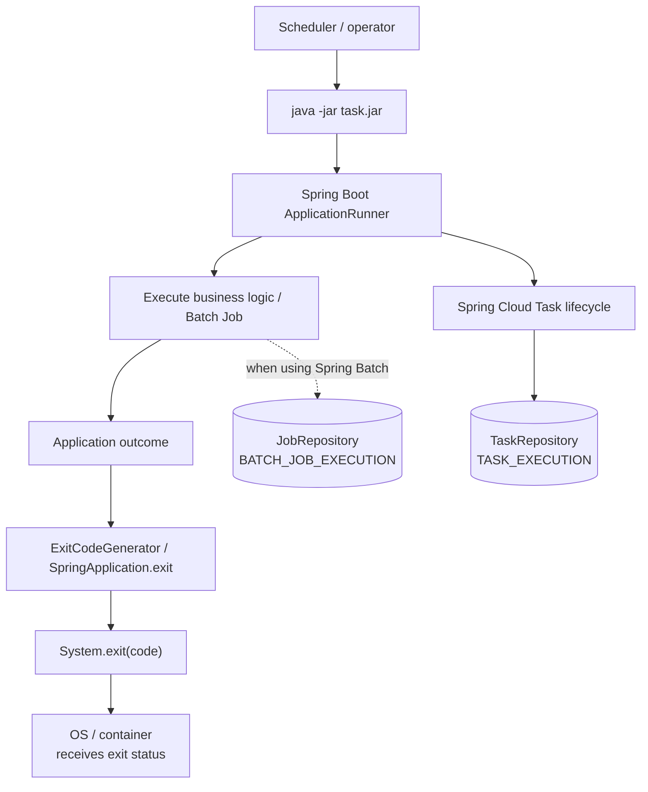
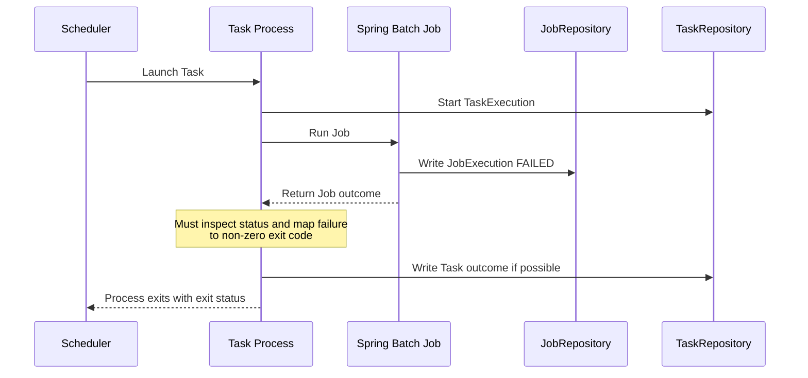

# Returning Exit Codes from `main` to the Operating System

## Learning Objectives

After this lesson, you will be able to:

- Distinguish the **operating system process exit code**, `TaskExecution.exitCode` in Spring Cloud Task, and Spring Batch Job status.
- Explain why `SpringApplication.exit(context)` and `System.exit(exitCode)` are typically used together in a short-lived Spring Boot application.
- Write a `main` method that returns a clear exit code, using `ExitCodeGenerator` when business outcomes may be success, invalid input, or failure.
- Understand failure paths when `SpringApplication.run(...)` throws an exception, when a runner catches an error and returns, and when a process is terminated abruptly.
- Inspect exit codes from Bash, PowerShell, Docker, and Kubernetes Job/CronJob, and reconcile them with `TaskRepository` data.
- Design exit code conventions supporting retries, alerting, and safe operations when a Task runs on a schedule or on demand.

> **Context:** This lesson belongs to the **Results and Exit Codes** chapter of the **SPRING_CLOUD_TASK** module. Spring Cloud Task targets short-lived Spring Boot applications, storing execution runs and outcomes in a database via `TaskRepository`. For external systems to know whether a run succeeded or failed, in addition to database metadata, the Java process itself must **terminate with an appropriate exit code**.

## 1. Why Does the Process Exit Code Matter?

Imagine a `daily-settlement-task` triggered every night by a Kubernetes CronJob. The Task does three things:

1. Accepts the `--business-date=2026-11-24` argument.
2. Reads data, reconciles settlements, and stores results in the business database.
3. Records run metadata in `TaskRepository` and exits.

If invalid input data is detected and the runner only logs an `ERROR` and returns normally, the process can terminate with code `0`. A Kubernetes Job or shell script may treat the run as **succeeded** even though the business work did not complete.

At the operating system level, a process returns an **exit status** upon termination. By common convention:

| Exit code | Common interpretation | Operational action you can apply |
| ---: | --- | --- |
| `0` | Completed successfully. | Mark complete; do not retry. |
| `1` | General unclassified error. | Emit alert; inspect logs. |
| `2` | Invalid input, e.g., missing argument. | Adjust invocation command before rerunning. |
| `10` | Business processing failure. | Controlled retry or investigate. |
| `20` | External dependency unavailable. | Check database/API; consider retrying. |

Non-`0` codes in the table are **application example conventions**, not values mandated by Spring Cloud Task. Shells, container runtimes, or orchestrators primarily care about **`0` vs. non-`0`** first; if retry decisions depend on failure type, build that policy at the orchestration layer.

**Core point:** recording `EXIT_CODE=10` in the Task table and **returning code `10` to the operating system** are two outcomes that must be understood, configured, and verified separately.

## 2. Three Outcome Layers That Are Easily Confused

In an application with Spring Cloud Task—and optionally Spring Batch—distinguish:

| Layer | Data source | Answers the question |
| --- | --- | --- |
| **Process outcome** | Exit status returned by the JVM to the OS, shell, Docker, or Kubernetes. | Did the runtime platform treat the process as a success? |
| **Task outcome** | `TaskExecution.exitCode`, `exitMessage`, `errorMessage` in `TaskRepository`. | What outcome did the framework record for the Task run? |
| **Spring Batch Job outcome** | `JobExecution.status`, `ExitStatus` in `JobRepository`. | Which Job/Step succeeded, failed, or stopped? |

Do not assume these signals are always synchronized.

For example, a Batch Job may have `BatchStatus.FAILED`, yet the outer application does not propagate that failure to the JVM exit code. Conversely, a process killed abruptly by the OS can have an abnormal exit status even if `TaskRepository` never managed to write `END_TIME` or update `EXIT_CODE`.



The diagram shows **three observation points**. There is no single perfect automatic mapping from business outcomes to all three places in every situation; the application must handle and test failure paths.

## 3. What Does `SpringApplication.run(...)` Return?

A typical Spring Boot `main` method:

```java
@SpringBootApplication
public class DailySettlementApplication {
    public static void main(String[] args) {
        SpringApplication.run(DailySettlementApplication.class, args);
    }
}
```

`SpringApplication.run(...)` returns a `ConfigurableApplicationContext` after Spring Boot initializes the context and completes its managed startup flow, including running synchronous `ApplicationRunner`/`CommandLineRunner` beans. It **does not return an integer exit code**.

Because Java's `main(String[] args)` method has return type `void`, you cannot write:

```java
// Invalid in Java:
public static void main(String[] args) {
    return 10; // main has return type void
}
```

If `main` ends normally without requesting another exit code, the JVM typically exits with status `0` once no non-daemon threads remain active. If startup throws an unhandled exception, the JVM typically exits non-`0`; however, when frameworks, wrappers, or application code catch errors, the actual outcome must be verified.

Spring Boot provides an API to compute the exit code, and Java provides an API to terminate the process with a specific code. Combining both APIs is a clear way to give schedulers the right signal.

## 4. Standard `main` Pattern for a Short-Lived Task

For a non-HTTP Task, you can configure a Spring Boot application as follows:

```java
package com.example.settlement;

import org.springframework.boot.SpringApplication;
import org.springframework.boot.autoconfigure.SpringBootApplication;
import org.springframework.cloud.task.configuration.EnableTask;
import org.springframework.context.ConfigurableApplicationContext;

@SpringBootApplication
@EnableTask
public class DailySettlementApplication {

    public static void main(String[] args) {
        ConfigurableApplicationContext context =
                SpringApplication.run(DailySettlementApplication.class, args);

        int exitCode = SpringApplication.exit(context);
        System.exit(exitCode);
    }
}
```

Example `application.yml` configuration:

```yaml
spring:
  application:
    name: daily-settlement-task
  main:
    web-application-type: none
  cloud:
    task:
      initialize-enabled: false
  datasource:
    url: jdbc:postgresql://localhost:5432/taskdb
    username: ${TASK_DB_USER}
    password: ${TASK_DB_PASSWORD}
```

This configuration assumes the PostgreSQL database already has the **version-appropriate Spring Cloud Task schema** and credentials are supplied via environment variables. If the schema is missing, the application may fail before completing startup.

### 4.1. Role of Each Call

**`SpringApplication.run(...)`** initializes the context and executes the application's synchronous runners. If everything returns normally, it returns the context so code in `main` can continue.

**`SpringApplication.exit(context)`** gathers Spring Boot–supported exit code contributors (including beans implementing `ExitCodeGenerator`), closes the context according to the application lifecycle, and returns **an integer**. Calling this method **does not mean** the JVM is guaranteed to halt immediately with that code.

**`System.exit(exitCode)`** instructs the JVM to terminate with the resolved code. The operating system and orchestration platform observe that exit code after the process stops.

You can write this concisely:

```java
public static void main(String[] args) {
    System.exit(
        SpringApplication.exit(
            SpringApplication.run(DailySettlementApplication.class, args)
        )
    );
}
```

However, splitting into `context` and `exitCode` variables is usually easier to debug, log, and test.

### 4.2. What If There Is No Special Exit-Code Logic?

On a normal startup flow without any `ExitCodeGenerator` reporting an error, `SpringApplication.exit(context)` typically returns `0`. When business logic needs to return `2` for invalid arguments or `10` for an unsatisfactory outcome, supply a signal to Spring Boot (e.g., via `ExitCodeGenerator`) **before calling `SpringApplication.exit`**.

Simply adding `System.exit(0)` at the end of `main` causes every normal-returning run to report success, even if the code detected an error without propagating status. Never hardcode `0` when business outcomes can fail.

## 5. Using `ExitCodeGenerator` to Reflect Business Outcomes

`ExitCodeGenerator` is a Spring Boot interface with the method:

```java
package org.springframework.boot;

@FunctionalInterface
public interface ExitCodeGenerator {
    int getExitCode();
}
```

A bean implementing this interface can contribute an exit code to `SpringApplication.exit(context)`. In a short-lived Task, you can record the outcome in a bean and let `main` read the code once runners finish.

### 5.1. Creating the Status Holder

```java
package com.example.settlement;

import org.springframework.boot.ExitCodeGenerator;
import org.springframework.stereotype.Component;

@Component
public class SettlementExitStatus implements ExitCodeGenerator {

    private volatile int code = 0;

    public void invalidInput() {
        this.code = 2;
    }

    public void businessFailure() {
        this.code = 10;
    }

    @Override
    public int getExitCode() {
        return code;
    }
}
```

Here, `0` denotes success by default, `2` is for invalid input, and `10` is for business failure. `volatile` ensures cross-thread visibility; the example still assumes **the runner waits for work to finish** before returning. If multiple threads compete to update status, define an explicit code-precedence strategy and synchronization rather than letting the last assignment win.

### 5.2. Runner Recording the Exit Code

```java
package com.example.settlement;

import java.time.LocalDate;
import java.time.format.DateTimeParseException;
import java.util.List;

import org.slf4j.Logger;
import org.slf4j.LoggerFactory;
import org.springframework.boot.ApplicationArguments;
import org.springframework.boot.ApplicationRunner;
import org.springframework.stereotype.Component;

@Component
public class SettlementRunner implements ApplicationRunner {

    private static final Logger log =
            LoggerFactory.getLogger(SettlementRunner.class);

    private final SettlementExitStatus exitStatus;
    private final SettlementService service;

    public SettlementRunner(SettlementExitStatus exitStatus,
                            SettlementService service) {
        this.exitStatus = exitStatus;
        this.service = service;
    }

    @Override
    public void run(ApplicationArguments args) {
        List<String> dates = args.getOptionValues("business-date");
        if (dates == null || dates.size() != 1) {
            log.error("Exactly one --business-date=yyyy-MM-dd is required");
            exitStatus.invalidInput();
            return;
        }

        LocalDate businessDate;
        try {
            businessDate = LocalDate.parse(dates.get(0));
        } catch (DateTimeParseException ex) {
            log.error("Invalid business date: {}", dates.get(0));
            exitStatus.invalidInput();
            return;
        }

        try {
            service.settle(businessDate);
            log.info("Settlement succeeded for {}", businessDate);
        } catch (Exception ex) {
            log.error("Settlement failed", ex);
            exitStatus.businessFailure();
        }
    }
}
```

In this example, `SettlementService` is an application-provided business service:

```java
package com.example.settlement;

import java.time.LocalDate;
import org.springframework.stereotype.Service;

@Service
public class SettlementService {

    public void settle(LocalDate businessDate) {
        // Study example: replace with actual data read/write,
        // transactions, result verification, and idempotency.
        if (businessDate.isAfter(LocalDate.now())) {
            throw new IllegalStateException(
                    "Cannot settle a future date");
        }
    }
}
```

**Note on error handling in the example:** The runner deliberately **records a non-`0` code and returns**, allowing `SpringApplication.run(...)` to return the context so `main` continues to `SpringApplication.exit(...)`. This is one way to handle anticipated business outcomes that you want classified into distinct codes. It does not mean every exception should be caught and swallowed. For unexpected errors, let the exception escape and use Spring Boot's startup-failure handling.

In particular, `TaskExecution.exitCode` in the database can depend on how Spring Cloud Task integrates with `ExitCodeGenerator`, context-close events, and the version in use. **Test both the code in `TASK_EXECUTION` and the process exit code**; never infer one from the other.

### 5.3. Running and Predicting Exit Codes

```bash
# Valid input, service succeeds:
java -jar daily-settlement-task.jar --business-date=2026-11-24

# Missing date, runner sets code 2:
java -jar daily-settlement-task.jar

# Invalid date, runner sets code 2:
java -jar daily-settlement-task.jar --business-date=abc

# To test code 10, trigger a controlled business failure in a test environment.
```

In the sample application, codes `2` and `10` are determined by `SettlementExitStatus`. Non-`0` codes **are not built-in Spring Cloud Task conventions**; the team should agree on a code table and document the action for each code.

## 6. What If `SpringApplication.run(...)` Fails Before Returning a Context?

Consider a runner that throws an exception directly:

```java
@Component
class ValidateRunner implements ApplicationRunner {

    @Override
    public void run(ApplicationArguments args) {
        throw new IllegalStateException("Unable to connect to data source");
    }
}
```

In that case, `SpringApplication.run(...)` may **throw an exception without returning a `ConfigurableApplicationContext` to `main`**. Consequently, these two lines:

```java
int exitCode = SpringApplication.exit(context);
System.exit(exitCode);
```

will **not execute** along the normal path. Spring Boot runs its supported startup-failure handling; an unhandled exception escaping `main` normally makes the Java process exit non-`0`.

What matters is not "every error must pass through `SpringApplication.exit`," but rather **failure paths must deliver a genuine failure code to the operating system**.

### 6.1. Avoid Swallowing Exceptions and Accidentally Reporting Success

The snippet below has a design flaw:

```java
try {
    runBusiness();
} catch (Exception ex) {
    log.error("Error occurred", ex);
    // Not thrown and no failure code recorded.
}
```

The runner returns normally, `SpringApplication.run` returns the context, `ExitCodeGenerator` sees no error, and `main` calls `System.exit(0)`. The scheduler sees the Task succeed even though the business operation failed.

There are three valid options depending on requirements:

1. **Rethrow the exception:** suited to unrecoverable errors, causing startup/execution to fail with a non-`0` exit status.
2. **Explicitly record an error code:** such as `SettlementExitStatus`, useful when distinguishing bad input, business errors, and transient dependencies.
3. **Use Spring Boot's `ExitCodeExceptionMapper`:** map exception types to exit codes when the failure path is handled by the framework. Verify the API and actual reported code on your deployed Spring Boot version.

Do not scatter `System.exit(...)` calls inside business services; doing so can bypass cleanup, transactions, and expected lifecycle callbacks. Centralize process termination in `main` or the entrypoint layer, and let business logic return explicit outcomes or throw errors cleanly.

### 6.2. Very Early Startup Failures

If the Task database lacks its schema, a connection secret is missing, or bean creation fails, `SpringApplication.run` may fail **before Spring Cloud Task creates a `TaskExecution`**. In that situation:

- There may be no row in `TASK_EXECUTION`.
- Bootstrap logs, stderr, and orchestration platform failure events become primary diagnostic sources.
- Operations should not require `EXIT_CODE != 0` in the database before recognizing a Task as failed.

The process exit code is an essential signal because it still reports startup failures even when `TaskRepository` records nothing.

## 7. `SpringApplication.exit` Closes the Context; `System.exit` Ends the JVM

The two calls have distinct responsibilities:

| Call | What happens? | What is not guaranteed? |
| --- | --- | --- |
| `SpringApplication.exit(context)` | Computes the exit code per Spring Boot rules and closes `ApplicationContext`, executing supported context-close callbacks. | The method itself does not force the JVM to terminate immediately. |
| `System.exit(code)` | Instructs the JVM to stop and return `code` to the runtime environment. | Does not verify business outcomes or read codes from `TaskRepository`. |
| `return` from `main` | Exits the `main` method. | JVM may stay alive if non-daemon threads remain; cannot return an integer from `void main`. |

In a short-lived Task, once runners and required work **have completed synchronously**, calling `SpringApplication.exit` before `System.exit` gives Spring infrastructure a chance to close resources cleanly through its managed lifecycle.

However, `System.exit` can also kill **unfinished** background threads or async work. If a runner spawns a `CompletableFuture` and returns immediately, `main` can close the context and exit while the Future is still running. Await results with a timeout, check for errors, and close resources before signaling completion.

Incorrect example regarding completion semantics:

```java
@Override
public void run(ApplicationArguments args) {
    CompletableFuture.runAsync(this::processPayments);
    // Returns immediately even though processPayments is not finished.
}
```

The fix is to return only after work finishes—for example awaiting `future.get(timeout, TimeUnit.SECONDS)` and letting errors or timeouts produce an appropriate failure code. Execution deadlines and cancellation should be coordinated with the scheduler, not left solely to in-code timeouts.

## 8. Reconciling Exit Codes with Spring Cloud Task Metadata

In a JDBC repository, Spring Cloud Task typically writes one row to `TASK_EXECUTION` per run, with columns such as:

- `TASK_EXECUTION_ID`: unique ID of the run.
- `TASK_NAME`: Task application name.
- `START_TIME` and `END_TIME`: timestamps recorded by the framework.
- `EXIT_CODE`, `EXIT_MESSAGE`, `ERROR_MESSAGE`: recorded outcome/error fields when writable.

Example query:

```sql
SELECT
    TASK_EXECUTION_ID,
    TASK_NAME,
    START_TIME,
    END_TIME,
    EXIT_CODE,
    EXIT_MESSAGE,
    ERROR_MESSAGE
FROM TASK_EXECUTION
WHERE TASK_NAME = 'daily-settlement-task'
ORDER BY START_TIME DESC, TASK_EXECUTION_ID DESC;
```

**Do not equate `EXIT_CODE` here with the JVM exit status in every case.** They generally serve a similar goal, yet are recorded through different mechanisms. Cases to verify:

| Case | Code in `TaskRepository` | Process exit status |
| --- | --- | --- |
| Runner finishes normally | Usually `0` when final update succeeds. | Usually `0`. |
| Runner records a business failure without throwing | Depends on Task integration mechanism, config, and release. | May be non-`0` if `ExitCodeGenerator`/`main` is configured properly. |
| Runner throws an unhandled exception | May be updated as failed if framework/repository remain healthy. | Usually non-`0`. |
| Task dies before repository initialization | May have no Task row. | May be non-`0`. |
| Container is killed abruptly | Task row may lack `END_TIME` or final outcome. | Container runtime records termination status; code depends on cause. |

For frequently running tasks, include `executionId` in structured logs or log listeners to correlate each run with its metadata row. Across multiple environments, pair it with cluster/environment identifiers because IDs are only unique within a given repository.

## 9. When a Task Contains a Spring Batch Job

A `Spring Batch Job` may record `BatchStatus.FAILED`, yet the runner launching the Job completes without throwing an exception to Spring Boot. In that case, `JobRepository` records failure while the Task/process may continue treating the run as successful.

Example model:



With Spring Cloud Task–Batch integration, you can configure (if supported by your release):

```properties
spring.cloud.task.batch.fail-on-job-failure=true
```

This property lets the Task–Batch integration reflect failed Batch Jobs through the framework's mechanism. However, do not treat this property as an absolute guarantee for custom Job launchers, asynchronous runs, or runners that catch exceptions themselves.

When invoking `JobLauncher` directly, the runner should:

1. Await `JobExecution` completion according to the launch mode.
2. Inspect `BatchStatus` and any relevant `ExitStatus`.
3. Throw an error or record a non-`0` exit code whenever business conditions are unmet.
4. Ensure `main` forwards that code as the **JVM exit status**.
5. Reconcile `BATCH_JOB_EXECUTION`, `TASK_EXECUTION`, and container status in a test environment.

`TASK_EXECUTION_ID` and `JOB_EXECUTION_ID` are two independent IDs. When `spring-cloud-task-batch` integration is active, the `TASK_TASK_BATCH` table links them, though it does not automatically propagate every business failure across layers.

## 10. Observing Exit Codes from the Terminal

### 10.1. Bash or POSIX Shell

Run:

```bash
java -jar daily-settlement-task.jar --business-date=2026-11-24
echo $?
```

`$?` is the status of the **most recently completed command**. Read it immediately after `java`; running another command first overwrites it.

When using a wrapper script:

```bash
#!/usr/bin/env bash

java -jar daily-settlement-task.jar "$@"
status=$?
echo "Task finished with exit code: $status"
exit "$status"
```

`exit "$status"` preserves Java's code for the caller invoking the script. If the script merely logs and exits normally, it can accidentally turn an application failure into a wrapper success.

### 10.2. Windows PowerShell

```powershell
java -jar daily-settlement-task.jar --business-date=2026-11-24
$LASTEXITCODE
```

`$LASTEXITCODE` is the PowerShell variable storing the exit code of the last native executable run. Do not confuse it with `$?`, since `$?` represents a Boolean success/failure status of the previous command.

When writing a PowerShell wrapper script:

```powershell
java -jar daily-settlement-task.jar --business-date=2026-11-24
$taskExitCode = $LASTEXITCODE
Write-Host "Task exit code: $taskExitCode"
exit $taskExitCode
```

### 10.3. Chaining Multiple Commands

A pipeline invoking Java followed by `echo`, `tee`, or a log parser must preserve Java's exit status. In shells, pay close attention to pipelines and `pipefail`; in PowerShell, capture `$LASTEXITCODE` immediately after the native program finishes.

If a Task fails to return non-`0` on business errors, fix the **application's exit code** before modifying scripts. A wrapper script cannot reliably infer business failure solely from `ERROR` text on stdout.

## 11. Docker and Kubernetes Job/CronJob

### 11.1. Docker

Docker records the exit code of the container's main process. If a Dockerfile runs the application through a shell wrapper that drops error codes, reported outcomes will be wrong.

Example Dockerfile:

```dockerfile
FROM eclipse-temurin:21-jre

WORKDIR /app
COPY target/daily-settlement-task.jar app.jar

ENTRYPOINT ["java", "-jar", "/app/app.jar"]
```

Exec-form `ENTRYPOINT` keeps Java as PID 1 (the main process) in the container. Inspect after the container stops:

```bash
docker inspect --format '{{.State.ExitCode}}' my-task-container
```

This inspect command assumes a container named `my-task-container` was created and stopped. If you run `docker run --rm`, the container is removed on exit so there is nothing left to inspect. During diagnostics, keep the container or read the exit status of `docker run` directly.

### 11.2. Kubernetes Job

For a Kubernetes Job, a container exiting with `0` is generally treated as completed successfully; a non-`0` code marks the container failed, and the Job controller may retry according to configuration.

Illustrative manifest:

```yaml
apiVersion: batch/v1
kind: Job
metadata:
  name: daily-settlement-once
spec:
  backoffLimit: 2
  template:
    spec:
      restartPolicy: Never
      containers:
        - name: settlement
          image: example/daily-settlement-task:1.0
          args:
            - "--business-date=2026-11-24"
```

The YAML assumes the image defines an `ENTRYPOINT` running `java -jar`. `backoffLimit` configures Kubernetes Job retries—do not assume the application runs strictly once; retries can create **a new `TaskExecution`** and reprocess business data.

Inspect status:

```bash
kubectl get job daily-settlement-once
kubectl get pods -l job-name=daily-settlement-once
kubectl describe job daily-settlement-once
```

For a terminated Pod, inspect the container's termination state:

```bash
kubectl get pod <pod-name> -o jsonpath='{.status.containerStatuses[*].state.terminated.exitCode}'
```

`<pod-name>` is a placeholder to replace with the real Pod name. If the Pod has been garbage-collected or the container is still pending/running, that field may be absent or empty. Combine `kubectl describe` with centralized logging when investigating.

### 11.3. Kubernetes CronJob

A CronJob creates Jobs on a schedule. It **does not run business logic inside Spring Cloud Task**; it simply launches a new process. Each run typically creates its own `TaskExecution.executionId` if the Task repository write succeeds.

Design considerations:

- Set an appropriate `concurrencyPolicy` if jobs must not overlap.
- Configure `backoffLimit`, `activeDeadlineSeconds`, and retry caps based on safety requirements.
- Enforce idempotency by business key such as `businessDate`, not by `executionId`.
- Verify both exit codes and data state after reruns to avoid double-writes.

Code `10` carries no special "retry" meaning to Kubernetes unless you build custom orchestration rules. Default behavior primarily distinguishes success (`0`) from failure (non-`0`).

## 12. Notes on Testing `System.exit`

Calling a `main` method containing `System.exit(...)` directly inside a JUnit test running in the same JVM will **terminate the entire test runner JVM**. Split testing into two layers:

**Logic layer:** test runners and `ExitCodeGenerator` as standalone beans/classes without calling `System.exit`.

Simple unit test example:

```java
import org.junit.jupiter.api.Test;
import static org.junit.jupiter.api.Assertions.assertEquals;

class SettlementExitStatusTest {

    @Test
    void shouldReturnBusinessFailureCode() {
        SettlementExitStatus status = new SettlementExitStatus();
        status.businessFailure();
        assertEquals(10, status.getExitCode());
    }
}
```

**Process layer:** launch the application in a **child process** and assert the actual exit code. You can use `ProcessBuilder` in integration tests once the JAR is built and a test database is ready, or run the shell commands from Section 10 in an isolated environment.

Conceptual Java snippet:

```java
Process process = new ProcessBuilder(
        "java",
        "-jar",
        "target/daily-settlement-task.jar",
        "--business-date=bad-date"
).inheritIO().start();

int actualExitCode = process.waitFor();
assertEquals(2, actualExitCode);
```

This snippet belongs inside a test method handling `InterruptedException`/`IOException` with the JAR present at the expected path. In integration tests, enforce timeouts on child processes, prepare the database/schema cleanly, avoid leaving orphan processes or test data behind, and keep test cases order-independent.

Testing only `ExitCodeGenerator.getExitCode()` **does not prove** Kubernetes or the shell actually receives that code. To verify end-to-end behavior, test from `main` all the way to the process exit status.

## 13. Common Mistakes

| Symptom | Causes to check | Resolution |
| --- | --- | --- |
| Task logs `ERROR`, yet shell reports `0` | Runner caught exception and returned without setting an error exit code. | Rethrow the exception or supply a failure code via `ExitCodeGenerator`. |
| `SpringApplication.exit` returns non-`0`, yet Job succeeds | `System.exit(code)` omitted, wrapper swallowed code, or Job inspected wrong process. | Forward exit code from `main` to the JVM, then verify wrapper/container setup. |
| Code after `SpringApplication.run` never executes | Startup or runner error made `run` throw an exception. | Inspect stack trace; ensure the failure path yields a non-`0` exit status and proper logs. |
| `TaskExecution.exitCode` differs from container exit code | Metadata update and process exit code use different paths; repository write failed; error not propagated. | Compare listener logs, DB, `ExitCodeGenerator`, and actual process exit code. |
| Batch Job `FAILED`, yet Task/process reports `0` | Only `JobExecution` failure recorded without propagating error to Task/process. | Check `JobExecution`, runner, Task–Batch integration, and `fail-on-job-failure` if supported. |
| Pod stopped, yet `TASK_EXECUTION.END_TIME` is `NULL` | Process killed/crashed, timed out, or DB failed during update. | Investigate via logs and container status; never infer "still running" solely from DB. |
| Retry creates duplicate outcomes | Scheduler reran the same business key, but code is not idempotent. | Use business keys, transactions, and appropriate deduplication. |
| Unit test crashes when calling `main` | `System.exit` terminated the test JVM. | Test logic directly and verify process exit via subprocesses. |
| Application exits while background work is still running | Runner returned early and `System.exit` killed the JVM. | Await work completion with timeouts and propagate errors. |
| Shell script always succeeds despite Java failure | Wrapper logged and returned `0`, or read exit status after a later command. | Capture exit code immediately after Java and `exit` with that code. |

## 14. Pre-Operations Checklist

1. **`main` method:** uses `SpringApplication.run`, `SpringApplication.exit`, and `System.exit` aligned with the designed short-lived lifecycle.
2. **Business codes:** defines `0` and non-`0` conventions; never catches errors and returns success unintentionally.
3. **Synchronous completion:** runner awaits all work with timeouts and error propagation; never exits while data updates remain unfinished.
4. **`TaskRepository`:** stores metadata in a persistent database with the right schema version; logs `executionId` for tracing.
5. **Spring Batch (if used):** verifies `JobExecution.status`, Task outcome, and process exit status on both success and failure paths.
6. **Shell/container:** uses no wrapper that drops Java's exit code; verifies the code at the exact point observed by the scheduler.
7. **Retries and idempotency:** accounts for the impact of a scheduler rerunning a Task that already persisted partial data.
8. **Security:** keeps secrets out of command-line arguments and Task metadata; restricts access to logs and result tables.
9. **Observability:** monitors bootstrap logs, Task metadata, container termination reasons, and business state since any single source can miss details on a crash.

## 15. Hands-On Exercises

**Exercise 1 — `0` and `2`:** Build a Spring Cloud Task with an `ApplicationRunner` validating `--business-date`. Use `ExitCodeGenerator` to return `2` when missing or malformed. Run via Bash or PowerShell; demonstrate exit status `0` for valid input and `2` for invalid input.

**Exercise 2 — Removing `System.exit`:** Temporarily remove `System.exit(exitCode)` from the example above in a learning environment. Observe the process once the context closes and check the code received by the shell. Explain why the integer returned by `SpringApplication.exit` **does not automatically become the JVM exit status**.

**Exercise 3 — Runner failure:** Have the runner throw `IllegalStateException` so `SpringApplication.run` fails. Inspect logs, process exit code, and any `TASK_EXECUTION` record. Explain why code after `run` in `main` does not run on this path.

**Exercise 4 — Verifying from `TaskRepository`:** Execute one successful run, one run returning `2`, and one run intentionally throwing an error from the service. Compare `EXIT_CODE` and `END_TIME` in `TASK_EXECUTION` with the shell exit code. If they differ, explain the mechanism and where to investigate.

**Exercise 5 — Batch and Kubernetes Job:** Write a Task launching a Spring Batch Job with an intentionally failing Step. Configure error propagation to the Task and inspect `BATCH_JOB_EXECUTION`, `TASK_EXECUTION`, and the Pod exit code. Explain how a retry creates a new `TaskExecution` and why idempotency is required.

## Key Takeaways

- Java's `main` method has return type `void`; to return a specific exit code to the OS, applications typically call **`System.exit(exitCode)`**.
- In Spring Boot, `SpringApplication.exit(context)` computes the exit code and closes the context; **`System.exit`** delivers that code to the runtime environment.
- **`ExitCodeGenerator`** is one way to provide non-`0` codes for intentionally handled business errors.
- `TaskExecution.exitCode` in the database, Batch's `JobExecution.status`, and the JVM exit status are **three distinct signals** that must be reconciled.
- Thrown exceptions, abrupt crashes, retries, or asynchronous work can produce unexpected outcomes; test end-to-end from business logic to shell, container, and scheduler.
- A non-`0` code tells the orchestrator a Task failed, but it does not itself solve idempotency, retries, transactions, or data correctness.

## References

- [Spring Boot — Application Exit](https://docs.spring.io/spring-boot/reference/features/spring-application.html#features.spring-application.application-exit)
- [Spring Boot — `ExitCodeGenerator` Javadoc](https://docs.spring.io/spring-boot/api/java/org/springframework/boot/ExitCodeGenerator.html)
- [Spring Boot — `SpringApplication` Javadoc](https://docs.spring.io/spring-boot/api/java/org/springframework/boot/SpringApplication.html)
- [Spring Cloud Task — Reference Documentation](https://docs.spring.io/spring-cloud-task/reference/)
- [Spring Cloud Task — Features](https://docs.spring.io/spring-cloud-task/reference/features.html)
- [Spring Cloud Task — Batch Integration](https://docs.spring.io/spring-cloud-task/reference/batch.html)
- [Kubernetes — Jobs](https://kubernetes.io/docs/concepts/workloads/controllers/job/)
- [Kubernetes — CronJobs](https://kubernetes.io/docs/concepts/workloads/controllers/cron-jobs/)
