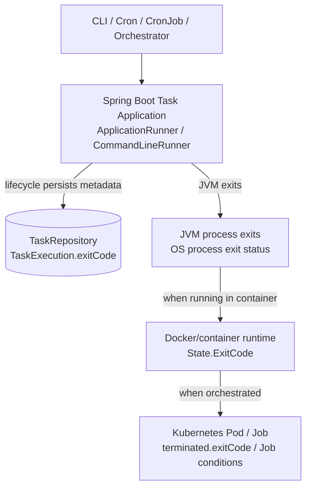

# Verifying Exit Codes When Running JARs and Containers

## Lesson Objectives

In the **Results and Exit Codes** chapter of the **Spring Cloud Task** module, this lesson guides you through verifying that a short-lived Spring Boot application properly reports **success or failure** when deployed as an executable JAR, Docker container, or Kubernetes Job. This is a core requirement for scheduled or on-demand tasks: the orchestrator must receive a reliable outcome to decide whether to alert or retry.

After completing this lesson, you will be able to:

- Distinguish three outcome sources: `TaskExecution.exitCode` in `TaskRepository`, the **Java process exit code**, and the **container/Job exit code**.
- Build a task with three test scenarios: success, invalid input, and transient infrastructure error, mapping exceptions to exit codes.
- Read exit codes immediately after `java -jar` in Bash, PowerShell, and CMD without losing the result to subsequent commands or pipelines.
- Package with an exec-form Dockerfile and read exit codes via `docker run` and `docker inspect`.
- Inspect Kubernetes Job status and container exit codes, understanding retries, `OOMKilled`, termination signals, and cases where the repository fails to record outcomes in time.
- Design smoke tests and reconcile logs, Task metadata, exit status, Spring Batch Jobs, and actual business outcomes.

## 1. Why Must Exit Codes Be Verified?

Suppose a payment reconciliation task runs at 02:00. It receives `--businessDate=2026-11-23`, reads transactions, writes results, and exits. The orchestrator needs to know:

1. Did the task complete and produce a valid report?
2. If parameters were wrong, is this a data-fix error that **should not be retried as-is**?
3. If the partner could not be reached, should it retry after a delay?
4. If the Pod ran out of memory and was killed by the system, does Task metadata reflect the incident?

Merely seeing `"Completed"` in logs or `"container stopped"` is not enough. The application might swallow an exception and return `0`, causing the orchestrator to treat the run as **succeeded** despite a business failure. Conversely, the Java process might fail before Spring Cloud Task starts, leaving **no `TaskExecution` record** even though Docker reported failure.

Across most operating systems and container platforms, the baseline convention is:

- **Exit code `0`:** the process self-reports **execution success**.
- **Non-`0` exit code:** the process or runtime reported an **error**; the specific meaning is defined by the application and platform.
- **No exit code yet:** the process is still running or termination details have not been saved/collected.

This convention **does not guarantee accurate business results**: if a report has 10,000 rows yet logic only writes 9,000 rows and still returns `0`, exit codes cannot detect the discrepancy themselves. The application must verify its own success criteria.

## 2. Three Exit Code Layers to Reconcile



| Layer | Field/value to inspect | Responsible component | Can it be missing or differ from other layers? |
| --- | --- | --- | --- |
| **Spring Cloud Task** | `TASK_EXECUTION.EXIT_CODE`; `END_TIME`; `ERROR_MESSAGE` | `TaskLifecycleListener` and `TaskRepository` | Yes: context not created, DB error, or JVM killed abruptly |
| **JVM/OS** | Exit status returned by `java -jar` to the shell | JVM and Spring Boot/application exit code mechanisms | Yes: exit code changed after metadata was written or process received a signal |
| **Docker** | `docker run` exit status or `.State.ExitCode` | Docker/container runtime; usually follows PID 1 | Yes: Docker failed before launch or entrypoint masked Java's exit code |
| **Kubernetes Pod** | `.status.containerStatuses[].state.terminated.exitCode`; `reason` | Kubelet/container runtime | Yes: image failed to pull, Pod never ran, or container was OOM/killed |
| **Kubernetes Job** | `Complete` / `Failed`; `succeeded` / `failed` | Job controller, after retries and Job policy | Yes: multiple Pods/attempts, final Job outcome differs from a single Pod |

**The goal of verification** is to ensure the three primary layers align on normal execution paths while **understanding why** they diverge when failures occur.

### 2.1. Exit Code in `TaskExecution`

Spring Cloud Task stores one `TaskExecution` per run. The `exitCode` field typically means:

- `null` while the task is **not yet finalized in the repository**.
- `0` when Spring Cloud Task records successful execution.
- A non-`0` value when an error is handled by the framework or a custom exit code is applied.

Per the Spring Cloud Task documentation, codes mapped by `ExitCodeExceptionMapper` can be saved to the repository; if an `ApplicationFailedEvent` occurs with no custom code, the value is usually `1`. On normal completion, it is usually `0`.

Read these fields **together**: `TASK_EXECUTION_ID`, `TASK_NAME`, `START_TIME`, `END_TIME`, `EXIT_CODE`, `EXIT_MESSAGE`, `ERROR_MESSAGE`. A row with `EXIT_CODE = NULL` does not prove the process is still alive; the JVM may also have been forcefully stopped before the repository updated.

### 2.2. Java Process Exit Code

To the shell, `java -jar app.jar` is a process. The shell captures its status once the process exits. This code is consumed by shell scripts, cron, CI/CD pipelines, and—when Java is the main process—the container runtime.

Spring Boot supports `ExitCodeGenerator`, `ExitCodeExceptionMapper`, and `SpringApplication.exit(...)`. To return a specific code via `SpringApplication.exit`, Spring Boot documentation instructs passing its return value to `System.exit(...)`. However, calling `System.exit(0)` **directly inside a runner** can cut off listeners or prevent the repository from saving results; let the framework manage the Task lifecycle and place error-code logic appropriately.

### 2.3. Container Exit Code and Job Status

Docker tracks the container's **main process**. If the Dockerfile uses `ENTRYPOINT ["java", "-jar", "..."]`, the main process is Java itself. If replaced by a shell script that does not `exec` Java or always runs `echo "done"` last, the script's exit code may no longer match Java's exit code.

With Kubernetes, the **container exit code** reflects a single container run, whereas **Job status** is determined after the Job controller applies restarts, retries, deadlines, and attempts. Thus, one Pod failure can be retried and the Job still succeed, or the Job can fail due to deadline even when the underlying issue was a time limit.

## 3. Preparing the Test Application

We create an `exit-probe` program with three fixed modes for verification:

| Parameter | Scenario | Example convention code |
| --- | --- | --- |
| `--mode=ok` | Processing succeeded | `0` |
| `--mode=invalid` | Input data error unresolvable by retrying | `12` |
| `--mode=temporary` | Transient dependency connection error | `23` |
| Missing/invalid `--mode` | Invalid configuration or parameter | `12` |

**`12` and `23` are conventions chosen for this lab**, not standard codes mandated by Spring Cloud Task, Docker, or Kubernetes. In real systems, align the code table across the application, scheduler, alerting, and retry policy.

### 3.1. Dependencies

On [Spring Initializr](https://start.spring.io/), generate a Maven Spring Boot project with Java 17 or a Java version supported by your Spring Boot line. Select **Task (Spring Cloud)** and **H2 Database**; let Spring Initializr pick compatible Spring Boot/Spring Cloud release trains.

If your project already has a matching Spring Boot parent and Spring Cloud BOM, the dependencies look like:

```xml
<dependencies>
    <dependency>
        <groupId>org.springframework.cloud</groupId>
        <artifactId>spring-cloud-starter-task</artifactId>
    </dependency>
    <dependency>
        <groupId>com.h2database</groupId>
        <artifactId>h2</artifactId>
        <scope>runtime</scope>
    </dependency>
</dependencies>
```

The snippet above is not a complete `pom.xml`; do not pin a starter version conflicting with the project's release train.

### 3.2. Java Code with Identifiable Failures

Create `src/main/java/com/example/task/ExitProbeApplication.java`:

```java
package com.example.task;

import java.util.List;

import org.springframework.boot.ApplicationArguments;
import org.springframework.boot.ApplicationRunner;
import org.springframework.boot.ExitCodeGenerator;
import org.springframework.boot.SpringApplication;
import org.springframework.boot.autoconfigure.SpringBootApplication;
import org.springframework.cloud.task.configuration.EnableTask;
import org.springframework.context.annotation.Bean;

@SpringBootApplication
@EnableTask
public class ExitProbeApplication {

    public static void main(String[] args) {
        SpringApplication.run(ExitProbeApplication.class, args);
    }

    @Bean
    ApplicationRunner probeRunner() {
        return (ApplicationArguments args) -> {
            List<String> modes = args.getOptionValues("mode");
            if (modes == null || modes.size() != 1) {
                throw new InvalidInputException(
                    "Exactly one --mode=ok|invalid|temporary is required");
            }

            String mode = modes.get(0);
            switch (mode) {
                case "ok":
                    System.out.println("RESULT=SUCCESS");
                    break;
                case "invalid":
                    throw new InvalidInputException(
                        "Invalid input data");
                case "temporary":
                    throw new TemporaryDependencyException(
                        "Dependent service temporarily unavailable");
                default:
                    throw new InvalidInputException(
                        "Unsupported mode: " + mode);
            }
        };
    }

    static class InvalidInputException extends RuntimeException
            implements ExitCodeGenerator {
        InvalidInputException(String message) {
            super(message);
        }
        @Override
        public int getExitCode() {
            return 12;
        }
    }

    static class TemporaryDependencyException extends RuntimeException
            implements ExitCodeGenerator {
        TemporaryDependencyException(String message) {
            super(message);
        }
        @Override
        public int getExitCode() {
            return 23;
        }
    }
}
```

**Key point of the example:** exceptions are not caught and ignored. Both exception types implement `ExitCodeGenerator` so Spring Boot can return meaningful codes instead of a generic `1`. Spring Cloud Task receives the error details emitted by Spring Boot during the application lifecycle and persists matching metadata when the repository is operational.

We **do not call `System.exit(...)` directly inside the runner**. On normal failure paths, Spring Boot handles startup/runner exceptions and emits the error code. When upgrading versions, re-verify actual codes in **both the JVM and repository**, as Spring Boot exit mechanisms and context-close timing can change.

If you need to map an exception from a third-party library whose class you cannot modify, declare an `org.springframework.boot.ExitCodeExceptionMapper` bean:

```java
@Bean
org.springframework.boot.ExitCodeExceptionMapper thirdPartyErrorMapper() {
    return error -> {
        Throwable current = error;
        while (current != null) {
            if (current instanceof java.net.SocketTimeoutException) {
                return 23;
            }
            current = current.getCause();
        }
        return 0; // Do not handle this error: let another mechanism decide.
    };
}
```

This is an **optional supplementary snippet** to place in a Spring configuration class, not a standalone Java class. When multiple exit code mechanisms exist, Spring Boot evaluates precedence/`Ordered`; test on your exact version rather than assuming a mapper overrides listener errors.

### 3.3. Configuring Task Metadata Storage

Create `src/main/resources/application.yml`:

```yaml
spring:
  application:
    name: exit-probe
  main:
    web-application-type: none
  datasource:
    url: jdbc:h2:file:./task-exit-db
    driver-class-name: org.h2.Driver
    username: sa
    password: ""
  cloud:
    task:
      initialize-enabled: true
      closecontext-enabled: true
```

Meaning:

- `web-application-type: none` runs as a CLI rather than an HTTP service.
- **File-based** H2 preserves metadata across JVM exits under the **same directory and filesystem**; `mem` H2 loses data when the JVM stops.
- `initialize-enabled: true` uses the framework's Task schema initialization for this demo. In production, **deploy schemas via controlled migrations** and set `initialize-enabled: false` per your configuration/version.
- `closecontext-enabled: true` tells Spring Cloud Task to close the context after runners finish, preventing apps from hanging due to an open context. Still check any background threads or resources created by application code.

File-based H2 is for single-machine learning. When running containers, each container's filesystem is separate from the host and ephemeral; to reconcile metadata across JAR and container runs, configure **one shared persistent external database** with proper permissions and schema. Never treat data in a container's ephemeral filesystem as centralized history.

### 3.4. Building the Executable JAR

From the Spring Boot project root:

```bash
./mvnw clean package
```

Assuming Maven has `artifactId=exit-probe` and `version=0.0.1-SNAPSHOT`, the output is `target/exit-probe-0.0.1-SNAPSHOT.jar`. If your actual filename differs, use the JAR produced by Maven; verify that it is a **Spring Boot executable JAR** runnable via `java -jar`.

## 4. Verifying the JAR Directly

### 4.1. Bash: Capturing the Command Exit Code Immediately After Java Exits

```bash
java -jar target/exit-probe-0.0.1-SNAPSHOT.jar --mode=ok
printf 'JVM exit=%s\n' "$?"

java -jar target/exit-probe-0.0.1-SNAPSHOT.jar --mode=invalid
printf 'JVM exit=%s\n' "$?"

java -jar target/exit-probe-0.0.1-SNAPSHOT.jar --mode=temporary
printf 'JVM exit=%s\n' "$?"
```

With the failure paths defined by `ExitCodeGenerator` and handled normally by Spring Boot, the **expected codes to verify** are `0`, `12`, and `23`, respectively. If a different value appears, trust the measured code and inspect logs and framework versions. Never alter test reports to match expectations when actual runs diverge.

**`$?` must be read immediately after `java`**. If another command runs in between (such as `echo` or `grep`), `$?` holds that command's status rather than the JVM's.

When you need to both capture logs and preserve Java's exit code, use `pipefail` in Bash:

```bash
set -o pipefail
java -jar target/exit-probe-0.0.1-SNAPSHOT.jar --mode=invalid \
    2>&1 | tee task-run.log
printf 'Pipeline exit=%s\n' "$?"
```

Without `pipefail`, a pipeline normally returns the exit code of `tee` at the end, which can be `0` even when Java fails. `set -o pipefail` is supported in Bash and compatible shells, not necessarily in every `/bin/sh`.

### 4.2. PowerShell on Windows

```powershell
java -jar target/exit-probe-0.0.1-SNAPSHOT.jar --mode=ok
$exitCode = $LASTEXITCODE
Write-Host "JVM exit=$exitCode"

java -jar target/exit-probe-0.0.1-SNAPSHOT.jar --mode=invalid
$exitCode = $LASTEXITCODE
Write-Host "JVM exit=$exitCode"
```

`$LASTEXITCODE` holds the status of the **most recent native executable**, here `java.exe`. Capture it immediately after `java` before running another native executable. `$?` in PowerShell indicates Boolean success of the **previous PowerShell command**, not a reliable substitute for Java's integer exit code.

For Windows Command Prompt (`cmd.exe`):

```bat
java -jar target\exit-probe-0.0.1-SNAPSHOT.jar --mode=invalid
echo JVM exit=%ERRORLEVEL%
```

Put `echo` on the very next line; do not insert commands that alter `ERRORLEVEL` in between.

### 4.3. Automated Smoke Test

Testing a failure case with **expected code `12`** in Bash:

```bash
set +e
java -jar target/exit-probe-0.0.1-SNAPSHOT.jar --mode=invalid
actual=$?
set -e

if [ "$actual" -ne 12 ]; then
  echo "FAIL: expected=12 actual=$actual"
  exit 1
fi
echo "PASS: invalid input returned 12"
```

Use `set +e` before negative test cases if the enclosing script uses `set -e`. Automated test suites should cover **at least one success case, one business-error case, and one transient-dependency case**. Beyond exit codes, verify the process actually finishes within the expected timeout.

### 4.4. Reconciling with `TaskRepository`

In the file-based H2 example, after Java processes have exited, connect a **SQL client to the exact same database file** and run:

```sql
SELECT
    TASK_EXECUTION_ID,
    TASK_NAME,
    START_TIME,
    END_TIME,
    EXIT_CODE,
    EXIT_MESSAGE,
    ERROR_MESSAGE
FROM TASK_EXECUTION
WHERE TASK_NAME = 'exit-probe'
ORDER BY TASK_EXECUTION_ID DESC;
```

Each new run receives a distinct `TASK_EXECUTION_ID`. Match **timestamps, arguments, and outcomes** against each terminal run. Checking only `EXIT_CODE` on the newest row when two processes ran close together risks attributing a code to the wrong run.

| Scenario | Shell JVM (expected) | `TaskExecution.EXIT_CODE` (expected) | `ERROR_MESSAGE` |
| --- | --- | --- | --- |
| `--mode=ok` | `0` | `0` | Usually empty |
| `--mode=invalid` | `12` | `12` when exit code mechanism is recorded | Usually holds exception stack trace |
| `--mode=temporary` | `23` | `23` when exit code mechanism is recorded | Usually holds exception stack trace |

**If the two exit-code columns disagree, treat that as diagnostic evidence to investigate.** Causes include exit code mapping not applying uniformly, calling `System.exit` too early, listener exceptions, DB update failures, or external JVM kills. Never run `UPDATE TASK_EXECUTION SET EXIT_CODE=...` to "clean up" history.

## 5. Docker: Preserving Java's Exit Code

### 5.1. Dockerfile

Create a `Dockerfile` in the **practice project** after building the JAR:

```dockerfile
FROM eclipse-temurin:21-jre
WORKDIR /app
COPY target/exit-probe-0.0.1-SNAPSHOT.jar /app/app.jar
ENTRYPOINT ["java", "-jar", "/app/app.jar"]
```

This example uses **Java 21**; choose a runtime image compatible with the Java version used for the build. The Dockerfile uses **exec-form `ENTRYPOINT`**, making Java the main container process. Arguments appended after the image name in `docker run` are forwarded to the application's `main(String[] args)`.

Avoid writing:

```dockerfile
# Avoid if you want to preserve Java's exit code cleanly:
ENTRYPOINT ["sh", "-c", "java -jar /app/app.jar; echo done"]
```

That shell wrapper executes `echo` after Java; if `echo` succeeds, the shell can return `0` even when Java failed. If a shell script is unavoidable (e.g., to stage files), end with `exec java -jar /app/app.jar "$@"` and verify argument forwarding.

### 5.2. Running Containers and Checking Exit Status

```bash
docker build -t exit-probe:local .

docker run --rm exit-probe:local --mode=ok
printf 'Docker CLI exit=%s\n' "$?"

docker run --rm exit-probe:local --mode=invalid
printf 'Docker CLI exit=%s\n' "$?"
```

With a properly built image, expect `0` and `12`, respectively. The code from `docker run` reflects the container run **or a Docker launch failure**. Docker reserves several codes for errors caused by Docker or the entrypoint itself:

| Code | Meaning per Docker documentation | Action needed |
| --- | --- | --- |
| `0` | Main process reported success | Verify business outcome and repository |
| `12` / `23` | Example application-defined exit codes | Inspect exceptions and apply retry policy |
| `125` | Docker daemon/CLI failed to run the requested container | Check `docker run` flags and Docker errors |
| `126` | Specified command cannot be invoked | Check permissions and entrypoint |
| `127` | Specified command not found | Check image and command path |
| `137` | Typically indicates process received `SIGKILL` (9) | Check OOM, manual kills, runtime incidents |
| `143` | Typically indicates process received `SIGTERM` (15) on Linux | Check stop reason and shutdown handling; do not assume business error |

**`137` does not by default prove OOM**: it can also come from `docker kill` or another `SIGKILL` source. Check `OOMKilled` and logs. Similarly, `143` depends on runtime/script signal handling, and not every `SIGTERM` termination returns `143`.

### 5.3. Keeping Containers to Inspect

Running with `--rm` deletes the container upon exit, leaving **no object to inspect**. To inspect after completion, omit `--rm`:

```bash
docker run --name exit-probe-invalid exit-probe:local --mode=invalid
docker inspect --format '{{.State.ExitCode}}' exit-probe-invalid
docker inspect --format '{{.State.OOMKilled}}' exit-probe-invalid
docker logs exit-probe-invalid
docker rm exit-probe-invalid
```

The exit code of the **`docker inspect` command itself** is normally `0` when the query succeeds, even when `.State.ExitCode` prints `12`. Read the **field value**, and never confuse the CLI tool's exit code with the container's exit code. In PowerShell, `docker inspect --format '{{.State.ExitCode}}' ...` also works; follow PowerShell quoting rules.

### 5.4. Persisting `TaskRepository` When Running Docker

File-based H2 inside the image is a local illustration, and each new `docker run --rm` starts with a fresh container filesystem. Therefore, do not expect three separate `docker run` invocations to share one `TASK_EXECUTION` table.

To verify metadata across container runs:

- Point `spring.datasource.*` to **one shared external PostgreSQL/MySQL/etc.** instance and manage Task schemas with migrations; or
- For local exercises, mount a volume holding the H2 file, while **never running multiple JVMs concurrently against the same H2 file in unsupported ways**.

Never pass database passwords as `--password=...` CLI arguments when running a Task: Spring Cloud Task may persist arguments into metadata. Use secret management and controlled environment variables.

## 6. Kubernetes Job: Reading Both Exit Codes and Job Conclusions

This section covers running the application on Kubernetes. To test, **push the image to a registry accessible by the cluster** (or load the image into a dev cluster using your platform's supported method). `registry.example.com/exit-probe:1.0` below **is an example only**; replace it with your real image.

Create `job-exit-probe.yml` in the practice project:

```yaml
apiVersion: batch/v1
kind: Job
metadata:
  name: exit-probe-invalid
spec:
  completions: 1
  parallelism: 1
  backoffLimit: 0
  activeDeadlineSeconds: 300
  template:
    spec:
      restartPolicy: Never
      containers:
        - name: task
          image: registry.example.com/exit-probe:1.0
          args: ["--mode=invalid"]
```

Choosing `backoffLimit: 0` and `restartPolicy: Never` makes it easy to verify a **single failed attempt**, avoiding automatic retries that complicate comparison in exercises. `activeDeadlineSeconds` caps total Job duration; when reached, the Job can fail with `DeadlineExceeded` even before retries are exhausted.

### 6.1. Running and Inspecting Status

```bash
kubectl apply -f job-exit-probe.yml
kubectl get job exit-probe-invalid
kubectl describe job exit-probe-invalid
kubectl get pods -l batch.kubernetes.io/job-name=exit-probe-invalid
kubectl logs job/exit-probe-invalid
```

**`kubectl apply` returning `0` only means the API accepted the request**, not that the Job finished successfully. Check Job/Pod status after the workload terminates. Grab the Pod name from `kubectl get pods` and inspect the container exit code:

```bash
kubectl get pod POD_NAME \
  -o jsonpath='{.status.containerStatuses[0].state.terminated.exitCode}'

kubectl get pod POD_NAME \
  -o jsonpath='{.status.containerStatuses[0].state.terminated.reason}'
```

Replace `POD_NAME` with the real name; the commands above use Bash line continuation. In PowerShell, enter them on a single line without `\`. Index `[0]` assumes the Pod has a single container per the manifest; with multiple containers or init containers, select the `task` container specifically.

In the `--mode=invalid` example, when the image runs properly and the exception maps cleanly, the container can terminate with `exitCode=12`, the Pod enters `Failed`, and the Job reaches the `Failed` condition once the controller updates. For `--mode=ok`, create a **newly named** Job with `args: ["--mode=ok"]`; expect container `exitCode=0`, Pod `Succeeded`, and Job `Complete`.

### 6.2. Do Not Inspect One Pod and Judge the Entire Job

When `backoffLimit` is non-zero or `restartPolicy=OnFailure`, a Job can create **multiple execution attempts**. One `Failed` Pod with a non-`0` exit code may be followed by a `Succeeded` Pod, leaving the Job `Complete`. Conversely, a Pod stuck in `ImagePullBackOff` never ran Java and has no Java `terminated.exitCode` to reconcile.

Kubernetes documentation notes that even with `completions=1`, `parallelism=1`, and `restartPolicy=Never`, the program **may still be restarted** under certain failure modes. Consequently, Spring Cloud Task can create multiple `TaskExecution` records for the same business key; tasks must be idempotent, such as enforcing a unique constraint on `(partnerId, businessDate)`.

### 6.3. Handling `OOMKilled` or Termination Signals

If a Pod reports `reason=OOMKilled` with the commonly seen exit code `137`, the container was killed by the system due to memory limits. The container's exit code may differ from `TaskExecution.exitCode` because the JVM could not run shutdown callbacks or commit to the repository.

With `SIGTERM`, many platforms grant a shutdown grace period, yet you cannot assume the framework will write a complete record: the application may be mid-flight, lose resources, or hit the deadline. To investigate, combine `kubectl describe pod`, termination reason, events, logs, resource limits, and external DB metadata.

## 7. Interpreting Discrepancies Across Layers

| Observed situation | Reasonable interpretation | Next verification step |
| --- | --- | --- |
| Repository `0`, JVM/container `0`, valid business data | Normal run | Record business metrics and correlation ID |
| Repository `0`, JVM/container `0`, wrong business data | Code failed to check success criteria | Add validation and throw errors, then retest |
| Repository `12`, JVM/container `12` | Input error mapped consistently | Check logs and do not retry with unchanged arguments |
| Repository `23`, container `23` | Retryable dependency failure | Apply bounded retry with backoff and idempotency |
| Repository `0`, container non-`0` | Java/entrypoint/OS altered status after Task saved outcome | Inspect Dockerfile, shell wrapper, `System.exit` calls, signals |
| No `TaskExecution`, container `1` | Likely startup failure before repository/context creation | Inspect JVM logs, DB, and Spring configuration |
| Repository has `END_TIME=NULL`, container `137` | Process likely killed before updating metadata | Check `OOMKilled`, Docker/Kubernetes events, and logs |
| `docker run` returns `125` | Docker error rather than Java's exit code | Inspect daemon, flags, image, and network |
| One Pod failed, final Job `Complete` | Job succeeded on retry | Inspect all Pods/attempts and verify idempotency |
| `kubectl apply` returns `0`, final Job `Failed` | API accepted manifest, but workload failed | Check `Job conditions`, Pod exit code, and events |

### 7.1. Common Verification Mistakes

**Mistake 1 — Looking only for "Completed" in logs.** A runner might log success before the final DB commit fails. Log completion only after business criteria are confirmed.

**Mistake 2 — Catching an exception and returning normally.** With code like the following, the framework may consider the runner completed:

```java
try {
    paymentService.reconcile();
} catch (Exception ex) {
    log.error("Reconcile failed", ex);
    // Wrong: not rethrown, no error reported to Spring Boot.
}
```

Propagate the error or map the business outcome to an appropriate exit code whenever a failure genuinely prevents completion.

**Mistake 3 — Calling `System.exit(0)` inside a runner.** This can interrupt Spring Cloud Task's flow and lose final metadata updates. Let the framework finish runners and listeners; when custom exit codes are needed, use Spring Boot's exit code APIs and test both the repository and process.

**Mistake 4 — Using a shell wrapper that drops the exit code.** For instance, `java -jar app.jar; echo finished` makes the script return `echo`'s exit code. Use exec-form entrypoints or `exec java ...`.

**Mistake 5 — Checking only the orchestration CLI command status.** `docker inspect`, `kubectl apply`, and `kubectl logs` have their own exit codes. They do not represent the workload's exit code.

**Mistake 6 — Assuming `137` always means OOM, or `143` always means an application bug.** Check the signal, reason, `OOMKilled`, and logs; never diagnose a business failure from a single integer alone.

## 8. Spring Batch: A `FAILED` Job Can Still Cause a Task to Return `0`

When Spring Cloud Task launches a **Spring Batch Job**, an extra outcome layer exists:

| Component | Status to inspect |
| --- | --- |
| Spring Batch `JobExecution` | `BatchStatus` such as `COMPLETED` or `FAILED`; Job `ExitStatus` |
| Spring Cloud Task `TaskExecution` | `EXIT_CODE` of the Task run recorded by the framework |
| JVM/container/Kubernetes | Process/container exit code, final status after retries |

Spring Cloud Task documentation notes that under default Batch/Boot configuration, a `FAILED` Batch Job **may not automatically turn the Task exit code non-`0`**. When using `spring-cloud-task-batch` integration, you can enable:

```yaml
spring:
  cloud:
    task:
      batch:
        fail-on-job-failure: true
```

This property allows Spring Cloud Task to reflect a `FAILED` Batch Job as a Task failure via the documented mechanism (typically `1` or a code chosen by an `ExitCodeGenerator`). Verify your version and how Jobs are launched; if launching Batch manually another way, explicitly translate `FAILED` into an appropriate process outcome.

**Mandatory test for Batch applications:** create one succeeding Job and one intentionally failing Job, then reconcile **JobExecution status → TaskExecution exit code → JVM/container exit code → Kubernetes Job status**. Never let any single layer stand in for all of them.

## 9. Recommended Deployment Verification Workflow

For each Spring Cloud Task application release, complete these steps in a test environment:

1. **Define the code table:** `0` for success, non-`0` codes grouped by business error, infrastructure error, retryable failure, and non-retryable failure; document the contract for the orchestrator.
2. **Run the local JAR:** run at least the `ok`, `invalid`, and `temporary` cases; read `$?` or `$LASTEXITCODE` immediately after Java.
3. **Verify the repository:** check `TASK_EXECUTION_ID`, arguments, `EXIT_CODE`, `END_TIME`, and `ERROR_MESSAGE` for each run in a persistent DB.
4. **Build Docker with exec-form:** rerun all three cases; check `docker run` status and `docker inspect .State.ExitCode` where needed.
5. **Run a Kubernetes Job:** test a single attempt with `backoffLimit: 0`, then test real retry settings; inspect both Pod exit codes and Job conditions.
6. **Test infrastructure failures:** point to an unreachable datasource in test to observe the **missing `TaskExecution`** case and distinguish startup errors from runner errors.
7. **Test forced termination in an isolated environment:** confirm alerts do not depend solely on `onTaskEnd` or `END_TIME`.
8. **Reconcile business outcomes:** verify row counts, totals, checksums, or target records; `0` is acceptable only when these checks pass.
9. **Configure monitoring and retention:** store logs, scheduler statuses, correlation IDs, and Task metadata; alert on missing runs, overruns, and exit code mismatches.

### Self-Check Scenarios

**Question 1.** `java -jar` returns `12`, yet the last log line is `"Starting Spring..."`. Can you conclude input validation worked as expected?

> Not yet. Inspect error logs, confirm whether the runner executed, check which exception was thrown, and see whether the repository has a completion record; code `12` could come from a mapper or a different phase.

**Question 2.** `docker inspect` prints `12`, while the shell reports the exit code of the `docker inspect` command itself as `0`. Is that a contradiction?

> No. `12` is the container's `.State.ExitCode` field; `0` means the Docker CLI tool queried that metadata successfully.

**Question 3.** One Pod has exit code `23`, yet the final Job status is `Complete`. Why?

> The Job likely retried and a subsequent Pod/attempt succeeded. Inspect all Pods belonging to the Job and ensure idempotency across retries.

**Question 4.** The repository shows `EXIT_CODE = NULL` and the container stopped with `137`. Should you update `EXIT_CODE=0` directly?

> No. Investigate the termination reason, check business data, and preserve an accurate audit history. Handling stalled records requires a dedicated operational policy.

**Question 5.** Why can a Spring Batch Job fail while the container still reports `0`?

> Because Batch Job status does not automatically determine the Spring Boot Task exit code by default. Verify Batch integration, `fail-on-job-failure`, and how outcomes propagate to the process.

## Key Takeaways

- **Three layers to reconcile:** `TaskExecution.EXIT_CODE`, **JVM** exit code, and **container/Job** exit code.
- **`0` only means the process reported execution success**; the application must still verify business criteria itself.
- **Bash `$?`, PowerShell `$LASTEXITCODE`, Docker `.State.ExitCode`, and Kubernetes `terminated.exitCode`** are direct observation points, each with its own scope.
- **Exec-form `ENTRYPOINT`** keeps Docker tracking Java cleanly; misplaced shell wrappers or `System.exit(0)` calls can skew results.
- **OOM, signals, startup failures, and retries** can cause Spring Cloud Task metadata to differ from container status; inspect logs, orchestrator state, and the repository together.
- For **Spring Batch**, verify the mapping from `FAILED` to a failing Task exit code, especially when orchestrators rely on exit status.

## References

1. [Spring Cloud Task — Features: TaskExecution, mapping exit codes, lifecycle](https://docs.spring.io/spring-cloud-task/reference/features.html)
2. [Spring Cloud Task — Batch: Batch Job Exit Codes](https://docs.spring.io/spring-cloud-task/reference/batch.html)
3. [Spring Boot — SpringApplication: Application Exit, ExitCodeGenerator](https://docs.spring.io/spring-boot/reference/features/spring-application.html)
4. [Spring Boot API — ExitCodeExceptionMapper](https://docs.spring.io/spring-boot/api/java/org/springframework/boot/ExitCodeExceptionMapper.html)
5. [Docker — Running containers: Exit status 125/126/127](https://docs.docker.com/engine/containers/run/)
6. [Docker — docker container inspect](https://docs.docker.com/reference/cli/docker/container/inspect/)
7. [Docker — docker container ls: exited=137](https://docs.docker.com/reference/cli/docker/container/ls/)
8. [Kubernetes — Jobs: failure/retry/backoff/deadline](https://kubernetes.io/docs/concepts/workloads/controllers/job/)
9. [Kubernetes — Pod Lifecycle: container exit and restarts](https://kubernetes.io/docs/concepts/workloads/pods/pod-lifecycle/)
