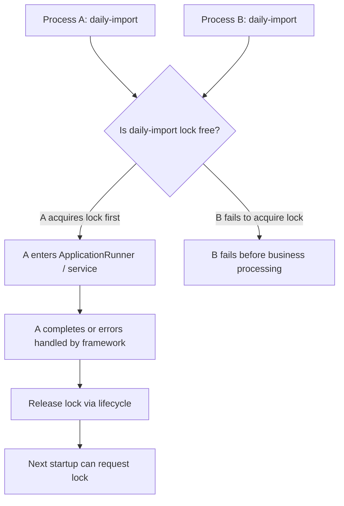

# Enabling `spring.cloud.task.single-instance-enabled`

## 1. The Problem: Two Overlapping Runs of the Same Task

**Spring Cloud Task** is used to build Spring Boot applications with a finite runtime: start up, accept parameters, process business logic, store metadata using `TaskRepository`, and terminate. A task can be invoked manually, from a scheduler, by an external request, or by an orchestrator such as a Kubernetes CronJob.

Suppose `daily-import` imports orders at 02:00 every day. Normally the task finishes in 10 minutes, but today a slow data source leaves it still running at 02:30. An operator clicks re-run or the scheduler re-emits the request. If two processes update the same dataset concurrently, duplicate writes, transaction conflicts, database load spikes, or incorrect aggregate results can occur.

Spring Cloud Task provides the **`spring.cloud.task.single-instance-enabled=true`** option to restrict execution to **only one running instance per task name** when instances participate in the same locking mechanism. The default value is **`false`**, meaning the framework does not enforce this restriction automatically. When one instance holds the lock, another instance with the same task name and the feature enabled will not be allowed to execute the business logic; according to the Spring Cloud Task documentation, a rejected run returns process exit code `1`.

| Scenario | Expected Outcome When Using a Shared Lock Mechanism |
| --- | --- |
| A and B are both named `daily-import`, both have single-instance enabled, and A is running | B is rejected while A holds the lock |
| A finishes and releases the lock, and B is started afterward | B can run |
| A is named `daily-import`, and B is named `daily-reconcile` | They can run in parallel because their names differ |
| A and B share the same name, but only A enables the feature | You cannot rely on B respecting the lock; B may overlap |
| A and B share the same name, but connect to two independent lock databases | There is no mutual exclusion guarantee between the two stores |

**The protection scope is the task name**, not the filename, processing date, `requestId`, `TaskExecution` ID, or Spring Batch job instance. A stable task name helps the system recognize runs belonging to the same type of job. This mechanism does not schedule runs, does not queue rejected runs automatically, and does not turn business processing into *exactly once*.

## 2. Where Does the Locking Mechanism Take Place?

When the feature is enabled, Spring Cloud Task uses a locking mechanism based on **Spring Integration**. The `SingleInstanceTaskListener` component works with `TaskNameResolver` to determine the name to lock, requests the lock during task startup, and releases it in framework-managed completion/failure callbacks. If a lock for that name already exists and cannot be granted, the listener throws a `TaskExecutionException` to prevent the new instance from executing work.



The diagram illustrates **concurrency semantics**, not the exact order of every internal transaction. A rejected run may still produce logs or startup metadata depending on the version and the point of failure; do not assume a `TASK_EXECUTION` record is always present or always absent for a blocked run. Verify in practice using logs, process status, and repository data.

The Spring Cloud Task schema typically includes the **`TASK_LOCK`** table for this feature, alongside `TASK_EXECUTION`, `TASK_EXECUTION_PARAMS`, and other supporting objects. The columns described in the schema documentation are `LOCK_KEY`, `REGION`, `CLIENT_ID`, and `CREATED_DATE`. This is a **table for lock management**, not business history, and cannot replace `TASK_EXECUTION`.

### Conditions for the Restriction to Hold Across Multiple JVMs

1. **Same task name**: explicitly configure `spring.cloud.task.name` or use a `TaskNameResolver` that yields the same logical name for the same job.
2. **Feature enabled on all relevant launches**: `spring.cloud.task.single-instance-enabled=true` must be active on every process that should participate in the restriction.
3. **Same shared lock store**: processes must point to the same RDBMS and lock schema/namespace, configured via the appropriate `DataSource`/`LockRegistry`.
4. **Required dependencies and schema present**: including the Spring Integration libraries and the Spring Cloud Task tables/objects matching your version.
5. **Policy for abruptly terminated processes**: lock timeout/TTL, monitoring, and a verification procedure before allowing a rerun.

If an application configures multiple `DataSource` beans, you must identify the exact data source used by `TaskRepository` and the locking layer. Two applications writing to the same business table **does not mean** they share the same Spring Cloud Task lock store.

## 3. Adding Spring Integration Dependencies

In a Maven project that uses a BOM to ensure **compatible Spring Boot and Spring Cloud versions**, example dependencies include:

```xml
<dependencies>
    <dependency>
        <groupId>org.springframework.cloud</groupId>
        <artifactId>spring-cloud-starter-task</artifactId>
    </dependency>
    <dependency>
        <groupId>org.springframework.boot</groupId>
        <artifactId>spring-boot-starter-jdbc</artifactId>
    </dependency>
    <dependency>
        <groupId>org.springframework.integration</groupId>
        <artifactId>spring-integration-core</artifactId>
    </dependency>
    <dependency>
        <groupId>org.springframework.integration</groupId>
        <artifactId>spring-integration-jdbc</artifactId>
    </dependency>
    <dependency>
        <groupId>org.postgresql</groupId>
        <artifactId>postgresql</artifactId>
        <scope>runtime</scope>
    </dependency>
</dependencies>
```

The two libraries **`spring-integration-core` and `spring-integration-jdbc`** are the dependencies specified by the Spring Cloud Task documentation for the single-instance feature. `spring-boot-starter-jdbc` provides JDBC infrastructure and `DataSource` management; the PostgreSQL driver handles connections to the database server in this example. Do not manually pin individual dependency versions when a compatible BOM/dependency management setup is in place.

Setting `single-instance-enabled=true` without the corresponding libraries or lock table can cause the task to fail at startup. It is not a magic switch capable of protecting every application without the backing infrastructure.

## 4. Enabling the Feature in application.yml

Example configuration for an import task in `src/main/resources/application.yml`:

```yaml
spring:
  application:
    name: daily-import-app
  main:
    web-application-type: none
  datasource:
    url: ${TASK_DB_URL}
    username: ${TASK_DB_USER}
    password: ${TASK_DB_PASSWORD}
  cloud:
    task:
      name: daily-import
      single-instance-enabled: true
      initialize-enabled: false
```

In this example:

- `spring.cloud.task.name: daily-import` assigns a **fixed logical name** to all runs of the same job type. `spring.application.name` is the Spring Boot application name and can differ from the task name.
- `single-instance-enabled: true` turns on duplicate-run restriction by name. In a `.properties` file you can write `spring.cloud.task.single-instance-enabled=true`; in YAML you simply place `single-instance-enabled: true` under `spring.cloud.task`.
- `initialize-enabled: false` assumes the **metadata schema has already been created**. Do not copy this configuration onto an empty database and expect the framework to create `TASK_EXECUTION` and `TASK_LOCK` automatically.
- `TASK_DB_URL`, `TASK_DB_USER`, and `TASK_DB_PASSWORD` must be supplied by the deployment environment; for example, a PostgreSQL URL looks like `jdbc:postgresql://db-host:5432/taskdb`. Do not put real passwords in YAML or pass them in CLI arguments.

### Preparing the Schema Before Testing Concurrency

Use the **official DDL scripts or migrations that match the exact Spring Cloud Task version in use** to create metadata and lock tables in the same PostgreSQL database. If Spring Batch is used in the application, also prepare the `BATCH_*` schema matching your Spring Batch version. Verify read/write permissions for the task database user; read-only permissions are not enough to acquire and release locks.

In a lab, you can run the schema initialization mechanism appropriate for your framework version against a fresh database **before** launching multiple processes. When running concurrently, finish migrations first and then use `initialize-enabled: false` so two JVMs do not race to create tables. In production, manage schemas via migration tools and a controlled deployment pipeline.

> **Do not hand-craft a simplified `TASK_LOCK` table from a guessed schema.** Spring Integration relies on lock constraints and SQL statements tailored to its implementation. A table with the right name but wrong keys, indexes, or column types can still cause concurrency control to behave incorrectly.

## 5. Writing a Sample Task to Observe Two Processes

The sample code uses Java 17+ and an `ApplicationRunner` that runs for a specified number of seconds. Keep the duration bounded so lock contention is easy to reproduce; `Thread.sleep` here is **for demo purposes only**, not a recipe for real business processing.

```java
package com.example.taskdemo;

import java.util.List;

import org.springframework.boot.ApplicationArguments;
import org.springframework.boot.ApplicationRunner;
import org.springframework.boot.SpringApplication;
import org.springframework.boot.autoconfigure.SpringBootApplication;
import org.springframework.context.annotation.Bean;

@SpringBootApplication
public class SingleInstanceDemoApplication {

    public static void main(String[] args) {
        SpringApplication.run(SingleInstanceDemoApplication.class, args);
    }

    @Bean
    ApplicationRunner runImport() {
        return args -> {
            long seconds = getDuration(args);
            System.out.printf("BUSINESS_START task=daily-import hold=%ds%n", seconds);

            // Simulate a business service executing work.
            Thread.sleep(seconds * 1_000L);

            System.out.println("BUSINESS_DONE task=daily-import");
        };
    }

    private static long getDuration(ApplicationArguments args) {
        List<String> values = args.getOptionValues("hold.seconds");
        if (values == null || values.isEmpty()) {
            return 30L;
        }
        if (values.size() != 1 || values.get(0) == null) {
            throw new IllegalArgumentException("Exactly one --hold.seconds is required");
        }

        try {
            long seconds = Long.parseLong(values.get(0));
            if (seconds < 1 || seconds > 300) {
                throw new IllegalArgumentException("--hold.seconds must be between 1 and 300");
            }
            return seconds;
        } catch (NumberFormatException ex) {
            throw new IllegalArgumentException("--hold.seconds must be an integer", ex);
        }
    }
}
```

Spring Cloud Task and the single-instance mechanism are activated via dependencies and configuration; the runner does not need to call `lock()` manually or touch `TASK_LOCK`. If the application has a business service, place the business logic in a separate `@Service` bean and let the runner parse arguments, invoke the service, and return or throw an exception on failure.

### Testing with Two Terminals

Assume the project has been built into an executable JAR `target/single-instance-demo.jar`, PostgreSQL already has the schema, and both terminal windows have the **same three environment variables** `TASK_DB_URL`, `TASK_DB_USER`, and `TASK_DB_PASSWORD`.

**Terminal A**: start a process that holds work for 60 seconds.

```bash
java -jar target/single-instance-demo.jar --hold.seconds=60
```

As soon as you see `BUSINESS_START` in A's logs, run in **Terminal B**:

```bash
java -jar target/single-instance-demo.jar --hold.seconds=5
```

If both share the name `daily-import`, share the same lock store, have the feature enabled, and use a valid schema, B will **fail because A is holding the lock**. According to the Spring Cloud Task guide, the exit code of a blocked run is `1`; the message typically means something like `Task with name "daily-import" is already running.`. B must not print `BUSINESS_START` if it is rejected before the runner executes. Do not assume every version prints that exact wording verbatim; check the logs and exit status.

After A prints `BUSINESS_DONE` and exits, run B's command again:

```bash
java -jar target/single-instance-demo.jar --hold.seconds=5
```

This subsequent run can acquire the lock and complete successfully. This basic test shows that the mechanism enforces **mutual exclusion while running**, not permanent rejection of future runs with the same name.

**Control test:** In a separate test environment, temporarily set `single-instance-enabled: false` on both processes and run them concurrently. Without this restriction, both can enter the runner. Then set it back to `true` and test against the shared lock store. Never toggle this feature mid-flight on a system processing real data.

### Testing Two Different Task Names

When using the default resolver, you can launch another process with:

```bash
java -jar target/single-instance-demo.jar --spring.cloud.task.name=daily-reconcile --hold.seconds=10
```

This run has a **different name-based lock**, so in principle it can run concurrently with `daily-import`. However, the demo runner still performs the same `BUSINESS_START task=daily-import` work because changing the metadata name does not automatically change business logic. In a real project, you must design corresponding service routing logic; simply renaming a task to bypass a lock is wrong if both processes still update the same data unsafely.

## 6. Inspecting TaskRepository and the Lock Table

While A is running, open a PostgreSQL connection to read metadata (using an account with appropriate permissions). You can inspect:

```sql
-- Metadata for task executions
SELECT TASK_EXECUTION_ID,
       TASK_NAME,
       START_TIME,
       END_TIME,
       EXIT_CODE,
       ERROR_MESSAGE
FROM TASK_EXECUTION
WHERE TASK_NAME = 'daily-import'
ORDER BY TASK_EXECUTION_ID DESC;

-- Metadata supporting the locking mechanism; read-only, do not update
SELECT LOCK_KEY, REGION, CLIENT_ID, CREATED_DATE
FROM TASK_LOCK
ORDER BY CREATED_DATE DESC;
```

`TASK_EXECUTION` helps look up execution history; `TASK_LOCK` supports lock management. The structure and row lifecycle in the lock table depend on Spring Integration's mechanism and the version in use: **do not assume a task is definitely still running just because a row appears in `TASK_LOCK`**, nor assume a lock is released based solely on a single query snapshot. Combine logs, process state, lock information, and TTL behavior before taking operational actions.

After both processes stop, query `TASK_EXECUTION` again to compare `START_TIME`, `END_TIME`, and `EXIT_CODE`. A run rejected due to lock contention may be recorded differently depending on the version and where the error occurred; **the JVM exit status and error logs** remain essential signals. If a process was forcibly killed, `END_TIME` may be null because the framework had no chance to write completion metadata.

### Why Not Use H2 In-Memory to Test Multiple JVMs?

Two processes using `jdbc:h2:mem:task_demo` will have **two separate in-memory databases**. Using the same URL string does not turn H2 `mem:` into a shared lock store across two JVMs. File-based H2 persists data across runs, but imposes file-locking constraints when multiple processes open the database simultaneously; H2 file-lock errors do not prove Spring Cloud Task single-instance locking is working properly.

To test **real cross-process locking**, use a server database such as PostgreSQL or another RDBMS supported by Spring Cloud Task and properly configured.

## 7. TTL, Lock Checks, and Lost Process Scenarios

Under normal operation, the framework releases the lock when the task lifecycle completes or enters a handled error path. However, if the JVM receives `kill -9`, a pod is abruptly terminated, or the host loses power, the release callback may **never execute**. In such cases, you must consider lock expiration and recovery mechanisms rather than assuming that because the process is gone, the lock has automatically disappeared.

Relevant properties described in the Spring Cloud configuration docs:

| Property | Purpose | Default Stated in Configuration Docs |
| --- | --- | --- |
| `spring.cloud.task.single-instance-enabled` | Enables/disables single-instance mode per task name | `false` |
| `spring.cloud.task.single-instance-lock-check-interval` | Wait interval between lock status checks | `500` ms |
| `spring.cloud.task.single-instance-lock-ttl` | Maximum duration a lock is considered valid | `Integer.MAX_VALUE` ms |

These figures come from the property reference; confirm them against the **Spring Cloud Task version line you are deploying**. Setting a TTL shorter than actual processing time can allow another process to acquire the lock while the old process is **still running**, causing overlap. Setting a TTL that is too long can cause an abandoned lock after a crash to block new runs for an extended time. TTL does not replace job-status verification and business data recovery.

If you need to adjust the TTL, base it on the expected maximum runtime, network/database characteristics, retry policy, and incident recovery time. Never set TTL arbitrarily across all tasks. When a task runs for a very long time or faces connection-drop risks, check the exact lock renewal/expiration behavior in the Spring Integration version being used.

### Procedure When an Abandoned Lock Is Suspected

1. Check the scheduler/orchestrator and all deployment environments to verify whether any process/pod with the same name is still running.
2. Cross-check logs, `TASK_EXECUTION`, `TASK_LOCK` details, recent launches, and the configured TTL.
3. Determine what business data was written, whether transactions are still open, or if work is incomplete; plan a safe rerun.
4. Intervene on the lock only using an **administrative procedure supported by the implementation**, during a window where new launches are paused and after confirming no valid owner remains.
5. Rerun under observation, verify the lock is released on time, and update alerts to detect similar incidents.

**Never run `DELETE FROM TASK_LOCK` in production just because a launch was blocked.** Accidentally deleting the lock of a live process can allow two instances into business logic simultaneously, defeating the exact protection this feature provides.

## 8. Limitation: Single Instance Does Not Guarantee Exactly-Once

Name-based concurrency restriction is a **runtime execution** control layer, whereas business data safety is a separate problem.

Suppose Process A imports 8,000 of 10,000 orders and crashes, the lock expires, and the scheduler launches B. B can start validly afterward, but if it processes everything from scratch without checking prior data, those 8,000 imported orders risk being duplicated. Similarly, if a run already sent an email or called an external API and died before updating status, the next task run could repeat that side effect.

Measures that must work together:

- **Idempotency key / business key** for orders, requests, or import batches; use unique constraints, upserts, or status checks so reruns are safe.
- **Transactions** aligned with the write scope and rollback capabilities. For external APIs or emails outside the DB, consider the outbox pattern, checkpoints, compensation, or safe replay.
- **Scheduler retry policy**: distinguish lock-contention rejections from real business failures; avoid rapid-fire retries that overload systems and spam logs.
- **Right lock granularity for your needs**: if you only need one task per customer rather than one task globally, default task-name locking may be too coarse or target the wrong unit; design a custom business lock tested under concurrency.

If multiple tasks with different names access the **same data tables**, name-based single-instance locking cannot prevent conflicts between them. You need controls at the business/database layer or resource-aware orchestration.

## 9. Scheduled Runs and Coordination with Spring Batch

### External Schedules

Cron or a Kubernetes CronJob can start a new JVM on every schedule tick. `single-instance-enabled` only checks **whether the new JVM may execute under that task name**; it does not decide schedule times and does not automatically defer and replay a blocked run. The scheduler must handle exit code `1` according to an appropriate policy: alert, skip the overlapping tick, or perform bounded retries once the prior run ends.

When using a Kubernetes CronJob, `concurrencyPolicy: Forbid` serves as an orchestration layer that reduces overlapping runs created by **that specific CronJob**. It does not replace a database lock when multiple schedules, external systems, or human operators can start the task. Additionally, pods must connect to the **same metadata/lock store**, not per-pod H2 `mem:` databases.

### Spring Batch and Multi-Level Concurrency

A Spring Cloud Task can run one or more Spring Batch jobs. `TaskExecution` represents an application run; `JobExecution` and `StepExecution` belong to Spring Batch and have their own restart rules and `BATCH_*` metadata.

Restricting **one Spring Cloud Task instance by name** does not automatically ensure no other Batch job (triggered from another process or a different task name) is processing the same data. If you need to control concurrency for the same Batch job instance, coordinate `JobRepository`, job parameters, and Spring Batch concurrency rules. Do not use the `TaskExecution` ID as a Batch data idempotency key because retries can generate a new task ID.

### Do Not Confuse with Spring Boot Task Scheduling

`spring.cloud.task.*` configures the **Spring Cloud Task** lifecycle. Spring Boot's `spring.task.*` configures Spring Framework's executors and schedulers. Setting `spring.task.scheduling.pool.size=1` does not restrict multiple JVMs from running with the same name; likewise, enabling single-instance does not automatically restrict all threads or jobs inside a single JVM.

## 10. Diagnosing When the Feature Does Not Behave as Expected

| Symptom | Common Causes | How to Verify |
| --- | --- | --- |
| Two JVMs still enter business logic at the same time | One process lacks the flag; different task names; different lock stores or TTL expired early | Inspect effective config, `TaskNameResolver`, JDBC URL/schema, TTL, and logs from each JVM |
| Task errors with missing Spring Integration beans/classes | Missing `spring-integration-core` or `spring-integration-jdbc`, incompatible dependencies | Inspect dependency tree and BOM, add the right modules, rebuild |
| Errors about missing `TASK_LOCK` or SQL errors | Schema not migrated for the right version, wrong schema/prefix, or missing DB privileges | Check `DataSource`, official DDL, and required `SELECT/INSERT/UPDATE/DELETE` permissions |
| Second run is rejected even though first seemed done | Old JVM still running, lock still valid, or release callback did not run after a crash | Check processes/pods, metadata, lock TTL, and logs; do not delete lock rows rashly |
| Concurrent file-based H2 test hits database file locked error | H2 file-locking contention instead of Task lock mechanism | Move concurrency testing to PostgreSQL or a server RDBMS |
| Every run has task name `application` | `spring.cloud.task.name` not defined; default resolver uses an unintended name/context ID | Set a stable name, inspect `TASK_EXECUTION.TASK_NAME` |
| Blocked runs are retried continuously by the scheduler | Scheduler does not distinguish concurrency conflicts from processing errors | Configure backoff, max retries, alerting, and option to skip overlapping schedules |
| Flag enabled but application does not exit | Runner or background threads remain alive; lifecycle does not shut down as expected | Check running threads, `web-application-type: none`, executor lifecycle, and context closing config |
| New task runs even though old task is actually still running | TTL too short, split lock state, or misconfiguration | Investigate runtime duration, TTL/registry, shared database, and lock mechanism of your version |

For lock-contention issues, collect logs from **both processes** with timestamps, task names, and execution IDs (if assigned). Looking at a single stack trace is often insufficient to know who acquired the lock first.

## 11. Verification Exercises

1. Explain why `single-instance-enabled` defaults to `false`, and give examples of jobs where it should be enabled (e.g., importing the same data batch) versus jobs that can intentionally run in parallel (e.g., generating independent reports).
2. Prepare PostgreSQL with the Spring Cloud Task metadata schema matching your version, including `TASK_LOCK`; run two terminals with the same name `daily-import`, same database, and the flag enabled. Observe which run prints `BUSINESS_START` and what exit code the rejected run returns.
3. Wait for the first process to finish, then rerun the previously rejected command. Explain the difference between **being blocked while running** and **running validly afterward**.
4. Change the second run's name to `daily-reconcile` and test whether both can run simultaneously. Analyze why renaming solely to bypass a lock can corrupt data if both runners still perform the same business operations.
5. Try turning off the flag on one of the two processes **in a lab environment**. Why is flag consistency across every instance a critical requirement?
6. Inspect `TASK_EXECUTION` and `TASK_LOCK` metadata during execution and after completion. Explain why a lock row alone cannot replace checking process liveness and TTL.
7. Design a scenario where a task is forcibly killed after writing half its data. Propose how to decide on a safe retry, monitor the lock, and apply idempotency in the service layer.
8. Suppose a Spring Batch job can be launched from two differently named tasks. What additional constraints are needed beyond task-name single-instance locking?

By the end of this lesson, you should be able to **enable and verify** `spring.cloud.task.single-instance-enabled`, explain name-based locking over a shared database, prepare the right dependencies and schema, analyze failure and TTL scenarios, and understand why task-level locking must be paired with idempotency, monitoring, and business-level or Spring Batch concurrency control.

## 12. References

- [Spring Cloud Task — Features: Restricting Spring Cloud Task Instances](https://docs.spring.io/spring-cloud-task/reference/features.html): properties, duplicate-name behavior, and required Spring Integration dependencies.
- [Spring Cloud Task — Task Repository Schema](https://docs.spring.io/spring-cloud-task/reference/appendix-task-repository-schema.html): role and columns of the `TASK_LOCK` table.
- [Spring Cloud Task — `SingleInstanceTaskListener` Javadoc](https://docs.spring.io/spring-cloud-task/docs/current/apidocs/org/springframework/cloud/task/configuration/SingleInstanceTaskListener.html): `lockTask`, `unlockTaskOnEnd`, and `unlockTaskOnError`.
- [Spring Cloud — Configuration Properties](https://docs.spring.io/spring-cloud/docs/current/reference/html/configprops.html): `single-instance-enabled`, `single-instance-lock-ttl`, `single-instance-lock-check-interval`, and their corresponding defaults.

When deploying a real system, verify the documentation for the **exact versions of Spring Cloud Task, Spring Integration, and database** in use—especially before changing TTL, schema, or post-incident lock-release procedures.
