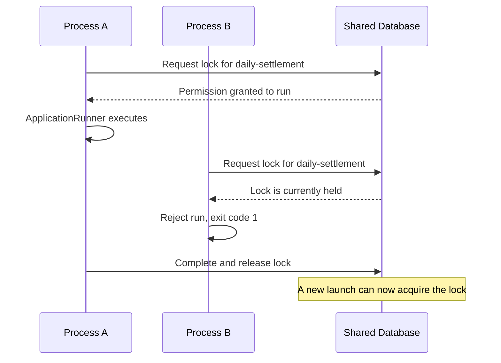

# Spring Integration Dependencies and the JDBC Lock Store

## 1. The Problem: Two Processes Running the Same Spring Cloud Task

A **Spring Cloud Task** application typically performs finite work: syncing data, importing files, generating reports, or invoking a Spring Batch flow and then exiting. Spring Cloud Task uses **`TaskRepository`** to record `TaskExecution` history in a database, helping track runs, parameters, timestamps, and exit codes.

Suppose a `daily-settlement` job handles daily settlement processing. The scheduler launches it at 01:00, but the first run takes 20 minutes. Due to a retry event or manual request, a second run is created at 01:05. If both write results concurrently, the system may encounter:

- The same settlement entry posted twice.
- Two processes updating the same file or data partition simultaneously.
- Both loading large datasets, spiking load on the database or external APIs.
- One run overwriting intermediate results of the other.

**`TaskRepository` records executions, but the repository alone does not prevent two concurrent runs.** Spring Cloud Task provides the `spring.cloud.task.single-instance-enabled=true` option to require that only one instance with the same task name runs at a time. This feature uses **Spring Integration** locking components, including JDBC dependencies and lock state in a shared database.

After this lesson, you will be able to:

1. Add the correct Spring Integration dependencies for the single-instance restriction feature.
2. Distinguish `TaskRepository` from the JDBC lock store and the `TASK_LOCK` table.
3. Configure `single-instance-enabled`, task name, lock expiration, and the shared database connection.
4. Test two processes to verify the overlap-prevention mechanism.
5. Understand `JdbcLockRegistry`, `DefaultLockRepository`, the `INT_LOCK` table, and when to use locks directly in business logic.
6. Operate safely under timeouts, JVM crashes, DB disconnects, retries, or Spring Batch integration.

## 2. Spring Cloud Task's Single-Instance Mechanism

Spring Cloud Task provides the configuration:

```yaml
spring:
  application:
    name: daily-settlement
  cloud:
    task:
      single-instance-enabled: true
```

According to the Spring Cloud Task 3.2 documentation, `single-instance-enabled` defaults to `false`. When set to `true` **across all launches that need coordination**, a run whose task name matches an active execution is rejected. A run rejected because an instance with the same name is already running has **exit code 1**.



Key characteristics:

| Scenario | Expected Result |
| --- | --- |
| Two runs with the **same name** and both have single-instance enabled | Only one processes business logic at that time. |
| Two runs with **different names** | They do not block each other simply because they share the same database. |
| One process does not enable `single-instance-enabled` | Protection cannot be considered complete for that process. |
| Two processes point to two different lock databases | There is no lock coordination between them. |
| The previous process finished and released the lock | The next run can execute. |

The task name is the **logical key used to detect contention**. Declare a clear, consistent name across all replicas using `spring.cloud.task.name` or your version's naming configuration. Changing the name on one replica can prevent two runs from competing for the same lock.

> This feature addresses the requirement **not to run two copies with the same name simultaneously**. It does not guarantee *exactly-once* business data semantics on its own. If an instance writes data and then crashes, an orchestrator may still retry; write operations require idempotency, business locks, or appropriate transactions.

## 3. Why Are Spring Integration and JDBC Needed?

To ensure a process on machine A can detect that a process on machine B holds a lock, you need a locking mechanism **shared across JVMs**, not an in-memory `static` variable or `synchronized` block.

Spring Integration provides these abstractions:

| Component | Role |
| --- | --- |
| `LockRegistry` | Provides a `java.util.concurrent.locks.Lock` object for a logical key. |
| `JdbcLockRegistry` | Implements a lock registry backed by a `LockRepository` and a JDBC database. |
| `DefaultLockRepository` | Implements `LockRepository`, managing ownership and lock rows in a SQL table. |
| `DataSource` and transaction manager | Connects and executes transactions when acquiring, releasing, or updating lock state. |
| Lock table in RDBMS | Stores lock state visible to different processes. |

Spring Cloud Task uses Spring Integration's JDBC locking capability to implement the single-instance restriction. **Having only `spring-cloud-starter-task` is not sufficient for this optional feature** according to the Spring Cloud Task documentation: you must also add both `spring-integration-core` and `spring-integration-jdbc`.

Maven dependencies:

```xml
<dependency>
    <groupId>org.springframework.integration</groupId>
    <artifactId>spring-integration-core</artifactId>
</dependency>
<dependency>
    <groupId>org.springframework.integration</groupId>
    <artifactId>spring-integration-jdbc</artifactId>
</dependency>
```

In a Spring Cloud application using a compatible BOM, let **the BOM manage versions** rather than manually picking two Spring Integration versions that may be out of sync with Spring Boot and Spring Cloud Task.

If you only use Spring Cloud Task to track execution history and **do not enable single-instance mode**, you do not need these two dependencies simply because `TaskRepository` contains the word "repository." `TaskRepository` and `LockRepository` serve two distinct purposes:

- `TaskRepository` stores **execution history** (when it ran, what the outcome was).
- `LockRepository` stores **temporary lock ownership** (which instance is allowed to access a resource or run first).

## 4. The `TASK_LOCK` and `INT_LOCK` Tables: Two Easily Confused Names

This is an important technical detail for this topic.

The **Spring Cloud Task 3.2** schema documentation specifies the `TASK_LOCK` table for `single-instance-enabled`. Meanwhile, the **Spring Integration JDBC** documentation describes `DefaultLockRepository` with the default prefix `INT_`, meaning the default lock table for an independently configured `JdbcLockRegistry` is usually `INT_LOCK`.

| Use Case | Typical Lock Table | Who Manages Configuration |
| --- | --- | --- |
| **Spring Cloud Task** single-instance | `TASK_LOCK` | Spring Cloud Task infrastructure, Task schema per version. |
| Application-declared `JdbcLockRegistry` with default prefix | `INT_LOCK` | Spring Integration `DefaultLockRepository`. |
| `JdbcLockRegistry` customized with prefix `APP_` | `APP_LOCK` | Application sets `prefix` and manages the corresponding DDL. |

**Do not create `INT_LOCK` yourself and assume Spring Cloud Task will use it.** If using the built-in `single-instance-enabled`, consult the schema for the **exact Spring Cloud Task version**, which includes `TASK_LOCK` and the other repository tables. If you create your own Spring Integration registry for business needs, use the JDBC scripts for the exact Spring Integration version and configured prefix.

### 4.1. Basic Columns of `TASK_LOCK`

According to the Spring Cloud Task 3.2 schema documentation:

| Column | Meaning |
| --- | --- |
| `LOCK_KEY` | Lock identifier, 36-character type. |
| `REGION` | Lock scope/group, string type up to 100 characters. |
| `CLIENT_ID` | Identifier of the lock holder. |
| `CREATED_DATE` | Timestamp when the lock record was written. |

An **illustrative example of a similar structure in PostgreSQL**:

```sql
CREATE TABLE TASK_LOCK (
    LOCK_KEY CHAR(36) NOT NULL,
    REGION VARCHAR(100) NOT NULL,
    CLIENT_ID CHAR(36),
    CREATED_DATE TIMESTAMP NOT NULL,
    CONSTRAINT TASK_LOCK_PK PRIMARY KEY (LOCK_KEY, REGION)
);
```

This is only a sample to explain column names and the primary key; it **does not replace the official DDL for deployment**. The exact script, timestamp precision, constraints, and other objects must come from the schema matching your Spring Cloud Task version and target database. In addition to `TASK_LOCK`, the application also needs `TASK_EXECUTION`, `TASK_EXECUTION_PARAMS`, and related metadata objects.

### 4.2. Why Must the Database Be Shared?

To protect between machine A and machine B, **both must access the same lock table in the same logical database** and agree on the lock key. Using H2 in-memory in two JVMs creates two separate databases, making it unreliable for cross-process testing.

File-based H2 is suitable only for observing the schema from a single process; two processes opening the same embedded H2 file can trigger database file-lock errors rather than verifying actual single-instance behavior.

**For two-process testing or multi-node deployment, use a PostgreSQL/MySQL server** (or an RDBMS supported by your Spring Cloud Task version) as the shared lock source.

## 5. Sample Spring Boot Project with PostgreSQL

The example uses **JDK 17**, **Spring Boot 3.4.5**, and **Spring Cloud 2024.0.2** with a compatible dependency set. The demo database is a PostgreSQL server so two separate JAR processes can connect concurrently.

Project structure:

```text
single-task-demo/
├── pom.xml
└── src/main/
    ├── java/com/example/singletask/
    │   ├── SingleTaskApplication.java
    │   └── SettlementRunner.java
    └── resources/
        └── application.yml
```

### 5.1. Maven `pom.xml`

```xml
<?xml version="1.0" encoding="UTF-8"?>
<project xmlns="http://maven.apache.org/POM/4.0.0"
         xmlns:xsi="http://www.w3.org/2001/XMLSchema-instance"
         xsi:schemaLocation="http://maven.apache.org/POM/4.0.0 https://maven.apache.org/xsd/maven-4.0.0.xsd">
    <modelVersion>4.0.0</modelVersion>

    <parent>
        <groupId>org.springframework.boot</groupId>
        <artifactId>spring-boot-starter-parent</artifactId>
        <version>3.4.5</version>
        <relativePath/>
    </parent>

    <groupId>com.example</groupId>
    <artifactId>single-task-demo</artifactId>
    <version>0.0.1-SNAPSHOT</version>

    <properties>
        <java.version>17</java.version>
    </properties>

    <dependencyManagement>
        <dependencies>
            <dependency>
                <groupId>org.springframework.cloud</groupId>
                <artifactId>spring-cloud-dependencies</artifactId>
                <version>2024.0.2</version>
                <type>pom</type>
                <scope>import</scope>
            </dependency>
        </dependencies>
    </dependencyManagement>

    <dependencies>
        <dependency>
            <groupId>org.springframework.cloud</groupId>
            <artifactId>spring-cloud-starter-task</artifactId>
        </dependency>
        <dependency>
            <groupId>org.springframework.boot</groupId>
            <artifactId>spring-boot-starter-jdbc</artifactId>
        </dependency>
        <dependency>
            <groupId>org.postgresql</groupId>
            <artifactId>postgresql</artifactId>
            <scope>runtime</scope>
        </dependency>
        <dependency>
            <groupId>org.springframework.integration</groupId>
            <artifactId>spring-integration-core</artifactId>
        </dependency>
        <dependency>
            <groupId>org.springframework.integration</groupId>
            <artifactId>spring-integration-jdbc</artifactId>
        </dependency>
    </dependencies>

    <build>
        <plugins>
            <plugin>
                <groupId>org.springframework.boot</groupId>
                <artifactId>spring-boot-maven-plugin</artifactId>
            </plugin>
        </plugins>
    </build>
</project>
```

The two Spring Integration dependencies are added to enable the single-instance locking mechanism. The PostgreSQL JDBC driver must be on the classpath and match the chosen database infrastructure.

### 5.2. Configuring `application.yml`

```yaml
spring:
  application:
    name: daily-settlement
  main:
    web-application-type: none
  datasource:
    url: jdbc:postgresql://localhost:5432/cloud_task_demo
    username: task_runtime
    password: ${DB_PASSWORD}
  cloud:
    task:
      name: daily-settlement
      single-instance-enabled: true
      initialize-enabled: false
      closecontext-enabled: true
```

In this configuration:

- `spring.cloud.task.name` fixes the name used to identify the task; **all replicas must use the same name** for the lock to take effect.
- `single-instance-enabled: true` requires only one run with the same name at a time.
- `initialize-enabled: false` assumes the database already has the official schema, including `TASK_LOCK`. This is the appropriate configuration when schemas are managed by migrations.
- `web-application-type: none` suits finite applications, and `closecontext-enabled` ensures the Spring context closes upon completion.
- `password` is read from the `DB_PASSWORD` environment variable. In production, use a secret manager or whatever secret injection method your environment supports.

**Prepare the database before running:** Create the `cloud_task_demo` database and an appropriate user through your infrastructure process. Apply the **PostgreSQL schema script bundled with your Spring Cloud Task version** (including Task tables/sequences and `TASK_LOCK`) via Flyway, Liquibase, or a DBA. Grant the necessary read/write permissions to `task_runtime`. Do not manually create only a `TASK_LOCK` table and expect all of `TaskRepository` to work.

> When testing for the first time against a fresh, isolated database, you may temporarily enable `spring.cloud.task.initialize-enabled=true` in a controlled way so the library initializes the schema, then switch it back to `false`. Never let multiple replicas start up simultaneously and race to run schema creation DDL.

### 5.3. Enabling Spring Cloud Task

Create `SingleTaskApplication.java`:

```java
package com.example.singletask;

import org.springframework.boot.SpringApplication;
import org.springframework.boot.autoconfigure.SpringBootApplication;
import org.springframework.cloud.task.configuration.EnableTask;

@SpringBootApplication
@EnableTask
public class SingleTaskApplication {
    public static void main(String[] args) {
        SpringApplication.run(SingleTaskApplication.class, args);
    }
}
```

### 5.4. Creating a Runner Long Enough to Test Lock Contention

Create `SettlementRunner.java`:

```java
package com.example.singletask;

import java.util.List;

import org.springframework.boot.ApplicationArguments;
import org.springframework.boot.ApplicationRunner;
import org.springframework.stereotype.Component;

@Component
public class SettlementRunner implements ApplicationRunner {

    @Override
    public void run(ApplicationArguments args) throws Exception {
        List<String> values = args.getOptionValues("work-seconds");
        long seconds = (values == null || values.isEmpty())
                ? 30L : Long.parseLong(values.get(0));

        if (seconds < 0 || seconds > 120L) {
            throw new IllegalArgumentException(
                    "--work-seconds must be in the range 0..120");
        }

        System.out.println("Starting settlement processing, duration="
                + seconds + " seconds");
        try {
            Thread.sleep(seconds * 1_000L);
        } catch (InterruptedException interrupted) {
            Thread.currentThread().interrupt();
            throw interrupted;
        }

        System.out.println("Settlement processing completed");
    }
}
```

`Thread.sleep()` simulates long-running work. In a real application, replace it with bounded data processing, error checks, and business result persistence. If there are mandatory asynchronous workers, the runner **must wait for them to finish** before returning, because the task's single-instance lock must cover all mandatory work.

## 6. Testing Two Processes Against the Same Database

Ensure both terminals share the same datasource configuration and `DB_PASSWORD`. If using PowerShell, set the password in each terminal or let your environment provide the variable:

```powershell
$env:DB_PASSWORD = "<password-in-test-environment>"
```

Prepare the schema first, then package:

```bash
mvn clean package
```

### 6.1. Terminal A: Start the First Instance

```bash
java -jar target/single-task-demo-0.0.1-SNAPSHOT.jar --work-seconds=30
```

Runner log output:

```text
Starting settlement processing, duration=30 seconds
```

Process A continues running during `Thread.sleep()`. Spring Cloud Task is holding execution permission for `daily-settlement` in the shared lock store.

### 6.2. Terminal B: Start the Second Instance While A Is Still Running

Within that 30-second window, in another terminal using the **same database** and **same task name**:

```bash
java -jar target/single-task-demo-0.0.1-SNAPSHOT.jar --work-seconds=2
```

Expected outcome: the framework detects that a task with the same name is running and **rejects the second instance**, reporting that a task with that name is already running; according to the documentation, the exit code is `1`. Runner B's `Starting settlement processing` log line must not appear if the blocking mechanism works properly.

In PowerShell, check the exit code of the Java process that just finished with `$LASTEXITCODE`. In Bash, check with `echo $?` immediately after the Java command.

### 6.3. After A Completes

Once A prints:

```text
Settlement processing completed
```

and exits normally, run B again. This time `daily-settlement` no longer holds the old lock, so the runner can start processing.

| Time | A | B | Expected Outcome |
| --- | --- | --- | --- |
| T0 | Starts and acquires lock | Not running yet | A starts working. |
| T0 + a few seconds | Running | B starts | B is rejected, exit code 1. |
| After A finishes | Not running | B starts again | B is allowed to run. |

Note: If B starts after A has **already finished**, both can succeed sequentially. The test must create a **genuine overlapping time window**.

## 7. Querying `TASK_LOCK` and `TASK_EXECUTION`

Connect to the PostgreSQL database `cloud_task_demo` using a SQL client or `psql`.

### 7.1. Checking the Lock Table Structure

```sql
SELECT table_name, column_name, data_type
FROM information_schema.columns
WHERE lower(table_name) = 'task_lock'
ORDER BY ordinal_position;
```

This query helps detect missing columns, a different table name, or connecting to the wrong database. Depending on your deployment, the table may reside under a schema other than `public`; add a `table_schema` filter if needed.

### 7.2. Observing Lock Records

While A is running:

```sql
SELECT LOCK_KEY, REGION, CLIENT_ID, CREATED_DATE
FROM TASK_LOCK;
```

Reading this table helps observe the metadata used by the locking mechanism. Do not expect `LOCK_KEY` to contain the literal task name verbatim: Spring Integration may represent the key as an internal hash/value. Do not manually edit `LOCK_KEY` or `CLIENT_ID` to "hand over" a lock without verifying the owner.

### 7.3. Cross-Checking Execution History

```sql
SELECT TASK_EXECUTION_ID,
       TASK_NAME,
       START_TIME,
       END_TIME,
       EXIT_CODE,
       ERROR_MESSAGE
FROM TASK_EXECUTION
WHERE TASK_NAME = 'daily-settlement'
ORDER BY TASK_EXECUTION_ID DESC;
```

`TASK_EXECUTION` stores history, while `TASK_LOCK` holds lock state. They serve different purposes, so **do not use `END_TIME IS NULL` as a substitute locking mechanism**; an abruptly terminated process can leave `END_TIME` empty even when it no longer holds execution permission.

A launch rejected **very early** might not persist a full execution record the way normal runner executions do. When verifying duplicate blocking, combine the exit code, logs, lock table state, and the number of times the runner actually executed.

## 8. Lock Expiration (TTL) and Check Interval

Alongside `single-instance-enabled`, some Spring Cloud Task versions provide these properties:

```yaml
spring:
  cloud:
    task:
      single-instance-enabled: true
      single-instance-lock-check-interval: 500
      single-instance-lock-ttl: 3600000
```

Values are in **milliseconds**:

- `single-instance-lock-check-interval` specifies the interval between lock checks; the Spring Cloud property docs list a default of **500 ms**.
- `single-instance-lock-ttl` limits how long a lock remains valid; for example, `3600000` equals **1 hour**. Defaults and detailed handling vary by version; check your version's docs and effective configuration.

TTL supports reclamation after a process fails to release its lock due to a crash or lost connection. However, it introduces a trade-off:

| TTL | Risk |
| --- | --- |
| Too short relative to task duration | The lock may expire while A is still working, allowing B to run and causing overlap. |
| Too long | After A crashes, B may have to wait or remain rejected longer than desired. |
| No timeout management strategy | Hard to determine when to retry versus when to alert an operator. |

In long-running applications, do not just guess a "just-long-enough TTL"; set execution bounds, monitor actual runtimes, understand the lock renewal mechanism supported by your version, and ensure business processing can rerun safely. **Do not assume every Spring Cloud Task setup renews leases indefinitely.**

Lock expiration is **different** from I/O timeouts, SQL statement timeouts, or scheduler timeouts. Changing TTL alone will not fix a worker hung while holding business resources.

## 9. Using `JdbcLockRegistry` Directly When Locking by Business Resource

`single-instance-enabled` protects at the **entire task application name** level. Sometimes finer-grained locking is needed:

- Two differently named tasks still update the same `2026-11` report.
- Multiple jobs process tenants in parallel, but only one update per tenant is allowed at a time.
- Only the final write step requires exclusivity; earlier read steps can run in parallel.

In such cases, the application can **configure its own `JdbcLockRegistry`** and use a logical key such as `tenant-42:settlement`. This is a custom design and does not automatically alter Spring Cloud Task's single-instance lock.

### 9.1. Initializing a Dedicated Spring Integration Lock Store

Assume the application already has a `DataSource`, and the database has an `APP_LOCK` table matching Spring Integration JDBC's schema. Register the beans:

```java
package com.example.singletask;

import javax.sql.DataSource;

import org.springframework.context.annotation.Bean;
import org.springframework.context.annotation.Configuration;
import org.springframework.integration.jdbc.lock.DefaultLockRepository;
import org.springframework.integration.jdbc.lock.JdbcLockRegistry;
import org.springframework.integration.support.locks.LockRegistry;

@Configuration
public class BusinessLockConfig {

    @Bean
    public DefaultLockRepository businessLockRepository(DataSource dataSource) {
        DefaultLockRepository repository = new DefaultLockRepository(dataSource);
        repository.setPrefix("APP_");
        return repository;
    }

    @Bean("businessLockRegistry")
    public LockRegistry businessLockRegistry(
            DefaultLockRepository businessLockRepository) {
        return new JdbcLockRegistry(businessLockRepository);
    }
}
```

`DefaultLockRepository` uses the `INT_` prefix by default, but this example switches it to `APP_` to separate business locks from Spring Cloud Task's `TASK_LOCK` table. You must create `APP_LOCK` beforehand using the DDL for your Spring Integration version (or adapt the provided vendor script).

This is a **standalone example for business-level locking**. If the application only needs `single-instance-enabled`, you do not need these beans. When registering multiple `LockRegistry` beans, explicitly qualify which bean is injected to avoid mixing up lock stores.

### 9.2. Acquiring, Executing, and Releasing the Lock

```java
package com.example.singletask;

import java.util.concurrent.TimeUnit;
import java.util.concurrent.locks.Lock;

import org.springframework.beans.factory.annotation.Qualifier;
import org.springframework.integration.support.locks.LockRegistry;
import org.springframework.stereotype.Service;

@Service
public class TenantSettlementService {

    private final LockRegistry lockRegistry;

    public TenantSettlementService(
            @Qualifier("businessLockRegistry") LockRegistry lockRegistry) {
        this.lockRegistry = lockRegistry;
    }

    public void settle(String tenantId) throws InterruptedException {
        String key = "settlement:" + tenantId;
        Lock lock = lockRegistry.obtain(key);
        boolean acquired = lock.tryLock(5, TimeUnit.SECONDS);
        if (!acquired) {
            throw new IllegalStateException(
                    "Resource is busy: " + tenantId);
        }

        try {
            // Process settlement for tenantId; replace with real business logic here.
            System.out.println("Processing tenant " + tenantId);
        } finally {
            lock.unlock();
        }
    }
}
```

Using `try/finally` is critical: if the business logic throws an exception, the application still attempts to release the lock. For `InterruptedException`, the appropriate caller layer should restore the interrupt flag if wrapping into another exception and halt processing safely.

**Do not conflate the two concepts:** A Spring Integration lock for business key `settlement:tenant-42` is separate from the task-name lock in `TASK_LOCK`. If both strategies coexist, clarify each lock's scope and acquisition order to prevent deadlocks caused by processes acquiring multiple locks in different orders.

## 10. Common Errors

| Symptom | Common Cause | How to Fix |
| --- | --- | --- |
| Single-instance enabled, but missing Spring Integration class errors occur | `spring-integration-core` or `spring-integration-jdbc` not added | Add both dependencies using BOM-managed versions. |
| `TASK_LOCK` does not exist | Task schema not initialized or missing from migration | Use the Spring Cloud Task DDL for your exact version; verify database/schema. |
| `INT_LOCK` exists, yet built-in mode still complains about `TASK_LOCK` | Confused default Spring Integration lock store with Task's lock store | Create `TASK_LOCK`; use `INT_LOCK` only for a separately configured registry. |
| Both replicas run even with the setting enabled | Different task names, different databases, or an instance disables the option | Cross-check task names, effective config, and JDBC URLs across all replicas. |
| New instance cannot run after a crash | Lock not released yet or TTL still active | Check the old process, lease/TTL, logs, and recovery policy. |
| Overlap occurs during long-running task | TTL expired before business processing completed | Re-evaluate TTL/timeouts, renewal capabilities, and idempotency. |
| One process fails to connect to file-based H2 | Embedded H2 file locked by another process | Run concurrency tests against a shared PostgreSQL/MySQL server. |
| `Permission denied` on lock table | Runtime account lacks read/write privileges | Verify DML permissions for Task tables and the lock table. |
| Only some replicas record `TaskExecution` history | Data written to different schemas or datasources | Check `TaskRepository` configuration and DB namespace. |
| Spring Batch job runs twice | Task lock does not cover the full workflow, or job was triggered elsewhere | Wait for job completion, use `JobRepository`/`JobParameters`, and configure proper retries. |

### Diagnostic Procedure When an Instance Is Rejected

1. Confirm from logs and exit code whether it was **expected lock contention** or an infrastructure failure.
2. Check `spring.cloud.task.name`, `single-instance-enabled`, and active profiles on both processes.
3. Compare JDBC URLs, schemas, and access to `TASK_LOCK` from each instance.
4. Inspect `TASK_EXECUTION` and the process state of the currently running instance.
5. If an old lock is suspected, inspect TTL, lock creation timestamp, process stop logs, and whether the old job might still be running.
6. Apply stale-lock cleanup only after **confirming no owner is still running** and following an approved operational procedure.

Never manually delete `TASK_LOCK` rows while a process is alive: doing so can allow a second process into the same business critical section. When the database has an outage, prioritize restoring connectivity and observing state rather than bypassing locks automatically.

## 11. Ensuring Safe Operations Under Scheduled or On-Demand Runs

A system invoking Spring Cloud Task via `cron`, Kubernetes `Job`/`CronJob`, or an orchestration API can produce multiple runs with the same name. `single-instance-enabled` is an application-level safeguard, but the operational system still requires:

- **Scheduler concurrency policy:** For instance, prevent overlapping jobs right in Kubernetes/the orchestrator; the database lock serves as an extra safeguard if retries or manual triggers still occur.
- **Durable, available database:** Replicas share a PostgreSQL/MySQL server with backups, monitoring, proper permissions, and appropriate connection timeouts.
- **TTL and expected runtime:** Track p95/p99 task durations, choose bounds that avoid expiration while a job is still running, and prepare a plan for hung processes.
- **Idempotent design:** Use business keys, unique constraints, upserts, or transactions to limit impact when retrying after a crash.
- **Arguments and secrets:** Do not pass tokens on the command line because `TaskRepository` may persist arguments; use a secret manager or environment variables.
- **Asynchrony:** Ensure `ApplicationRunner` waits for mandatory futures/jobs to finish before returning, preventing premature lock release while workers are still writing data.
- **Spring Batch:** `TaskRepository` tracks the application run, while `JobRepository` tracks jobs and steps. With an async launcher, do not treat a newly submitted `JobExecution` as a completed job.
- **Monitoring:** Alert on duplicate-schedule rejections, lock-table access errors, tasks lacking `END_TIME` for too long, and invalid business outcomes.

A JDBC lock is a **coordination mechanism**, not a distributed transaction spanning external services. If operations require stronger guarantees under network failures and lease expiration, also evaluate idempotency keys, unique constraints, fencing tokens, or target-appropriate processing patterns.

## 12. Self-Check and Exercises

### Exercise 1: Verify Dependencies and Schema

1. Create a sample project with `spring-cloud-starter-task` and the two Spring Integration dependencies.
2. Verify the PostgreSQL schema contains both `TASK_EXECUTION` and `TASK_LOCK`.
3. Explain why creating `INT_LOCK` manually is not sufficient for Spring Cloud Task's `single-instance-enabled`.

### Exercise 2: Run Two Instances

1. Start A with `--work-seconds=30`.
2. Before A finishes, start B with `--work-seconds=2` from another terminal.
3. Confirm B is rejected with exit code 1.
4. Run B again after A finishes; confirm B begins business processing.
5. Repeat with two different task names and explain why the runs may not contend for the same lock.

### Exercise 3: Analyze a Lock Incident

Suppose a job normally runs for 45 minutes, but TTL is set to only 15 minutes. Describe the risk when an automatic retry launches at minute 20; propose configuration, monitoring, and business-layer measures to prevent writing data twice.

### Review Questions

1. Which two Spring Integration dependencies does Spring Cloud Task require when using `single-instance-enabled`?
2. How do `TaskRepository` and `DefaultLockRepository` differ in purpose?
3. Why can a JDBC-backed `JdbcLockRegistry` coordinate across multiple JVMs?
4. In which cases does `TASK_LOCK` differ from `INT_LOCK`?
5. If B is blocked because A is running with the same task name, what exit code does the documentation specify?
6. Why is an embedded H2 file not a good choice for verifying locks across multiple processes?
7. What risks are caused by a TTL that is too short versus a TTL that is too long?
8. How can you protect asynchronous Spring Batch work from premature lock release?

**Key takeaway:** When enabling `spring.cloud.task.single-instance-enabled=true`, Spring Cloud Task requires **Spring Integration Core + JDBC** and a shared lock store to prevent overlapping runs with the same name. For the built-in mechanism, the Spring Cloud Task schema includes the **`TASK_LOCK`** table; an independently configured Spring Integration registry typically uses **`INT_LOCK`**. Manage schemas according to your exact version, use a shared database, choose TTL intentionally, and design business logic to rerun safely.

## References

- [Spring Cloud Task 3.2 — Features: Restricting Spring Cloud Task Instances](https://docs.spring.io/spring-cloud-task/reference/3.2/features.html): `single-instance-enabled`, Spring Integration dependencies, and exit code on duplicate run.
- [Spring Cloud Task 3.2 — Task Repository Schema](https://docs.spring.io/spring-cloud-task/reference/3.2/appendix-task-repository-schema.html): columns of `TASK_EXECUTION` and `TASK_LOCK`.
- [Spring Integration 6.4 — JDBC Lock Registry](https://docs.spring.io/spring-integration/reference/6.4/jdbc/lock-registry.html): `DefaultLockRepository`, `JdbcLockRegistry`, `INT_` prefix, and TTL.
- [Spring Cloud — Configuration Properties](https://docs.spring.io/spring-cloud/docs/current/reference/html/configprops.html): `single-instance-lock-check-interval` and `single-instance-lock-ttl`.
