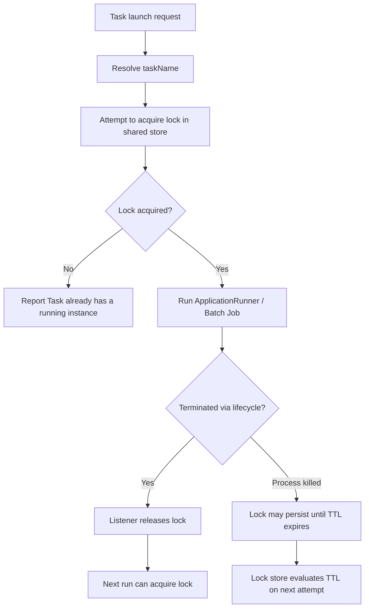

# Lock Check Interval and Lock Time-To-Live (TTL) in Spring Cloud Task

## 1. Why Does a Task Need a Lock?

**Spring Cloud Task** is used to build Spring Boot applications with a finite runtime: start up, perform work, and terminate. Each run can record metadata in `TaskRepository` as a `TaskExecution`, including start time, end time, exit code, and outcome. Tasks are commonly invoked manually, on a schedule, or through an orchestrator; invocations can arrive concurrently.

Suppose the `daily-invoice-import` application imports invoices:

- 01:00: The scheduler launches Task A, expected to run for 18 minutes.
- 01:05: A rerun request starts Task B with the same name.
- If A and B write data concurrently, invoices can be imported twice.
- If A is killed while holding the lock, a stale lock can block subsequent runs even though no process is actually running.

Spring Cloud Task provides a **single-instance** mode to prevent multiple Tasks with the **same name** from running concurrently. When using a JDBC lock shared across instances, the mechanism requires two parameters: **check interval** and **lock time-to-live (TTL)**. Misconfiguring these two values can cause the application to be rejected repeatedly, or worse, allow two processes to modify data simultaneously.

This lesson in the **Locking and Concurrency** chapter helps you:

1. Understand `single-instance-enabled`, `single-instance-lock-check-interval`, and `single-instance-lock-ttl`.
2. Distinguish lock check intervals from Task schedules, scheduler retries, and business execution duration.
3. Inspect the lock table, recognize stale locks, and identify risks when TTL expires while a Task is still active.
4. Select values based on actual runtimes, verify with two processes, and build a recovery plan.
5. Coordinate safely with Spring Batch, transactions, idempotency, and orchestrators.

## 2. Scope of the Single-Instance Mechanism

When `spring.cloud.task.single-instance-enabled=true`, Spring Cloud Task enables `SingleInstanceTaskListener` to attempt acquiring a lock by **Task name** before business logic runs. According to the official documentation, if another run with the same name already holds the lock, the new run is rejected; this contention scenario is documented as failing with **exit code 1**.



The lock scope is **`taskName`**, not PID, `TaskExecutionId`, report date, or command-line arguments. Two runs with the same name but different `--run-date` values still contend for the same lock. Conversely, two runs with different names may not block each other even if both write to the same business table.

The Task name is typically resolved by `TaskNameResolver`. You can set `spring.cloud.task.name` explicitly; otherwise, the name may be derived from the Spring Boot application identifier. Every instance that must block others must use the **same name and the same lock store**. In multi-container environments, per-process in-memory H2 **does not** provide distributed locking.

| Component | Function | Does Not Guarantee |
| --- | --- | --- |
| `TASK_EXECUTION` / `TaskRepository` | Records run history | Does not automatically prevent duplicate Tasks |
| `SingleInstanceTaskListener` | Acquires/releases lock before and after work | Does not protect data after lock expiration |
| `TASK_LOCK` / JDBC lock store | Coordinates across JVMs sharing a database | Does not terminate the process when TTL expires |
| Scheduler, Kubernetes Job, Cron | Decides when to submit launch requests | Cannot be replaced by the lock check interval |
| Unique constraints, business locks, idempotency | Prevents duplicate writes on retries or overlaps | Does not replace observability and orchestration |

## 3. Three Properties to Understand Together

| Property | Default per Spring Cloud Task Config Table | Meaning |
| --- | --- | --- |
| `spring.cloud.task.single-instance-enabled` | `false` | Enables/disables single-run protection per name |
| `spring.cloud.task.single-instance-lock-check-interval` | `500` **milliseconds** | Wait time between lock check/acquisition attempts made by the lock mechanism |
| `spring.cloud.task.single-instance-lock-ttl` | `Integer.MAX_VALUE` **milliseconds** | Maximum validity duration of a lock in the distributed mechanism |

**The unit is milliseconds**, not seconds. For example, `1000` is 1 second; `1800000` is 30 minutes. The default figures above reflect the configuration properties documentation referenced at the end of this lesson. When upgrading Spring Cloud Task or Spring Integration, verify the properties for the exact version your project uses.

Example `application.yml`:

```yaml
spring:
  application:
    name: invoice-import
  main:
    web-application-type: none
  cloud:
    task:
      name: daily-invoice-import
      single-instance-enabled: true
      single-instance-lock-check-interval: 1000
      single-instance-lock-ttl: 1800000
```

In this configuration, the interval is 1 second and the TTL is 30 minutes. If A finishes normally after 10 minutes and the listener releases the lock, another run can acquire the lock **before the 30-minute mark**. TTL does not force the Task to hold the lock for the full 30 minutes.

### 3.1. Check Interval Is Not a Run Schedule

`single-instance-lock-check-interval` describes the wait period between check/retry attempts performed by the locking mechanism. It does **not** mean Spring Cloud Task creates a new `TaskExecution` every 1,000 ms. Nor is it a heartbeat mechanism that renews the TTL.

The single-instance documentation describes a second request with the same name while the lock is held as **failing**, without promising an unbounded queue waiting for the first instance. Therefore:

- Reducing the interval does not guarantee request B will run immediately once A finishes.
- Increasing the interval does not reduce how often the scheduler invokes the Task.
- If B must run after A, use bounded retry/backoff in the scheduler, a message queue, or a dedicated orchestration mechanism.
- If the locking mechanism performs multiple JDBC attempts, an overly small interval can increase database round-trips; a larger interval can add latency in waiting paths. Verify how it behaves in your running version.

In particular, do not confuse `single-instance-lock-check-interval` with `@Scheduled(fixedDelay=...)`, `spring.task.scheduling.*`, Spring Batch polling intervals, or Kubernetes retry settings.

### 3.2. TTL Is Not an Execution Timeout

`single-instance-lock-ttl` defines how long a lock is considered valid. **It does not stop the JVM, cancel the runner, roll back transactions, or interrupt a Batch Job** when the deadline passes. If A is still working after the lock's TTL expires, B may be allowed to acquire the lock and **run in parallel with A**.

TTL also supports recovery: if A dies without running its release callback, the lock may remain in the database, but the lock store can treat the lock as expired on the next check/reclaim attempt. TTL expiration does not guarantee the row is deleted at that exact millisecond.

Choosing a TTL always involves a trade-off:

| TTL | Advantage | Risk |
| --- | --- | --- |
| Too short | Orphaned locks are replaced sooner | A still-running long Task can be overtaken by another instance |
| Too long | Reduces risk of expiration while Task still runs | A crashed Task can block new launches for a very long time |
| Matched to realistic runtime bounds | Balances safety and recovery | Still requires monitoring, incident handling, and idempotency |

The default value of `Integer.MAX_VALUE` milliseconds is huge and **not a safe permanent setting**. Do not leave it at default simply because you lack runtime measurements.

## 4. Timeline Model

Assume a 30-minute TTL, 1-second interval, and instances sharing a JDBC lock store:

```text
01:00  A acquires lock and starts importing invoices.
01:05  B with same taskName launches -> rejected because A's lock is still valid.
01:18  A finishes; listener releases lock.
01:19  C launches -> can acquire lock.

If A dies abnormally:
01:00  A acquires lock.
01:07  A is killed without executing lifecycle unlock.
01:10  B tries to acquire lock -> may be rejected because TTL has not elapsed.
After TTL  The lock store can allow another attempt to reclaim/reacquire the old lock.

If TTL is too short:
01:00  A acquires lock, but work runs longer than 30 minutes.
01:30  Lock is considered expired while A is still writing data.
01:31  B acquires lock -> risk of A and B overlapping.
```

These timestamps **illustrate the principle**. In real deployments, outcomes also depend on transactions, database latency, expiration evaluation, clock accuracy, and the lock registry version. Do not assume a run will be permitted at the exact millisecond the TTL elapses.

### What Does the JDBC Lock Store See?

The Spring Cloud Task lock schema typically uses the `TASK_LOCK` table:

| Column | Meaning |
| --- | --- |
| `LOCK_KEY` | Lock identifier at the repository layer, typed `CHAR(36)` in standard DDL |
| `REGION` | Lock group/namespace |
| `CLIENT_ID` | Lock store client identifier |
| `CREATED_DATE` | Timestamp when the lock record was created/updated by the mechanism |

```sql
SELECT LOCK_KEY, REGION, CLIENT_ID, CREATED_DATE
FROM TASK_LOCK
ORDER BY CREATED_DATE DESC;
```

This is a **read-only query**. Verify table/column names against actual DDL when using a table prefix or a different version. Do not assume `LOCK_KEY` equals the literal Task name; the lock registry may transform keys internally before persisting. Do not join `CLIENT_ID` directly with `TASK_EXECUTION_ID` without verifying the implementation.

## 5. Preparing Maven, Gradle, and a Shared DataSource

Spring Cloud Task documentation requires Spring Integration Core and Spring Integration JDBC dependencies when using single-instance mode. Your project must import a Spring Cloud BOM compatible with Spring Boot to manage versions; do not mix individual `spring-cloud-*` versions manually.

**Maven** — valid dependencies inside `pom.xml`:

```xml
<dependencies>
    <dependency>
        <groupId>org.springframework.cloud</groupId>
        <artifactId>spring-cloud-starter-task</artifactId>
    </dependency>
    <dependency>
        <groupId>org.springframework.integration</groupId>
        <artifactId>spring-integration-core</artifactId>
    </dependency>
    <dependency>
        <groupId>org.springframework.integration</groupId>
        <artifactId>spring-integration-jdbc</artifactId>
    </dependency>
    <dependency>
        <groupId>org.postgresql</groupId>
        <artifactId>postgresql</artifactId>
        <scope>runtime</scope>
    </dependency>
</dependencies>
```

**Gradle (Groovy DSL)** — when the project already imports a compatible BOM:

```groovy
dependencies {
    implementation 'org.springframework.cloud:spring-cloud-starter-task'
    implementation 'org.springframework.integration:spring-integration-core'
    implementation 'org.springframework.integration:spring-integration-jdbc'
    runtimeOnly 'org.postgresql:postgresql'
}
```

In real environments, use PostgreSQL or a supported RDBMS and ensure **every instance points to the same lock backend**. Giving each container its own in-memory H2 database will not prevent overlapping runs. If schemas are managed by Flyway/Liquibase, deploy the Task and lock tables using the version-matched DDL before running the Task.

Example `application.yml` for an environment where the schema already exists and datasource config is injected via environment variables:

```yaml
spring:
  datasource:
    # SPRING_DATASOURCE_URL, SPRING_DATASOURCE_USERNAME,
    # SPRING_DATASOURCE_PASSWORD are supplied by the deployment platform.
    driver-class-name: org.postgresql.Driver
  cloud:
    task:
      name: daily-invoice-import
      single-instance-enabled: true
      single-instance-lock-check-interval: 1000
      single-instance-lock-ttl: 1800000
      initialize-enabled: false
```

`initialize-enabled=false` is only appropriate once you have already created the required tables. It does not make Spring Cloud Task skip requiring `TASK_LOCK`. Never pass database passwords via CLI in real systems because command arguments can appear in shell history or metadata.

## 6. Java Application to Test Locking with Two Processes

The following snippet illustrates a finite-running Task. Use Java 17+ with compatible Spring Boot/Spring Cloud versions and a prepared database and schema. `Thread.sleep` only simulates work; never use it in real business processing.

```java
package com.example.invoice;

import org.springframework.boot.ApplicationArguments;
import org.springframework.boot.ApplicationRunner;
import org.springframework.boot.SpringApplication;
import org.springframework.boot.autoconfigure.SpringBootApplication;
import org.springframework.cloud.task.configuration.EnableTask;
import org.springframework.context.annotation.Bean;

@SpringBootApplication
@EnableTask
public class InvoiceImportTaskApplication {

    public static void main(String[] args) {
        SpringApplication.run(InvoiceImportTaskApplication.class, args);
    }

    @Bean
    ApplicationRunner importInvoices() {
        return args -> {
            int seconds = parseSeconds(args);
            System.out.printf("Starting; seconds=%d%n", seconds);
            Thread.sleep(seconds * 1000L);
            System.out.println("Completed");
        };
    }

    private static int parseSeconds(ApplicationArguments args) {
        var values = args.getOptionValues("demo.seconds");
        if (values == null) {
            return 30;
        }
        if (values.size() != 1 || values.get(0) == null) {
            throw new IllegalArgumentException(
                "demo.seconds must have exactly one value"
            );
        }
        int seconds;
        try {
            seconds = Integer.parseInt(values.get(0));
        } catch (NumberFormatException ex) {
            throw new IllegalArgumentException(
                "demo.seconds must be an integer", ex
            );
        }
        if (seconds < 1 || seconds > 600) {
            throw new IllegalArgumentException(
                "demo.seconds must be in the range 1..600"
            );
        }
        return seconds;
    }
}
```

Because `ApplicationRunner.run` allows throwing exceptions, an `InterruptedException` raised by `Thread.sleep` will not be swallowed. For real work, ensure proper transactions and error handling; **the listener only releases the lock if the lifecycle mechanism gets a chance to run**.

### Testing with Two Terminals

Prepare two terminals connected to the same PostgreSQL database with identical `spring.cloud.task.name`, `single-instance-enabled=true`, and shared lock schema.

**Terminal A**:

```bash
java -jar invoice-import-task.jar --demo.seconds=60
```

**Terminal B**, run immediately while A is still active:

```bash
java -jar invoice-import-task.jar --demo.seconds=10
```

B should be blocked by the single-instance mechanism because A holds the lock for the same name; per Spring Cloud Task docs, a rejected run can return exit code **1**. Once A completes normally, run B again: if the lock has been released, B can enter the runner.

Do not confuse "re-launching B" with "B was automatically queued by the framework from the previous attempt." The rejected run of B was a **failed request**; retrying requires a new action from the operator or scheduler.

### Testing an Overly Short TTL on Dummy Data

Change the test environment configuration:

```yaml
spring:
  cloud:
    task:
      single-instance-enabled: true
      single-instance-lock-check-interval: 500
      single-instance-lock-ttl: 5000
```

Run A for 30 seconds; after more than 5 seconds, try B. If the registry permits expired locks to be reclaimed while A is still running, B **can** begin processing. This demonstrates the overlap risk; never test this on real data. If B is still rejected, consult the documentation/implementation for your exact version and inspect the actual lock state rather than assuming TTL is ignored.

## 7. Choosing TTL and Interval from Actual Runtimes

The TTL value must be based on metrics and operational policy, not just average runtime. Use p95/p99 durations, valid maximum runtimes, scheduler timeouts, DB latency, GC pauses, and a safety margin.

| Illustrative Task Metric | Value |
| --- | --- |
| Median duration | 4 minutes |
| p95 | 9 minutes |
| p99 | 13 minutes |
| Committed business timeout | 20 minutes |
| Margin for abnormal slowness | 10 minutes |
| Initial TTL to test | 30 minutes (`1800000` ms) |
| Initial interval to measure | 1 second (`1000` ms) |

This is an **illustrative choice**, not a recommendation for every service. If a valid Task can run for 60 minutes, a 30-minute TTL is unsafe. If you cannot establish a reliable upper runtime bound, consider lock renewal mechanisms, workflow orchestration, or stronger business-level locking.

Design process:

1. **Define exclusivity scope:** which Task name and data region must avoid parallel execution.
2. **Measure runtime distribution:** include DB waits, Spring Batch checkpoints, cleanup, and process shutdown time.
3. **Set timeouts:** business/scheduler timeout must be an explicit decision; TTL does not create a timeout on its own.
4. **Pick a TTL with headroom:** long enough that valid runs do not lose the lock before finishing, or design renewal with thorough verification.
5. **Measure real interval impact:** monitor JDBC check/retry counts, connection pool pressure, and latency under contention.
6. **Test failures:** two simultaneous launches, crashes, temporary DB disconnects, a Task exceeding TTL, and unlock events.
7. **Verify after upgrades:** Spring Cloud Task/Spring Integration internals can change across versions; never assume every release behaves identically.

### Lock Renewal and Heartbeats

Spring Integration provides `RenewableLockRegistry`; `JdbcLockRegistry` in compatible versions supports `renewLock(...)`. However, **do not** assume `single-instance-lock-check-interval` is a renewal heartbeat, or that `SingleInstanceTaskListener` in every Spring Cloud Task version automatically renews locks for the entire run.

If an application requires lease renewal, verify the exact implementation and lock-owning thread, define the renewal schedule, handle renewal failures, and test runs exceeding TTL. Spring Integration documentation notes that renewal operations must respect thread ownership rules for the corresponding lock registry. When protecting critical data, combine unique constraints, business locks, idempotency, or fencing tokens so an owner that lost its lock cannot continue writing invalid data.

## 8. Stale-Lock Recovery and Operational Observability

A Task with `TASK_EXECUTION.END_TIME IS NULL` **is not guaranteed to still be running**: the process may have been killed before the repository recorded completion. Conversely, a Task still running may have **lost its lock ownership** because its TTL expired. Therefore, cross-check Task metadata, the lock table, logs, and the scheduler.

### Investigation Procedure

1. **Identify the rejected request:** taskName, timestamp, deployment, Job/Pod ID, error message, and exit code.
2. **Check the actual process:** is an owning instance alive in the scheduler/container/OS? Are there incomplete business transactions?
3. **Read database state:** `TASK_LOCK`, `TASK_EXECUTION`, and recent timestamps.
4. **Evaluate TTL:** determine whether the lock has expired at the repository level, or if clock skew or active transactions still hold it.
5. **Plan recovery:** wait for expiration, stop a verified owner, or execute an organization-approved unlock procedure; strictly avoid arbitrarily deleting active lock records.
6. **Verify aftermath:** business data written, `JobExecution`/`StepExecution` if using Batch, retry counts, and idempotency.

**Read-only** queries for cross-checking:

```sql
SELECT LOCK_KEY, REGION, CLIENT_ID, CREATED_DATE
FROM TASK_LOCK
ORDER BY CREATED_DATE DESC;

SELECT
    TASK_EXECUTION_ID,
    TASK_NAME,
    START_TIME,
    END_TIME,
    EXIT_CODE,
    EXIT_MESSAGE
FROM TASK_EXECUTION
WHERE TASK_NAME = 'daily-invoice-import'
ORDER BY TASK_EXECUTION_ID DESC;
```

Do not delete `TASK_LOCK` merely because `CREATED_DATE` looks old: a live owner or active transaction may still depend on that lock. If the schema uses a non-default table prefix, substitute the table names from your actual DDL. Do not treat `CLIENT_ID` as `TASK_EXECUTION_ID` without verifying how the library stores locks.

### Signals to Monitor

| Symptom | Questions to Investigate |
| --- | --- |
| Multiple runs with the same name rejected | Is the scheduler sending duplicates or is a valid Task running too long? |
| Lock persists long after process ended | Did unlock fail, was the process killed, or is TTL overly large? |
| Task runs near or beyond TTL | Is there a risk the owner loses its lock while writing data? |
| Connection pool errors during lock checks | Are the interval and retry attempts causing pressure, or is the DB unhealthy? |
| Two Tasks with the same name run concurrently | Do they use the same database, same taskName, and same config? Did TTL expire? |
| `END_TIME` stays empty for a long time | Is the process still alive or is metadata stuck after a crash? |

When designing alerts, distinguish **rejected due to a valid owner** from **unable to access the lock repository**. Both prevent the Task from running, yet their remediation procedures differ significantly.

## 9. Coordinating with Spring Batch and Preventing Duplicate Data

Spring Cloud Task tracks the **process**, while Spring Batch tracks `JobInstance`, `JobExecution`, `StepExecution`, and restart state. A Task can launch a Batch Job; the same Batch Job could also be launched from two differently named Tasks.

| Mechanism | Protected Target |
| --- | --- |
| Spring Cloud Task single-instance | Tasks sharing the same name within one lock store |
| Spring Batch `JobRepository` | Job execution state by Job name and identifying `JobParameters` |
| Scheduler/orchestrator | Launch timing, retries, and timeouts |
| Business unique constraint/idempotency | Output records such as a `(tenant_id, period)` pair |

**Single-instance is not an exactly-once guarantee for data.** If A writes 500 records and crashes, B may be invoked again after TTL; without proper checkpoints, transactions, or idempotency, those 500 records may be created again. A lock prevents overlaps under normal conditions, but does not replace data-integrity controls across crashes and retries.

For long Tasks with many partitions, locking by a single `taskName` may be too broad. If multiple differently named Tasks touch the same dataset, locking by Task name may be too narrow. Identify the true business key before choosing a concurrency strategy.

## 10. Exercises and Self-Assessment Questions

### Exercise 1 — Two Runs with the Same Name

Create a simulated 60-second Task using a shared database, with single-instance enabled, 1-second interval, and 2-minute TTL. Launch A and B a few seconds apart; record B's exit code and log order. Once A completes, launch B again. Explain why the first run of B was not automatically queued.

### Exercise 2 — TTL Expiring While Task Is Still Running

On dummy data, set TTL to 5 seconds, run A for 30 seconds, and launch B after 8 seconds. If B enters the runner, describe the risk. If B does not enter, check the schema, logs, and implementation to find out why. Never run this test on production business tables.

### Exercise 3 — Orphaned Lock After Crash

Have A acquire the lock and then terminate abruptly in a test environment. Use read-only queries to inspect `TASK_LOCK` and `TASK_EXECUTION`; verify the process stopped, wait past TTL, and retry. Write a recovery runbook covering ownership checks and data-state verification.

### Exercise 4 — Tight Recovery Constraints

A Task has a p99 of 50 minutes and a 90-minute timeout, yet operations needs recovery within 10 minutes if a node dies. Why is a 10-minute TTL dangerous if the Task is still running? How does a TTL over 90 minutes slow down recovery? Propose a verified renewal or orchestration approach paired with idempotency/business locks.

### Self-Check Questions

1. Does `single-instance-lock-check-interval=500` mean Spring Cloud Task runs the Job automatically every 500 ms?
2. With a 30-minute TTL, does the JVM automatically shut down the application after 30 minutes?
3. Why must containers share the same lock database and the same `spring.cloud.task.name`?
4. Why is `TASK_EXECUTION.END_TIME IS NULL` insufficient to confirm a lock is still valid?
5. What happens if a process holds a lock past its TTL while still writing data?
6. Why do Batch Jobs and unique constraints remain important even when a Task enables single-instance mode?

**Completion criteria:** You can explain the roles of interval and TTL, choose millisecond values from real runtimes, simulate contention across two processes, spot risks of overly short/long TTLs, and propose a recovery procedure along with duplicate-write safeguards.

## Official References

- [Spring Cloud Task — Features, Restricting Spring Cloud Task Instances](https://docs.spring.io/spring-cloud-task/reference/features.html): enabling single-instance and behavior on duplicate names.
- [Spring Cloud — Configuration Properties](https://docs.spring.io/spring-cloud/docs/current/reference/html/configprops.html): `single-instance-lock-check-interval` and `single-instance-lock-ttl` values.
- [Spring Cloud Task — SingleInstanceTaskListener API](https://docs.spring.io/spring-cloud-task/docs/current/apidocs/org/springframework/cloud/task/configuration/SingleInstanceTaskListener.html): callbacks for acquiring and releasing locks.
- [Spring Cloud Task — Repository Schema](https://docs.spring.io/spring-cloud-task/docs/current/reference/html/): the `TASK_LOCK` table.
- [Spring Integration — JDBC Lock Registry](https://docs.spring.io/spring-integration/reference/jdbc/lock-registry.html): `JdbcLockRegistry`, TTL, `idleBetweenTries`, and lock renewal.
- [Spring Batch — Reference Documentation](https://docs.spring.io/spring-batch/reference/): Job lifecycle, checkpoints, and restarts.
