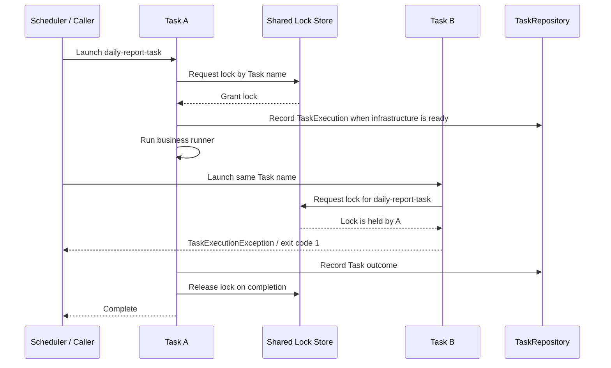
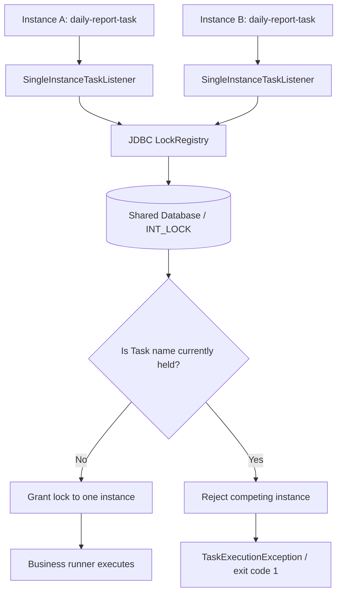

# Outcome When Another Instance Already Holds the Lock

## Objectives

**SPRING_CLOUD_TASK (Spring Cloud Task)** enables Spring Boot applications to run for a finite duration, storing the state and outcome of each execution in `TaskRepository`. A task may be triggered on a schedule, manually, or from a Spring Batch pipeline. When multiple requests arrive closely together, two instances of the same task can launch concurrently; if both write data, they can produce duplicate reports, overwrite results, or contend for resources.

Within the **Locking and Concurrency** chapter, this lesson focuses on the question: **what happens when a second instance starts while the first instance still holds the single-instance lock?** After this lesson, you will be able to:

- Configure `spring.cloud.task.single-instance-enabled` and explain the lock scope by **Task name**.
- Recognize the actual outcome for the second instance: it does not run the business runner, reports that the Task is already running, and returns **exit code 1** under the documented mechanism.
- Distinguish lock rejections from business errors, database errors, or other startup failures.
- Set up a shared lock store with Spring Integration JDBC and manage schema, TTL, schedules, and retries.
- Observe `TaskExecution`, logs, and orchestrator state without guessing from a single source.
- Understand the limits of single-instance locking and add idempotency, business-key locks, or orchestration when needed.

## 1. Primary Outcome: The Second Instance Is Rejected

Spring Cloud Task provides a feature that limits execution to **one running instance per Task name**. To enable it, the relevant launches must configure:

```properties
spring.cloud.task.single-instance-enabled=true
```

The default value is `false`. When enabled and one instance already holds the lock for the same Task name, `SingleInstanceTaskListener` fails to acquire the lock and throws a `TaskExecutionException`; the official documentation states that the second instance **fails with process exit code 1**.

The typical documented message is:

```text
Task with name "application" is already running.
```

Here `application` is the example Task name in the documentation. If your application sets the name `daily-report-task`, the corresponding message will use that name. Check actual logs because exception wrapping and exact wording may vary across versions.

This has three important consequences:

1. **The first instance continues running.** It retains permission to execute for that Task name while the lock remains valid.
2. **The second instance does not run business logic in `ApplicationRunner`/`CommandLineRunner`.** Being rejected does not mean a report has already been processed or a Spring Batch Job has finished.
3. **The second instance appears to the orchestrator as a failed run (exit code 1).** Spring Cloud Task does not automatically turn the second request into a durable queue to run after the first instance ends.

**Do not confuse "business logic did not run" with "no side effects occurred."** Spring Boot may still read configuration, instantiate beans, and run initialization callbacks before checking the lock. Therefore, business operations with side effects should never be placed in constructors, `@PostConstruct`, or context initialization logic.

## 2. Illustration with Two Launches

Suppose `daily-report-task` generates the report for `2026-11-23`, taking around 30 seconds per run. The orchestrator receives two commands closely together:

| Illustrative Timestamp | Instance A | Instance B |
| --- | --- | --- |
| 02:00:00 | Starts up and acquires the `daily-report-task` lock. | Not launched yet. |
| 02:00:02 | Processing the report. | Starts up with the same Task name and same lock store. |
| 02:00:03 | Continues processing. | Fails to acquire the lock; reports Task is already running, **exit code 1**. |
| 02:00:30 | Runner completes; shutdown lifecycle releases the lock. | Already terminated with failure; **does not restart automatically**. |
| 02:00:35 | Completed. | A **new run** at this point can acquire the lock if resources are ready. |



The diagram is a **logical model**. The exact order of repository/listener operations and whether a `TaskExecution` row exists for B depend on the version and when the error occurs. Do not conclude "B definitely has a failed `TASK_EXECUTION` row" solely from the diagram; check actual process logs and the database.

## 3. The Lock Belongs to the Task Name, Not the Date or Execution ID

`SingleInstanceTaskListener` creates a lock based on the Task name resolved from configuration, usually `spring.cloud.task.name`. This lock protects the scope of **a single Task name**; it does not inspect business parameters automatically.

| Scenario | Contends on Single-Instance Lock? | Explanation |
| --- | --- | --- |
| Two processes named `daily-report-task`, same database/lock registry | **Yes**, when both enable single-instance. | The second instance is rejected while A still holds the lock. |
| Same Task name, but dates A=`2026-11-22` and B=`2026-11-23` | **Yes**. | The Task name is identical even though the business date differs. |
| Two processes with different names `daily-report-task` and `monthly-report-task` | **Not on this Task name's lock**. | Each name uses a separate lock; business data collisions can still happen. |
| Two processes with the same name using **two different lock databases** | **Do not protect each other**. | Each sees only the lock in its own store. |
| A enables single-instance, but B disables it | **No protection guarantee against B**. | B may bypass the lock check altogether. |
| Two processes on the same date with different `TaskExecution.executionId` | **Still contends** if sharing the same name and lock store. | Execution ID identifies each run, not the job-type lock. |

For example, if you want different dates to run in parallel while forbidding two runs for the **same date**, the default Task-name lock is **too broad**. In that case, design a distributed lock keyed like `daily-report:2026-11-23`, or use a unique constraint/claim on a business table combined with scheduler controls. Never turn the Task name into an arbitrary string containing the date just to bypass locking without evaluating the impact on metadata history and operations.

## 4. Under the Hood: SingleInstanceTaskListener and Spring Integration

When enabled, Spring Cloud Task uses `SingleInstanceTaskListener`. The Javadoc describes this listener attempting to create a lock based on `spring.cloud.task.name` and **throwing `TaskExecutionException` if the lock already exists**. The listener has lifecycle hook methods such as:

- `lockTask(TaskExecution)` — bound to `@BeforeTask` to claim execution rights.
- `unlockTaskOnEnd(TaskExecution)` — bound to `@AfterTask` to release when the Task ends.
- `unlockTaskOnError(TaskExecution, Throwable)` — bound to `@FailedTask` to handle release on the error path.

In common deployments, Spring Cloud Task relies on **Spring Integration JDBC** distributed locking components: `LockRegistry`, `JdbcLockRegistry`, and `DefaultLockRepository`. Locking/unlocking requires a **shared database** across instances; a lock in one JVM's RAM cannot block another JVM.



**Two types of tables to distinguish:**

- Spring Cloud Task metadata, such as `TASK_EXECUTION` and `TASK_EXECUTION_PARAMS`, records **the history of each execution**.
- Spring Integration's lock table, typically `INT_LOCK` with columns like `LOCK_KEY`, `REGION`, `CLIENT_ID`, and `CREATED_DATE` (and possibly additional columns depending on version), records **current lock ownership**.

Do not deploy only the `TASK_EXECUTION` schema and assume single-instance is ready. You need lock DDL compatible with the **exact Spring Integration version**. Some newer versions alter the lock table structure, for example adding TTL metadata; therefore, never copy an `INT_LOCK` `CREATE TABLE` snippet verbatim from docs for a different version during upgrades.

## 5. Minimal Configuration

### 5.1. Maven Dependencies

Alongside Spring Cloud Task and a JDBC driver, the documentation requires two Spring Integration libraries for locking:

```xml
<dependencies>
    <dependency>
        <groupId>org.springframework.cloud</groupId>
        <artifactId>spring-cloud-starter-task</artifactId>
    </dependency>
    <dependency>
        <groupId>org.springframework.boot</groupId>
        <artifactId>spring-boot-starter-jdbc</artifactId>
    </dependency>
    <dependency>
        <groupId>org.springframework.integration</groupId>
        <artifactId>spring-integration-core</artifactId>
    </dependency>
    <dependency>
        <groupId>org.springframework.integration</groupId>
        <artifactId>spring-integration-jdbc</artifactId>
    </dependency>
    <dependency>
        <groupId>org.postgresql</groupId>
        <artifactId>postgresql</artifactId>
        <scope>runtime</scope>
    </dependency>
</dependencies>
```

This example assumes `pom.xml` manages **compatible** Spring Boot and Spring Cloud versions via BOMs, with Spring Integration versions managed by the corresponding BOM. Do not add arbitrary version numbers to individual artifacts, as that easily causes API and schema mismatches.

### 5.2. application.yml and Profile Configuration

```yaml
# application.yml
spring:
  application:
    name: daily-report-task
  main:
    web-application-type: none
  cloud:
    task:
      name: daily-report-task
      single-instance-enabled: true
```

```yaml
# application-prod.yml (assumes schema is already migrated)
spring:
  datasource:
    url: ${TASK_DB_URL}
    username: ${TASK_DB_USER}
    password: ${TASK_DB_PASSWORD}
  cloud:
    task:
      initialize-enabled: false
```

Every process that must contend for the same lock must share the **same Task name**, **same registry mechanism**, **same lock data store**, and enable this feature. If `test` and `prod` environments use different databases, they will not see each other's locks; that is the expected environment isolation.

`spring.cloud.task.initialize-enabled=false` in the example assumes **the Task metadata tables and JDBC lock table have already been deployed**. The Task schema initialization property is not a schema management process for Spring Integration's lock table. Do not use in-memory H2 across two JVMs to test distributed contention because each JVM gets its own private database.

## 6. Testing Two Instances in an Isolated Environment

Create a simple runner that lasts 30 seconds so you have time to launch Instance B. This is **practice code**, not a pattern for deliberately delaying production tasks:

```java
package com.example.report;

import java.time.LocalDate;
import java.util.List;

import org.springframework.boot.ApplicationRunner;
import org.springframework.boot.SpringApplication;
import org.springframework.boot.autoconfigure.SpringBootApplication;
import org.springframework.cloud.task.configuration.EnableTask;
import org.springframework.context.annotation.Bean;

@SpringBootApplication
@EnableTask
public class DailyReportTaskApplication {

    public static void main(String[] args) {
        SpringApplication.run(DailyReportTaskApplication.class, args);
    }

    @Bean
    ApplicationRunner reportRunner() {
        return arguments -> {
            List<String> dates =
                    arguments.getOptionValues("businessDate");
            if (dates == null || dates.size() != 1) {
                throw new IllegalArgumentException(
                        "Exactly one --businessDate=yyyy-MM-dd is required");
            }
            LocalDate businessDate = LocalDate.parse(dates.get(0));

            System.out.println("START businessDate=" + businessDate);
            Thread.sleep(30_000); // Only for testing lock contention.
            System.out.println("END businessDate=" + businessDate);
        };
    }
}
```

Run in **two separate terminals** pointing to the same metadata/lock database:

**Terminal A:**

```bash
java -jar daily-report-task.jar \
  --spring.profiles.active=prod \
  --businessDate=2026-11-23
```

**Terminal B:** run the same command after A prints `START` and before A prints `END`.

```bash
java -jar daily-report-task.jar \
  --spring.profiles.active=prod \
  --businessDate=2026-11-23
```

In both terminals, the same `TASK_DB_URL`, `TASK_DB_USER`, and `TASK_DB_PASSWORD` values must be provided by the environment. The JAR filename is illustrative; substitute your actual artifact.

**Expected outcome:** A prints `START` then `END`; B does not print `START` from the runner, reports that an instance with the same name is already running, and exits with exit code 1. After A completes and releases the lock, run **a new process** to verify it can acquire the lock normally.

Note: do not just see that B "did not print `START`" and assume locking was verified. If B failed due to a wrong `DataSource` or a missing `INT_LOCK` table, it also would not print `START`. Always check the **root failure reason** and exit code.

### 6.1. Identifying the Contention Error

In practice, the message may appear inside a `TaskExecutionException` stack trace thrown by `SingleInstanceTaskListener`. Record:

| Field | A (holds lock) | B (rejected) |
| --- | --- | --- |
| Task name | `daily-report-task` | `daily-report-task` |
| Single-instance flag | `true` | `true` |
| Lock database/registry | Shared store | Same store used by A |
| Runner invoked | Yes | No |
| Process exit code | Usually `0` if business logic succeeds | **1** because the lock is held |
| Logs | Contains business start/end markers | Contains Task-already-running message / `TaskExecutionException` |
| `TaskExecution` record | Check A's record | **Do not assume** whether a separate record for B exists or not |

If A ultimately fails due to a business error, A's failure must be diagnosed separately; B being rejected due to lock contention **does not prove** whether A's business logic succeeded or failed.

## 7. Does the Rejected Instance Have a TaskExecution Record?

`TaskRepository` records metadata about framework-managed runs, whereas a single-instance contention error occurs during **lifecycle startup**. Depending on the Spring Cloud Task version, listener ordering, whether launched with `spring.cloud.task.executionid`, and exact failure timing, B may:

- Have no complete new `TASK_EXECUTION` row saved.
- Have an execution **pre-created** by the orchestrator whose status the process did not update as expected.
- Have clear logs/exit code in the orchestrator even when the metadata row lacks B's final details.

Therefore, the reliable operational statement is: **B failed because it could not acquire the lock and did not run business logic; the exact metadata state must be verified on your specific version and deployment flow.** Never build dashboards assuming "every blocked run always produces a `TASK_EXECUTION` row with `EXIT_CODE=1`."

The following query helps inspect persisted runs:

```sql
SELECT TASK_EXECUTION_ID,
       TASK_NAME,
       START_TIME,
       END_TIME,
       EXIT_CODE,
       EXIT_MESSAGE
FROM TASK_EXECUTION
WHERE TASK_NAME = 'daily-report-task'
ORDER BY TASK_EXECUTION_ID DESC;
```

If you need to inspect Spring Integration's lock table in a compatible schema, run a **read-only** query:

```sql
SELECT LOCK_KEY, REGION, CLIENT_ID, CREATED_DATE
FROM INT_LOCK;
```

Table/column names may differ by schema, prefix, or Spring Integration version. `INT_LOCK` is **lock orchestration infrastructure data**; do not `DELETE` rows merely because a row exists. Before handling a suspected orphaned lock, verify whether the owner is still alive and check the TTL policy of your version.

## 8. TTL, Check Interval, and Abandoned Locks

Spring Cloud Task provides properties related to the single-instance mechanism:

| Property | Documented Default | Meaning |
| --- | --- | --- |
| `spring.cloud.task.single-instance-enabled` | `false` | Whether to enforce a single instance per Task name. |
| `spring.cloud.task.single-instance-lock-check-interval` | `500` ms | Interval between lock check attempts. |
| `spring.cloud.task.single-instance-lock-ttl` | `Integer.MAX_VALUE` ms | Maximum duration a run can hold the lock as configured for the mechanism. |

These properties belong to Spring Cloud Task configuration; Spring Integration's TTL/renewal APIs may vary across versions. Do not infer from the property names that the framework guarantees waiting in a queue until the lock is free. **The documented contention outcome remains failure with exit code 1.**

A customized example, **only to be applied after Task duration and recovery procedures are established**:

```yaml
spring:
  cloud:
    task:
      single-instance-enabled: true
      single-instance-lock-check-interval: 500
      single-instance-lock-ttl: 600000 # 10 minutes, illustrative example
```

Do not set a 10-minute TTL on a Task that can run for 30 minutes: **if the TTL expires while A is still running, B risks acquiring the lock and running in parallel with A** unless the infrastructure provides compatible renewal. Conversely, an overly long TTL slows recovery when a process dies without releasing its lock. Design and test TTL according to maximum runtime, actual heartbeat/renewal behavior of your version, and scheduler timeout policy.

### Node Death or Process Kill Scenarios

When the JVM exits normally, completion or error callbacks get a chance to release the lock. However, when a container receives `SIGKILL`, a node loses power, or the DB network drops, callbacks **may not run**. A lock row may persist until the TTL/cleanup mechanism recognizes expiration and allows reacquisition.

Handling procedure:

1. Check whether A's Job/Pod/process is still running; inspect start time and any heartbeats.
2. Verify the lock database is healthy, the schema is valid, and check lock state via infrastructure tooling.
3. Verify TTL, retry attempts, and how your version's registry handles expired locks.
4. Release/reset the lock only via a tested runbook once certain no valid owner remains; avoid causing two processes to modify data simultaneously.
5. Check A's business output and idempotency before launching B.

Never rely solely on `TASK_EXECUTION.END_TIME IS NULL` to decide whether deleting a lock is safe: that value can mean "still running," "not started yet," or "died before writing metadata."

## 9. How Does the Scheduler Handle Exit Code 1?

From Spring Cloud Task's perspective, lock contention is a **failure of launch B**. Yet to users, its meaning might be "another run is already processing" rather than "report generation logic is broken."

| Orchestration System | Risk If Treating Every Exit Code 1 as an Error Needing Immediate Retry | Suggested Handling |
| --- | --- | --- |
| OS Cron | Every overlapping run fails and leaves scattered error logs. | Send categorized alerts, avoid overlapping schedules; record catch-up requests when needed. |
| Kubernetes CronJob | Job may retry per `backoffLimit`; once A releases the lock, B's retry may start and reprocess the same date. | Combine appropriate `concurrencyPolicy`, backoff/retries, and business locks/idempotency. |
| Manual trigger API | API returns a generic error even though another run is actively processing. | Return a "Task already running" status, surface Process A's ID if known, and define deferred-run policy. |
| Spring Cloud Data Flow or another launcher | A Task execution reports failure even though no business workload executed. | Correlate exit code, lock message, and launcher state; do not lump together with business errors. |

**Important:** Task locking does not decide whether you want to **skip** B, **defer** B, or **queue sequential runs**. That is an orchestrator policy:

- **Skip:** ignore the duplicate request if A already satisfies the same business goal.
- **Queue:** persist the request in a durable queue and attempt launching **after** A completes.
- **Reject:** return a conflict error to the caller and let the caller decide.

If queuing is needed, do not make the second Task run `Thread.sleep` in a loop waiting for A to release the lock. Long waits inside a JVM waste resources and may still fail; manage queuing in the orchestrator.

## 10. Task Locking Does Not Replace Business Idempotency

Even if only one `daily-report-task` process runs at any instant, this scenario can still happen:

1. A finishes writing the report for `businessDate=2026-11-23`, but the process is killed before updating `TaskRepository`.
2. The scheduler observes "failed" and starts B after A's lock expires.
3. B validly acquires the lock because A no longer holds it.
4. If B simply runs `INSERT` without checking a business key, the report may be generated a **second time**.

`Single-instance` solves **concurrent execution** for the same Task name. `Idempotency` solves **sequential re-execution** of the same business work. Both complement each other.

Example report table with a per-date constraint:

```sql
CREATE TABLE daily_report (
    business_date DATE PRIMARY KEY,
    content_json TEXT NOT NULL,
    updated_at TIMESTAMP NOT NULL DEFAULT CURRENT_TIMESTAMP
);

-- PostgreSQL example: controlled overwrite of daily report.
INSERT INTO daily_report(business_date, content_json)
VALUES (DATE '2026-11-23', '{"totalOrders":125}')
ON CONFLICT (business_date)
DO UPDATE SET
    content_json = EXCLUDED.content_json,
    updated_at = CURRENT_TIMESTAMP;
```

This SQL only illustrates one update policy; a real system must decide whether finalized reports may be overwritten, use versioning/locks if required, and coordinate external side effects via an outbox/idempotency key. Do not assume `ON CONFLICT DO UPDATE` always suits business logic requiring immutable results.

For systems requiring "only one Task per date, while different dates run in parallel," use a **business-key** lock or unique claim mechanism. Never treat Task-name locking as automatic partitioning by `businessDate`.

## 11. Coordinating with Spring Batch

When a Spring Cloud Task launches a Spring Batch Job:

- `SingleInstanceTaskListener` governs the **Task process lifecycle by Task name**.
- Spring Batch's `JobRepository` manages `JobInstance`, `JobExecution`, and `JobParameters` states.
- If B is rejected before the runner/Job launcher executes, **no new Batch Job is processed by B** in the normal business flow.
- If A's Job fails, that is **a separate Batch failure**; do not conflate it with Task B being rejected by the lock.

Spring Batch enforces JobInstance restart/uniqueness rules based on JobParameters. Those rules **do not replace** Task single-instance locking, and vice versa. A Task running multiple Jobs or a Job triggered by multiple differently named Tasks may need concurrency control at the Batch/DB level.

When reporting status to operators, separate three questions: (1) was the lock acquired to start the Task, (2) how did the Task start and end, and (3) did the Batch Job/business output succeed?

## 12. Verification Matrix

| Scenario | Lock Outcome | Runner B | What to Verify |
| --- | --- | --- | --- |
| A holds lock, B shares name/registry/single-instance enabled | B is rejected | Does not run | `TaskExecutionException`, **exit code 1**, A continues. |
| A released lock, new B starts | B can acquire lock | Runs if config is valid | Independent metadata for B, business output. |
| B has a different Task name | Does not contend for **A's name lock** | Can run | Guard against data conflicts if both Tasks access the same tables. |
| B points to a different lock database | Does not see A's lock | Can run | Inspect `DataSource`, active profiles, and schema. |
| B sets `single-instance-enabled=false` | Does not participate in single-instance blocking | Can run | Do not assume protection is active. |
| A is killed, old lock remains | Depends on TTL/registry | May be blocked or run after expiration | Verify actual owner, lock row, deadline; follow runbook. |
| B lacks `INT_LOCK`/JDBC privileges | Infrastructure error, distinct from A holding lock | Does not run | SQL stack trace, migrations, and permissions; do not misclassify as contention. |
| A held lock, but scheduler retries B after A finishes | Retry can acquire lock | Can run | Guard business logic against duplicate processing; review retry policy. |

### Misconceptions to Avoid

- **"B's exit code 1 means report processing failed."** Not necessarily: B may never have entered the runner and was simply denied permission to start.
- **"B will automatically wait for A and then run."** Single-instance provides no such guarantee; documented default behavior on conflict is failure.
- **"Seeing a `TASK_EXECUTION` for A means A is still running."** The record may remain unfinished due to a crash; check the actual process and lock.
- **"Setting `single-instance-enabled=true` in every Pod is enough."** Pods must share the same distributed registry, lock database, and Task name.
- **"Using one Task name for every pipeline protects all data."** It can lock too broadly, while differently named Tasks can still touch the same data.
- **"A tiny TTL gives fast recovery with no risk."** Expiring too early can allow two instances to run concurrently.

## 13. Comprehensive Practice

**Scenario:** a system runs `daily-report-task` via cron at 02:00 while also allowing operators to click "rerun now." Requirement: prevent concurrent processing of the same task while preserving failure auditability.

1. Use a shared PostgreSQL instance for `TaskRepository` and the JDBC lock registry in a test environment. Prepare both the Task schema **and** the version-matched Spring Integration lock table.
2. Add `spring-integration-core` and `spring-integration-jdbc`, and enable `spring.cloud.task.single-instance-enabled=true`.
3. Run the sample 30-second runner in Terminal A, then launch B with the same Task name and database.
4. Confirm B exits with **exit code 1** and a Task-already-running message; B's runner does not print `START`.
5. Query `TASK_EXECUTION` and inspect logs and status for both processes. Record the observed metadata behavior instead of assuming B wrote a row.
6. After A finishes, launch a new C. Confirm C acquires the lock and starts.
7. Test a different Task name, and the same Task name with a different `businessDate` parameter; verify locking keys on name, not date.
8. Simulate a failure by killing A **only in an isolated test environment**. Observe TTL, retries, and how orphaned locks are detected under your mechanism.
9. Add a per-date unique key to the business table. Run sequentially twice for the same date and verify no duplicate report is created.
10. Configure the orchestrator's retry/concurrency policy and document the rule on conflict: `skip`, `queue`, or `reject`.

**Completion criteria:** you can demonstrate B being blocked while A holds the lock, distinguish lock conflicts from DB/Batch errors, inspect both process exit codes and metadata, understand name-based lock scoping, and prevent duplicate data when the scheduler retries.

## 14. References

- [Spring Cloud Task — Restricting Spring Cloud Task Instances](https://docs.spring.io/spring-cloud-task/reference/features.html): `single-instance-enabled` config, conflict example, and exit code 1.
- [SingleInstanceTaskListener Javadoc](https://docs.spring.io/spring-cloud-task/docs/current/apidocs/org/springframework/cloud/task/configuration/SingleInstanceTaskListener.html): listener creating a lock by Task name and throwing `TaskExecutionException` when the lock exists.
- [Spring Cloud Task / Spring Cloud Properties](https://docs.spring.io/spring-cloud/docs/current/reference/html/configprops.html): `single-instance-lock-check-interval`, `single-instance-lock-ttl`, and default values.
- [Spring Integration — JDBC Lock Registry](https://docs.spring.io/spring-integration/reference/jdbc/lock-registry.html): `JdbcLockRegistry`, `DefaultLockRepository`, `INT_LOCK` schema, and TTL.

These examples explain common behavior for Spring Cloud Task 3.x and Spring Integration JDBC infrastructure; before deploying, lock in compatible versions and test against your actual database/dialect.

## Key Takeaways

- With `single-instance-enabled=true`, **a second instance with the same Task name while the lock is held fails with exit code 1** without executing the business runner.
- Single-instance is **locked by Task name and a shared lock registry**. Without a shared registry or when one side disables the flag, mutual exclusion is not guaranteed.
- `SingleInstanceTaskListener` uses distributed locking; Spring Integration's lock table and `TaskRepository` metadata tables serve distinct roles.
- **The lock does not auto-queue** rejected requests. The scheduler must implement a skip/queue/reject policy and controlled retries.
- Too short a TTL breaks concurrency protection; too long a TTL slows crash recovery. Always verify the actual owner before intervening on a lock.
- Task locking prevents **concurrent duplicates**, whereas business constraints/idempotency prevent **sequential rerun duplicates**. Both are needed when results must stay safe.
