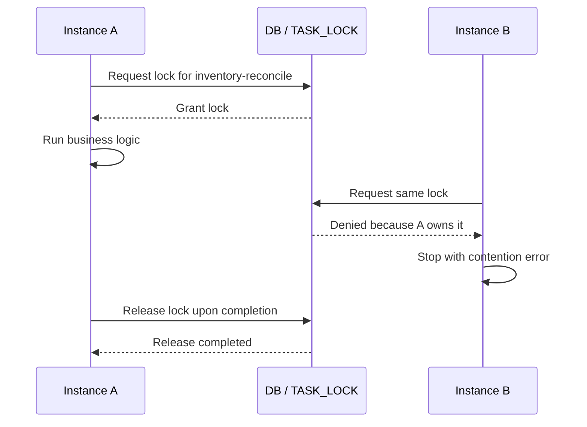
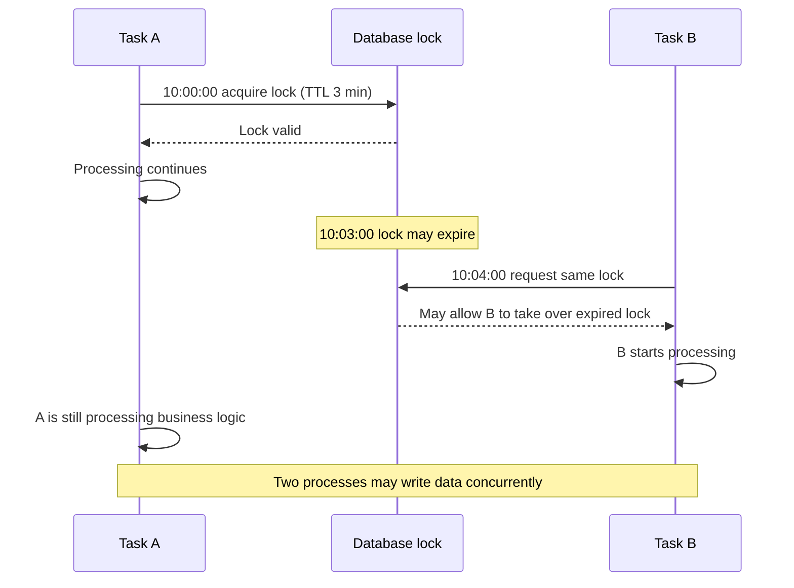
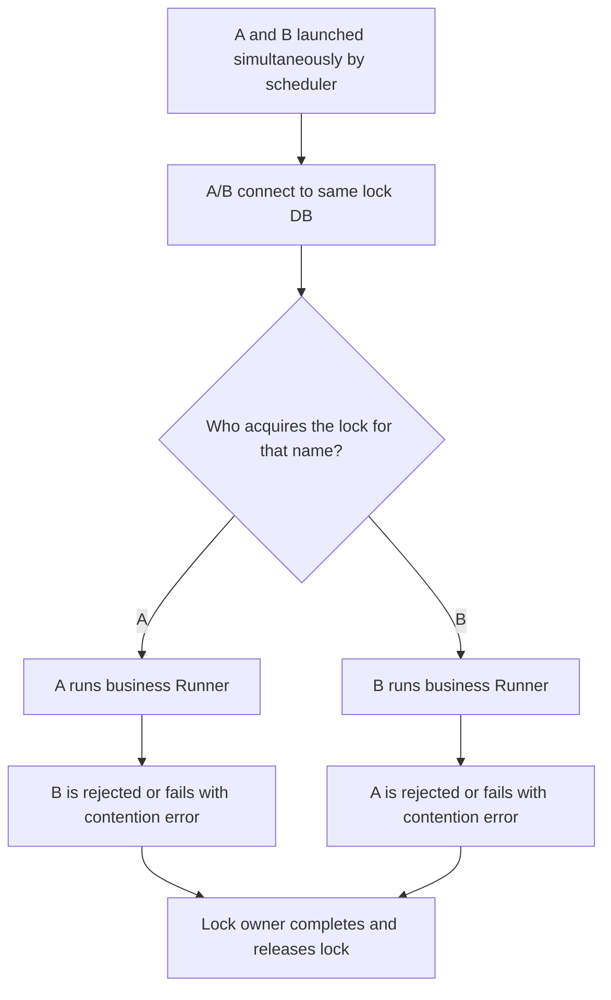

# Expired Locks, Dead Processes, and Contention Scenarios

## 1. Context: Why Might a Spring Cloud Task Need a Lock?

**Spring Cloud Task** helps build Spring Boot applications that run for a finite duration: start up, process work, record execution results via `TaskRepository`, and terminate. This work can be run on a schedule, on demand, or via an orchestrator, and integrated with Spring Batch when stepped data processing is required. In multi-server or multi-container environments, two requests to run a Task can arrive nearly simultaneously.

Suppose the `inventory-reconcile` task reconciles inventory every hour. The 10:00 run has not finished yet, but right at 11:00 the scheduler launches the next run. If both modify the state of the same warehouse simultaneously, overwrites, double updates, or duplicate notifications can occur. One way to mitigate this risk is to **allow only one instance with the same Task name to execute at a time**.

Spring Cloud Task provides a **single-instance** feature using a lock mechanism shared across instances. This lesson focuses on non-ideal scenarios: **a lock expiring while a process is still running**, **a process dying before releasing its lock**, **two instances contending for a lock**, **database connection loss**, and **safe recovery procedures**.

After this lesson, you will be able to:

- Explain the differences between in-JVM locks, distributed locks, database transactions, and business locks.
- Configure `single-instance-enabled`, lock expiration (TTL), and lock check interval for your version.
- Inspect lock information in the database without arbitrarily mutating ownership state.
- Analyze contention timelines, timeouts, crashes, and **split-brain** risks.
- Choose timeouts, monitoring mechanisms, idempotency, and fencing based on data criticality.
- Design testing and operational runbooks when a task cannot acquire a lock or a lock is stuck.

## 2. Four Mechanisms Commonly Confused with One Another

| Mechanism | Protection Scope | Problem Solved | Limitations |
| --- | --- | --- | --- |
| `synchronized` / `ReentrantLock` | Threads inside **the same JVM** | Prevents concurrent access within one process | Does not block two different pods or hosts |
| Distributed lock via database | Multiple processes using **the same lock store** | Coordinates execution rights across instances | Subject to TTL, network errors, release and reclamation issues |
| SQL transaction / row lock | Rows or operations within **one DB transaction** | Prevents inconsistent writes | Does not retain exclusive ownership for the entire Task after commit |
| Business lock, idempotency, fencing | A **unit of work/data** | Prevents duplicate side effects and stale-owner overwrites | Must be designed for specific business semantics |

**A distributed lock does not make business data completely safe on its own.** It reduces the chance of concurrent execution when instances follow the same rules, yet transactions and deduplication safeguards are still required to protect data if the lock loses validity.

For example, two JARs on two servers using `ReentrantLock` create **two independent locks**; both can still run. Conversely, if both configure Spring Cloud Task single-instance with a shared repository database and the same Task name, they participate in shared coordination.

## 3. Single-Instance in Spring Cloud Task

### 3.1. Operating Principle

When `spring.cloud.task.single-instance-enabled=true` is enabled, Spring Cloud Task uses a Spring Integration-based locking component to restrict multiple runs with the **same Task name**. According to official documentation, if one instance holds the lock and another attempts to run with the same name, the later run is rejected, typically with an error like:

```text
Task with name "inventory-reconcile" is already running.
```

A rejection due to a duplicate instance is documented as returning exit code **1**. Do not treat this as a silent success skip by default. The orchestration system must know whether blocking the subsequent run is acceptable under the scheduling policy.

This feature is **off** by default in standard Spring Cloud Task documentation. When enabled, runs must use the **same Task name** and **same lock storage** to coordinate. The Task name is typically resolved by `TaskNameResolver`; you can explicitly configure `spring.cloud.task.name` to avoid runs accidentally using different names.



The diagram shows the logical model of the **normal path**. Whether callbacks run in time and lock release succeeds when the JVM or DB fails are separate questions that must be handled explicitly.

### 3.2. Required Dependencies

Besides the Spring Cloud Task starter and an appropriate JDBC driver, the single-instance docs require Spring Integration modules:

```xml
<dependencies>
    <dependency>
        <groupId>org.springframework.cloud</groupId>
        <artifactId>spring-cloud-starter-task</artifactId>
    </dependency>
    <dependency>
        <groupId>org.springframework.integration</groupId>
        <artifactId>spring-integration-core</artifactId>
    </dependency>
    <dependency>
        <groupId>org.springframework.integration</groupId>
        <artifactId>spring-integration-jdbc</artifactId>
    </dependency>
</dependencies>
```

The Maven snippet assumes the project already manages **compatible Spring Boot and Spring Cloud versions**, along with a `DataSource` and JDBC driver. Do not manually pick an independent Spring Integration version that drifts from Spring Cloud Task's APIs. Verify compatibility with your Task version, especially when upgrading across Spring Boot generations.

### 3.3. Configuring a Task with PostgreSQL

```yaml
spring:
  application:
    name: inventory-reconcile
  main:
    web-application-type: none
  datasource:
    url: ${TASK_DB_URL:jdbc:postgresql://localhost:5432/taskdb}
    username: ${TASK_DB_USER:task_user}
    password: ${TASK_DB_PASSWORD}
  cloud:
    task:
      name: inventory-reconcile
      single-instance-enabled: true
      single-instance-lock-ttl: 180000
      single-instance-lock-check-interval: 500
      initialize-enabled: false
      closecontextEnabled: true
```

In this example:

- `single-instance-enabled: true` turns on the single-run restriction per name.
- `single-instance-lock-ttl: 180000` equals **180,000 ms = 3 minutes**, intended only for short-duration experiments.
- `single-instance-lock-check-interval: 500` specifies the lock check interval in milliseconds in versions supporting this property; **it is not a lock-renewal heartbeat** and not a scheduler retry interval.
- `initialize-enabled: false` assumes migrations have already created all repository and lock tables matching your Spring Cloud Task version's DDL. Without the schema, startup can fail.
- `closecontextEnabled: true` closes the context after the Task completes; the application must still release resources it manages itself.

**Version note:** Property names and defaults can change across release trains. Spring Cloud config docs describe a default TTL of `Integer.MAX_VALUE` milliseconds and a default check interval of `500` milliseconds; do not treat these as immutable constants across every version. **Read the configuration metadata of the exact dependency versions locked in your project** before choosing a production TTL.

### 3.4. Lock Scope Depends on Task Name

An important point: **single-instance locks by Task name**, not automatically by business parameters.

For example:

```bash
java -jar inventory-task.jar --warehouse=north
java -jar inventory-task.jar --warehouse=south
```

If both share the same Task name and repository, these two commands **will still contend for the same lock**, even though they process two independent warehouses. If the goal is to serialize per `warehouse`, intentionally design a business/partition-level lock; never assume the framework automatically folds `--warehouse` into the lock key.

Conversely, if two processes accidentally use different Task names or point to **two different lock databases**, setting `single-instance-enabled=true` on both **does not create system-wide mutual exclusion**.

## 4. TASK_LOCK and Reading Lock State

### 4.1. Role of the Lock Table

In a JDBC configuration, Spring Cloud Task uses a lock table such as `TASK_LOCK` for single-instance mode. Columns commonly seen in DDL scripts include:

| Field | Common Role |
| --- | --- |
| `LOCK_KEY` | Identifier of the lock record |
| `REGION` | Lock group/region in Spring Integration's mechanism |
| `CLIENT_ID` | Identifier of the party storing the lock record |
| `CREATED_DATE` | Timestamp stored for lock management |

**Do not guess** column names, constraints, primary keys, or extra objects from an illustrative table. Structure varies by Spring Integration version and database vendor. Some newer Spring Integration versions add expiration metadata, such as an `EXPIRED_AFTER` column. Use the DDL **for the exact Spring Cloud Task/Spring Integration version running** to avoid lock read/write errors.

On PostgreSQL, you can **read** this table:

```sql
SELECT *
FROM TASK_LOCK;
```

In production environments, restrict who has permission to query this table. Never include `DELETE FROM TASK_LOCK` in automated incident remediation scripts, because you could accidentally delete a lock still owned by a live Task.

### 4.2. Why You Should Not Search for the Task Name Directly in LOCK_KEY

`LOCK_KEY` in `JdbcLockRegistry` may be a key transformed/encoded for storage rather than containing `spring.cloud.task.name` verbatim. Nor is `REGION` guaranteed to be the job name or cluster name.

Therefore, do not write queries like `WHERE LOCK_KEY = 'inventory-reconcile'` and conclude no lock exists if zero rows match. To correlate a **suspected lock** with a Task name, understand your exact version's lock implementation or use official operational monitoring/support tools.

### 4.3. TASK_EXECUTION Is Not the Lock Ownership Table

`TASK_EXECUTION` stores the lifecycle of a run: start time, end time, Task name, exit code, and error details. For example:

```sql
SELECT TASK_EXECUTION_ID,
       TASK_NAME,
       START_TIME,
       END_TIME,
       EXIT_CODE,
       ERROR_MESSAGE
FROM TASK_EXECUTION
WHERE TASK_NAME = 'inventory-reconcile'
ORDER BY TASK_EXECUTION_ID DESC;
```

This is investigative metadata, **not a substitute for verifying process liveness or current lock state**. A row with `END_TIME IS NULL` may be a running Task or a Task that died before updating the repository. Never conclude it is safe to delete a lock from this record alone.

## 5. What Is TTL, and What Happens When a Lock Expires?

### 5.1. The Lease Concept (Time-Bounded Lock Ownership)

**Time to live (TTL)** is the duration for which a lock record is considered valid by the lock management mechanism. A key purpose is to allow another process to **reclaim or take over an old lock** when the prior owner could not release it due to a crash, power loss, or abnormal termination.

TTL does **not** mean:

- The JVM automatically stops when TTL expires.
- Business transactions automatically roll back at the exact moment TTL expires.
- The lock row vanishes instantaneously when the clock hits the deadline.
- Another instance is guaranteed to start immediately right after TTL.
- The old process's access is automatically revoked from all external systems.

In JDBC locking, detecting and handling expired locks may occur **when the next lock acquisition request arrives**, depending on the implementation. TTL is a **limit on ownership in the lock store**, not a watchdog that kills processes.

### 5.2. Lock Expiration Timeline Example

Suppose A runs for 10 minutes, but the TTL is only 3 minutes:



This is a **split-brain risk**: the lock system considers B the new owner, yet A has not stopped, so both can mutate the same resource. If both call a shipping-label API, a Task lock alone cannot stop duplicate requests from being sent.

**Design takeaway:** a TTL that is too short can cause concurrent runs; a TTL that is too long forces long waits after a crash. Never pick a short TTL merely for "fast self-recovery."

### 5.3. A Large Default TTL Is Not a Safety Guarantee

In some Spring Cloud Task configurations, the default TTL is documented as `Integer.MAX_VALUE` milliseconds—about **24.9 days**. This reduces the chance of expiration during long jobs, yet can leave locks abandoned for a long time after a process crashes.

In real deployments, measure **actual Task durations**, I/O wait times, orchestrator timeouts, and lock reclamation procedures. Never assume leaving TTL near infinity is optimal.

### 5.4. Can a Lock Be Renewed?

Spring Integration provides a **renewal** interface/mechanism for certain `JdbcLockRegistry` implementations. According to Spring Integration documentation, `renewLock(...)` must be called **while holding the lock** and typically only succeeds when the calling thread is still the lock-owning thread, depending on API version.

Do not assume enabling `spring.cloud.task.single-instance-enabled` **renews indefinitely automatically** or that every Spring Cloud Task version runs a lock heartbeat. If a task must run longer than TTL, you need to:

1. Verify the exact Spring Integration/Task libraries and whether renewal is integrated into the single-instance flow.
2. Without reliable renewal, choose a TTL longer than a bounded maximum processing duration and monitor timeouts.
3. If building custom renewal, verify ownership before every renewal and adopt a policy to **halt data writes if renewal fails**.
4. For critical data, add a **fencing token** or stale-owner rejection at the target resource.

Calling renewal from the wrong thread or using APIs from another version can fail. Never ship a custom lock-renewal bean to production without thoroughly verifying lock acquisition/release timing and your library's exact semantics.

## 6. Process Death While Holding a Lock

### 6.1. What Kinds of Termination Exist?

| Termination Type | Likelihood of Lock Release | Data and Metadata State |
| --- | --- | --- |
| Runner finishes normally | Usually the framework gets a chance to release the lock | `TaskExecution` is usually updated; committed transactions persist |
| Runner throws an exception | Gets a chance to run error-handling path and release lock | Current transaction may roll back, though prior commits remain |
| `SIGTERM` / container shutdown with grace period | May execute shutdown callbacks | Not guaranteed to finish before deadline |
| `SIGKILL` / `kill -9` / OOM kill | No reliable Java cleanup path | Lock may be left behind; metadata may lack `END_TIME` |
| JVM crash / host power loss | Cleanup cannot run | DB keeps committed metadata; lock may only clear after TTL expires |
| Lost connection between Task and DB | Ownership state uncertain | Task may still be working yet unable to verify or release the lock |

**Lock expiration** is partly designed to recover when the owner dies. However, verifying that a process is genuinely dead must go through the orchestrator/host; you cannot rely solely on timestamps in the lock table.

### 6.2. Crash and Recovery Timeline

```mermaid
sequenceDiagram
    participant A as Task A
    participant DB as TaskRepository / Lock
    participant C as Orchestrator
    participant B as Task B
    A->>DB: Create TaskExecution and acquire lock
    DB-->>A: Granted
    A->>A: Partial processing, committed
    Note over A: Process dies abruptly
    C->>DB: Inspect metadata and lock
    DB-->>C: END_TIME may be null; lock still exists
    C->>C: Verify process stopped, reconcile data
    Note over DB: TTL expires or controlled cleanup runs
    B->>DB: Request lock
    DB-->>B: May be granted
    B->>B: Resume using idempotency mechanism
```

An easy detail to miss: **recovering a lock does not mean recovering business work**. Task A may have committed 80 of 100 records. Task B must recognize already-completed records, avoid duplicate processing, and continue with the remaining records per business requirements.

### 6.3. Why Not Automatically Delete TASK_LOCK?

Suppose A only lost DB connectivity for 20 seconds while still processing data against an external system. An operator assumes A is dead and deletes the lock; B acquires the lock and runs. A reconnects and keeps calling the API. The result can be **two tasks running simultaneously**.

Furthermore, a lock row may have already been replaced by Process B after TTL expired. A delete command based on stale inspection could accidentally delete **B's new lock**. Therefore:

- Never truncate or delete the entire `TASK_LOCK` table.
- Never delete solely by old `CREATED_DATE` without verifying the owner, schema, and expiration rules of your exact version.
- Never treat editing `TASK_EXECUTION.END_TIME` as a way to release a lock; those two datasets serve different purposes.

If manual intervention is truly required, follow an **approved recovery procedure**, target the exact record, verify the old owner has stopped, keep an audit trail, and use an operation compatible with the implementation. Manual DB edits are a last resort when official recovery paths cannot resolve the issue.

## 7. Contention and Race Conditions

### 7.1. Two Tasks Launching at the Same Moment

If two instances A and B request the lock simultaneously, the database and repository mechanism must arbitrate so **only one side** becomes lock owner under normal conditions.



The winner can vary across runs; never rely on hostname, log order, or retry count to assume A always wins. When single-instance rejects a launch, the application may exit before running business logic; inspect actual exit codes, logs, and metadata rather than assuming every launch attempt always produces a `TaskExecution` row.

### 7.2. Race When TTL Expires

A trickier scenario:

1. A acquires the lock and begins processing.
2. A hangs on an HTTP call for 5 minutes while TTL is only 3 minutes.
3. B arrives later and is permitted to reclaim the expired lock.
4. A wakes up after its HTTP timeout and continues writing results.
5. B is also executing the same work.

The locking mechanism behaved strictly according to **TTL expiration**, yet business data can still be corrupted. That is why **you must never treat TTL as the sole safeguard against duplicate execution**.

### 7.3. Race When Releasing the Lock

After A's TTL expires and B becomes the new owner, A might attempt to release the lock it already lost. Locking libraries check ownership/IDs to prevent some accidental deletions, though the strength of guarantees varies by version.

In modern Spring Integration, `JdbcLockRegistry` may throw an exception upon detecting expired ownership during unlock. An application must never swallow signs of **lost lock ownership** and keep writing data as if nothing happened. Inspect lock/unlock logs, exit codes, and business data; handle via a safe-stop policy.

### 7.4. Losing DB Connectivity Mid-Run

Distributed locking depends on a shared state store. If Task A cannot reach the database while it can still reach external systems, A cannot be sure it still holds the lock. For critical work, the safe choice is usually to **stop producing new business side effects** until ownership is re-verified, rather than trusting stale in-memory lock state.

This must be designed into services/workflows; simply enabling the single-instance property will not make every HTTP call magically know the lock was lost.

## 8. Choosing TTL and Timeouts: Balancing Recovery and Safety

### 8.1. Quantities to Measure

| Parameter | Example | Role |
| --- | --- | --- |
| Typical runtime | 2 minutes | Used for operational estimation |
| p99 runtime | 8 minutes | Captures most slow-path executions |
| Task deadline / timeout | 12 minutes | Point where the system begins stopping/canceling the Task |
| Max graceful shutdown time | 1 minute | Time reserved for rollback and cleanup |
| Lock TTL | e.g., 15–20 minutes | Must be chosen from real bounds, not arbitrary numbers |
| Rerun delay | Policy-dependent | Must wait for stable state and check idempotency |

These numbers are **design examples**, not official defaults. For tasks that can hang indefinitely, increasing TTL alone does not remove the hazard; you need reliable deadlines and termination controls.

A guiding rule when **no verified lock renewal exists**:

> TTL must exceed the maximum duration an instance could still produce business side effects (including a buffer for shutdown and observation lag), while staying small enough to recover from a crash within an acceptable window.

If these two requirements conflict (for example, a task can run for hours yet requires 1-minute recovery), **do not solve it by setting TTL = 1 minute**. Design ownership-checked renewal, fencing, work partitioning, or a different orchestration pattern.

### 8.2. Calculating TTL in Milliseconds

Conversion examples:

| Configuration | Duration |
| --- | --- |
| `60000` | 1 minute |
| `180000` | 3 minutes |
| `900000` | 15 minutes |
| `3600000` | 1 hour |
| `Integer.MAX_VALUE` ms | About 24.9 days |

Always verify the units of the **exact property** and framework version running. Both `single-instance-lock-check-interval` and `single-instance-lock-ttl` are documented in **milliseconds** across many config docs, yet never confuse check interval with lock validity duration.

### 8.3. Do Not Use Check Interval as a Substitute for Renewal

`spring.cloud.task.single-instance-lock-check-interval` is not a promise to refresh TTL every 500 ms. A fast check interval lets the implementation observe lock status according to its rules; it **does not prevent** a lock from expiring while a slow owner is still running.

Test explicitly on your project's version: launch two Tasks with the same name, measure when contention fails, and test when an expired lock can be reacquired. Never infer full semantics from property names alone.

## 9. Hands-On Example: Two Processes Contending for the Same Lock

### 9.1. Task Application Simulating Long Work

Java 17+ example:

```java
import org.springframework.boot.ApplicationRunner;
import org.springframework.boot.SpringApplication;
import org.springframework.boot.autoconfigure.SpringBootApplication;
import org.springframework.cloud.task.configuration.EnableTask;
import org.springframework.context.annotation.Bean;

@SpringBootApplication
@EnableTask
public class LockDemoApplication {

    public static void main(String[] args) {
        SpringApplication.run(LockDemoApplication.class, args);
    }

    @Bean
    ApplicationRunner simulatedWork() {
        return args -> {
            String instance = java.util.UUID.randomUUID().toString();
            System.out.println("STARTED instance=" + instance);

            // Simulate 45 seconds of processing without writing business data.
            Thread.sleep(45_000L);

            System.out.println("FINISHED instance=" + instance);
        };
    }
}
```

This application only simulates duration, making contention easy to observe **without real business side effects**. The project needs the Spring Cloud Task starter, Spring Integration JDBC/core, and a compatible PostgreSQL driver. The database storing TaskRepository and locks must have the `TASK_*` tables from your version's official DDL.

With the 180,000 ms TTL in Section 3.3's config example, the TTL is longer than the 45-second simulation. This setup is suitable for testing the **normal contention path**; testing a TTL shorter than runtime should only be done in a separate experiment.

### 9.2. Running in Two Terminals

Assume the built JAR is named `target/lock-demo-task.jar` (replace with your actual name):

**Terminal A:**

```bash
java -jar target/lock-demo-task.jar
```

Once A prints `STARTED`, run the same command in **Terminal B** before 45 seconds elapse:

```bash
java -jar target/lock-demo-task.jar
```

Expected outcome with same name/same DB and locking enabled:

- A acquires the lock first and runs through the simulation.
- B cannot run the work as a second instance and may report `Task with name ... is already running`.
- B typically returns a non-zero exit code; per single-instance docs, a rejected run exits with code 1.
- After A finishes and releases the lock, a subsequent run C can be accepted.

If B runs concurrently without error, verify **Task name**, `single-instance-enabled`, datasource, `TASK_LOCK` schema, Spring Integration dependencies, and whether A was actually still running.

### 9.3. Testing Lock Expiration

Only in an **isolated test database**, change TTL to `15000` (15 seconds) while keeping the 45-second simulated Task. Launch A, then launch B after more than 15 seconds.

When the implementation allows expired locks to be reclaimed, B **may** acquire the lock even though A has not finished. Exact behavior depends on the Spring Task/Integration version and TTL handling; record timestamps, logs, lock rows, and process state rather than assuming every version behaves identically.

This experiment illustrates the **split-brain** hazard; never use a 15-second TTL for a real 45-second task without business-level safeguards.

### 9.4. Testing Process Death

Still in the test environment:

1. Launch A and wait for the `STARTED` log.
2. Forcibly stop A to simulate a crash (using your test environment's tooling).
3. Inspect `TASK_LOCK` and `TASK_EXECUTION`, recording existing details.
4. Run B **before** the expected TTL expires and observe rejection behavior.
5. Once TTL has elapsed and you have verified A is truly no longer alive, test rerunning according to the library's mechanism.
6. Compare old and new metadata; never manually edit `END_TIME` or delete the lock just to make results look clean.

Never simulate kills in production or on a database holding real data. Each failure test should use isolated data reset between runs.

## 10. Task-Wide Locking Is Not Enough: Protecting Business Logic with Idempotency

### 10.1. Business State Should Have a Unique Key

Suppose a Task generates a daily report. Even with single-instance locking, the program can still be rerun after a crash. One way to prevent duplicates is creating a unique business key per report type and date:

```sql
CREATE TABLE report_results (
    report_type VARCHAR(60) NOT NULL,
    business_date DATE NOT NULL,
    result_uri VARCHAR(300),
    status VARCHAR(20) NOT NULL,
    PRIMARY KEY (report_type, business_date)
);
```

A `(report_type, business_date)` key prevents two **duplicate result rows**, yet does not by itself stop two processes from both sending an email or uploading a file before writing to the DB. Place ownership decisions and completion recording inside an appropriate transaction/business flow.

### 10.2. Conditional State Transitions

PostgreSQL example for a pending order:

```sql
UPDATE orders
SET status = 'PROCESSING'
WHERE id = :order_id
  AND status = 'PENDING';
```

This statement only claims work while the order remains `PENDING`. Two concurrent transactions updating it are serialized by DB lock/transaction semantics; the **affected row count** tells a process whether it won the work.

This illustrative SQL uses **named parameter** `:order_id` for `NamedParameterJdbcTemplate` or equivalent tools; do not pass that syntax verbatim to positional `?` `JdbcTemplate` without adapting it.

### 10.3. Fencing Tokens: Rejecting Stale Lock Owners

A **fencing token** is a monotonically increasing version number issued whenever an instance gains permission to work. Every critical write must have **the target resource validate the token** and reject stale tokens.

Mental model example:

```text
10:00  A acquires ownership, fencingToken = 41
10:03  A's lock expires while A is waiting on network
10:04  B acquires new ownership, fencingToken = 42
10:05  A wakes up, sends update with token 41
       Target resource rejects because token 41 is stale
10:06  B updates with token 42 and is accepted
```

Example **guarded write condition** in the database:

```sql
UPDATE report_results
SET result_uri = :new_uri,
    status = 'DONE'
WHERE report_type = :report_type
  AND business_date = :business_date
  AND owner_token = :fencing_token
  AND status = 'PROCESSING';
```

This SQL is a **conceptual pattern**: you must add an `owner_token` column and an **atomic, monotonically increasing** token-issuance mechanism activated only upon valid takeover. Check the updated row count and **abort** if it is 0. Do not assume `TaskExecutionId` is a universally safe fencing token across every architecture: ID allocation order, repository scope, and when work ownership begins must be verified.

Fencing only protects resources that **actually check the token**. If an email or HTTP API does not support idempotency/fencing, the application still needs an outbox, dedicated lock, or compensation strategy for external requests.

### 10.4. Differences Between Leases and Fencing

| Capability | Lease / TTL | Fencing |
| --- | --- | --- |
| Prevents a new party from claiming ownership while lock is valid | Yes | Not its primary role |
| Enables recovery if old owner dies | Possible, after expiration | Does not handle on its own |
| Prevents old owner from writing after losing ownership | **Not guaranteed** | Yes, if target resource checks the token |
| Requires updating all places with business side effects | Not necessarily | Yes, at every protected target |

For critical or irreversible business actions, treat TTL and fencing as **complementary layers** rather than picking one and expecting it to cover every risk.

## 11. Record-Level Contention: When to Use FOR UPDATE SKIP LOCKED?

Single-instance applies **exclusivity by Task name**, which can hurt throughput when two runs genuinely need to process **independent records**. For work-queue patterns in PostgreSQL, you can distribute work per record using transactions and `FOR UPDATE SKIP LOCKED`.

Example query to **claim up to 20 pending orders**:

```sql
WITH claimed AS (
    SELECT id
    FROM orders
    WHERE status = 'PENDING'
    ORDER BY id
    LIMIT 20
    FOR UPDATE SKIP LOCKED
)
UPDATE orders AS o
SET status = 'PROCESSING'
FROM claimed
WHERE o.id = claimed.id
RETURNING o.id;
```

Within a transaction, concurrent workers try to claim disjoint rows instead of waiting on already-locked rows. Once the transaction commits, the **row lock is released**, while the `PROCESSING` status persists. If a process dies after committing the claim, orphaned `PROCESSING` rows may remain; add order-level leases, checkpoints, or recovery.

`FOR UPDATE SKIP LOCKED` has syntax/semantics specific to PostgreSQL and certain other RDBMS engines. It **does not replace** single-instance in all cases; its purpose is **row-level work partitioning**, not ensuring only one Task process runs.

## 12. Combining with Schedulers and Kubernetes

### 12.1. Two Concurrency Control Layers

A system can combine:

1. **Scheduler-level policy** to prevent creating duplicate runs managed by that scheduler.
2. **Application-level distributed lock** to prevent processes from different trigger sources from running simultaneously when sharing a repository.

Kubernetes CronJob example:

```yaml
apiVersion: batch/v1
kind: CronJob
metadata:
  name: inventory-reconcile
spec:
  schedule: "0 * * * *"
  concurrencyPolicy: Forbid
  jobTemplate:
    spec:
      backoffLimit: 1
      activeDeadlineSeconds: 900
      template:
        spec:
          restartPolicy: Never
          containers:
            - name: inventory-task
              image: registry.example.com/inventory-task:1.0.0
              args:
                - "--warehouse=main"
```

This is a **configuration template**; adjust image/registry names, database connections, secrets, and cluster policies for your environment. `concurrencyPolicy: Forbid` keeps **that CronJob** from intentionally starting two overlapping Jobs; it does not stop manual Jobs, Jobs from another CronJob, or Tasks launched from external systems.

`activeDeadlineSeconds: 900` is a Kubernetes-level Job execution limit, **not a database TTL**. `backoffLimit` controls Job retries under Kubernetes rules; when an instance is rejected by the lock and returns a non-zero exit code, the scheduler may treat it as a failed run needing retry. Tune policies so they do not create a contention retry loop.

### 12.2. Why Not Choose Replace Arbitrarily?

A CronJob's `concurrencyPolicy: Replace` stops an old Job to start the newly scheduled Job. This may suit tasks needing only the latest snapshot, yet is risky for data-import or financial jobs that have partially committed.

When stopping an old Job is unavoidable, define **safe stopping points**, timeouts, and checkpoint resumption. Never assume deleting an old Job immediately releases distributed locks or cancels in-flight external API calls.

### 12.3. Coordinating with Spring Batch

In a Task integrating **Spring Batch**, there are two levels of state:

- Spring Cloud Task's `TaskExecution`: one process execution.
- Spring Batch's `JobExecution` and `StepExecution`: Job/Step progress and status; restart relies on its own metadata.

A single-instance lock can restrict two Task processes with the same name, yet **does not replace** Spring Batch's restriction on running a Job with the same `JobParameters`, nor does it automatically mark Steps committed prior to a crash.

When a Task containing a Batch Job reruns after a timeout or lost lock, check:

1. Has the old process genuinely stopped?
2. Up to which checkpoint did the previous Job/Step commit?
3. Is there an unfinished `JobExecution` still lingering?
4. Which `JobParameters` are valid for restarting the Batch Job?
5. Is there any business data that must not be reprocessed?

Never run `DELETE` on `TASK_LOCK` as a way to "reset the entire Batch Job," because the lock table and the Batch repository manage two completely different kinds of state.

## 13. Procedure for Investigating and Recovering Stuck Locks

### 13.1. Detection

Signals may include:

- Multiple runs failing with a message that a Task with the same name is already running.
- No running process found, yet `TASK_LOCK` still holds a related record.
- `TaskExecution` has a `START_TIME` without an `END_TIME` for a long period.
- One or more Jobs/Kubernetes Pods were killed, timed out, or lost their node.
- Job duration exceeded the TTL threshold, or DB connectivity/lock-release errors occurred.

To inspect metadata (PostgreSQL, default tables):

```sql
SELECT TASK_EXECUTION_ID,
       TASK_NAME,
       START_TIME,
       END_TIME,
       EXIT_CODE
FROM TASK_EXECUTION
WHERE TASK_NAME = 'inventory-reconcile'
ORDER BY TASK_EXECUTION_ID DESC
LIMIT 20;
```

Inspecting locks:

```sql
SELECT *
FROM TASK_LOCK;
```

Do not join these two tables assuming `CLIENT_ID` equals `TASK_EXECUTION_ID`; schemas and lock key mappings depend on the implementation.

### 13.2. Recovery Runbook

**Step 1 — Prevent new launch requests.** Pause the schedule or throttle retries if needed to reach a stable state. Record the Task name, environment, timestamp, Job/Pod ID, host, and effective TTL config.

**Step 2 — Verify the owner.** Check Job/Pod/process status, startup logs, and ongoing operations. Determine whether any instance is still writing data. When in doubt, prioritize halting new business side effects before considering takeover.

**Step 3 — Verify database and schema.** Ensure all instances point to the same repository, with no DNS issues, wrong `DataSource`, or missing `TASK_LOCK` table; verify DDL version and connection health.

**Step 4 — Reconcile committed work.** Inspect checkpoints, business tables, outboxes, or external system state. Assess whether a new Task can safely rerun.

**Step 5 — Wait for TTL expiration or use supported mechanisms.** If the old owner has stopped and the lock can expire automatically via TTL, prefer that path. Use manual lock cleanup only as a last resort, targeting the exact record with ownership verification and proper operational approval.

**Step 6 — Run a controlled trial.** Watch the new process and `TaskExecution`, lock acquisition, business output, and release timing. Avoid letting multiple schedulers retry simultaneously.

**Step 7 — Fix the root cause.** Adjust TTL/timeouts, eliminate non-terminating tasks, add alerts, implement idempotency/fencing, or fix lock repository configuration.

### 13.3. What Not to Do During an Incident

| Risky Action | Why It Can Make Things Worse |
| --- | --- |
| Unconditional `DELETE FROM TASK_LOCK` | May delete the lock of a running process or a new lock owner |
| Marking all unfinished `TASK_EXECUTION` rows as `SUCCESS` | Hides crashes without verifying business data |
| Setting an ultra-short TTL to "auto-resolve stuck locks" | A still-running old owner may lose ownership and cause parallel execution |
| Retrying immediately in a tight loop on lock rejection | Increases contention, exhausts connections, and floods logs |
| Assuming a `Terminating` Kubernetes Pod can no longer write data | The Pod may still be in graceful shutdown or holding dependent tasks |
| Changing `spring.cloud.task.name` to bypass the lock | Bypasses coordination and lets two processes mutate the same business domain |

## 14. Monitoring and Testing Contention Scenarios

### 14.1. Metrics to Track

| Metric | Meaning |
| --- | --- |
| Lock rejection count per Task name | Detects overlapping schedules or duplicate triggers |
| Lock wait / acquisition latency | Detects contention and DB slowness |
| Execution duration p95/p99 | Basis for choosing TTL and timeouts |
| Tasks exceeding duration threshold | Alerts on risk of TTL expiring before completion |
| Tasks with `END_TIME IS NULL` for too long | Signal requiring cross-check against live processes |
| Repository disconnects / unlock failures | Signals uncertain lock ownership |
| Duplicate-write attempts / idempotent skips | Measures business-level impact |

Not all of these metrics are exported automatically by Spring Cloud Task out of the box. You can combine Micrometer/Actuator, structured logs, DB metrics, and scheduler metrics; identify the exact source for each metric.

### 14.2. Test Matrix

| Scenario | How to Simulate in Test Environment | Expectations to Verify |
| --- | --- | --- |
| No contention | Run one instance and wait for completion | Lock acquired and released, valid metadata |
| Two simultaneous instances | Run A, then launch B while A is still working | One instance runs; the other is rejected per policy |
| Lock expires before Task finishes | Set TTL shorter than processing duration | Observe risk of B acquiring the lock while A is still running |
| Lock owner dies | Kill A after lock acquisition | Lock may remain; recovery works after TTL |
| Flaky DB connection | Introduce controlled outage | Do not assume ownership remains valid after disconnect |
| Task commits partway then dies | Process 10 units, kill mid-run | Retry creates no duplicate records or side effects |
| Two launch sources | CronJob and manual Job sharing repository | Single-instance policy still applies if names match |
| Two different Task names | Use different names on same DB | Verify real lock scope and business safeguards |
| Uninitialized schema | Disable migrations on test DB | Fails to write lock/TaskExecution with clear error logs |
| Library upgrade | Test DDL of target version | No `TASK_LOCK`/sequence structural errors |

Testing **loss of ownership while still processing** is more valuable than merely running two normal Tasks. It exposes false assumptions like "TTL kills the process" or "having a lock eliminates the need for idempotency."

## 15. Practice Exercises

**Exercise 1 — TTL Timeline.** A runs for 15 minutes, lock TTL is 5 minutes, and B launches at minute 6. Draw the timeline and highlight two moments where concurrent side effects can happen. Propose at least two ways to reduce the risk.

**Exercise 2 — Crash Without Cleanup.** A commits 80 of 100 records and receives `SIGKILL`. Distinguish the states of `TASK_LOCK`, `TASK_EXECUTION`, and business data. Outline a safe recovery procedure.

**Exercise 3 — Lock Scope.** Are `--warehouse=north` and `--warehouse=south` allowed to run concurrently with the same Task name and single-instance enabled? Design a solution when business requirements demand independent locking per warehouse.

**Exercise 4 — Configuration.** For a Task with p99 runtime of 8 minutes, hard timeout of 12 minutes, and max graceful shutdown of 1 minute, propose a TTL with headroom and explain the trade-off between safety and post-crash recovery time.

**Exercise 5 — Fencing.** A holds token 41, and B holds token 42 after A's lock expired. Write the SQL condition to reject A's write and explain when tokens must be incremented atomically.

**Exercise 6 — Kubernetes.** A CronJob uses `concurrencyPolicy: Forbid`, yet operators can still trigger Jobs manually. Explain why an application-level distributed lock remains necessary in some systems.

**Exercise 7 — Spring Batch.** A Task runs a chunk-oriented Batch Job and is killed after the 3rd chunk. Distinguish Task lock release from `JobRepository` restart semantics; plan a rerun without duplicating data.

**Exercise 8 — Investigation.** A dashboard reports "Task already running," while Kubernetes shows no running Pods. List each verification step before allowing a new instance to claim ownership; explain why deleting all of `TASK_LOCK` is unsafe.

## 16. Key Principles to Remember

1. **Single-instance protects by Task name within a shared lock store**; it does not lock by parameters or across the whole cluster if instances use different databases.
2. **TTL only limits lock validity**; it does not stop the JVM, roll back transactions, or stop an old owner from calling external systems.
3. **A dead process can leave behind locks and unfinished metadata**; reconcile processes and data before retrying.
4. **Lock expiration while the owner is alive creates split-brain risk**, especially with unpredictable runtimes or network errors.
5. **Never delete locks manually on a whim**, and never treat `END_TIME IS NULL` as proof the lock owner is dead.
6. **Idempotency and fencing** form the business protection layer when work is retried or lock ownership changes.
7. **TTL, timeouts, shutdowns, schedulers, and retry policies** must be designed together and verified on your actual version.

## References

- [Spring Cloud Task — Features: Restricting Spring Cloud Task Instances](https://docs.spring.io/spring-cloud-task/reference/features.html): enabling single-instance, behavior when two Tasks share a name, and Spring Integration dependencies.
- [Spring Cloud Task — Task Repository Schema](https://docs.spring.io/spring-cloud-task/reference/appendix-task-repository-schema.html): role of `TASK_LOCK` and execution metadata tables.
- [Spring Cloud — Configuration Properties](https://docs.spring.io/spring-cloud/docs/current/reference/html/configprops.html): descriptions of `single-instance-lock-ttl`, `single-instance-lock-check-interval`, and Task properties per release line.
- [Spring Integration — JDBC Lock Registry](https://docs.spring.io/spring-integration/reference/jdbc/lock-registry.html): `JdbcLockRegistry`, TTL, expiration mechanics, and lock renewal.
- [Spring Framework — Transaction Management](https://docs.spring.io/spring-framework/reference/data-access/transaction.html): transaction boundaries and consistent data management.
- [Kubernetes — CronJob](https://kubernetes.io/docs/concepts/workloads/controllers/cron-jobs/): `concurrencyPolicy` and Job scheduling rules.
- [Spring Batch — Reference](https://docs.spring.io/spring-batch/reference/): `JobExecution`, `StepExecution` metadata, and restart mechanics.
