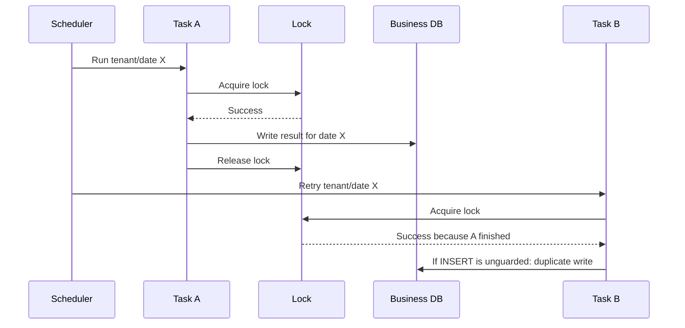
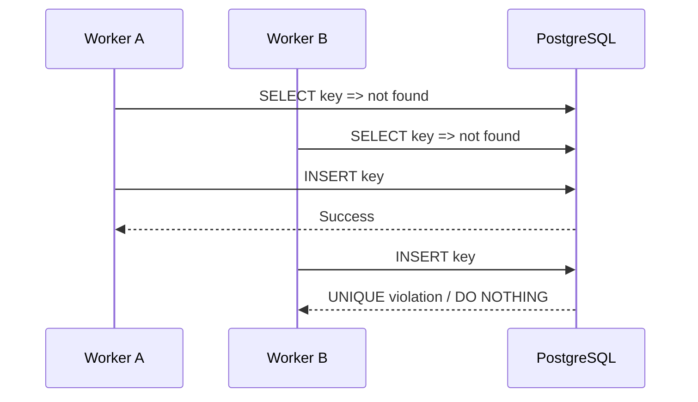
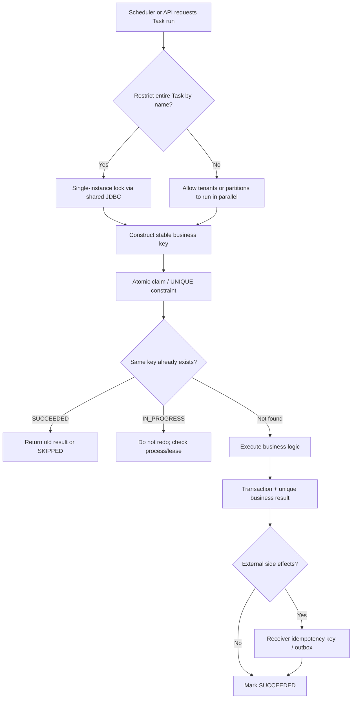

# Distinguishing Execution Locking from Duplicate Data Prevention

## Objectives and Context

A **Spring Cloud Task** application runs for a finite duration: receive a request, process data, write results to `TaskRepository`, and exit. For example, a `settlement-task` closes transactions for tenant `shop-42` on `2026-11-23`. The scheduler might start the task twice due to a timeout, an operator might rerun it hours later, or two replicas might receive the same message.

Two separate requirements must be addressed independently:

- **Execution lock** (*mutual exclusion*): limits how many processes **may run concurrently** within a lock scope, such as the same Task name.
- **Duplicate data prevention** (*idempotency/deduplication*): ensures a business request **invoked repeatedly** does not cause unwanted extra side effects, even when runs are hours apart.

This lesson belongs to the **Locking and Concurrency** chapter. After this lesson, you will be able to enable Spring Cloud Task's single-instance mode, understand lock scope, design a durable *business key*, perform atomic writes with `UNIQUE`, and plan safe recovery when a Task crashes or retries.

## 1. Differences in Goal, Scope, and Lifetime

| Criterion | Execution Lock | Duplicate Data Prevention |
| --- | --- | --- |
| Question | "Who is allowed to run **right now**?" | "Has this business operation **already happened**?" |
| Typical scope | Task name, tenant, partition, or resource | Tenant + business date, invoice ID, request ID |
| Lifetime | While holding the lock / TTL | Across multiple runs, retries, and restarts, per business retention |
| Solution | Spring Cloud Task single-instance, JDBC/Redis distributed lock, scheduler concurrency policy | Unique constraint, atomic claim, business state, transactions, downstream idempotency key |
| Prevents concurrent runs | Yes, within the right lock scope when all workers obey it | Does not necessarily block processes, yet can block the same write side effect |
| Prevents rerun an hour later | No: the lock has already been released | Yes, when using proper keys and data constraints |
| After JVM is killed | Requires TTL/lock reclamation and owner verification | Business state and results must persist for reconciliation |
| If misused | Resource contention or two workers mutating together | Duplicate writes, double payments, or skipped valid processing |

Timeline example:

| Time | Event | Execution Lock | Duplicate Prevention |
| --- | --- | --- | --- |
| 01:00 | A starts processing shop-42 / Nov 23 | A holds the lock | Key absent; A can claim |
| 01:01 | B also launches with same Task name | B is blocked | B still must not write the same key |
| 01:05 | A finishes and releases lock | No lock held | Key is durably persisted |
| 01:10 | C reruns shop-42 / Nov 23 | C **is allowed to start** | DB recognizes key is already processed; no duplicate write |

**Takeaway from the table:** mutual exclusion does not prevent **sequential** duplicate processing. And a deduplication table does not automatically prevent two independent jobs from consuming CPU/memory simultaneously.

## 2. Built-In Single-Instance Mechanism in Spring Cloud Task

Spring Cloud Task supports preventing two instances with the same **Task name** from executing concurrently:

```yaml
spring:
  application:
    name: settlement-task
  main:
    web-application-type: none
  cloud:
    task:
      single-instance-enabled: true
```

According to [Spring Cloud Task – Restricting Instances](https://docs.spring.io/spring-cloud-task/reference/features.html#restricting-spring-cloud-task-instances), `spring.cloud.task.single-instance-enabled` defaults to `false`. When enabled and an instance with the same name is still running, the next run is rejected; the docs specify **exit code `1`** for this case. This locks by **Task name** and does not inspect `businessDate`, `tenantId`, or Batch Job contents.

### 2.1. Required Dependencies and Infrastructure

Single-instance mode relies on **Spring Integration JDBC** distributed locking. Alongside the Task starter, the project needs the dependencies specified in the docs:

```xml
<dependencies>
    <dependency>
        <groupId>org.springframework.cloud</groupId>
        <artifactId>spring-cloud-starter-task</artifactId>
    </dependency>
    <dependency>
        <groupId>org.springframework.integration</groupId>
        <artifactId>spring-integration-core</artifactId>
    </dependency>
    <dependency>
        <groupId>org.springframework.integration</groupId>
        <artifactId>spring-integration-jdbc</artifactId>
    </dependency>
    <dependency>
        <groupId>org.postgresql</groupId>
        <artifactId>postgresql</artifactId>
        <scope>runtime</scope>
    </dependency>
</dependencies>
```

This is a `dependencies` snippet to insert into a Spring Boot `pom.xml`. You need a **compatible Boot parent/BOM + Spring Cloud BOM** in your build so they manage the starter and Spring Integration versions.

Instances require:

1. **Same Task name.** Usually `spring.application.name=settlement-task` determines the name; `TaskNameResolver` can alter naming. If one launcher sets `manual-settlement-task`, it may fall into a different lock scope.
2. **Same JDBC lock store.** If replica A connects to DB X while B connects to DB Y, the two locks do not protect each other. Never use per-JVM in-memory H2 databases to test distributed mutual exclusion.
3. **Matching schema and DB privileges.** Spring Cloud Task's default schema contains `TASK_EXECUTION` for history and `TASK_LOCK` for single-instance mode. Create the schema for the **exact library version**, especially when customizing prefixes/schemas.
4. **Consistent config across all launchers.** Never let one trigger path enable single-instance while another runs the same name without enforcing locking.
5. **Stale-lock handling procedure.** Connection failures, crashes, timeouts/TTL, and owner changes must be investigated before reclaiming locks.

Reference configuration for PostgreSQL with Task schemas already migrated:

```yaml
spring:
  application:
    name: settlement-task
  main:
    web-application-type: none
  datasource:
    url: ${TASK_DB_URL}
    username: ${TASK_DB_USER}
    password: ${TASK_DB_PASSWORD}
  cloud:
    task:
      single-instance-enabled: true
      initialize-enabled: false
      closecontext-enabled: true
```

The `TASK_DB_*` variables are supplied by the platform. Never pass passwords/tokens as CLI options because they can appear in process lists and `TASK_EXECUTION_PARAMS`. When history and locks must span multiple runs, TaskRepository and the lock store must live in a durable DB reachable by all instances.

### 2.2. Task Names Can Make Locking Too Broad

| A Is Running | B Wants to Run | Effect When Sharing Lock Store |
| --- | --- | --- |
| `settlement-task`, tenant A, date X | `settlement-task`, tenant A, date X | B is blocked |
| `settlement-task`, tenant A, date X | `settlement-task`, tenant B, date Y | B **is still blocked**, even though they share no data |
| `settlement-task`, tenant A, date X | `invoice-task`, tenant A, date X | Single-instance does not mutually exclude two differently named Tasks |
| A has already finished | `settlement-task`, tenant A, date X | B can run again because the old lock was released |

If many tenants must run in parallel, Task-wide locking can create a bottleneck. You can design a **per-tenant/partition** lock with a dedicated distributed registry, though that requires extra care with lock keys, TTL, renewal, and lifecycle management. **Putting the tenant into the Task name does not turn locking into idempotency**, since reruns after lock release can still occur.

### 2.3. TTL and Lock Limitations

Spring Cloud provides properties such as `spring.cloud.task.single-instance-lock-ttl` and `spring.cloud.task.single-instance-lock-check-interval` in supported versions. Check the docs/config metadata of your exact version before setting values. A TTL shorter than processing duration can let a new worker claim the lock before the old worker finishes; an overly long TTL makes a leftover lock after a crash block runs for too long. Different `JdbcLockRegistry` setups have differing renewal support and configuration; see [Spring Integration – JDBC Lock Registry](https://docs.spring.io/spring-integration/reference/jdbc/lock-registry.html).

Because locks can be lost or expire, **business code must never rely solely on the assumption "since I hold the lock, no one else is writing."** Database constraints remain the final line of defense for data outcomes.

## 3. Demo: Observing Two JVMs Contending for a Lock

Create `src/main/java/com/example/task/LockDemoTaskApplication.java` in a Spring Boot project that has the Task starter and both Spring Integration dependencies. The sample intentionally sleeps for 30 seconds so you have time to open a second terminal.

```java
package com.example.task;

import java.time.Duration;
import java.time.LocalDate;
import java.util.List;
import org.springframework.boot.ApplicationRunner;
import org.springframework.boot.SpringApplication;
import org.springframework.boot.autoconfigure.SpringBootApplication;
import org.springframework.context.annotation.Bean;

@SpringBootApplication
public class LockDemoTaskApplication {
    public static void main(String[] args) {
        SpringApplication.run(LockDemoTaskApplication.class, args);
    }

    @Bean
    ApplicationRunner runOnce() {
        return args -> {
            List<String> dates = args.getOptionValues("business-date");
            if (dates == null || dates.size() != 1) {
                throw new IllegalArgumentException("Requires --business-date=YYYY-MM-DD");
            }

            LocalDate date = LocalDate.parse(dates.get(0));
            System.out.println("Starting processing for " + date);
            Thread.sleep(Duration.ofSeconds(30).toMillis()); // For demo only.
            System.out.println("Finished " + date);
        };
    }
}
```

Build the executable JAR and use two terminals:

```bash
# Terminal A: run first.
java -jar target/settlement-task.jar --business-date=2026-11-23

# Terminal B: run immediately within 30 seconds before A finishes.
java -jar target/settlement-task.jar --business-date=2026-11-24
```

Expected outcome: A runs the runner; B is rejected because of the **same Task name** despite the different date, with the exit code documented for single-instance mode. Wait for A to finish and run B again; B is permitted to execute. If you change B's Task name, name-based Task locking cannot prevent B from processing overlapping data with A.

Check **process/container exit codes and logs**, and inspect `TaskExecution` metadata. If a launch fails very early, there may not even be a Task record. A lock is not `TaskExecution.exitCode`: `exitCode` records the outcome of a run, whereas the lock controls permission to start.

## 4. Why Is Locking Not Enough to Prevent Duplicate Data?



Duplicate paths remain even when every process obeys the lock:

- **Sequential retries:** the scheduler misses an ACK and reruns after the lock was released.
- **Two differently named Tasks:** an automated Task and a manual Task both update the same data period.
- **Different lock stores:** one replica points to the wrong DB or schema.
- **Lock expires while A still runs:** B reclaims ownership, creating overlapping execution.
- **Duplicate records inside one JVM:** input contains the same `invoiceId` twice, or a batch retries a chunk.

`TaskExecutionId` is the ID of **each physical launch**, not the ID of the business request. If you use this ID as an idempotency key, every retry generates a new key and fails to prevent duplicate processing. Similarly, `TaskExecution.exitCode=0` only tells you the framework saw the run finish; it does not prove an invoice was never written before.

## 5. Choosing a Business Key for Idempotency

Define upfront: **when do two requests represent the same business intent?**

For transaction aggregation: `key = (tenantId, businessDate)`. Each day must be settled once per tenant; retries must reuse the same key. If business rules allow legitimate *adjustment versions*, the key must include `reportVersion` or `generation` per business rules.

| Domain | Suggested Key | What Needs Agreement |
| --- | --- | --- |
| Daily transaction settlement | `(tenantId, businessDate)` | Catch-up run or new version? |
| Partner invoice ingestion | `(partnerId, externalInvoiceId)` | Can partner IDs reset across years? |
| Message broker processing | `(source, eventId)` | How long to retain keys relative to redelivery window? |
| Payments | `paymentRequestId` | Does retry keep the same intent and amount? |
| Sending notifications | `(campaignId, recipientId, kind)` | When is intentional resending allowed? |

Too broad a key blocks valid requests. Too narrow a key lets duplicates through. In multi-tenant setups, forgetting `tenantId` in the key can make tenant A block tenant B; using `TaskExecutionId` fails to block retries altogether.

## 6. Data Line of Defense: `UNIQUE` and `ON CONFLICT`

In PostgreSQL, enforce uniqueness **right where results are persisted**, rather than only reading to check before writing.

Suppose one aggregated result per tenant/day:

```sql
CREATE TABLE settlement_result (
    tenant_id       VARCHAR(80) NOT NULL,
    business_date   DATE NOT NULL,
    invoice_count   INTEGER NOT NULL CHECK (invoice_count >= 0),
    total_amount    NUMERIC(20, 2) NOT NULL,
    created_at      TIMESTAMPTZ NOT NULL DEFAULT CURRENT_TIMESTAMP,
    CONSTRAINT settlement_result_pk
        PRIMARY KEY (tenant_id, business_date)
);
```

Write data keyed by the business key using an atomic operation:

```sql
INSERT INTO settlement_result (
    tenant_id, business_date, invoice_count, total_amount
) VALUES ('shop-42', DATE '2026-11-23', 120, 158000.00)
ON CONFLICT (tenant_id, business_date) DO NOTHING
RETURNING tenant_id, business_date;
```

The first insert succeeds and returns one row. A subsequent duplicate key inserts no row and `RETURNING` is empty. Even if two processes run concurrently, `PRIMARY KEY` still stops both from committing two rows with the same key. See [PostgreSQL – INSERT / ON CONFLICT](https://www.postgresql.org/docs/current/sql-insert.html).

### Why Is `SELECT` Then `INSERT` a Concurrency Bug?

Both A and B can run `SELECT COUNT(*)` and receive `0` **before either writes**. Both then believe the key is free. Without a constraint, two duplicate rows can commit. With `UNIQUE`, the DB rejects one row; with `ON CONFLICT DO NOTHING`, the application handles that conflict cleanly.



**Critical limitation:** a unique key in the result table **cannot** undo side effects that happened **before writing to the table**, such as calling a payout API twice. For external systems, use an idempotency key supported by the receiving API, or an outbox/deduplication and reconciliation design.

`DO NOTHING` works well when skipping requests that already have a result, **provided you verify the payload**: if the existing result differs from the new request, never silently report success. `ON CONFLICT DO UPDATE` works when business rules genuinely allow updating to the desired state; it is not magic that makes every upsert idempotent.

## 7. For Long-Running Work: Request State and Atomic Claim

For tasks taking minutes or hours, a final result table alone does not show whether a **request is currently in progress** or **awaiting retry**. You can create a business idempotency table:

```sql
CREATE TABLE settlement_request (
    tenant_id       VARCHAR(80) NOT NULL,
    business_date   DATE NOT NULL,
    state           VARCHAR(20) NOT NULL
                    CHECK (state IN ('IN_PROGRESS', 'SUCCEEDED', 'FAILED')),
    attempt_id      UUID NOT NULL,
    claimed_at      TIMESTAMPTZ NOT NULL DEFAULT CURRENT_TIMESTAMP,
    completed_at    TIMESTAMPTZ,
    CONSTRAINT settlement_request_pk
        PRIMARY KEY (tenant_id, business_date)
);
```

Claim a request not yet recorded:

```sql
INSERT INTO settlement_request (
    tenant_id, business_date, state, attempt_id
) VALUES (
    'shop-42', DATE '2026-11-23', 'IN_PROGRESS',
    'f7a0550a-29a0-4df1-b43c-a3694c8f0752'
)
ON CONFLICT (tenant_id, business_date) DO NOTHING
RETURNING tenant_id, business_date;
```

One returned row means this attempt **won the claim**. Zero rows means **a record already exists**, so read `state` to determine the status:

| Existing `state` | Handling Duplicate Request |
| --- | --- |
| `SUCCEEDED` | Return existing result or record `SKIPPED`; raise conflict if payload differs |
| `IN_PROGRESS` | Do not trigger a second side effect; check owner, process, and SLA |
| `FAILED` | Start a new attempt only under a valid retry/recovery policy |
| Absent | Attempt a new claim via atomic `INSERT` |

After succeeding, update **matching the exact attempt owner**:

```sql
UPDATE settlement_request
SET state = 'SUCCEEDED',
    completed_at = CURRENT_TIMESTAMP
WHERE tenant_id = 'shop-42'
  AND business_date = DATE '2026-11-23'
  AND attempt_id = 'f7a0550a-29a0-4df1-b43c-a3694c8f0752'
  AND state = 'IN_PROGRESS';
```

The application must verify affected row count **equals `1`**. If it is `0`, the attempt lost ownership or state changed; it must never treat itself as completed. When `settlement_result` and `settlement_request` live in the same datasource, write the result and transition to `SUCCEEDED` inside **the same transaction**.

**Gaps to address:** after the claim commits, the JVM may die before writing the result, leaving `IN_PROGRESS` stuck. Or it may die **after calling an external API**, leaving ambiguity over whether the side effect occurred. Recovery requires reconciliation, leases/timeouts, ownership, fencing tokens for replacement workers, and downstream idempotency; never reset or delete old records blindly by clock alone.

## 8. Java Example: Idempotency Independent of Task Locking

This is an **illustrative service class** in a Spring Boot project using `JdbcTemplate`, PostgreSQL, transactions, and the two tables above. It does not acquire/release distributed locks itself; `single-instance-enabled` remains managed separately by Spring Cloud Task.

```java
package com.example.task;

import java.math.BigDecimal;
import java.sql.Date;
import java.time.LocalDate;
import java.util.UUID;

import org.springframework.jdbc.core.JdbcTemplate;
import org.springframework.stereotype.Service;
import org.springframework.transaction.annotation.Transactional;

@Service
public class SettlementService {
    private final JdbcTemplate jdbc;

    public SettlementService(JdbcTemplate jdbc) {
        this.jdbc = jdbc;
    }

    public boolean tryClaim(
            String tenantId, LocalDate businessDate, UUID attemptId) {
        int inserted = jdbc.update(
                """
                INSERT INTO settlement_request (
                    tenant_id, business_date, state, attempt_id
                ) VALUES (?, ?, 'IN_PROGRESS', ?)
                ON CONFLICT (tenant_id, business_date) DO NOTHING
                """,
                tenantId, Date.valueOf(businessDate), attemptId);

        return inserted == 1;
    }

    @Transactional
    public void saveResultAndComplete(
            String tenantId, LocalDate businessDate, UUID attemptId,
            int invoiceCount, BigDecimal amount) {

        int inserted = jdbc.update(
                """
                INSERT INTO settlement_result (
                    tenant_id, business_date, invoice_count, total_amount
                ) VALUES (?, ?, ?, ?)
                ON CONFLICT (tenant_id, business_date) DO NOTHING
                """,
                tenantId, Date.valueOf(businessDate), invoiceCount, amount);

        if (inserted != 1) {
            // Replay or conflicting payload: must read existing data.
            throw new IllegalStateException("Result already exists");
        }

        int updated = jdbc.update(
                """
                UPDATE settlement_request
                SET state = 'SUCCEEDED', completed_at = CURRENT_TIMESTAMP
                WHERE tenant_id = ?
                  AND business_date = ?
                  AND attempt_id = ?
                  AND state = 'IN_PROGRESS'
                """,
                tenantId, Date.valueOf(businessDate), attemptId);

        if (updated != 1) {
            // @Transactional rolls back the settlement_result INSERT as well.
            throw new IllegalStateException("Attempt no longer owns completion rights");
        }
    }
}
```

In `ApplicationRunner`, use it like this (pseudocode illustrating flow):

```java
UUID attemptId = UUID.randomUUID();
if (!service.tryClaim(tenantId, businessDate, attemptId)) {
    // Read settlement_request + settlement_result:
    // SUCCEEDED -> result already exists.
    // IN_PROGRESS -> do not process concurrently.
    // FAILED -> initiate controlled retry/recovery procedure.
    return;
}

// Compute invoiceCount, amount and verify tenant/business rules.
service.saveResultAndComplete(
        tenantId, businessDate, attemptId, invoiceCount, amount);
```

That `return` in the failed-claim branch **does not automatically mean "business success"**: return an appropriate status to the caller, separating `SKIPPED/ALREADY_DONE` from `IN_PROGRESS` and `FAILED`. This additional handling depends on each project's API/scheduler contract.

**Limitations of this example:**

- `tryClaim` commits its own row before a long process. On crash, `IN_PROGRESS` persists; the example **lacks recovery** or fenced re-claiming.
- `@Transactional` protects the two operations inside `saveResultAndComplete` **only when they share the same transaction manager/datasource**. It does not create a distributed transaction across a separate TaskRepository DB or external APIs.
- If calling a payment API or sending email, you need receiver-side idempotency keys, outbox/inbox, or reconciliation. A local DB unique constraint does not guarantee at-most-once external calls.
- Before treating a duplicate as "already completed," verify `state`, payload/fingerprint, and tenant authorization.

## 9. Combining Both Layers in an Architecture



Three common patterns:

| Context | Locking Decision | Data Decision |
| --- | --- | --- |
| System-wide schema maintenance job requiring strict serialization | Lock entire Task name using shared JDBC | Key by version/migration milestone to avoid unsafe re-execution |
| Reports across 10,000 independent tenants | Avoid Task-wide lock bottleneck; lock per tenant/partition if needed | `UNIQUE(tenant_id, business_date)`, state/attempt per business key |
| Ingesting messages subject to redelivery | Allow multiple concurrent workers | Key by `event_id`, inbox/dedup, and transaction at write target |

Locks reduce contention and wasted resources; unique constraints and idempotent design protect long-term correctness.

### With Spring Batch, Understand One More Identification Layer

Spring Cloud Task records `TaskExecution` for the application run; Spring Batch records `JobInstance`, `JobExecution`, and `StepExecution`. Spring Batch identifies a `JobInstance` by **job name + identifying `JobParameters`**. This supports job restarts and management, yet **does not replace unique constraints on business data**:

- Two different `JobParameters` sets can still point to the same invoice.
- A restart may re-read or reprocess some data depending on transaction, chunk, and checkpoint boundaries.
- Each Task run gets a new `TaskExecutionId`, even when restarting the same `JobInstance`.
- When a writer writes to the business database, you still need constraints on invoice ID/business key and safe rewrite design.

In particular, if a Job calls an external API per item, Spring Batch's DB transaction cannot automatically roll back that side effect. See [Spring Batch – Configuring and Running a Job](https://docs.spring.io/spring-batch/reference/job/configuring-job.html).

## 10. Crashes, Timeouts, Lost Locks, and Retries

In distributed systems, an operation can complete in one place without being recorded in another.

| Failure Timing | State Left Behind | Risk | Recovery Approach |
| --- | --- | --- | --- |
| Before `ApplicationContext` creates Task | No `TaskExecution` | Scheduler finds no DB history | Check process exit, container state, bootstrap logs |
| After acquiring lock, before business work | Lock may remain until timeout/recovery | Blocks subsequent requests | Check owner, TTL, process health, then handle lock |
| After claiming business key, before writing result | `IN_PROGRESS` remains | Retries rejected even though job died | Recovery with ownership/lease and side-effect investigation |
| After committing result, before updating TaskRepository | Result exists, `TaskExecution.exitCode` may be `NULL` | Scheduler thinks it didn't finish and reruns | Business key/constraints prevent duplicate results |
| After calling external API, before writing DB result | API may have executed; DB unaware | Double payout / double email | Downstream idempotency key, reconciliation, or outbox |
| TTL expires while worker A is still active | B may acquire lock | Overlapping execution | Renewal/fencing if supported, unique/conditional writes |

**Never manually update `TASK_EXECUTION.EXIT_CODE` or delete `TASK_LOCK` rows to "clean up" a dashboard.** Doing so mutates metadata without verifying processes or business impact. When a lock must be reclaimed, follow an operational runbook that verifies the owner, bounds contention, and protects stale workers from continuing writes.

### Why Not Promise "Exactly Once" Using Only a Lock?

An orchestrator can resend the same request when an ACK is lost. After calling an external API, a process can die before saving the result. A lock only holds for a bounded duration and usually does not control the receiving API.

A more realistic goal is **"safe retries, with business side effects deduplicated within the designed scope."** To achieve this:

1. Use a **stable business key** across all retries.
2. Enforce constraints and atomic transactions on every data write path.
3. Give external APIs an idempotency key or a valid reconciliation/compensation strategy.
4. On retry, inspect business state before deciding to proceed.
5. When stale workers/leases can exist, use attempt ownership or fencing to reject writes from a deposed owner.

## 11. Monitoring Three Sources of State

| Layer | Data to Observe | Questions to Answer |
| --- | --- | --- |
| **Task / process** | `TaskExecutionId`, `startTime`, `endTime`, `exitCode`, process exit, container state | Is the process alive? Has metadata been finalized? |
| **Lock** | Lock owner, key, region, TTL, acquisition timestamp | Who still holds permission to run? Is the lock stale or expired? |
| **Business** | `tenantId`, `businessDate`, `attemptId`, `state`, written result, external request ID | Is the key completed or in progress? Are there duplicate side effects? |

Inspecting Task metadata (assuming default schema):

```sql
SELECT TASK_EXECUTION_ID, TASK_NAME, START_TIME,
       END_TIME, EXIT_CODE
FROM TASK_EXECUTION
WHERE TASK_NAME = 'settlement-task'
ORDER BY TASK_EXECUTION_ID DESC
LIMIT 20;
```

Inspecting the default lock table during investigation, **read-only**:

```sql
SELECT LOCK_KEY, REGION, CLIENT_ID, CREATED_DATE
FROM TASK_LOCK;
```

`CLIENT_ID`, `LOCK_KEY`, and `REGION` belong to the lock structure of your specific version/schema. Do not infer a process is alive merely from the presence of a lock row. See [Spring Cloud Task – Repository Schema](https://docs.spring.io/spring-cloud-task/reference/appendix-task-repository-schema.html) and your project's deployed schema.

Inspecting stuck business requests:

```sql
SELECT tenant_id, business_date, state, attempt_id,
       claimed_at, completed_at
FROM settlement_request
WHERE state = 'IN_PROGRESS'
ORDER BY claimed_at;
```

`IN_PROGRESS` alone does not prove a process is still running, just as `TaskExecution.exitCode=NULL` does not guarantee `RUNNING`. Cross-check scheduler/containers, SLAs, logs, and actual side effects.

Useful metrics include: single-instance rejections; lock hold duration; duplicate claim count; keys stuck `IN_PROGRESS` past SLA; retries after errors; DB duplicate-key rejections; and downstream idempotent replay counts. Distinguish "lock busy" errors from DB connectivity failures even though both can cause a task to fail.

## 12. Concurrency and Recovery Testing

Do not test only the single-JVM happy path. In a test environment with a shared DB, verify:

| Scenario | Action | What to Verify |
| --- | --- | --- |
| Two JVMs with same Task name | Start A, then start B before A ends | B is rejected by single-instance; A continues |
| Same business key run **sequentially** | Run date X, wait for completion, rerun X | Lock does not block the rerun; unique/idempotency blocks duplicate write |
| Two Task names sharing same data key | Run scheduled task and manual task | DB constraints still protect the outcome |
| Two `INSERT` transactions with same key | Have A/B write simultaneously | Only one transaction inserts a new row |
| JVM dies after claim | Stop process before result is saved | `IN_PROGRESS` remains; recovery does not blindly duplicate work |
| JVM dies after business commit | Induce failure before TaskRepository records completion | Process/Task metadata diverges from business state; retry remains safe |
| Lock exceeds TTL | In test, set TTL shorter than runtime | Observe overlap possibility; constraints still protect data |
| External API succeeds but ACK is lost | Simulate timeout after receiver processed request | Retry with same key; receiver causes no second side effect |

For long Tasks with external side effects, intentional fault-injection testing is the true test. Never unit-test a `tryClaim` method alone and conclude the system has achieved exactly-once semantics.

## 13. Scenario Exercises

**Scenario A.** The scheduler runs `settlement-task` for `shop-42` on Nov 23; A succeeds. An hour later, the scheduler retries the same date. Does `single-instance-enabled=true` reject it?

**Hint:** No. No instance with that name still holds the lock, so C can run. Only the business key `(tenantId, businessDate)` and unique/idempotency rules prevent duplicate writes.

**Scenario B.** The system processes `shop-42` and `shop-43` independently, yet they cannot run in parallel because both use the name `settlement-task`. What should change?

**Hint:** Locking by Task name is too coarse for parallel needs. Consider per-tenant/partition locking or allowing multiple instances while protecting data via keys/constraints. Keep monitoring and recovery intact.

**Scenario C.** Worker A calls a payout API and crashes before updating `settlement_request` to `SUCCEEDED`. Worker B sees `IN_PROGRESS` for over 30 minutes. Can B delete the row and call the API again?

**Hint:** No. Reconcile outcome with the receiver, reuse the same idempotency key if supported by the API, verify owner/lease, and bound retries. Deleting the claim can cause double payouts.

**Scenario D.** Two workers both observe `SELECT COUNT(*)=0` and both attempt `INSERT`. Why does the `PRIMARY KEY` constraint matter even when distributed locking is enabled?

**Hint:** Locks may not cover every entry path, may have the wrong scope, or may expire. The DB constraint protects at the final write point under real contention.

**Scenario E.** Spring Batch restarts a Job with the same identifying `JobParameters`, yet the new run has a different `TaskExecutionId`. Should the new Task ID be used as the business idempotency key?

**Hint:** No. The Task ID changes on every physical execution. Use a stable business key or record-level key so restarts do not repeat side effects.

## 14. Safe Operations Checklist

- [ ] Clearly defined lock scope: entire task, tenant, partition, or resource; verified locking does not unnecessarily block independent work.
- [ ] For single-instance, all JVMs share the same task name, shared JDBC lock store, Spring Integration dependencies, and version-matched `TASK_LOCK` schema.
- [ ] Monitored lock TTL, owner, runtime, and crash recovery procedures; never delete lock table rows arbitrarily.
- [ ] Chose a stable business key across retries; never use `TaskExecutionId` as a business deduplication key.
- [ ] Protected target tables with `PRIMARY KEY`/`UNIQUE` and atomic writes; never rely solely on `SELECT` before `INSERT`.
- [ ] Defined handling for `SUCCEEDED`, `IN_PROGRESS`, `FAILED`, and mismatched payloads under the same key.
- [ ] When sharing a DB, persisted result and updated state in one transaction; verified `attempt_id` and affected row count.
- [ ] For external APIs, used receiver-side idempotency keys, outbox, or reconciliation; never assumed `@Transactional` covers external side effects.
- [ ] Tested crashes/retries, TTL expiration, two replicas, and two differently named Tasks touching the same business key.
- [ ] If using Spring Batch, reconciled `JobInstance`, identifying `JobParameters`, checkpoints, and idempotent writers.
- [ ] Secured sensitive data in arguments, `TaskRepository`, and logs; monitored process exits, locks, and business outcomes together.

## Official Documentation

1. [Spring Cloud Task – Features / Restricting Spring Cloud Task Instances](https://docs.spring.io/spring-cloud-task/reference/features.html#restricting-spring-cloud-task-instances) — `single-instance-enabled` mode, Spring Integration JDBC, and rejection behavior for same-named instances.
2. [Spring Cloud Task – Task Repository Schema](https://docs.spring.io/spring-cloud-task/reference/appendix-task-repository-schema.html) — `TASK_EXECUTION`, `TASK_EXECUTION_PARAMS`, and `TASK_LOCK` tables.
3. [Spring Integration – JDBC Lock Registry](https://docs.spring.io/spring-integration/reference/jdbc/lock-registry.html) — lock expiry, TTL, renewal, and lock ownership.
4. [PostgreSQL – INSERT / ON CONFLICT](https://www.postgresql.org/docs/current/sql-insert.html) — atomic conflict handling by unique/primary key.
5. [Spring Batch – Configuring and Running a Job](https://docs.spring.io/spring-batch/reference/job/configuring-job.html) — `JobInstance` identification and execution/restart mechanics.

**Principle to remember:** **Execution locking prevents two processes from contending for the same scope at the same moment; duplicate data prevention ensures the same business intent does not cause extra side effects when invoked repeatedly.** Use locks for coordination, use business keys + constraints/transactions/idempotency to preserve data integrity, and always maintain a recovery procedure when processes terminate abnormally.
