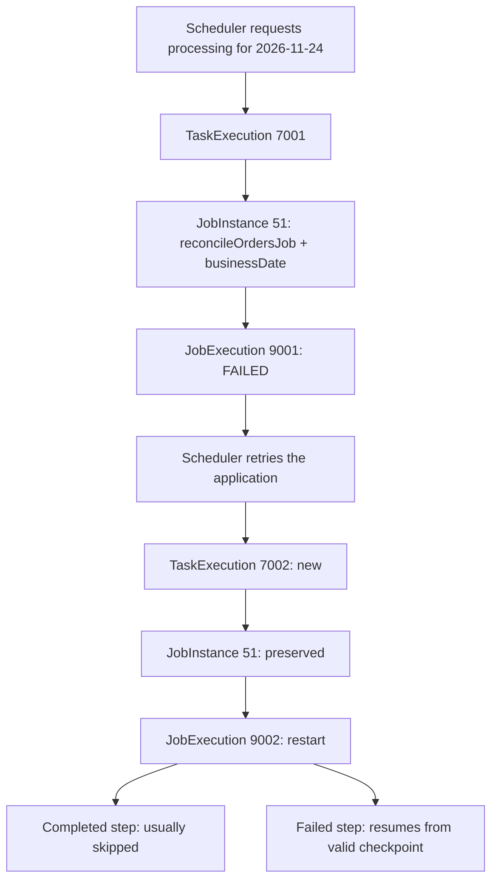
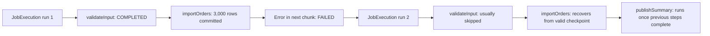
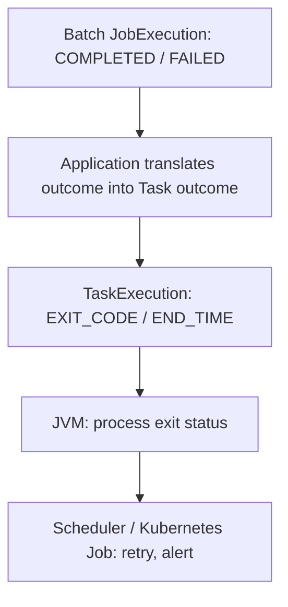

# Rerunning a Task and Resuming a Spring Batch Job

## 1. Goal: rerun only what actually needs to run

In the **Idempotent Retries** chapter, we address a common situation with **Spring Cloud Task**: a short-lived application runs on a schedule or on demand, completes part of its work, and then fails. The orchestrator can launch the application again, but the harder question is **should it reprocess all the data, or resume from where the Spring Batch Job failed?**

Spring Cloud Task manages the lifecycle of **a single Spring Boot application run** through `TaskExecution` and `TaskRepository`. Spring Batch manages **batch processing jobs and steps** through `JobInstance`, `JobExecution`, `StepExecution`, `ExecutionContext`, and `JobRepository`. They can work closely together, but **Task retry** and **Batch Job restart** are two distinct concepts.

After this lesson, you will be able to:

- Explain when a retry creates a new `TaskExecution`, and when Spring Batch creates a new `JobExecution` under an existing `JobInstance`.
- Choose stable identifying `JobParameters` to restart the right job and avoid accidentally creating a new job instance.
- Understand how completed `Step`s are skipped, chunks are committed, and `ExecutionContext` state supports resumption.
- Write Batch launch logic inside a Spring Cloud Task application, propagating failures to the Task level and the orchestrator.
- Design **idempotency**, prevent duplicate runs, control source data, and handle cases where the task finished its work but metadata failed.
- Build a checklist for testing failures, retries, and restarts in an environment with a persistent metadata database.

> **Principle:** Spring Cloud Task **records** runs; it does not automatically guarantee "exactly once" business processing. Spring Batch **supports** restart, but safe resumption also depends on job/step configuration, repository state, how data is read/written, and external systems.

## 2. Four units to distinguish

| Unit | Framework | Scope | Effect of a rerun |
| --- | --- | --- | --- |
| `TaskExecution` | Spring Cloud Task | One launch of a Task application | Usually creates a **new ID** when the scheduler reruns the process |
| `JobInstance` | Spring Batch | One logical job: **Job name + identifying JobParameters** | Can **remain the same** when restarting with the same identifying parameters |
| `JobExecution` | Spring Batch | One execution attempt of a JobInstance | Usually creates a **new ID** for a valid restart |
| `StepExecution` | Spring Batch | One Step execution within a JobExecution | A Step that needs to rerun gets a new execution; a completed Step can be skipped |

For example, the `reconcileOrdersJob` job processes date `2026-11-24`. The first run starts at 02:00 and fails on the second step; the scheduler reruns the application at 02:10.

| Time | TaskExecution | JobInstance | JobExecution | Outcome |
| --- | --- | --- | --- | --- |
| 02:00 | `7001` | `51` | `9001` | Step 1 completes; Step 2 fails |
| 02:10 | `7002` | `51` | `9002` | Step 1 is skipped if already `COMPLETED`; Step 2 restarts per configuration |

These IDs are **illustrative**, not values guaranteed by the framework. The relationship between a Task and a Job is not necessarily one-to-one: a Task can run zero jobs, one job, or multiple jobs. When Spring Cloud Task Batch integration and the corresponding linking listener are enabled, the system can trace a `JobExecution` back to the `TaskExecution` that launched it.



The two repositories serve different purposes: **`TaskRepository`** tracks application launch history, while **`JobRepository`** tracks job/step history and restart state. They can reside in the same database or be configured separately; both must be stored persistently if you want tracking across container restarts.

## 3. Task retry does not automatically become Batch restart

**Task retry** means an external system (CronJob, queue consumer, orchestration API, scheduler, etc.) **launches the application process again**. Spring Cloud Task records a new execution. If the application logic always reads the entire file and calls APIs from the beginning, previously executed side effects may be repeated.

**Batch Job restart** means Spring Batch finds an existing `JobInstance`, creates a subsequent `JobExecution` **if the state and configuration allow**, and then determines which steps must run and what state can be recovered. Simply calling `JobLauncher` another time does not guarantee a restart.

| Scenario | Typical Batch behavior |
| --- | --- |
| Job name + identifying parameters **do not exist yet** | Creates a new `JobInstance` and the first `JobExecution` |
| JobInstance is `FAILED` or `STOPPED` and the job allows restart | Can create a new `JobExecution` for the **same JobInstance**, then resume eligible steps |
| JobInstance is already `COMPLETED` | Usually rejects rerunning the same instance with `JobInstanceAlreadyCompleteException` |
| Same JobInstance is currently `STARTING` / `STARTED` / still running | Usually rejects concurrent execution with an error such as `JobExecutionAlreadyRunningException` |
| Job is declared non-restartable | Can be rejected with `JobRestartException` |
| **Identifying** parameters change | Becomes a **new JobInstance**; does not resume from the old instance's checkpoint |

Exact behavior also depends on Batch status, `JobRepository`, version, and Job policy; in particular, `ABANDONED` is not a status that is automatically restartable like `FAILED`. You should not manually edit status columns in the repository to force a job to rerun.

### The important difference when a Task fails *after* Batch completes

Suppose Batch reached `COMPLETED`, but the application still has a step to send a notification or update an external system and fails there. The scheduler retries the Task; the new application run requests the **same already-completed JobInstance** again. Batch is right to reject rerunning that instance. This is not evidence that the Task Repository is broken.

You must decide clearly: **once Batch has completed, can it be skipped so only the post-processing work continues**, or does a post-processing failure require a compensation mechanism? You should not create a new JobInstance by adding a random parameter just to "make it run again."

## 4. `JobParameters` determine whether the right JobInstance resumes

Spring Batch normally identifies a `JobInstance` by:

```text
JobInstance = Job name + identifying JobParameters
```

Suppose a job processes a **business date** and a **source data version**. The following values must remain stable across every attempt that wants to restart the same work:

```text
jobName = reconcileOrdersJob
businessDate = 2026-11-24
inputVersion = snapshot-v1
```

In the Spring Batch 5.x API, here is an example of creating parameters with the identifying flag set explicitly:

```java
JobParameters parameters = new JobParametersBuilder()
        .addString("businessDate", "2026-11-24", true)
        .addString("inputVersion", "snapshot-v1", true)
        .toJobParameters();
```

These two values together with the job name identify a single JobInstance. On restart, keep the **value, name, data type, and identifying flag** identical. Do not arbitrarily change a parameter from string to date or alter `inputVersion` if you need to resume the old instance.

**Common mistake:** adding `run.id=timestamp`, `currentTimeMillis`, a UUID, or `taskExecutionId` as an **identifying** parameter on every launch. Doing so creates a new JobInstance, preventing the old instance's checkpoint-based restart mechanism from being used. `RunIdIncrementer` is suitable when you **intentionally** want a new instance, not as a default solution for post-failure retries.

If you want to store an ID for each attempt from the scheduler, you can:

- Keep it in `TaskExecution` metadata, logs, or a separate audit table.
- When using `JobParameters`, mark observability-only parameters as **non-identifying** if the version supports it and the job model allows it. Verify that changing a non-identifying parameter across executions does not cause inconsistent reads or writes.
- Distinguish a shared `requestId` for one logical request from an `attemptId` specific to each run; only values that **truly identify the work** should affect `JobInstance`.

## 5. Example of a Spring Cloud Task launching a restartable Spring Batch job

### 5.1. Required components

Assume the Spring Boot project has the appropriate dependencies:

```xml
<dependency>
    <groupId>org.springframework.cloud</groupId>
    <artifactId>spring-cloud-starter-task</artifactId>
</dependency>
<dependency>
    <groupId>org.springframework.boot</groupId>
    <artifactId>spring-boot-starter-batch</artifactId>
</dependency>
<!-- JDBC driver and actual metadata datasource configuration. -->
```

Spring Cloud Task + Batch uses libraries with a **version compatibility matrix**. Spring Batch 5.x and 6.x have API differences, so the Java examples below illustrate common usage **under the Batch 5.x API**; Batch 6 projects should verify the corresponding API signatures before compiling. Do not run Gradle/Maven assuming an arbitrary version is "the latest."

The metadata schemas for **TaskRepository** and **JobRepository** must be initialized/migrated for the right version. When using different datasources, Task and Batch metadata must be routed accurately to their respective stores.

### 5.2. Disable Batch auto-run if invoking JobLauncher manually

When you choose to launch the Job **explicitly inside an ApplicationRunner**, avoid letting Spring Boot auto-launch the same job a second time. For Spring Boot versions that support this property:

```yaml
spring:
  main:
    web-application-type: none
  batch:
    job:
      enabled: false
  datasource:
    url: jdbc:postgresql://localhost:5432/task_batch_demo
    username: batch_app
    password: ${TASK_DB_PASSWORD}
  cloud:
    task:
      name: order-reconciliation
```

This is an illustrative configuration assuming the JDBC driver, credentials, and metadata tables are already prepared. In production, pass secrets from a secure source and manage migrations and read/write permissions. Enabling `spring.cloud.task.batch.fail-on-job-failure` can help when a job is **managed by Boot/Batch auto-execution**; do not treat that property as a guarantee for every custom runner.

### 5.3. Runner launching with identifying parameters

Assume the project **has already defined** `Job reconcileOrdersJob` with the appropriate processing steps and JobRepository:

```java
import java.time.LocalDate;
import java.util.List;

import org.springframework.batch.core.BatchStatus;
import org.springframework.batch.core.Job;
import org.springframework.batch.core.JobExecution;
import org.springframework.batch.core.JobParameters;
import org.springframework.batch.core.JobParametersBuilder;
import org.springframework.batch.core.launch.JobLauncher;
import org.springframework.beans.factory.annotation.Qualifier;
import org.springframework.boot.ApplicationRunner;
import org.springframework.context.annotation.Bean;
import org.springframework.context.annotation.Configuration;

@Configuration(proxyBeanMethods = false)
public class ReconciliationLaunchConfig {

    @Bean
    ApplicationRunner runReconciliation(
            JobLauncher jobLauncher,
            @Qualifier("reconcileOrdersJob") Job job) {
        return args -> {
            List<String> dates = args.getOptionValues("business-date");
            List<String> versions = args.getOptionValues("input-version");

            if (dates == null || dates.size() != 1 ||
                    versions == null || versions.size() != 1) {
                throw new IllegalArgumentException(
                        "Both --business-date and --input-version are required");
            }

            String businessDate = LocalDate.parse(dates.get(0)).toString();
            String inputVersion = versions.get(0);
            if (inputVersion.isBlank()) {
                throw new IllegalArgumentException("input-version is blank");
            }

            JobParameters params = new JobParametersBuilder()
                    .addString("businessDate", businessDate, true)
                    .addString("inputVersion", inputVersion, true)
                    .toJobParameters();

            JobExecution result = jobLauncher.run(job, params);
            if (result.getStatus() != BatchStatus.COMPLETED) {
                throw new IllegalStateException(
                        "Batch did not complete: " + result.getStatus());
            }
        };
    }
}
```

The example above assumes `JobLauncher` **runs synchronously**, meaning `run` returns only once the Job reaches a terminal status. If you use an asynchronous launcher, the status when `run` returns may still be running; you must wait for or monitor `JobExecution` completion before concluding the Task succeeded. The code intentionally **throws an exception outward** when Batch has not completed, so the framework marks the Task as failed and the calling system receives an appropriate exit code.

Do not catch all exceptions and return normally, because doing so can easily leave the Task with `EXIT_CODE=0` when the Job actually failed. At the same time, a `COMPLETED` Batch does not automatically guarantee an OS exit code of 0 if another error occurs in the application; you must test the full Task -> OS -> scheduler path.

If `JobInstanceAlreadyCompleteException` occurs, do not ignore it blindly. Check whether the JobInstance genuinely completed, review the current data policy, and verify whether any business step **outside Batch** remains unfinished. Only treat it as "already processed, no need to rerun" when the business contract allows.

### 5.4. Running and retrying example

```bash
java -jar reconcile-task.jar \
  --business-date=2026-11-24 \
  --input-version=snapshot-v1
```

Suppose the first run fails after committing several chunks. The orchestrator spawns a new process with the **same pair of identifying parameters**:

```bash
java -jar reconcile-task.jar \
  --business-date=2026-11-24 \
  --input-version=snapshot-v1
```

The second invocation creates a **new TaskExecution**, while Batch attempts to restart the **old JobInstance** if the first run is in an eligible state and metadata is valid. If the job is already `COMPLETED`, the second command does not automatically "rerun" the job; you need rules for handling the already-completed case as described in section 3.

## 6. How Batch resumes: steps, chunks, and checkpoints

Consider a three-step job:

1. `validateInput` — verifies that the data snapshot exists and is valid.
2. `importOrders` — reads 10,000 orders and writes to the database in chunks of 100.
3. `publishSummary` — aggregates and publishes a report.

First run: `validateInput` completes; `importOrders` commits 30 chunks (3,000 rows) and then fails on the next chunk; `publishSummary` has not run yet.



In **chunk-oriented processing**, Spring Batch typically reads, processes, and writes per chunk within a transaction boundary. Once a chunk is committed, its effects generally persist after an error in the following chunk. On restart, metadata in `ExecutionContext` lets the reader/writer restore its position or state. **This does not mean the framework always knows exact row 3,001 automatically**, because recoverability depends on the reader, writer, transaction, checkpoint, and whether the source data changed.

### `ItemStream` and `ExecutionContext`

Stateful readers and writers typically implement the `ItemStream` contract, which includes phases for opening with a context, updating the context, and closing resources. `ExecutionContext` is persisted across executions by `JobRepository` when the step/repository and transactions are properly configured. With delegate readers/writers, register the stream explicitly if the framework does not detect the delegate automatically.

If you use a **stateless** reader, rerunning the step may read from the start; in that case, you need an idempotent writer or custom checkpoint management. For stable restarts, keep an **immutable input snapshot**: the same `inputVersion` should not point to a file whose contents or row order changed.

### Completed steps are usually skipped

Under standard Spring Batch behavior, a step with `BatchStatus.COMPLETED` in the same JobInstance is typically **skipped** on restart. For a step that intentionally must run again, you can configure `allowStartIfComplete(true)` when supported by your version's API:

```java
// Illustrative Step configuration snippet, not a complete Step.
new StepBuilder("validateInput", jobRepository)
        .allowStartIfComplete(true)
        // .tasklet(..., transactionManager)
        .build();
```

The snippet above only shows where the option belongs; you must declare the step type, tasklet/chunk, and actual transaction manager before building. **Do not enable this for every step out of habit**: a step that transfers money, sends email, or issues invoices can cause duplicate side effects if rerun. You can also set `startLimit` to cap how many times a risky step can start.

### Restart does not roll back everything

For the 3,000 rows already committed, restart does not mean automatically rolling back all 3,000 rows to the initial state. For each write target, you must understand precisely which transactions committed and the rollback policy on exceptions. If an item was sent successfully over HTTP but the database transaction failed before updating the checkpoint, a restart may resend that item. Batch cannot create a single atomic transaction across all external systems on its own.

## 7. Idempotency: the condition for retries without duplicate side effects

**Idempotent** means executing the same request again does not change the outcome beyond a single execution as defined by the business rules. For example, processing order `order-123` twice still produces only one final processed record for the same business date and data version.

Common techniques:

| Technique | Example | Limitations to know |
| --- | --- | --- |
| Unique constraint | `UNIQUE(business_date, order_id, input_version)` | Business key must be defined accurately; contention still requires error handling |
| Conditional upsert | PostgreSQL `INSERT ... ON CONFLICT ... DO UPDATE/NOTHING` | Updating again may not be equivalent to zero side effects; choose semantics carefully |
| Idempotency table | Store `requestId + operation + outcome` | Must manage `IN_PROGRESS` state, timeouts, and post-execution failures |
| Checkpoint with `ExecutionContext` | Reader stores last committed position/index/key | Insufficient if source changes or external systems do not join the transaction |
| Outbox/inbox pattern | Write events to outbox inside transaction; consumer uses dedupe key | Requires correct publish/retry/deduplication implementation |
| Business processing lock | Only one worker processes a given date or tenant at a time | Needs safe lease/timeout; locks do not replace idempotency |

PostgreSQL example for an order import results table:

```sql
CREATE TABLE reconciled_order (
    business_date DATE NOT NULL,
    input_version VARCHAR(80) NOT NULL,
    order_id VARCHAR(100) NOT NULL,
    amount NUMERIC(18, 2) NOT NULL,
    PRIMARY KEY (business_date, input_version, order_id)
);

INSERT INTO reconciled_order (
    business_date, input_version, order_id, amount
) VALUES (
    DATE '2026-11-24', 'snapshot-v1', 'order-123', 125000.00
)
ON CONFLICT (business_date, input_version, order_id)
DO NOTHING;
```

This is only an **example deduplication strategy**: `DO NOTHING` fits when data for the same key is immutable and the existing record is already verified; if a payload arrives with the same key but a different amount, silently ignoring it is a data bug. The application should compare payloads, raise alerts, or use conditional upserts per the contract. DDL, isolation level, and data types depend on the actual database.

For external APIs such as sending email, payments, or publishing messages, if the provider supports an **idempotency key**, pass a business-stable key—do not use the new `TaskExecutionId` as the key because a retry generates a different ID. If the provider does not support one, consider outbox/inbox, checking status before resending, and compensation mechanisms. Never promise system-wide "exactly once" based solely on Spring Batch checkpoints.

## 8. Decision matrix when a Task reruns

| Observed state | Safe action to consider |
| --- | --- |
| Task failed **before Batch started**, no JobExecution found | Investigate startup, datasource/schema, and input; relaunch once the root cause is resolved |
| Batch JobInstance is `FAILED`, restartable, checkpoint is valid | Rerun with the **same job name and identifying parameters**, and observe the new JobExecution |
| Batch JobInstance is `COMPLETED`, Task failed in post-processing | Do not force Batch to rerun; continue/compensate post-processing according to business state |
| Batch JobInstance is currently running | Reject or reschedule the request; do not attempt to run the same instance concurrently |
| Job is non-restartable or metadata is corrupted | Analyze data recovery options and policy for creating a new instance; do not manually edit JobRepository |
| Input snapshot has changed | Do not assume the checkpoint is still valid; establish data versioning/snapshot locking and a reprocessing procedure |
| Task was killed, `END_TIME` is empty, and Batch is still `STARTED` | Cross-check container/runtime, heartbeat, and JobRepository before deciding to transition state or perform a controlled restart |
| Batch completed, but Task/OS reported failure due to saving completion metadata | Inspect actual business effects; avoid blindly retrying the entire business flow |
| Two requests for the same date run concurrently | Use request locking, unique constraints, JobRepository, and appropriate concurrency controls |

**Note on JobExecutions stuck in `STARTED`:** a killed container may not have time to transition status to `FAILED` or `STOPPED`. Spring Batch may refuse to restart because it still sees an active execution. Only handle a stuck state after **confirming the process has truly stopped**, evaluating committed data, and using supported operational tools/procedures. Never directly update `BATCH_JOB_EXECUTION.STATUS` in production based on guesswork.

## 9. Exit codes must reflect Batch failure

Spring Cloud Task tracks **application** outcomes; Spring Batch tracks **job** outcomes. If Batch reports `FAILED` but the runner swallows the error and returns normally, the Task may record exit code 0, causing the scheduler to assume success and **not retry** even though the job only processed part of the data.

With Boot/Cloud Task auto-launched Batch integration, the following property helps return an error code when a job fails:

```yaml
spring:
  cloud:
    task:
      batch:
        fail-on-job-failure: true
```

The scope of this property depends on the version and how the application launches Batch; when managing `JobLauncher` directly as in section 5, explicitly **wait for the job to finish and propagate failures to the Task level**. A `BatchStatus.FAILED` does not automatically align Task, Java process, and wrapper script exit codes by itself.

Verify all layers:



A scheduler typically relies on **process exit status**, while looking up runs in a Task dashboard depends on **TaskRepository**. Test the entire error-handling path, including asynchronous launchers, shell wrapper scripts, shutdown failures, and repository connectivity.

## 10. Observing both repositories after a retry

### 10.1. TaskRepository

Example SQL using the default Task schema:

```sql
SELECT TASK_EXECUTION_ID, TASK_NAME,
       START_TIME, END_TIME, EXIT_CODE, EXIT_MESSAGE
FROM TASK_EXECUTION
ORDER BY TASK_EXECUTION_ID DESC
LIMIT 20;
```

Two application launches usually produce two different `TASK_EXECUTION_ID` values. `END_TIME IS NULL` only means **completion has not been recorded yet**, not that the Task is definitely still alive. If `externalExecutionId` is available, use it or an audit table to correlate the container/scheduler run back to the Task execution.

### 10.2. JobRepository

Example SQL to inspect a JobInstance and its corresponding JobExecutions, assuming default Batch JDBC tables:

```sql
SELECT ji.JOB_INSTANCE_ID,
       ji.JOB_NAME,
       je.JOB_EXECUTION_ID,
       je.STATUS,
       je.EXIT_CODE,
       je.START_TIME,
       je.END_TIME
FROM BATCH_JOB_INSTANCE ji
JOIN BATCH_JOB_EXECUTION je
  ON je.JOB_INSTANCE_ID = ji.JOB_INSTANCE_ID
WHERE ji.JOB_NAME = 'reconcileOrdersJob'
ORDER BY ji.JOB_INSTANCE_ID DESC, je.JOB_EXECUTION_ID DESC;
```

Inspect step statuses within a JobExecution:

```sql
SELECT JOB_EXECUTION_ID, STEP_EXECUTION_ID, STEP_NAME,
       STATUS, READ_COUNT, WRITE_COUNT, COMMIT_COUNT,
       ROLLBACK_COUNT, START_TIME, END_TIME
FROM BATCH_STEP_EXECUTION
WHERE JOB_EXECUTION_ID = :jobExecutionId
ORDER BY STEP_EXECUTION_ID;
```

`:jobExecutionId` is an illustrative placeholder for libraries supporting named parameters; direct SQL clients require their corresponding binding syntax. Table/column names depend on the schema and Batch version; do not substitute `TASK_*` for `BATCH_*` because these are two distinct sets of metadata.

From the data, verify:

- Whether the two JobExecutions share the same `JOB_INSTANCE_ID`.
- Which Steps were `COMPLETED` in the prior run and were properly skipped during restart.
- Whether counts and checkpoints reflect the amount of data committed.
- Whether the new Task is linked to the corresponding JobExecution (if Task–Batch integration is enabled).

Spring Cloud Task supports linking a Task Execution with a Batch Job Execution via `TaskBatchExecutionListener` when the corresponding integration module is on the classpath and auto-configuration is properly set up. This mechanism aids **traceability**; it does not replace JobRepository or decide restart policy on its own.

## 11. Using `JobOperator` when managing restarts by JobExecution

In addition to relaunching via `JobLauncher` with the same `JobParameters`, Spring Batch provides the administrative `JobOperator` API to restart from an eligible failed or stopped JobExecution. Its strength is that an orchestrator can target the exact **job execution to recover**, rather than only re-passing CLI parameters.

**API version note:** in Spring Batch 5.x, examples use `jobOperator.restart(long jobExecutionId)`; in Batch 6 versions, the API has different signatures or changes such as `restart(JobExecution)`. Read the exact Javadoc for the dependency version you use before integrating. Both approaches must still respect JobInstance state, restartability rules, and data recoverability.

Do not use `startNextInstance` or auto-increment `run.id` to "restart" a failed job: they can create a different instance and bypass the checkpoint state of the instance you need to recover. Only intentionally create a new instance when you genuinely want to **run from the beginning**, have dealt with old data/events, and accept the business consequences.

## 12. Safe retry sequence on a scheduler

When a Kubernetes CronJob or scheduler reports a failed attempt, a verifiable procedure includes:

1. **Record the request and attempt:** store `requestId`/`businessDate`/`inputVersion` and the external run ID; do not use the new attempt's task ID as a business key.
2. **Confirm the process has terminated:** cross-check Pod/container status against `TaskExecution.END_TIME`; if killed, Task metadata may not have been closed.
3. **Query JobRepository:** locate the JobInstance by job name and identifying parameters; inspect the latest JobExecution and step statuses.
4. **Classify the failure:** invalid input, transient error, corrupted metadata, business failure after data writes, or post-processing failure.
5. **Inspect committed data:** determine which chunks were written, whether the source is immutable, and whether external side effects could repeat.
6. **Choose an action:** restart the same JobInstance, skip an already-completed Batch job and resume post-processing, compensate, or require manual intervention.
7. **Rerun with the right identifying parameters:** create a new TaskExecution, monitor the corresponding JobExecution, retry count, backoff, and timeout.
8. **Verify the final result:** cross-check business results, Task exit code, and process exit status; close alerts only when the request meets completion criteria.

Never allow unbounded retries: cap the number of attempts, prevent two processes from processing the same business key concurrently, set appropriate deadlines, and alert on data inconsistencies.

## 13. End-to-end hands-on scenario

Suppose a job imports `snapshot-v1` containing 1,000 orders with a chunk size of 100:

| Milestone | Event | Expected metadata |
| --- | --- | --- |
| Run 1 | Start importing date `2026-11-24` | TaskExecution A; JobInstance X; JobExecution 1 |
| After chunk 4 | 400 orders committed to database | StepExecution records appropriate progress/ExecutionContext |
| Chunk 5 fails | Failed chunk's transaction is rolled back per configuration | JobExecution 1 = `FAILED`; Task A reports failure if mapped properly |
| Scheduler retry | New application process, same `businessDate` and `inputVersion` | New TaskExecution B; JobInstance X stays the same |
| Run 2 | Reader restores checkpoint and continues writing | JobExecution 2; finished steps skipped; failed step reruns |
| Completion | All 1,000 orders and steps complete | JobExecution 2 = `COMPLETED`, Task B finishes successfully if no other error |

**Exercise 1 — Change a parameter:** add a new identifying `run.id` on run 2, compare `JOB_INSTANCE_ID`, and explain why checkpoint-based restart no longer happens as expected.

**Exercise 2 — Mutate source data:** modify the content or ordering of the `snapshot-v1` file between two attempts, and predict the risks when the reader resumes from the saved position.

**Exercise 3 — Failure outside transaction:** after the writer successfully sends an HTTP request but before the checkpoint commits, intentionally crash the process. Design an idempotency key and a duplicate-request detection strategy.

**Exercise 4 — Job completes, Task fails:** simulate Batch reaching `COMPLETED` while the final report-sending step fails. Observe `JobInstanceAlreadyCompleteException` during retry and design an independent post-processing path.

**Exercise 5 — Concurrent runs:** submit two requests for the same date/version nearly simultaneously, identify how to prevent the same JobInstance from running concurrently, and ensure the business layer remains idempotent.

### Self-check questions

1. Does retrying a Kubernetes Job automatically make Spring Batch resume from a checkpoint? What conditions must be satisfied?
2. Why can two new `TaskExecution`s both be associated with one old `JobInstance`?
3. If the first `JobExecution=FAILED`, which `JobParameters` must remain unchanged to restart the right instance?
4. Why can `RunIdIncrementer` or an identifying timestamp turn a retry into running a new JobInstance?
5. How is a `COMPLETED` Step normally handled on restart? When is `allowStartIfComplete(true)` appropriate?
6. A chunk has committed to the database and then the Job fails on the next chunk: does restarting roll back the previous chunk?
7. Why is `ExecutionContext` insufficient to guarantee an external API is never called twice?
8. The Batch job has completed, but the Task fails while sending a notification. What should you decide instead of forcing a new JobInstance?
9. A Task has `END_TIME IS NULL` and Batch is still `STARTED` after the container was killed. Why should you not arbitrarily edit the status and retry?
10. When should `JobOperator.restart` be used, and why must you check the API signature for your version?

## 14. References

- [Spring Batch — Configuring a Job, Restartability](https://docs.spring.io/spring-batch/reference/job/configuring-job.html).
- [Spring Batch — Configuring a Step for Restart](https://docs.spring.io/spring-batch/reference/step/chunk-oriented-processing/restart.html).
- [Spring Batch — Chunk-oriented Processing](https://docs.spring.io/spring-batch/reference/step/chunk-oriented-processing.html).
- [Spring Batch — ItemStream Registration](https://docs.spring.io/spring-batch/reference/step/chunk-oriented-processing/registering-item-streams.html).
- [Spring Cloud Task — Batch Integration and Exit Codes](https://docs.spring.io/spring-cloud-task/reference/batch.html).

**Remember:** Rerunning a Spring Cloud Task typically creates a **new TaskExecution**; restarting Spring Batch creates a **new JobExecution** for the **old JobInstance** if the job name and identifying parameters match, the status permits it, and the checkpoint is valid. `JobRepository` determines what work can resume; **idempotency of business data and external systems** determines whether the rerun is safe. For reliable operations, check TaskRepository, JobRepository, business outcomes, and process/scheduler state together.
