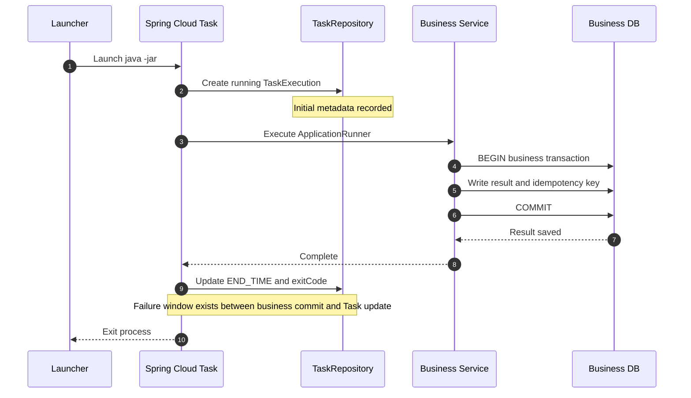
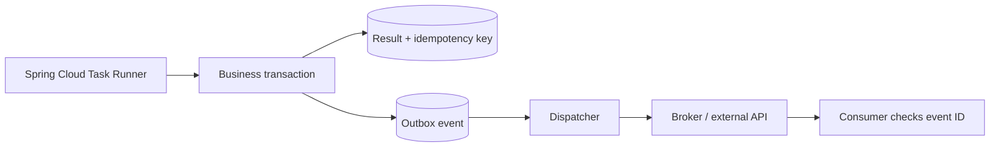

# Transaction Boundaries Between the Task Repository and Business Data

A **Spring Cloud Task** application typically runs for a finite duration: it accepts parameters, processes work, records execution status, and terminates. When deployed on a schedule or on demand, failures can occur at any moment. Suppose a revenue aggregation task **finished writing its data** but stopped abruptly before updating `TaskExecution` as successful. The orchestrator sees a failed or incomplete run and decides to **retry**. If the business logic is not designed for safe reruns, revenue can end up counted twice.

In the **Idempotent Retries** chapter, the core issue is understanding that **the transaction recording `TaskRepository` metadata and the transaction writing business data can finish at different times**. `TaskRepository` helps trace runs; it does not automatically turn the entire task and all external side effects into a single atomic transaction.

After this lesson, you will be able to:

- Distinguish `TaskRepository` from the business data store, even when both live in the same database.
- Identify the time windows where data has committed but Task metadata has not yet been updated.
- Create **idempotency keys** and short transaction boundaries to safely reprocess the same request.
- Handle retries, concurrent processes, and side effects outside the database with appropriate strategies.
- Distinguish Spring Cloud Task transactions, service transactions, and Spring Batch `JobRepository`/`Step` transactions.

## 1. Two kinds of data, two responsibilities

**`TaskRepository`** is Spring Cloud Task's metadata store. The framework typically creates a `TaskExecution` when the application starts and updates it when the application exits. The record can store execution ID, task name, start/end timestamps, exit code, and other version-dependent fields.

The **business data store** is where the application produces actual outcomes: daily revenue totals, invoices, report files, reconciliation status, or messages sent to other systems.

| Aspect | Spring Cloud Task metadata | Business data |
| --- | --- | --- |
| Purpose | Record **one application run** | Record **work outcomes** |
| Typical entities | `TaskExecution`, arguments, `exitCode` | `daily_revenue`, invoices, payment history, files |
| Managed by | `TaskRepository` and `TaskExplorer` | Business services, repositories, or APIs |
| Identifier | New `TASK_EXECUTION_ID` on each run | Business keys such as `business_date`, `tenant_id`, `request_id` |
| On retry | Usually gets a **new TaskExecution** | Must decide to **resume, overwrite safely, skip, or compensate** |
| Guarantee | History exists if metadata is written in time | Depends on transactions, unique keys, and business design |

**Do not use `TASK_EXECUTION_ID` as a business deduplication key.** A retry created to process the *same request* normally receives a new execution ID. If the idempotency key changes with each run ID, both runs can write data.

### Same database does not mean same transaction

An application may use **one `DataSource`** to store both `TASK_EXECUTION` and `daily_revenue`. Even then, Spring Cloud Task writes metadata at the beginning and end of the lifecycle, whereas business services open and commit transactions while the runner executes. The business transaction does not automatically span the metadata writes before and after it.

With **two `DataSource`s** or two separate databases, this boundary is even clearer: the metadata transaction manager and the business transaction manager govern separate resources. A `rollback` in the business database does not automatically roll back committed `TaskExecution` rows.



The diagram depicts the happy path; callback and metadata commit details depend on version and configuration. **A final metadata update can fail even after the business transaction has committed.**

## 2. Failure windows and consequences on rerun

Break the lifecycle into milestones:

1. **M0:** Launcher spawns the process; Spring Cloud Task prepares to write `TaskExecution`.
2. **M1:** Start record is saved; the runner begins processing.
3. **M2:** Business transaction commits.
4. **M3:** `TaskRepository` updates the outcome and end timestamp.
5. **M4:** Launcher observes the exit code and decides the next action.

| Failure timing | Possible business data state | Possible Task metadata state | Action before retry |
| --- | --- | --- | --- |
| Before M1 | Not processed yet | No record or incomplete creation | Check startup errors, datasource, and infrastructure status. |
| Between M1 and M2 | Processing; some short transactions may have committed | `TaskExecution` running or missing `END_TIME` | Inspect individual business effects and recoverability. |
| **Between M2 and M3** | **Result already committed** | May still appear incomplete or marked failed | Check idempotency key; **do not reapply effects** if already complete. |
| After M3, before M4 | Likely fully committed | Metadata recorded the outcome | Cross-check OS exit code and launcher state; avoid blind retry. |
| Container killed via `SIGKILL`/OOM | Depends on transactions committed earlier | End metadata may be missing | Combine logs, container events, and business data. |

Crucially, **you cannot infer "nothing was done" from "missing `END_TIME`."** Nor can you infer from `exitCode = 0` that every external system definitively received the result.

### Concrete example: adding revenue twice

Suppose a worker runs this statement for 2026-11-24:

```sql
UPDATE account_balance
SET total_revenue = total_revenue + 1500000
WHERE account_id = 42;
```

If the transaction commits but the worker is killed before updating metadata, a retry executing the same statement adds **1,500,000** again. The transaction makes the `UPDATE` atomic **within a single invocation**, but **does not make this addition idempotent across multiple runs**.

There are two safer design directions:

- **Compute a deterministic result and perform a controlled overwrite:** e.g., aggregate total revenue for the day and `UPSERT` by date key instead of blind incremental addition.
- **Use an idempotency key** backed by a unique constraint, writing both the processed marker and the business effect **in the same transaction**.

## 3. Choosing an idempotency key per business requirement

**Idempotency** means repeatedly processing a request produces no unintended extra side effects after the request has completed. The idempotency key must remain stable **across retries of the same unit of work**.

| Job type | Suggested key | What to avoid |
| --- | --- | --- |
| Daily revenue aggregation | `tenant_id + business_date + report_type` | Using only `TaskExecution.executionId`, since each retry gets a new ID. |
| Transaction file import | File ID or content checksum + import type | Using only the filename if the name can be reused for different content. |
| Payment order processing | Unique business order ID | Generating a new ID on every scheduler retry. |
| Report export for a data version | `report_type + period + data_version` | Permanently blocking valid regenerations after source data changes. |

The key must reflect **the boundary within which reruns are permitted**. If you need to recalculate data for the same day after supplemental transactions arrive, the workflow must include an **input version** or a controlled reprocessing policy. A permanent "day completed" lock can prevent old data from ever being updated.

### Concurrency protection

Checking with a `SELECT` before processing is insufficient:

```text
Worker A: SELECT sees date not yet processed
Worker B: SELECT sees date not yet processed
Worker A: writes revenue
Worker B: writes revenue a second time
```

Two processes can pass the check at the same time. You need **database unique constraints**, atomic writes, lock/lease mechanisms, or an appropriate concurrency strategy. Each solves a different problem: unique keys prevent committing duplicate outcomes; leases help with long-running tasks but require expiration handling and fencing so stale workers cannot keep writing.

## 4. Complete example: writing data and processed marker in the same transaction

The following example uses **PostgreSQL**, Spring Boot, Spring Cloud Task, and Spring JDBC. To focus on idempotency, assume Task metadata and business tables live in **the same PostgreSQL database**, while having **separate transaction boundaries** as explained above. The design also applies when metadata lives in a separate database, as long as the business transaction contains **both the idempotency marker and the business result**.

### 4.1. Business schema

Create illustrative tables:

```sql
CREATE TABLE sales_transaction (
    id BIGINT GENERATED ALWAYS AS IDENTITY PRIMARY KEY,
    business_date DATE NOT NULL,
    amount NUMERIC(18, 2) NOT NULL
);

CREATE TABLE daily_revenue (
    business_date DATE PRIMARY KEY,
    total_amount NUMERIC(18, 2) NOT NULL,
    calculated_at TIMESTAMPTZ NOT NULL DEFAULT CURRENT_TIMESTAMP
);

CREATE TABLE reconciliation_done (
    business_date DATE PRIMARY KEY,
    completed_at TIMESTAMPTZ NOT NULL DEFAULT CURRENT_TIMESTAMP
);

INSERT INTO sales_transaction (business_date, amount)
VALUES
    (DATE '2026-11-24', 1000000),
    (DATE '2026-11-24', 500000);
```

Meaning: `sales_transaction` is the input; `daily_revenue` holds **one result per day**; `reconciliation_done` is the **processed marker**. The primary key on `business_date` prevents two transactions from committing two completion markers for the same date.

**Important:** Both the `reconciliation_done` marker and the `daily_revenue` result must be written **in the same business database transaction**. If you save the marker in transaction A and update the result in transaction B, a failure between them can leave an "already processed" state with no actual report.

### 4.2. Dependencies and configuration

In a Maven project that already includes the Spring Boot parent/plugin and a **compatible Spring Cloud BOM**, include these dependencies:

```xml
<dependencies>
    <dependency>
        <groupId>org.springframework.cloud</groupId>
        <artifactId>spring-cloud-starter-task</artifactId>
    </dependency>
    <dependency>
        <groupId>org.springframework.boot</groupId>
        <artifactId>spring-boot-starter-jdbc</artifactId>
    </dependency>
    <dependency>
        <groupId>org.postgresql</groupId>
        <artifactId>postgresql</artifactId>
        <scope>runtime</scope>
    </dependency>
</dependencies>
```

File `src/main/resources/application.yml`:

```yaml
spring:
  application:
    name: reconcile-revenue-task
  main:
    web-application-type: none
  datasource:
    url: jdbc:postgresql://localhost:5432/reconcile_db
    username: reconcile_app
    password: ${RECONCILE_DB_PASSWORD}
  cloud:
    task:
      name: dailyRevenueReconcile
      initialize-enabled: false
```

This example assumes the Spring Cloud Task metadata tables were created by **version-appropriate migrations** in this database. With a single `DataSource` and an appropriate default JDBC transaction manager, Spring Boot can auto-configure the required beans for `JdbcTemplate` and `@Transactional`. Never put real passwords in source files.

### 4.3. Service processing in a short transaction

Create `src/main/java/com/example/reconcile/DailyRevenueService.java`:

```java
package com.example.reconcile;

import java.math.BigDecimal;
import java.sql.Date;
import java.time.LocalDate;

import org.springframework.jdbc.core.JdbcTemplate;
import org.springframework.stereotype.Service;
import org.springframework.transaction.annotation.Transactional;

@Service
public class DailyRevenueService {

    private final JdbcTemplate jdbc;

    public DailyRevenueService(JdbcTemplate jdbc) {
        this.jdbc = jdbc;
    }

    @Transactional
    public void reconcile(LocalDate businessDate) {
        Date sqlDate = Date.valueOf(businessDate);

        // Record the marker in the same transaction as the result.
        // PostgreSQL handles PRIMARY KEY conflicts atomically.
        int inserted = jdbc.update("""
            INSERT INTO reconciliation_done (business_date)
            VALUES (?)
            ON CONFLICT (business_date) DO NOTHING
            """, sqlDate);

        if (inserted == 0) {
            System.out.println(
                "Date " + businessDate + " already reconciled, skipping retry"
            );
            return;
        }

        BigDecimal total = jdbc.queryForObject("""
            SELECT COALESCE(SUM(amount), 0)
            FROM sales_transaction
            WHERE business_date = ?
            """, BigDecimal.class, sqlDate);

        jdbc.update("""
            INSERT INTO daily_revenue (business_date, total_amount)
            VALUES (?, ?)
            ON CONFLICT (business_date)
            DO UPDATE SET
                total_amount = EXCLUDED.total_amount,
                calculated_at = CURRENT_TIMESTAMP
            """, sqlDate, total);

        System.out.println(
            "Reconciled " + businessDate + ", total = " + total
        );
    }
}
```

**Why is this pattern safe when retrying the same date?**

1. The first run inserts a row into `reconciliation_done` but **does not commit** until the `reconcile` method finishes successfully.
2. Within the same transaction, the service computes the sum and writes to `daily_revenue`. If a step throws an exception causing a rollback, **both the marker and the result in the transaction roll back**.
3. After the transaction commits, a rerun with the same `businessDate` hits a primary key conflict: `ON CONFLICT DO NOTHING` returns `0` rows inserted, and the service skips duplicate processing.
4. If two PostgreSQL processes try to insert the same date concurrently, the unique/primary key constraint forces the transactions to serialize conflict resolution. Once the first transaction finishes, only one marker commits; the other transaction either skips or proceeds if the first rolled back.

The example above suits a **short database processing unit**. In production, add metrics/logs for the "already processed" case and ensure input data remains stable during the calculation. Never hold a transaction open while calling external APIs or waiting for hours.

**Scope limitation:** This approach blocks rerunning the same date **permanently** unless an explicit recalculation process is designed. To support new data versions, add `source_version`/`calculation_version` to the key and define result replacement rules.

### 4.4. Spring Cloud Task startup runner

Create `src/main/java/com/example/reconcile/ReconcileTaskApplication.java`:

```java
package com.example.reconcile;

import java.time.LocalDate;
import java.util.List;

import org.springframework.boot.ApplicationArguments;
import org.springframework.boot.ApplicationRunner;
import org.springframework.boot.SpringApplication;
import org.springframework.boot.autoconfigure.SpringBootApplication;
import org.springframework.cloud.task.configuration.EnableTask;
import org.springframework.context.annotation.Bean;

@SpringBootApplication
@EnableTask
public class ReconcileTaskApplication {

    public static void main(String[] args) {
        SpringApplication.run(ReconcileTaskApplication.class, args);
    }

    @Bean
    ApplicationRunner run(DailyRevenueService service) {
        return args -> {
            List<String> values = args.getOptionValues("business-date");
            if (values == null || values.size() != 1
                    || values.get(0) == null || values.get(0).isBlank()) {
                throw new IllegalArgumentException(
                    "Must pass --business-date=YYYY-MM-DD"
                );
            }
            LocalDate date = LocalDate.parse(values.get(0));
            service.reconcile(date);
        };
    }
}
```

`ApplicationRunner` calls the **service bean through the Spring proxy**, so `@Transactional` on `reconcile` takes effect when transaction management is properly configured. Calling `this.reconcile(...)` from inside the service class itself or instantiating it with `new` outside Spring can **bypass the proxy**, preventing transactions from behaving as expected.

### 4.5. Run twice and compare results

After packaging as an executable JAR with `spring-boot-maven-plugin`:

```bash
./mvnw clean package

java -jar target/reconcile-revenue-task-0.0.1-SNAPSHOT.jar \
  --business-date=2026-11-24

java -jar target/reconcile-revenue-task-0.0.1-SNAPSHOT.jar \
  --business-date=2026-11-24
```

The JAR name assumes `artifactId=reconcile-revenue-task` and `version=0.0.1-SNAPSHOT`. Expected result: the first run records total **1,500,000**; the second run reports already processed and skips. After two runs, there may be **two distinct `TaskExecution` rows** in metadata, but only **one row** for that date in `reconciliation_done` and `daily_revenue`.

Verify business data:

```sql
SELECT business_date, total_amount
FROM daily_revenue
WHERE business_date = DATE '2026-11-24';

SELECT business_date, completed_at
FROM reconciliation_done
WHERE business_date = DATE '2026-11-24';
```

Verify Spring Cloud Task metadata:

```sql
SELECT
    TASK_EXECUTION_ID,
    TASK_NAME,
    START_TIME,
    END_TIME,
    EXIT_CODE
FROM TASK_EXECUTION
ORDER BY TASK_EXECUTION_ID DESC;
```

Metadata columns must match the schema for the Spring Cloud Task version in use. If the first run is killed **before the business transaction commits**, PostgreSQL rolls back both marker and result, so the retry can try again. If the first run **already committed** but could not update end metadata in time, the retry still sees the processed marker and does not duplicate the result.

## 5. When metadata and business data live in two different `DataSource`s

In real deployments, you may use one PostgreSQL instance for metadata and another PostgreSQL instance for business data:

```text
Spring Cloud Task
  ├── TaskRepository
  │     └── taskDataSource + taskTransactionManager
  │           └── TASK_EXECUTION, metadata tables
  └── DailyRevenueService
        └── businessDataSource + businessTransactionManager
              └── reconciliation_done, daily_revenue, sales_transaction
```

The business service must then use its corresponding manager:

```java
@Transactional(transactionManager = "businessTransactionManager")
public void reconcile(LocalDate businessDate) {
    // Write idempotency marker and result using businessDataSource.
}
```

This is an **illustrative configuration snippet**, not a complete method. You must configure `businessDataSource`, `businessTransactionManager`, and `TaskConfigurer`/metadata datasource beans consistently for your Spring Cloud Task version.

**Do not place the idempotency marker in `TaskRepository` while writing business outcomes to another database and assume both commit together.** A local JDBC transaction manager only manages the resource bound to it. Two independent transaction managers can commit one side and fail the other. When business consistency is needed, prefer keeping **the processed marker and outcome data in the same business transaction**.

Distributed JTA/XA transactions can be an option in systems with a transaction coordinator and compatible resources, but they carry significant operational overhead and risk. Most scheduled tasks do not need them just to make Task metadata and business data "succeed simultaneously"; it is usually far more practical to make business logic **idempotent**, observable, and reconcilable after failures.

## 6. Side effects outside the database: outbox and receiver-side idempotency

A JDBC transaction cannot automatically roll back a sent email, a called payment API, or a message already accepted by another system. For example:

```text
1. Write report to database
2. Send "report-ready" event to message broker
3. Killed before updating TaskExecution
4. Retry, resend "report-ready"
```

If step 2 succeeds but the application never receives confirmation, the receiver's actual state may be **unknown**. Using `@Transactional` on the database alone does not prevent duplicate sends.

A common approach is the **transactional outbox**:

1. Within the **same business transaction**, save the report outcome, the idempotency marker, and an `outbox_event` row with a **unique event ID/key**.
2. A separate process reads unpublished events and delivers them to the broker/API.
3. After receiving acknowledgment, the dispatcher marks the event as sent. If it crashes between sending and marking, the event may be delivered **again**.
4. The receiving consumer or API must process **idempotently by event ID**, or use the provider's idempotency key feature if available.



An outbox prevents losing the intent to publish once business results commit, but **does not provide end-to-end exactly-once delivery on its own**. If the goal is zero duplicate effects in external systems, the receiver must implement deduplication/idempotency keys and clear acknowledgment or compensation policies.

## 7. If a task contains a Spring Batch Job

Spring Cloud Task and Spring Batch complement each other, yet maintain **separate metadata stores and transaction scopes**:

| Scope | Store and state | Meaning on retry |
| --- | --- | --- |
| Spring Cloud Task | `TaskRepository` / `TaskExecution` | Each launch of the finite application has its own history and exit code. |
| Spring Batch | `JobRepository` / `JobExecution` / `StepExecution` | Job/Step has status, checkpoints, and restart rules keyed by `JobParameters`. |
| Business service | Business tables or external systems | Must prevent duplicate effects and govern commit/rollback per processing unit. |

A chunk-oriented Batch Step might commit every 500 records. If an error occurs after several chunks commit, Spring Batch can use checkpoints to resume per its restart policy. However, the **TaskExecution for that application run** was already created beforehand and has its own lifecycle. Relaunching the application typically creates a new `TaskExecution` even when Batch is configured to restart the same `JobInstance`.

When integrating, separate:

- The transaction manager for Spring Cloud Task metadata via `TaskConfigurer`/`TaskRepository`.
- The transaction manager for Spring Batch `JobRepository` and `Step`s according to your Spring Batch version.
- The transaction manager for business data; with chunks, verify commit boundaries and how checkpoints reflect progress.

Do not assume `JobExecution.exitStatus`, `TaskExecution.exitCode`, and the OS exit code are always synchronized automatically. A Batch Job reporting failure whose exception is caught by a runner returning normally can make application outcomes misleading if errors are not mapped properly.

## 8. Safe retries also require orchestration policies

Even when business code is idempotent, the operational platform must handle these scenarios:

| Situation | Risk | Appropriate action |
| --- | --- | --- |
| Scheduler receives no response | Old task might still be running | Cross-check process/container and metadata before creating a retry. |
| Two processes receive same `business-date` | Concurrent data writes | Database unique keys; for long tasks, locks/leases with fencing and timeouts. |
| Metadata DB connection lost after business commit | Incomplete `TaskExecution` | Rely on committed business markers, logs, and infra state to decide. |
| Retry after invalid input | Repeats the same error | Fix parameters, avoid blind retries, and return classified exit codes. |
| Retry after transient infra error | Excess load or concurrent execution | Bound retry counts, use backoff, jitter, and concurrency limits. |
| Source data changes after initial run | Stale result not updated | Key by data version or use a controlled reprocessing workflow. |
| Business logic calls external API | Replay may generate duplicate requests | Outbox, receiver-side idempotency keys, or compensation. |

**Distinguish three identifiers:**

- `TaskExecution.executionId`: identifies a **specific run**, changing on every retry.
- **Business idempotency key**: identifies the **logical unit of work**, remaining stable across retries of the same request.
- **Correlation ID**: links the request, launcher, logs, `TaskExecution`, and external systems for tracing; it may match the business key or be a distinct value.

In multi-tenant systems, business keys must include tenant scope if different tenants can share the same date or document ID. Never pass tokens, passwords, or secrets in CLI arguments or logged metadata.

## 9. Misconceptions to avoid

**"`@Transactional` makes the entire Spring Cloud Task atomic."** Incorrect. The annotation applies to methods invoked through a proxy using the configured transaction manager and propagation. It does not automatically span `TaskRepository` at lifecycle start/end, nor can it roll back effects outside the database.

**"If a Task has `EXIT_CODE=0`, retries will never duplicate."** Incorrect. The scheduler can re-dispatch the same request, an operator can manually rerun it, or the launcher can lose the response. Rerun safety must be enforced at the business layer.

**"Blank `END_TIME` means data has not committed."** Incorrect. Metadata stores and business transactions can be independent; always check idempotency markers and business results.

**"Pre-checking with `SELECT` is enough against concurrency."** Incorrect when two workers read before either writes. You need constraints, locks, or controlled atomic writes.

**"If a `reconciliation_done` row exists, deleting it and rerunning is safe."** Not necessarily. If external outputs, version history, or downstream data exist, deleting the marker can trigger duplicate effects. Design an explicit **reprocess** flow with versioning, correlation, and verification criteria.

## 10. Hands-on exercises and self-check questions

Try these on a test database—**never tamper with production data**:

1. Run the JAR with `--business-date=2026-11-24`. Verify one `daily_revenue` row, one `reconciliation_done` row, and one new `TaskExecution`.
2. Rerun for the same date. Confirm the business row count and total revenue do not increase, even though `TaskExecution` history adds another run.
3. Make the service throw an exception **after inserting the marker, before writing the result**. Verify the transaction rolls back both changes so a subsequent retry can process cleanly from scratch.
4. Let the service commit and simulate a failure **before Task metadata finishes** in a test environment. Observe the retry detecting the processed marker and avoiding recalculation.
5. Launch two processes concurrently for the same date. Explain the role of the `reconciliation_done.business_date` primary key in resolving the conflict.
6. Add a `source_version` column to the business key. State what conditions allow recalculating a report when source data changes.
7. Redraw the transaction boundary if task metadata lives in `taskdb` while reports live in `businessdb`. Which side can commit when the other fails?
8. Design an outbox for the `report-ready` event. What happens if the dispatcher sends successfully but is killed before marking it sent?

**Review questions:**

- Why is `TASK_EXECUTION_ID` unsuitable as an idempotency key for the same revenue period?
- In the SQL example, why must the `reconciliation_done` marker and `daily_revenue` table be updated **in the same transaction**?
- If the business transaction committed but `TaskExecution` lacks `END_TIME`, what should be inspected before retrying?
- When a Spring Batch Job processes multiple chunks, are Batch checkpoints and Spring Cloud Task metadata the same thing?
- For an external API that does not support idempotency keys, what limitations remain even when using an outbox?

**Remember:** `TaskRepository` provides **execution history**; business transactions determine **when real outcomes commit**. These two events are not automatically atomic. Safe Spring Cloud Task retries require **stable business idempotency keys**, appropriate data constraints and transactions, combined with clear retry and monitoring policies. When integrating Spring Batch or external systems, extend the safety strategy to every chunk, event, and downstream receiver.
