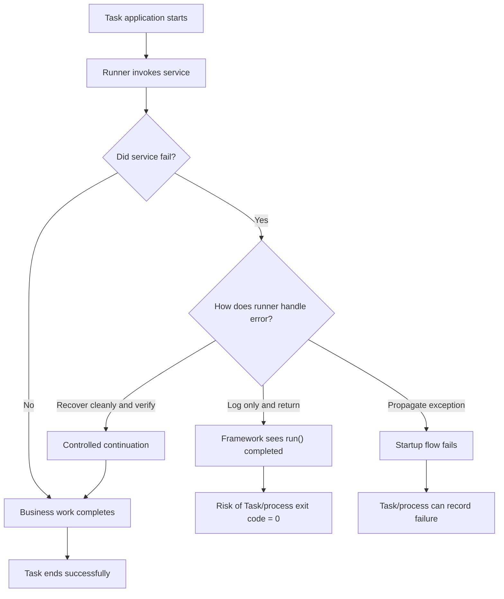

# Caught Exceptions and the Risk of False Success

## Learning objectives

After this lesson, you will be able to:

- Explain why **catching an exception and only logging it** can cause Spring Cloud Task and the operating system to receive a success outcome even though business processing failed.
- Distinguish business state, `TaskExecution.exitCode` in `TaskRepository`, Spring Batch `JobExecution` status, and the **process exit code** observed by the scheduler.
- Choose appropriate `try/catch` boundaries: handle to recover, translate into a meaningful failure, or propagate the exception to fail the Task.
- Understand the impact of swallowing exceptions on `@Transactional`, partially processed data, retry mechanisms, and idempotency.
- Design error-path tests, reconciliation SQL, and safe operational criteria for scheduled or on-demand Tasks.

> **Context:** This lesson belongs to the **Idempotent Retries** chapter of the **SPRING_CLOUD_TASK** module. Spring Cloud Task is used to build finite-running Spring Boot applications, persist execution history via `TaskRepository`, and integrate with Spring Batch. Every run must report its outcome honestly so the orchestration platform can decide whether to alert, retry, or require manual intervention. This lesson focuses on failures that **occurred but were masked by code** before reaching the Task management infrastructure.

## 1. The problem: an error occurred, yet the Task still "succeeded"

Suppose every night a Kubernetes CronJob triggers the `daily-settlement` process to reconcile transactions:

1. The runner receives `--business-date=2026-11-24`.
2. The service loads transactions from the database and calls the payment system.
3. The payment API returns a connection error.
4. The runner catches `Exception`, logs an `ERROR`, and **returns normally**.
5. Spring Cloud Task may record `TaskExecution` as successful; the Java process exits with code `0`.
6. The scheduler marks the Job successful and does not retry, while the transactions remain unprocessed.

Problematic code example:

```java
@Component
class SettlementRunner implements ApplicationRunner {

    private static final Logger log =
            LoggerFactory.getLogger(SettlementRunner.class);

    private final SettlementService service;

    SettlementRunner(SettlementService service) {
        this.service = service;
    }

    @Override
    public void run(ApplicationArguments args) {
        try {
            service.settle();
        } catch (Exception ex) {
            log.error("Settlement failed", ex);
            // Wrong if the business operation must succeed:
            // the exception is swallowed and run() still returns normally.
        }
    }
}
```

Here, `log.error(...)` **only emits an observability message**. It does not change the execution status, request rollback of an already-finished transaction, or inform the shell or Kubernetes that the process failed.

| Observation | What the operator sees | Possible false conclusion |
| --- | --- | --- |
| Logs | An `ERROR` line with a stack trace. | "The application definitely reported a failure to the scheduler." |
| Runner | The `run` method returns normally. | "Business processing succeeded." |
| `TaskRepository` | May record exit code `0` when no error is received. | "Reconciliation data is complete." |
| Process | Exit status may be `0`. | "No retry needed." |
| Business database | May have persisted only partial results. | "All transactions committed safely." |

**Log messages and execution state are two separate channels.** An error that is merely logged does not necessarily alter the runner's return path, repository status, or OS exit code.

## 2. How does Spring Cloud Task know a run failed?

Spring Cloud Task manages lifecycle metadata for finite-running Boot applications. When a JDBC `TaskRepository` is properly configured and the database is reachable, each run is typically represented by a `TaskExecution` containing:

- `executionId` and `taskName`: the specific execution and Task name.
- `startTime` / `endTime`: recorded start and completion timestamps.
- `exitCode`, `exitMessage`, `errorMessage`: outcome/error metadata recorded by the framework.
- `arguments`: process arguments, if any.

Spring Boot invokes `ApplicationRunner` and `CommandLineRunner` beans during startup. Spring Cloud Task observes the lifecycle to create and update metadata. If a runner throws an exception and it **propagates out of `run(...)`**, startup fails; the framework has an opportunity to record the error and a non-`0` exit code while the repository is still reachable.

If the runner catches all errors and returns, the outer layer may **have no idea any failure happened**. In particular, `TaskExecutionListener.onTaskFailed(...)` does not automatically detect `log.error` calls. Failure listeners generally run only when the Task infrastructure actually receives a failure event.

### One execution produces multiple outcome signals

| Signal | Source | Limitation |
| --- | --- | --- |
| Business outcome | Reconciliation tables, API responses, event records, invariant checks. | Defined by the application; may differ from system exit code. |
| `TaskExecution.exitCode` | `TaskRepository`, `TASK_EXECUTION` table. | May not be recorded if the Task fails too early or crashes abruptly. |
| `JobExecution.status` | Spring Batch `JobRepository` when running a Job. | A Job may be `FAILED` even if the wrapping Task runs to completion. |
| JVM exit code | Exit status of the `java` process. | Schedulers usually distinguish `0` from non-`0`; lacks detailed root cause. |



Do not assume this diagram guarantees every thrown exception produces a failed `TASK_EXECUTION` row: errors occurring before the repository registers the Task or database connectivity losses can prevent metadata from being written.

## 3. Distinguishing "caught the error" from "handled the error"

In Java, `catch` only means a block of code **received** the exception. To know whether an error was **completely handled**, answer this: after `catch`, do business invariants still hold and does the outcome qualify as success?

| Situation | Allowed to continue? | Appropriate handling |
| --- | --- | --- |
| API call failed once, retried within bounds, succeeded, and outcome verified. | Yes. | Log at an appropriate level; keep success semantics. |
| One input record is invalid and business policy allows skipping with clear count/threshold. | Conditionally. | Record skipped item, reconciliation counts, and acceptable completion state. |
| Database write failed; unclear whether transaction committed. | Cannot self-conclude. | Stop or reconcile state before retrying; do not return false success. |
| Settlement totals mismatch, but runner only logs the mismatch. | No, if matching totals is mandatory. | Throw an exception or return a non-`0` exit code. |
| Async work returns a `Future` running in background; runner exits before result arrives. | Unknown. | Await completion, inspect result, and propagate errors/timeouts. |
| A Spring Batch Job has `BatchStatus.FAILED`, but launcher call does not throw. | No, if the Job must complete. | Check `JobExecution` and report failure at Task/process level. |

**Decision rule:** If `catch` cannot restore a valid state, it must emit a failure signal to the layer responsible for concluding the Task outcome. Logging only assists diagnostics; it does not replace that signal.

## 4. Correct pattern: log with context, then rethrow

A clean pattern for synchronous Task applications is keeping the runner thin, placing business logic in a dedicated service, and letting critical errors propagate:

```java
package com.example.settlement;

import java.time.LocalDate;
import java.util.List;

import org.slf4j.Logger;
import org.slf4j.LoggerFactory;
import org.springframework.boot.ApplicationArguments;
import org.springframework.boot.ApplicationRunner;
import org.springframework.stereotype.Component;

@Component
public class SettlementRunner implements ApplicationRunner {

    private static final Logger log =
            LoggerFactory.getLogger(SettlementRunner.class);

    private final SettlementService service;

    public SettlementRunner(SettlementService service) {
        this.service = service;
    }

    @Override
    public void run(ApplicationArguments args) {
        List<String> dates = args.getOptionValues("business-date");
        if (dates == null || dates.size() != 1) {
            throw new IllegalArgumentException(
                    "Exactly one --business-date=yyyy-MM-dd is required");
        }

        LocalDate date = LocalDate.parse(dates.get(0));

        try {
            service.settle(date);
            log.info("Settlement completed for {}", date);
        } catch (RuntimeException ex) {
            log.error("Settlement failed for {}", date, ex);
            throw ex; // Propagate failure to Spring Boot / Spring Cloud Task.
        }
    }
}
```

The crucial line is `throw ex`. It preserves the original error details and ensures `run` **does not return normally**. If you want to attach extra context, throw `new IllegalStateException("Settlement failed for " + date, ex)` to preserve the `cause` instead of replacing the exception with a message lacking the original stack trace.

### Task application configuration

```java
package com.example.settlement;

import org.springframework.boot.SpringApplication;
import org.springframework.boot.autoconfigure.SpringBootApplication;
import org.springframework.cloud.task.configuration.EnableTask;
import org.springframework.context.ConfigurableApplicationContext;

@SpringBootApplication
@EnableTask
public class DailySettlementTaskApplication {

    public static void main(String[] args) {
        ConfigurableApplicationContext context =
                SpringApplication.run(DailySettlementTaskApplication.class, args);

        int code = SpringApplication.exit(context);
        System.exit(code);
    }
}
```

`SpringApplication.exit(context)` computes the exit code according to Spring Boot's configured mechanism and closes the context. `System.exit(code)` passes that code to the JVM/operating system. **When `SpringApplication.run(...)` throws an exception**, lines below it do not execute on the normal path; Spring Boot handles the startup failure and an uncaught exception in `main` usually causes the process to exit non-`0`. Always test actual exit codes, because exception handlers and wrapper scripts can affect the outcome.

Example `application.yml` using a PostgreSQL DataSource that already has the Task schema:

```yaml
spring:
  application:
    name: daily-settlement-task
  main:
    web-application-type: none
  datasource:
    url: jdbc:postgresql://localhost:5432/taskdb
    username: ${TASK_DB_USER}
    password: ${TASK_DB_PASSWORD}
  cloud:
    task:
      initialize-enabled: false
```

The example assumes the application includes `spring-cloud-starter-task`, a JDBC driver, and dependencies managed by a compatible Spring Boot/Spring Cloud BOM. `initialize-enabled=false` is appropriate only when Task tables were already created beforehand via migration. With two separate `DataSource`s for business data and Task metadata, configure `TaskConfigurer` to select the right Task repository.

### When the runner does not need `try/catch`

If the runner performs no recovery and adds no extra context, it can call the service directly:

```java
@Override
public void run(ApplicationArguments args) {
    LocalDate date = parseDate(args);
    service.settle(date);
}
```

When the service throws an unhandled exception, it propagates naturally. Wrapping every line in `try/catch` just to log and rethrow is not always necessary, because Spring Boot typically logs startup failure stack traces already. Add logs when they add diagnostic value such as processing date, request ID, or record counts.

## 5. Pitfall with `@Transactional`: catching errors can cause unintended commits

Consider a transactional business service:

```java
@Service
public class SettlementService {

    private final JdbcTemplate jdbcTemplate;
    private final BankGateway bankGateway;

    public SettlementService(JdbcTemplate jdbcTemplate,
                             BankGateway bankGateway) {
        this.jdbcTemplate = jdbcTemplate;
        this.bankGateway = bankGateway;
    }

    @Transactional
    public void settle(LocalDate date) {
        jdbcTemplate.update(
            "UPDATE settlements SET status = 'PROCESSING' WHERE business_date = ?",
            java.sql.Date.valueOf(date)
        );

        try {
            bankGateway.submit(date);
        } catch (RuntimeException ex) {
            // DANGEROUS: swallowing error before exiting @Transactional.
            log.error("Cannot submit settlements", ex);
        }
    }
}
```

Normally, the `@Transactional` interceptor sees the method exit cleanly and may **commit the prior JDBC update**. Logging inside `catch` does not trigger a rollback. Thus, the `settlements` table can stay in `PROCESSING` even though the bank request failed.

Fix it by letting the exception propagate out of the transaction boundary:

```java
@Transactional
public void settle(LocalDate date) {
    jdbcTemplate.update(
        "UPDATE settlements SET status = 'PROCESSING' WHERE business_date = ?",
        java.sql.Date.valueOf(date)
    );

    try {
        bankGateway.submit(date);
    } catch (RuntimeException ex) {
        log.error("Cannot submit settlements", ex);
        throw ex;
    }
}
```

Under Spring's default transaction rules, a `RuntimeException`/`Error` propagating through the proxy marks the transaction for rollback. For checked exceptions or custom rules, specify `rollbackFor` or appropriate rollback settings. Also ensure the `@Transactional` method is invoked through the Spring-proxied bean; self-invocation on the same instance can bypass the interceptor.

**Crucial limitation:** JDBC rollback **cannot undo** a bank request or external API call that already succeeded. Client timeouts after the bank received the transaction leave an *uncertain* outcome. Do not blindly retry; use idempotency keys, status-query APIs, or external reconciliation workflows.

### Pitfall at the layer outside the transaction

Even when the service rolls back properly, the runner can still hide the failure:

```java
@Override
public void run(ApplicationArguments args) {
    try {
        transactionalService.settle(...);
    } catch (Exception ex) {
        log.warn("Transaction rolled back, continuing anyway", ex);
        // Task may finish with exit code = 0.
    }
}
```

In this case, the **business database rolled back**, yet the **Task may falsely report success**. A transaction protects data within its scope; `TaskRepository` and the process exit code must receive the error signal from another layer. That is why you must design both **data consistency** and **execution outcome reporting**.

## 6. Catching errors to retry: when is returning success valid?

You may catch transient errors (brief network drops, throttling) to retry inside the same Task. This is valid if you **only report success after the final attempt truly succeeds**.

Illustrative bounded-retry example for an operation **proven to be idempotent**:

```java
public void runWithBoundedRetry(String businessKey) {
    int maxAttempts = 3;

    for (int attempt = 1; attempt <= maxAttempts; attempt++) {
        try {
            paymentGateway.submitWithIdempotencyKey(businessKey);
            return; // Return only after verifying the operation succeeded.
        } catch (TemporaryGatewayException ex) {
            if (attempt == maxAttempts) {
                throw new IllegalStateException(
                    "Payment gateway failed after retries", ex
                );
            }
            // In production: use backoff with jitter and handle interrupts/timeouts.
            log.warn("Temporary gateway error, attempt={}", attempt, ex);
        }
    }
}
```

`TemporaryGatewayException` and `paymentGateway` are illustrative business components; the snippet focuses on termination criteria and error propagation. For APIs that may leave **uncertain outcomes after a timeout**, retries must use a receiver-supported idempotency key or query status from a trusted source first. Not every "network" error is safe to resend.

When applying `Spring Retry`, Spring Batch retry, or scheduler retries, you still must define:

- Retryable error types: transient failures differ from invalid-data errors.
- Max attempts, backoff, jitter, timeouts, and total runtime limits.
- Idempotency keys and how prior outcomes are checked before re-executing.
- Outcome after retries are exhausted: **throw an error or return a non-`0` code**, never swallow the final exception.
- Impact of nested retries: retries across the API client, Task, Batch, and Kubernetes can multiply total execution attempts dramatically.

`Spring Cloud Task` tracks a finite process; it **does not schedule business retries automatically** just because `TaskRepository` exists. A relaunch from a CronJob, Kubernetes Job, or orchestrator is a new execution, typically creating a new `executionId`.

## 7. Partial failures: do not equate "finished the loop" with "success"

Suppose a Task processes 1,000 invoices; 990 succeed and 10 fail. The following code misleads callers:

```java
for (Invoice invoice : invoices) {
    try {
        process(invoice);
    } catch (Exception ex) {
        log.warn("Skipped invoice {}", invoice.id(), ex);
    }
}
log.info("All invoices processed"); // Hides the 10 failed invoices.
```

If the requirement is **all invoices must succeed**, reflect failures after the loop:

```java
List<String> failedIds = new ArrayList<>();

for (Invoice invoice : invoices) {
    try {
        process(invoice);
    } catch (RecoverableInvoiceException ex) {
        failedIds.add(invoice.id());
        log.warn("Invoice failed: {}", invoice.id(), ex);
    }
}

if (!failedIds.isEmpty()) {
    throw new IllegalStateException(
        "Failed invoices: count=" + failedIds.size()
    );
}

log.info("Invoice processing completed successfully");
```

The snippet illustrates failure-reporting policy; `Invoice` and `RecoverableInvoiceException` are project-defined business types. In production, do not keep IDs only in memory if you need to resume after a crash; persist checkpoints/record states and consider Spring Batch when multiple steps or restartability are required.

If business rules **allow skipping up to N records**, define a concrete, testable policy: which error types are skippable, maximum error rate, where skipped items are stored, alert triggers, and what success means. A Task that "succeeded with warnings" must be clearly distinguished on business dashboards; exit code `0` is valid only when acceptance criteria are genuinely met.

| Policy | Completion condition | Recommended signal |
| --- | --- | --- |
| All records must complete | `failedCount == 0` | Success; if non-`0`, fail. |
| Bounded skips allowed | Only accepted error types skipped and count within threshold. | Success with warning plus skip report; fail if threshold exceeded. |
| Phased completion allowed | Persistent checkpoints exist; later phase resumes cleanly. | Business codes/states clearly represent progress; do not mark "completed" prematurely. |
| Uncertain if external payment committed | Cannot conclude yet. | Stop for reconciliation or report investigation-needed status; do not blindly replay. |

## 8. Distinguishing caught exceptions from `SpringApplication.exit` and JVM exit codes

`main` often ends with:

```java
public static void main(String[] args) {
    ConfigurableApplicationContext context =
            SpringApplication.run(DailySettlementTaskApplication.class, args);

    int exitCode = SpringApplication.exit(context);
    System.exit(exitCode);
}
```

`SpringApplication.exit(context)` computes an exit code via Spring Boot's mechanism, including configured `ExitCodeGenerator` beans, and closes the context; it **does not force the JVM to return that code to the OS by itself**. `System.exit(exitCode)` performs that step.

If a runner catches an error and returns **without supplying a failure signal**, `SpringApplication.exit` may return `0`. Also remember: if `SpringApplication.run` throws before returning a context, lines after `run` do not execute. On startup failure paths, Spring Boot applies its own exception/exit-code handling; verify the actual exit status when running the application.

### If you intentionally catch errors and want error-specific exit codes

You can use a Spring Boot `ExitCodeGenerator` bean to compute a code based on recorded business outcomes:

```java
@Component
class TaskExitStatus implements ExitCodeGenerator {

    private volatile int exitCode = 0;

    public void invalidInput() {
        exitCode = 2;
    }

    public void businessFailure() {
        exitCode = 10;
    }

    @Override
    public int getExitCode() {
        return exitCode;
    }
}
```

The runner can call `taskExitStatus.businessFailure()` upon detecting a business failure. When `main` calls `SpringApplication.exit` and `System.exit`, that code can be propagated to the process. **However, this does not automatically guarantee `TaskExecution.exitCode` or `onTaskFailed` callbacks are updated identically** across every release and deployment style. If your goal is observing failures in both `TaskRepository` and the process, the cleanest approach for unrecoverable errors is **propagating the exception**, then testing both signals.

For errors that were fully recovered and where business verification succeeded, you do not have to return a non-`0` code merely because a transient exception appeared in logs. Final outcome decisions must be based on business completion criteria, not on whether a warn/error log was emitted.

## 9. When a Spring Batch Job fails but the Task reports success

Spring Cloud Task records metadata for **the entire application run**; Spring Batch records `JobExecution`, `StepExecution`, and its own states. The following can happen:

1. A Batch Job is launched.
2. A Step fails; `JobRepository` records `BatchStatus.FAILED`.
3. The wrapping runner **does not check `JobExecution`** or swallows the exception.
4. The runner finishes normally; the Task/process risks returning code `0`.

Example invoking `JobLauncher` directly must check the result:

```java
@Component
class BatchSettlementRunner implements ApplicationRunner {

    private final JobLauncher jobLauncher;
    private final Job settlementJob;

    BatchSettlementRunner(JobLauncher jobLauncher,
                          @Qualifier("settlementJob") Job settlementJob) {
        this.jobLauncher = jobLauncher;
        this.settlementJob = settlementJob;
    }

    @Override
    public void run(ApplicationArguments args) throws Exception {
        String businessDate = args.getOptionValues("business-date").get(0);

        JobParameters parameters = new JobParametersBuilder()
                .addString("businessDate", businessDate, true)
                .toJobParameters();

        JobExecution execution =
                jobLauncher.run(settlementJob, parameters);

        // Example assumes synchronous launcher and that the Job has finished.
        if (execution.getStatus() != BatchStatus.COMPLETED) {
            throw new IllegalStateException(
                "Batch Job did not complete: " + execution.getStatus()
            );
        }
    }
}
```

Corresponding imports belong to `org.springframework.batch.core` (`Job`, `JobExecution`, `JobParameters`, `JobParametersBuilder`, `BatchStatus`), `org.springframework.batch.core.launch.JobLauncher`, along with Spring Boot and Spring Framework types. The example assumes a synchronous `JobLauncher`; if configured asynchronously, wait for the Job to finish before evaluating its outcome. Argument extraction should also validate missing or malformed values as in standard runners.

If managing the Job in your own runner, prevent Spring Boot's auto-run mechanism from launching **the same Job a second time**. Depending on your version, disable auto-run via:

```properties
spring.batch.job.enabled=false
```

When integrating `spring-cloud-task-batch`, some releases support:

```properties
spring.cloud.task.batch.fail-on-job-failure=true
```

This property helps reflect Batch Job failures in supported Task–Batch integration paths; **it does not replace checking outcomes in custom flows, async execution, or exception-swallowing runners**. When investigating, cross-check `BATCH_JOB_EXECUTION.STATUS`, `TASK_EXECUTION.EXIT_CODE`, and the process exit code.

`TaskExecution.executionId` and `JobExecution.id` are two independent keys. If the `TASK_TASK_BATCH` linking table is present, use it to join the right executions instead of assuming the two IDs are equal.

## 10. Safe retries after a Task reported "false success"

A Task marked with false success may leave behind **partially processed data**. Fixing the code to throw an exception on future runs does not resolve leftover state from the earlier run. Before retrying, determine:

- Which rows already committed to the business database?
- Did external side effects (payment APIs, emails, published messages) already occur?
- Is there a sufficiently stable business key to recognize repeated requests?
- Is there a checkpoint or persistent state to resume unfinished work?
- Could records stuck in `IN_PROGRESS` belong to a crashed prior process?

### 10.1. Use a business key instead of `executionId` to prevent duplicate processing

Spring Cloud Task's `executionId` identifies **each execution**. When the scheduler retries, the new Task normally gets a new ID even though it processes the same reconciliation date. Therefore, `executionId` is unsuitable as a business deduplication key.

For example, a settlement batch key might be `(business_date, region)`. Create a unique constraint:

```sql
CREATE TABLE settlement_runs (
    business_date DATE NOT NULL,
    region        VARCHAR(30) NOT NULL,
    status        VARCHAR(20) NOT NULL,
    updated_at    TIMESTAMPTZ NOT NULL DEFAULT CURRENT_TIMESTAMP,
    PRIMARY KEY (business_date, region)
);
```

With PostgreSQL, attempt to insert the claim row:

```sql
INSERT INTO settlement_runs(business_date, region, status)
VALUES (DATE '2026-11-24', 'apac', 'IN_PROGRESS')
ON CONFLICT (business_date, region) DO NOTHING;
```

**This only prevents inserting two rows with the same key**; it is not a complete idempotency algorithm. When a conflict occurs, inspect the existing state:

| Existing status | Action to consider |
| --- | --- |
| `COMPLETED` with verified result | Do not replay business effects; return the saved outcome. |
| `IN_PROGRESS`, process still holds valid lease/lock | Avoid parallel execution; wait or return in-progress status. |
| `IN_PROGRESS` with expired lease, old process dead | Require controlled takeover/recovery and reconcile prior effects. |
| `FAILED` and retryable | Classify root cause, inspect external state, and resume per designed rules. |
| `FAILED` due to invalid data | Do not blindly retry; require fixing input/data. |

In multi-Pod environments, `SELECT` followed by `INSERT` is not enough against race conditions; use database constraints, locks, optimistic locking, leases, or equivalent concurrency controls.

### 10.2. Never blindly retry when external side effects exist

Suppose a Task calls a funds-transfer API. The client times out, yet the bank **already accepted the transaction**; the application catches the error, logs it, and exits `0`. Once you fix the code to report failures, the orchestrator may retry and create a **duplicate transfer** unless safeguards exist.

The solution typically combines:

1. An idempotency key tied to the **actual transfer order**, not the Task execution ID.
2. Receiver API idempotency contracts or a reliable status-lookup endpoint.
3. Persisting intent/effect state in the business database prior to sending, when the architecture requires and permits it.
4. Outbox/inbox patterns or equivalent coordination when combining database commits with message publishing.
5. Marking `COMPLETED` only when verifiable business conditions hold, while storing evidence for reconciliation.

Spring Cloud Task records lifecycle history; **it does not provide exactly-once guarantees for external effects**. Safe retry is a property of business and infrastructure design, not an automatic byproduct of having `TaskRepository`.

## 11. Observing Tasks and detecting "false success"

Use SQL to inspect recent runs (default table/column names may vary by schema/version):

```sql
SELECT
    TASK_EXECUTION_ID,
    TASK_NAME,
    START_TIME,
    END_TIME,
    EXIT_CODE,
    EXIT_MESSAGE,
    ERROR_MESSAGE
FROM TASK_EXECUTION
WHERE TASK_NAME = 'daily-settlement-task'
ORDER BY START_TIME DESC, TASK_EXECUTION_ID DESC;
```

**From this table alone, you cannot prove business data is complete.** To catch false success, cross-check the Task against business tables using a safe key such as date, region, and request ID:

```sql
-- Example query on the business database, not TaskRepository.
SELECT business_date, region, status, updated_at
FROM settlement_runs
WHERE business_date = DATE '2026-11-24'
  AND region = 'apac';
```

If you see `TASK_EXECUTION.EXIT_CODE=0` while `settlement_runs.status=IN_PROGRESS` or verified results are missing, flag the incident as **inconsistent** for investigation. Do not edit `EXIT_CODE` via SQL to "fix" history, because that erases evidence of what the system actually reported at runtime.

### Attaching `executionId` to logs

`TaskExecutionListener` can help log each run's ID:

```java
@Component
class TaskAuditListener implements TaskExecutionListener {

    private static final Logger log =
            LoggerFactory.getLogger(TaskAuditListener.class);

    @Override
    public void onTaskStartup(TaskExecution taskExecution) {
        log.info("Task started executionId={}",
                 taskExecution.getExecutionId());
    }

    @Override
    public void onTaskFailed(TaskExecution taskExecution, Throwable throwable) {
        log.error("Task failure executionId={}",
                  taskExecution.getExecutionId(), throwable);
    }

    @Override
    public void onTaskEnd(TaskExecution taskExecution) {
        log.info("Task ended executionId={}, exitCode={}",
                 taskExecution.getExecutionId(),
                 taskExecution.getExitCode());
    }
}
```

The snippet requires importing `org.springframework.cloud.task.listener.TaskExecutionListener` and `org.springframework.cloud.task.repository.TaskExecution`. If a runner swallows an error, the failure callback **is not guaranteed to fire**, so always cross-check business logs, repositories, and process status.

When Tasks run across multiple nodes, include environment/cluster, scheduler Job ID, and correlation ID in structured logs. Never pass passwords, access tokens, or sensitive data in CLI arguments because `TASK_EXECUTION_PARAMS` and logs may store them.

### Distinguishing commonly misinterpreted states

| Observed data | What you can conclude? | What you cannot conclude yet? |
| --- | --- | --- |
| Log contains `ERROR` | Some component logged an error event. | That the Task definitely failed or rolled back. |
| `TASK_EXECUTION.EXIT_CODE=0` | Repository recorded a success code under current logic. | That all business changes are accurate and complete. |
| `END_TIME IS NULL` | No completion timestamp recorded in metadata yet. | That the process is definitely still running. |
| Process exit status is non-`0` | The OS observed a failed/abnormal termination. | That all business effects were rolled back. |
| `BATCH_JOB_EXECUTION.STATUS=FAILED` | The Spring Batch Job failed. | That the wrapping Task/process reported failure accordingly. |
| `settlement_runs.status=COMPLETED` | Business table holds completed status. | That external APIs or message brokers confirmed unless corresponding evidence exists. |

## 12. Testing error paths from runner to operating system

Merely asserting that `log.error` was called is **insufficient**. Test business outcomes, transactions, Task metadata, and process exit status across critical branches.

### 12.1. Test matrix

| Scenario | Business expectation | Task/process expectation |
| --- | --- | --- |
| Valid parameters, service succeeds | Complete results, `COMPLETED` status. | Exit code `0`; metadata recorded if repository is up. |
| Missing `--business-date` | No data processed; input error reported. | Must not return success; non-`0` code per policy. |
| Service throws `RuntimeException` | JDBC transaction rolls back per default config; not marked complete. | Runner propagates failure; process fails; metadata records error if reachable. |
| Transient API error followed by safe retry success | Verified result, no duplicate effects. | May exit `0` after recovery. |
| Retries exhausted | Not marked complete when results are missing. | Failure exit code, root-cause log, and attempt count. |
| 10/1,000 records fail, policy requires 100% completion | Failure list recorded, not declared complete. | Task/process fails. |
| Batch Job returns `FAILED` without launcher throwing | Job failure clearly detected. | Runner checks outcome; Task/process does not report false success. |
| Container killed mid-commit | State may be uncertain; needs reconciliation. | Use termination info and logs; DB may lack `END_TIME`. |
| Scheduler retries same business key | No duplicate effects; detects completed or in-progress record. | New `TaskExecution` created, yet business outcome remains consistent. |

### 12.2. Reading exit codes in Bash and PowerShell

For Bash or POSIX shells:

```bash
java -jar daily-settlement-task.jar --business-date=2026-11-24
echo $?
```

`$?` holds the exit code of the immediately preceding command, so read it right after `java`; shell wrappers must not swallow the exit code.

For Windows PowerShell:

```powershell
java -jar daily-settlement-task.jar --business-date=2026-11-24
$LASTEXITCODE
```

If the application is launched via a script, the script must propagate Java's error code to its caller. In Kubernetes Jobs/CronJobs, also inspect `containerStatuses[].state.terminated.exitCode` or `kubectl describe` to confirm how the container terminated.

### 12.3. What should an integration test verify?

Instead of only asserting that the runner logged an exception, an integration test can:

1. Provision dedicated test Task and business databases.
2. Launch the application as a **child process** with explicit arguments and a timeout.
3. Simulate a failing dependency (API service or JDBC) using a stub or test container.
4. Wait for the process to exit; assert a non-`0` exit code when the error must fail the run.
5. Query `TASK_EXECUTION` for the run to verify metadata **when the repository is reachable**.
6. Verify business transactions/tables were not falsely marked `COMPLETED`.
7. Trigger a retry with the same business key and verify no effects were duplicated.

Do not invoke `main` containing `System.exit(...)` directly inside the JUnit JVM, as it can terminate the entire test runner process. Use `ProcessBuilder`/subprocesses or container test tooling to verify the signal from JVM to OS.

## 13. Quick troubleshooting table

| Symptom | Likely cause to check | Resolution |
| --- | --- | --- |
| `ERROR` log yet CronJob succeeds | Runner caught exception and returned, or wrapper returned `0`. | Propagate failure/set proper exit code; check process and wrapper scripts. |
| `TaskExecution.exitCode=0` despite service failure | No failure signal reached Task infrastructure; exception handled inside runner. | Change catch rules and test both repository and business outcomes. |
| Database has half-updated data | Exception caught inside `@Transactional`, causing commit; or non-DB side effects did not roll back. | Move catch boundary, propagate exceptions, design idempotency and reconciliation. |
| Every retry duplicates transactions | Missing business key, idempotency key, or prior-effect check. | Use reliable keys and idempotency contracts; never use `executionId` as business key. |
| Batch `FAILED` yet shell returns `0` | Only checked launcher exceptions, ignored `JobExecution.status`. | Check `JobExecution`, use appropriate Task–Batch integration, and fail the process. |
| No `TASK_EXECUTION` row after failure | Metadata database unavailable or startup failed too early. | Inspect bootstrap logs, datasource, schema, and container termination status. |
| `END_TIME` blank even though Pod died | Abrupt kill or metadata update failure. | Cross-check pod/logs/timeouts; never treat NULL as proof it is still running. |
| Async error appears after runner exits | Runner did not wait for `Future`/Job to finish. | Await result with timeout, handle exceptions, and surface errors to Task level. |
| Multiple retry layers spike load | Client + Task + Batch + scheduler retries stacked together. | Unify retry budget and backoff across the entire pipeline. |
| Code fixed, yet old history still shows success | Metadata reflects behavior from before the fix. | Preserve history, build separate reconciliation reports, never arbitrarily edit old data. |

## 14. Hands-on exercises

### Exercise 1 — Reproduce "false success"

Create an `ApplicationRunner` that calls a service throwing `IllegalStateException`. In the runner, catch the error, only call `log.error`, and `return`. Run via `java -jar`, check `$?` or `$LASTEXITCODE`, and inspect `TASK_EXECUTION`. Explain why error logs can appear in a run still marked successful.

### Exercise 2 — Propagate errors

Add `throw ex` inside the runner's catch block. Rerun and compare the JVM exit code, `ERROR_MESSAGE`, and `EXIT_CODE` in the repository when recorded. Find an early-failure case where no Task metadata exists and identify what diagnostic sources remain available.

### Exercise 3 — Transactions and half-done data

In a `@Transactional` service, update the `settlements` table to `PROCESSING` and then throw an exception. Compare outcomes when catching the error **inside** the transactional method versus letting the exception propagate out through the proxy. Demonstrate which case rolls back and which can commit.

### Exercise 4 — Idempotent retries

Have a Task process `(business_date, region)` and call a simulated API that times out. Design the unique key, processing status, idempotency key, and post-timeout API status check. Launch again with the same parameters three times; verify the final outcome is written only once even though `TaskExecution.executionId` differs.

### Exercise 5 — Batch failure

Create a Spring Batch Job with an intentionally failing Step, use a runner to invoke `JobLauncher`, and check `JobExecution.status`. Compare two versions: ignoring status versus throwing when not `COMPLETED`. Cross-check `BATCH_JOB_EXECUTION`, `TASK_EXECUTION`, and process exit code.

### Exercise 6 — Skip policy

Given 1,000 invoices, clearly define which error types are skippable, the acceptance threshold, and where the skip list is stored. Write criteria for `COMPLETED`, `COMPLETED_WITH_WARNINGS` at the business layer, and `FAILED`, and state what signal must be returned to the scheduler when the threshold is exceeded.

## Key takeaways

- **Catching and logging an exception does not mean the error was handled.** If the runner exits normally, Spring Cloud Task and the process may report success despite business failure.
- For errors that prevent completion criteria from being met, **propagate the exception or send an explicit failure signal** to the outcome-deciding layer; verify both `TaskRepository` and the JVM exit code.
- **`@Transactional` does not roll back automatically if errors are swallowed before reaching the interceptor**, and JDBC rollback cannot undo side effects outside the database.
- Retries are safe only with business keys, concurrency controls, state verification, and idempotency for repeatable effects.
- `TaskExecution.executionId` identifies one run, not a business key; a scheduler retry normally receives a new `executionId`.
- With Spring Batch, inspect `JobExecution` and ensure Job failures propagate properly to the Task/process level.
- When investigating incidents, combine **logs, TaskExecution, Batch status, container exit status, and business data state**; never conclude from a single source alone.

## References

- [Spring Cloud Task — Reference Documentation](https://docs.spring.io/spring-cloud-task/reference/)
- [Spring Cloud Task — Features and TaskRepository](https://docs.spring.io/spring-cloud-task/reference/features.html)
- [Spring Cloud Task — Batch Integration](https://docs.spring.io/spring-cloud-task/reference/batch.html)
- [Spring Boot — Application Exit](https://docs.spring.io/spring-boot/reference/features/spring-application.html#features.spring-application.application-exit)
- [Spring Framework — Declarative Transaction Rollback](https://docs.spring.io/spring-framework/reference/data-access/transaction/declarative/rolling-back.html)
- [Spring Batch — Configuring a Step](https://docs.spring.io/spring-batch/reference/step/chunk-oriented-processing/configuring.html)
- [Kubernetes — Jobs](https://kubernetes.io/docs/concepts/workloads/controllers/job/)
