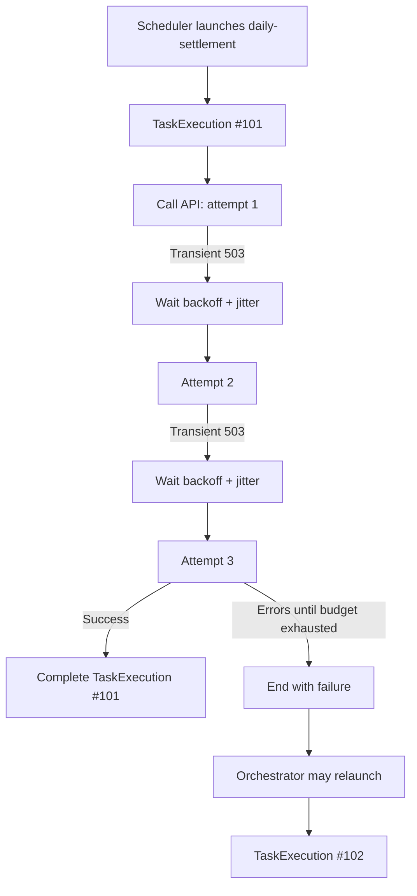

# Bounded Retries and Exponential Backoff in Spring Cloud Task

## 1. Why avoid unbounded retries?

A **Spring Cloud Task** application typically runs finite work: reconciling payments, importing data, generating reports, or calling an external service, and then terminates. While running, it may encounter transient errors such as timeouts, HTTP `503`, `429` rate limits, or database lock conflicts. Because these errors **sometimes resolve on their own**, retrying can help the job succeed without operator intervention.

However, immediate and unbounded retries cause three problems:

1. **Overloading an already degraded system:** many tasks calling back simultaneously make it harder for the downstream dependency to recover.
2. **Uncontrolled runtime growth:** an `ApplicationRunner` can stay stuck holding connections and exceed scheduler or Kubernetes Job deadlines.
3. **Duplicate side effects:** a payment or write request may have already succeeded on the target side even though the application only saw a timeout.

Therefore, in the **Idempotent Retries** chapter, we combine **bounded retries**, **exponential backoff**, **jitter**, and **idempotency** (safe repeated execution without unintended extra side effects).

After this lesson, you will be able to distinguish in-process retries from full application relaunches, configure sensible limits, write a Java example, classify retryable errors, and design resilience when integrating with Spring Batch.

## 2. How does in-process retry differ from rerunning the whole task?

Spring Cloud Task records a single application launch as a **`TaskExecution`** in **`TaskRepository`**. It does not automatically turn every internal API retry inside `ApplicationRunner` into a new `TaskExecution` row.

| Scope | Who decides to retry? | What is newly created? | When is it appropriate? |
| --- | --- | --- | --- |
| **In-process operation retry** | Code inside the runner, a retry library, or Spring Batch retry | A new **attempt** calling an API/SQL within the same application run | Brief network glitches, rolled-back deadlocks, recovering dependencies |
| **Full task relaunch** | Scheduler, Kubernetes Job, operator, or orchestrator | A new process and usually a **new `TaskExecution`** | Process crashed, local retry budget exhausted, clean restart needed |
| **Batch job/step restart** | Spring Batch and job operations workflow | `JobExecution`/`StepExecution` records per Batch restart mechanics | Checkpointed batch processing resuming from saved state |

For example, `daily-settlement` with `executionId=101` calls an API three times because the first two return `503`. If the third succeeds, **there is still only one `TaskExecution`** for that run. If all four attempts fail, the runner throws an error and the Kubernetes Job spawns a new Pod; the next run normally gets `executionId=102`.



The diagram shows illustrative branches. A `TaskExecution` record may not be created or fully updated if the application fails to start its context or loses database connectivity. **Counting rows in `TASK_EXECUTION` does not reveal how many times an external service was called.** To observe internal attempts, add appropriate logs and metrics.

## 3. Designing a bounded retry policy

A policy should define at least five elements:

| Element | Design question | Illustrative value |
| --- | --- | --- |
| **`maxAttempts`** | At most how many times is the operation called, **including the first try**? | `4` = one initial call + up to three retries |
| **`initialDelay`** | How long to wait after the first retryable failure? | `1 second` |
| **`multiplier`** | By what factor does the delay grow? | `2` |
| **`maxDelay`** | What is the longest single wait interval? | `8 seconds` |
| **`jitter`** | Must concurrent processes stagger retry timing? | Yes, using bounded randomization |

In addition, cap **per-call timeout**, **total runtime**, **scheduler relaunch count**, retryable error types, and downstream load.

### 3.1. How does exponential backoff work?

If `n` is the `n`-th consecutive failure that *will still be retried*, the base delay is:

\[
  d_n = \min(d_{\max},\ d_0 \times m^{n-1})
\]

Where `d0` is the initial delay, `m` is the multiplier, and `d_max` is the cap. With `d0 = 1 second`, `m = 2`, `d_max = 8 seconds`:

| Attempt just failed | Another attempt remains? | Base backoff before next call |
| --- | --- | --- |
| `1` | Yes | `1 second` |
| `2` | Yes | `2 seconds` |
| `3` | Yes | `4 seconds` |
| `4` | No: `maxAttempts = 4` exhausted | **No wait**; propagate final error |

If you increase `maxAttempts`, the sequence continues as `8, 8, 8, ...` once capped. In the four-attempt example, **the maximum total wait time is 1 + 2 + 4 = 7 seconds**, excluding each request's execution time. This is the algorithm's wait bound, **not** the entire task runtime limit.

### 3.2. Why use jitter?

Suppose 100 Pods all receive `503` at 02:00. If every Pod waits exactly `1`, `2`, and `4` seconds, they all fire simultaneously again, causing a *thundering herd*. **Jitter** randomizes wait durations, spreading load and reducing the risk of processes colliding repeatedly.

An easy-to-understand strategy is **full jitter**: after each error, pick a random wait between **`0` and `d_n`**. When `d_n = 2 seconds`, run A might wait `0.4 seconds` while B waits `1.6 seconds`. Actual values vary each time; never rely on illustrative numbers to predict retry ordering.

Another strategy is **equal jitter**, always waiting at least half the base delay plus a randomized remainder. Both are valid depending on the system. What matters is being **bounded**, reducing synchronization, and keeping scheduler deadlines under control. If the service returns `Retry-After`, factor that signal and your overall time budget in before deciding when to try next.

## 4. Classifying errors before deciding to retry

Not every exception deserves a retry. Errors that will **definitely recur with the same input** should fail fast to avoid waste.

| Situation | Recommended policy | Reason |
| --- | --- | --- |
| Connection timeout or service returns `502`, `503`, `504` | Bounded retry possible | Downstream service may recover; verify whether the request has side effects |
| HTTP `429 Too Many Requests` | Retryable, honoring `Retry-After`/quota | Calling again too soon triggers further throttling |
| Deadlock or rolled-back transient transaction error | Retry in **a fresh transaction** | Sleeping inside the old transaction does not clear a deadlock |
| HTTP `400` due to invalid data | Usually do not retry | Unchanged input produces the same error |
| HTTP `401`/`403` due to missing permissions | Do not blindly retry | Credentials or authorization must be fixed |
| Fixed business entity not found | Usually do not retry | Preconditions and business semantics must be checked |
| HTTP `409` | Depends on API | May be a duplicate idempotency key or transient conflict; understand the contract |
| Connection lost after sending a debit request | **Outcome unknown**; query status/idempotency first | Cannot assume the target did not process it |

The list above offers **design guidance**, not rigid rules for every API. Some `500`s are recoverable, yet some services return `500` after already committing work. Policy must be grounded in the API's documentation, actual behavior, and safe idempotent replay capability.

**Principle:** only retry errors whose **cause you understand**, whose **operation is safe to repeat**, and while **budget remains**. Whenever you are unsure whether side effects occurred, reconcile state with the target system before replaying.

## 5. Java example: retrying up to four times with exponential backoff and full jitter

The example below uses **Java 17**, Spring Boot, and Spring Cloud Task. `ApplicationRunner` accepts a settlement date, simulates a temporarily unavailable service, and retries up to four attempts. After each `TemporaryGatewayFailure`, it waits a random interval under the `1`, `2`, `4` second base sequence. Any input errors occur outside the retry block and fail immediately.

> This is a simulation you can run after configuring dependencies and a database. It does not call a real payment system; when integrating a real API, enforce idempotency and timeouts as covered in subsequent sections.

```java
import java.time.LocalDate;
import java.util.List;
import java.util.concurrent.ThreadLocalRandom;
import java.util.concurrent.atomic.AtomicInteger;

import org.springframework.boot.ApplicationRunner;
import org.springframework.boot.SpringApplication;
import org.springframework.boot.autoconfigure.SpringBootApplication;
import org.springframework.cloud.task.configuration.EnableTask;
import org.springframework.context.annotation.Bean;

@SpringBootApplication
@EnableTask
public class SettlementTaskApplication {

    private static final int MAX_ATTEMPTS = 4;
    private static final long INITIAL_DELAY_MS = 1_000L;
    private static final long MAX_DELAY_MS = 8_000L;

    public static void main(String[] args) {
        SpringApplication.run(SettlementTaskApplication.class, args);
    }

    @Bean
    ApplicationRunner settlementRunner() {
        return args -> {
            List<String> dates = args.getOptionValues("businessDate");
            if (dates == null || dates.size() != 1) {
                throw new IllegalArgumentException(
                    "Must pass --businessDate=yyyy-MM-dd");
            }
            LocalDate date = LocalDate.parse(dates.get(0));

            // For simulation only: how many initial calls fail transiently.
            int failFirst = 2;
            List<String> values = args.getOptionValues("failFirst");
            if (values != null) {
                if (values.size() != 1) {
                    throw new IllegalArgumentException("Use --failFirst=<number>");
                }
                failFirst = Integer.parseInt(values.get(0));
            }
            if (failFirst < 0) {
                throw new IllegalArgumentException("failFirst must be >= 0");
            }

            final int transientFailures = failFirst;
            AtomicInteger callCount = new AtomicInteger();
            retryTemporaryFailure(() -> {
                int call = callCount.incrementAndGet();
                System.out.printf("Calling service, attempt=%d%n", call);

                if (call <= transientFailures) {
                    throw new TemporaryGatewayFailure("Simulated 503 from service");
                }

                // Replace with an API call using a timeout and stable idempotency key.
                System.out.println("Settlement completed for " + date);
            });
        };
    }

    static void retryTemporaryFailure(CheckedOperation operation)
            throws Exception {
        long delayCapMs = INITIAL_DELAY_MS;

        for (int attempt = 1; attempt <= MAX_ATTEMPTS; attempt++) {
            try {
                operation.run();
                return; // Success: do not retry.
            } catch (TemporaryGatewayFailure error) {
                if (attempt == MAX_ATTEMPTS) {
                    throw error; // Budget exhausted: let Task record failure.
                }

                // Full jitter: value in [0, delayCapMs].
                long waitMs = ThreadLocalRandom.current()
                    .nextLong(delayCapMs + 1);
                System.out.printf(
                    "Attempt %d/%d failed; waiting %d ms before retry%n",
                    attempt, MAX_ATTEMPTS, waitMs);

                try {
                    Thread.sleep(waitMs);
                } catch (InterruptedException interrupted) {
                    Thread.currentThread().interrupt();
                    throw interrupted; // Honor process shutdown request.
                }
                delayCapMs = Math.min(MAX_DELAY_MS, delayCapMs * 2);
            }
        }
    }

    @FunctionalInterface
    interface CheckedOperation {
        void run() throws Exception;
    }

    static class TemporaryGatewayFailure extends RuntimeException {
        TemporaryGatewayFailure(String message) {
            super(message);
        }
    }
}
```

Key points from the example:

- The loop uses **`MAX_ATTEMPTS = 4`**, including the initial call—not four retries on top of the first call.
- `catch` catches only `TemporaryGatewayFailure`. `IllegalArgumentException`, configuration errors, or unclassified exceptions **are not retried**.
- `Thread.sleep(...)` runs only between attempts, **never waiting** after the final failure.
- With this setup, `delayCapMs + 1` is safe because the cap is 8,000 ms. If you make configuration values arbitrary inputs, validate positivity, caps, and overflow risks when multiplying or generating random delays.
- If interrupted while sleeping, the code preserves the interrupt flag and exits so the application can shut down cleanly.
- `callCount` is only for simulating errors within a single process. **Never rely on an in-memory counter** to track real payment state across launches.

### 5.1. Configuring Spring Cloud Task to persist history

```yaml
spring:
  application:
    name: settlement-worker
  main:
    web-application-type: none
  cloud:
    task:
      name: daily-settlement
  datasource:
    url: ${TASK_DB_URL}
    username: ${TASK_DB_USER}
    password: ${TASK_DB_PASSWORD}
```

You need `spring-cloud-starter-task`, a JDBC driver, and a schema matching your Spring Cloud Task version. Use a persistent database so history survives after the JVM exits. The Java snippet places retry constants directly in the class for readability; in production, externalize them into application configuration, validate constraints, and inject them into a policy bean.

Spring Cloud Task will not magically recognize properties like `spring.cloud.task.retry.max-attempts` if you invent them. **Business retries must be implemented in code or configured through the actual retry mechanism you use.**

### 5.2. Running three scenarios

Run with two transient failures, succeeding on the third attempt:

```bash
java -jar settlement-task.jar --businessDate=2026-11-23 --failFirst=2
```

Run succeeding on the first try:

```bash
java -jar settlement-task.jar --businessDate=2026-11-23 --failFirst=0
```

Run failing after at most four attempts:

```bash
java -jar settlement-task.jar --businessDate=2026-11-23 --failFirst=10
```

In the third case, the runner throws `TemporaryGatewayFailure` after the fourth attempt. If the context and `TaskRepository` are healthy, Spring Cloud Task records the failed execution. The orchestrator can then decide to relaunch the entire application under an **independent retry budget**.

## 6. Using Spring Retry or framework retry mechanisms

The loop example makes the algorithm clear. In production code, you can use **Spring Retry** to centralize policy: `RetryPolicy` bounds attempts, `BackOffPolicy` controls wait intervals, and callbacks supply observability hooks. That is a separate library; **Spring Cloud Task itself primarily tracks lifecycle**, and does not mean every runner is retried automatically.

Example using Spring Retry **2.x** builder API (requires a Spring Retry dependency compatible with your Spring Boot version):

```java
import java.time.Duration;
import org.springframework.retry.support.RetryTemplate;

RetryTemplate template = RetryTemplate.builder()
    .maxAttempts(4)
    .retryOn(TemporaryGatewayFailure.class)
    .exponentialBackoff(
        Duration.ofSeconds(1),
        2.0,
        Duration.ofSeconds(8),
        true // Enable randomization per Spring Retry policy.
    )
    .build();

template.execute(context -> {
    gateway.call();
    return null;
});
```

This snippet illustrates declaring a policy inside a method that already has `gateway` and `TemporaryGatewayFailure`; it is **not** a standalone compilable class. APIs, randomized backoff styles, and integration requirements can vary across release lines, so verify against the documentation governed by your application BOM. Passing `true` uses **Spring Retry**'s randomization, which does not necessarily match the manual *full jitter* algorithm in section 5.

You can use `@Retryable` when your Spring Retry version and proxy/AOP setup are properly configured. However, **self-invocation within the same bean** can bypass the proxy, preventing the annotation from taking effect. Always specify retryable exceptions, max attempts, backoff, and final behavior once exhausted.

**Do not wrap an entire complex business workflow in one retry call** if parts of it already wrote data or sent non-idempotent requests. Scope retry policies around well-defined operations that are safe to repeat.

## 7. Safe retries must go hand in hand with idempotency

**Idempotency** means repeating an operation with the same business identity creates no unintended extra side effects. This is critical when tasks initiate payments, send emails, ship inventory, or call object-creation APIs.

### 7.1. Timeouts do not tell you whether the target processed the request

Suppose the application sends a reconciliation request to a partner and times out. Possibilities include:

- The request never reached the target server.
- The target received it but has not finished processing.
- The target **committed successfully**, and the response was lost.

In the third case, retrying with a fresh request lacking an idempotency key can create a second record or side effect. **Staying within the same `TaskExecution` does not automatically deduplicate external operations.**

### 7.2. Creating a stable business key

For daily settlement, a sensible key might be based on `(merchantId, businessDate)` and operation type `settlement`. A string like `settlement:merchant-42:2026-11-23` can serve as an **idempotency key** if the partner API supports it and the key scope matches their contract.

Principles:

1. **Keep the same key across every in-process attempt and task relaunch** handling the same business request.
2. **Change the key only when the business request genuinely differs**, never per `executionId` or run timestamp.
3. **Persist the key and processing state durably** so you know which requests are in progress, completed, or need reconciliation.
4. **Verify key scope and retention window at the target system**: some APIs retain idempotency keys only for a limited period.
5. **Protect with database constraints or appropriate locks** so two concurrent tasks cannot both create unintended side effects.

If the outcome is unclear after a timeout, query status by the transaction key/identifier. Only after knowing the outcome should the application mark success, retry with the **same key**, or escalate to manual reconciliation.

### 7.3. Example table design for tracking outcomes

With PostgreSQL, a business processing state table can be designed as follows (this schema is an **application-defined example**, not a Spring Cloud Task table):

```sql
CREATE TABLE settlement_work (
    merchant_id VARCHAR(64) NOT NULL,
    business_date DATE NOT NULL,
    idempotency_key VARCHAR(160) NOT NULL,
    status VARCHAR(24) NOT NULL,
    updated_at TIMESTAMPTZ NOT NULL DEFAULT CURRENT_TIMESTAMP,
    PRIMARY KEY (merchant_id, business_date),
    UNIQUE (idempotency_key)
);
```

Before sending an external request, the task checks or records the work unit under this key in a short transaction. Once a definitive result arrives, it updates `status`. If the application is killed, the next launch relies on this table to recover or reconcile rather than looking only at `executionId`. **A unique constraint alone does not make your database and an external API atomic together**; you still need a workflow for uncertain outcomes.

## 8. Capping total runtime and avoiding stacked retry layers

`maxAttempts` only bounds **call count**, and `maxDelay` only bounds **a single wait**. A single API call can hang indefinitely without a timeout. Therefore, enforce time budgets across layers.

Suppose each HTTP request has a `5 second` deadline, up to `4` attempts, and base delays after three errors are `1 + 2 + 4 = 7 seconds`. The maximum time for the API call loop is roughly:

\[
T_{\text{retry}} \le 4 \times 5s + 7s = 27s
\]

This excludes JVM startup, database queries, saving results, and shutdown. With **full jitter**, actual wait time may be shorter. Set whole-task timeouts and scheduler/container deadlines with sufficient margin; if less time remains than one expected attempt requires, stop retrying and let the orchestrator decide.

### 8.1. Beware stacking retries across multiple layers

Suppose:

- The HTTP client retries up to **4** times internally.
- The orchestrator allows **3** total task launches (one initial run plus two relaunches).

When every layer fails, a single business operation may be transmitted **12 times** (`4 × 3`), not counting proxy, load balancer, or Spring Batch retries if present. When every layer configures uncoordinated retries, the target system receives far higher load than intended.

Designate **one primary retry owner per boundary**, tabulate the combined budget across layers, and prevent client, service, and scheduler from all retrying blindly. If Spring Batch already retries individual items, the runner does not necessarily need to wrap the whole job in another retry loop.

### 8.2. Never sleep inside a long transaction

If the error is a database deadlock or optimistic locking failure, a retry typically needs a **new transaction** after the previous one rolled back or finished. Never call `Thread.sleep(...)` inside an active transaction holding locks or connections while waiting for backoff. A standard pattern puts the retry block **outside the transactional call**, so each attempt invokes the transactional method through its proxy and returns connections to the pool between attempts.

When using Spring Batch, also understand chunk/step transaction boundaries before retrying an `ItemProcessor`, `ItemWriter`, or `ItemReader`. A reader may have advanced its cursor before throwing; calling `read()` again may not re-read the exact same item unless the reader is designed for safe retry/restart.

## 9. How are retry results reflected in `TaskRepository`?

Spring Cloud Task tracks **application runs**. When a runner recovers from transient failures and completes normally, `TaskRepository` typically records a successful `TaskExecution`. It does not create separate rows in `TASK_EXECUTION` for each internal attempt.

When the retry budget is exhausted and the runner throws an unhandled exception, Spring Boot triggers the failure path; if infrastructure and database remain available, Spring Cloud Task updates failure metadata. Exact `exitCode`, `exitMessage`, and process exit status also depend on how the application maps errors and Spring Boot's exit policies; verify in practice rather than assuming all layers match automatically.

| Situation | `TaskExecution` in current run | Additional data to observe |
| --- | --- | --- |
| Attempt 1 fails, attempt 2 succeeds | Usually one completed success record | `attemptCount=2`, initial transient error, backoff durations |
| Four attempts exhausted, runner throws | Usually one failed record if repository update succeeds | Final exception, attempt count, target service, process exit code |
| Scheduler relaunches after failure | A **new** `TaskExecution` | Link to previous run and shared business key |
| JVM killed while sleeping | Record may lack `endTime` | Container/process status, logs, and target transaction state |
| Metadata DB unavailable | Record may not be created or finalized | Bootstrap logs, actual exit code, and scheduler status |

### 9.1. Querying retry history

With the standard Spring Cloud Task JDBC schema, you can query:

```sql
SELECT TASK_EXECUTION_ID,
       TASK_NAME,
       START_TIME,
       END_TIME,
       EXIT_CODE,
       EXIT_MESSAGE
FROM TASK_EXECUTION
WHERE TASK_NAME = 'daily-settlement'
ORDER BY TASK_EXECUTION_ID DESC;
```

Match table/column names against your actual version's schema. You can also use `TaskExplorer` in Java. If you need to know **how many API attempts ran**, emit metrics/logs with fields like `task_name`, `execution_id`, `operation`, `attempt`, `retryable_error_class`, and `next_delay_ms` with bounded cardinality. Never log tokens, sensitive payloads, or PII.

## 10. Scheduled execution and full application relaunches

A Kubernetes Job or orchestrator can spawn a new Pod/process when a task exits with an error. At this layer, configure **relaunch limits**, **deadlines**, **orchestrator backoff**, **concurrency policies**, and **alerts upon final failure**. For example, Kubernetes Jobs provide `backoffLimit` and `activeDeadlineSeconds` for distinct controls; CronJobs also have concurrency policies across schedules. They do not replace timeouts, idempotency, and retry bounds inside your code.

An unrecoverable input error (malformed `businessDate`) should not be relaunched repeatedly by the scheduler. You can distinguish exit codes or failure reasons to apply appropriate policies, depending on platform capabilities. If your orchestrator cannot filter by error type, lower overall retries and add alerting/manual triage.

In real operations, **one failed run does not prove every action rolled back**. If a Pod dies after sending a request but before updating local state, the next run must check business keys and target-side data before executing again.

## 11. Combining with Spring Batch and other retry layers

Spring Cloud Task and Spring Batch address **two different scopes**:

| Component | What does it track? | At what level does it retry? |
| --- | --- | --- |
| Spring Cloud Task | `TaskExecution`: one application launch | Does not retry individual business calls automatically |
| Spring Batch | `JobExecution`, `StepExecution`, chunk/item, checkpoint | Can configure item-level retry in reader/processor/writer and job restart |
| Spring Retry or custom loop | One specific API, SQL, or method call | Configures attempts, retryable exceptions, and backoff |
| Scheduler/Kubernetes | Executed process/Job/Pod | Can relaunch the entire task |

Inside a Batch step, retry only genuinely transient errors. If a CSV record has an invalid date format, re-reading it repeatedly will keep failing; depending on requirements, record a data error or use a controlled skip policy. Conversely, a rolled-back deadlock can be handled by retry aligned with step transactions.

If a task application launches a Batch job **asynchronously** and the runner returns early, `TaskExecution` may be marked complete before the job finishes. When metadata must reflect full job outcomes, the runner should wait for job completion and translate job failures into task-level failure according to design.

Do not equate `TaskExecution.executionId` with Spring Batch's `JobExecution.id` or use either as an idempotency key for business operations. Both identifiers only describe **an execution instance**, which changes across reruns.

## 12. Common design mistakes

| Symptom | Root cause | Fix |
| --- | --- | --- |
| Task runs for hours even when target is down | Unbounded retries or missing timeouts | Bound attempts, backoff, overall deadline, and final alert |
| Multiple Pods hit target simultaneously | Fixed backoff without jitter | Add jitter and concurrency/rate limits |
| Payment recorded twice after timeout | Retrying write request without idempotency key | Use stable keys, target status checks, and unique constraints |
| HTTP `400` retried four times | Catching all `Exception`s as retryable | Allow only classified transient failures |
| Retries keep failing after DB deadlock | Reusing rolled-back transaction or sleeping while holding locks | Start a fresh transaction per attempt |
| Attempts exhausted yet dashboard shows success | Code logs final error and returns normally | Propagate error or emit proper failure signal |
| In-runner retry succeeded without extra `TaskExecution` rows | Confusing internal attempts with task relaunches | Emit attempt metrics/logs; understand `TaskRepository` scope |
| Throughput collapses during retries | Stacked retry layers and sleeping on open connections | Compute total budget, isolate transactions, shed load, use circuit breakers where appropriate |
| Task killed mid-sleep leaving unfinished history | Forced JVM termination | Cross-check process/Pod status, verify business outcomes, retry safely |

## 13. Implementation and testing checklist

Before enabling retries for a task with side effects, complete these checks:

- [ ] Distinguished **transient errors**, **permanent input errors**, and **uncertain timeout outcomes**.
- [ ] Defined `maxAttempts` (including initial try), backoff cap, jitter, and per-attempt timeout.
- [ ] Set overall task deadline and capped orchestrator relaunches.
- [ ] Avoided sleeping while holding long transactions or database connections unnecessarily.
- [ ] Used stable idempotency keys across all attempts and task relaunches for side-effecting operations.
- [ ] Exhausted retries produce an explicit failure outcome; final exceptions are never swallowed.
- [ ] Added logs/metrics for attempt count, transient errors, and wait durations correlatable with `executionId`.
- [ ] Verified interrupt handling, shutdown behavior, and uncertain states when the process is killed.
- [ ] With Spring Batch, clarified which layer owns retries to avoid multiplying calls.
- [ ] Tested immediate success, success after retry, permanent error, budget exhaustion, and two concurrent runs.

### Minimum test matrix

| Scenario | Expected attempts | Outcome to verify |
| --- | --- | --- |
| `--failFirst=0` | `1` | No sleep; runner finishes |
| `--failFirst=2` | `3` | Two backoffs, succeeds inside the same `TaskExecution` |
| `--failFirst=10` | `4` | No fifth attempt; final exception propagates |
| Malformed `businessDate` | `0` gateway calls | Input validation fails before retry |
| Interrupted during wait | Stops on interrupt | Does not continue looping |
| Scheduler retries after failed task | Per external budget | New `TaskExecution` and **same idempotency key** for the same work |

## 14. Self-check questions

**Q1.** Does `maxAttempts = 4` mean four retries **after** the first call, or four calls total?

**Q2.** With base backoffs of `1, 2, 4` seconds and a maximum of four attempts, what is the maximum total **wait** time excluding request duration if jitter never exceeds the cap?

**Q3.** Why can 100 Pods all retrying after exactly one second keep overloading a downstream service? How does jitter help?

**Q4.** A payment-creation request times out, yet the target may have committed it. List three steps to consider before retrying.

**Q5.** If a runner retries three times internally and then succeeds, how many `TaskExecution` records does Spring Cloud Task normally create for that application launch?

**Q6.** Why should you not configure four attempts in the HTTP client and three full task relaunches without calculating the combined budget?

**Answer hints:** (1) four calls total; (2) at most `7 seconds` of waiting; (3) synchronized retries cause a *thundering herd*, while jitter spreads attempts over time; (4) keep a stable business key, query target status, decide controlled replay; (5) usually one record—internal attempts do not create new `TaskExecution` rows; (6) it can multiply into twelve calls, amplifying load or duplicate side effects.

## 15. Summary and references

To **retry safely** in Spring Cloud Task, retry **only transient errors**, **bound attempt counts**, wait with **exponential backoff and jitter**, and protect data with **idempotency**. Distinguish retrying an operation inside an `ApplicationRunner` from relaunching the whole application: one adds internal attempts, while the other typically creates a new `TaskExecution` in `TaskRepository`.

A sound policy enforces time caps, knows when to stop, surfaces failures clearly, reconciles business state, and avoids multiplying calls across stacked retry layers. When pairing with Spring Batch, also account for transactions, checkpoints, step retry/skip policies, and job outcomes before deciding to rerun at the Task layer.

**Official documentation to consult for your version:**

- [Spring Cloud Task Reference — Features and `TaskExecution`](https://docs.spring.io/spring-cloud-task/reference/features.html)
- [Spring Retry — `SimpleRetryPolicy`, total attempt bounds](https://docs.spring.io/spring-retry/docs/current/apidocs/spring.retry/org/springframework/retry/policy/SimpleRetryPolicy.html)
- [Spring Retry — `RetryTemplateBuilder` and backoff](https://docs.spring.io/spring-retry/docs/current/apidocs/spring.retry/org/springframework/retry/support/RetryTemplateBuilder.html)
- [Spring Batch — Configuring Retry Logic](https://docs.spring.io/spring-batch/reference/step/chunk-oriented-processing/retry-logic.html)
